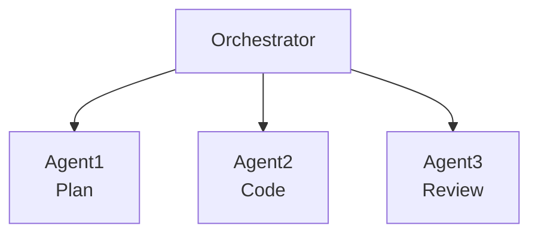
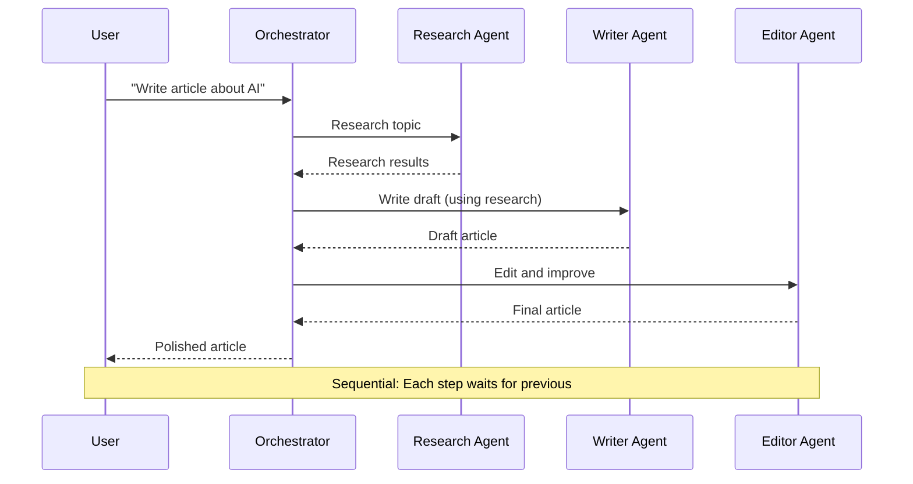
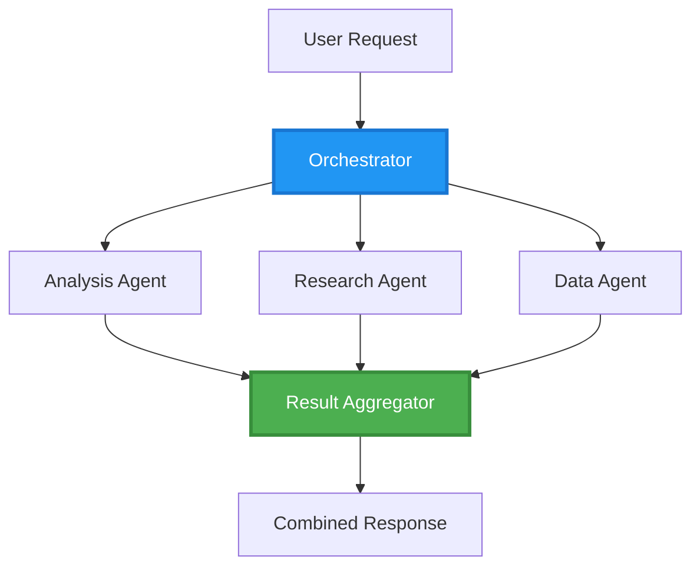
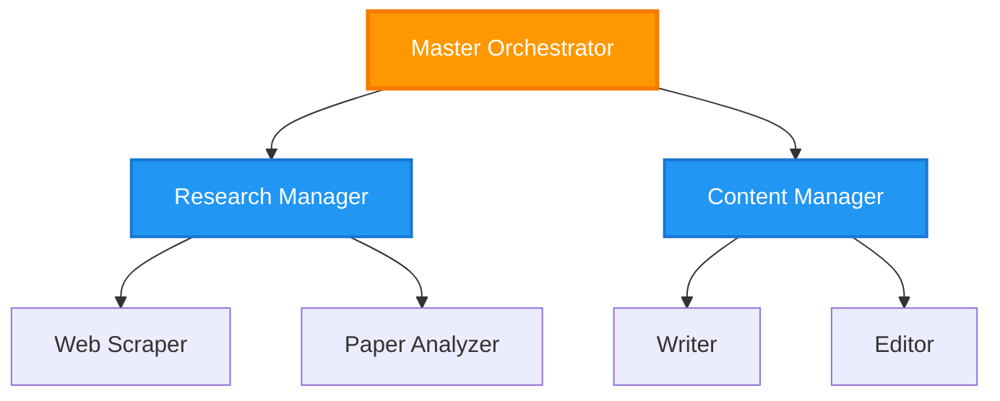
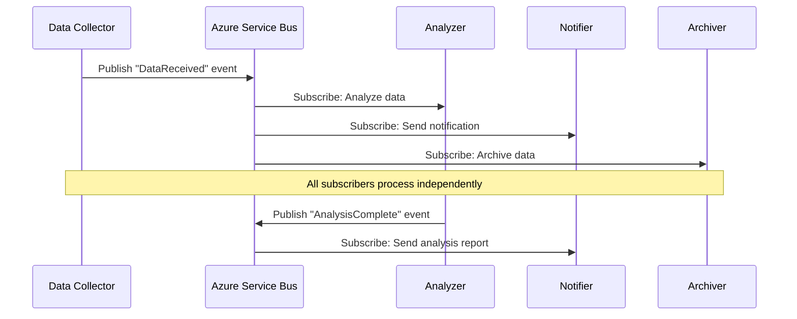
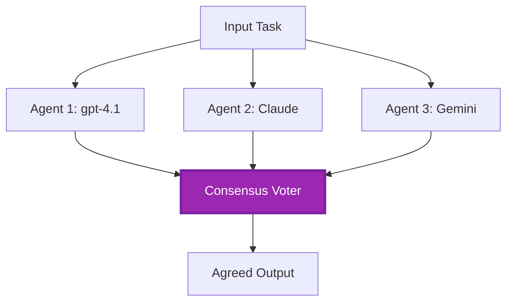
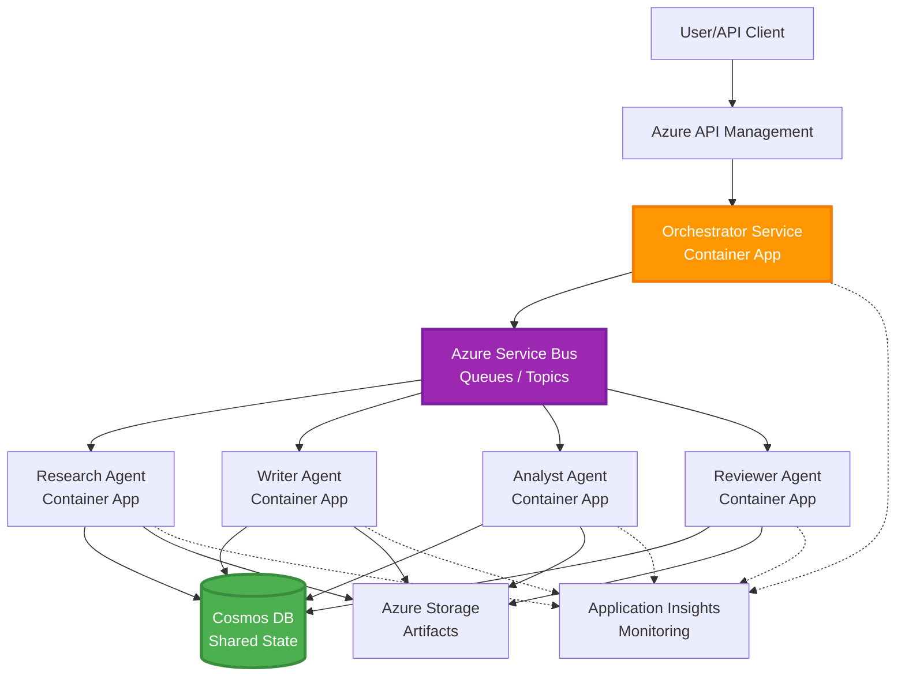

# Multi-Agent Coordination Patterns

⏱️ **Estimated Time**: 60-75 minutes reading; several hours to implement | 💰 **Estimated Cost**: workload-dependent | ⭐ **Complexity**: Advanced

**📚 Learning Path:**
- ← Previous: [Capacity Planning](capacity-planning.md) - Resource sizing and scaling strategies
- 🎯 **You Are Here**: Multi-Agent Coordination Patterns (Orchestration, communication, state management)
- → Next: [SKU Selection](sku-selection.md) - Choosing the right Azure services
- 🏠 [Course Home](../../README.md)

---

## What You'll Learn

By completing this lesson, you will:
- Understand **multi-agent architecture** patterns and when to use them
- Implement **orchestration patterns** (centralized, decentralized, hierarchical)
- Design **agent communication** strategies (synchronous, asynchronous, event-driven)
- Manage **shared state** across distributed agents
- Deploy **multi-agent systems** on Azure with AZD
- Apply **coordination patterns** for real-world AI scenarios
- Monitor and debug distributed agent systems

## Why Multi-Agent Coordination Matters

### The Evolution: From Single Agent to Multi-Agent

**Single Agent (Simple):**
```
User → Agent → Response
```
- ✅ Easy to understand and implement
- ✅ Fast for simple tasks
- ❌ Limited by single model's capabilities
- ❌ Cannot parallelize complex tasks
- ❌ No specialization

**Multi-Agent System (Advanced):**

- ✅ Specialized agents for specific tasks
- ✅ Parallel execution for speed
- ✅ Modular and maintainable
- ✅ Better at complex workflows
- ⚠️ Requires coordination logic

**Analogy**: Single agent is like one person doing all tasks. Multi-agent is like a team where each member has specialized skills (researcher, coder, reviewer, writer) working together.

---

## Core Coordination Patterns

### Pattern 1: Sequential Coordination (Chain of Responsibility)

**When to use**: Tasks must complete in specific order, each agent builds on previous output.



**Benefits:**
- ✅ Clear data flow
- ✅ Easy to debug
- ✅ Predictable execution order

**Limitations:**
- ❌ Slower (no parallelism)
- ❌ One failure blocks entire chain
- ❌ Cannot handle interdependent tasks

**Example Use Cases:**
- Content creation pipeline (research → write → edit → publish)
- Code generation (plan → implement → test → deploy)
- Report generation (data collection → analysis → visualization → summary)

---

### Pattern 2: Parallel Coordination (Fan-Out/Fan-In)

**When to use**: Independent tasks can run simultaneously, results combined at the end.



**Benefits:**
- ✅ Fast (parallel execution)
- ✅ Fault-tolerant (partial results acceptable)
- ✅ Scales horizontally

**Limitations:**
- ⚠️ Results may arrive out-of-order
- ⚠️ Need aggregation logic
- ⚠️ Complex state management

**Example Use Cases:**
- Multi-source data gathering (APIs + databases + web scraping)
- Competitive analysis (multiple models generate solutions, best selected)
- Translation services (translate to multiple languages simultaneously)

---

### Pattern 3: Hierarchical Coordination (Manager-Worker)

**When to use**: Complex workflows with sub-tasks, delegation needed.



**Benefits:**
- ✅ Handles complex workflows
- ✅ Modular and maintainable
- ✅ Clear responsibility boundaries

**Limitations:**
- ⚠️ More complex architecture
- ⚠️ Higher latency (multiple coordination layers)
- ⚠️ Requires sophisticated orchestration

**Example Use Cases:**
- Enterprise document processing (classify → route → process → archive)
- Multi-stage data pipelines (ingest → clean → transform → analyze → report)
- Complex automation workflows (planning → resource allocation → execution → monitoring)

---

### Pattern 4: Event-Driven Coordination (Publish-Subscribe)

**When to use**: Agents need to react to events, loose coupling desired.



**Benefits:**
- ✅ Loose coupling between agents
- ✅ Easy to add new agents (just subscribe)
- ✅ Asynchronous processing
- ✅ Resilient (message persistence)

**Limitations:**
- ⚠️ Eventual consistency
- ⚠️ Complex debugging
- ⚠️ Message ordering challenges

**Example Use Cases:**
- Real-time monitoring systems (alerts, dashboards, logs)
- Multi-channel notifications (email, SMS, push, Slack)
- Data processing pipelines (multiple consumers of same data)

---

### Pattern 5: Consensus-Based Coordination (Voting/Quorum)

**When to use**: Need agreement from multiple agents before proceeding.



**Benefits:**
- ✅ Higher accuracy (multiple opinions)
- ✅ Fault-tolerant (minority failures acceptable)
- ✅ Quality assurance built-in

**Limitations:**
- ❌ Expensive (multiple model calls)
- ❌ Slower (waiting for all agents)
- ⚠️ Conflict resolution needed

**Example Use Cases:**
- Content moderation (multiple models review content)
- Code review (multiple linters/analyzers)
- Medical diagnosis (multiple AI models, expert validation)

---

## Architecture Overview

### Complete Multi-Agent System on Azure



**Key Components:**

| Component | Purpose | Azure Service |
|-----------|---------|---------------|
| **API Gateway** | Entry point, rate limiting, auth | API Management |
| **Orchestrator** | Coordinates agent workflows | Container Apps |
| **Message Queue** | Asynchronous communication | Service Bus / Event Hubs |
| **Agents** | Specialized AI workers | Container Apps / Functions |
| **State Store** | Shared state, task tracking | Cosmos DB |
| **Artifact Storage** | Documents, results, logs | Blob Storage |
| **Monitoring** | Distributed tracing, logs | Application Insights |

Service Bus queues/topics and Event Hubs are different services with different delivery/consumption models; Event Hubs is not a drop-in replacement for the Service Bus worker code below. Parallelism, persisted messages, and model voting do not by themselves guarantee fault tolerance or higher accuracy.

---

## Prerequisites

### Required Tools

```bash
# Verify Azure Developer CLI
azd version
# Command reference baseline: azd 1.37.2

# Verify Azure CLI
az --version
# ✅ Expected: azure-cli 2.50.0 or higher

# Verify Docker (for local testing)
docker --version
# ✅ Expected: Docker version 20.10 or higher
```

### Azure Requirements

- Active Azure subscription
- Permissions to create:
  - Container Apps
  - Service Bus namespaces
  - Cosmos DB accounts
  - Storage accounts
  - Application Insights

### Knowledge Prerequisites

You should have completed:
- [Configuration Management](../chapter-03-configuration/configuration.md)
- [Authentication & Security](../chapter-03-configuration/authsecurity.md)
- [Microservices Example](../../examples/microservices/)

---

## Implementation Guide

> **Design fragments, not a deployable lab:** The project tree and `File:` labels below describe files to create in your own project; this repository does not contain a complete `multi-agent-system` application. Missing pieces include main/parameter templates, Container Apps environment/registry, Dockerfiles and dependency locks, Cosmos database/container setup, model deployments, identity/role configuration, scaling rules, and parallel workers/queues. Do not expect `azd init` to generate these files or `azd up` to deploy the snippets unchanged. For an executable starting point, complete [Multi-Agent Basics](../chapter-05-multi-agent/multi-agent-basics.md).

**Runtime assumptions:** Python 3.10+, `azure-servicebus`, `azure-cosmos`, `openai`, Flask, and (for monitoring) `azure-monitor-opentelemetry`; put `shared` on the Python import path in each service image. The Cosmos `agent-state/tasks` container must already exist with partition key `/id`. Key-based connections simplify these fragments, not production guidance: prefer managed identities with scoped Service Bus/Cosmos/OpenAI data-plane roles. Do not expose keys in outputs or logs.

Service Bus delivery is **at least once**. Persist idempotency per task **and step**, use optimistic concurrency (ETags) for read/modify/write state, and renew message locks during long processing. The simple state manager below is sequential-only and does not implement these production guarantees.

### Project Structure

```
multi-agent-system/
├── azure.yaml                    # AZD configuration
├── infra/
│   ├── main.bicep               # Main infrastructure
│   ├── core/
│   │   ├── servicebus.bicep     # Message queue
│   │   ├── cosmos.bicep         # State store
│   │   ├── storage.bicep        # Artifact storage
│   │   └── monitoring.bicep     # Application Insights
│   └── app/
│       ├── orchestrator.bicep   # Orchestrator service
│       └── agent.bicep          # Agent template
└── src/
    ├── orchestrator/            # Orchestration logic
    │   ├── app.py
    │   ├── workflows.py
    │   └── Dockerfile
    ├── agents/
    │   ├── research/            # Research agent
    │   ├── writer/              # Writer agent
    │   ├── analyst/             # Analyst agent
    │   └── reviewer/            # Reviewer agent
    └── shared/
        ├── state_manager.py     # Shared state logic
        └── message_handler.py   # Message handling
```

---

## Lesson 1: Sequential Coordination Pattern

### Implementation: Content Creation Pipeline

Let's design a sequential pipeline: Research → Write → Edit. Publishing is outside this example.

### 1. AZD Configuration

**File: `azure.yaml`**

```yaml
name: content-pipeline
metadata:
  template: multi-agent-sequential@1.0.0

services:
  orchestrator:
    project: ./src/orchestrator
    language: python
    host: containerapp
  
  research-agent:
    project: ./src/agents/research
    language: python
    host: containerapp
  
  writer-agent:
    project: ./src/agents/writer
    language: python
    host: containerapp
  
  editor-agent:
    project: ./src/agents/editor
    language: python
    host: containerapp
```

### 2. Infrastructure: Service Bus for Coordination

**File: `infra/core/servicebus.bicep`**

```bicep
param name string
param location string
param tags object = {}

resource serviceBusNamespace 'Microsoft.ServiceBus/namespaces@2022-10-01-preview' = {
  name: name
  location: location
  tags: tags
  sku: {
    name: 'Standard'
    tier: 'Standard'
  }
  properties: {
    minimumTlsVersion: '1.2'
  }
}

// Queue for orchestrator → research agent
resource researchQueue 'Microsoft.ServiceBus/namespaces/queues@2022-10-01-preview' = {
  parent: serviceBusNamespace
  name: 'research-tasks'
  properties: {
    maxDeliveryCount: 3
    lockDuration: 'PT5M'
    deadLetteringOnMessageExpiration: true
  }
}

// Queue for research agent → writer agent
resource writerQueue 'Microsoft.ServiceBus/namespaces/queues@2022-10-01-preview' = {
  parent: serviceBusNamespace
  name: 'writer-tasks'
  properties: {
    maxDeliveryCount: 3
    lockDuration: 'PT5M'
  }
}

// Queue for writer agent → editor agent
resource editorQueue 'Microsoft.ServiceBus/namespaces/queues@2022-10-01-preview' = {
  parent: serviceBusNamespace
  name: 'editor-tasks'
  properties: {
    maxDeliveryCount: 3
    lockDuration: 'PT5M'
  }
}

output namespace string = serviceBusNamespace.name
// Do not output RootManageSharedAccessKey. Resolve scoped credentials
// securely or use managed identity in the application and scale rules.
```

### 3. Shared State Manager

**File: `src/shared/state_manager.py`**

```python
from azure.cosmos import CosmosClient, PartitionKey
from datetime import datetime, timezone
import os

class StateManager:
    """Manages shared state across agents using Cosmos DB"""
    
    def __init__(self):
        endpoint = os.environ['COSMOS_ENDPOINT']
        key = os.environ['COSMOS_KEY']
        
        self.client = CosmosClient(endpoint, key)
        self.database = self.client.get_database_client('agent-state')
        self.container = self.database.get_container_client('tasks')
    
    def create_task(self, task_id: str, task_type: str, input_data: dict):
        """Create a new task"""
        task = {
            'id': task_id,
            'type': task_type,
            'status': 'pending',
            'input': input_data,
            'created_at': datetime.now(timezone.utc).isoformat(),
            'steps': []
        }
        self.container.create_item(task)
        return task
    
    def update_task_step(self, task_id: str, step_name: str, result: dict):
        """Update task with completed step"""
        task = self.container.read_item(task_id, partition_key=task_id)
        
        task['steps'].append({
            'name': step_name,
            'completed_at': datetime.now(timezone.utc).isoformat(),
            'result': result
        })
        
        self.container.replace_item(task_id, task)
        return task
    
    def complete_task(self, task_id: str, final_result: dict):
        """Mark task as complete"""
        task = self.container.read_item(task_id, partition_key=task_id)
        task['status'] = 'completed'
        task['result'] = final_result
        task['completed_at'] = datetime.now(timezone.utc).isoformat()
        self.container.replace_item(task_id, task)
        return task
    
    def get_task(self, task_id: str):
        """Retrieve task state"""
        return self.container.read_item(task_id, partition_key=task_id)
```

### 4. Orchestrator Service

**File: `src/orchestrator/app.py`**

```python
from flask import Flask, request, jsonify
from azure.servicebus import ServiceBusClient, ServiceBusMessage
import json
import uuid
import os
from shared.state_manager import StateManager

app = Flask(__name__)
state_manager = StateManager()

# Service Bus connection
servicebus_connection_str = os.environ['SERVICEBUS_CONNECTION_STRING']
servicebus_client = ServiceBusClient.from_connection_string(servicebus_connection_str)

@app.route('/health', methods=['GET'])
def health():
    return jsonify({'status': 'healthy', 'service': 'orchestrator'})

@app.route('/create-content', methods=['POST'])
def create_content():
    """
    Sequential workflow: Research → Write → Edit (returns a draft; no publishing)
    """
    data = request.get_json(silent=True) or {}
    topic = data.get('topic')
    
    if not topic:
        return jsonify({'error': 'Topic required'}), 400
    
    # Create task in state store
    task_id = str(uuid.uuid4())
    task = state_manager.create_task(
        task_id=task_id,
        task_type='content_creation',
        input_data={'topic': topic}
    )
    
    # Send message to research agent (first step)
    sender = servicebus_client.get_queue_sender('research-tasks')
    message = ServiceBusMessage(
        body=json.dumps({
            'task_id': task_id,
            'topic': topic,
            'next_queue': 'writer-tasks'  # Where to send results
        }),
        content_type='application/json'
    )
    
    with sender:
        sender.send_messages(message)
    
    return jsonify({
        'task_id': task_id,
        'status': 'started',
        'workflow': 'sequential',
        'steps': ['research', 'write', 'edit'],
        'message': 'Content creation pipeline initiated'
    }), 202

@app.route('/task/<task_id>', methods=['GET'])
def get_task_status(task_id):
    """Check task status"""
    try:
        task = state_manager.get_task(task_id)
        return jsonify(task)
    except Exception as e:
        return jsonify({'error': str(e)}), 404

if __name__ == '__main__':
    app.run(host='0.0.0.0', port=8080)
```

### 5. Research Agent

**File: `src/agents/research/app.py`**

```python
from azure.servicebus import ServiceBusClient, ServiceBusMessage
from openai import AzureOpenAI
import json
import os
import time
from shared.state_manager import StateManager

# Initialize clients
state_manager = StateManager()
servicebus_client = ServiceBusClient.from_connection_string(
    os.environ['SERVICEBUS_CONNECTION_STRING']
)

openai_client = AzureOpenAI(
    api_key=os.environ['AZURE_OPENAI_API_KEY'],
    api_version="2024-10-21",
    azure_endpoint=os.environ['AZURE_OPENAI_ENDPOINT']
)

def process_research_task(message_data):
    """Process research request and pass to writer"""
    task_id = message_data['task_id']
    topic = message_data['topic']
    next_queue = message_data['next_queue']
    
    print(f"🔬 Researching: {topic}")
    
    # Call Microsoft Foundry Models for research
    response = openai_client.chat.completions.create(
        model=os.environ['AZURE_OPENAI_DEPLOYMENT'],
        messages=[
            {"role": "system", "content": "You are a research assistant. Provide comprehensive research on the given topic."},
            {"role": "user", "content": f"Research this topic thoroughly: {topic}"}
        ],
        max_tokens=1500
    )
    
    research_results = response.choices[0].message.content
    
    # Update state
    state_manager.update_task_step(
        task_id=task_id,
        step_name='research',
        result={'research': research_results}
    )
    
    # Send to next agent (writer)
    sender = servicebus_client.get_queue_sender(next_queue)
    message = ServiceBusMessage(
        body=json.dumps({
            'task_id': task_id,
            'topic': topic,
            'research': research_results,
            'next_queue': 'editor-tasks'
        }),
        content_type='application/json'
    )
    
    with sender:
        sender.send_messages(message)
    
    print(f"✅ Research complete for task {task_id}")

def main():
    """Listen to research queue"""
    receiver = servicebus_client.get_queue_receiver('research-tasks')
    
    print("🔬 Research Agent started, listening for tasks...")
    
    with receiver:
        while True:
            messages = receiver.receive_messages(max_wait_time=5)
            for message in messages:
                try:
                    message_data = json.loads(str(message))
                    process_research_task(message_data)
                    receiver.complete_message(message)
                except Exception as e:
                    print(f"❌ Error processing message: {e}")
                    receiver.abandon_message(message)

if __name__ == '__main__':
    main()
```

### 6. Writer Agent

**File: `src/agents/writer/app.py`**

```python
from azure.servicebus import ServiceBusClient, ServiceBusMessage
from openai import AzureOpenAI
import json
import os
from shared.state_manager import StateManager

state_manager = StateManager()
servicebus_client = ServiceBusClient.from_connection_string(
    os.environ['SERVICEBUS_CONNECTION_STRING']
)

openai_client = AzureOpenAI(
    api_key=os.environ['AZURE_OPENAI_API_KEY'],
    api_version="2024-10-21",
    azure_endpoint=os.environ['AZURE_OPENAI_ENDPOINT']
)

def process_writing_task(message_data):
    """Write article based on research"""
    task_id = message_data['task_id']
    topic = message_data['topic']
    research = message_data['research']
    next_queue = message_data['next_queue']
    
    print(f"✍️ Writing article: {topic}")
    
    # Call Microsoft Foundry Models to write article
    response = openai_client.chat.completions.create(
        model=os.environ['AZURE_OPENAI_DEPLOYMENT'],
        messages=[
            {"role": "system", "content": "You are a professional writer. Write engaging, well-structured articles."},
            {"role": "user", "content": f"Based on this research:\n\n{research}\n\nWrite a comprehensive article about: {topic}"}
        ],
        max_tokens=2000
    )
    
    article_draft = response.choices[0].message.content
    
    # Update state
    state_manager.update_task_step(
        task_id=task_id,
        step_name='writing',
        result={'draft': article_draft}
    )
    
    # Send to editor
    sender = servicebus_client.get_queue_sender(next_queue)
    message = ServiceBusMessage(
        body=json.dumps({
            'task_id': task_id,
            'topic': topic,
            'draft': article_draft
        }),
        content_type='application/json'
    )
    
    with sender:
        sender.send_messages(message)
    
    print(f"✅ Article draft complete for task {task_id}")

def main():
    """Listen to writer queue"""
    receiver = servicebus_client.get_queue_receiver('writer-tasks')
    
    print("✍️ Writer Agent started, listening for tasks...")
    
    with receiver:
        while True:
            messages = receiver.receive_messages(max_wait_time=5)
            for message in messages:
                try:
                    message_data = json.loads(str(message))
                    process_writing_task(message_data)
                    receiver.complete_message(message)
                except Exception as e:
                    print(f"❌ Error: {e}")
                    receiver.abandon_message(message)

if __name__ == '__main__':
    main()
```

### 7. Editor Agent

**File: `src/agents/editor/app.py`**

```python
from azure.servicebus import ServiceBusClient
from openai import AzureOpenAI
import json
import os
from shared.state_manager import StateManager

state_manager = StateManager()
servicebus_client = ServiceBusClient.from_connection_string(
    os.environ['SERVICEBUS_CONNECTION_STRING']
)

openai_client = AzureOpenAI(
    api_key=os.environ['AZURE_OPENAI_API_KEY'],
    api_version="2024-10-21",
    azure_endpoint=os.environ['AZURE_OPENAI_ENDPOINT']
)

def process_editing_task(message_data):
    """Edit and finalize article"""
    task_id = message_data['task_id']
    topic = message_data['topic']
    draft = message_data['draft']
    
    print(f"📝 Editing article: {topic}")
    
    # Call Microsoft Foundry Models to edit
    response = openai_client.chat.completions.create(
        model=os.environ['AZURE_OPENAI_DEPLOYMENT'],
        messages=[
            {"role": "system", "content": "You are an expert editor. Improve grammar, clarity, and structure."},
            {"role": "user", "content": f"Edit and improve this article:\n\n{draft}"}
        ],
        max_tokens=2000
    )
    
    final_article = response.choices[0].message.content
    
    # Mark task as complete
    state_manager.complete_task(
        task_id=task_id,
        final_result={
            'topic': topic,
            'final_article': final_article,
            'word_count': len(final_article.split())
        }
    )
    
    print(f"✅ Article finalized for task {task_id}")

def main():
    """Listen to editor queue"""
    receiver = servicebus_client.get_queue_receiver('editor-tasks')
    
    print("📝 Editor Agent started, listening for tasks...")
    
    with receiver:
        while True:
            messages = receiver.receive_messages(max_wait_time=5)
            for message in messages:
                try:
                    message_data = json.loads(str(message))
                    process_editing_task(message_data)
                    receiver.complete_message(message)
                except Exception as e:
                    print(f"❌ Error: {e}")
                    receiver.abandon_message(message)

if __name__ == '__main__':
    main()
```

### 8. Deploy and Test

These commands apply **only after you implement the missing project files**. Interactive Foundry agent initialization is a separate workflow; it does not generate this Service Bus design.

```bash
# In your completed custom project
azd up

# Alternative in a SEPARATE empty folder (GA bundle workflow requires azd >= 1.37.0)
azd ext install microsoft.foundry
azd ai agent init
azd up
```

> See [AZD AI CLI Commands](../chapter-08-production/production-ai-practices.md#azd-ai-cli-commands-and-extensions) for all `azd ai` flags and options.

```bash
# Get orchestrator URL
ORCHESTRATOR_URL=$(azd env get-values | grep ORCHESTRATOR_URL | cut -d '=' -f2 | tr -d '"')

# Create content
curl -X POST $ORCHESTRATOR_URL/create-content \
  -H "Content-Type: application/json" \
  -d '{"topic": "The Future of AI in Healthcare"}'
```

**✅ Expected output:**
```json
{
  "task_id": "a1b2c3d4-e5f6-7890-abcd-ef1234567890",
  "status": "started",
  "workflow": "sequential",
  "steps": ["research", "write", "edit"],
  "message": "Content creation pipeline initiated"
}
```

**Check task progress:**
```bash
TASK_ID="a1b2c3d4-e5f6-7890-abcd-ef1234567890"
curl $ORCHESTRATOR_URL/task/$TASK_ID
```

**✅ Expected output (completed):**
```json
{
  "id": "a1b2c3d4-e5f6-7890-abcd-ef1234567890",
  "type": "content_creation",
  "status": "completed",
  "steps": [
    {
      "name": "research",
      "completed_at": "2025-11-19T10:30:00Z",
      "result": {"research": "..."}
    },
    {
      "name": "writing",
      "completed_at": "2025-11-19T10:32:00Z",
      "result": {"draft": "..."}
    }
  ],
  "result": {
    "topic": "The Future of AI in Healthcare",
    "final_article": "...",
    "word_count": 1500
  }
}
```

---

## Lesson 2: Parallel Coordination Pattern

### Implementation: Multi-Source Research Aggregator

Let's build a parallel system that gathers information from multiple sources simultaneously.

### Parallel Orchestrator

**File: `src/orchestrator/parallel_workflow.py`**

```python
from flask import Flask, request, jsonify
from azure.servicebus import ServiceBusClient, ServiceBusMessage
import json
import uuid
import os
from shared.state_manager import StateManager

app = Flask(__name__)
state_manager = StateManager()

servicebus_client = ServiceBusClient.from_connection_string(
    os.environ['SERVICEBUS_CONNECTION_STRING']
)

@app.route('/research-parallel', methods=['POST'])
def research_parallel():
    """
    Parallel workflow: Multiple agents work simultaneously
    """
    data = request.json
    query = data.get('query')
    
    task_id = str(uuid.uuid4())
    task = state_manager.create_task(
        task_id=task_id,
        task_type='parallel_research',
        input_data={
            'query': query,
            'agents': ['web', 'academic', 'news', 'social']
        }
    )
    
    # Fan-out: publish sequentially; workers may process concurrently.
    agents = [
        ('web-research-queue', 'web'),
        ('academic-research-queue', 'academic'),
        ('news-research-queue', 'news'),
        ('social-research-queue', 'social')
    ]
    
    for queue_name, agent_type in agents:
        sender = servicebus_client.get_queue_sender(queue_name)
        message = ServiceBusMessage(
            body=json.dumps({
                'task_id': task_id,
                'query': query,
                'agent_type': agent_type,
                'result_queue': 'aggregation-queue'
            }),
            content_type='application/json'
        )
        
        with sender:
            sender.send_messages(message)
    
    return jsonify({
        'task_id': task_id,
        'status': 'started',
        'workflow': 'parallel',
        'agents_dispatched': 4,
        'message': 'Parallel research initiated'
    }), 202

if __name__ == '__main__':
    app.run(host='0.0.0.0', port=8080)
```

### Aggregation Logic

**File: `src/agents/aggregator/app.py`**

```python
from azure.servicebus import ServiceBusClient
import json
import os
from collections import defaultdict
from shared.state_manager import StateManager

state_manager = StateManager()
servicebus_client = ServiceBusClient.from_connection_string(
    os.environ['SERVICEBUS_CONNECTION_STRING']
)

# Single-process demo only: not durable or shared across replicas.
# Production: use durable unique (task_id, agent_type) result records.
task_results = defaultdict(dict)
expected_agents = 4  # web, academic, news, social

def process_result(message_data):
    """Aggregate results from parallel agents"""
    task_id = message_data['task_id']
    agent_type = message_data['agent_type']
    result = message_data['result']
    
    # Store result
    task_results[task_id][agent_type] = {
        'agent': agent_type,
        'data': result
    }
    
    print(f"📊 Received result from {agent_type} agent ({len(task_results[task_id])}/{expected_agents})")
    
    # Check if all agents completed (fan-in)
    if len(task_results[task_id]) == expected_agents:
        print(f"✅ All agents completed for task {task_id}. Aggregating...")
        
        # Combine results
        aggregated = {
            'query': message_data['query'],
            'sources': list(task_results[task_id].values()),
            'summary': generate_summary(list(task_results[task_id].values()))
        }
        
        # Mark complete
        state_manager.complete_task(task_id, aggregated)
        
        # Clean up
        del task_results[task_id]
        
        print(f"✅ Aggregation complete for task {task_id}")

def generate_summary(results):
    """Generate summary from all sources"""
    summaries = [r['data'].get('summary', '') for r in results]
    return '\n\n'.join(summaries)

def main():
    """Listen to aggregation queue"""
    receiver = servicebus_client.get_queue_receiver('aggregation-queue')
    
    print("📊 Aggregator started, listening for results...")
    
    with receiver:
        while True:
            messages = receiver.receive_messages(max_wait_time=5)
            for message in messages:
                try:
                    message_data = json.loads(str(message))
                    process_result(message_data)
                    receiver.complete_message(message)
                except Exception as e:
                    print(f"❌ Error: {e}")
                    receiver.abandon_message(message)

if __name__ == '__main__':
    main()
```

**Benefits of Parallel Pattern:**
- ⚡ **Potentially lower latency** (bounded by the slowest worker plus coordination overhead)
- 🔄 **Can support partial results** with explicit deadlines and failure policy (not implemented by the basic aggregator)
- 📈 **Scalable** (add more agents easily)

---

## Practical Exercises

### Exercise 1: Add Timeout Handling ⭐⭐ (Medium)

**Goal**: Implement timeout logic so aggregator doesn't wait forever for slow agents.

**Starting point:** Run this local deadline simulation before integrating it into a queue worker. A timeout checked only when another message arrives never fires if the missing worker sends nothing.

**Steps**:

1. **Add timeout tracking to aggregator:**

```python
import asyncio

async def simulated_agent(name, delay):
    await asyncio.sleep(delay)
    return {'agent': name, 'result': 'done'}

async def main():
    tasks = [asyncio.create_task(simulated_agent(name, delay))
             for name, delay in [('web', 0.1), ('academic', 0.2),
                                 ('news', 0.3), ('social', 3)]]
    done, pending = await asyncio.wait(tasks, timeout=1)
    results = [task.result() for task in done]
    for task in pending:
        task.cancel()
    await asyncio.gather(*pending, return_exceptions=True)
    print({'completed_agents': len(results), 'timed_out': bool(pending)})
    assert len(results) == 3 and pending

asyncio.run(main())
```

2. **Expected output:**

```text
{'completed_agents': 3, 'timed_out': True}
```

3. **Queue-system integration (design task):** Persist the dispatch deadline and expected agents when creating the task, run a periodic deadline sweep independent of incoming results, atomically finalize partial results, and ignore late/duplicate messages for finalized tasks. A local timeout does not cancel remote workers.

For your implemented project only:

```bash
azd deploy aggregator

# Submit task
curl -X POST $ORCHESTRATOR_URL/research-parallel \
  -H "Content-Type: application/json" \
  -d '{"query": "AI safety research"}'

# Check results after 30 seconds
curl $ORCHESTRATOR_URL/task/$TASK_ID
```

**✅ Success Criteria:**
- ✅ The local test returns after its one-second deadline even if an agent is incomplete
- ✅ Response indicates partial results (`"timed_out": true`)
- ✅ Available results are returned (3 out of 4 agents)

**Time**: 20-25 minutes

---

### Exercise 2: Implement Retry Logic ⭐⭐⭐ (Advanced)

**Goal**: Retry failed agent tasks automatically before giving up.

**Steps**:

1. **Use Service Bus delivery counts rather than re-enqueuing custom retry counters:**

```python
import json
import time
# Integration fragment: use a live peek-lock ServiceBusReceiver.
# Set queue maxDeliveryCount to 4 for one attempt + up to three retries.
```

2. **Add retry handler to agents:**

```python
def process_with_retry(message, receiver, process_func):
    """Process message with automatic retry on failure"""
    try:
        message_data = json.loads(str(message))
        
        # Process the message
        process_func(message_data)
        
        # Success - complete
        receiver.complete_message(message)
        
    except Exception as e:
        if message.delivery_count < 4:
            # Bounded exponential delay: 5s, 10s, 20s.
            # Renew the lock if processing + waiting can exceed its duration.
            time.sleep(5 * 2 ** (message.delivery_count - 1))
            receiver.abandon_message(message)
        else:
            # Max retries exceeded - move to dead letter queue
            print(f"❌ Max attempts exceeded for message {message.message_id}")
            receiver.dead_letter_message(
                message,
                reason="MaxRetriesExceeded",
                error_description=str(e)
            )
```

3. **Monitor dead letter queue:**

```python
def monitor_dead_letters():
    """Check dead letter queue for failed messages"""
    receiver = servicebus_client.get_queue_receiver(
        'research-tasks',
        sub_queue='deadletter'
    )
    
    with receiver:
        messages = receiver.receive_messages(max_wait_time=5)
        for message in messages:
            print(f"☠️ Dead letter: {message.message_id}")
            print(f"Reason: {message.dead_letter_reason}")
            print(f"Description: {message.dead_letter_error_description}")
```

**✅ Success Criteria:**
- ✅ Failed tasks retry automatically (up to 3 times)
- ✅ Exponential backoff between retries (5s, 10s, 20s), with message-lock renewal where needed
- ✅ After max retries, messages go to dead letter queue
- ✅ Dead letter messages can be inspected; replay needs a separate idempotent recovery workflow

**Time**: 30-40 minutes

---

### Exercise 3: Implement Circuit Breaker ⭐⭐⭐ (Advanced)

**Goal**: Prevent cascading failures by stopping requests to failing agents.

**Steps**:

1. **Create circuit breaker class:**

```python
from enum import Enum
from datetime import datetime, timedelta, timezone

class CircuitState(Enum):
    CLOSED = "closed"      # Normal operation
    OPEN = "open"          # Failing, reject requests
    HALF_OPEN = "half_open"  # Testing if recovered

class CircuitBreaker:
    def __init__(self, failure_threshold=5, timeout_seconds=60):
        self.failure_threshold = failure_threshold
        self.timeout_seconds = timeout_seconds
        self.failure_count = 0
        self.last_failure_time = None
        self.state = CircuitState.CLOSED
    
    def call(self, func):
        """Execute function with circuit breaker protection"""
        if self.state == CircuitState.OPEN:
            # Check if timeout expired
            if datetime.now(timezone.utc) - self.last_failure_time > timedelta(seconds=self.timeout_seconds):
                self.state = CircuitState.HALF_OPEN
                print("🔄 Circuit breaker: HALF_OPEN (testing)")
            else:
                raise Exception(f"Circuit breaker OPEN for agent. Try again in {self.timeout_seconds}s")
        
        try:
            result = func()
            
            # Success
            self.failure_count = 0 # Count consecutive failures only
            if self.state == CircuitState.HALF_OPEN:
                self.state = CircuitState.CLOSED
                self.failure_count = 0
                print("✅ Circuit breaker: CLOSED (recovered)")
            
            return result
            
        except Exception as e:
            self.failure_count += 1
            self.last_failure_time = datetime.now(timezone.utc)
            
            if self.failure_count >= self.failure_threshold:
                self.state = CircuitState.OPEN
                print(f"🔴 Circuit breaker: OPEN (too many failures)")
            
            raise
```

2. **Apply to agent calls:**

```python
# In orchestrator
agent_circuits = {
    'web': CircuitBreaker(failure_threshold=5, timeout_seconds=60),
    'academic': CircuitBreaker(failure_threshold=5, timeout_seconds=60),
    'news': CircuitBreaker(failure_threshold=5, timeout_seconds=60),
    'social': CircuitBreaker(failure_threshold=5, timeout_seconds=60)
}

def send_to_agent(agent_type, message_data):
    """Send with circuit breaker protection"""
    circuit = agent_circuits[agent_type]
    
    try:
        circuit.call(lambda: send_message(agent_type, message_data))
    except Exception as e:
        print(f"⚠️ Skipping {agent_type} agent: {e}")
        # Continue with other agents
```

This circuit protects the **send operation**, not completion by the remote worker: successfully enqueueing a message says nothing about whether an agent is alive. `send_message` is your application's sender function. For execution circuits, feed observed task failures/timeouts into a durable coordinator. This in-memory class is a single-thread demonstration, not a distributed circuit breaker.

3. **Test circuit breaker locally:**

```python
# Run after the class definition; no Azure changes required.
circuit = CircuitBreaker(failure_threshold=5, timeout_seconds=0)
def fail():
    raise RuntimeError("simulated failure")
for _ in range(5):
    try:
        circuit.call(fail)
    except RuntimeError:
        pass
assert circuit.state == CircuitState.OPEN
assert circuit.call(lambda: "recovered") == "recovered"
assert circuit.state == CircuitState.CLOSED
print("Circuit breaker recovery verified")
```

**✅ Success Criteria:**
- ✅ After 5 failures, circuit opens (rejects requests)
- ✅ After 60 seconds, circuit goes half-open (tests recovery)
- ✅ Other agents continue working normally
- ✅ Circuit closes automatically when agent recovers

**Time**: 40-50 minutes

---

## Monitoring and Debugging

### Distributed Tracing with Application Insights

**File: `src/shared/tracing.py`**

```python
from azure.monitor.opentelemetry import configure_azure_monitor
from opentelemetry import trace
from opentelemetry.trace import SpanKind
import logging
import os

connection_string = os.environ.get('APPLICATIONINSIGHTS_CONNECTION_STRING')

# Configure once per process. Message send/receive trace-context propagation
# and agent attributes on exceptions need explicit instrumentation.
if connection_string:
    configure_azure_monitor(connection_string=connection_string, logger_name=__name__)
tracer = trace.get_tracer(__name__)

# Configure logging
logger = logging.getLogger(__name__)
logger.setLevel(logging.INFO)

def trace_agent_call(agent_name, task_id, operation_name, operation):
    """Trace agent operations"""
    with tracer.start_as_current_span(f'agent.{agent_name}.{operation_name}', kind=SpanKind.CLIENT) as span:
        span.set_attribute('agent', agent_name)
        span.set_attribute('task_id', task_id)
        span.set_attribute('operation', operation_name)
        
        try:
            result = operation()
            span.set_attribute('status', 'success')
            logger.info('Agent operation completed', extra={
                'agent': agent_name, 'task_id': task_id, 'operation': operation_name
            })
            return result
        except Exception as e:
            span.set_attribute('status', 'error')
            logger.exception('Agent operation failed', extra={
                'agent': agent_name, 'task_id': task_id, 'operation': operation_name
            })
            raise
```

### Application Insights Queries

**Track multi-agent workflows:**

```kusto
// Trace complete workflow for a task
traces
| where customDimensions.task_id == "a1b2c3d4-..."
| project timestamp, message, customDimensions.agent, customDimensions.operation
| order by timestamp asc
```

**Agent performance comparison:**

```kusto
// Compare agent execution times
dependencies
| where name contains "agent"
| summarize 
    avg_duration = avg(duration),
    p95_duration = percentile(duration, 95),
    count = count()
  by agent = tostring(customDimensions.agent)
| order by avg_duration desc
```

**Failure analysis:**

```kusto
// Find which agents fail most
exceptions
| where customDimensions.agent != ""
| summarize 
    failure_count = count(),
    unique_errors = dcount(outerMessage)
  by agent = tostring(customDimensions.agent)
| order by failure_count desc
```

---

## Cost Analysis

### Multi-Agent System Costs (Monthly Estimates)

Illustrative planning figures only, not quotes: the sum below is **$240-565/month**. Verify current regional rates, active/idle replica hours, input/output token mix, storage, and telemetry. Serverless has no provisioned-throughput minimum but still bills for requests and storage.

| Component | Configuration | Cost |
|-----------|--------------|------|
| **Orchestrator** | 1 Container App (1 vCPU, 2GB) | $30-50 |
| **4 Agents** | 4 Container Apps (0.5 vCPU, 1GB each) | $60-120 |
| **Service Bus** | Standard tier, 10M messages | $10-20 |
| **Cosmos DB** | Serverless, 5GB storage, 1M RUs | $25-50 |
| **Blob Storage** | 10GB storage, 100K operations | $5-10 |
| **Application Insights** | 5GB ingestion | $10-15 |
| **Microsoft Foundry Models** | gpt-4.1, 10M tokens | $100-300 |
| **Total** | | **$240-565/month** |

### Cost Optimization Strategies

1. **Use serverless where possible:**
   ```bicep
   // Cosmos DB serverless (no minimum cost)
   properties: {
     databaseAccountOfferType: 'Standard'
     capabilities: [{ name: 'EnableServerless' }]
   }
   ```

2. **Scale agents to zero when idle:**
   ```bicep
   scale: {
     minReplicas: 0  // Requires a Service Bus/KEDA scale rule to wake workers
     maxReplicas: 10
   }
   ```

3. **Use batching for Service Bus:**
   ```python
   # Send messages in batches (cheaper)
   sender.send_messages([message1, message2, message3])
   ```

4. **Cache frequently used results:**
   ```python
   # Use Azure Cache for Redis
   if cache.exists(query_hash):
       return cache.get(query_hash)
   ```

---

## Best Practices

### ✅ DO:

1. **Use idempotent operations**
   ```python
   # Pseudocode: implement a durable, atomic per-step deduplication claim.
   def process_task(task_id):
       raise NotImplementedError("Claim (task_id, step) atomically, execute, persist outcome")
   ```

2. **Implement comprehensive logging**
   ```python
   logger.info(f"Agent: {agent_name}, Task: {task_id}, Action: {action}")
   ```

3. **Use correlation IDs**
   ```python
   # Pass task_id through entire workflow
   message_data = {
       'task_id': task_id,  # Correlation ID
       'timestamp': datetime.utcnow().isoformat()
   }
   ```

4. **Set message TTL (time-to-live)**
   ```bicep
   properties: {
     defaultMessageTimeToLive: 'PT1H'  // 1 hour max
   }
   ```

5. **Monitor dead letter queues**
   ```python
   # Regular monitoring of failed messages
   monitor_dead_letters()
   ```

### ❌ DON'T:

1. **Don't create circular dependencies**
   ```python
   # ❌ BAD: Agent A → Agent B → Agent A (infinite loop)
   # ✅ GOOD: Define clear directed acyclic graph (DAG)
   ```

2. **Don't block agent threads**
   ```python
   # ❌ BAD: Synchronous wait
   while not task_complete:
       time.sleep(1)
   
   # ✅ GOOD: Use message queue callbacks
   ```

3. **Don't ignore partial failures**
   ```python
   # ❌ BAD: Fail entire workflow if one agent fails
   # ✅ GOOD: Return partial results with error indicators
   ```

4. **Don't use infinite retries**
   ```python
   # ❌ BAD: retry forever
   # ✅ GOOD: max_retries = 3, then dead letter
   ```

---

## Troubleshooting Guide

### Problem: Messages stuck in queue

**Symptoms:**
- Messages accumulate in queue
- Agents not processing
- Task status stuck at "pending"

**Diagnosis:**
```bash
# Check queue depth
az servicebus queue show \
  --resource-group "$RG_NAME" \
  --namespace-name mybus \
  --name research-tasks \
  --query "countDetails"

# Check agent logs using Azure CLI
az containerapp logs show --name research-agent --resource-group $RG_NAME --tail 50
```

**Solutions:**

1. **Increase agent replicas:**
   ```bash
   az containerapp update \
     --resource-group "$RG_NAME" \
     --name research-agent \
     --min-replicas 3 \
     --max-replicas 10
   ```

2. **Check dead letter queue:**
   ```bash
   az servicebus queue show \
     --resource-group "$RG_NAME" \
     --namespace-name mybus \
     --name research-tasks \
     --query "countDetails.deadLetterMessageCount"
   ```

---

### Problem: Task timeout/never completes

**Symptoms:**
- Task status stays "in_progress"
- Some agents complete, others don't
- No error messages

**Diagnosis:**
```bash
# Check task state
curl $ORCHESTRATOR_URL/task/$TASK_ID

# Check Application Insights
# Run query: traces | where customDimensions.task_id == "..."
```

**Solutions:**

1. **Implement timeout in aggregator (Exercise 1)**

2. **Check for agent failures using Azure Monitor:**
   ```bash
   # View logs via azd monitor
   azd monitor --logs
   
   # Or use Azure CLI to check specific container app logs
   az containerapp logs show --name <agent-name> --resource-group $RG_NAME --follow | grep "ERROR\|FAIL"
   ```

3. **Verify all agents are running:**
   ```bash
   az containerapp list \
     --resource-group rg-agents \
     --query "[].{name:name, status:properties.runningStatus}"
   ```

---

## Learn More

### Official Documentation
- [Azure Service Bus](https://learn.microsoft.com/azure/service-bus-messaging/service-bus-messaging-overview)
- [Cosmos DB](https://learn.microsoft.com/azure/cosmos-db/introduction)
- [Container Apps DAPR](https://learn.microsoft.com/azure/container-apps/dapr-overview)
- [AI Agent Orchestration Patterns](https://learn.microsoft.com/azure/architecture/ai-ml/guide/ai-agent-design-patterns)

### Next Steps in This Course
- ← Previous: [Capacity Planning](capacity-planning.md)
- → Next: [SKU Selection](sku-selection.md)
- 🏠 [Course Home](../../README.md)

### Related Examples
- [Microservices Example](../../examples/microservices/) - Service communication patterns
- [Microsoft Foundry Models Example](../../examples/azure-openai-chat/) - AI integration

---

## Summary

**You've learned:**
- ✅ Five coordination patterns (sequential, parallel, hierarchical, event-driven, consensus)
- ✅ Multi-agent architecture on Azure (Service Bus, Cosmos DB, Container Apps)
- ✅ State management across distributed agents
- ✅ Timeout handling, retries, and circuit breakers
- ✅ Monitoring and debugging distributed systems
- ✅ Cost optimization strategies

**Key Takeaways:**
1. **Choose the right pattern** - Sequential for ordered workflows, parallel for speed, event-driven for flexibility
2. **Manage state carefully** - Use Cosmos DB or similar for shared state
3. **Handle failures gracefully** - Timeouts, retries, circuit breakers, dead letter queues
4. **Monitor everything** - Distributed tracing is essential for debugging
5. **Optimize costs** - Scale to zero, use serverless, implement caching

**Next Steps:**
1. Complete the practical exercises
2. Build a multi-agent system for your use case
3. Study [SKU Selection](sku-selection.md) to optimize performance and cost
