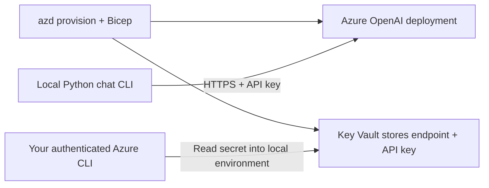

# Azure OpenAI Chat — Local CLI and AZD Infrastructure

**Level:** Intermediate · **Time:** 35–60 minutes including setup

This sample provisions an **Azure OpenAI resource and Key Vault**, then runs an
interactive Python chat CLI **on your machine**. It does not host a web application
or Container App. The default model is `gpt-4.1`, version `2025-04-14`, with
`GlobalStandard` deployment capacity 20. Check current availability and quota in
your selected region before provisioning; model lifecycle dates can change.

## Learning objectives

- Provision model infrastructure with Bicep and azd.
- Retrieve an API key from Key Vault without putting it in deployment outputs.
- Send Chat Completions requests and maintain conversation history.
- Interpret token counts and the limitations of cost estimates.



There is no managed-identity runtime integration, multi-region failover, custom
rate limiter, streaming mode, or hosted compute in this sample. The OpenAI SDK
performs up to two retries for retryable failures; the CLI reports remaining errors.

## Prerequisites

- A current stable [azd](https://learn.microsoft.com/azure/developer/azure-developer-cli/install-azd)
  (published release at review time: 1.37.2).
- [Azure CLI](https://learn.microsoft.com/cli/azure/install-azure-cli).
- Python **3.10+** (3.11 recommended) and a virtual environment.
- An Azure subscription with permission to create Cognitive Services and Key Vault
  resources, deploy models, and read the vault's secrets.
- Regional availability and `GlobalStandard` quota for `gpt-4.1`. Access requirements
  depend on the subscription and feature; there is no guaranteed approval timeframe.

```bash
azd version
az version
python --version
azd auth login
az login
```

These are separate authentication sessions. Select the same subscription in both
tools before running the commands below.

## Quick start (Bash)

Run from the repository root:

```bash
cd examples/azure-openai-chat
azd env new myopenai
azd provision
```

Choose a supported region. Provisioning creates a resource group, OpenAI account,
model deployment, Key Vault, and the `openai-endpoint`/`openai-api-key` secrets.
There are **no services to deploy** in `azure.yaml`.

Load the non-secret outputs and fetch the secret into your current shell:

```bash
export AZURE_OPENAI_ENDPOINT="$(azd env get-value AZURE_OPENAI_ENDPOINT)"
export AZURE_OPENAI_MODEL="$(azd env get-value AZURE_OPENAI_MODEL)"
KV_NAME="$(azd env get-value AZURE_KEY_VAULT_NAME)"
export AZURE_OPENAI_API_KEY="$(az keyvault secret show \
  --vault-name "$KV_NAME" --name openai-api-key --query value --output tsv)"

python -m venv .venv
source .venv/bin/activate
python -m pip install -r src/requirements.txt
python src/chat.py
```

In PowerShell, activate with `.\.venv\Scripts\Activate.ps1` and assign environment
variables with `$env:AZURE_OPENAI_ENDPOINT = azd env get-value AZURE_OPENAI_ENDPOINT`
(and similarly for the model). Retrieve the API key using
`$env:AZURE_OPENAI_API_KEY = az keyvault secret show --vault-name $KV_NAME --name openai-api-key --query value -o tsv`.
Set `$KV_NAME = azd env get-value AZURE_KEY_VAULT_NAME` first.

Do not print, commit, or paste the API key into issue reports. The CLI reads process
environment variables; it does **not** fetch Key Vault secrets or load `.env` files.
`config.py` validates endpoint, token limit, and temperature at startup.

Expected output (content and usage vary):

```text
Azure OpenAI Chat Application
Model: gpt-4.1
...
You: Say hello in one sentence.
Assistant: Hello! How can I help you today?
[Tokens: ... | Cost: $...]
```

Commands: `stats` shows totals, `clear` clears conversation history, and
`quit`/`exit` ends the session. There are no `--stream`, `--show-tokens`, `tokens`,
or `cost` commands.

## Verify the deployment

After loading the shell variables above:

```bash
curl --fail-with-body \
  "${AZURE_OPENAI_ENDPOINT%/}/openai/deployments/${AZURE_OPENAI_MODEL}/chat/completions?api-version=2024-10-21" \
  -H "Content-Type: application/json" \
  -H "api-key: $AZURE_OPENAI_API_KEY" \
  -d '{"messages":[{"role":"user","content":"Say hello!"}],"max_tokens":50}'

az keyvault secret list --vault-name "$KV_NAME" --query "[].name" -o table
```

Success: the API returns HTTP 200 with `choices[0].message.content` and `usage`;
the vault lists `openai-api-key` and `openai-endpoint`. A successful ARM deployment
alone does not verify inference.

## Files and configuration

```text
azure.yaml                         # Infrastructure-only AZD project
infra/main.bicep                   # Subscription deployment
infra/main.parameters.json         # Environment, location, principal ID
infra/resources/openai.bicep       # Account + model
infra/resources/keyvault.bicep     # Vault + deploying user's secret access policy
infra/resources/secrets.bicep      # Writes secrets, no key output
src/chat.py                        # Interactive CLI
src/config.py                      # Environment validation
src/requirements.txt               # Python packages
```

To change the provisioned model/version/capacity, edit the defaults in
`infra/main.bicep` and run `azd provision`. Setting `AZURE_OPENAI_MODEL` in your
shell only selects an **existing deployment name**; it does not deploy another model.

| Runtime variable | Default / source |
|---|---|
| `AZURE_OPENAI_ENDPOINT` | Required; azd non-secret output |
| `AZURE_OPENAI_API_KEY` | Required; retrieve from Key Vault |
| `AZURE_OPENAI_MODEL` | `gpt-4.1`; Azure deployment name |
| `AZURE_OPENAI_MAX_TOKENS` | 800 (validation range 1–4096) |
| `AZURE_OPENAI_TEMPERATURE` | 0.7 (range 0–2) |
| `AZURE_OPENAI_INPUT_PRICE_PER_1K` | 0.002 USD; illustrative uncached input rate |
| `AZURE_OPENAI_OUTPUT_PRICE_PER_1K` | 0.008 USD; illustrative output rate |

## Costs and security limitations

The cost display is an **estimate**, not Azure billing. It multiplies API token
usage by the configured rates and does not account for cached input discounts,
regional/SKU differences, taxes, price changes, or failed/retried calls.
Override **both rates** when using another model or SKU and verify current
[Azure OpenAI pricing](https://azure.microsoft.com/pricing/details/cognitive-services/openai-service/).

For illustration, 100 requests using 500 uncached input and 200 output tokens each
at the default rates cost `100 × (500/1000 × .002 + 200/1000 × .008) = $0.26`.
Key Vault operations/storage incur separate charges. There is no fixed $50/month
charge for this local CLI and no hosted compute in the template.

The vault uses an access policy for the deploying principal; it is not an RBAC or
managed-identity application example. Public endpoints and API-key authentication
are used for teaching. Limit permissions and add appropriate identity/network
controls before adapting it for production.

## Practical exercises

### 1. Verify context and reset it

**Start:** running CLI. **Goal:** observe history.
Say “Remember the word cedar,” then ask “What word did I ask you to remember?”
Run `stats`; two successful turns should count as two exchanged messages.
Run `clear` and `stats`; exchanged messages should be zero (token totals remain).
The model's exact wording is not deterministic.

### 2. Change the response limit

**Start:** exit the CLI, keeping the same shell.
Run `export AZURE_OPENAI_MAX_TOKENS=100`, restart `python src/chat.py`, and ask for
a short explanation of azd. Check that the banner shows 100.
Restore with `unset AZURE_OPENAI_MAX_TOKENS`. A smaller response limit does not
reduce already-sent history tokens.

### Common issues

- **Missing environment variables:** provisioning does not export shell values;
  repeat the export steps. A new terminal needs them again.
- **403 reading Key Vault:** verify Azure CLI subscription/login and the principal
  in the vault access policy. Policy changes can take time to propagate.
- **404 inference:** check the deployment name, endpoint, and deployment status.
- **429 inference:** wait for rate limits to reset; verify regional model quota.
  The CLI removes failed turns from history so retrying does not duplicate them.
- **Context length:** the sample does not trim long conversations; use `clear`.
- **Model unavailable/retired:** consult current model availability and update
  model/version/SKU together; API version and model version are different settings.

## Cleanup and next steps

```bash
azd down
unset AZURE_OPENAI_API_KEY
```

Key Vault soft-delete retention is seven days; purge requires separate permissions.
There is no committed test suite; do not run a nonexistent `pytest tests/` command.
Add mocked API tests before extending the code.

[Container examples](../container-app/) · [Retail architecture blueprint](../retail-scenario.md) ·
[Course home](../../README.md) · [Report an issue](https://github.com/microsoft/AZD-for-beginners/issues)
