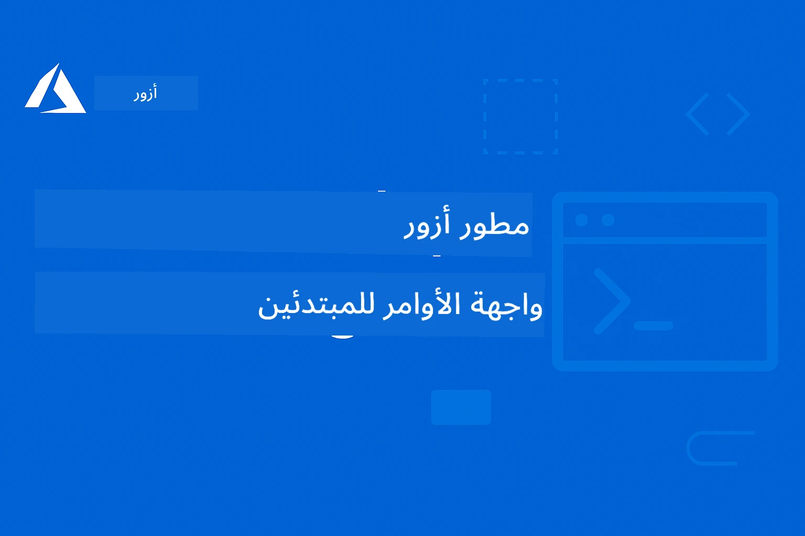

# AZD للمبتدئين: رحلة تعلم منظمة

 

[](https://github.com/microsoft/AZD-for-beginners)
[](https://GitHub.com/microsoft/azd-for-beginners/network/)
[](https://github.com/microsoft/AZD-for-beginners)

[](https://discord.com/invite/nkVh3dp)
[](https://discord.gg/nTYy5BXMWG)

---

### الترجمات الآلية (محدثة دائمًا)

<!-- CO-OP TRANSLATOR LANGUAGES TABLE START -->
[Arabic](./README.md) | [Bengali](../bn/README.md) | [Bulgarian](../bg/README.md) | [Burmese (Myanmar)](../my/README.md) | [Chinese (Simplified)](../zh-CN/README.md) | [Chinese (Traditional, Hong Kong)](../zh-HK/README.md) | [Chinese (Traditional, Macau)](../zh-MO/README.md) | [Chinese (Traditional, Taiwan)](../zh-TW/README.md) | [Croatian](../hr/README.md) | [Czech](../cs/README.md) | [Danish](../da/README.md) | [Dutch](../nl/README.md) | [Estonian](../et/README.md) | [Finnish](../fi/README.md) | [French](../fr/README.md) | [German](../de/README.md) | [Greek](../el/README.md) | [Hebrew](../he/README.md) | [Hindi](../hi/README.md) | [Hungarian](../hu/README.md) | [Indonesian](../id/README.md) | [Italian](../it/README.md) | [Japanese](../ja/README.md) | [Kannada](../kn/README.md) | [Khmer](../km/README.md) | [Korean](../ko/README.md) | [Lithuanian](../lt/README.md) | [Malay](../ms/README.md) | [Malayalam](../ml/README.md) | [Marathi](../mr/README.md) | [Nepali](../ne/README.md) | [Nigerian Pidgin](../pcm/README.md) | [Norwegian](../no/README.md) | [Persian (Farsi)](../fa/README.md) | [Polish](../pl/README.md) | [Portuguese (Brazil)](../pt-BR/README.md) | [Portuguese (Portugal)](../pt-PT/README.md) | [Punjabi (Gurmukhi)](../pa/README.md) | [Romanian](../ro/README.md) | [Russian](../ru/README.md) | [Serbian (Cyrillic)](../sr/README.md) | [Slovak](../sk/README.md) | [Slovenian](../sl/README.md) | [Spanish](../es/README.md) | [Swahili](../sw/README.md) | [Swedish](../sv/README.md) | [Tagalog (Filipino)](../tl/README.md) | [Tamil](../ta/README.md) | [Telugu](../te/README.md) | [Thai](../th/README.md) | [Turkish](../tr/README.md) | [Ukrainian](../uk/README.md) | [Urdu](../ur/README.md) | [Vietnamese](../vi/README.md)

> **هل تفضل النسخ محليًا؟**
>
> يحتوي هذا المستودع على ترجمات لأكثر من 50 لغة مما يزيد حجم التنزيل بشكل كبير. لنسخ المستودع بدون الترجمات، استخدم الفحص الجزئي:
>
> **Bash / macOS / Linux:**
> ```bash
> git clone --filter=blob:none --sparse https://github.com/microsoft/AZD-for-beginners.git
> cd AZD-for-beginners
> git sparse-checkout set --no-cone '/*' '!translations' '!translated_images'
> ```
>
> **CMD (ويندوز):**
> ```cmd
> git clone --filter=blob:none --sparse https://github.com/microsoft/AZD-for-beginners.git
> cd AZD-for-beginners
> git sparse-checkout set --no-cone "/*" "!translations" "!translated_images"
> ```
>
> هذا يمنحك كل ما تحتاجه لإكمال الدورة مع تنزيل أسرع بكثير.
<!-- CO-OP TRANSLATOR LANGUAGES TABLE END -->

## 🆕 ما الجديد في azd اليوم

> 📌 **تحديث Foundry GA (2026-11-09):** أصبحت **`microsoft.foundry` 1.0 متاحة بشكل عام**، كما أعلن في [5 نوفمبر 2026](https://devblogs.microsoft.com/azure-sdk/microsoft-foundry-azure-developer-cli-ga/). استخدم **`azd >= 1.37.0`** وقم بتثبيتها باستخدام `azd ext install microsoft.foundry`. اتبع [الدليل الموجه للوكيل المستضاف](docs/chapter-02-ai-development/microsoft-foundry-integration.md#hosted-agent-walkthrough-ga) للإعداد والاختبار المحلي والنشر. هذا التحديث يعتمد على التوجيهات المنشورة، وليس نشرًا مباشرًا على Azure؛ توفر حزمة GA لا يعني أن كل ميزة اختيارية أو امتداد أو SDK متاحة للجميع.

يدعم Azure Developer CLI العديد من أنواع التطبيقات، بما في ذلك تطبيقات الويب وواجهات برمجة التطبيقات ووكالات الذكاء الاصطناعي، من خلال المضيفين والقوالب والامتدادات المدعومة.

هذا ما يعنيه ذلك بالنسبة لك:

- **حزمة GA لتطوير Foundry.** يقوم `microsoft.foundry` بتثبيت سبعة امتدادات أساسية، بما في ذلك الوكلاء والمشاريع وAgent Inspector. يبقى كود الوكيل وإعدادات النشر معًا في `azure.yaml`.
- **اختبر محليًا، ثم قم بنشر الكود الخاص بك.** استخدم `azd ai agent init --deploy-mode code`، `azd provision`، و`azd ai agent run` لفحص الطلبات والاستجابات المحلية. ثم استخدم `azd deploy` للبناء عن بُعد في Foundry، دون الحاجة للبناء المحلي للحاوية.
- **قم بقياس الجودة بشكل منفصل.** قم بتثبيت **`azure.ai.evaluations`** لـ `azd ai eval generate`، `init`، و`run start`؛ فهي غير متضمنة في الحزمة. احتفظ بمجموعات البيانات المراجعة والروبريك مع الكود الخاص بك. يجب أن تتبع المشاريع الأقدم [دليل التقييم والهجرة للتحسين](docs/chapter-08-production/production-ai-practices.md#evaluation-migration-and-quality-checks).
- **إعادة استخدام الإعدادات في CI/CD.** بعد `azd up` ناجح، قم بتكوين خط الأنابيب باستخدام `azd pipeline config`. قم بتثبيت الحزمة على الجهاز القائم بالتشغيل واحتفظ بإعدادات المصادقة والبيئة المُولدة.
- **أساسيات يومية أكثر سلاسة.** أصدرت الإصدارات الحديثة `azd init` ليصبح idempotent (آمن لإعادة التشغيل)، وجعل `azd auth login` يقوم تلقائيًا بمسح الرموز القديمة، وأضافت موجه إعداد أول تشغيل ودود `azd tool`.
- **لم يتغير سير العمل الأساسي.** سواء كنت تنشر تطبيق مهام، أو خدمة مصغرة، أو حل ذكاء اصطناعي متعدد الوكلاء، فإن الأوامر هي نفسها.

> **ملاحظة لمستخدمي Aspire:** تشير مايكروسوفت الآن إلى المنتج ببساطة باسم **Aspire** (سابقًا ".NET Aspire"). دعم azd لـ Aspire لم يتغير - فقط تم تحديث الاسم.

إذا كنت قد استخدمت azd مسبقًا، فإن دعم الذكاء الاصطناعي هو امتداد طبيعي - وليس أداة منفصلة أو مسار متقدم. إذا كنت تبدأ من الصفر، فستتعلم سير عمل واحد يعمل لكل شيء.

---

## 🚀 ما هو Azure Developer CLI (azd)؟

**Azure Developer CLI (azd)** هو أداة سطر أوامر صديقة للمطورين تجعل من السهل نشر التطبيقات على Azure. بدلًا من إنشاء وربط العشرات من موارد Azure يدويًا، يمكنك نشر التطبيقات كاملة بأمر واحد.

### سحر `azd up`

```bash
# This single command does everything:
# ✅ Creates all Azure resources  
# ✅ Configures networking and security
# ✅ Builds your application code
# ✅ Deploys to Azure
# ✅ Gives you a working URL
azd up
```

يقدم القالب تكوين التطبيق والبنية التحتية. يتطلب النشر الناجح خدمات/نماذج مدعومة، حصة وأذونات كافية، مدخلات صحيحة، والتحقق من التطبيق المنشور. لا يجعل `azd up` القالب آمنًا أو متوافقًا أو جاهزًا للإنتاج تلقائيًا.

---

## ❓ Azure Developer CLI مقابل Azure CLI: ما الفرق؟

هذا هو السؤال الأكثر شيوعًا بين المبتدئين. إليك الجواب البسيط:

| الميزة | **Azure CLI (`az`)** | **Azure Developer CLI (`azd`)** |
|---------|---------------------|--------------------------------|
| **الغرض** | إدارة موارد Azure الفردية | نشر تطبيقات كاملة |
| **التركيز** | يركز على البنية التحتية | يركز على التطبيق |
| **مثال** | `az webapp create --name myapp...` | `azd up` |
| **منحنى التعلم** | يجب معرفة خدمات Azure | فقط معرفة تطبيقك |
| **الأفضل لـ** | DevOps والبنية التحتية | المطورين والنماذج الأولية |

### تشبيه بسيط

- **Azure CLI** يشبه امتلاك كل الأدوات لبناء منزل - مطارق، مناشير، مسامير. يمكنك بناء أي شيء، لكن يجب أن تعرف البناء.
- **Azure Developer CLI** يشبه توظيف مقاول - تصف ما تريد وهم يتولون البناء.

### متى تستخدم كلًا منهما

| السيناريو | استخدم هذا |
|----------|----------|
| "أريد نشر تطبيقي الويب بسرعة" | `azd up` |
| "أحتاج فقط لإنشاء حساب تخزين" | `az storage account create` |
| "أبني تطبيق ذكاء اصطناعي كامل" | `azd init --template azure-search-openai-demo` |
| "أحتاج لتصحيح مورد Azure محدد" | `az resource show` |
| "أريد النشر إلى بيئة الإنتاج التي أعددتها" | راجع الإعدادات، الوصول، التكلفة، والبوابات التشغيلية قبل `azd up --environment production` |

### يعملان معًا!

لدى AZD وAzure CLI مصادقة وإعداد منفصلان. استخدم `azd auth login` لـ AZD، و`az login` عندما يحتاج أمر وصلة أو تشخيص صراحة إلى Azure CLI. يمكنك استخدامهما معًا:
```bash
# Deploy your app with AZD
azd up

# Then fine-tune specific resources with Azure CLI
az webapp config set --name myapp --always-on true
```

---

## 🌟 اعثر على القوالب في Awesome AZD

لا تبدأ من الصفر! **Awesome AZD** هو مجموعة المجتمع من القوالب الجاهزة للنشر:

| المورد | الوصف |
|----------|-------------|
| 🔗 [**معرض Awesome AZD**](https://azure.github.io/awesome-azd/) | تصفح أكثر من 200 قالب بنقرة نشر واحدة |
| 🔗 [**أرسل قالبًا**](https://github.com/Azure/awesome-azd/issues) | ساهم بقالبك الخاص للمجتمع |
| 🔗 [**مستودع GitHub**](https://github.com/Azure/awesome-azd) | قم بوضع نجمة واستكشف المصدر |

### قوالب الذكاء الاصطناعي الشهيرة من Awesome AZD

اختر قالبًا في مجلد فارغ خاص به؛ الأوامر أدناه بدائل. السطر الذي ينتهي بـ `.` يقوم بتهيئة ذلك المجلد.

```bash
# RAG Chat with Microsoft Foundry Models + AI Search
azd init --template azure-search-openai-demo .

# Quick AI Chat Application
azd init --template openai-chat-app-quickstart .

# AI Agents with Foundry Agents
azd init --template get-started-with-ai-agents .
```

---

## 🎯 بدء العمل في 3 خطوات

قبل أن تبدأ، تأكد من أن جهازك جاهز للقالب الذي تريد نشره:

**Windows:**
```powershell
.\validate-setup.ps1
```

**macOS / Linux:**
```bash
bash ./validate-setup.sh
```

إذا فشل أي فحص مطلوب، قم بإصلاحه أولًا ثم استمر مع البداية السريعة.

### الخطوة 1: تثبيت AZD (دقيقتان)

**Windows:**
```powershell
winget install microsoft.azd
```

**macOS:**
```bash
brew tap azure/azd && brew install azd
```

**Linux:**
```bash
curl -fsSL https://aka.ms/install-azd.sh | bash
```

### الخطوة 2: المصادقة لـ AZD

```bash
# Optional if you plan to use Azure CLI commands directly in this course
az login

# Required for AZD workflows
azd auth login
```

إذا لم تكن متأكدًا مما تحتاجه، اتبع سير الإعداد الكامل في [التثبيت والإعداد](docs/chapter-01-foundation/installation.md#authentication-setup).

### الخطوة 3: انشر تطبيقك الأول

```bash
# Initialize from a template
azd init --template todo-nodejs-mongo .

# Deploy to Azure (creates everything!)
azd up
```

**🎉 هذا كل شيء!** تطبيقك الآن مباشر على Azure.

### التنظيف (لا تنسى!)

```bash
# Remove all resources when done experimenting
azd down --force --purge
```

---

## 📚 كيف تستخدم هذه الدورة

تم تصميم هذه الدورة لـ **التعلم التدريجي** - ابدأ من حيث ترتاح وتقدم تدريجيًا:

| خبرتك | ابدأ هنا |
|-----------------|------------|
| **مبتدئ تمامًا في Azure** | [الفصل 1: الأساسيات](#-chapter-1-foundation--quick-start) |
| **تعرف على Azure، جديد على AZD** | [الفصل 1: الأساسيات](#-chapter-1-foundation--quick-start) |
| **أريد نشر تطبيقات الذكاء الاصطناعي** | [الفصل 2: تطوير الذكاء الاصطناعي أولًا](#-chapter-2-ai-first-development-recommended-for-ai-developers) |
| **أريد ممارسة عملية** | [🎓 ورشة تفاعلية](workshop/README.md) - مختبر موجه 3-4 ساعات |
| **أحتاج أنماط إنتاجية** | [الفصل 8: الإنتاج والمؤسسات](#-chapter-8-production--enterprise-patterns) |

### بدء سريع

1. **افتح هذا المستودع**: [](https://GitHub.com/microsoft/azd-for-beginners/fork)
2. **انسخه محليًا**: `git clone https://github.com/YOUR-USERNAME/azd-for-beginners.git`
3. **احصل على المساعدة**: [مجتمع Azure على Discord](https://discord.com/invite/ByRwuEEgH4)

> **تفضل النسخ محليًا؟**

> يتضمن هذا المستودع أكثر من 50 ترجمة للغات مما يزيد بشكل كبير من حجم التنزيل. للاستنساخ بدون الترجمات، استخدم السحب الجزئي:
> ```bash
> git clone --filter=blob:none --sparse https://github.com/microsoft/AZD-for-beginners.git
> cd AZD-for-beginners
> git sparse-checkout set --no-cone '/*' '!translations' '!translated_images'
> ```
> هذا يمنحك كل ما تحتاجه لإكمال الدورة بتنزيل أسرع بكثير.


## نظرة عامة على الدورة

اتقن Azure Developer CLI (azd) من خلال فصول منظمة مصممة للتعلم التدريجي. **تركيز خاص على نشر تطبيقات الذكاء الاصطناعي مع تكامل Microsoft Foundry.**

### لماذا هذه الدورة ضرورية للمطورين الحديثين

يحتاج المطورون الذين ينشرون أحمال عمل الذكاء الاصطناعي عادة إلى إرشادات حول:
- معماريات الذكاء الاصطناعي المعقدة متعددة الخدمات
- أفضل ممارسات نشر الذكاء الاصطناعي في الإنتاج  
- تكامل وتكوين خدمات Azure AI
- تحسين تكلفة أحمال عمل الذكاء الاصطناعي
- استكشاف مشاكل النشر الخاصة بالذكاء الاصطناعي وإصلاحها

### أهداف التعلم

عند إكمال هذه الدورة المنظمة، سوف:
- **اتقن أساسيات AZD**: المفاهيم الأساسية، التثبيت، والتكوين
- **نشر تطبيقات الذكاء الاصطناعي**: استخدام AZD مع خدمات Microsoft Foundry
- **تنفيذ البنية التحتية ككود**: إدارة موارد Azure باستخدام قوالب Bicep
- **استكشاف مشاكل النشر وإصلاحها**: حل المشكلات الشائعة وتصحيح الأخطاء
- **تحسين للنشر في الإنتاج**: الأمان، التوسع، المراقبة، وإدارة التكلفة
- **بناء حلول متعددة الوكلاء**: نشر معماريات الذكاء الاصطناعي المعقدة

## قبل أن تبدأ: الحسابات، الوصول، والافتراضات

قبل أن تبدأ الفصل 1، تأكد من توفر ما يلي. تفترض خطوات التثبيت لاحقًا في هذا الدليل أن هذه الأساسيات قد تم التعامل معها بالفعل.

- **اشتراك Azure**: يمكنك استخدام اشتراك موجود من العمل أو حسابك الخاص، أو إنشاء [نسخة تجريبية مجانية](https://aka.ms/azurefreetrial) للبدء.
- **صلاحية إنشاء موارد Azure**: لأغلب التمارين، يجب أن تحصل على إذن **المساهم** على الاشتراك الهدف أو مجموعة الموارد. بعض الفصول قد تفترض أيضًا إمكانية إنشاء مجموعات موارد، هويات مُدارة، وتعيينات RBAC.
- [**حساب GitHub**](https://github.com): مفيد لاستنساخ المستودع، تتبع تغييراتك الخاصة، واستخدام GitHub Codespaces للورشة.
- **متطلبات تشغيل القوالب**: بعض القوالب تحتاج أدوات محلية مثل Node.js، Python، Java، أو Docker. شغّل مدقق الإعداد قبل البدء لتكتشف الأدوات المفقودة مبكرًا.
- **معرفة أساسية بالتيرمينال**: لست بحاجة لأن تكون خبيرًا، ولكن يجب أن تكون مرتاحًا في تشغيل أوامر مثل `git clone`، `azd auth login`، و`azd up`.

> **تعمل في اشتراك مؤسسي؟**
> إذا كان بيئة Azure الخاصة بك تُدار بواسطة مسؤول، تحقق مسبقًا من إمكانية نشر الموارد في الاشتراك أو مجموعة الموارد التي تخطط لاستخدامها. إذا لم يكن كذلك، اطلب اشتراك صندوق رمل أو صلاحية المساهم قبل البدء.

> **جديد في Azure؟**
> ابدأ بنسخة Azure التجريبية الخاصة بك أو اشتراك الدفع حسب الاستخدام في https://aka.ms/azurefreetrial حتى تتمكن من إتمام التمارين من البداية للنهاية دون انتظار موافقات على مستوى المستأجر.

## 🗺️ خريطة الدورة: تنقل سريع حسب الفصل

لكل فصل ملف README مخصص يحتوي على أهداف التعلم، البدايات السريعة، والتمارين:

| الفصل | الموضوع | الدروس | المدة | التعقيد |
|---------|-------|---------|----------|------------|
| **[الفصل 1: الأساس](docs/chapter-01-foundation/README.md)** | البداية | [أساسيات AZD](docs/chapter-01-foundation/azd-basics.md) &#124; [التثبيت](docs/chapter-01-foundation/installation.md) &#124; [المشروع الأول](docs/chapter-01-foundation/first-project.md) | 30-45 دقيقة | ⭐ |
| **[الفصل 2: تطوير الذكاء الاصطناعي](docs/chapter-02-ai-development/README.md)** | تطبيقات الذكاء الاصطناعي أولاً | [تكامل Foundry](docs/chapter-02-ai-development/microsoft-foundry-integration.md) &#124; [وكلاء الذكاء الاصطناعي](docs/chapter-02-ai-development/agents.md) &#124; [نشر النماذج](docs/chapter-02-ai-development/ai-model-deployment.md) &#124; [الورشة](docs/chapter-02-ai-development/ai-workshop-lab.md) | 1-2 ساعة | ⭐⭐ |
| **[الفصل 3: التكوين](docs/chapter-03-configuration/README.md)** | المصادقة والأمان | [التكوين](docs/chapter-03-configuration/configuration.md) &#124; [المصادقة والأمان](docs/chapter-03-configuration/authsecurity.md) | 45-60 دقيقة | ⭐⭐ |
| **[الفصل 4: البنية التحتية](docs/chapter-04-infrastructure/README.md)** | IaC والنشر | [دليل النشر](docs/chapter-04-infrastructure/deployment-guide.md) &#124; [التجهيز](docs/chapter-04-infrastructure/provisioning.md) | 1-1.5 ساعة | ⭐⭐⭐ |
| **[الفصل 5: متعدد الوكلاء](docs/chapter-05-multi-agent/README.md)** | حلول وكلاء الذكاء الاصطناعي | [سيناريو البيع بالتجزئة](examples/retail-scenario.md) &#124; [أنماط التنسيق](docs/chapter-06-pre-deployment/coordination-patterns.md) | 2-3 ساعات | ⭐⭐⭐⭐ |
| **[الفصل 6: ما قبل النشر](docs/chapter-06-pre-deployment/README.md)** | التخطيط والتحقق | [فحوصات ما قبل النشر](docs/chapter-06-pre-deployment/preflight-checks.md) &#124; [تخطيط السعة](docs/chapter-06-pre-deployment/capacity-planning.md) &#124; [اختيار SKU](docs/chapter-06-pre-deployment/sku-selection.md) &#124; [مراقبة التطبيقات](docs/chapter-06-pre-deployment/application-insights.md) | 1 ساعة | ⭐⭐ |
| **[الفصل 7: استكشاف الأخطاء](docs/chapter-07-troubleshooting/README.md)** | التصحيح وإصلاح | [المشاكل الشائعة](docs/chapter-07-troubleshooting/common-issues.md) &#124; [التصحيح](docs/chapter-07-troubleshooting/debugging.md) &#124; [مشاكل الذكاء الاصطناعي](docs/chapter-07-troubleshooting/ai-troubleshooting.md) | 1-1.5 ساعة | ⭐⭐ |
| **[الفصل 8: الإنتاج](docs/chapter-08-production/README.md)** | أنماط المؤسسات | [ممارسات الإنتاج](docs/chapter-08-production/production-ai-practices.md) | 2-3 ساعات | ⭐⭐⭐⭐ |
| **[🎓 الورشة](workshop/README.md)** | مختبر عملي | [مقدمة](workshop/docs/instructions/0-Introduction.md) &#124; [الاختيار](workshop/docs/instructions/1-Select-AI-Template.md) &#124; [التحقق](workshop/docs/instructions/2-Validate-AI-Template.md) &#124; [التفكيك](workshop/docs/instructions/3-Deconstruct-AI-Template.md) &#124; [التكوين](workshop/docs/instructions/4-Configure-AI-Template.md) &#124; [التخصيص](workshop/docs/instructions/5-Customize-AI-Template.md) &#124; [تفكيك](workshop/docs/instructions/6-Teardown-Infrastructure.md) &#124; [الختام](workshop/docs/instructions/7-Wrap-up.md) | 3-4 ساعات | ⭐⭐ |

**إجمالي مدة الدورة:** ~10-14 ساعة | **تقدم المهارة:** مبتدئ → جاهز للإنتاج

---

## 📚 فصول التعلم

*اختر مسار التعلم بناءً على مستوى الخبرة والأهداف*

### 🚀 الفصل 1: الأساس والبداية السريعة
**المتطلبات المسبقة**: اشتراك Azure، معرفة أساسية بسطر الأوامر  
**المدة**: 30-45 دقيقة  
**التعقيد**: ⭐

#### ما ستتعلمه
- فهم أساسيات Azure Developer CLI
- تثبيت AZD على منصتك
- نشر أول ناجح لك

#### مصادر التعلم
- **🎯 ابدأ هنا**: [ما هو Azure Developer CLI؟](#-what-is-azure-developer-cli-azd)
- **📖 نظرية**: [أساسيات AZD](docs/chapter-01-foundation/azd-basics.md) - المفاهيم الأساسية والمصطلحات
- **⚙️ إعداد**: [التثبيت والإعداد](docs/chapter-01-foundation/installation.md) - أدلة لمنصات معينة
- **🛠️ عملي**: [مشروعك الأول](docs/chapter-01-foundation/first-project.md) - تعليمات خطوة بخطوة
- **📋 مرجع سريع**: [ورقة الغش للأوامر](resources/cheat-sheet.md)

#### التمارين العملية
```bash
# Quick installation check
azd version

# Deploy your first application
azd init --template todo-nodejs-mongo .
azd up
```

**💡 نتيجة الفصل**: نشر تطبيق ويب بسيط على Azure باستخدام AZD بنجاح

**✅ التحقق من النجاح:**
```bash
# After completing Chapter 1, you should be able to:
azd version              # Shows installed version
azd init --template todo-nodejs-mongo  # Initializes project
azd up                  # Deploys to Azure
azd show                # Displays running app URL
# Application opens in browser and works
azd down --force --purge  # Cleans up resources
```

**📊 الوقت المستثمر:** 30-45 دقيقة  
**📈 مستوى المهارة بعد:** قادر على نشر التطبيقات الأساسية مستقلًا

---

### 🤖 الفصل 2: تطوير الذكاء الاصطناعي أولاً (موصى به لمطوري الذكاء الاصطناعي)
**المتطلبات المسبقة**: إكمال الفصل 1  
**المدة**: 1-2 ساعة  
**التعقيد**: ⭐⭐

#### ما ستتعلمه
- تكامل Microsoft Foundry مع AZD
- نشر التطبيقات المعززة بالذكاء الاصطناعي
- فهم تكوينات خدمات الذكاء الاصطناعي

#### مصادر التعلم
- **🎯 ابدأ هنا**: [تكامل Microsoft Foundry](docs/chapter-02-ai-development/microsoft-foundry-integration.md)
- **🤖 وكلاء الذكاء الاصطناعي**: [دليل وكلاء الذكاء الاصطناعي](docs/chapter-02-ai-development/agents.md) - نشر وكلاء أذكياء باستخدام AZD
- **📖 أنماط**: [نشر نماذج الذكاء الاصطناعي](docs/chapter-02-ai-development/ai-model-deployment.md) - نشر وإدارة نماذج الذكاء الاصطناعي
- **🛠️ ورشة عمل**: [مختبر ورشة عمل الذكاء الاصطناعي](docs/chapter-02-ai-development/ai-workshop-lab.md) - جهز حلول الذكاء الاصطناعي لتكون جاهزة مع AZD
- **🎥 دليل تفاعلي**: [مواد الورشة](workshop/README.md) - تعلم عبر المتصفح مع MkDocs * بيئة DevContainer
- **📋 قوالب**: [قوالب Microsoft Foundry](#featured-microsoft-foundry-templates)
- **📝 أمثلة**: [أمثلة نشر AZD](examples/README.md)

#### التمارين العملية
```bash
# Deploy your first AI application
azd init --template azure-search-openai-demo .
azd up

# Try additional AI templates
azd init --template openai-chat-app-quickstart .
azd init --template agent-openai-python-prompty .
```

**💡 نتيجة الفصل**: نشر وتكوين تطبيق دردشة مدعوم بالذكاء الاصطناعي مع قدرات RAG

**✅ التحقق من النجاح:**
```bash
# After Chapter 2, you should be able to:
azd init --template azure-search-openai-demo .
azd up
# Test the AI chat interface
# Ask questions and get AI-powered responses with sources
# Verify search integration works
azd monitor  # Check Application Insights shows telemetry
azd down --force --purge
```

**📊 الوقت المستثمر:** 1-2 ساعة  
**📈 مستوى المهارة بعد:** قادر على نشر تطبيقات تعلم الذكاء الاصطناعي وتحديد متطلبات الاستعداد للإنتاج الإضافية
**💰 الوعي بالتكاليف:** فهم تكاليف التطوير 80-150 دولار شهريًا، وتكاليف الإنتاج 300-3500 دولار شهريًا

#### 💰 اعتبارات التكلفة لنشر الذكاء الاصطناعي

**بيئة التطوير (تقدير 80-150 دولار/شهر):**
- نماذج Microsoft Foundry (الدفع حسب الاستخدام): 0-50 دولار/شهر (اعتمادًا على استخدام الرموز)
- بحث الذكاء الاصطناعي (الطبقة الأساسية): 75 دولار/شهر
- تطبيقات الحاويات (الاستهلاك): 0-20 دولار/شهر
- التخزين (القياسي): 1-5 دولار/شهر

**بيئة الإنتاج (تقدير 300-3500+ دولار/شهر):**
- نماذج Microsoft Foundry (PTU للأداء المتسق): 3000+ دولار/شهر أو الدفع حسب الاستخدام مع حجم كبير
- بحث الذكاء الاصطناعي (الطبقة القياسية): 250 دولار/شهر
- تطبيقات الحاويات (مخصصة): 50-100 دولار/شهر
- رؤى التطبيقات: 5-50 دولار/شهر
- التخزين (الممتاز): 10-50 دولار/شهر

**💡 نصائح تحسين التكلفة:**
- تحقق من تسعير استدلال النماذج والاعتمادات الخاصة بالحساب؛ Azure OpenAI لا تتضمن مخصص مجاني شامل من 50,000 رمز شهريًا
- شغّل `azd down` لحذف الموارد عندما لا تعود ضرورية، بعد مراجعة البيئة المختارة
- ابدأ بالفوترة على أساس الاستهلاك، وطور إلى PTU فقط للإنتاج
- استخدم `azd provision --preview` لفحص البنية التحتية المخططة، ثم قيّم تكلفة الموارد الناتجة باستخدام حاسبة أسعار Azure
- فعّل التوسع التلقائي: ادفع فقط مقابل الاستهلاك الفعلي

**مراقبة التكلفة:**
```bash
# Inspect planned resources (this does not calculate prices)
azd provision --preview

# Monitor actual costs in Azure Portal
az consumption budget list --resource-group <your-rg>
```

---

### ⚙️ الفصل 3: التكوين والمصادقة
**المتطلبات المسبقة**: إكمال الفصل 1  
**المدة**: 45-60 دقيقة  
**التعقيد**: ⭐⭐

#### ما ستتعلمه
- تكوين البيئة وإدارتها
- أفضل ممارسات المصادقة والأمان
- تسمية الموارد وتنظيمها

#### مصادر التعلم
- **📖 التكوين**: [دليل التكوين](docs/chapter-03-configuration/configuration.md) - إعداد البيئة
- **🔐 الأمان**: [أنماط المصادقة والهوية المُدارة](docs/chapter-03-configuration/authsecurity.md) - أنماط المصادقة
- **📝 أمثلة**: [مثال تطبيق قاعدة بيانات](examples/database-app/README.md) - أمثلة قواعد بيانات AZD

#### التمارين العملية
- تكوين بيئات متعددة (تطوير، اختبار، إنتاج)
- إعداد مصادقة الهوية المُدارة
- تنفيذ تكوينات خاصة بالبيئة

**💡 نتيجة الفصل**: إدارة بيئات متعددة مع المصادقة الصحيحة والأمان

---

### 🏗️ الفصل 4: البنية التحتية ككود والنشر
**المتطلبات المسبقة**: إكمال الفصول 1-3  
**المدة**: 1-1.5 ساعة  
**التعقيد**: ⭐⭐⭐

#### ما ستتعلمه
- أنماط نشر متقدمة
- البنية التحتية ككود باستخدام Bicep
- استراتيجيات تجهيز الموارد

#### مصادر التعلم
- **📖 النشر**: [دليل النشر](docs/chapter-04-infrastructure/deployment-guide.md) - سير العمل الكامل
- **🏗️ التجهيز**: [تجهيز الموارد](docs/chapter-04-infrastructure/provisioning.md) - إدارة موارد Azure
- **📝 أمثلة**: [مثال تطبيق الحاويات](../../examples/container-app) - النشر بالحاويات

#### التمارين العملية
- إنشاء قوالب Bicep مخصصة
- نشر تطبيقات متعددة الخدمات
- تنفيذ استراتيجيات النشر الأزرق-الأخضر

**💡 نتيجة الفصل**: نشر تطبيقات معقدة متعددة الخدمات باستخدام قوالب بنية تحتية مخصصة

---

### 🎯 الفصل 5: حلول الذكاء الاصطناعي متعددة الوكلاء (متقدم)
**المتطلبات المسبقة**: إكمال الفصول 1-2  
**المدة**: 2-3 ساعات  
**التعقيد**: ⭐⭐⭐⭐

#### ما ستتعلمه
- أنماط معمارية متعددة الوكلاء
- تنظيم وتنسيق الوكلاء
- نشرات الذكاء الاصطناعي الجاهزة للإنتاج

#### مصادر التعلم
- **🤖 التصميم المميز**: [حل متعدد الوكلاء للبيع بالتجزئة](examples/retail-scenario.md) - مخطط معماري، ليس تطبيقًا كاملاً
- **🛠️ قوالب ARM**: [حزمة قالب ARM](../../examples/retail-multiagent-arm-template) - هيكل البنية التحتية؛ راجع المتطلبات المسبقة ومكونات التطبيق المفقودة
- **📖 العمارة**: [أنماط تنسيق الوكلاء المتعددين](docs/chapter-06-pre-deployment/coordination-patterns.md) - أنماط

#### التمارين العملية
```bash
# Inspect the retail infrastructure scaffold before choosing to deploy it
cd examples/retail-multiagent-arm-template
cat README.md

# After an intentional deployment, inspect infrastructure state
az deployment group show --resource-group <rg-name> --name <deployment-name>
```

**💡 نتيجة الفصل**: فهم تصميم الوكلاء المتعددين وتحديد العمل المطلوب للتنفيذ والتحقق والتشغيل بالإضافة إلى هيكل البنية التحتية

---

### 🔍 الفصل 6: التحقق والتخطيط قبل النشر
**المتطلبات المسبقة**: إتمام الفصل 4  
**المدة**: ساعة واحدة  
**التعقيد**: ⭐⭐

#### ما ستتعلمه
- تخطيط القدرة والتحقق من الموارد
- استراتيجيات اختيار SKU
- فحوصات ما قبل الإقلاع والأتمتة

#### موارد التعلم
- **📊 التخطيط**: [تخطيط القدرة](docs/chapter-06-pre-deployment/capacity-planning.md) - التحقق من الموارد
- **💰 الاختيار**: [اختيار SKU](docs/chapter-06-pre-deployment/sku-selection.md) - خيارات فعالة من حيث التكلفة
- **✅ التحقق**: [فحوصات ما قبل الإقلاع](docs/chapter-06-pre-deployment/preflight-checks.md) - نصوص مؤتمتة

#### التمارين العملية
- تشغيل نصوص التحقق من القدرة
- تحسين اختيارات SKU من حيث التكلفة
- تنفيذ فحوصات ما قبل النشر المؤتمتة

**💡 نتيجة الفصل**: التحقق من تحسين عمليات النشر قبل التنفيذ

---

### 🚨 الفصل 7: استكشاف الأخطاء وإصلاحها وتصحيحها
**المتطلبات المسبقة**: إتمام أي فصل نشر  
**المدة**: ساعة إلى ساعة ونصف  
**التعقيد**: ⭐⭐

#### ما ستتعلمه
- منهجيات تصحيح الأخطاء المنهجية
- المشاكل الشائعة والحلول
- استكشاف مشكلات الذكاء الاصطناعي المحددة

#### موارد التعلم
- **🔧 المشاكل الشائعة**: [المشاكل الشائعة](docs/chapter-07-troubleshooting/common-issues.md) - الأسئلة المتكررة والحلول
- **🕵️ تصحيح الأخطاء**: [دليل تصحيح الأخطاء](docs/chapter-07-troubleshooting/debugging.md) - استراتيجيات خطوة بخطوة
- **🤖 مشاكل الذكاء الاصطناعي**: [استكشاف مشكلات الذكاء الاصطناعي](docs/chapter-07-troubleshooting/ai-troubleshooting.md) - مشكلات خدمات الذكاء الاصطناعي

#### التمارين العملية
- تشخيص فشل النشر
- حل مشاكل المصادقة
- تصحيح مشكلات الاتصال بخدمة الذكاء الاصطناعي

**💡 نتيجة الفصل**: تشخيص وحل مشاكل النشر الشائعة بشكل مستقل

---

### 🏢 الفصل 8: أنماط الإنتاج والمؤسسات
**المتطلبات المسبقة**: إتمام الفصول 1-4  
**المدة**: ساعتان إلى 3 ساعات  
**التعقيد**: ⭐⭐⭐⭐

#### ما ستتعلمه
- استراتيجيات نشر الإنتاج
- أنماط أمان المؤسسات
- المراقبة وتحسين التكلفة

#### موارد التعلم
- **🏭 الإنتاج**: [أفضل ممارسات الذكاء الاصطناعي للإنتاج](docs/chapter-08-production/production-ai-practices.md) - أنماط المؤسسات
- **📝 الأمثلة**: [مثال الخدمات المصغرة](../../examples/microservices) - هياكل معقدة
- **📊 المراقبة**: [تكامل Application Insights](docs/chapter-06-pre-deployment/application-insights.md) - المراقبة

#### التمارين العملية
- تنفيذ أنماط أمان المؤسسات
- إعداد مراقبة شاملة
- النشر للإنتاج مع الحوكمة المناسبة

**💡 نتيجة الفصل**: نشر تطبيقات جاهزة للإنتاج بمزايا تشغيل كاملة

---

## 🎓 نظرة عامة على الورشة: تجربة تعلم عملية

> **⚠️ حالة الورشة: قيد التطوير النشط**  
> مواد الورشة قيد التطوير والتنقيح حاليًا. الوحدات الأساسية تعمل، ولكن بعض الأقسام المتقدمة غير مكتملة. نحن نعمل بنشاط لاستكمال كافة المحتويات. [تتبع التقدم →](workshop/README.md)

### مواد الورشة التفاعلية
**تعلم عملي شامل باستخدام أدوات متصفح وتمارين موجهة**

توفر مواد ورشتنا تجربة تعليمية منظمة وتفاعلية تكمل المنهج القائم على الفصول أعلاه. الورشة مصممة للتعلم الذاتي وكذلك الجلسات التي يديرها المدربون.

#### 🛠️ ميزات الورشة
- **واجهة متصفح**: ورشة عمل كاملة مدعومة بـ MkDocs مع ميزات البحث والنسخ والثيمات
- **تكامل GitHub Codespaces**: إعداد بيئة تطوير بنقرة واحدة
- **مسار تعليمي منظم**: 8 وحدات تمرين موجهة (3-4 ساعات إجمالًا)
- **منهجية متدرجة**: المقدمة → الاختيار → التحقق → تفكيك → التكوين → التخصيص → الإزالة → الختام
- **بيئة DevContainer التفاعلية**: أدوات واعتمادات مُعدة مسبقًا

#### 📚 بنية وحدة الورشة
تتبع الورشة **منهجية تقدمية مكونة من 8 وحدات** تأخذك من الاكتشاف إلى إتقان النشر:

| الوحدة | الموضوع | ما ستفعله | المدة |
|--------|-------|----------------|----------|
| **0. المقدمة** | نظرة عامة على الورشة | فهم أهداف التعلم، المتطلبات المسبقة، وبنية الورشة | 15 دقيقة |
| **1. الاختيار** | اكتشاف القوالب | استكشاف قوالب AZD واختيار القالب المناسب للذكاء الاصطناعي حسب السيناريو الخاص بك | 20 دقيقة |
| **2. التحقق** | النشر والتحقق | نشر القالب مع `azd up` والتحقق من عمل البنية التحتية | 30 دقيقة |
| **3. التفكيك** | فهم الهيكل | استخدام GitHub Copilot لاستكشاف هندسة القالب وملفات Bicep وتنظيم الكود | 30 دقيقة |
| **4. التكوين** | تعمق في azure.yaml | إتقان تكوين `azure.yaml`، خطوات دورة الحياة، ومتغيرات البيئة | 30 دقيقة |
| **5. التخصيص** | اجعلها خاصة بك | تفعيل بحث الذكاء الاصطناعي، التتبع، التقييم، والتخصيص لسيناركيو الخاص | 45 دقيقة |
| **6. الإزالة** | التنظيف | إزالة الموارد بأمان باستخدام `azd down --purge` | 15 دقيقة |
| **7. الختام** | الخطوات التالية | مراجعة الإنجازات، المفاهيم الرئيسية، ومتابعة رحلة التعلم | 15 دقيقة |

**تدفق الورشة:**
```
Introduction → Selection → Validation → Deconstruction → Configuration → Customization → Teardown → Wrap-up
     ↓            ↓           ↓              ↓               ↓              ↓            ↓           ↓
  Overview    Find the     Deploy &      Explore        Master         Customize     Clean up    Review &
             right        verify        code &        azure.yaml      for your      resources   next steps
             template                   structure                     scenario
```

#### 🚀 بدء الورشة
```bash
# Option 1: GitHub Codespaces (Recommended)
# Click "Code" → "Create codespace on main" in the repository

# Option 2: Local Development
git clone https://github.com/microsoft/azd-for-beginners.git
cd azd-for-beginners/workshop
# Follow the setup instructions in workshop/README.md
```

#### 🎯 نتائج تعلم الورشة
عند إكمال الورشة، سيقوم المشاركون بـ:
- **نشر تطبيقات الذكاء الاصطناعي للإنتاج**: استخدام AZD مع خدمات Microsoft Foundry
- **إتقان معماريات الوكلاء المتعددين**: تنفيذ حلول وكيل ذكاء اصطناعي منسقة
- **تنفيذ أفضل ممارسات الأمان**: تكوين المصادقة والتحكم في الوصول
- **التحسين من أجل التوسع**: تصميم نشرات فعالة من حيث التكلفة وأداء عالي
- **استكشاف مشاكل النشر**: حل المشكلات الشائعة بشكل مستقل

#### 📖 موارد الورشة
- **🎥 دليل تفاعلي**: [مواد الورشة](workshop/README.md) - بيئة تعلم عبر المتصفح
- **📋 تعليمات الوحدات**:
  - [0. المقدمة](workshop/docs/instructions/0-Introduction.md) - نظرة عامة وأهداف الورشة
  - [1. الاختيار](workshop/docs/instructions/1-Select-AI-Template.md) - البحث واختيار قوالب الذكاء الاصطناعي
  - [2. التحقق](workshop/docs/instructions/2-Validate-AI-Template.md) - النشر والتحقق من القوالب
  - [3. التفكيك](workshop/docs/instructions/3-Deconstruct-AI-Template.md) - استكشاف هندسة القوالب
  - [4. التكوين](workshop/docs/instructions/4-Configure-AI-Template.md) - إتقان azure.yaml
  - [5. التخصيص](workshop/docs/instructions/5-Customize-AI-Template.md) - التخصيص حسب السيناريو الخاص
  - [6. الإزالة](workshop/docs/instructions/6-Teardown-Infrastructure.md) - تنظيف الموارد
  - [7. الختام](workshop/docs/instructions/7-Wrap-up.md) - المراجعة والخطوات المقبلة
- **🛠️ مختبر ورشة الذكاء الاصطناعي**: [مختبر ورشة الذكاء الاصطناعي](docs/chapter-02-ai-development/ai-workshop-lab.md) - تمارين مركزة على الذكاء الاصطناعي
- **💡 البداية السريعة**: [دليل إعداد الورشة](workshop/README.md#browser-based-guide) - تكوين البيئة

**مثالي لـ**: التدريب المؤسسي، دورات الجامعة، التعلم الذاتي، ومعسكرات تدريب المطورين.

---

## 📖 تعمق: قدرات AZD

بالإضافة إلى الأساسيات، يوفر AZD ميزات قوية لنشر الإنتاج:

- **نشر معتمد على القوالب** - استخدم قوالب مُعدة مسبقًا لأنماط التطبيقات الشائعة
- **البنية التحتية كرمز** - إدارة موارد Azure باستخدام Bicep أو Terraform  
- **تدفقات العمل المتكاملة** - التوفير، النشر، والمراقبة بسلاسة
- **صديق للمطور** - مُحسَّن لإنتاجية وتجربة المطور

### **AZD + Microsoft Foundry: مثالي لنشر الذكاء الاصطناعي**

**لماذا AZD لحلول الذكاء الاصطناعي؟** AZD يعالج أهم تحديات مطوري الذكاء الاصطناعي:

- **قوالب جاهزة للذكاء الاصطناعي** - قوالب مهيأة مسبقًا لنماذج Microsoft Foundry، خدمات Azure AI، وأعباء عمل ML
- **نشر آمن للذكاء الاصطناعي** - أنماط أمان مدمجة لخدمات AI، مفاتيح API، ونقاط نهاية النماذج  
- **أنماط AI للإنتاج** - أفضل الممارسات لنشر تطبيقات الذكاء الاصطناعي القابلة للتوسع والفعالة من حيث التكلفة
- **تدفقات عمل AI شاملة** - من تطوير النموذج إلى النشر في الإنتاج مع المراقبة المناسبة
- **تحسين التكلفة** - استراتيجيات تخصيص الموارد الذكية وتدرج أحمال عمل الذكاء الاصطناعي
- **تكامل Microsoft Foundry** - اتصال سلس مع كتالوج نماذج Microsoft Foundry ونقاط النهاية

---

## 🎯 مكتبة القوالب والأمثلة

### مميز: قوالب Microsoft Foundry
**ابدأ هنا إذا كنت تنشر تطبيقات الذكاء الاصطناعي!**

> **ملاحظة:** هذه القوالب توضح أنماطًا مختلفة للذكاء الاصطناعي. بعضها عينات Azure خارجية، وأخرى تطبيقات محلية.

| القالب | الفصل | التعقيد | الخدمات | النوع |
|----------|---------|------------|----------|------|
| [**ابدأ مع دردشة AI**](https://github.com/Azure-Samples/get-started-with-ai-chat) | الفصل 2 | ⭐⭐ | AzureOpenAI + Azure AI Model Inference API + Azure AI Search + Azure Container Apps + Application Insights | خارجي |
| [**ابدأ مع وكلاء AI**](https://github.com/Azure-Samples/get-started-with-ai-agents) | الفصل 2 | ⭐⭐ | Foundry Agents + AzureOpenAI + Azure AI Search + Azure Container Apps + Application Insights| خارجي |
| [**عرض Azure Search + OpenAI**](https://github.com/Azure-Samples/azure-search-openai-demo) | الفصل 2 | ⭐⭐ | Azure OpenAI + Azure AI Search + Container Apps (افتراضي) + التخزين | خارجي |
| [**بدء تطبيق دردشة OpenAI سريعًا**](https://github.com/Azure-Samples/openai-chat-app-quickstart) | الفصل 2 | ⭐ | AzureOpenAI + Container Apps + Application Insights | خارجي |
| [**وكيل OpenAI Python Prompty**](https://github.com/Azure-Samples/agent-openai-python-prompty) | الفصل 5 | ⭐⭐⭐ | AzureOpenAI + Azure Functions + Prompty | خارجي |
| [**دردشة Contoso RAG**](https://github.com/Azure-Samples/contoso-chat) | الفصل 8 | ⭐⭐⭐⭐ | AzureOpenAI + AI Search + Cosmos DB + Container Apps | خارجي |
| [**حل متعدد الوكلاء للبيع بالتجزئة**](examples/retail-scenario.md) | الفصل 5 | ⭐⭐⭐⭐ | مخطط معماري وهيكل بنية مقترح؛ تنفيذ التطبيق مطلوب | **مخطط محلي** |

### مميز: سيناريوهات تعلم كاملة
**قوالب تطبيقات جاهزة للإنتاج مرتبطة بفصول التعلم**

| القالب | فصل التعلم | التعقيد | التعلم الرئيسي |
|----------|------------------|------------|--------------|
| [**openai-chat-app-quickstart**](https://github.com/Azure-Samples/openai-chat-app-quickstart) | الفصل 2 | ⭐ | أنماط نشر AI الأساسية |
| [**azure-search-openai-demo**](https://github.com/Azure-Samples/azure-search-openai-demo) | الفصل 2 | ⭐⭐ | تطبيق RAG مع Azure AI Search |
| [**get-started-with-ai-agents**](https://github.com/Azure-Samples/get-started-with-ai-agents) | الفصل 2 | ⭐⭐ | دردشة مدعومة بالوكلاء واختبارات تقييم محددة |
| [**agent-openai-python-prompty**](https://github.com/Azure-Samples/agent-openai-python-prompty) | الفصل 5 | ⭐⭐⭐ | إطار وكيل واستدعاء دوال |
| [**contoso-chat**](https://github.com/Azure-Samples/contoso-chat) | الفصل 8 | ⭐⭐⭐ | تنسيق AI المؤسسي |
| [**retail-multi-agent-solution**](examples/retail-scenario.md) | الفصل 5 | ⭐⭐⭐⭐ | هندسة متعددة الوكلاء مع وكلاء العملاء والمخزون |

### التعلم حسب نوع المثال

> **📌 أمثلة محلية مقابل خارجية:**  
> **أمثلة محلية** (في هذا المستودع) = تفقد README الخاص بالمثال لحالة التنفيذ والمتطلبات المسبقة
> **أمثلة خارجية** (عينات Azure) = استنساخ من المستودعات المرتبطة

#### أمثلة محلية (جاهزة للاستخدام)
- [**حل متعدد الوكلاء للبيع بالتجزئة**](examples/retail-scenario.md) - مخطط معماري مع هيكل بنية ARM
  - أدوار وكلاء العملاء والمخزون المقترحة
  - يجب تنفيذ ومراجعة الرصد، التقييم، وكود التطبيق
  - توفير الموارد فقط لا ينتج تطبيق بيع بالتجزئة يعمل

#### أمثلة محلية - تطبيقات الحاويات (الفصول 2-5)
**أمثلة نشر تطبيقات الحاويات الشاملة في هذا المستودع:**
- [**أمثلة تطبيق الحاوية**](examples/container-app/README.md) - دليل كامل للنشر بالحاويات
  - [واجهة API Flask بسيطة](../../examples/container-app/simple-flask-api) - REST API أساسي مع مقياس للصفر
  - [هندسة الخدمات المصغرة](../../examples/container-app/microservices) - عينة تعلم بخدمتين؛ تقوية الإنتاج عمل إضافي
  - أنماط نشر بدء سريعة، الإنتاج، والمتقدمة
  - إرشادات المراقبة والأمان وتحسين التكلفة

#### أمثلة خارجية - تطبيقات بسيطة (الفصول 1-2)
**استنساخ هذه المستودعات عينات Azure للبدء:**
- [تطبيق ويب بسيط - Node.js + MongoDB](https://github.com/Azure-Samples/todo-nodejs-mongo) - أنماط نشر أساسية
- [موقع ويب ثابت - React SPA](https://github.com/Azure-Samples/todo-csharp-sql-swa-func) - نشر محتوى ثابت
- [تطبيق الحاوية - Python Flask](https://github.com/Azure-Samples/container-apps-store-api-microservice) - نشر REST API

#### أمثلة خارجية - تكامل قاعدة البيانات (الفصل 3-4)  
- [تطبيق قاعدة البيانات - C# + SQL](https://github.com/Azure-Samples/todo-csharp-sql) - أنماط توصيل قاعدة البيانات
- [وظائف + Cosmos DB](https://github.com/Azure-Samples/todo-python-mongo-swa-func) - سير عمل البيانات بدون خادم

#### أمثلة خارجية - أنماط متقدمة (الفصول 4-8)
- [خدمات Java المصغرة](https://github.com/Azure-Samples/java-microservices-aca-lab) - بنى متعددة الخدمات
- [وظائف تطبيقات الحاوية](https://github.com/Azure-Samples/container-apps-jobs) - معالجة الخلفية  
- [خط أنابيب تعلم الآلة للمؤسسات](https://github.com/Azure/mlops-v2) - أنماط مرجعية لـ MLOps؛ ليست قالب AZD مباشر

### مجموعات القوالب الخارجية
- [**معرض القوالب الرسمي لـ AZD**](https://azure.github.io/awesome-azd/) - مجموعة مختارة من القوالب الرسمية وقوالب المجتمع
- [**قوالب Azure Developer CLI**](https://learn.microsoft.com/en-us/azure/developer/azure-developer-cli/azd-templates) - توثيق قوالب مايكروسوفت ليرن
- [**دليل الأمثلة**](examples/README.md) - أمثلة تعلم محلية مع شروحات تفصيلية

---

## 📚 مصادر التعلم والمراجع

### المراجع السريعة
- [**ورقة غش الأوامر**](resources/cheat-sheet.md) - أوامر azd الأساسية منظمة حسب الفصل
- [**المصطلحات**](resources/glossary.md) - مصطلحات Azure و azd  
- [**الأسئلة المتكررة**](resources/faq.md) - أسئلة شائعة منظمة حسب فصل التعلم
- [**دليل الدراسة**](resources/study-guide.md) - تمارين تطبيقية شاملة

### ورش عمل تطبيقية
- [**مختبر ورشة عمل الذكاء الاصطناعي**](docs/chapter-02-ai-development/ai-workshop-lab.md) - اجعل حلول الذكاء الاصطناعي قابلة للنشر باستخدام AZD (2-3 ساعات)
- [**ورشة عمل تفاعلية**](workshop/README.md) - تمارين موجهة من 8 وحدات باستخدام MkDocs و GitHub Codespaces
  - تتبع: مقدمة → اختيار → التحقق → التفكيك → التكوين → التخصيص → التفكيك → الخلاصة

### مصادر تعلم خارجية
- [توثيق Azure Developer CLI](https://learn.microsoft.com/en-us/azure/developer/azure-developer-cli/)
- [مركز هندسة Azure](https://learn.microsoft.com/en-us/azure/architecture/)
- [حاسبة أسعار Azure](https://azure.microsoft.com/pricing/calculator/)
- [حالة Azure](https://status.azure.com/)

### مهارات وكيل الذكاء الاصطناعي لمحررك
- [**مهارات مايكروسوفت أزور على skills.sh**](https://skills.sh/microsoft/github-copilot-for-azure) - 37 مهارة وكيل مفتوحة لـ Azure AI و Foundry والنشر والتشخيص وتحسين التكلفة والمزيد. قم بتثبيتها في GitHub Copilot، Cursor، Claude Code أو أي وكيل مدعوم:
  ```bash
  npx skills add microsoft/github-copilot-for-azure
  ```

---

## 🔧 دليل حل المشكلات السريع

**المشكلات الشائعة التي يواجهها المبتدئون والحلول الفورية:**

<details>
<summary><strong>❌ "azd: الأمر غير موجود"</strong></summary>

```bash
# Install AZD first
# Windows (PowerShell):
winget install microsoft.azd

# macOS:
brew tap azure/azd && brew install azd

# Linux:
curl -fsSL https://aka.ms/install-azd.sh | bash

# Verify installation
azd version
```
</details>

<details>
<summary><strong>❌ "لم يتم العثور على اشتراك" أو "لم يتم تعيين الاشتراك"</strong></summary>

```bash
# List available subscriptions
az account list --output table

# Set default subscription
az account set --subscription "<subscription-id-or-name>"

# Set for AZD environment
azd env set AZURE_SUBSCRIPTION_ID "<subscription-id>"

# Verify
az account show
```
</details>

<details>
<summary><strong>❌ "InsufficientQuota" أو "تجاوز الحصة"</strong></summary>

```bash
# Try different Azure region
azd env set AZURE_LOCATION "westus2"
azd up

# Or use smaller SKUs in development
# Edit infra/main.parameters.json:
{
  "sku": "B1"  // Instead of "P1V2"
}
```
</details>

<details>
<summary><strong>❌ "فشل أمر azd up" في منتصف التنفيذ</strong></summary>

```bash
# Option 1: Inspect the error and retry after correcting its cause
azd show
azd up --debug

# Option 2: Just fix infrastructure
azd provision

# Option 3: Check detailed status
azd show

# Option 4: Check logs in Azure Monitor
azd monitor --logs
```
</details>

<details>
<summary><strong>❌ "فشل المصادقة" أو "انتهت صلاحية الرمز"</strong></summary>

```bash
# Re-authenticate for AZD
azd auth logout
azd auth login

# Optional: refresh Azure CLI too if you are running az commands
az logout
az login

# Verify authentication
az account show
```
</details>

<details>
<summary><strong>❌ "المورد موجود بالفعل" أو تعارضات التسمية</strong></summary>

```bash
# Inspect the conflicting resource before changing or deleting anything.
# For an isolated new deployment, create a separate environment:
azd env new dev-v2
azd up
```
</details>

<details>
<summary><strong>❌ استغراق نشر القالب وقتًا طويلاً</strong></summary>

**أوقات الانتظار العادية:**
- تطبيق ويب بسيط: 5-10 دقائق
- تطبيق مع قاعدة بيانات: 10-15 دقيقة
- تطبيقات الذكاء الاصطناعي: 15-25 دقيقة (توفير OpenAI بطيء)

```bash
# Check progress
azd show

# If stuck >30 minutes, check Azure Portal:
azd monitor --overview
# Look for failed deployments
```
</details>

<details>
<summary><strong>❌ "تم رفض الإذن" أو "ممنوع"</strong></summary>

```bash
# Check your Azure role
az role assignment list --assignee $(az account show --query user.name -o tsv)

# You need at least "Contributor" role
# Ask your Azure admin to grant:
# - Contributor (for resources)
# - User Access Administrator (for role assignments)
```
</details>

<details>
<summary><strong>❌ لا يمكن العثور على عنوان URL للتطبيق المنشور</strong></summary>

```bash
# Show all service endpoints
azd show

# Or open Azure Portal
azd monitor

# Check specific service
azd env get-values
# Look for *_URL variables
```
</details>

### 📚 موارد حل المشكلات الكاملة

- **دليل المشكلات الشائعة:** [حلول مفصلة](docs/chapter-07-troubleshooting/common-issues.md)
- **مشكلات خاصة بالذكاء الاصطناعي:** [حل المشكلات للذكاء الاصطناعي](docs/chapter-07-troubleshooting/ai-troubleshooting.md)
- **دليل التصحيح:** [التصحيح خطوة بخطوة](docs/chapter-07-troubleshooting/debugging.md)
- **الحصول على المساعدة:** [Azure Discord](https://discord.gg/microsoft-azure) #azure-developer-cli

---

## 🎓 إتمام الدورة والشهادة

### تتبع التقدم
تتبع تقدم تعلمك من خلال كل فصل:

- [ ] **الفصل 1**: الأساس والبداية السريعة ✅
- [ ] **الفصل 2**: تطوير قائم على الذكاء الاصطناعي أولاً ✅  
- [ ] **الفصل 3**: التكوين والمصادقة ✅
- [ ] **الفصل 4**: البنية التحتية كرمز والنشر ✅
- [ ] **الفصل 5**: حلول الذكاء الاصطناعي متعددة الوكلاء ✅
- [ ] **الفصل 6**: التحقق والتخطيط قبل النشر ✅
- [ ] **الفصل 7**: حل المشكلات والتصحيح ✅
- [ ] **الفصل 8**: الإنتاج والأنماط المؤسسية ✅

### التحقق من التعلم
بعد إتمام كل فصل، تحقق من معرفتك عن طريق:
1. **تمرين عملي**: إكمال النشر العملي للفصل
2. **اختبار المعرفة**: مراجعة قسم الأسئلة الشائعة لفصلك
3. **مناقشة المجتمع**: شارك تجربتك في Azure Discord
4. **الفصل التالي**: الانتقال إلى مستوى التعقيد التالي

### فوائد إتمام الدورة
عند إتمام جميع الفصول، ستحصل على:
- **خبرة الإنتاج**: نشر تطبيقات ذكاء اصطناعي حقيقية على Azure
- **مهارات مهنية**: قدرات نشر جاهزة للمؤسسات  
- **اعتراف المجتمع**: عضو نشط في مجتمع مطوري Azure
- **تقدم وظيفي**: خبرة مطلوبة في نشر AZD والذكاء الاصطناعي

---

## 🤝 المجتمع والدعم

### الحصول على المساعدة والدعم
- **المشكلات التقنية**: [الإبلاغ عن الأخطاء وطلب الميزات](https://github.com/microsoft/azd-for-beginners/issues)
- **أسئلة التعلم**: [مجتمع مايكروسوفت Azure Discord](https://discord.gg/microsoft-azure) و [](https://discord.gg/nTYy5BXMWG)
- **مساعدة خاصة بالذكاء الاصطناعي**: انضم إلى [](https://discord.gg/nTYy5BXMWG)
- **التوثيق**: [التوثيق الرسمي لـ Azure Developer CLI](https://learn.microsoft.com/en-us/azure/developer/azure-developer-cli/)

### رؤى المجتمع من Microsoft Foundry Discord

**المواضيع التي يناقشها المجتمع:**
- نشرات متعددة الخدمات، إدارة بيانات الاعتماد، وجاهزية الإنتاج
- قوالب خاصة بالذكاء الاصطناعي، أدلة حل المشكلات، والممارسات الفضلى

**انضم إلى مجتمعنا لـ:**
- مشاركة تجارب AZD + AI والحصول على المساعدة
- الوصول إلى معاينات مبكرة للقوالب الجديدة للذكاء الاصطناعي
- المساهمة في أفضل ممارسات نشر الذكاء الاصطناعي
- التأثير في تطوير ميزات AI + AZD المستقبلية

### المساهمة في الدورة
نرحب بالمساهمات! يرجى قراءة [دليل المساهمة](CONTRIBUTING.md) للتفاصيل حول:
- **تحسين المحتوى**: تعزيز الفصول والأمثلة الحالية
- **أمثلة جديدة**: إضافة سيناريوهات وقوالب من العالم الحقيقي  
- **الترجمة**: المساعدة في دعم اللغات المتعددة
- **تقارير الأخطاء**: تحسين الدقة والوضوح
- **معايير المجتمع**: اتباع إرشادات مجتمعنا الشاملة

---

## 📄 معلومات الدورة

### الترخيص
هذا المشروع مرخص بموجب رخصة MIT - راجع ملف [LICENSE](../../LICENSE) للتفاصيل.

### موارد تعلم مايكروسوفت ذات الصلة

ينتج فريقنا دورات تعليمية شاملة أخرى:

<!-- CO-OP TRANSLATOR OTHER COURSES START -->
### LangChain
[](https://aka.ms/langchain4j-for-beginners)
[](https://aka.ms/langchainjs-for-beginners?WT.mc_id=m365-94501-dwahlin)
[](https://github.com/microsoft/langchain-for-beginners?WT.mc_id=m365-94501-dwahlin)
---

### Azure / Edge / MCP / الوكلاء
[](https://github.com/microsoft/AZD-for-beginners?WT.mc_id=academic-105485-koreyst)
[](https://github.com/microsoft/edgeai-for-beginners?WT.mc_id=academic-105485-koreyst)
[](https://github.com/microsoft/mcp-for-beginners?WT.mc_id=academic-105485-koreyst)
[](https://github.com/microsoft/ai-agents-for-beginners?WT.mc_id=academic-105485-koreyst)

---
 
### سلسلة الذكاء الاصطناعي التوليدي
[](https://github.com/microsoft/generative-ai-for-beginners?WT.mc_id=academic-105485-koreyst)
[-9333EA?style=for-the-badge&labelColor=E5E7EB&color=9333EA)](https://github.com/microsoft/Generative-AI-for-beginners-dotnet?WT.mc_id=academic-105485-koreyst)
[-C084FC?style=for-the-badge&labelColor=E5E7EB&color=C084FC)](https://github.com/microsoft/generative-ai-for-beginners-java?WT.mc_id=academic-105485-koreyst)
[-E879F9?style=for-the-badge&labelColor=E5E7EB&color=E879F9)](https://github.com/microsoft/generative-ai-with-javascript?WT.mc_id=academic-105485-koreyst)

---
 
### التعلم الأساسي
[](https://aka.ms/ml-beginners?WT.mc_id=academic-105485-koreyst)
[](https://aka.ms/datascience-beginners?WT.mc_id=academic-105485-koreyst)
[](https://aka.ms/ai-beginners?WT.mc_id=academic-105485-koreyst)
[](https://github.com/microsoft/Security-101?WT.mc_id=academic-96948-sayoung)
[](https://aka.ms/webdev-beginners?WT.mc_id=academic-105485-koreyst)
[](https://aka.ms/iot-beginners?WT.mc_id=academic-105485-koreyst)
[](https://github.com/microsoft/xr-development-for-beginners?WT.mc_id=academic-105485-koreyst)

---
 
### سلسلة Copilot
[](https://aka.ms/GitHubCopilotAI?WT.mc_id=academic-105485-koreyst)
[](https://github.com/microsoft/mastering-github-copilot-for-dotnet-csharp-developers?WT.mc_id=academic-105485-koreyst)
[](https://github.com/microsoft/CopilotAdventures?WT.mc_id=academic-105485-koreyst)
<!-- CO-OP TRANSLATOR OTHER COURSES END -->

---

## 🗺️ تنقل الدورة

**🚀 هل أنت جاهز للبدء بالتعلم؟**

**المبتدئون**: ابدأ بـ [الفصل 1: الأساس والبداية السريعة](#-chapter-1-foundation--quick-start)  
**مطورو الذكاء الاصطناعي**: انتقل إلى [الفصل 2: تطوير قائم على الذكاء الاصطناعي أولاً](#-chapter-2-ai-first-development-recommended-for-ai-developers)  
**المطورون ذوو الخبرة**: ابدأ بـ [الفصل 3: التكوين والمصادقة](#️-chapter-3-configuration--authentication)

**الخطوات التالية**: [ابدأ الفصل 1 - أساسيات AZD](docs/chapter-01-foundation/azd-basics.md) →

---

<!-- CO-OP TRANSLATOR DISCLAIMER START -->
**تنويه**:
تمت ترجمة هذا المستند باستخدام خدمة الترجمة بالذكاء الاصطناعي [Co-op Translator](https://github.com/Azure/co-op-translator). بينما نسعى للدقة، يرجى العلم أن الترجمات الآلية قد تحتوي على أخطاء أو عدم دقة. يجب اعتبار المستند الأصلي بلغته الأصلية المصدر الرسمي والمعتمد. للمعلومات الهامة، يُنصح بالاستعانة بترجمة بشرية محترفة. نحن غير مسؤولين عن أي سوء فهم أو تفسير ناتج عن استخدام هذه الترجمة.
<!-- CO-OP TRANSLATOR DISCLAIMER END -->