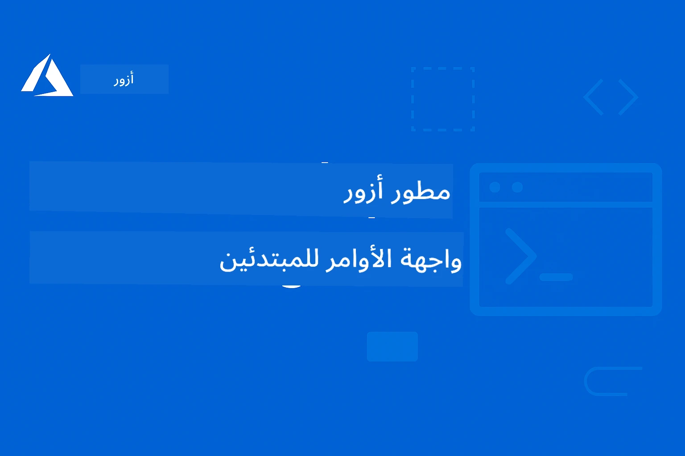

# AZD للمبتدئين: رحلة تعليمية منظمة

 

[](https://github.com/microsoft/AZD-for-beginners)
[](https://GitHub.com/microsoft/azd-for-beginners/network/)
[](https://github.com/microsoft/AZD-for-beginners)

[](https://discord.com/invite/nkVh3dp)
[](https://discord.gg/nTYy5BXMWG)

---

### الترجمات الآلية (دائمًا مُحدّثة)

<!-- CO-OP TRANSLATOR LANGUAGES TABLE START -->
[العربية](./README.md) | [البنغالية](../bn/README.md) | [البلغارية](../bg/README.md) | [البورمية (ميانمار)](../my/README.md) | [الصينية (المبسطة)](../zh-CN/README.md) | [الصينية (التقليدية، هونغ كونغ)](../zh-HK/README.md) | [الصينية (التقليدية، ماكاو)](../zh-MO/README.md) | [الصينية (التقليدية، تايوان)](../zh-TW/README.md) | [الكرواتية](../hr/README.md) | [التشيكية](../cs/README.md) | [الدانمركية](../da/README.md) | [الهولندية](../nl/README.md) | [الإستونية](../et/README.md) | [الفنلندية](../fi/README.md) | [الفرنسية](../fr/README.md) | [الألمانية](../de/README.md) | [اليونانية](../el/README.md) | [العبرية](../he/README.md) | [الهندية](../hi/README.md) | [الهنغارية](../hu/README.md) | [الإندونيسية](../id/README.md) | [الإيطالية](../it/README.md) | [اليابانية](../ja/README.md) | [الكنادية](../kn/README.md) | [الخميرية](../km/README.md) | [الكورية](../ko/README.md) | [الليتوانية](../lt/README.md) | [الماليزية](../ms/README.md) | [المالايالامية](../ml/README.md) | [الماراثية](../mr/README.md) | [النيبالية](../ne/README.md) | [النيجرية بيدجين](../pcm/README.md) | [النرويجية](../no/README.md) | [الفارسية (اللغة الفارسية)](../fa/README.md) | [البولندية](../pl/README.md) | [البرتغالية (البرازيل)](../pt-BR/README.md) | [البرتغالية (البرتغال)](../pt-PT/README.md) | [البنجابية (غورموكي)](../pa/README.md) | [الرومانية](../ro/README.md) | [الروسية](../ru/README.md) | [الصربية (السيريلية)](../sr/README.md) | [السلوفاكية](../sk/README.md) | [السلوفينية](../sl/README.md) | [الإسبانية](../es/README.md) | [السواحيلية](../sw/README.md) | [السويدية](../sv/README.md) | [التاغالوغية (الفلبينية)](../tl/README.md) | [التاميلية](../ta/README.md) | [التيلوجو](../te/README.md) | [التايلاندية](../th/README.md) | [التركية](../tr/README.md) | [الأوكرانية](../uk/README.md) | [الأردية](../ur/README.md) | [الفيتنامية](../vi/README.md)

> **تفضل الاستنساخ محليًا؟**
>
> يحتوي هذا المستودع على ترجمات لأكثر من 50 لغة مما يزيد بشكل كبير من حجم التنزيل. للاستنساخ بدون الترجمات، استخدم اسماء التحقق الجزئي:
>
> **Bash / macOS / Linux:**
> ```bash
> git clone --filter=blob:none --sparse https://github.com/microsoft/AZD-for-beginners.git
> cd AZD-for-beginners
> git sparse-checkout set --no-cone '/*' '!translations' '!translated_images'
> ```
>
> **CMD (ويندوز):**
> ```cmd
> git clone --filter=blob:none --sparse https://github.com/microsoft/AZD-for-beginners.git
> cd AZD-for-beginners
> git sparse-checkout set --no-cone "/*" "!translations" "!translated_images"
> ```
>
> هذا يمنحك كل ما تحتاجه لإكمال الدورة بسرعة تنزيل أكبر.
<!-- CO-OP TRANSLATOR LANGUAGES TABLE END -->

## 🆕 ما الجديد في azd اليوم

> 📌 **مراجعة إصدار AI CLI (2026-11-04):** تم فحص الإرشادات وفقًا للوثائق/المصادر المنشورة **`azd 1.37.2`**، **الوكلاء `1.0.0-beta.23`**، و**التقييمات `1.0.0-beta.2`**. استخدم `azd >= 1.37.0` لسير العمل المدمج. قم بتشغيل `azd version` و[تحديث CLI الأساسي](https://learn.microsoft.com/azure/developer/azure-developer-cli/install-azd) قبل الإضافات. راجع [التغييرات والإصلاحات في الإصدار](docs/chapter-08-production/production-ai-practices.md#recent-release-changes-and-fixes). هذا ليس تحقق نشر مباشر للدورة كاملة.

يدعم Azure Developer CLI العديد من أنواع التطبيقات، بما في ذلك تطبيقات الويب، واجهات برمجة التطبيقات، ووكلاء الذكاء الاصطناعي، من خلال المضيفين والقوالب والإضافات المدعومة.

إليك ما يعنيه ذلك بالنسبة لك:

- **الوكلاء الذكاء الاصطناعي أصبحوا الآن عبء عمل رئيسي في azd.** يمكنك تهيئة، نشر، وإدارة مشاريع وكلاء الذكاء الاصطناعي باستخدام سير العمل `azd init` → `azd up` الذي تعرفه بالفعل.
- **دورة حياة الوكيل عبر امتدادين.** استخدم `azure.ai.agents` لتهيئة، استدعاء، تحسين، وإيقاف الوكلاء. ثبّت **`azure.ai.evaluations`** بشكل منفصل لـ `azd ai eval init`، `generate`، و `run start`. استبدل وكلاء beta.22 سير عمل التقييم القديم وغيّر تكوين التحسين؛ اتبع [دليل الترحيل](docs/chapter-08-production/production-ai-practices.md#evaluation-migration-and-quality-checks).
- **المزيد من لبنات بناء الذكاء الاصطناعي.** إضافات المعاينة الجديدة — `azure.ai.skills` و `azure.ai.connections` — تتيح لك إدارة مهارات الوكلاء القابلة لإعادة الاستخدام واتصالات Foundry مباشرة عبر azd.
- **تكامل Microsoft Foundry** يجلب نشر النماذج واستضافة الوكلاء وتكوين خدمات الذكاء الاصطناعي مباشرة إلى نظام قوالب azd.
- **تحسينات يومية سلسة.** أصدرت النسخ الأخيرة جعل `azd init` متكررة (آمنة لإعادة التشغيل)، و `azd auth login` يمسح الرموز القديمة تلقائيًا، وأضاف موجه إعداد ودود لأول تشغيل `azd tool`.
- **سير العمل الأساسي لم يتغير.** سواء كنت تنشر تطبيق مهام، خدمة مصغرة، أو حل ذكاء اصطناعي متعدد الوكلاء، الأوامر هي نفسها.

> **ملاحظة لمستخدمي Aspire:** الآن تشير Microsoft إلى المنتج ببساطة باسم **Aspire** (سابقًا ".NET Aspire"). دعم azd لـ Aspire لم يتغير - تم تحديث الاسم فقط.

إذا استخدمت azd من قبل، فإن دعم الذكاء الاصطناعي هو امتداد طبيعي - ليس أداة منفصلة أو مسار متقدم. إذا بدأت من جديد، ستتعلم سير عمل واحد يعمل لكل شيء.

---

## 🚀 ما هو Azure Developer CLI (azd)؟

**Azure Developer CLI (azd)** هو أداة سطر أوامر موجهة للمطورين تجعل من السهل نشر التطبيقات على Azure. بدلاً من إنشاء وتوصيل العديد من موارد Azure يدويًا، يمكنك نشر تطبيقات كاملة بأمر واحد.

### سحر `azd up`

```bash
# This single command does everything:
# ✅ Creates all Azure resources  
# ✅ Configures networking and security
# ✅ Builds your application code
# ✅ Deploys to Azure
# ✅ Gives you a working URL
azd up
```

القالب يوفر تكوين التطبيق والبنية التحتية. يتطلب النشر الناجح خدمات/نماذج مدعومة، حصة كافية وأذونات، مدخلات صحيحة، والتحقق من التطبيق المنشور. `azd up` لا يجعل القالب آمنًا أو متوافقًا أو جاهزًا للإنتاج تلقائيًا.

---

## ❓ Azure Developer CLI مقابل Azure CLI: ما الفرق؟

هذا هو السؤال الأكثر شيوعًا للمبتدئين. إليك الجواب البسيط:

| الميزة | **Azure CLI (`az`)** | **Azure Developer CLI (`azd`)** |
|---------|---------------------|--------------------------------|
| **الغرض** | إدارة موارد Azure الفردية | نشر التطبيقات كاملة |
| **التوجه** | يركز على البنية التحتية | يركز على التطبيق |
| **مثال** | `az webapp create --name myapp...` | `azd up` |
| **منحنى التعلم** | يجب معرفة خدمات Azure | فقط اعرف تطبيقك |
| **الأفضل لـ** | DevOps، البنية التحتية | المطورين، النمذجة الأولية |

### تشبيه بسيط

- **Azure CLI** مثل وجود كل الأدوات لبناء بيت - مطارق، مناشير، مسامير. يمكنك بناء أي شيء، لكن يجب أن تعرف البناء.
- **Azure Developer CLI** مثل توظيف مقاول - تصف ما تريد، وهم يتولون البناء.

### متى تستخدم كلًا منهما

| السيناريو | استخدم هذا |
|----------|----------|
| "أريد نشر تطبيقي على الويب بسرعة" | `azd up` |
| "أحتاج لإنشاء حساب تخزين فقط" | `az storage account create` |
| "أقوم ببناء تطبيق ذكاء اصطناعي كامل" | `azd init --template azure-search-openai-demo` |
| "أحتاج لتصحيح مورد Azure محدد" | `az resource show` |
| "أريد النشر إلى بيئة الإنتاج المجهزة لدي" | راجع التكوين، الوصول، التكلفة، وأبواب العمليات قبل `azd up --environment production` |

### يعملان معًا!

لدى AZD و Azure CLI مصادقة وتكوين منفصلان. استخدم `azd auth login` لـ AZD، و `az login` عند الحاجة صراحةً إلى Azure CLI في أمر تشخيصي أو وصلة. يمكنك استخدامهما معًا:
```bash
# Deploy your app with AZD
azd up

# Then fine-tune specific resources with Azure CLI
az webapp config set --name myapp --always-on true
```

---

## 🌟 اعثر على القوالب في Awesome AZD

لا تبدأ من الصفر! **Awesome AZD** هو مجموعة من قوالب جاهزة للنشر من المجتمع:

| المورد | الوصف |
|----------|-------------|
| 🔗 [**معرض Awesome AZD**](https://azure.github.io/awesome-azd/) | استعرض أكثر من 200 قالب ونشر بنقرة واحدة |
| 🔗 [**قدّم قالبًا**](https://github.com/Azure/awesome-azd/issues) | ساهم بقالبك الخاص للمجتمع |
| 🔗 [**مستودع GitHub**](https://github.com/Azure/awesome-azd) | نجم واستكشف المصدر |

### قوالب الذكاء الاصطناعي الشائعة من Awesome AZD

اختر قالبًا في دليل فارغ خاص به؛ الأوامر أدناه بدائل. `.` في النهاية يهيئ ذلك الدليل.

```bash
# RAG Chat with Microsoft Foundry Models + AI Search
azd init --template azure-search-openai-demo .

# Quick AI Chat Application
azd init --template openai-chat-app-quickstart .

# AI Agents with Foundry Agents
azd init --template get-started-with-ai-agents .
```

---

## 🎯 البدء في 3 خطوات

قبل أن تبدأ، تأكد من جاهزية جهازك للقالب الذي تريد نشره:

**ويندوز:**
```powershell
.\validate-setup.ps1
```

**macOS / Linux:**
```bash
bash ./validate-setup.sh
```

إذا فشل أي تحقق مطلوب، أصلح ذلك أولاً ثم تابع البدء السريع.

### الخطوة 1: تثبيت AZD (دقيقتان)

**ويندوز:**
```powershell
winget install microsoft.azd
```

**macOS:**
```bash
brew tap azure/azd && brew install azd
```

**لينكس:**
```bash
curl -fsSL https://aka.ms/install-azd.sh | bash
```

### الخطوة 2: التوثيق لـ AZD

```bash
# Optional if you plan to use Azure CLI commands directly in this course
az login

# Required for AZD workflows
azd auth login
```

إذا لم تكن متأكدًا مما تحتاجه، اتبع تدفق الإعداد الكامل في [التثبيت والإعداد](docs/chapter-01-foundation/installation.md#authentication-setup).

### الخطوة 3: نشر تطبيقك الأول

```bash
# Initialize from a template
azd init --template todo-nodejs-mongo .

# Deploy to Azure (creates everything!)
azd up
```

**🎉 هذا كل شيء!** تطبيقك الآن مباشر على Azure.

### التنظيف (لا تنسى!)

```bash
# Remove all resources when done experimenting
azd down --force --purge
```

---

## 📚 كيف تستخدم هذه الدورة

هذه الدورة مصممة لـ **التعلم التدريجي** - ابدأ حيث ترتاح وتحرك للأعلى:

| خبرتك | ابدأ من هنا |
|-----------------|------------|
| **جديد تمامًا على Azure** | [الفصل 1: الأساسيات](#-chapter-1-foundation--quick-start) |
| **تعرف على Azure، جديد على AZD** | [الفصل 1: الأساسيات](#-chapter-1-foundation--quick-start) |
| **أريد نشر تطبيقات الذكاء الاصطناعي** | [الفصل 2: تطوير الذكاء الاصطناعي أولًا](#-chapter-2-ai-first-development-recommended-for-ai-developers) |
| **أريد التطبيق العملي** | [🎓 ورشة عمل تفاعلية](workshop/README.md) - مختبر موجّه ٣-٤ ساعات |
| **أحتاج لأنماط الإنتاج** | [الفصل 8: الإنتاج والمؤسسات](#-chapter-8-production--enterprise-patterns) |

### الإعداد السريع

1. **افتح هذا المستودع**: [](https://GitHub.com/microsoft/azd-for-beginners/fork)
2. **استنسخه**: `git clone https://github.com/YOUR-USERNAME/azd-for-beginners.git`
3. **احصل على المساعدة**: [مجتمع Azure Discord](https://discord.com/invite/ByRwuEEgH4)

> **تفضل الاستنساخ محليًا؟**

> يحتوي هذا المستودع على ترجمات لأكثر من 50 لغة مما يزيد بشكل كبير من حجم التنزيل. للاستنساخ بدون الترجمات، استخدم اسماء التحقق الجزئي:
> ```bash
> git clone --filter=blob:none --sparse https://github.com/microsoft/AZD-for-beginners.git
> cd AZD-for-beginners
> git sparse-checkout set --no-cone '/*' '!translations' '!translated_images'
> ```
> هذا يمنحك كل ما تحتاجه لإكمال الدورة بسرعة تنزيل أكبر.


## نظرة عامة على الدورة

اتقن Azure Developer CLI (azd) من خلال فصول منظمة مصممة للتعلم التدريجي. **تركيز خاص على نشر تطبيقات الذكاء الاصطناعي مع دمج Microsoft Foundry.**

### لماذا هذه الدورة ضرورية للمطورين المعاصرين

يحتاج المطورون الذين ينشرون أحمال عمل الذكاء الاصطناعي عادة إلى توجيه حول:
- معماريات الذكاء الاصطناعي المعقدة متعددة الخدمات
- أفضل ممارسات نشر الذكاء الاصطناعي للإنتاج  
- تكامل وخدمات Azure AI وإعدادها
- تحسين التكاليف لأحمال عمل الذكاء الاصطناعي
- استكشاف مشاكل النشر الخاصة بالذكاء الاصطناعي وإصلاحها

### أهداف التعلم

عند إكمال هذه الدورة المنظمة، ستتمكن من:
- **إتقان أساسيات AZD**: المفاهيم الأساسية، التثبيت، والإعداد
- **نشر تطبيقات الذكاء الاصطناعي**: استخدام AZD مع خدمات Microsoft Foundry
- **تنفيذ البنية التحتية ككود**: إدارة موارد Azure باستخدام قوالب Bicep
- **استكشاف أخطاء النشر**: حل المشكلات الشائعة وتصحيح الأخطاء
- **التحسين للإنتاج**: الأمان، التحجيم، المراقبة، وإدارة التكاليف
- **بناء حلول متعددة الوكلاء**: نشر معماريات الذكاء الاصطناعي المعقدة

## قبل أن تبدأ: الحسابات، الوصول، والافتراضات

قبل أن تبدأ الفصل الأول، تأكد من توفر الأمور التالية. خطوات التثبيت في هذا الدليل تفترض أن هذه الأساسيات تُدار بالفعل.

- **اشتراك Azure**: يمكنك استخدام اشتراك موجود من العمل أو حسابك الخاص، أو إنشاء [نسخة تجريبية مجانية](https://aka.ms/azurefreetrial) للبدء.
- **إذن إنشاء موارد Azure**: لأغلب التمارين، يجب أن يكون لديك على الأقل صلاحية **Contributor** على الاشتراك أو مجموعة الموارد المستهدفة. قد تفترض بعض الفصول أيضًا إمكانية إنشاء مجموعات موارد، هويات مُدارة، وتعيينات RBAC.
- [**حساب GitHub**](https://github.com): مفيد لتفريع المستودع، تتبع التغييرات الخاصة بك، واستخدام GitHub Codespaces للورشة.
- **المتطلبات المسبقة لتشغيل القوالب**: بعض القوالب تحتاج لأدوات محلية مثل Node.js، Python، Java، أو Docker. شغّل مدقق الإعداد قبل البدء لتتجنب نقص الأدوات مبكرًا.
- **معرفة أساسية بواجهة الأوامر الطرفية**: لست بحاجة لأن تكون خبيرًا، لكن يجب أن تكون مرتاحًا لتشغيل أوامر مثل `git clone`، `azd auth login`، و`azd up`.

> **تعمل في اشتراك مؤسسي؟**
> إذا كانت بيئة Azure الخاصة بك تُدار بواسطة مسؤول، تأكد مسبقًا من إمكانية نشر الموارد في الاشتراك أو مجموعة الموارد التي تخطط لاستخدامها. فإذا لم يكن ذلك ممكنًا، اطلب اشتراك صندوق رمل أو صلاحية Contributor قبل البدء.

> **جديد على Azure؟**
> ابدأ بنسخة تجريبية في Azure أو اشتراك بنظام الدفع حسب الاستخدام عبر https://aka.ms/azurefreetrial حتى تكمل التمارين بالكامل دون انتظار موافقات على مستوى المُستأجر.

## 🗺️ خريطة الدورة: التنقل السريع حسب الفصل

يحتوي كل فصل على README مخصص مع أهداف التعلم، بدء سريع، وتمارين:

| الفصل | الموضوع | الدروس | المدة | التعقيد |
|---------|-------|---------|----------|------------|
| **[الفصل 1: الأساس](docs/chapter-01-foundation/README.md)** | البداية | [أساسيات AZD](docs/chapter-01-foundation/azd-basics.md) &#124; [التثبيت](docs/chapter-01-foundation/installation.md) &#124; [المشروع الأول](docs/chapter-01-foundation/first-project.md) | 30-45 دقيقة | ⭐ |
| **[الفصل 2: تطوير الذكاء الاصطناعي](docs/chapter-02-ai-development/README.md)** | تطبيقات تركز على الذكاء الاصطناعي | [تكامل Foundry](docs/chapter-02-ai-development/microsoft-foundry-integration.md) &#124; [وكلاء الذكاء الاصطناعي](docs/chapter-02-ai-development/agents.md) &#124; [نشر النماذج](docs/chapter-02-ai-development/ai-model-deployment.md) &#124; [ورشة عمل](docs/chapter-02-ai-development/ai-workshop-lab.md) | 1-2 ساعة | ⭐⭐ |
| **[الفصل 3: الإعداد](docs/chapter-03-configuration/README.md)** | المصادقة والأمان | [الإعداد](docs/chapter-03-configuration/configuration.md) &#124; [المصادقة والأمان](docs/chapter-03-configuration/authsecurity.md) | 45-60 دقيقة | ⭐⭐ |
| **[الفصل 4: البنية التحتية](docs/chapter-04-infrastructure/README.md)** | IaC والنشر | [دليل النشر](docs/chapter-04-infrastructure/deployment-guide.md) &#124; [التزويد](docs/chapter-04-infrastructure/provisioning.md) | 1-1.5 ساعة | ⭐⭐⭐ |
| **[الفصل 5: وكلاء متعددون](docs/chapter-05-multi-agent/README.md)** | حلول وكلاء الذكاء الاصطناعي | [سيناريو البيع بالتجزئة](examples/retail-scenario.md) &#124; [أنماط التنسيق](docs/chapter-06-pre-deployment/coordination-patterns.md) | 2-3 ساعات | ⭐⭐⭐⭐ |
| **[الفصل 6: قبل النشر](docs/chapter-06-pre-deployment/README.md)** | التخطيط والتحقق | [فحوصات ما قبل الرحلة](docs/chapter-06-pre-deployment/preflight-checks.md) &#124; [تخطيط السعة](docs/chapter-06-pre-deployment/capacity-planning.md) &#124; [اختيار SKU](docs/chapter-06-pre-deployment/sku-selection.md) &#124; [رؤى التطبيقات](docs/chapter-06-pre-deployment/application-insights.md) | 1 ساعة | ⭐⭐ |
| **[الفصل 7: استكشاف الأخطاء](docs/chapter-07-troubleshooting/README.md)** | التصحيح والإصلاح | [مشكلات شائعة](docs/chapter-07-troubleshooting/common-issues.md) &#124; [التصحيح](docs/chapter-07-troubleshooting/debugging.md) &#124; [مشكلات الذكاء الاصطناعي](docs/chapter-07-troubleshooting/ai-troubleshooting.md) | 1-1.5 ساعة | ⭐⭐ |
| **[الفصل 8: الإنتاج](docs/chapter-08-production/README.md)** | أنماط المؤسسات | [ممارسات الإنتاج](docs/chapter-08-production/production-ai-practices.md) | 2-3 ساعات | ⭐⭐⭐⭐ |
| **[🎓 ورشة العمل](workshop/README.md)** | مختبر عملي | [مقدمة](workshop/docs/instructions/0-Introduction.md) &#124; [الاختيار](workshop/docs/instructions/1-Select-AI-Template.md) &#124; [التحقق](workshop/docs/instructions/2-Validate-AI-Template.md) &#124; [التفكيك](workshop/docs/instructions/3-Deconstruct-AI-Template.md) &#124; [الإعداد](workshop/docs/instructions/4-Configure-AI-Template.md) &#124; [التخصيص](workshop/docs/instructions/5-Customize-AI-Template.md) &#124; [التفكيك النهائي](workshop/docs/instructions/6-Teardown-Infrastructure.md) &#124; [الخاتمة](workshop/docs/instructions/7-Wrap-up.md) | 3-4 ساعات | ⭐⭐ |

**إجمالي مدة الدورة:** ~10-14 ساعة | **تقدم المهارات:** مبتدئ → جاهز للإنتاج

---

## 📚 فصول التعلم

*اختر مسار تعلمك بناءً على مستوى الخبرة والأهداف*

### 🚀 الفصل 1: الأساس والبداية السريعة
**المتطلبات:** اشتراك Azure، معرفة أساسية بسطر الأوامر  
**المدة:** 30-45 دقيقة  
**التعقيد:** ⭐

#### ما ستتعلمه
- فهم أساسيات Azure Developer CLI
- تثبيت AZD على منصتك
- أول عملية نشر ناجحة لك

#### مصادر التعلم
- **🎯 ابدأ هنا**: [ما هو Azure Developer CLI؟](#-what-is-azure-developer-cli-azd)
- **📖 النظريات**: [أساسيات AZD](docs/chapter-01-foundation/azd-basics.md) - المفاهيم الأساسية والمصطلحات
- **⚙️ الإعداد**: [التثبيت والإعداد](docs/chapter-01-foundation/installation.md) - أدلة خاصة بالمنصة
- **🛠️ التطبيق العملي**: [مشروعك الأول](docs/chapter-01-foundation/first-project.md) - تعليمات خطوة بخطوة
- **📋 مرجع سريع**: [ورقة غش الأوامر](resources/cheat-sheet.md)

#### تمارين عملية
```bash
# Quick installation check
azd version

# Deploy your first application
azd init --template todo-nodejs-mongo .
azd up
```

**💡 نتيجة الفصل**: نشر تطبيق ويب بسيط على Azure باستخدام AZD بنجاح

**✅ تحقق النجاح:**
```bash
# After completing Chapter 1, you should be able to:
azd version              # Shows installed version
azd init --template todo-nodejs-mongo  # Initializes project
azd up                  # Deploys to Azure
azd show                # Displays running app URL
# Application opens in browser and works
azd down --force --purge  # Cleans up resources
```

**📊 استثمار الوقت:** 30-45 دقيقة  
**📈 مستوى المهارة بعد:** يمكن نشر تطبيقات أساسية بشكل مستقل

---

### 🤖 الفصل 2: تطوير الذكاء الاصطناعي أولًا (مُوصى به لمطوري الذكاء الاصطناعي)
**المتطلبات:** إكمال الفصل 1  
**المدة:** 1-2 ساعة  
**التعقيد:** ⭐⭐

#### ما ستتعلمه
- دمج Microsoft Foundry مع AZD
- نشر التطبيقات المدعومة بالذكاء الاصطناعي
- فهم إعدادات خدمات الذكاء الاصطناعي

#### مصادر التعلم
- **🎯 ابدأ هنا**: [تكامل Microsoft Foundry](docs/chapter-02-ai-development/microsoft-foundry-integration.md)
- **🤖 وكلاء الذكاء الاصطناعي**: [دليل وكلاء الذكاء الاصطناعي](docs/chapter-02-ai-development/agents.md) - نشر وكلاء أذكياء باستخدام AZD
- **📖 الأنماط**: [نشر نماذج الذكاء الاصطناعي](docs/chapter-02-ai-development/ai-model-deployment.md) - نشر وإدارة نماذج الذكاء الاصطناعي
- **🛠️ ورشة عمل**: [مختبر ورشة الذكاء الاصطناعي](docs/chapter-02-ai-development/ai-workshop-lab.md) - جعل حلول الذكاء الاصطناعي جاهزة مع AZD
- **🎥 دليل تفاعلي**: [مواد الورشة](workshop/README.md) - التعلم عبر المتصفح مع MkDocs * بيئة DevContainer
- **📋 القوالب**: [قوالب Microsoft Foundry](#featured-microsoft-foundry-templates)
- **📝 الأمثلة**: [أمثلة نشر AZD](examples/README.md)

#### تمارين عملية
```bash
# Deploy your first AI application
azd init --template azure-search-openai-demo .
azd up

# Try additional AI templates
azd init --template openai-chat-app-quickstart .
azd init --template agent-openai-python-prompty .
```

**💡 نتيجة الفصل**: نشر وتكوين تطبيق محادثة مدعوم بالذكاء الاصطناعي مع قدرات RAG

**✅ تحقق النجاح:**
```bash
# After Chapter 2, you should be able to:
azd init --template azure-search-openai-demo .
azd up
# Test the AI chat interface
# Ask questions and get AI-powered responses with sources
# Verify search integration works
azd monitor  # Check Application Insights shows telemetry
azd down --force --purge
```

**📊 استثمار الوقت:** 1-2 ساعة  
**📈 مستوى المهارة بعد:** يمكن نشر تطبيقات تعلم الذكاء الاصطناعي وتحديد متطلبات الاستعداد للإنتاج الإضافية
**💰 الوعي بالتكلفة:** فهم تكاليف التطوير بين $80-150/شهر، وتكاليف الإنتاج بين $300-3500/شهر

#### 💰 اعتبارات التكاليف لنشر الذكاء الاصطناعي

**بيئة التطوير (تقديري $80-150/شهر):**
- نماذج Microsoft Foundry (الدفع حسب الاستخدام): $0-50/شهر (بناءً على استخدام الرموز)
- بحث AI (الطبقة الأساسية): $75/شهر
- تطبيقات الحاويات (الاستهلاك): $0-20/شهر
- التخزين (القياسي): $1-5/شهر

**بيئة الإنتاج (تقديري $300-3500+/شهر):**
- نماذج Microsoft Foundry (PTU لأداء ثابت): $3,000+/شهر أو الدفع حسب الاستخدام مع حجم كبير
- بحث AI (الطبقة القياسية): $250/شهر
- تطبيقات الحاويات (مخصصة): $50-100/شهر
- رؤى التطبيق: $5-50/شهر
- التخزين (المتميز): $10-50/شهر

**💡 نصائح تحسين التكلفة:**
- تحقق من تسعير استنتاج النموذج والاعتمادات الخاصة بالحساب؛ Azure OpenAI لا يشمل بديلًا شهريًا مجانيًا عالميًا بـ 50,000 رمز
- شغّل `azd down` لحذف الموارد عندما لا تكون مطلوبة بعد مراجعة البيئة المختارة
- ابدأ بفوترة حسب الاستهلاك، وقم بالترقية لـ PTU فقط للإنتاج
- استخدم `azd provision --preview` لفحص البنية التحتية المخططة، ثم سعّر الموارد الناتجة باستخدام حاسبة تسعير Azure
- فعّل التوسع التلقائي: ادفع فقط مقابل الاستخدام الفعلي

**مراقبة التكاليف:**
```bash
# Inspect planned resources (this does not calculate prices)
azd provision --preview

# Monitor actual costs in Azure Portal
az consumption budget list --resource-group <your-rg>
```

---

### ⚙️ الفصل 3: الإعداد والمصادقة
**المتطلبات:** إكمال الفصل 1  
**المدة:** 45-60 دقيقة  
**التعقيد:** ⭐⭐

#### ما ستتعلمه
- إعداد وإدارة البيئة
- أفضل ممارسات المصادقة والأمان
- تسمية الموارد وتنظيمها

#### مصادر التعلم
- **📖 الإعداد**: [دليل الإعداد](docs/chapter-03-configuration/configuration.md) - إعداد البيئة
- **🔐 الأمان**: [أنماط المصادقة والهوية المُدارة](docs/chapter-03-configuration/authsecurity.md) - أنماط المصادقة
- **📝 الأمثلة**: [مثال تطبيق قاعدة بيانات](examples/database-app/README.md) - أمثلة قواعد بيانات AZD

#### تمارين عملية
- إعداد بيئات متعددة (تطوير، اختبار، إنتاج)
- إعداد مصادقة الهوية المُدارة
- تنفيذ إعدادات خاصة بالبيئة

**💡 نتيجة الفصل**: إدارة بيئات متعددة مع مصادقة وأمان مناسبين

---

### 🏗️ الفصل 4: البنية التحتية ككود والنشر
**المتطلبات:** إكمال الفصول 1-3  
**المدة:** 1-1.5 ساعة  
**التعقيد:** ⭐⭐⭐

#### ما ستتعلمه
- أنماط نشر متقدمة
- البنية التحتية ككود باستخدام Bicep
- استراتيجيات توفير الموارد

#### مصادر التعلم
- **📖 النشر**: [دليل النشر](docs/chapter-04-infrastructure/deployment-guide.md) - سير العمل الكامل
- **🏗️ التزويد**: [تزويد الموارد](docs/chapter-04-infrastructure/provisioning.md) - إدارة موارد Azure
- **📝 الأمثلة**: [مثال تطبيق حاوية](../../examples/container-app) - عمليات نشر بالحاويات

#### تمارين عملية
- إنشاء قوالب Bicep مخصصة
- نشر تطبيقات متعددة الخدمات
- تنفيذ استراتيجيات النشر الأزرق-الأخضر

**💡 نتيجة الفصل**: نشر تطبيقات معقدة متعددة الخدمات باستخدام قوالب بنية تحتية مخصصة

---

### 🎯 الفصل 5: حلول الذكاء الاصطناعي متعددة الوكلاء (متقدم)
**المتطلبات:** إكمال الفصول 1-2  
**المدة:** 2-3 ساعات  
**التعقيد:** ⭐⭐⭐⭐

#### ما ستتعلمه
- أنماط هندسة متعددة الوكلاء
- تنسيق وتنسيق الوكلاء
- نشرات الذكاء الاصطناعي الجاهزة للإنتاج

#### مصادر التعلم
- **🤖 التصميم المميز**: [حل الذكاء الاصطناعي متعدد الوكلاء للبيع بالتجزئة](examples/retail-scenario.md) - مخطط الهندسة، ليس تطبيقًا كاملاً
- **🛠️ قوالب ARM**: [حزمة قالب ARM](../../examples/retail-multiagent-arm-template) - هيكل البنية التحتية؛ مراجعة المتطلبات المسبقة والمكونات التطبيقية المفقودة  
- **📖 الهندسة المعمارية**: [أنماط التنسيق متعدد الوكلاء](docs/chapter-06-pre-deployment/coordination-patterns.md) - أنماط  

#### تمارين عملية  
```bash
# Inspect the retail infrastructure scaffold before choosing to deploy it
cd examples/retail-multiagent-arm-template
cat README.md

# After an intentional deployment, inspect infrastructure state
az deployment group show --resource-group <rg-name> --name <deployment-name>
```
  
**💡 نتيجة الفصل**: فهم تصميم الوكلاء المتعددين وتحديد العمل المطلوب للتنفيذ، والتحقق، والتشغيل بما يتجاوز هيكل البنية التحتية  

---

### 🔍 الفصل 6: التحقق والتخطيط قبل النشر  
**المتطلبات المسبقة**: إكمال الفصل 4  
**المدة**: ساعة واحدة  
**التعقيد**: ⭐⭐  

#### ما ستتعلمه  
- تخطيط السعة والتحقق من الموارد  
- استراتيجيات اختيار وحدات SKU  
- فحوصات ما قبل الطيران والأتمتة  

#### مصادر التعلم  
- **📊 التخطيط**: [تخطيط السعة](docs/chapter-06-pre-deployment/capacity-planning.md) - التحقق من الموارد  
- **💰 الاختيار**: [اختيار وحدة SKU](docs/chapter-06-pre-deployment/sku-selection.md) - خيارات فعالة من حيث التكلفة  
- **✅ التحقق**: [فحوصات ما قبل الطيران](docs/chapter-06-pre-deployment/preflight-checks.md) - سكريبتات آلية  

#### تمارين عملية  
- تشغيل سكريبتات التحقق من السعة  
- تحسين اختيار وحدات SKU من حيث التكلفة  
- تنفيذ فحوصات ما قبل النشر الآلية  

**💡 نتيجة الفصل**: التحقق من عمليات النشر وتحسينها قبل التنفيذ  

---

### 🚨 الفصل 7: استكشاف الأخطاء وإصلاحها وتصحيحها  
**المتطلبات المسبقة**: إكمال أي فصل نشر  
**المدة**: 1-1.5 ساعة  
**التعقيد**: ⭐⭐  

#### ما ستتعلمه  
- منهجيات التصحيح المنهجي  
- المشاكل الشائعة وحلولها  
- استكشاف أخطاء الذكاء الاصطناعي وإصلاحها  

#### مصادر التعلم  
- **🔧 المشاكل الشائعة**: [المشاكل الشائعة](docs/chapter-07-troubleshooting/common-issues.md) - الأسئلة الشائعة والحلول  
- **🕵️ التصحيح**: [دليل التصحيح](docs/chapter-07-troubleshooting/debugging.md) - استراتيجيات خطوة بخطوة  
- **🤖 مشكلات الذكاء الاصطناعي**: [استكشاف أخطاء الذكاء الاصطناعي وإصلاحها](docs/chapter-07-troubleshooting/ai-troubleshooting.md) - مشاكل خدمات الذكاء الاصطناعي  

#### تمارين عملية  
- تشخيص فشل عمليات النشر  
- حل مشاكل المصادقة  
- تصحيح اتصال خدمة الذكاء الاصطناعي  

**💡 نتيجة الفصل**: تشخيص وحل مشاكل النشر الشائعة بشكل مستقل  

---

### 🏢 الفصل 8: أنماط الإنتاج والمؤسسات  
**المتطلبات المسبقة**: إكمال الفصول 1-4  
**المدة**: 2-3 ساعات  
**التعقيد**: ⭐⭐⭐⭐  

#### ما ستتعلمه  
- استراتيجيات نشر الإنتاج  
- أنماط أمان المؤسسات  
- المراقبة وتحسين التكلفة  

#### مصادر التعلم  
- **🏭 الإنتاج**: [أفضل ممارسات AI للإنتاج](docs/chapter-08-production/production-ai-practices.md) - أنماط المؤسسات  
- **📝 أمثلة**: [مثال الخدمات المصغرة](../../examples/microservices) - هندسات معقدة  
- **📊 المراقبة**: [تكامل Application Insights](docs/chapter-06-pre-deployment/application-insights.md) - المراقبة  

#### تمارين عملية  
- تنفيذ أنماط أمان المؤسسات  
- إعداد مراقبة شاملة  
- النشر للإنتاج مع الحوكمة المناسبة  

**💡 نتيجة الفصل**: نشر تطبيقات جاهزة للمؤسسات بقدرات إنتاج كاملة  

---

## 🎓 نظرة عامة على الورشة: تجربة تعلم عملية  

> **⚠️ حالة الورشة: تطوير نشط**  
> مواد الورشة قيد التطوير والتحسين حالياً. الوحدات الأساسية تعمل، لكن بعض الأقسام المتقدمة غير مكتملة. نعمل بنشاط لإكمال المحتوى بالكامل. [تتبع التقدم →](workshop/README.md)  

### مواد ورشة العمل التفاعلية  
**تعلم عملي شامل مع أدوات متصفح وتمارين موجهة**  

توفر مواد ورشة العمل تجربة تعلم منظمة وتفاعلية تكمل المنهج القائم على الفصول أعلاه. تم تصميم الورشة لكل من التعلم الذاتي والجلسات التي يقودها المدرب.  

#### 🛠️ ميزات الورشة  
- **واجهة قائمة على المتصفح**: ورشة عمل كاملة تعمل بـ MkDocs مع ميزات بحث ونسخ وثيمات  
- **تكامل GitHub Codespaces**: إعداد بيئة تطوير بنقرة واحدة  
- **مسار تعليمي منظم**: 8 وحدات تمارين موجهة (3-4 ساعات إجمالاً)  
- **منهجية تدرجية**: مقدمة → اختيار → تحقق → تفكيك → تكوين → تخصيص → تنظيف → خاتمة  
- **بيئة DevContainer تفاعلية**: أدوات واعتمادات مهيأة مسبقاً  

#### 📚 هيكل وحدة الورشة  
تتبع الورشة منهجية تقدمية من 8 وحدات تأخذك من الاكتشاف إلى إتقان النشر:  

| الوحدة | الموضوع | ماذا ستفعل | المدة |  
|--------|-------|----------------|----------|  
| **0. مقدمة** | نظرة عامة على الورشة | فهم أهداف التعلم، المتطلبات المسبقة، وهيكل الورشة | 15 دقيقة |  
| **1. الاختيار** | اكتشاف القوالب | استكشاف قوالب AZD واختيار القالب المناسب لحالة الذكاء الاصطناعي الخاصة بك | 20 دقيقة |  
| **2. التحقق** | نشر والتحقق | نشر القالب باستخدام `azd up` والتحقق من عمل البنية التحتية | 30 دقيقة |  
| **3. التفكيك** | فهم الهيكل | استخدام GitHub Copilot لاستكشاف هندسة القالب وملفات Bicep وتنظيم الكود | 30 دقيقة |  
| **4. التكوين** | الغوص العميق في azure.yaml | إتقان تكوين `azure.yaml`، والتوابع الحياتية، ومتغيرات البيئة | 30 دقيقة |  
| **5. التخصيص** | جعله خاصاً بك | تمكين الذكاء الاصطناعي للبحث، التتبع، التقييم، والتخصيص حسب السيناريو الخاص بك | 45 دقيقة |  
| **6. التنظيف** | تنظيف الموارد | إلغاء توفير الموارد بأمان باستخدام `azd down --purge` | 15 دقيقة |  
| **7. الخاتمة** | الخطوات التالية | مراجعة الإنجازات، المفاهيم الرئيسية، ومواصلة رحلة التعلم الخاصة بك | 15 دقيقة |  

**تدفق الورشة:**  
```
Introduction → Selection → Validation → Deconstruction → Configuration → Customization → Teardown → Wrap-up
     ↓            ↓           ↓              ↓               ↓              ↓            ↓           ↓
  Overview    Find the     Deploy &      Explore        Master         Customize     Clean up    Review &
             right        verify        code &        azure.yaml      for your      resources   next steps
             template                   structure                     scenario
```
  
#### 🚀 بدء الورشة  
```bash
# Option 1: GitHub Codespaces (Recommended)
# Click "Code" → "Create codespace on main" in the repository

# Option 2: Local Development
git clone https://github.com/microsoft/azd-for-beginners.git
cd azd-for-beginners/workshop
# Follow the setup instructions in workshop/README.md
```
  
#### 🎯 نتائج تعلم الورشة  
من خلال إكمال الورشة، سيقوم المشاركون بـ:  
- **نشر تطبيقات AI للإنتاج**: استخدام AZD مع خدمات Microsoft Foundry  
- **إتقان هندسة متعددة الوكلاء**: تنفيذ حلول وكلاء AI منسقة  
- **تطبيق أفضل ممارسات الأمان**: تكوين المصادقة والتحكم في الوصول  
- **تحسين من أجل الحجم**: تصميم نشرات فعالة من حيث التكلفة والأداء  
- **استكشاف مشاكل النشر**: حل القضايا الشائعة بشكل مستقل  

#### 📖 موارد الورشة  
- **🎥 دليل تفاعلي**: [مواد الورشة](workshop/README.md) - بيئة تعلم قائمة على المتصفح  
- **📋 تعليمات وحدة بوحدة**:  
  - [0. مقدمة](workshop/docs/instructions/0-Introduction.md) - نظرة عامة وأهداف الورشة  
  - [1. اختيار](workshop/docs/instructions/1-Select-AI-Template.md) - البحث واختيار قوالب الذكاء الاصطناعي  
  - [2. تحقق](workshop/docs/instructions/2-Validate-AI-Template.md) - نشر والتحقق من القوالب  
  - [3. تفكيك](workshop/docs/instructions/3-Deconstruct-AI-Template.md) - استكشاف هندسة القوالب  
  - [4. تكوين](workshop/docs/instructions/4-Configure-AI-Template.md) - إتقان azure.yaml  
  - [5. تخصيص](workshop/docs/instructions/5-Customize-AI-Template.md) - التخصيص حسب السيناريو الخاص بك  
  - [6. تنظيف](workshop/docs/instructions/6-Teardown-Infrastructure.md) - تنظيف الموارد  
  - [7. خاتمة](workshop/docs/instructions/7-Wrap-up.md) - مراجعة والخطوات التالية  
- **🛠️ مختبر ورشة AI**: [مختبر ورشة AI](docs/chapter-02-ai-development/ai-workshop-lab.md) - تمارين تركز على الذكاء الاصطناعي  
- **💡 بداية سريعة**: [دليل إعداد الورشة](workshop/README.md#browser-based-guide) - تكوين البيئة  

**مثالي لـ**: التدريب المؤسسي، دورات الجامعة، التعلم الذاتي، ومعسكرات تدريب المطورين.  

---

## 📖 الغوص العميق: قدرات AZD  

إلى ما بعد الأساسيات، يقدم AZD ميزات قوية لنشرات الإنتاج:  

- **النشرات القائمة على القوالب** - استخدام قوالب مُعدة مسبقاً لأنماط تطبيق شائعة  
- **البنية التحتية ككود** - إدارة موارد Azure باستخدام Bicep أو Terraform  
- **تدفقات العمل المتكاملة** - توفير، نشر، ومراقبة التطبيقات بسلاسة  
- **صديق للمطور** - محسّن لإنتاجية وتجربة المطور  

### **AZD + Microsoft Foundry: مثالي لنشرات الذكاء الاصطناعي**  

**لماذا AZD لحلول AI؟** AZD تعالج التحديات الرئيسية التي يواجهها مطورو الذكاء الاصطناعي:  

- **قوالب جاهزة للذكاء الاصطناعي** - قوالب مهيأة مسبقاً لنماذج Microsoft Foundry، خدمات Azure AI، وأحمال عمل ML  
- **نشرات AI آمنة** - أنماط أمان مدمجة لخدمات الذكاء الاصطناعي، مفاتيح API، ونقاط نهاية النماذج  
- **أنماط AI للإنتاج** - أفضل الممارسات للنشرات القابلة للتوسع وفعالة التكلفة لتطبيقات AI  
- **تدفقات العمل الشاملة للذكاء الاصطناعي** - من تطوير النموذج إلى النشر مع المراقبة المناسبة  
- **تحسين التكلفة** - تخصيص الموارد الذكي واستراتيجيات التوسع لأحمال عمل AI  
- **تكامل Microsoft Foundry** - اتصال سلس إلى كتالوج النماذج ونقاط النهاية الخاصة بـ Microsoft Foundry  

---

## 🎯 مكتبة القوالب والأمثلة  

### مميز: قوالب Microsoft Foundry  
**ابدأ من هنا إذا كنت تنشر تطبيقات AI!**  

> **ملاحظة:** هذه القوالب توضح أنماط AI متنوعة. بعضها عينات Azure خارجية، والبعض الآخر تطبيقات محلية.  

| القالب | الفصل | التعقيد | الخدمات | النوع |  
|----------|---------|------------|----------|------|  
| [**ابدأ بالدردشة بالذكاء الاصطناعي**](https://github.com/Azure-Samples/get-started-with-ai-chat) | الفصل 2 | ⭐⭐ | AzureOpenAI + Azure AI Model Inference API + Azure AI Search + Azure Container Apps + Application Insights | خارجي |  
| [**ابدأ مع وكلاء AI**](https://github.com/Azure-Samples/get-started-with-ai-agents) | الفصل 2 | ⭐⭐ | Foundry Agents + AzureOpenAI + Azure AI Search + Azure Container Apps + Application Insights| خارجي |  
| [**عرض Azure Search + OpenAI**](https://github.com/Azure-Samples/azure-search-openai-demo) | الفصل 2 | ⭐⭐ | Azure OpenAI + Azure AI Search + Container Apps (افتراضي) + التخزين | خارجي |  
| [**بدء تطبيق دردشة OpenAI سريع**](https://github.com/Azure-Samples/openai-chat-app-quickstart) | الفصل 2 | ⭐ | AzureOpenAI + Container Apps + Application Insights | خارجي |  
| [**Agent OpenAI Python Prompty**](https://github.com/Azure-Samples/agent-openai-python-prompty) | الفصل 5 | ⭐⭐⭐ | AzureOpenAI + Azure Functions + Prompty | خارجي |  
| [**دردشة Contoso RAG**](https://github.com/Azure-Samples/contoso-chat) | الفصل 8 | ⭐⭐⭐⭐ | AzureOpenAI + AI Search + Cosmos DB + Container Apps | خارجي |  
| [**حل متعدد الوكلاء للبيع بالتجزئة**](examples/retail-scenario.md) | الفصل 5 | ⭐⭐⭐⭐ | الهيكلية المقترحة وهيكل البنية التحتية؛ يتطلب تنفيذ التطبيق | **المخطط المحلي** |  

### مميز: سيناريوهات تعلم كاملة  
**قوالب تطبيقات جاهزة للإنتاج مرتبطة بفصول التعلم**  

| القالب | فصل التعلم | التعقيد | التعلم الرئيسي |  
|----------|------------------|------------|--------------|  
| [**openai-chat-app-quickstart**](https://github.com/Azure-Samples/openai-chat-app-quickstart) | الفصل 2 | ⭐ | أنماط نشر AI الأساسية |  
| [**azure-search-openai-demo**](https://github.com/Azure-Samples/azure-search-openai-demo) | الفصل 2 | ⭐⭐ | تنفيذ RAG مع Azure AI Search |  
| [**get-started-with-ai-agents**](https://github.com/Azure-Samples/get-started-with-ai-agents) | الفصل 2 | ⭐⭐ | دردشة مدعومة بالوكلاء واختبارات تقييم محددة للعينات |  
| [**agent-openai-python-prompty**](https://github.com/Azure-Samples/agent-openai-python-prompty) | الفصل 5 | ⭐⭐⭐ | إطار الوكلاء واستدعاء الوظائف |  
| [**contoso-chat**](https://github.com/Azure-Samples/contoso-chat) | الفصل 8 | ⭐⭐⭐ | تنسيق AI للمؤسسات |  
| [**retail-multi-agent-solution**](examples/retail-scenario.md) | الفصل 5 | ⭐⭐⭐⭐ | هندسة متعددة الوكلاء مع وكلاء العملاء والمخزون |  

### التعلم حسب نوع المثال  

> **📌 أمثلة محلية مقابل خارجية:**  
> **الأمثلة المحلية** (في هذا المستودع) = تحقق من ملف README لكل مثال لحالة التنفيذ والمتطلبات  
> **الأمثلة الخارجية** (عينات Azure) = انسخ من المستودعات المرتبطة  

#### أمثلة محلية (جاهزة للاستخدام)  
- [**حل متعدد الوكلاء للبيع بالتجزئة**](examples/retail-scenario.md) - مخطط هندسي مع هيكل بنية تحتية ARM  
  - أدوار وكلاء العملاء والمخزون المقترحة  
  - يجب تنفيذ الكود للتتبع والتقييم والتطبيق والتحقق منه  
  - توفير الموارد وحده لا ينتج تطبيق بيع تجزئة يعمل  

#### أمثلة محلية – تطبيقات الحاويات (الفصول 2-5)  
**أمثلة نشر شاملة للحاويات في هذا المستودع:**  
- [**أمثلة تطبيقات الحاويات**](examples/container-app/README.md) - دليل كامل للنشر بالحاويات  
  - [واجهة برمجة تطبيقات Flask بسيطة](../../examples/container-app/simple-flask-api) - REST API أساسي مع مقياس حتى الصفر  
  - [هندسة الخدمات المصغرة](../../examples/container-app/microservices) - عينة تعلم لخدمتين؛ تقوية الإنتاج عمل إضافي  
  - أنماط نشر البداية السريعة، الإنتاج، والمتقدمة  
  - إرشادات المراقبة، الأمان، وتحسين التكلفة  

#### أمثلة خارجية – تطبيقات بسيطة (الفصول 1-2)  
**انسخ هذه المستودعات لعينات Azure للبدء:**  
- [تطبيق ويب بسيط - Node.js + MongoDB](https://github.com/Azure-Samples/todo-nodejs-mongo) - أنماط نشر أساسية  
- [موقع ثابت - React SPA](https://github.com/Azure-Samples/todo-csharp-sql-swa-func) - نشر محتوى ثابت  
- [تطبيق حاوية - Python Flask](https://github.com/Azure-Samples/container-apps-store-api-microservice) - نشر REST API  

#### أمثلة خارجية – تكامل قواعد البيانات (الفصول 3-4)  
- [تطبيق قاعدة البيانات - C# + SQL](https://github.com/Azure-Samples/todo-csharp-sql) - أنماط الاتصال بقاعدة البيانات
- [الدوال + Cosmos DB](https://github.com/Azure-Samples/todo-python-mongo-swa-func) - سير عمل البيانات بدون خادم

#### أمثلة خارجية - أنماط متقدمة (الفصول 4-8)
- [الخدمات المصغرة جافا](https://github.com/Azure-Samples/java-microservices-aca-lab) - هندسات متعددة الخدمات
- [مهام تطبيقات الحاويات](https://github.com/Azure-Samples/container-apps-jobs) - المعالجة في الخلفية  
- [خط أنابيب التعلم الآلي للمؤسسات](https://github.com/Azure/mlops-v2) - أنماط مرجعية لـ MLOps؛ ليست قالب AZD جاهز للاستخدام

### مجموعات القوالب الخارجية
- [**معرض القوالب الرسمي لـ AZD**](https://azure.github.io/awesome-azd/) - مجموعة منسقة من القوالب الرسمية والمجتمعية
- [**قوالب Azure Developer CLI**](https://learn.microsoft.com/en-us/azure/developer/azure-developer-cli/azd-templates) - توثيق قوالب Microsoft Learn
- [**دليل الأمثلة**](examples/README.md) - أمثلة تعليمية محلية مع شروحات مفصلة

---

## 📚 مصادر تعلم ومرجعيات

### مراجع سريعة
- [**ورقة غش الأوامر**](resources/cheat-sheet.md) - أوامر azd الأساسية منظمة حسب الفصل
- [**مسرد المصطلحات**](resources/glossary.md) - مصطلحات Azure و azd  
- [**الأسئلة الشائعة**](resources/faq.md) - الأسئلة الشائعة منظمة حسب فصل التعلم
- [**دليل الدراسة**](resources/study-guide.md) - تمارين شاملة للممارسة

### ورش عمل تفاعلية
- [**مختبر ورشة عمل الذكاء الاصطناعي**](docs/chapter-02-ai-development/ai-workshop-lab.md) - اجعل حلول الذكاء الاصطناعي قابلة للنشر بـ AZD (ساعتان إلى ثلاث ساعات)
- [**ورشة تفاعلية**](workshop/README.md) - تمارين موجهة مكونة من 8 وحدات مع MkDocs و GitHub Codespaces
  - يتبع: المقدمة → الاختيار → التحقق → التفكيك → التكوين → التخصيص → الإغلاق → الخاتمة

### مصادر تعلم خارجية
- [توثيق Azure Developer CLI](https://learn.microsoft.com/en-us/azure/developer/azure-developer-cli/)
- [مركز هندسة Azure](https://learn.microsoft.com/en-us/azure/architecture/)
- [حاسبة تسعير Azure](https://azure.microsoft.com/pricing/calculator/)
- [حالة Azure](https://status.azure.com/)

### مهارات وكيل الذكاء الاصطناعي لمحررك
- [**مهارات Microsoft Azure على skills.sh**](https://skills.sh/microsoft/github-copilot-for-azure) - 37 مهارة وكيل مفتوحة لـ Azure AI، Foundry، النشر، التشخيص، تحسين التكلفة، وأكثر. قم بتثبيتها في GitHub Copilot و Cursor و Claude Code أو أي وكيل مدعوم:
  ```bash
  npx skills add microsoft/github-copilot-for-azure
  ```

---

## 🔧 دليل استكشاف الأخطاء وإصلاحها السريع

**المشكلات الشائعة التي يواجهها المبتدئون والحلول الفورية:**

<details>
<summary><strong>❌ "azd: الأمر غير موجود"</strong></summary>

```bash
# Install AZD first
# Windows (PowerShell):
winget install microsoft.azd

# macOS:
brew tap azure/azd && brew install azd

# Linux:
curl -fsSL https://aka.ms/install-azd.sh | bash

# Verify installation
azd version
```
</details>

<details>
<summary><strong>❌ "لم يتم العثور على اشتراك" أو "الاشتراك غير مُعين"</strong></summary>

```bash
# List available subscriptions
az account list --output table

# Set default subscription
az account set --subscription "<subscription-id-or-name>"

# Set for AZD environment
azd env set AZURE_SUBSCRIPTION_ID "<subscription-id>"

# Verify
az account show
```
</details>

<details>
<summary><strong>❌ "InsufficientQuota" أو "تم تجاوز الحصة"</strong></summary>

```bash
# Try different Azure region
azd env set AZURE_LOCATION "westus2"
azd up

# Or use smaller SKUs in development
# Edit infra/main.parameters.json:
{
  "sku": "B1"  // Instead of "P1V2"
}
```
</details>

<details>
<summary><strong>❌ فشل "azd up" في منتصف العملية</strong></summary>

```bash
# Option 1: Inspect the error and retry after correcting its cause
azd show
azd up --debug

# Option 2: Just fix infrastructure
azd provision

# Option 3: Check detailed status
azd show

# Option 4: Check logs in Azure Monitor
azd monitor --logs
```
</details>

<details>
<summary><strong>❌ "فشل التوثيق" أو "انتهت صلاحية الرمز"</strong></summary>

```bash
# Re-authenticate for AZD
azd auth logout
azd auth login

# Optional: refresh Azure CLI too if you are running az commands
az logout
az login

# Verify authentication
az account show
```
</details>

<details>
<summary><strong>❌ "المورد موجود بالفعل" أو تعارضات التسمية</strong></summary>

```bash
# Inspect the conflicting resource before changing or deleting anything.
# For an isolated new deployment, create a separate environment:
azd env new dev-v2
azd up
```
</details>

<details>
<summary><strong>❌ استغراق وقت طويل في نشر القالب</strong></summary>

**أوقات الانتظار العادية:**
- تطبيق ويب بسيط: 5-10 دقائق
- تطبيق مع قاعدة بيانات: 10-15 دقيقة
- تطبيقات الذكاء الاصطناعي: 15-25 دقيقة (توفير OpenAI بطيء)

```bash
# Check progress
azd show

# If stuck >30 minutes, check Azure Portal:
azd monitor --overview
# Look for failed deployments
```
</details>

<details>
<summary><strong>❌ "تم رفض الإذن" أو "ممنوع"</strong></summary>

```bash
# Check your Azure role
az role assignment list --assignee $(az account show --query user.name -o tsv)

# You need at least "Contributor" role
# Ask your Azure admin to grant:
# - Contributor (for resources)
# - User Access Administrator (for role assignments)
```
</details>

<details>
<summary><strong>❌ لا يمكن العثور على عنوان URL للتطبيق المنشور</strong></summary>

```bash
# Show all service endpoints
azd show

# Or open Azure Portal
azd monitor

# Check specific service
azd env get-values
# Look for *_URL variables
```
</details>

### 📚 موارد كاملة لاستكشاف الأخطاء وإصلاحها

- **دليل المشكلات الشائعة:** [حلول مفصلة](docs/chapter-07-troubleshooting/common-issues.md)
- **مشكلات الذكاء الاصطناعي المحددة:** [استكشاف أخطاء الذكاء الاصطناعي](docs/chapter-07-troubleshooting/ai-troubleshooting.md)
- **دليل التصحيح:** [التصحيح خطوة بخطوة](docs/chapter-07-troubleshooting/debugging.md)
- **الحصول على المساعدة:** [Azure Discord](https://discord.gg/microsoft-azure) #azure-developer-cli

---

## 🎓 إتمام الدورة والشهادة

### تتبع التقدم
تتبع تقدم تعلمك عبر كل فصل:

- [ ] **الفصل 1**: الأساسيات والبداية السريعة ✅
- [ ] **الفصل 2**: التطوير المعتمد على الذكاء الاصطناعي أولاً ✅  
- [ ] **الفصل 3**: التكوين والتوثيق ✅
- [ ] **الفصل 4**: البنية التحتية ككود والنشر ✅
- [ ] **الفصل 5**: حلول الذكاء الاصطناعي متعددة الوكلاء ✅
- [ ] **الفصل 6**: التحقق والتخطيط قبل النشر ✅
- [ ] **الفصل 7**: استكشاف الأخطاء وإصلاحها والتصحيح ✅
- [ ] **الفصل 8**: أنماط الإنتاج والمؤسسات ✅

### التحقق من التعلم
بعد إكمال كل فصل، تحقق من معرفتك من خلال:
1. **تمرين عملي**: إكمال نشر الفصل العملي
2. **اختبار المعرفة**: مراجعة قسم الأسئلة الشائعة الخاص بفصلك
3. **نقاش المجتمع**: شارك تجربتك في Azure Discord
4. **الفصل التالي**: الانتقال إلى مستوى التعقيد التالي

### فوائد إتمام الدورة
عند إتمام جميع الفصول، ستحصل على:
- **خبرة الإنتاج**: تطبيقات ذكاء اصطناعي حقيقية منشورة على Azure
- **المهارات المهنية**: قدرات نشر جاهزة للمؤسسات  
- **الاعتراف المجتمعي**: عضو نشط في مجتمع مطوري Azure
- **تقدم مهني**: خبرة مطلوبة في AZD ونشر الذكاء الاصطناعي

---

## 🤝 المجتمع والدعم

### الحصول على المساعدة والدعم
- **المشكلات التقنية**: [الإبلاغ عن الأخطاء وطلب الميزات](https://github.com/microsoft/azd-for-beginners/issues)
- **أسئلة التعلم**: [مجتمع Microsoft Azure Discord](https://discord.gg/microsoft-azure) و[](https://discord.gg/nTYy5BXMWG)
- **مساعدة خاصة بالذكاء الاصطناعي**: انضم إلى [](https://discord.gg/nTYy5BXMWG)
- **التوثيق**: [توثيق Azure Developer CLI الرسمي](https://learn.microsoft.com/en-us/azure/developer/azure-developer-cli/)

### رؤى المجتمع من Microsoft Foundry Discord

**المواضيع التي نوقشت من قبل المجتمع:**
- نشرات متعددة الخدمات، إدارة الاعتماد، والاستعداد للإنتاج
- قوالب الذكاء الاصطناعي، أدلة استكشاف الأخطاء، وأفضل الممارسات

**انضم إلى مجتمعنا لـ:**
- مشاركة تجاربك مع AZD + AI والحصول على المساعدة
- الوصول إلى معاينات مبكرة لقوالب الذكاء الاصطناعي الجديدة
- الإسهام في أفضل ممارسات نشر الذكاء الاصطناعي
- التأثير على تطوير ميزات الذكاء الاصطناعي + AZD المستقبلية

### المساهمة في الدورة
نرحب بالمساهمات! يرجى قراءة [دليل المساهمة](CONTRIBUTING.md) للتفاصيل حول:
- **تحسين المحتوى**: تعزيز الفصول والأمثلة الحالية
- **أمثلة جديدة**: إضافة سيناريوهات وقوالب حقيقية  
- **الترجمة**: المساعدة في دعم اللغات المتعددة
- **تقارير الأخطاء**: تحسين الدقة والوضوح
- **معايير المجتمع**: اتباع إرشادات المجتمع الشاملة

---

## 📄 معلومات الدورة

### الرخصة
هذا المشروع مرخص بموجب رخصة MIT - راجع ملف [LICENSE](../../LICENSE) للتفاصيل.

### مصادر تعلم ذات صلة من Microsoft

فريقنا ينتج دورات تعلم شاملة أخرى:

<!-- CO-OP TRANSLATOR OTHER COURSES START -->
### LangChain
[](https://aka.ms/langchain4j-for-beginners)
[](https://aka.ms/langchainjs-for-beginners?WT.mc_id=m365-94501-dwahlin)
[](https://github.com/microsoft/langchain-for-beginners?WT.mc_id=m365-94501-dwahlin)
---

### Azure / Edge / MCP / Agents
[](https://github.com/microsoft/AZD-for-beginners?WT.mc_id=academic-105485-koreyst)
[](https://github.com/microsoft/edgeai-for-beginners?WT.mc_id=academic-105485-koreyst)
[](https://github.com/microsoft/mcp-for-beginners?WT.mc_id=academic-105485-koreyst)
[](https://github.com/microsoft/ai-agents-for-beginners?WT.mc_id=academic-105485-koreyst)

---
 
### سلسلة الذكاء الاصطناعي التوليدي
[](https://github.com/microsoft/generative-ai-for-beginners?WT.mc_id=academic-105485-koreyst)
[-9333EA?style=for-the-badge&labelColor=E5E7EB&color=9333EA)](https://github.com/microsoft/Generative-AI-for-beginners-dotnet?WT.mc_id=academic-105485-koreyst)
[-C084FC?style=for-the-badge&labelColor=E5E7EB&color=C084FC)](https://github.com/microsoft/generative-ai-for-beginners-java?WT.mc_id=academic-105485-koreyst)
[-E879F9?style=for-the-badge&labelColor=E5E7EB&color=E879F9)](https://github.com/microsoft/generative-ai-with-javascript?WT.mc_id=academic-105485-koreyst)

---
 
### التعلم الأساسي
[](https://aka.ms/ml-beginners?WT.mc_id=academic-105485-koreyst)
[](https://aka.ms/datascience-beginners?WT.mc_id=academic-105485-koreyst)
[](https://aka.ms/ai-beginners?WT.mc_id=academic-105485-koreyst)
[](https://github.com/microsoft/Security-101?WT.mc_id=academic-96948-sayoung)
[](https://aka.ms/webdev-beginners?WT.mc_id=academic-105485-koreyst)
[](https://aka.ms/iot-beginners?WT.mc_id=academic-105485-koreyst)
[](https://github.com/microsoft/xr-development-for-beginners?WT.mc_id=academic-105485-koreyst)

---
 
### سلسلة Copilot
[](https://aka.ms/GitHubCopilotAI?WT.mc_id=academic-105485-koreyst)
[](https://github.com/microsoft/mastering-github-copilot-for-dotnet-csharp-developers?WT.mc_id=academic-105485-koreyst)
[](https://github.com/microsoft/CopilotAdventures?WT.mc_id=academic-105485-koreyst)
<!-- CO-OP TRANSLATOR OTHER COURSES END -->

---

## 🗺️ التنقل في الدورة

**🚀 جاهز للبدء في التعلم؟**

**المبتدئون**: ابدأ بـ [الفصل 1: الأساسيات والبداية السريعة](#-chapter-1-foundation--quick-start)  
**مطوروا الذكاء الاصطناعي**: انتقل إلى [الفصل 2: التطوير المعتمد على الذكاء الاصطناعي أولاً](#-chapter-2-ai-first-development-recommended-for-ai-developers)  
**المطورون ذوو الخبرة**: ابدأ بـ [الفصل 3: التكوين والتوثيق](#️-chapter-3-configuration--authentication)

**الخطوات التالية**: [ابدأ الفصل 1 - أساسيات AZD](docs/chapter-01-foundation/azd-basics.md) →

---

<!-- CO-OP TRANSLATOR DISCLAIMER START -->
**تنويه**:
تمت ترجمة هذا المستند باستخدام خدمة الترجمة بالذكاء الاصطناعي [Co-op Translator](https://github.com/Azure/co-op-translator). بينما نسعى للدقة، يرجى العلم أن الترجمات الآلية قد تحتوي على أخطاء أو عدم دقة. يجب اعتبار المستند الأصلي بلغته الأصلية المصدر الرسمي والمعتمد. للمعلومات الهامة، يُنصح بالاستعانة بترجمة بشرية محترفة. نحن غير مسؤولين عن أي سوء فهم أو تفسير ناتج عن استخدام هذه الترجمة.
<!-- CO-OP TRANSLATOR DISCLAIMER END -->