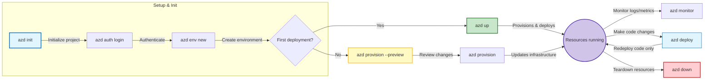
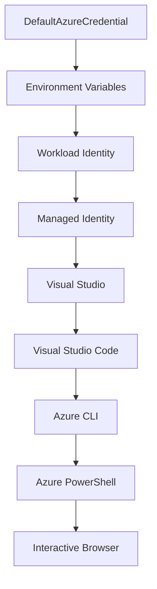

# أساسيات AZD - المفاهيم الأساسية والأسس

**ملاحة الفصل:**
- **📚 الصفحة الرئيسية للدورة**: [AZD للمبتدئين](../../README.md)
- **📖 الفصل الحالي**: الفصل 1 - الأساسيات والبدء السريع
- **⬅️ السابق**: [نظرة عامة على الدورة](../../README.md#-chapter-1-foundation--quick-start)
- **➡️ التالي**: [التثبيت والإعداد](installation.md)
- **🚀 الفصل التالي**: [الفصل 2: التطوير الموجه للذكاء الاصطناعي](../chapter-02-ai-development/microsoft-foundry-integration.md)

## المقدمة

> تمت المراجعة بناءً على `azd 1.37.2` (نوفمبر 2026). أوامر Bash تستخدم عناصر نائب بين علامات اقتباس يجب عليك استبدالها. تدفقات العمل النموذجية تستخدم `.` لتهيئة الدليل الحالي؛ بدون وسيطة دليل، تهيئة القالب تنشئ دليلاً فرعيًا ولا تغير دليل العمل في الصدفة. المقاطع المتقدمة توضيحية وليست مشاريع كاملة.

تعرفك هذه الدرس على Azure Developer CLI (azd)، أداة قوية لسطر الأوامر تسرع رحلتك من التطوير المحلي إلى النشر في Azure. ستتعلم المفاهيم الأساسية، الميزات الجوهرية، وتفهم كيف يقوم azd بتبسيط نشر التطبيقات الأصلية للسحابة.

## أهداف التعلم

بنهاية هذا الدرس، ستتمكن من:
- فهم ما هو Azure Developer CLI والغرض الأساسي منه
- تعلم المفاهيم الأساسية للقوالب، البيئات، والخدمات
- استكشاف الميزات الرئيسية بما في ذلك التطوير المدفوع بالقوالب والبنية التحتية كرمز
- فهم هيكل مشروع azd وتدفق العمل
- الاستعداد لتثبيت وتكوين azd لبيئة التطوير الخاصة بك

## مخرجات التعلم

بعد إكمال هذا الدرس، ستتمكن من:
- شرح دور azd في تدفقات عمل تطوير السحابة الحديثة
- تحديد مكونات هيكل مشروع azd
- وصف كيف تعمل القوالب، البيئات، والخدمات معًا
- فهم فوائد البنية التحتية كرمز مع azd
- التعرف على أوامر azd المختلفة وأغراضها

## ما هو Azure Developer CLI (azd)؟

Azure Developer CLI (azd) هي أداة لسطر الأوامر مصممة لتسريع رحلتك من التطوير المحلي إلى النشر في Azure. تبسط عملية بناء، نشر، وإدارة تطبيقات السحابة الأصلية على Azure.

### ماذا يمكنك نشره باستخدام azd؟

يدعم azd مجموعة واسعة من أحمال العمل - والقائمة تتزايد. اليوم، يمكنك استخدام azd لنشر:

| نوع الحمولة | أمثلة | نفس سير العمل؟ |
|---------------|----------|----------------|
| **التطبيقات التقليدية** | تطبيقات الويب، APIs REST، المواقع الثابتة | ✅ `azd up` |
| **الخدمات والخدمات المصغرة** | تطبيقات الحاويات، تطبيقات الوظائف، الخلفيات متعددة الخدمات | ✅ `azd up` |
| **التطبيقات المعززة بالذكاء الاصطناعي** | تطبيقات الدردشة باستخدام نماذج Microsoft Foundry، حلول RAG مع البحث بالذكاء الاصطناعي | ✅ `azd up` |
| **وكلاء ذكيون** | وكلاء مستضافون في Foundry، تنظيمات متعددة الوكلاء | ✅ `azd up` |

الفكرة الأساسية هي أن **دورة حياة azd تبقى نفسها بغض النظر عما تنشره**. تقوم بتهيئة مشروع، توفير البنية التحتية، نشر الكود، مراقبة التطبيق، وتنظيف الموارد - سواء كانت موقع ويب بسيط أو وكيل ذكاء اصطناعي معقد.

هذه الاستمرارية مصممة عمدًا. يعامل azd قدرات الذكاء الاصطناعي كنوع آخر من الخدمات التي يمكن لتطبيقك استخدامها، وليس كشيء مختلف جوهريًا. نقطة نهاية الدردشة المدعومة بنماذج Microsoft Foundry هي، من منظور azd، مجرد خدمة أخرى يجب تكوينها ونشرها.

### 🎯 لماذا تستخدم AZD؟ مقارنة واقعية

لنقارن نشر تطبيق ويب بسيط مع قاعدة بيانات:

#### ❌ بدون AZD: نشر يدوي في Azure (أكثر من 30 دقيقة)

**مقارنة Bash توضيحية، ليست بداية تطبيق قابلة للتشغيل.** هذا يفترض وجود كود تطبيق موجود، أسماء موارد فريدة، مصادقة Azure CLI، وأي ملحقات CLI مطلوبة. استخدم تمرين القالب أدناه للمسار المدعوم من البداية للنهاية.

```bash
# Step 1: Create resource group
az group create --name myapp-rg --location eastus

# Step 2: Create App Service Plan
az appservice plan create --name myapp-plan \
  --resource-group myapp-rg \
  --sku B1 --is-linux

# Step 3: Create Web App
az webapp create --name myapp-web-unique123 \
  --resource-group myapp-rg \
  --plan myapp-plan \
  --runtime "NODE:22-lts"

# Step 4: Create Cosmos DB account (10-15 minutes)
az cosmosdb create --name myapp-cosmos-unique123 \
  --resource-group myapp-rg \
  --kind MongoDB

# Step 5: Create database
az cosmosdb mongodb database create \
  --account-name myapp-cosmos-unique123 \
  --resource-group myapp-rg \
  --name tododb

# Step 6: Create collection
az cosmosdb mongodb collection create \
  --account-name myapp-cosmos-unique123 \
  --resource-group myapp-rg \
  --database-name tododb \
  --name todos

# Step 7: Get connection string
CONN_STR=$(az cosmosdb keys list \
  --name myapp-cosmos-unique123 \
  --resource-group myapp-rg \
  --type connection-strings \
  --query "connectionStrings[0].connectionString" -o tsv)

# Step 8: Configure app settings
az webapp config appsettings set \
  --name myapp-web-unique123 \
  --resource-group myapp-rg \
  --settings MONGODB_URI="$CONN_STR"

# Step 9: Enable logging
az webapp log config --name myapp-web-unique123 \
  --resource-group myapp-rg \
  --application-logging filesystem \
  --detailed-error-messages true

# Step 10: Set up Application Insights
az monitor app-insights component create \
  --app myapp-insights \
  --location eastus \
  --resource-group myapp-rg

# Step 11: Link App Insights to Web App
INSTRUMENTATION_KEY=$(az monitor app-insights component show \
  --app myapp-insights \
  --resource-group myapp-rg \
  --query "instrumentationKey" -o tsv)

az webapp config appsettings set \
  --name myapp-web-unique123 \
  --resource-group myapp-rg \
  --settings APPINSIGHTS_INSTRUMENTATIONKEY="$INSTRUMENTATION_KEY"

# Step 12: Build application locally
npm install
npm run build

# Step 13: Create deployment package
zip -r app.zip . -x "*.git*" "node_modules/*"

# Step 14: Deploy application
az webapp deployment source config-zip \
  --resource-group myapp-rg \
  --name myapp-web-unique123 \
  --src app.zip

# Step 15: Wait and pray it works 🙏
# (No automated validation, manual testing required)
```

**المشكلات:**
- ❌ أكثر من 15 أمر يجب تذكرها وتنفيذها بالترتيب
- ❌ 30-45 دقيقة من العمل اليدوي
- ❌ سهولة الوقوع في الأخطاء (أخطاء مطبعية، معلمات خاطئة)
- ❌ تتطلب بيانات الاعتماد التعامل الصريح؛ سجلات التصحيح وتعقب الصدفة قد تكشفها
- ❌ لا يوجد تراجع تلقائي إذا فشل شيء ما
- ❌ صعوبة التكرار لأعضاء الفريق
- ❌ مختلفة في كل مرة (غير قابلة لإعادة الإنتاج)

#### ✅ مع AZD: نشر آلي (5 أوامر، 10-15 دقيقة)

```bash
# Step 1: Initialize from template
azd init --template todo-nodejs-mongo .

# Step 2: Authenticate
azd auth login

# Step 3: Select the environment created during init
azd env select dev

# Step 4: Preview changes (optional but recommended)
azd provision --preview

# Step 5: Deploy everything
azd up

# ✨ Done! Everything is deployed, configured, and monitored
```

**الفوائد:**
- ✅ **5 أوامر** مقابل أكثر من 15 خطوة يدوية
- ✅ **10-15 دقيقة** الوقت الإجمالي (معظمها انتظار Azure)
- ✅ **أخطاء يدوية أقل** - سير عمل مؤتمت مدفوع بالقالب
- ✅ **إدارة أسرار آمنة** - العديد من القوالب تستخدم تخزين أسرار مدار من Azure
- ✅ **نشر متكرر** - نفس سير العمل في كل مرة
- ✅ **تعريفات بنية تحتية متكررة** - خاضعة للحصص، توافر المناطق، وإصدارات القوالب
- ✅ **جاهزية للفريق** - يمكن لأي شخص النشر بنفس الأوامر
- ✅ **البنية التحتية كرمز** - قوالب Bicep مع تحكم في الإصدارات
- ✅ **مراقبة معرفها بالقالب** - Application Insights عند تضمينه في القالب

### الوقت والموثوقية

الأوقات المذكورة أعلاه تقديرية وليست مقاييس أداء. يقلل azd من الأوامر التي يجب تنسيقها، لكنه لا يضمن مدة النشر، أو يزيل الأخطاء، أو يوفر تراجعًا تلقائيًا للتطبيق/قاعدة البيانات. احتفظ بنُسخ عاملة في التحكم بالمصدر واختبر إجراءات الاسترداد.

## المفاهيم الأساسية

### القوالب
القوالب هي أساس azd. تحتوي على:
- **كود التطبيق** - كود المصدر والاعتمادات الخاصة بك
- **تعريفات البنية التحتية** - موارد Azure المعرفة في Bicep أو Terraform
- **ملفات التكوين** - الإعدادات ومتغيرات البيئة
- **سكريبتات النشر** - تدفقات عمل النشر المؤتمتة

### البيئات
تمثل البيئات أهداف نشر مختلفة:
- **التطوير** - للاختبار والتطوير
- **التجهيز** - بيئة ما قبل الإنتاج
- **الإنتاج** - بيئة الإنتاج الحية

تحافظ كل بيئة على:
- اسم البيئة وقيمها؛ تعتمد عزل الموارد على قالب البنية التحتية
- إعدادات التكوين
- حالة النشر

### الخدمات
الخدمات في `azure.yaml` تصف مكونات التطبيق القابلة للنشر:
- **الواجهة الأمامية** - تطبيقات الويب، تطبيقات الصفحة الواحدة (SPA)
- **الخلفية** - APIs، الخدمات المصغرة

عادةً ما يتم توفير قواعد البيانات والتخزين كموارد بنية تحتية، وليس كخدمات مضيفة مخترعة مثل `host: postgres`.

## الميزات الرئيسية

### 1. التطوير المدفوع بالقوالب
```bash
# Browse available templates
azd template list

# Initialize from a template
azd init --template "<template-name>" .
```

### 2. البنية التحتية كرمز
- **Bicep** - لغة المجال الخاصة بـ Azure
- **Terraform** - أداة بنية تحتية متعددة السحابات
- يترجم Bicep إلى قوالب ARM؛ JSON ARM الخام ليس `infra.provider` مدمج منفصل.

### 3. تدفقات عمل متكاملة
```bash
# Complete deployment workflow
azd up            # Provision + Deploy this is hands off for first time setup

# 🧪 NEW: Preview infrastructure changes before deployment (SAFE)
azd provision --preview    # Simulate infrastructure deployment without making changes

azd provision     # Create Azure resources if you update the infrastructure use this
azd deploy        # Deploy application code or redeploy application code once update
azd down          # Clean up resources
```

#### 🛡️ تخطيط بنية تحتية آمن مع المعاينة
أمر `azd provision --preview` هو تغيير قواعد اللعبة للنشر الآمن:
- **تحليل تجربة بدون تطبيق** - يظهر ما سيتم إنشاؤه، تعديله، أو حذفه
- **بدون تطبيق البنية التحتية** - يراجع تغييرات المزود؛ افحص علقات المشروع أولاً، حيث يمكن أن تنفذ العلقات أوامر ذات تأثيرات جانبية
- **تعاون الفريق** - شارك نتائج المعاينة قبل النشر
- **مدخل تخطيط التكلفة** - افحص وحدات SKU المقترحة، ثم احسب أسعارها باستخدام حاسبة تسعير Azure؛ المعاينة لا تحسب الأسعار

```bash
# Example preview workflow
azd provision --preview           # See what will change
# Review the output, discuss with team
azd provision                     # Apply changes with confidence
```

### 📊 تصور: تدفق عمل تطوير AZD



**شرح سير العمل:**
1. **التهيئة** - ابدأ بقالب أو مشروع جديد
2. **المصادقة** - المصادقة مع Azure
3. **البيئة** - إنشاء بيئة نشر معزولة
4. **المعاينة** - 🆕 دائمًا اعرض تغييرات البنية التحتية أولاً (ممارسة آمنة)
5. **التوفير** - إنشاء/تحديث موارد Azure
6. **النشر** - دفع كود تطبيقك
7. **الرصد** - مراقبة أداء التطبيق
8. **التكرار** - إجراء تغييرات وإعادة نشر الكود
9. **التنظيف** - إزالة الموارد عند الانتهاء

### 4. إدارة البيئة
```bash
# Create and manage environments
azd env new "<environment-name>"
azd env select "<environment-name>"
azd env list
```

### 5. الإضافات وأوامر الذكاء الاصطناعي

يستخدم azd نظام إضافات لإضافة قدرات تتجاوز CLI الأساسي. هذا مفيد خصوصًا لأحمال عمل الذكاء الاصطناعي:

```bash
# List available extensions
azd extension list

# Install the Foundry agents extension
azd extension install azure.ai.agents

# Initialize an AI agent project interactively
azd ai agent init

# Test a deployed agent (shows latency and time-to-first-byte)
azd ai agent invoke

# Start the MCP server for AI-assisted development (Alpha)
azd mcp start
```

**دورة حياة الوكيل، من البداية إلى النهاية.** استخدم `azure.ai.agents` لعمليات دورة حياة الوكيل وثبت `azure.ai.evaluations` بشكل منفصل للتقييم. استخدم `azd >= 1.37.0` لسير العمل الموحد. لا تحتاج إلى كل هذه في اليوم الأول:

| المرحلة | الأمر | ما يفعله |
|-------|---------|--------------|
| **التهيئة** | `azd ai agent init --template <path-to-azure.yaml>` | اعتماد قالب مشروع وكيل حالي |
| **الاختبار** | `azd ai agent invoke` | استدعاء الوكيل وعرض توقيت الاستجابة |
| **القياس** | `azd ai eval init`, `generate`, `run start` | تكوين، نشر، وتشغيل تقييمات باستخدام الإضافة المنفصلة |
| **التحسين** | `azd ai agent optimize --eval <evaluation-name> --optimize-model <optimizer-deployment>` | إعادة استخدام تقييم متوافق لتحسين الوكيل |
| **الفحص** | `azd ai agent endpoint show` | عرض تكوين نقطة النهاية الحية |
| **التنظيف** | `azd ai agent delete` | حذف وكيل مستضاف وكل إصداراته |

> يتم تغطية الإضافات بالتفصيل في [الفصل 2: التطوير الموجه للذكاء الاصطناعي](../chapter-02-ai-development/agents.md) ومرجع [أوامر AZD AI CLI](../chapter-08-production/production-ai-practices.md#azd-ai-cli-commands-and-extensions).

## 📁 هيكل المشروع

الهيكل النموذجي لمشروع azd:
```
my-app/
├── .azure/                  # Local environments and selected-environment config
│   ├── config.json
│   └── dev/.env
├── .devcontainer/          # Development container config
├── .github/workflows/      # GitHub Actions
├── .vscode/               # VS Code settings
├── infra/                 # Infrastructure code
│   ├── main.bicep        # Main infrastructure template
│   ├── main.parameters.json
│   └── modules/          # Reusable modules
├── src/                  # Application source code
│   ├── api/             # Backend services
│   └── web/             # Frontend application
├── azure.yaml           # azd project configuration
└── README.md
```

## 🔧 ملفات التكوين

### azure.yaml
ملف التكوين الرئيسي للمشروع:
```yaml
name: my-awesome-app
metadata:
  template: my-template@1.0.0

services:
  web:
    project: ./src/web
    language: js
    host: appservice
  api:
    project: ./src/api
    language: js
    host: appservice

hooks:
  preprovision:
    shell: pwsh
    run: echo "Preparing to provision..."
```

### .azure/config.json
اختيار محلي للمشروع للبيئة الافتراضية (توضيحي؛ مدار بواسطة azd):
```json
{
  "defaultEnvironment": "dev"
}
```

## 🎪 تدفقات عمل شائعة مع تمارين تطبيقية

> **💡 نصيحة تعلم:** اتبع هذه التمارين بالترتيب لبناء مهاراتك في AZD بشكل تدريجي.

### 🎯 التمرين 1: تهيئة مشروعك الأول

**الهدف:** إنشاء مشروع AZD واستكشاف هيكله

**الخطوات:**
```bash
# Use a proven template
mkdir azd-basics-practice
cd azd-basics-practice
# Choose "dev" for the environment name when prompted
azd init --template todo-nodejs-mongo .

# Explore the generated files
ls -la  # View all files including hidden ones

# Key files created:
# - azure.yaml (main config)
# - infra/ (infrastructure code)
# - src/ (application code)
```

**✅ النجاح:** لديك ملفات azure.yaml، infra/، و src/

---

### 🎯 التمرين 2: النشر إلى Azure

**الهدف:** إكمال النشر من البداية للنهاية

**الخطوات:**
```bash
# 1. Authenticate
azd auth login

# 2. Select the dev environment created in Exercise 1
azd env select dev
azd env set AZURE_LOCATION eastus

# 3. Preview changes (RECOMMENDED)
azd provision --preview

# 4. Deploy everything
azd up

# 5. Verify deployment
azd show    # View your app URL
```

**الوقت المتوقع:** 10-15 دقيقة  
**✅ النجاح:** فتح رابط التطبيق في المتصفح

---

### 🎯 التمرين 3: بيئات متعددة

**الهدف:** النشر إلى dev و staging

**الخطوات:**
```bash
# Already have dev, create staging
azd env new staging
azd env set AZURE_LOCATION westus2
azd up

# Switch between them
azd env list
azd env select dev
```

**✅ النجاح:** مجموعتا موارد منفصلتان في بوابة Azure

**التنظيف:** يخلق التمرين 3 نشرًا إضافيًا مدفوع الأجر. احذف كلاهما عند الانتهاء:

```bash
azd down --environment dev
azd down --environment staging
```

---

### 🛡️ تنظيف مدمر: `azd down --force --purge`

عندما تريد عمدًا حذف موارد Azure للبيئة المحددة:

```bash
azd down --force --purge
```

**ما يفعله:**
- `--force`: لا طلبات تأكيد
- `--purge`: يحذف أيضًا بشكل دائم الموارد التي تم حذفها ناعمًا (على سبيل المثال Key Vaults)، حيث يسمح حماية التنظيف بذلك. لا يحذف دليل `.azure/` المحلي.

**استخدمه عندما:** تنتهي من بيئة قابلة للتخلص منها. لا تعامل التنظيف المدمر كاستجابة أولى لأخطاء المصادقة، الحصص، أو التكوين.

---

## 🎪 مرجع سير العمل الأصلي

### بدء مشروع جديد
```bash
# Method 1: Use existing template
azd init --template todo-nodejs-mongo .

# Method 2: Start from scratch
azd init

# Method 3: Use current directory
azd init .
```

### دورة التطوير
```bash
# Set up development environment
azd auth login
azd env new dev
azd env select dev

# Deploy everything
azd up

# Make changes and redeploy
azd deploy

# Clean up when done
azd down --force --purge # Deletes this environment's discovered Azure resources; review before forcing deletion.
```

## فهم `azd down --force --purge`
أمر `azd down --force --purge` هو وسيلة قوية لتفكيك بيئة azd بالكامل وجميع الموارد المرتبطة بها. إليك تفصيل لما يفعله كل علامة:
```
--force
```
- يتخطى طلبات التأكيد.
- مفيد للأتمتة أو البرمجة حيث لا يكون الإدخال اليدوي ممكنًا.
- لا يتجاوز الأذونات، حماية التنظيف، أو فشل الحذف.

```
--purge
```
يحذف بشكل دائم موارد Azure المحذوفة بشكل ناعم التي يدعمها دون تأكيد إضافي. لا تزال حماية التنقية والصلاحيات سارية. لا يقوم **بإزالة** البيئات المحلية أو مجلد `.azure/`.


### لماذا استخدام كلاهما؟
استخدم كلاهما فقط عندما تنوي حذف موارد Azure للبيئة المحددة وتنقية الموارد القابلة للاسترداد. هذا تنظيف تدميري، وليس إصلاحًا عامًا أو إعادة تعيين للحالة المحلية.

يكون مفيدًا بشكل خاص بعد حذف الموارد يدويًا في بوابة Azure أو عند تبديل القوالب أو البيئات أو اصطلاحات تسمية مجموعات الموارد.


### إدارة بيئات متعددة
```bash
# Create staging environment
azd env new staging
azd env select staging
azd up

# Switch back to dev
azd env select dev

# Compare environments
azd env list
```

## 🔐 المصادقة والاعتمادات

فرق بين مصادقة النشر (`azd auth login`) ومصادقة SDK التطبيق (`DefaultAzureCredential`). هما منفصلتان. لا يستخدم azd بيانات اعتماد Azure CLI افتراضيًا.

### مصادقة Azure CLI (`az login`)

شغل `azd auth login` لـ azd. أوامر Azure CLI التالية اختيارية وتستخدم لمصادقة أوامر `az` بشكل منفصل:

```bash
# Interactive login (opens browser)
az login

# Login with specific tenant
az login --tenant "<tenant-id>"

# Login with service principal
az login --service-principal -u "<app-id>" -p "<password>" --tenant "<tenant-id>"

# Check current login status
az account show

# List available subscriptions
az account list --output table

# Set default subscription
az account set --subscription "<subscription-id>"
```

### تدفق المصادقة
1. **تسجيل دخول تفاعلي**: يفتح متصفحك الافتراضي للمصادقة
2. **تدفق رمز الجهاز**: للبيئات التي لا تملك وصولاً إلى المتصفح
3. **المُصرف الخدمي**: لسيناريوهات الأتمتة و CI/CD
4. **الهوية المُدارة**: للتطبيقات المستضافة في Azure

### سلسلة DefaultAzureCredential

`DefaultAzureCredential` هو نوع اعتماد يوفر تجربة مصادقة مبسطة بمحاولة تلقائية لمصادر اعتماد متعددة بترتيب معين:

#### سلسلة اعتماد SDK التطبيق

تعتمد السلسلة الدقيقة على لغة SDK لهوية أزور، الإصدار، الإضافات المثبتة، والخيارات. هذا المخطط تصوري، وليس تسلسل توثيق ثابت لـ azd؛ يمكن لـ SDKs الحديثة أن تشمل أيضًا بيانات اعتماد Azure Developer CLI.


#### 1. متغيرات البيئة
```bash
# Set environment variables for service principal
export AZURE_CLIENT_ID="<app-id>"
export AZURE_CLIENT_SECRET="<password>"
export AZURE_TENANT_ID="<tenant-id>"
```

#### 2. هوية الحمل (Kubernetes / إجراءات GitHub)
تُستخدم تلقائيًا في:
- خدمة Kubernetes في Azure (AKS) مع هوية الحمل
- إجراءات GitHub مع اتحاد OIDC
- سيناريوهات هوية اتحادية أخرى

#### 3. الهوية المدارة
لموارد Azure مثل:
- الآلات الافتراضية
- خدمة التطبيقات
- وظائف Azure
- مثيلات الحاويات

```bash
# Inspect a deployed Container App's configured identity (requires az login)
az containerapp show --name "<app-name>" --resource-group "<rg-name>" --query identity
```

#### 4. تكامل أدوات المطورين
- **Visual Studio**: يستخدم الحساب المسجل الدخول تلقائيًا
- **VS Code**: الدعم يعتمد على SDK وإعداد الوسيط/الإضافة المدعوم
- **Azure CLI**: يستخدم بيانات اعتماد `az login` (الأكثر شيوعًا للتطوير المحلي)

### إعداد توثيق AZD

```bash
# Method 1: Direct azd authentication (recommended)
azd auth login

# Method 2: Direct azd authentication
azd auth login --use-device-code  # For headless environments

# Method 3: Check authentication status
azd auth login --check-status

# Method 4: Logout and re-authenticate
azd auth logout
azd auth login
```

### أفضل ممارسات التوثيق

#### للتطوير المحلي
```bash
# 1. Log in to azd
azd auth login

# 2. Select the subscription for this initialized environment
azd env set AZURE_SUBSCRIPTION_ID "<subscription-id>"

# 3. Check azd sign-in details (read the status message)
azd auth login --check-status
```

#### لخطوط أنابيب CI/CD
```yaml
# Partial GitHub Actions steps: assumes checkout, azd installation,
# required AZURE_* environment values, and pipeline secret configuration.
- name: Deploy with azd
  run: |
    azd auth login --client-id ${{ secrets.AZURE_CLIENT_ID }} \
                    --client-secret ${{ secrets.AZURE_CLIENT_SECRET }} \
                    --tenant-id ${{ secrets.AZURE_TENANT_ID }}
    azd up --no-prompt
```

#### لبيئات الإنتاج
- استخدم **الهوية المدارة** عند التشغيل على موارد Azure
- استخدم **المُعَرِّف الخدمي** لسيناريوهات الأتمتة
- تجنب تخزين بيانات الاعتماد في الكود أو ملفات التكوين
- استخدم **Azure Key Vault** للتكوين الحساس

### القضايا الشائعة في التوثيق والحلول

#### المشكلة: "لا توجد اشتراك"
```bash
# Solution: Set default subscription
az account list --output table
az account set --subscription "<subscription-id>"
azd env set AZURE_SUBSCRIPTION_ID "<subscription-id>"
```

#### المشكلة: "صلاحيات غير كافية"
```bash
# Solution: Check and assign required roles
az role assignment list --assignee $(az account show --query user.name --output tsv)

# Common required roles:
# - Contributor (for resource management)
# - User Access Administrator (for role assignments)
```

#### المشكلة: "انتهت صلاحية الرمز المميز"
```bash
# Solution: Re-authenticate
az logout
az login
azd auth logout
azd auth login
```

### التوثيق في سيناريوهات مختلفة

#### التطوير المحلي
```bash
# Personal development account
az login
azd auth login
```

#### تطوير الفريق
```bash
# Use specific tenant for organization
az login --tenant contoso.onmicrosoft.com
azd auth login --tenant-id "<tenant-id>"
```

#### سيناريوهات متعددة المستأجرين
```bash
# Switch between tenants
az login --tenant tenant1.onmicrosoft.com
azd auth login --tenant-id "<tenant-1-id>"
# Select an environment configured with tenant 1's subscription
azd env select tenant1-dev
# Deploy to tenant 1
azd up

az login --tenant tenant2.onmicrosoft.com  
azd auth login --tenant-id "<tenant-2-id>"
azd env select tenant2-dev
# Deploy to tenant 2
azd up
```

### اعتبارات الأمان

1. **تخزين بيانات الاعتماد**: لا تخزن بيانات الاعتماد في شفرة المصدر أبداً
2. **تحديد الامتيازات**: استخدم مبدأ أقل الامتيازات للمُعَرِّفين الخدميين
3. **تدوير الرموز المميزة**: قم بتدوير أسرار المُعَرِّف الخدمي بانتظام
4. **سجل التدقيق**: راقب أنشطة التوثيق والنشر
5. **أمان الشبكة**: استخدم نقاط النهاية الخاصة متى ما أمكن

### استكشاف مشاكل التوثيق وإصلاحها

```bash
# Debug authentication issues
azd auth login --check-status
az account show
az account get-access-token

# Common diagnostic commands
whoami                          # Current user context
az ad signed-in-user show      # Microsoft Entra ID user details
az group list                  # Test resource access
```

## اكتشاف الأوامر

### الاكتشاف
```bash
azd template list              # Browse templates
azd template list --help       # Template discovery options
azd init --help               # Initialization options
```

### إدارة المشاريع
```bash
azd show                     # Project overview
azd env list                # Available environments and selected default
azd config show            # Configuration settings
```

### المراقبة
```bash
azd monitor                  # Open Azure portal monitoring
azd monitor --logs           # View application logs
azd monitor --live           # View live metrics
azd pipeline config          # Set up CI/CD
```

## أفضل الممارسات

### 1. استخدم أسماء ذات معنى
```bash
# Good
azd env new production-east
azd init --template todo-nodejs-mongo .

# Avoid
azd env new env1
azd init --template template1 .
```

### 2. الاستفادة من القوالب
- ابدأ بالقوالب الموجودة
- خصصها حسب احتياجاتك
- أنشئ قوالب قابلة لإعادة الاستخدام لمنظمتك

### 3. عزل البيئة
- استخدم بيئات منفصلة للتطوير/التجريب/الإنتاج
- لا تنشر مباشرة للإنتاج من الجهاز المحلي
- استخدم خطوط أنابيب CI/CD لعمليات النشر في الإنتاج

### 4. إدارة التكوين
- استخدم الهوية المدارة وKey Vault للأسرار؛ القيم `azd env set` العادية نص عادي محلي
- احتفظ بالتكوين في التحكم بالإصدارات
- وثق الإعدادات الخاصة بالبيئة

## تقدم التعلم

### مبتدئ (الأسبوع 1-2)
1. تثبيت azd وتوثيق الدخول
2. نشر قالب بسيط
3. فهم هيكل المشروع
4. تعلم الأوامر الأساسية (up, down, deploy)

### متوسط (الأسبوع 3-4)
1. تخصيص القوالب
2. إدارة بيئات متعددة
3. فهم كود البنية التحتية
4. إعداد خطوط أنابيب CI/CD

### متقدم (الأسبوع 5+)
1. إنشاء قوالب مخصصة
2. أنماط متقدمة للبنية التحتية
3. نشر في مناطق متعددة
4. تكوينات بمستوى المؤسسات

## الخطوات التالية

**📖 متابعة تعلم الفصل 1:**
- [التثبيت والإعداد](installation.md) - تثبيت وإعداد azd
- [مشروعك الأول](first-project.md) - إرشاد عملي كامل
- [دليل التكوين](../chapter-03-configuration/configuration.md) - خيارات إعداد متقدمة

**🎯 جاهز للفصل التالي؟**
- [الفصل 2: تطوير AI أولاً](../chapter-02-ai-development/microsoft-foundry-integration.md) - ابدأ بناء تطبيقات الذكاء الاصطناعي

## موارد إضافية

- [نظرة عامة على Azure Developer CLI](https://learn.microsoft.com/en-us/azure/developer/azure-developer-cli/)
- [معرض القوالب](https://azure.github.io/awesome-azd/)
- [عينات المجتمع](https://github.com/Azure-Samples)

---

## 🙋 أسئلة شائعة

### أسئلة عامة

**س: ما الفرق بين AZD و Azure CLI؟**

ج: Azure CLI (`az`) مخصص لإدارة موارد Azure الفردية. AZD (`azd`) لإدارة التطبيقات كاملة:

```bash
# Azure CLI - Low-level resource management
az webapp create --name myapp --resource-group rg
az sql server create --name myserver --resource-group rg
# ...many more commands needed

# AZD - Application-level management
azd up  # Deploys entire app with all resources
```

**فكر بها على هذا النحو:**
- `az` = التعامل مع قطع ليغو فردية
- `azd` = العمل مع مجموعات ليغو كاملة

---

**س: هل أحتاج معرفة Bicep أو Terraform لاستخدام AZD؟**

ج: لا! ابدأ مع القوالب:
```bash
# Use existing template - no IaC knowledge needed
azd init --template todo-nodejs-mongo .
azd up
```

يمكنك تعلم Bicep لاحقًا لتخصيص البنية التحتية. توفر القوالب أمثلة عملية للتعلم منها.

---

**س: كم تكلفة تشغيل قوالب AZD؟**

ج: التكاليف تختلف حسب المنطقة، SKU، وقت التشغيل، وضع قاعدة البيانات، واستخدام النماذج. قد تتحمل بيئة التطوير رسوم شهرية كبيرة حتى عند الخمول؛ لا تفترض نطاقاً موحداً بين ٥٠-١٥٠ دولار:

```bash
# Preview resource changes (not prices)
azd provision --preview

# Always cleanup when not using
azd down --force --purge  # Removes all resources
```

**نصيحة محترف:** استخدم المستويات المجانية حيثما توفرت:
- خدمة التطبيقات: المستوى F1 (مجاني)
- Azure OpenAI: لا يوجد بدل شهري مضمون مجاني؛ تحقق من التسعير الحالي للنموذج والعرض
- Cosmos DB: يمكن للحسابات المدعمة تجريبًا الاشتراك مجانًا؛ قوالب الخادم بدون خدمة لا تؤهل تلقائيًا

---

**س: هل يمكنني استخدام AZD مع موارد Azure موجودة؟**

ج: نعم، لكنها أسهل عند البدء من جديد. تعمل AZD بأفضل شكل عندما تدير الدورة الكاملة. للموارد الموجودة:

```bash
# Option 1: Import existing resources (advanced)
azd init
# Then modify infra/ to reference existing resources

# Option 2: Start fresh (recommended)
azd init --template "<verified-template-name>" .
azd up  # Creates new environment
```

---

**س: كيف أشارك مشروعي مع زملائي؟**

ج: قم بإيداع مشروع AZD في Git (لكن NOT مجلد .azure):

```bash
# Already in .gitignore by default
.azure/        # Contains secrets and environment data
*.env          # Environment variables

# Team members then:
git clone "<your-repo>"
# Change into the cloned repository before running the remaining commands.
azd auth login
azd env new "<their-name>-dev"
azd up
```

الجميع يحصل على نفس البنية التحتية من نفس القوالب.

---

### أسئلة استكشاف الأخطاء وإصلاحها

**س: فشل "azd up" في منتصف الطريق. ماذا أفعل؟**

ج: تحقق من الخطأ، أصلحه، ثم أعد المحاولة:

```bash
# Capture detailed diagnostics (redact sensitive values before sharing)
azd up --debug

# Common fixes:

# 1. If quota exceeded:
azd env set AZURE_LOCATION "westus2"  # Try different region

# 2. If resource name conflict:
azd down --force --purge  # Clean slate
azd up  # Retry

# 3. If auth expired:
az login
azd auth login
azd up
```

**أكثر مشكلة شائعة:** تم اختيار اشتراك Azure خاطئ
```bash
az account list --output table
az account set --subscription "<correct-subscription>"
azd env set AZURE_SUBSCRIPTION_ID "<correct-subscription-id>"
```

---

**س: كيف أنشر فقط تغييرات الكود بدون إعادة تزويد البنية التحتية؟**

ج: استخدم `azd deploy` بدلاً من `azd up`:

```bash
azd up          # First time: provision + deploy (slow)

# Make code changes...

azd deploy      # Subsequent times: deploy only (fast)
```

مقارنة السرعة:
- `azd up`: 10-15 دقيقة (يزود البنية التحتية)
- `azd deploy`: 2-5 دقائق (كود فقط)

---

**س: هل يمكنني تخصيص قوالب البنية التحتية؟**

ج: نعم! حرر ملفات Bicep في `infra/`:

```bash
# After azd init
cd infra/
code main.bicep  # Edit in VS Code

# Preview changes
azd provision --preview

# Apply changes
azd provision
```

**نصيحة:** ابدأ صغيرًا - غيّر SKUs أولاً:
```bicep
// infra/main.bicep
sku: {
  name: 'B1'  // Change to 'P1V2' for production
}
```

---

**س: كيف أحذف كل شيء أنشأه AZD؟**

ج: أمر واحد يزيل جميع الموارد:

```bash
azd down --force --purge

# This deletes:
# - Azure resources/resource groups discovered for the selected environment
# - Supported soft-deleted resources, if purge protection allows
# Local .azure files remain; shared/external resources may remain too.
```

**نفذ هذا دائماً عندما:**
- تنتهي من اختبار قالب
- تنتقل إلى مشروع مختلف
- تريد البدء من جديد

**فحص التكلفة:** تأكد من الحذف في Azure وتحقق من الموارد المحتفظ بها / المشتركة. الرسوم السابقة لا تزال تُحتسب.

---

**س: ماذا لو حذفت الموارد بالخطأ من بوابة Azure؟**

ج: حالة AZD قد تخرج عن التزامن. استخدم طريقة البداية النظيفة:

```bash
# 1. Delete remaining resources only if that is your intent
azd down --force --purge

# 2. Start fresh
azd up

# Alternative: Let AZD detect and fix
azd provision  # Will create missing resources
```

---

### أسئلة متقدمة

**س: هل أستطيع استخدام AZD في خطوط أنابيب CI/CD؟**

ج: نعم! مثال GitHub Actions:

```yaml
# .github/workflows/deploy.yml
name: Deploy with AZD

on:
  push:
    branches: [main]

jobs:
  deploy:
    runs-on: ubuntu-latest
    steps:
      - uses: actions/checkout@v4
      
      - name: Install azd
        run: curl -fsSL https://aka.ms/install-azd.sh | bash
      
      - name: Azure Login
        run: |
          azd auth login \
            --client-id ${{ secrets.AZURE_CLIENT_ID }} \
            --client-secret ${{ secrets.AZURE_CLIENT_SECRET }} \
            --tenant-id ${{ secrets.AZURE_TENANT_ID }}
      
      - name: Deploy
        env:
          AZURE_ENV_NAME: dev
          AZURE_LOCATION: ${{ vars.AZURE_LOCATION }}
          AZURE_SUBSCRIPTION_ID: ${{ vars.AZURE_SUBSCRIPTION_ID }}
        run: azd up --no-prompt
```

---

**س: كيف أتعامل مع الأسرار والبيانات الحساسة؟**

ج: استخدم Key Vault صراحة. `azd env set` يكتب القيم العادية إلى ملف بيئة محلي؛ لا ينشئ مستودعاً تلقائيًا، ولا يعيّن أدواراً، ولا يحقن الأسرار في تطبيقك.

```bash
# Interactive: create/select a Key Vault secret and save its reference
azd env set-secret DATABASE_PASSWORD
```

تحتاج إلى أذونات مناسبة في المستودع. يجب أن يربط البنية التحتية/التطبيق السر بمستهلكه ويمنح هوية وقت التشغيل الوصول. لا تطبع القيم السرية المحلولة في السجلات.

**لا تُخزن أبداً:**
- مجلد `.azure/` (يحتوي على بيانات البيئة)
- ملفات `.env` (الأسرار المحلية)
- سلاسل الاتصال

---

**س: هل يمكنني النشر في مناطق متعددة؟**

ج: نعم، أنشئ بيئة لكل منطقة:

```bash
# East US environment
azd env new prod-eastus
azd env set AZURE_LOCATION eastus
azd up

# West Europe environment
azd env new prod-westeurope
azd env set AZURE_LOCATION westeurope
azd up

# Each environment is independent
azd env list
```

للتطبيقات متعددة المناطق الحقيقية، خصص قوالب Bicep للنشر إلى مناطق متعددة في آن واحد.

---

**س: من أين يمكنني الحصول على المساعدة إذا توقفت؟**

1. **وثائق AZD:** https://learn.microsoft.com/azure/developer/azure-developer-cli/
2. **قضايا GitHub:** https://github.com/Azure/azure-dev/issues
3. **ديسكورد:** [Azure Discord](https://discord.gg/microsoft-azure) - قناة #azure-developer-cli
4. **Stack Overflow:** الوسم `azure-developer-cli`
5. **هذا الدورة:** [دليل استكشاف الأخطاء](../chapter-07-troubleshooting/common-issues.md)

**نصيحة محترف:** قبل السؤال، شغّل:
```bash
azd show       # Shows current state
azd version    # Shows your version
```
ضمن هذه المعلومات في سؤالك للمساعدة السريعة.

---

## 🎓 ما التالي؟

أنت الآن تفهم أساسيات AZD. اختر مسارك:

### 🎯 للمبتدئين:
1. **التالي:** [التثبيت والإعداد](installation.md) - ثبت AZD على جهازك
2. **ثم:** [مشروعك الأول](first-project.md) - انشر تطبيقك الأول
3. **الممارسة:** أكمل جميع التمارين الثلاثة في هذا الدرس

### 🚀 لمطوري الذكاء الاصطناعي:
1. **انتقل إلى:** [الفصل 2: تطوير AI أولاً](../chapter-02-ai-development/microsoft-foundry-integration.md)
2. **انشر:** في دليل مشروع فارغ، ابدأ مع `azd init --template get-started-with-ai-chat .`
3. **تعلم:** قم بالبناء أثناء النشر

### 🏗️ للمطورين المتمرسين:
1. **راجع:** [دليل التكوين](../chapter-03-configuration/configuration.md) - الإعدادات المتقدمة
2. **استكشف:** [البنية التحتية ككود](../chapter-04-infrastructure/provisioning.md) - تعلم عميق لـ Bicep
3. **قم بالبناء:** أنشئ قوالب مخصصة للمكدس البرمجي الخاص بك

---

**تنقل في الفصل:**
- **📚 الصفحة الرئيسية للدورة**: [AZD للمبتدئين](../../README.md)
- **📖 الفصل الحالي**: الفصل 1 - الأساسيات والبدء السريع  
- **⬅️ السابق**: [نظرة عامة على الدورة](../../README.md#-chapter-1-foundation--quick-start)
- **➡️ التالي**: [التثبيت والإعداد](installation.md)
- **🚀 الفصل التالي**: [الفصل 2: تطوير AI أولاً](../chapter-02-ai-development/microsoft-foundry-integration.md)

---

<!-- CO-OP TRANSLATOR DISCLAIMER START -->
**تنويه**:
تمت ترجمة هذا المستند باستخدام خدمة الترجمة بالذكاء الاصطناعي [Co-op Translator](https://github.com/Azure/co-op-translator). بينما نسعى للدقة، يرجى العلم أن الترجمات الآلية قد تحتوي على أخطاء أو عدم دقة. يجب اعتبار المستند الأصلي بلغته الأصلية المصدر الرسمي والمعتمد. للمعلومات الهامة، يُنصح بالاستعانة بترجمة بشرية محترفة. نحن غير مسؤولين عن أي سوء فهم أو تفسير ناتج عن استخدام هذه الترجمة.
<!-- CO-OP TRANSLATOR DISCLAIMER END -->