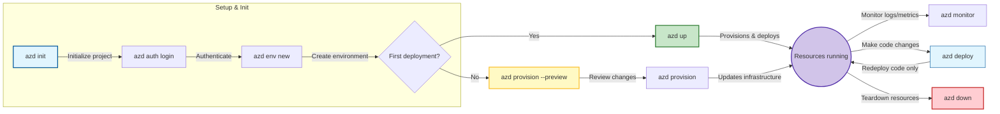
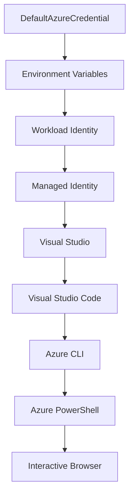

# أساسيات AZD - المفاهيم الأساسية والأساسيات

**التنقل في الفصل:**
- **📚 الصفحة الرئيسية للدورة**: [AZD للمبتدئين](../../README.md)
- **📖 الفصل الحالي**: الفصل 1 - الأساسيات والبداية السريعة
- **⬅️ السابق**: [نظرة عامة على الدورة](../../README.md#-chapter-1-foundation--quick-start)
- **➡️ التالي**: [التثبيت والإعداد](installation.md)
- **🚀 الفصل التالي**: [الفصل 2: التطوير المبني على الذكاء الاصطناعي](../chapter-02-ai-development/microsoft-foundry-integration.md)

## المقدمة

> تمت المراجعة بناءً على `azd 1.37.2` (نوفمبر 2026). أوامر Bash تستخدم عناصر نائبة مقتبسة يجب عليك استبدالها. تستخدم سير العمل النموذجي `.` لتهيئة الدليل الحالي؛ بدون وسيط دليل، تنشئ التهيئة النموذجية دليلاً فرعياً ولا تغير دليل العمل في القشرة. المقاطع المتقدمة توضيحية وليست مشاريع كاملة.

يقدم هذا الدرس أداة Azure Developer CLI (azd)، أداة قوية لسطر الأوامر تسرع رحلتك من التطوير المحلي حتى النشر على Azure. ستتعلم المفاهيم الأساسية، الميزات الجوهرية، وتفهم كيف يجعل azd نشر التطبيقات السحابية أسهل.

## أهداف التعلم

بنهاية هذا الدرس، سوف:
- تفهم ما هو Azure Developer CLI والغرض الأساسي منه
- تتعلم المفاهيم الأساسية للقوالب، البيئات، والخدمات
- تستكشف الميزات الرئيسية بما في ذلك التطوير القائم على القوالب والبنية التحتية كرمز
- تفهم بنية مشروع azd وسير العمل
- تكون مستعدًا لتثبيت وتكوين azd لبيئة تطويرك

## نواتج التعلم

بعد إكمال هذا الدرس، ستكون قادرًا على:
- شرح دور azd في سير عمل تطوير السحابة الحديثة
- التعرف على مكونات بنية مشروع azd
- وصف كيف تعمل القوالب والبيئات والخدمات معًا
- فهم فوائد البنية التحتية كرمز مع azd
- التعرف على أوامر azd المختلفة وأغراضها

## ما هو Azure Developer CLI (azd)؟

Azure Developer CLI (azd) هو أداة سطر أوامر مصممة لتسريع رحلتك من التطوير المحلي حتى النشر على Azure. يبسط عملية بناء ونشر وإدارة التطبيقات الأصلية للسحابة على Azure.

### ماذا يمكنك نشر باستخدام azd؟

يدعم azd مجموعة واسعة من أعباء العمل — والقائمة تزداد باستمرار. اليوم، يمكنك استخدام azd لنشر:

| نوع عبء العمل | أمثلة | نفس سير العمل؟ |
|---------------|----------|----------------|
| **التطبيقات التقليدية** | تطبيقات الويب، واجهات برمجة التطبيقات REST، المواقع الثابتة | ✅ `azd up` |
| **الخدمات والميكروسيرفيس** | تطبيقات الحاويات، تطبيقات الوظائف، خلفيات متعددة الخدمات | ✅ `azd up` |
| **التطبيقات المدعومة بالذكاء الاصطناعي** | تطبيقات الدردشة مع نماذج Microsoft Foundry، حلول RAG مع البحث بالذكاء الاصطناعي | ✅ `azd up` |
| **الوكلاء الأذكياء** | الوكلاء المستضافين على Foundry، تنظيمات متعددة الوكلاء | ✅ `azd up` |

الفكرة الرئيسية هي أن **دورة حياة azd تظل نفسها بغض النظر عما تنشره**. تقوم بتهيئة مشروع، توفير البنية التحتية، نشر الشفرة، مراقبة التطبيق، والتنظيف — سواء كان موقعًا بسيطًا أو وكيل ذكاء اصطناعي متقدم.

هذه الاستمرارية مقصودة. يتعامل azd مع قدرات الذكاء الاصطناعي كنوع آخر من الخدمات التي يمكن لتطبيقك استخدامها، وليس كشيء مختلف جوهريًا. نقطة النهاية للدردشة المدعومة بنماذج Microsoft Foundry هي، من منظور azd، مجرد خدمة أخرى تحتاج إلى التكوين والنشر.

### 🎯 لماذا تستخدم AZD؟ مقارنة من الواقع

دعنا نقارن نشر تطبيق ويب بسيط مع قاعدة بيانات:

#### ❌ بدون AZD: النشر اليدوي على Azure (أكثر من 30 دقيقة)

**مقارنة توضيحية لأوامر Bash، ليست بداية تطبيق قابلة للتشغيل.** هذا يفترض وجود شفرة تطبيق حالية، أسماء موارد فريدة، مصادقة Azure CLI، وأي إضافات CLI مطلوبة. استخدم تمرين القالب أدناه للمسار المدعوم من البداية للنهاية.

```bash
# Step 1: Create resource group
az group create --name myapp-rg --location eastus

# Step 2: Create App Service Plan
az appservice plan create --name myapp-plan \
  --resource-group myapp-rg \
  --sku B1 --is-linux

# Step 3: Create Web App
az webapp create --name myapp-web-unique123 \
  --resource-group myapp-rg \
  --plan myapp-plan \
  --runtime "NODE:22-lts"

# Step 4: Create Cosmos DB account (10-15 minutes)
az cosmosdb create --name myapp-cosmos-unique123 \
  --resource-group myapp-rg \
  --kind MongoDB

# Step 5: Create database
az cosmosdb mongodb database create \
  --account-name myapp-cosmos-unique123 \
  --resource-group myapp-rg \
  --name tododb

# Step 6: Create collection
az cosmosdb mongodb collection create \
  --account-name myapp-cosmos-unique123 \
  --resource-group myapp-rg \
  --database-name tododb \
  --name todos

# Step 7: Get connection string
CONN_STR=$(az cosmosdb keys list \
  --name myapp-cosmos-unique123 \
  --resource-group myapp-rg \
  --type connection-strings \
  --query "connectionStrings[0].connectionString" -o tsv)

# Step 8: Configure app settings
az webapp config appsettings set \
  --name myapp-web-unique123 \
  --resource-group myapp-rg \
  --settings MONGODB_URI="$CONN_STR"

# Step 9: Enable logging
az webapp log config --name myapp-web-unique123 \
  --resource-group myapp-rg \
  --application-logging filesystem \
  --detailed-error-messages true

# Step 10: Set up Application Insights
az monitor app-insights component create \
  --app myapp-insights \
  --location eastus \
  --resource-group myapp-rg

# Step 11: Link App Insights to Web App
INSTRUMENTATION_KEY=$(az monitor app-insights component show \
  --app myapp-insights \
  --resource-group myapp-rg \
  --query "instrumentationKey" -o tsv)

az webapp config appsettings set \
  --name myapp-web-unique123 \
  --resource-group myapp-rg \
  --settings APPINSIGHTS_INSTRUMENTATIONKEY="$INSTRUMENTATION_KEY"

# Step 12: Build application locally
npm install
npm run build

# Step 13: Create deployment package
zip -r app.zip . -x "*.git*" "node_modules/*"

# Step 14: Deploy application
az webapp deployment source config-zip \
  --resource-group myapp-rg \
  --name myapp-web-unique123 \
  --src app.zip

# Step 15: Wait and pray it works 🙏
# (No automated validation, manual testing required)
```

**المشاكل:**
- ❌ أكثر من 15 أمرًا يجب تذكرها وتنفيذها بالترتيب
- ❌ 30-45 دقيقة من العمل اليدوي
- ❌ سهل الوقوع في الأخطاء (أخطاء إملائية، معلمات خاطئة)
- ❌ تتطلب بيانات الاعتماد معالجة صريحة؛ سجلات التصحيح وتتبع القشرة قد تكشف عنها
- ❌ لا توجد استرجاع تلقائي إذا حدث فشل
- ❌ صعب التكرار لأعضاء الفريق
- ❌ مختلف في كل مرة (غير قابل لإعادة الإنتاج)

#### ✅ مع AZD: النشر الآلي (5 أوامر، 10-15 دقيقة)

```bash
# Step 1: Initialize from template
azd init --template todo-nodejs-mongo .

# Step 2: Authenticate
azd auth login

# Step 3: Select the environment created during init
azd env select dev

# Step 4: Preview changes (optional but recommended)
azd provision --preview

# Step 5: Deploy everything
azd up

# ✨ Done! Everything is deployed, configured, and monitored
```

**الفوائد:**
- ✅ **5 أوامر** مقابل أكثر من 15 خطوة يدوياً
- ✅ **10-15 دقيقة** إجمالي الوقت (معظمها انتظار Azure)
- ✅ **أخطاء يدوية أقل** - سير عمل متسق وقائم على القوالب
- ✅ **معالجة سرية آمنة** - العديد من القوالب تستخدم تخزين الأسرار المدير من Azure
- ✅ **نشرات قابلة للتكرار** - نفس سير العمل في كل مرة
- ✅ **تعريفات البنية التحتية القابلة للتكرار** - تخضع للحصص وتوفر المنطقة وإصدارات القالب
- ✅ **جاهز للفريق** - يمكن لأي شخص النشر بنفس الأوامر
- ✅ **البنية التحتية كرمز** - قوالب Bicep بإدارة الإصدار
- ✅ **مراقبة معرفة بالقالب** - Application Insights عند تضمينها في القالب

### الوقت والموثوقية

الأوقات أعلاه تقديرات وليست معايير. يقلل azd الأوامر التي يجب تنسيقها، لكنه لا يضمن مدة النشر، ولا يلغي الأخطاء، ولا يوفر استرجاعًا تلقائيًا للتطبيق/قاعدة البيانات. احتفظ بنسخ قابلة للعمل في التحكم بالمصدر واختبر إجراءات الاسترداد.

## المفاهيم الأساسية

### القوالب
القوالب هي أساس azd. تحتوي على:
- **شفرة التطبيق** - شفرتك المصدرية والتبعيات
- **تعريفات البنية التحتية** - موارد Azure معرفة بـ Bicep أو Terraform
- **ملفات التكوين** - الإعدادات ومتغيرات البيئة
- **سكريبتات النشر** - سير عمل نشر آلي

### البيئات
تمثل البيئات أهداف نشر مختلفة:
- **التطوير** - للاختبار والتطوير
- **الاختبار التجريبي** - بيئة ما قبل الإنتاج
- **الإنتاج** - بيئة الإنتاج الحية

يحتفظ كل بيئة بـ:
- اسم وقيم البيئة؛ يعتمد عزل الموارد على قالب البنية التحتية
- إعدادات التكوين
- حالة النشر

### الخدمات
الخدمات في `azure.yaml` تصف مكونات التطبيق القابلة للنشر:
- **الواجهة الأمامية** - تطبيقات الويب، تطبيقات الصفحة الواحدة SPAs
- **الواجهة الخلفية** - واجهات برمجة التطبيقات، الميكروسيرفيس

قواعد البيانات والتخزين عادة ما يتم توفيرها كموارد بنية تحتية، وليس كمضيفي خدمات مخترعين مثل `host: postgres`.

## الميزات الرئيسية

### 1. التطوير القائم على القوالب
```bash
# Browse available templates
azd template list

# Initialize from a template
azd init --template "<template-name>" .
```

### 2. البنية التحتية كرمز
- **Bicep** - لغة المجال الخاصة بـ Azure
- **Terraform** - أداة بنية تحتية متعددة السحابات
- يقوم Bicep بالترجمة إلى قوالب ARM؛ JSON خام لـ ARM ليس قالبًا مدمجًا منفصلاً `infra.provider`.

### 3. سير العمل المتكامل
```bash
# Complete deployment workflow
azd up            # Provision + Deploy this is hands off for first time setup

# 🧪 NEW: Preview infrastructure changes before deployment (SAFE)
azd provision --preview    # Simulate infrastructure deployment without making changes

azd provision     # Create Azure resources if you update the infrastructure use this
azd deploy        # Deploy application code or redeploy application code once update
azd down          # Clean up resources
```

#### 🛡️ تخطيط آمن للبنية التحتية مع المعاينة
أمر `azd provision --preview` هو تغيير قواعد اللعبة للنشرات الآمنة:
- **تحليل التجربة الجافة** - يعرض ما سيتم إنشاؤه أو تعديله أو حذفه
- **لا تطبيق للبنية التحتية** - يراجع تغييرات المزود؛ افحص روابط المشروع أولاً، لأن الروابط يمكن أن تشغل أوامر ذات تأثيرات جانبية
- **تعاون الفريق** - شارك نتائج المعاينة قبل النشر
- **مدخل تخطيط التكاليف** - فحص SKU المقترحة، ثم تسعيرها باستخدام حاسبة أسعار Azure؛ المعاينة لا تحسب الأسعار

```bash
# Example preview workflow
azd provision --preview           # See what will change
# Review the output, discuss with team
azd provision                     # Apply changes with confidence
```

### 📊 مرئي: سير عمل تطوير AZD



**شرح سير العمل:**
1. **Init** - ابدأ بقالب أو مشروع جديد
2. **Auth** - المصادقة مع Azure
3. **Environment** - إنشاء بيئة نشر معزولة
4. **Preview** - 🆕 دائمًا عاين تغييرات البنية التحتية أولاً (ممارسة آمنة)
5. **Provision** - إنشاء/تحديث موارد Azure
6. **Deploy** - دفع شفرتك التطبيقية
7. **Monitor** - مراقبة أداء التطبيق
8. **Iterate** - إجراء تغييرات وإعادة نشر الشفرة
9. **Cleanup** - إزالة الموارد عند الانتهاء

### 4. إدارة البيئة
```bash
# Create and manage environments
azd env new "<environment-name>"
azd env select "<environment-name>"
azd env list
```

### 5. الإضافات وأوامر الذكاء الاصطناعي

يستخدم azd نظام إضافات لإضافة قدرات تتعدى أداة CLI الأساسية. هذا مفيد بشكل خاص لأعباء عمل الذكاء الاصطناعي:

```bash
# List available extensions
azd extension list

# Install the GA Foundry bundle (requires azd >= 1.37.0)
azd ext install microsoft.foundry

# Initialize an AI agent project interactively
azd ai agent init

# Test a deployed agent (shows latency and time-to-first-byte)
azd ai agent invoke

# Start the MCP server for AI-assisted development (Alpha)
azd mcp start
```

**دورة حياة الوكيل، من البداية للنهاية.** تتضمن الحزمة العامة GA `microsoft.foundry` `azure.ai.agents` وست إضافات أساسية أخرى. قم بتثبيت `azure.ai.evaluations` بشكل منفصل للتقييم. استخدم `azd >= 1.37.0` لهذا سير العمل. ليس عليك الحصول على كل هذه في اليوم الأول:

| المرحلة | الأمر | ماذا يفعل |
|-------|---------|--------------|
| **التهيئة** | `azd ai agent init --template <path-to-azure.yaml>` | اعتماد قالب مشروع وكيل حالي |
| **التشغيل محلياً** | `azd ai agent run`، ثم `azd ai agent invoke --local "Test prompt"` في طرفية أخرى | فحص النشاط المحلي في Agent Inspector؛ لاتزال استدعاءات النماذج تستخدم Azure |
| **النشر** | `azd deploy` | لوكلاء الاستضافة في وضع الشفرة، رفع المصدر للبناء عن بعد عبر Foundry |
| **الاختبار** | `azd ai agent invoke` | استدعاء الوكيل وعرض توقيت الاستجابة |
| **القياس** | `azd ai eval init`, `generate`, `run start` | تكوين ونشر وتشغيل التقييمات باستخدام الإضافة المنفصلة |
| **التحسين** | `azd ai agent optimize --eval <evaluation-name> --optimize-model <optimizer-deployment>` | إعادة استخدام تقييم متوافق لتحسين الوكيل |
| **الفحص** | `azd ai agent endpoint show` | عرض تهيئة نقطة النهاية الحية |
| **التنظيف** | `azd ai agent delete` | حذف وكيل مستضاف وجميع نسخه |

> ابدأ بالدليل [GA hosted-agent walkthrough](../chapter-02-ai-development/microsoft-foundry-integration.md#hosted-agent-walkthrough-ga)، الذي يغطي المتطلبات الأساسية، التوفير، والتنظيف الآمن. تمت تغطية الإضافات بشكل أوسع في مرجع [أوامر AZD AI CLI](../chapter-08-production/production-ai-practices.md#azd-ai-cli-commands-and-extensions).

## 📁 بنية المشروع

بنية مشروع azd النموذجية:
```
my-app/
├── .azure/                  # Local environments and selected-environment config
│   ├── config.json
│   └── dev/.env
├── .devcontainer/          # Development container config
├── .github/workflows/      # GitHub Actions
├── .vscode/               # VS Code settings
├── infra/                 # Infrastructure code
│   ├── main.bicep        # Main infrastructure template
│   ├── main.parameters.json
│   └── modules/          # Reusable modules
├── src/                  # Application source code
│   ├── api/             # Backend services
│   └── web/             # Frontend application
├── azure.yaml           # azd project configuration
└── README.md
```

## 🔧 ملفات التكوين

### azure.yaml
ملف التكوين الرئيسي للمشروع:
```yaml
name: my-awesome-app
metadata:
  template: my-template@1.0.0

services:
  web:
    project: ./src/web
    language: js
    host: appservice
  api:
    project: ./src/api
    language: js
    host: appservice

hooks:
  preprovision:
    shell: pwsh
    run: echo "Preparing to provision..."
```

### .azure/config.json
اختيار محلي للمشروع للبيئة الافتراضية (توضيحي؛ يدار بواسطة azd):
```json
{
  "defaultEnvironment": "dev"
}
```

## 🎪 سير العمل الشائع مع تمارين تطبيقية

> **💡 نصيحة تعلم:** اتبع هذه التمارين بترتيبها لبناء مهارات AZD بشكل تدريجي.

### 🎯 التمرين 1: تهيئة مشروعك الأول

**الهدف:** إنشاء مشروع AZD واستكشاف هيكله

**الخطوات:**
```bash
# Use a proven template
mkdir azd-basics-practice
cd azd-basics-practice
# Choose "dev" for the environment name when prompted
azd init --template todo-nodejs-mongo .

# Explore the generated files
ls -la  # View all files including hidden ones

# Key files created:
# - azure.yaml (main config)
# - infra/ (infrastructure code)
# - src/ (application code)
```

**✅ النجاح:** لديك ملفات azure.yaml، ومجلدات infra/ و src/

---

### 🎯 التمرين 2: النشر على Azure

**الهدف:** إكمال النشر من البداية للنهاية

**الخطوات:**
```bash
# 1. Authenticate
azd auth login

# 2. Select the dev environment created in Exercise 1
azd env select dev
azd env set AZURE_LOCATION eastus

# 3. Preview changes (RECOMMENDED)
azd provision --preview

# 4. Deploy everything
azd up

# 5. Verify deployment
azd show    # View your app URL
```

**الوقت المتوقع:** 10-15 دقيقة  
**✅ النجاح:** فتح عنوان التطبيق في المتصفح

---

### 🎯 التمرين 3: بيئات متعددة

**الهدف:** النشر على بيئة التطوير والاختبار التجريبي

**الخطوات:**
```bash
# Already have dev, create staging
azd env new staging
azd env set AZURE_LOCATION westus2
azd up

# Switch between them
azd env list
azd env select dev
```

**✅ النجاح:** مجموعتا موارد منفصلتان في بوابة Azure

**التنظيف:** يخلق التمرين 3 نشرًا ثانيًا قابلًا للفوترة. احذف الاثنين عند الانتهاء:

```bash
azd down --environment dev
azd down --environment staging
```

---

### 🛡️ التنظيف المدمر: `azd down --force --purge`

عندما تريد عمدًا حذف موارد Azure لبيئة محددة:

```bash
azd down --force --purge
```

**ماذا يفعل:**
- `--force`: لا رسائل تأكيد
- `--purge`: يحذف أيضًا الموارد المحذوفة ناعمًا المدعومة (مثل خزائن المفاتيح)، حيث يسمح الحماية من الحذف. لا يحذف دليل `.azure/` المحلي.

**استخدمه عندما:** تنتهي من بيئة مؤقتة. لا تتعامل مع التنظيف المدمر كرد فعل أول لمشكلة مصادقة أو حصة أو تكوين.

---

## 🎪 مرجع سير العمل الأصلي

### بدء مشروع جديد
```bash
# Method 1: Use existing template
azd init --template todo-nodejs-mongo .

# Method 2: Start from scratch
azd init

# Method 3: Use current directory
azd init .
```

### دورة التطوير
```bash
# Set up development environment
azd auth login
azd env new dev
azd env select dev

# Deploy everything
azd up

# Make changes and redeploy
azd deploy

# Clean up when done
azd down --force --purge # Deletes this environment's discovered Azure resources; review before forcing deletion.
```

## فهم `azd down --force --purge`
أمر `azd down --force --purge` هو طريقة قوية لتفكيك بيئة azd بالكامل وكل الموارد المرتبطة بها. إليك تفصيل لما يفعله كل علم:
```
--force
```
- يتخطى مطالبات التأكيد.
- مفيد لأتمتة العمليات أو البرمجة النصية حيث الإدخال اليدوي غير ممكن.
- لا يتجاوز الأذونات، حماية الحذف، أو فشل الحذف.

```
--purge
```
يحذف بشكل دائم موارد Azure التي تم حذفها برفق والمُدعمة دون تأكيد إضافي. لا تزال حماية التنقية والأذونات سارية. لا يقوم **بإزالة** البيئات المحلية أو مجلد `.azure/`.


### لماذا تستخدم كلاهما؟
استخدم كلاهما فقط عندما تنوي حذف موارد Azure الخاصة بالبيئة المختارة وتنقية الموارد القابلة للاسترداد. هذا تنظيف تدميري، وليس إصلاحًا عامًا أو إعادة ضبط لحالة محلية.

إنه مفيد خاصة بعد عمليات الحذف اليدوي للموارد في بوابة Azure أو عند تبديل القوالب أو البيئات أو تسميات مجموعات الموارد.


### إدارة بيئات متعددة
```bash
# Create staging environment
azd env new staging
azd env select staging
azd up

# Switch back to dev
azd env select dev

# Compare environments
azd env list
```

## 🔐 المصادقة وبيانات الاعتماد

فرّق بين مصادقة النشر (`azd auth login`) ومصادقة SDK التطبيق (`DefaultAzureCredential`). هما منفصلان. azd لا يستخدم بيانات اعتماد Azure CLI بشكل افتراضي.

### مصادقة Azure CLI (`az login`)

شغّل `azd auth login` لـ azd. أوامر Azure CLI التالية اختيارية وتقوم بالمصادقة على أوامر `az` بشكل منفصل:

```bash
# Interactive login (opens browser)
az login

# Login with specific tenant
az login --tenant "<tenant-id>"

# Login with service principal
az login --service-principal -u "<app-id>" -p "<password>" --tenant "<tenant-id>"

# Check current login status
az account show

# List available subscriptions
az account list --output table

# Set default subscription
az account set --subscription "<subscription-id>"
```

### تدفق المصادقة
1. **تسجيل دخول تفاعلي**: يفتح متصفحك الافتراضي للمصادقة
2. **تدفق رمز الجهاز**: للبيئات التي لا تتوفر فيها إمكانية الوصول إلى المتصفح
3. **الممثل الخدمي**: لسيناريوهات الأتمتة وCI/CD
4. **الهوية المُدارة**: لتطبيقات مستضافة على Azure

### سلسلة DefaultAzureCredential

`DefaultAzureCredential` هو نوع بيانات الاعتماد يوفر تجربة مصادقة مبسطة من خلال محاولة مصادر بيانات اعتماد متعددة تلقائيًا بترتيب محدد:

#### سلسلة بيانات اعتماد SDK التطبيق

تعتمد السلسلة الدقيقة على لغة Azure Identity SDK والإصدار والإضافات المثبتة والخيارات. هذا الرسم بياني تصوري وليس تسلسل مصادقة azd ثابت؛ يمكن أيضًا أن تشمل SDKs الحديثة بيانات اعتماد Azure Developer CLI.


#### 1. متغيرات البيئة
```bash
# Set environment variables for service principal
export AZURE_CLIENT_ID="<app-id>"
export AZURE_CLIENT_SECRET="<password>"
export AZURE_TENANT_ID="<tenant-id>"
```

#### 2. هوية عبء العمل (Kubernetes/GitHub Actions)
تُستخدم تلقائيًا في:
- خدمة Azure Kubernetes (AKS) مع هوية عبء العمل
- GitHub Actions مع اتحاد OIDC
- سيناريوهات هوية اتحادية أخرى

#### 3. الهوية المُدارة
لمنصات Azure مثل:
- الأجهزة الافتراضية
- خدمة التطبيقات
- وظائف Azure
- مثيلات الحاويات

```bash
# Inspect a deployed Container App's configured identity (requires az login)
az containerapp show --name "<app-name>" --resource-group "<rg-name>" --query identity
```

#### 4. دمج أدوات المطورين
- **Visual Studio**: يستخدم تلقائيًا الحساب الموقع الدخول فيه
- **VS Code**: يعتمد الدعم على SDK وإعداد الوسيط/الإضافة المدعوم
- **Azure CLI**: يستخدم بيانات اعتماد `az login` (الأكثر شيوعًا للتطوير المحلي)

### إعداد المصادقة في AZD

```bash
# Method 1: Direct azd authentication (recommended)
azd auth login

# Method 2: Direct azd authentication
azd auth login --use-device-code  # For headless environments

# Method 3: Check authentication status
azd auth login --check-status

# Method 4: Logout and re-authenticate
azd auth logout
azd auth login
```

### أفضل ممارسات المصادقة

#### للتطوير المحلي
```bash
# 1. Log in to azd
azd auth login

# 2. Select the subscription for this initialized environment
azd env set AZURE_SUBSCRIPTION_ID "<subscription-id>"

# 3. Check azd sign-in details (read the status message)
azd auth login --check-status
```

#### لأنابيب CI/CD
```yaml
# Partial GitHub Actions steps: assumes checkout, azd installation,
# required AZURE_* environment values, and pipeline secret configuration.
- name: Deploy with azd
  run: |
    azd auth login --client-id ${{ secrets.AZURE_CLIENT_ID }} \
                    --client-secret ${{ secrets.AZURE_CLIENT_SECRET }} \
                    --tenant-id ${{ secrets.AZURE_TENANT_ID }}
    azd up --no-prompt
```

#### لبيئات الإنتاج
- استخدم **الهوية المُدارة** عند التشغيل على موارد Azure
- استخدم **الممثل الخدمي** لسيناريوهات الأتمتة
- تجنب تخزين بيانات الاعتماد في الكود أو ملفات التكوين
- استخدم **Azure Key Vault** للتكوين الحساس

### المشكلات الشائعة في المصادقة وحلولها

#### مشكلة: "لا توجد اشتراك"
```bash
# Solution: Set default subscription
az account list --output table
az account set --subscription "<subscription-id>"
azd env set AZURE_SUBSCRIPTION_ID "<subscription-id>"
```

#### مشكلة: "أذونات غير كافية"
```bash
# Solution: Check and assign required roles
az role assignment list --assignee $(az account show --query user.name --output tsv)

# Common required roles:
# - Contributor (for resource management)
# - User Access Administrator (for role assignments)
```

#### مشكلة: "انتهت صلاحية الرمز المميز"
```bash
# Solution: Re-authenticate
az logout
az login
azd auth logout
azd auth login
```

### المصادقة في سيناريوهات مختلفة

#### التطوير المحلي
```bash
# Personal development account
az login
azd auth login
```

#### تطوير الفريق
```bash
# Use specific tenant for organization
az login --tenant contoso.onmicrosoft.com
azd auth login --tenant-id "<tenant-id>"
```

#### سيناريوهات متعدد المستأجرين
```bash
# Switch between tenants
az login --tenant tenant1.onmicrosoft.com
azd auth login --tenant-id "<tenant-1-id>"
# Select an environment configured with tenant 1's subscription
azd env select tenant1-dev
# Deploy to tenant 1
azd up

az login --tenant tenant2.onmicrosoft.com  
azd auth login --tenant-id "<tenant-2-id>"
azd env select tenant2-dev
# Deploy to tenant 2
azd up
```

### اعتبارات أمنية

1. **تخزين بيانات الاعتماد**: لا تخزن بيانات الاعتماد في شفرة المصدر أبدًا
2. **تحديد النطاق**: استخدم مبدأ الأقل امتيازًا للممثلين الخدميين
3. **تدوير الرموز المميزة**: قم بدوران أسرار الممثل الخدمي بانتظام
4. **مسار التدقيق**: راقب أنشطة المصادقة والنشر
5. **أمان الشبكة**: استخدم نقاط النهاية الخاصة عندما يكون ذلك ممكنًا

### استكشاف أخطاء المصادقة وإصلاحها

```bash
# Debug authentication issues
azd auth login --check-status
az account show
az account get-access-token

# Common diagnostic commands
whoami                          # Current user context
az ad signed-in-user show      # Microsoft Entra ID user details
az group list                  # Test resource access
```

## اكتشاف الأوامر

### الاكتشاف
```bash
azd template list              # Browse templates
azd template list --help       # Template discovery options
azd init --help               # Initialization options
```

### إدارة المشاريع
```bash
azd show                     # Project overview
azd env list                # Available environments and selected default
azd config show            # Configuration settings
```

### المراقبة
```bash
azd monitor                  # Open Azure portal monitoring
azd monitor --logs           # View application logs
azd monitor --live           # View live metrics
azd pipeline config          # Set up CI/CD
```

## أفضل الممارسات

### 1. استخدم أسماء ذات معنى
```bash
# Good
azd env new production-east
azd init --template todo-nodejs-mongo .

# Avoid
azd env new env1
azd init --template template1 .
```

### 2. الاستفادة من القوالب
- ابدأ بالقوالب الموجودة
- خصصها حسب احتياجاتك
- أنشئ قوالب قابلة لإعادة الاستخدام لمنظمتك

### 3. عزل البيئة
- استخدم بيئات منفصلة للتطوير/الاختبار/الإنتاج
- لا تنشر مباشرة على الإنتاج من الجهاز المحلي
- استخدم أنابيب CI/CD للنشر على الإنتاج

### 4. إدارة التكوين
- استخدم الهوية المُدارة وKey Vault للأسرار؛ القيم العادية `azd env set` هي نص عادي محلي
- احفظ التكوين في نظام التحكم بالإصدار
- وثق إعدادات محددة للبيئة

## تقدم التعلم

### المبتدئ (الأسبوع 1-2)
1. تثبيت azd والمصادقة
2. نشر قالب بسيط
3. فهم هيكل المشروع
4. تعلم الأوامر الأساسية (up, down, deploy)

### المتوسط (الأسبوع 3-4)
1. تخصيص القوالب
2. إدارة بيئات متعددة
3. فهم كود البنية التحتية
4. إعداد أنابيب CI/CD

### المتقدم (الأسبوع 5+)
1. إنشاء قوالب مخصصة
2. أنماط بنية تحتية متقدمة
3. نشر متعدد المناطق
4. تكوينات بدرجة مؤسسية

## الخطوات التالية

**📖 متابعة تعلم الفصل 1:**
- [التثبيت والإعداد](installation.md) - تثبيت azd وتكوينه
- [مشروعك الأول](first-project.md) - إكمال الدليل العملي
- [دليل التكوين](../chapter-03-configuration/configuration.md) - خيارات التكوين المتقدمة

**🎯 هل أنت مستعد للفصل التالي؟**
- [الفصل 2: تطوير الذكاء الاصطناعي أولًا](../chapter-02-ai-development/microsoft-foundry-integration.md) - ابدأ ببناء تطبيقات الذكاء الاصطناعي

## موارد إضافية

- [نظرة عامة على Azure Developer CLI](https://learn.microsoft.com/en-us/azure/developer/azure-developer-cli/)
- [معرض القوالب](https://azure.github.io/awesome-azd/)
- [عينات من المجتمع](https://github.com/Azure-Samples)

---

## 🙋 الأسئلة المتداولة

### أسئلة عامة

**س: ما الفرق بين AZD وAzure CLI؟**

ج: Azure CLI (`az`) لإدارة موارد Azure الفردية. AZD (`azd`) لإدارة تطبيقات كاملة:

```bash
# Azure CLI - Low-level resource management
az webapp create --name myapp --resource-group rg
az sql server create --name myserver --resource-group rg
# ...many more commands needed

# AZD - Application-level management
azd up  # Deploys entire app with all resources
```

**فكر بها هكذا:**
- `az` = التعامل مع قطع ليغو الفردية
- `azd` = العمل مع مجموعات ليغو كاملة

---

**س: هل أحتاج معرفة Bicep أو Terraform لاستخدام AZD؟**

ج: لا! ابدأ بالقوالب:
```bash
# Use existing template - no IaC knowledge needed
azd init --template todo-nodejs-mongo .
azd up
```

يمكنك تعلم Bicep لاحقًا لتخصيص البنية التحتية. القوالب توفر أمثلة عملية يمكنك التعلم منها.

---

**س: كم تكلفة تشغيل قوالب AZD؟**

ج: تختلف التكاليف حسب المنطقة، نوع SKU، وقت التشغيل، وضع قاعدة البيانات، واستخدام النموذج. قد يتكبد بيئة التطوير مصاريف شهرية كبيرة حتى عندما تكون في وضع الخمول؛ لا تفترض نطاق $50-150 عالميًا:

```bash
# Preview resource changes (not prices)
azd provision --preview

# Always cleanup when not using
azd down --force --purge  # Removes all resources
```

**نصيحة احترافية:** استخدم الطبقات المجانية حيثما توفرت:
- خدمة التطبيقات: طبقة F1 (مجانية)
- Azure OpenAI: لا يوجد مخصص شهري مجاني مضمون عام؛ تحقق من أسعار النموذج الحالي والعرض
- Cosmos DB: يمكن للحسابات المؤهلة ذات السعة المخصصة الاشتراك في طبقة مجانية؛ قوالب Serverless لا تؤهل تلقائيًا

---

**س: هل يمكنني استخدام AZD مع موارد Azure الحالية؟**

ج: نعم، لكن البدء من جديد أسهل. يعمل AZD بشكل أفضل عندما يدير دورة الحياة كاملة. بالنسبة للموارد الموجودة:

```bash
# Option 1: Import existing resources (advanced)
azd init
# Then modify infra/ to reference existing resources

# Option 2: Start fresh (recommended)
azd init --template "<verified-template-name>" .
azd up  # Creates new environment
```

---

**س: كيف أشارك مشروعي مع زملاء الفريق؟**

ج: قم بعمل إلتزام لمشروع AZD إلى Git (لكن NOT مجلد .azure):

```bash
# Already in .gitignore by default
.azure/        # Contains secrets and environment data
*.env          # Environment variables

# Team members then:
git clone "<your-repo>"
# Change into the cloned repository before running the remaining commands.
azd auth login
azd env new "<their-name>-dev"
azd up
```

يحصل الجميع على نفس البنية التحتية من نفس القوالب.

---

### أسئلة استكشاف الأخطاء

**س: فشل أمر "azd up" منتصف التنفيذ. ماذا أفعل؟**

ج: تحقق من الخطأ وقم بإصلاحه، ثم أعد المحاولة:

```bash
# Capture detailed diagnostics (redact sensitive values before sharing)
azd up --debug

# Common fixes:

# 1. If quota exceeded:
azd env set AZURE_LOCATION "westus2"  # Try different region

# 2. If resource name conflict:
azd down --force --purge  # Clean slate
azd up  # Retry

# 3. If auth expired:
az login
azd auth login
azd up
```

**المشكلة الأكثر شيوعًا:** تم اختيار اشتراك Azure خاطئ
```bash
az account list --output table
az account set --subscription "<correct-subscription>"
azd env set AZURE_SUBSCRIPTION_ID "<correct-subscription-id>"
```

---

**س: كيف أنشر تغييرات الكود فقط بدون إعادة توفير؟**

ج: استخدم `azd deploy` بدلاً من `azd up`:

```bash
azd up          # First time: provision + deploy (slow)

# Make code changes...

azd deploy      # Subsequent times: deploy only (fast)
```

مقارنة السرعة:
- `azd up`: 10-15 دقيقة (يوفر البنية التحتية)
- `azd deploy`: 2-5 دقائق (الكود فقط)

---

**س: هل يمكنني تخصيص قوالب البنية التحتية؟**

ج: نعم! حرر ملفات Bicep في `infra/`:

```bash
# After azd init
cd infra/
code main.bicep  # Edit in VS Code

# Preview changes
azd provision --preview

# Apply changes
azd provision
```

**نصيحة:** ابدأ صغيرًا - غيّر نوعات SKU أولًا:
```bicep
// infra/main.bicep
sku: {
  name: 'B1'  // Change to 'P1V2' for production
}
```

---

**س: كيف أمحو كل ما أنشأه AZD؟**

ج: أمر واحد يحذف كل الموارد:

```bash
azd down --force --purge

# This deletes:
# - Azure resources/resource groups discovered for the selected environment
# - Supported soft-deleted resources, if purge protection allows
# Local .azure files remain; shared/external resources may remain too.
```

**شغّل هذا دائمًا عند:**
- الانتهاء من اختبار قالب
- التبديل لمشروع مختلف
- الرغبة بالبدء من جديد

**فحص التكلفة:** أكد الحذف في Azure وتحقق من الموارد المحفوظة/المشتركة. ما تم تحصيله سابقًا من رسوم ما زال ساريًا.

---

**س: ماذا لو حذفت الموارد عن طريق الخطأ في بوابة Azure؟**

ج: يمكن أن يكون حالة AZD غير متزامنة. الحل هو إعادة ضبط كل شيء:

```bash
# 1. Delete remaining resources only if that is your intent
azd down --force --purge

# 2. Start fresh
azd up

# Alternative: Let AZD detect and fix
azd provision  # Will create missing resources
```

---

### أسئلة متقدمة

**س: هل يمكنني استخدام AZD في أنابيب CI/CD؟**

ج: نعم! مثال GitHub Actions:

```yaml
# .github/workflows/deploy.yml
name: Deploy with AZD

on:
  push:
    branches: [main]

jobs:
  deploy:
    runs-on: ubuntu-latest
    steps:
      - uses: actions/checkout@v4
      
      - name: Install azd
        run: curl -fsSL https://aka.ms/install-azd.sh | bash
      
      - name: Azure Login
        run: |
          azd auth login \
            --client-id ${{ secrets.AZURE_CLIENT_ID }} \
            --client-secret ${{ secrets.AZURE_CLIENT_SECRET }} \
            --tenant-id ${{ secrets.AZURE_TENANT_ID }}
      
      - name: Deploy
        env:
          AZURE_ENV_NAME: dev
          AZURE_LOCATION: ${{ vars.AZURE_LOCATION }}
          AZURE_SUBSCRIPTION_ID: ${{ vars.AZURE_SUBSCRIPTION_ID }}
        run: azd up --no-prompt
```

---

**س: كيف أتعامل مع الأسرار والبيانات الحساسة؟**

ج: استخدم Key Vault بشكل صريح. `azd env set` يكتب القيم العادية إلى ملف البيئة المحلي؛ لا ينشئ خزانًا تلقائيًا أو يعين أدوارًا أو يحقن الأسرار داخل تطبيقك.

```bash
# Interactive: create/select a Key Vault secret and save its reference
azd env set-secret DATABASE_PASSWORD
```

أنت بحاجة إلى أذونات ملائمة على الخزان. يجب أن توصل بنيتك التحتية/تطبيقك السر إلى مستهلكه وتمنح هوية وقت التشغيل الوصول. لا تطبع قيم الأسرار المحللة في السجلات.

**لا تلتزم أبدًا بـ:**
- مجلد `.azure/` (يحتوي على بيانات البيئة)
- ملفات `.env` (الأسرار المحلية)
- سلاسل الاتصال

---

**س: هل يمكنني النشر في مناطق متعددة؟**

ج: نعم، أنشئ بيئة لكل منطقة:

```bash
# East US environment
azd env new prod-eastus
azd env set AZURE_LOCATION eastus
azd up

# West Europe environment
azd env new prod-westeurope
azd env set AZURE_LOCATION westeurope
azd up

# Each environment is independent
azd env list
```

للتطبيقات متعددة المناطق الحقيقية، خصص قوالب Bicep للنشر في عدة مناطق في نفس الوقت.

---

**س: من أين أحصل على المساعدة إذا توقفت؟**

1. **وثائق AZD:** https://learn.microsoft.com/azure/developer/azure-developer-cli/
2. **قضايا GitHub:** https://github.com/Azure/azure-dev/issues
3. **ديسكورد:** [Azure Discord](https://discord.gg/microsoft-azure) - قناة #azure-developer-cli
4. **Stack Overflow:** الوسم `azure-developer-cli`
5. **هذا المساق:** [دليل استكشاف الأخطاء](../chapter-07-troubleshooting/common-issues.md)

**نصيحة احترافية:** قبل السؤال، شغّل:
```bash
azd show       # Shows current state
azd version    # Shows your version
```
قم بتضمين هذه المعلومات في سؤالك للحصول على مساعدة أسرع.

---

## 🎓 ما التالي؟

أنت الآن تفهم أساسيات AZD. اختر مسارك:

### 🎯 للمبتدئين:
1. **التالي:** [التثبيت والإعداد](installation.md) - تثبيت AZD على جهازك
2. **ثم:** [مشروعك الأول](first-project.md) - نشر تطبيقك الأول
3. **تدرب:** أتمم التمارين الثلاثة في هذا الدرس

### 🚀 لمطوري الذكاء الاصطناعي:
1. **تخطى إلى:** [الفصل 2: تطوير الذكاء الاصطناعي أولًا](../chapter-02-ai-development/microsoft-foundry-integration.md)
2. **انشر:** في دليل مشروع فارغ، ابدأ بـ `azd init --template get-started-with-ai-chat .`
3. **تعلم:** ابنِ أثناء النشر

### 🏗️ للمطورين ذوي الخبرة:
1. **راجع:** [دليل التكوين](../chapter-03-configuration/configuration.md) - إعدادات متقدمة
2. **استكشف:** [البنية التحتية ككود](../chapter-04-infrastructure/provisioning.md) - تعمق في Bicep
3. **ابنِ:** أنشئ قوالب مخصصة لحزمة مشروعك

---

**التنقل في الفصل:**
- **📚 الصفحة الرئيسية للمساق**: [AZD للمبتدئين](../../README.md)
- **📖 الفصل الحالي**: الفصل 1 - الأساسيات والبداية السريعة  
- **⬅️ السابق**: [نظرة عامة على المساق](../../README.md#-chapter-1-foundation--quick-start)
- **➡️ التالي**: [التثبيت والإعداد](installation.md)
- **🚀 الفصل التالي**: [الفصل 2: تطوير الذكاء الاصطناعي أولًا](../chapter-02-ai-development/microsoft-foundry-integration.md)

---

<!-- CO-OP TRANSLATOR DISCLAIMER START -->
**تنويه**:
تمت ترجمة هذا المستند باستخدام خدمة الترجمة بالذكاء الاصطناعي [Co-op Translator](https://github.com/Azure/co-op-translator). بينما نسعى للدقة، يرجى العلم أن الترجمات الآلية قد تحتوي على أخطاء أو عدم دقة. يجب اعتبار المستند الأصلي بلغته الأصلية المصدر الرسمي والمعتمد. للمعلومات الهامة، يُنصح بالاستعانة بترجمة بشرية محترفة. نحن غير مسؤولين عن أي سوء فهم أو تفسير ناتج عن استخدام هذه الترجمة.
<!-- CO-OP TRANSLATOR DISCLAIMER END -->