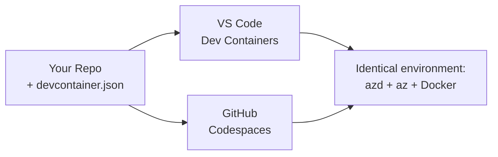

# حاويات التطوير وGitHub Codespaces لـ azd

**تنقل الفصل:**
- **📚 الصفحة الرئيسية للدورة**: [AZD للمبتدئين](../../README.md)
- **📖 الفصل الحالي**: الفصل 1 - الأساسيات والبدء السريع
- **⬅️ السابق**: [إحضار تطبيقك الخاص](bring-your-own-app.md)
- **🚀 الفصل التالي**: [الفصل 2: تطوير يركز على الذكاء الاصطناعي](../chapter-02-ai-development/README.md)

> مراجعة الأوامر والتكوين تستهدف: `azd 1.37.2` (نوفمبر 2026). لم يتم تنفيذ بناء الحاويات أو نشرات Azure كجزء من هذه المراجعة.

## مقدمة

تثبيت azd، بيئة تشغيل اللغة الصحيحة، Docker، وأداة Azure CLI على كل جهاز صعب - وهي السبب الأول في فشل الدروس التي "تعمل على جهازي" لشخص آخر. **حاوية التطوير** تحل هذه المشكلة بوصف كامل سلسلة الأدوات في ملف واحد. أي شخص يفتح المشروع في VS Code أو GitHub Codespaces يحصل على نفس البيئة تماماً، مع تثبيت azd مسبقاً. هذا الدرس يوضح لك كيفية إضافة واحدة.

## أهداف التعلم

بحلول نهاية هذا الدرس، ستتمكن من:
- فهم ما هي حاوية التطوير ولماذا تساعد مع azd
- إضافة `.devcontainer/devcontainer.json` بسيطة إلى مشروع
- تضمين azd، أداة Azure CLI، وDocker عبر *ميزات* حاوية التطوير
- فتح المشروع في GitHub Codespaces أو VS Code

## نتائج التعلم

بعد إكمال هذا الدرس، ستتمكن من:
- إنشاء `devcontainer.json` لمشروع azd
- إضافة azd وأدوات Azure بدون تثبيتات يدوية
- تشغيل `azd up` من داخل حاوية أو Codespace

---

## ما هي حاوية التطوير؟

حاوية التطوير هي بيئة تطوير تعتمد على Docker تُعرف بواسطة ملف `.devcontainer/devcontainer.json` في مستودعك. عند فتح المشروع:

- **VS Code** (مع امتداد Dev Containers) يبني الحاوية ويتصل بها.
- **GitHub Codespaces** يبني نفس الحاوية في السحابة ويوفر لك محرر مستند إلى المتصفح.

في الحالتين، يحصل كل مساهم على نفس الأدوات - لا المزيد من استكشاف "هل ثبتت azd؟".



---

## الخطوة 1: إنشاء ملف devcontainer

أنشئ `.devcontainer/devcontainer.json` في جذر مشروعك:

```json
{
  "name": "azd-project",
  "image": "mcr.microsoft.com/devcontainers/base:bookworm",
  "features": {
    "ghcr.io/devcontainers/features/azure-cli:1": {},
    "ghcr.io/azure/azure-dev/azd:0": { "version": "1.37.2" },
    "ghcr.io/devcontainers/features/docker-in-docker:2": {},
    "ghcr.io/devcontainers/features/node:1": {}
  },
  "customizations": {
    "vscode": {
      "extensions": [
        "ms-azuretools.azure-dev",
        "ms-azuretools.vscode-bicep"
      ]
    }
  },
  "forwardPorts": [3000],
  "postCreateCommand": "azd version"
}
```

ما يفعله كل جزء:

| المفتاح | الغرض |
|-----|---------|
| `image` | نظام التشغيل الأساسي للحاوية |
| `features` | المثبتات المسبقة—هنا: Azure CLI، **azd**، Docker، وNode.js |
| `customizations.vscode.extensions` | يثبت تلقائياً امتدادات azd وBicep في VS Code |
| `forwardPorts` | يفتح منفذ التطبيق للمتصفح لديك |
| `postCreateCommand` | يُشغل مرة واحدة بعد بناء الحاوية (هنا، فحص سلامة) |

> إصدار الميزة (`azd:0`) وإصدار CLI المثبت مختلفان. اضبط خيار `version` للميزة إلى `"1.37.2"` لتثبيت CLI؛ لا تستخدم إصدار CLI كميزة مميزة.

---

## الخطوة 2: مطابقة الميزة مع لغة تطبيقك

استبدل ميزة `node` بما تستخدمه تطبيقك:

```jsonc
// Python project
"ghcr.io/devcontainers/features/python:1": {},

// .NET project
"ghcr.io/devcontainers/features/dotnet:2": {},

// Java project
"ghcr.io/devcontainers/features/java:1": {},

// Go project
"ghcr.io/devcontainers/features/go:1": {}
```

احتفظ `docker-in-docker` عند بناء الصور محلياً. بناء ACR البعيد المهيأ (`docker.remoteBuild: true`) هو بديل؛ نوع المضيف وحده لا يتطلب دائماً Docker محلي.

---

## الخطوة 3: فتحها

**في VS Code:**
1. قم بتثبيت امتداد **Dev Containers**.
2. افتح مجلد المشروع.
3. انقر على **إعادة الفتح في الحاوية** عند الظهور (أو شغل *Dev Containers: Reopen in Container*).

**في GitHub Codespaces:**
1. ادفع المستودع إلى GitHub.
2. انقر **Code → Codespaces → Create codespace on main**.
3. انتظر بناء الحاوية—azd جاهز في الطرفية.

---

## الخطوة 4: النشر من داخل الحاوية

الحاوية تحتوي على azd مثبت مسبقاً، لذلك سير العمل المعتاد يعمل بسلاسة:

```bash
azd auth login --use-device-code   # device code is handy inside Codespaces
azd up
```

> **لماذا `--use-device-code`؟** في الحاوية البعيدة أو Codespace لا يوجد متصفح محلي لإعادة التوجيه، لذا تسجيل الدخول عبر رمز الجهاز هو الطريقة الموثوقة. ستلصق رمزاً في تبويب المتصفح لإكمال تسجيل الدخول.

---

## الأخطاء الشائعة

| المشكلة | الحل |
|---------|-----|
| لا يستطيع `azd up` بناء صورة | أضف ميزة `docker-in-docker` |
| تسجيل الدخول عبر المتصفح يتوقف في Codespaces | استخدم `azd auth login --use-device-code` |
| الأدوات تختلف بين الزملاء | ثبت CLI عبر خيار `version` في ميزة azd وثبت أطر تشغيل اللغة |
| التطبيق غير متاح في المتصفح | أضف المنفذ إلى `forwardPorts` |

---

## ملخص

- حاوية التطوير تجعل سلسلة أدوات azd الخاصة بك قابلة لإعادة الإنتاج للجميع.
- أضف azd، أداة Azure CLI، وDocker عبر *ميزات* حاوية التطوير.
- طابق ميزة اللغة مع تطبيقك واحتفظ بـ `docker-in-docker` لمضيفي الحاويات.
- استخدم تسجيل دخول رمز الجهاز عند التشغيل داخل Codespaces.

---

## 🔗 التنقل

| الاتجاه | المورد |
|-----------|----------|
| **السابق** | [إحضار تطبيقك الخاص](bring-your-own-app.md) |
| **الصفحة الرئيسية للفصل** | [الفصل 1: الأساسيات والبدء السريع](README.md) |
| **الفصل التالي** | [الفصل 2: تطوير يركز على الذكاء الاصطناعي](../chapter-02-ai-development/README.md) |

## 📖 موارد ذات صلة

- [التثبيت والإعداد](installation.md)
- [ملخص أوامر](../../resources/cheat-sheet.md)
- [المواصفات الرسمية لحاويات التطوير](https://containers.dev/)
- [ميزة حاوية التطوير الخاصة بـ azd](https://github.com/Azure/azure-dev/tree/main/ext/devcontainer)

---

<!-- CO-OP TRANSLATOR DISCLAIMER START -->
**تنويه**:
تمت ترجمة هذا المستند باستخدام خدمة الترجمة بالذكاء الاصطناعي [Co-op Translator](https://github.com/Azure/co-op-translator). بينما نسعى للدقة، يرجى العلم أن الترجمات الآلية قد تحتوي على أخطاء أو عدم دقة. يجب اعتبار المستند الأصلي بلغته الأصلية المصدر الرسمي والمعتمد. للمعلومات الهامة، يُنصح بالاستعانة بترجمة بشرية محترفة. نحن غير مسؤولين عن أي سوء فهم أو تفسير ناتج عن استخدام هذه الترجمة.
<!-- CO-OP TRANSLATOR DISCLAIMER END -->