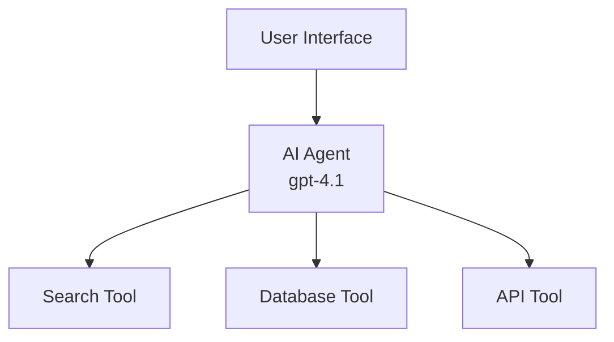
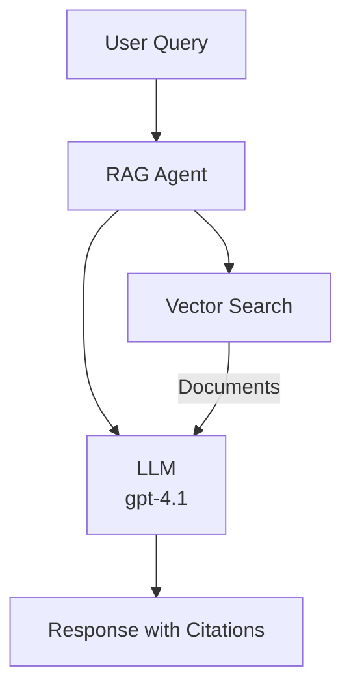
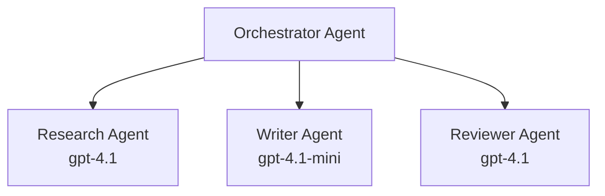

# وكلاء الذكاء الاصطناعي مع Azure Developer CLI

**تنقل الفصل:**
- **🏠 الصفحة الرئيسية للدورة**: [AZD للمبتدئين](../../README.md)
- **📖 الفصل الحالي**: الفصل 2 - التطوير الذي يركز على الذكاء الاصطناعي
- **⬅️ السابق**: [تكامل Microsoft Foundry](microsoft-foundry-integration.md)
- **➡️ التالي**: [نشر نموذج الذكاء الاصطناعي](ai-model-deployment.md)
- **🚀 المتقدم**: [حلول متعددة الوكلاء](../../examples/retail-scenario.md)

---

## مقدمة

وكلاء الذكاء الاصطناعي هم برامج مستقلة يمكنها إدراك بيئتها، واتخاذ القرارات، واتخاذ إجراءات لتحقيق أهداف محددة. على عكس روبوتات المحادثة البسيطة التي ترد على المطالبات، يمكن للوكلاء:

- **استخدام الأدوات** - استدعاء واجهات برمجة التطبيقات، البحث في قواعد البيانات، تنفيذ الشيفرة
- **التخطيط والتفكير** - تقسيم المهام المعقدة إلى خطوات
- **التعلم من السياق** - الحفاظ على الذاكرة وتكييف السلوك
- **التعاون** - العمل مع وكلاء آخرين (أنظمة متعددة الوكلاء)

يوضح هذا الدليل كيفية نشر وكلاء الذكاء الاصطناعي على Azure باستخدام Azure Developer CLI (azd).

استخدام سياق المحادثة ليس تدريبًا على النموذج: يجب تنفيذ/تكوين الذاكرة المستمرة، والتحكم في الوصول، والاحتفاظ من قبل التطبيق.

> **مراجعة الإصدار (2026-11-04):** تم التحقق من أمثلة CLI مقابل `azd` `1.37.2`، `azure.ai.agents` `1.0.0-beta.23`، و`azure.ai.evaluations` `1.0.0-beta.2` الوثائق/المصدر، وليس نشرًا مباشرًا على Azure. استخدم `azd >= 1.37.0` لسير العمل المدمج. راجع [التغييرات والإصلاحات الأخيرة](../chapter-08-production/production-ai-practices.md#recent-release-changes-and-fixes) قبل ترقية المشاريع الأقدم.

## أهداف التعلم

عند إكمال هذا الدليل، ستتمكن من:
- فهم ماهية وكلاء الذكاء الاصطناعي وكيف يختلفون عن روبوتات المحادثة
- نشر قوالب وكلاء الذكاء الاصطناعي الجاهزة باستخدام AZD
- تكوين وكلاء Foundry للوكلاء المخصصين
- تنفيذ أنماط الوكلاء الأساسية (استخدام الأدوات، RAG، متعدد الوكلاء)
- مراقبة وتصحيح الوكلاء المنشورين

## نتائج التعلم

عند الانتهاء، ستتمكن من:
- نشر تطبيقات وكلاء الذكاء الاصطناعي على Azure بأمر واحد فقط
- تكوين أدوات الوكلاء وقدراتهم
- تنفيذ التوليد المعزز بالاستخراج (RAG) مع الوكلاء
- تصميم هياكل متعددة الوكلاء لسير العمل المعقد
- استكشاف وحل مشاكل نشر الوكلاء الشائعة

---

## 🤖 ما الذي يجعل الوكيل مختلفًا عن روبوت المحادثة؟

| الخاصية | روبوت المحادثة | وكيل الذكاء الاصطناعي |
|---------|--------------|------------------|
| **السلوك** | يرد على المطالبات | يتخذ إجراءً مستقلاً |
| **الأدوات** | قد يستخدم الاسترجاع أو الأدوات | عادة يستخدم أدوات في حلقة موجهة نحو الهدف |
| **الذاكرة** | تعتمد على التطبيق | ذاكرة مستمرة فقط إذا تم تنفيذها صراحة |
| **التخطيط** | استجابة واحدة | التفكير متعدد الخطوات |
| **التعاون** | كيان واحد | يمكنه العمل مع وكلاء آخرين |

### تشبيه بسيط

- **روبوت المحادثة** = شخص مساعد يجيب على الأسئلة في مكتب المعلومات
- **وكيل الذكاء الاصطناعي** = مساعد شخصي يمكنه إجراء المكالمات، حجز المواعيد، وإتمام المهام نيابة عنك

---

## 🚀 بدء سريع: انشر وكيلك الأول

اختر خيارًا واحدًا في **دليل عمل فارغ جديد**. الأمر `.` ينشئ هناك؛ بدون وجهة محددة صراحةً، قد ينشئ AZD الحالي مجلدًا فرعيًا باسم النموذج ولا يغير دليل الشل الخاص بك. احتفظ بقوالب/بيئات منفصلة في دلائل منفصلة.

النطاقات الزمنية/التكلفة أدناه توضيحية، وليست عروض أسعار مؤكدة. تحقق من متطلبات كل نموذج، التسعير، حصة النموذج، والخدمات الاختيارية الحالية قبل النشر.

### الخيار 1: قالب وكلاء Foundry (مستحسن)

```bash
# Initialize the AI agents template
azd init --template get-started-with-ai-agents .

# Deploy to Azure
azd up
```

**ما سيتم نشره:** تحدد البنية التحتية الحالية للخادم والعناصر المختارة في النموذج الموارد المستخدمة للنموذج، الأدوات، الاستضافة، والمراقبة. راجع README الخاص به و `infra/` قبل التزويد؛ لا تفترض أن كل قالب وكيل يتضمن البحث أو واجهة الويب.

**الوقت:** ~15-20 دقيقة
**التكلفة:** ~100-150 دولار شهريًا (للتحطوير)

### الخيار 2: وكلاء الكتابة الإبداعية مع Prompty

```bash
# Initialize the Prompty-based agent template
azd init --template https://github.com/Azure-Samples/contoso-creative-writer .

# Deploy to Azure
azd up
```

**ما سيتم نشره:** نموذج كتابة متعدد الوكلاء FastAPI/Prompty يستخدم Azure OpenAI، Bing Grounding، وAzure AI Search. مستودع `agent-openai-python-prompty` السابق يعيد التوجيه هنا؛ ليس قالب وكيل الطقس البسيط لوظائف Azure. اتبع README الحالي الخاص به لمتطلبات الاستضافة، حصة النموذج، و Bing Grounding.

**الوقت:** ~10-15 دقيقة
**التكلفة:** ~50-100 دولار شهريًا (للتطوير)

### الخيار 3: وكيل دردشة RAG

```bash
# Initialize RAG chat template
azd init --template azure-search-openai-demo .

# Deploy to Azure
azd up
```

**ما سيتم نشره:**
- ✅ نماذج Microsoft Foundry
- ✅ Azure AI Search مع بيانات نموذجية
- ✅ خط معالجة الوثائق
- ✅ واجهة الدردشة مع الاستشهادات

**الوقت:** ~15-25 دقيقة
**التكلفة:** ~80-150 دولار شهريًا (للتطوير)

### الخيار 4: تهيئة وكيل AI باستخدام AZD (معاينة قالب المشروع)

استخدم `azd ai agent init` بشكل تفاعلي، أو اعتمد مشروع وكيل `azure.yaml` الحالي مع `--template`/`-t`. خيار `--manifest`/`-m` القديم هو اسم مستعار مهجور، وليس محولًا لمخططات الإصدارات القديمة.

```bash
# Install the AI agents extension
azd extension install azure.ai.agents

# Optional: verify the installed preview version
azd extension show azure.ai.agents

# Initialize from a current agent project template (supply your template path)
azd ai agent init --template ./templates/support-agent/azure.yaml

# Deploy to Azure
azd up

# Test the deployed agent (shows latency + time-to-first-byte)
azd ai agent invoke
```

**متى تستخدم `azd ai agent init` مقابل `azd init --template`:**

| النهج | الأفضل لـ | كيف يعمل |
|----------|----------|------|
| `azd init --template` | البدء من تطبيق نموذجي عامل | يستنسخ مستودع قالب كامل مع الكود + البنية التحتية |
| `azd ai agent init --template` | اعتماد مشروع وكيل Foundry الحالي | يستخدم وثيقة مشروع `azure.yaml` وتعريفاته |

> **نصيحة:** استخدم `azd init --template` عند التعلم (الخيارات 1-3 أعلاه). استخدم `azd ai agent init` لتدفق عمل وكيل Foundry. لإضافة تعريف وكيل مباشر إلى مشروع موجود، راجع [إرشادات التهيئة والهجرة](../chapter-08-production/production-ai-practices.md#initializing-agent-projects-with-azd-ai-agent-init).

بعد `azd up`، استخدم `azd ai agent invoke` للاختبار، وامتداد `azure.ai.evaluations` المنفصل (`azd ai eval init`، `generate`، و`run start`) لقياس الجودة، و`azd ai agent optimize` لتحسينها باستخدام تكوين التقييم الجديد. حلت Agents beta.22 محل تدفق عمل التقييم القديم وغيرت تنسيق `--config` الخاص بالتحسين. راجع [هجرة التقييم](../chapter-08-production/production-ai-practices.md#evaluation-migration-and-quality-checks) و[هجرة التحسين](../chapter-08-production/production-ai-practices.md#optimization-configuration-migration) قبل إعادة استخدام الأمثلة القديمة.

---

## 🏗️ أنماط هندسة الوكلاء

### النمط 1: وكيل واحد مع أدوات

أبسط نمط وكيل - وكيل واحد يمكنه استخدام أدوات متعددة.



**الأفضل لـ:**
- روبوتات دعم العملاء
- مساعدي البحث
- وكلاء تحليل البيانات

**عينة التطبيق ذات الصلة:** `azure-search-openai-demo` توضح RAG، وليس حلقة وكيل أداة عشوائية عامة.

### النمط 2: وكيل RAG (التوليد المعزز بالاسترجاع)

وكيل يسترجع المستندات ذات الصلة قبل توليد الردود.



**الأفضل لـ:**
- قواعد معرفة المؤسسات
- أنظمة أسئلة وأجوبة المستندات
- الامتثال والبحث القانوني

**قالب AZD:** `azure-search-openai-demo`

### النمط 3: نظام متعدد الوكلاء

وكلاء متخصصون متعددون يعملون معًا على مهام معقدة.



**الأفضل لـ:**
- توليد محتوى معقد
- تدفقات عمل متعددة الخطوات
- مهام تتطلب خبرات مختلفة

**تعلم المزيد:** [أنماط تنسيق الوكلاء المتعددة](../chapter-06-pre-deployment/coordination-patterns.md)

---

## ⚙️ تكوين أدوات الوكلاء

يصبح الوكلاء أقوى عندما يمكنهم استخدام الأدوات. إليك كيفية تكوين الأدوات الشائعة:

### تكوين الأدوات في وكلاء Foundry

هذا **مقطع SDK الكلاسيكي لخدمة الوكيل** يستهدف `azure-ai-projects==1.0.0` و`azure-ai-agents==1.1.0` مع `azure-identity`. ليس نسخة واجهة برمجة التطبيقات لوكيل بالإصدار الأحدث/جهود الاستجابة المستخدمة في بعض قوالب Foundry الحالية، ولا `azure.ai.agents` امتداد AZD (حزمة مختلفة). لا تخلط بين أجيال API هذه. اضبط `PROJECT_ENDPOINT` على نقطة نهاية مشروع Foundry الكلاسيكي و`MODEL_DEPLOYMENT_NAME` على نشر نموذج مدعوم موجود؛ قم بالمصادقة باستخدام `az login` محليًا ومنح الأذونات المطلوبة للمشروع.

```python
# agent_config.py
import os
from azure.ai.projects import AIProjectClient
from azure.ai.agents.models import FunctionTool
from azure.identity import DefaultAzureCredential

def search_knowledge_base(query: str) -> str:
    """Search the demonstration knowledge base.

    :param query: Search text.
    :return: Matching demonstration information.
    """
    # Local fixture only, not a production search implementation.
    return "Demo policy: returns are accepted within 30 days."

project_client = AIProjectClient(
    endpoint=os.environ["PROJECT_ENDPOINT"],
    credential=DefaultAzureCredential(),
)
search_tool = FunctionTool(functions={search_knowledge_base})
project_client.agents.enable_auto_function_calls(search_tool)
agent = project_client.agents.create_agent(
    model=os.environ["MODEL_DEPLOYMENT_NAME"],
    name="Support Agent",
    instructions="Use search_knowledge_base for policy questions. Label results as demo data.",
    tools=search_tool.definitions,
)
```

تسجيل مخطط وظيفة لا ينفذ بايثون على الخدمة. في هذا SDK، `enable_auto_function_calls` بالإضافة إلى `agents.runs.create_and_process(...)` يشغلان ردود الاستدعاء المسجلة في عملية العميل الخاصة بك. راجع [مثال SDK الصادر](https://github.com/Azure/azure-sdk-for-python/blob/azure-ai-agents_1.1.0/sdk/ai/azure-ai-agents/samples/agents_tools/sample_agents_auto_function_call.py). أغلق العميل واحذف وكلاء/خيوط العرض عند الانتهاء.

### تكوين البيئة

الأسماء التالية هي **مدخلات قالب مخصصة توضيحية**، وليست مفاتيح AZD مدمجة. قم أولاً بتوصيل كل قيمة عبر `infra/main.parameters.json` والبنية التحتية ورمز التطبيق. `azd env set` وحده لا يغير أدوات الوكيل أو التعليمات.

```bash
# Set up agent-specific environment variables
azd env set AZURE_OPENAI_MODEL "gpt-4.1"
azd env set AGENT_INSTRUCTIONS "You are a helpful assistant..."
azd env set ENABLE_CODE_INTERPRETER "true"
azd env set ENABLE_FILE_SEARCH "true"

# Apply wired infrastructure and application changes
azd up
```

---

## 📊 مراقبة الوكلاء

### تكامل Application Insights

إذا قام القالب المحدد الخاص بك بإعداد Application Insights وتكوين التهيئة:

```bash
# Open monitoring dashboard
azd monitor --overview

# Open the Application Insights logs view (not a streaming log tail)
azd monitor --logs

# View live metrics
azd monitor --live
```

### المقاييس الرئيسية للمراقبة

| المقياس | الوصف | الهدف |
|--------|-------------|--------|
| زمن استجابة | الوقت لتوليد الرد | < 5 ثوانٍ |
| استخدام الرموز | الرموز لكل طلب | راقب التكلفة |
| معدل نجاح استدعاء الأداة | % من تنفيذ الأدوات الناجح | > 95% |
| معدل الخطأ | طلبات الوكيل الفاشلة | < 1% |
| رضا المستخدم | درجات الملاحظات | > 4.0/5.0 |

### تسجيل مخصص للوكلاء

```python
import os
from azure.monitor.opentelemetry import configure_azure_monitor
from opentelemetry import trace

# Configure Azure Monitor with OpenTelemetry
configure_azure_monitor(
    connection_string=os.environ["APPLICATIONINSIGHTS_CONNECTION_STRING"]
)

tracer = trace.get_tracer(__name__)

def log_agent_interaction(user_query, agent_response, tools_used, latency_ms):
    with tracer.start_as_current_span("agent_interaction") as span:
        span.set_attributes({
            "query_length": len(user_query),  # Do not log raw prompts or personal data
            "response_length": len(agent_response),
            "tools_used": tools_used,
            "latency_ms": latency_ms
        })
```

> **ملاحظة:** قم بتثبيت الحزمة المطلوبة: `pip install azure-monitor-opentelemetry`. تجلب تبعيات OpenTelemetry؛ مساحة الأسماء للاستيراد ليست شرطًا لتثبيت حزمة باسم `opentelemetry`.

---

## 💰 اعتبارات التكلفة

### التكاليف الشهرية المقدرة حسب النمط

هذه نطاقات تخطيط توضيحية، وليست عروض أسعار أو حدود إنفاق. يمكن للمنطقة، رموز النموذج، وحدات البحث/الحوسبة، جلسات الأدوات، التخزين، وحركة المرور تجاوزها. تحقق من إرشادات التكلفة في العينة وتسعير Azure قبل `azd up`.

| النمط | بيئة التطوير | الإنتاج |
|---------|-----------------|------------|
| وكيل فردي | 50-100 دولار | 200-500 دولار |
| وكيل RAG | 80-150 دولار | 300-800 دولار |
| نظام متعدد الوكلاء (2-3 وكلاء) | 150-300 دولار | 500-1,500 دولار |
| نظام متعدد وكلاء المؤسسات | 300-500 دولار | 1,500-5,000+ دولار |

### نصائح لتحسين التكلفة

1. **استخدم gpt-4.1-mini للمهام البسيطة** (فقط إذا استهلك قالبك هذا الإدخال)
   ```bash
   azd env set AZURE_OPENAI_MODEL "gpt-4.1-mini"
   ```

2. **نفذ التخزين المؤقت النطاقي للاستعلامات الآمنة والمتكررة.** قم بتضمين تصريح المستأجر/المستخدم، نشر النموذج، التعليمات، وإصدار الاسترجاع في مفتاح التخزين المؤقت؛ عيّن فترة انتهاء. لا تشارك استجابات المحادثة الخاصة من خلال ذاكرة تخزين مؤقت للقراءة فقط على مستوى العملية. كائن SDK للوكيل لا يحتوي على طريقة `agent.run()` عامة.

3. **حدد حدود الرموز لكل تشغيل**
   ```python
   # Set max_completion_tokens when running the agent, not during creation
   run = project_client.agents.runs.create_and_process(
       thread_id=thread.id,
       agent_id=agent.id,
       max_completion_tokens=1000  # Budget across the run; may finish as incomplete
   )
   ```

4. **قم بتحجيم تطبيقات الحاوية المؤهلة إلى الصفر عند عدم الاستخدام**
   ```bash
   # Custom-template input: must map to template.scale.minReplicas
   azd env set MIN_REPLICAS "0"
   ```
   طبق التغيير الهيكلي باستخدام `azd provision` أو `azd up`. التحجيم إلى الصفر يحتاج إلى مشغل مناسب ولا يوقف رسوم البحث أو التخزين أو النموذج/الأداة.

---

## 🔧 استكشاف أخطاء الوكلاء وإصلاحها

### المشكلات والحلول الشائعة

<details>
<summary><strong>❌ الوكيل لا يستجيب لاستدعاءات الأدوات</strong></summary>

```bash
# Inspect the application deployment (not the agent's registered tools)
azd show

# Verify OpenAI deployment
az cognitiveservices account deployment list \
  --name $AZURE_OPENAI_NAME \
  --resource-group $RG_NAME

# Check agent logs
azd monitor --logs
```

**الأسباب الشائعة:**
- عدم تطابق توقيع وظيفة الأداة
- فقدان الأذونات المطلوبة
- نقطة نهاية API غير متاحة
</details>

<details>
<summary><strong>❌ زمن استجابة مرتفع في ردود الوكيل</strong></summary>

```bash
# Check Application Insights for bottlenecks
azd monitor --live

# Consider using a faster model
azd env set AZURE_OPENAI_MODEL "gpt-4.1-mini"
azd up
```

**نصائح تحسين:**
- استخدم الردود المتدفقة
- نفذ التخزين المؤقت للردود
- قلل حجم نافذة السياق
</details>

<details>
<summary><strong>❌ الوكيل يعيد معلومات غير صحيحة أو وهمية</strong></summary>

```python
# Improve with better system prompts
instructions = """
You are a helpful assistant. IMPORTANT:
- Only answer based on provided context
- If you don't know, say "I don't know"
- Always cite your sources
- Never make up information
"""

# Use these instructions in the agent definition.
# For classic file search, first upload/index documents in a vector store,
# then use FileSearchTool(vector_store_ids=[...]) and pass both its
# .definitions and .resources when creating the agent.
```
 التعليمات والاسترجاع يقللان المخاطر؛ لا يضمن أي منهما إجابات واقعية. قيّم الأسئلة المستندة على الواقع وخارج النطاق مقارنة بالإجابات المعروفة.
</details>

<details>
<summary><strong>❌ خطأ تجاوز حد الرموز</strong></summary>

```python
# Implement context window management
def truncate_context(messages, max_tokens=8000, model="gpt-4.1"):
    """Approximate content-only budget for objects with .content strings."""
    import tiktoken
    encoding = tiktoken.encoding_for_model(model)
    total_tokens = 0
    truncated = []
    
    for msg in reversed(messages):
        msg_tokens = len(encoding.encode(msg.content))
        if total_tokens + msg_tokens > max_tokens:
            break
        truncated.insert(0, msg)
        total_tokens += msg_tokens
    
    return truncated
```
 هذا المساعد يستثني مخططات الدور/الأداة، تعليمات النظام، رموز الصورة، وعبء البروتوكول. احجز مساحة لتلك والتعليمات اللازمة؛ لا تقسم أزواج استدعاء الأداة/النتيجة أو تتجاهل تعليمات النظام المطلوبة. ثبت `tiktoken` بشكل منفصل. ليس مدققًا عامًا لنافذة السياق.
</details>

---

## 🎓 تمارين تطبيقية

### التمرين 1: نشر وكيل أساسي (20 دقيقة)

**الهدف:** نشر وكيل الذكاء الاصطناعي الأول الخاص بك باستخدام AZD

```bash
# Step 1: Initialize template
azd init --template get-started-with-ai-agents .

# Step 2: Login to Azure
azd auth login
# If you work across tenants, add --tenant-id <tenant-id>

# Step 3: Deploy
azd up

# Step 4: Test the agent
# Expected output after deployment:
#   Deployment Complete!
#   Endpoint: https://<app-name>.<region>.azurecontainerapps.io
# Open the URL shown in the output and try asking a question

# Step 5: View monitoring
azd monitor --overview

# Step 6: Clean up
azd down --force --purge
```

**معايير النجاح:**
- [ ] الوكيل يجيب على الأسئلة
- [ ] يمكن الوصول إلى لوحة المراقبة عبر `azd monitor`
- [ ] تم تنظيف الموارد بنجاح

### التمرين 2: إضافة أداة مخصصة (30 دقيقة)

**الهدف:** توسعة الوكيل بأداة مخصصة

**نقطة البداية:** استخدم عميل SDK الكلاسيكي من [تكوين الأدوات](#tool-configuration-in-foundry-agents)، وليس قالبًا عشوائيًا مع جيل SDK مختلف.

1. أضف هذا الثابت الحتمي إلى `agent_config.py`:
   ```python
   def get_weather(location: str) -> str:
       """Return demonstration weather, not live conditions.

       :param location: City name.
       :return: A clearly labelled fixture.
       """
       print(f"TOOL_CALLED: {location}")
       return f"Demo weather in {location}: Sunny, 72°F (fixture, not live)"
   ```
2. استبدل كتلة تسجيل وإنشاء أداة البحث بـ:
   ```python
   weather_tool = FunctionTool(functions={get_weather})
   project_client.agents.enable_auto_function_calls(weather_tool)
   agent = project_client.agents.create_agent(
       model=os.environ["MODEL_DEPLOYMENT_NAME"],
       name="Weather Agent",
       instructions="Call get_weather for weather questions; explain that it returns demo data.",
       tools=weather_tool.definitions,
   )
   thread = project_client.agents.threads.create()
   try:
       project_client.agents.messages.create(
           thread_id=thread.id, role="user", content="Use get_weather for Seattle."
       )
       run = project_client.agents.runs.create_and_process(
           thread_id=thread.id, agent_id=agent.id
       )
       if run.status != "completed":
           raise RuntimeError(f"Run status: {run.status}; error: {run.last_error}")
       for message in project_client.agents.messages.list(thread_id=thread.id):
           for text in message.text_messages:
               print(text.text.value)
   finally:
       project_client.agents.threads.delete(thread.id)
       project_client.agents.delete_agent(agent.id)
       project_client.close()
   ```
3. شغّل محليًا (هذا يستدعي مشروع Azure الحالي ويتكبد رسوم النموذج):
   ```bash
   python agent_config.py
   # Expected: TOOL_CALLED: Seattle, then a completed answer labelled demo data.
   ```

**معايير النجاح:**
- [ ] يتعرف الوكيل على الاستفسارات المتعلقة بالطقس
- [ ] تم استدعاء الأداة بشكل صحيح
- [ ] تتضمن الاستجابة معلومات الطقس

### التمرين 3: بناء وكيل RAG (45 دقيقة)

**الهدف:** إنشاء وكيل يجيب على الأسئلة من مستنداتك

```bash
# Step 1: Deploy RAG template
azd init --template azure-search-openai-demo .
azd up

# Step 2: Upload your documents
# For the sample's local ingestion path, place supported files in data/.
# Run from the sample root after following its Python environment setup:
./scripts/prepdocs.sh
# Windows PowerShell equivalent: .\\scripts\\prepdocs.ps1

# Step 3: Test with domain-specific questions
# Open the web app URL from the azd up output
# Ask questions about your uploaded documents
# Responses should include citation references like [doc.pdf]
```

**معايير النجاح:**
- [ ] يجيب الوكيل من المستندات المرفوعة
- [ ] تتضمن الردود استشهادات
- [ ] يتم التعامل مع أسئلة الاختبار خارج النطاق دون ادعاءات غير مدعومة (ليس ضمانًا لكل سؤال مستقبلي)

إذا `USE_CLOUD_INGESTION=true`، استخدم بدلاً من ذلك سير عمل التحميل/الاستيعاب السحابي الخاص بالعينة؛ الملف المحلّي يتخطى الاستيعاب عمدًا. بعد الاختبار، شغّل `azd down` في بيئة RAG وراجع الموارد التي سيتم حذفها.

---

## 📚 الخطوات التالية

الآن بعد أن فهمت وكلاء الذكاء الاصطناعي، استكشف هذه المواضيع المتقدمة:

| الموضوع | الوصف | الرابط |
|-------|-------------|------|
| **أنظمة الوكلاء المتعددة** | بناء أنظمة بها وكلاء متعاونون متعددون | [مثال تجزئة متعددة الوكلاء](../../examples/retail-scenario.md) |
| **نماذج التنسيق** | تعلم نماذج التنسيق والاتصال | [نماذج التنسيق](../chapter-06-pre-deployment/coordination-patterns.md) |
| **نشر الإنتاج** | نشر الوكيل جاهز للمؤسسات | [ممارسات الذكاء الاصطناعي في الإنتاج](../chapter-08-production/production-ai-practices.md) |
| **تقييم الوكيل** | اختبار وتقييم أداء الوكيل | [استكشاف أخطاء الذكاء الاصطناعي وإصلاحها](../chapter-07-troubleshooting/ai-troubleshooting.md) |
| **مختبر ورشة عمل الذكاء الاصطناعي** | عمليًا: اجعل حل الذكاء الاصطناعي الخاص بك جاهزًا لـ AZD | [مختبر ورشة عمل الذكاء الاصطناعي](ai-workshop-lab.md) |

---

## 📖 موارد إضافية

### الوثائق الرسمية
- [خدمة وكيل Microsoft Foundry](https://learn.microsoft.com/azure/ai-services/agents/)
- [البدء السريع لخدمة وكيل Microsoft Foundry](https://learn.microsoft.com/azure/ai-services/agents/quickstart)
- [إطار عمل وكيل Semantic Kernel](https://learn.microsoft.com/semantic-kernel/)

### قوالب AZD للوكلاء
- [ابدأ مع وكلاء الذكاء الاصطناعي](https://github.com/Azure-Samples/get-started-with-ai-agents)
- [وكلاء الكتابة الإبداعية مع Prompty](https://github.com/Azure-Samples/contoso-creative-writer)
- [عرض توضيحي Azure Search OpenAI](https://github.com/Azure-Samples/azure-search-openai-demo)

### موارد المجتمع
- [Awesome AZD - قوالب الوكلاء](https://azure.github.io/awesome-azd/?tags=ai-agents)
- [ديسكورد Azure AI](https://discord.gg/microsoft-azure)
- [ديسكورد Microsoft Foundry](https://discord.gg/nTYy5BXMWG)

### مهارات الوكيل لمحررك
- [**مهارات وكيل Microsoft Azure**](https://skills.sh/microsoft/github-copilot-for-azure) - تثبيت مهارات وكيل الذكاء الاصطناعي القابلة لإعادة الاستخدام لتطوير Azure في GitHub Copilot، Cursor، أو أي وكيل مدعوم. يشمل مهارات لـ [Azure AI](https://skills.sh/microsoft/github-copilot-for-azure/azure-ai)، [Microsoft Foundry](https://skills.sh/microsoft/github-copilot-for-azure/microsoft-foundry)، [النشر](https://skills.sh/microsoft/github-copilot-for-azure/azure-deploy)، و[التشخيص](https://skills.sh/microsoft/github-copilot-for-azure/azure-diagnostics):
  ```bash
  npx skills add microsoft/github-copilot-for-azure
  ```

---

**التنقل**
- **الدرس السابق**: [تكامل Microsoft Foundry](microsoft-foundry-integration.md)
- **الدرس التالي**: [نشر نموذج الذكاء الاصطناعي](ai-model-deployment.md)

---

<!-- CO-OP TRANSLATOR DISCLAIMER START -->
**تنويه**:
تمت ترجمة هذا المستند باستخدام خدمة الترجمة بالذكاء الاصطناعي [Co-op Translator](https://github.com/Azure/co-op-translator). بينما نسعى للدقة، يرجى العلم أن الترجمات الآلية قد تحتوي على أخطاء أو عدم دقة. يجب اعتبار المستند الأصلي بلغته الأصلية المصدر الرسمي والمعتمد. للمعلومات الهامة، يُنصح بالاستعانة بترجمة بشرية محترفة. نحن غير مسؤولين عن أي سوء فهم أو تفسير ناتج عن استخدام هذه الترجمة.
<!-- CO-OP TRANSLATOR DISCLAIMER END -->