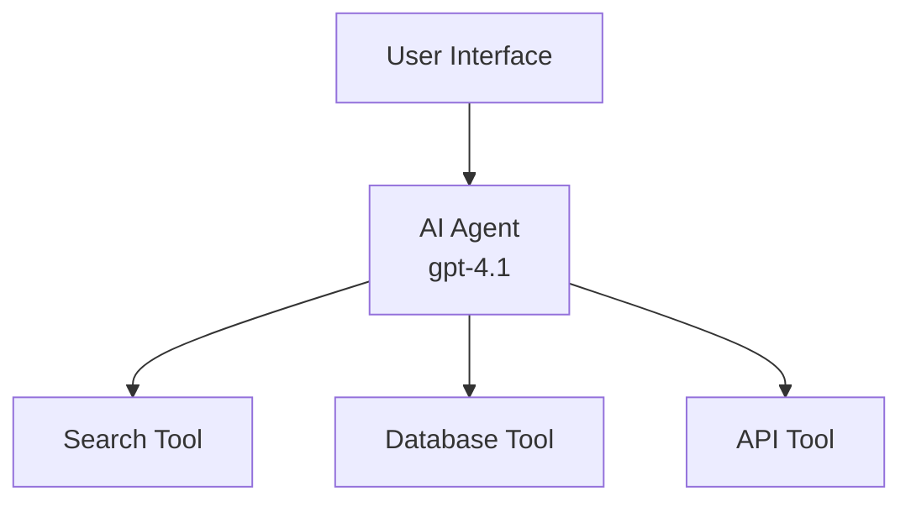
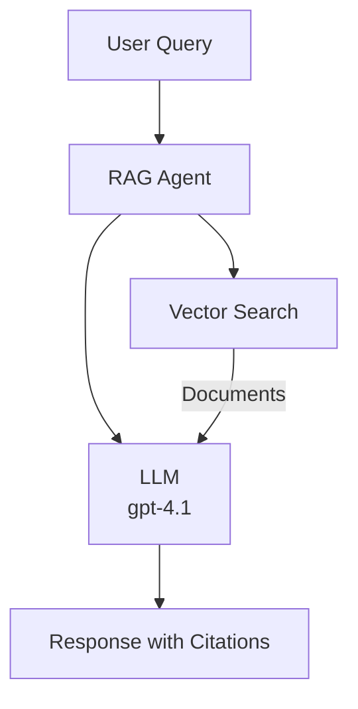
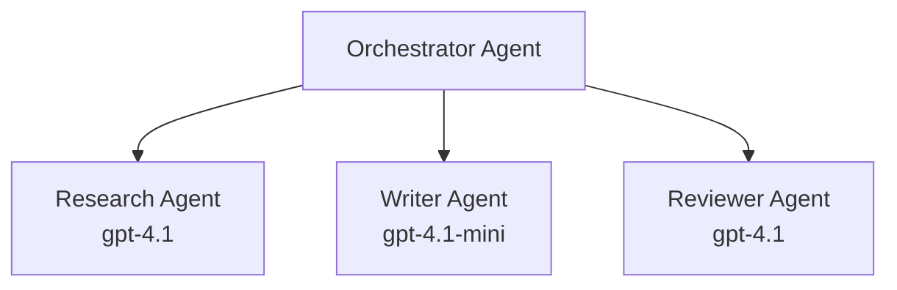

# وكلاء الذكاء الاصطناعي مع Azure Developer CLI

**تنقل الفصل:**
- **📚 الصفحة الرئيسية للدورة**: [AZD للمبتدئين](../../README.md)
- **📖 الفصل الحالي**: الفصل 2 - تطوير الذكاء الاصطناعي أولاً
- **⬅️ السابق**: [دمج Microsoft Foundry](microsoft-foundry-integration.md)
- **➡️ التالي**: [نشر نموذج الذكاء الاصطناعي](ai-model-deployment.md)
- **🚀 متقدم**: [حلول الوكلاء المتعددين](../../examples/retail-scenario.md)

---

## مقدمة

وكلاء الذكاء الاصطناعي هم برامج مستقلة يمكنها إدراك بيئتها، اتخاذ القرارات، واتخاذ إجراءات لتحقيق أهداف محددة. بخلاف الدردشة البسيطة التي ترد على المطالبات، يستطيع الوكلاء:

- **استخدام الأدوات** - استدعاء واجهات برمجة التطبيقات، البحث في قواعد البيانات، تنفيذ الأكواد
- **التخطيط والتفكير** - تقسيم المهام المعقدة إلى خطوات
- **التعلم من السياق** - الحفاظ على الذاكرة وتكييف السلوك
- **التعاون** - العمل مع وكلاء آخرين (أنظمة متعددة الوكلاء)

يوضح هذا الدليل كيفية نشر وكلاء الذكاء الاصطناعي على Azure باستخدام Azure Developer CLI (azd).

استخدام سياق المحادثة ليس تدريبًا للنموذج: يجب تنفيذ/تكوين الذاكرة المستمرة، التحكم في الوصول، والاحتفاظ من قبل التطبيق.

> **تحديث إصدار Foundry GA (2026-11-09):** قم بتثبيت الحزمة المتاحة عمومًا `microsoft.foundry` 1.0 مع `azd >= 1.37.0`. يتم تثبيت التقييمات بشكل منفصل؛ الميزات الاختيارية للمعاينة ومكمل SDK الكلاسيكي أدناه غير مدعومة في GA بواسطة إعلان الحزمة. هذا التوجيه يعتمد على [إعلان GA](https://devblogs.microsoft.com/azure-sdk/microsoft-foundry-azure-developer-cli-ga/) والوثائق، وليس نشرًا مباشرًا على Azure.

## أهداف التعلم

عند إتمام هذا الدليل، سوف:
- تفهم ماهية وكلاء الذكاء الاصطناعي وكيف يختلفون عن الدردشات الآلية
- تنشر قوالب وكلاء الذكاء الاصطناعي الجاهزة باستخدام AZD
- تضبط وكلاء Foundry للوكلاء المخصصين
- تنفذ أنماط الوكلاء الأساسية (استخدام الأدوات، RAG، وكلاء متعددون)
- تراقب وتحلل الوكلاء المنشورة

## المخرجات التعليمية

عند الانتهاء، ستكون قادرًا على:
- نشر تطبيقات وكلاء الذكاء الاصطناعي إلى Azure بأمر واحد
- تكوين أدوات وقدرات الوكيل
- تنفيذ التوليد المعزز بالاستدعاء (RAG) مع الوكلاء
- تصميم هياكل وكلاء متعددين لسير العمل المعقدة
- استكشاف أخطاء النشر الشائعة وإصلاحها

---

## 🤖 ما الذي يجعل الوكيل مختلفًا عن الدردشة الآلية؟

| الميزة | دردشة آلية | وكيل ذكاء اصطناعي |
|---------|---------|----------|
| **السلوك** | يرد على المطالبات | يتخذ إجراءات مستقلة |
| **الأدوات** | قد يستخدم الاستدعاء أو الأدوات | عادة ما يستخدم الأدوات في حلقة موجهة نحو الهدف |
| **الذاكرة** | تعتمد على التطبيق | ذاكرة مستمرة فقط إذا تم تنفيذها صراحة |
| **التخطيط** | استجابة واحدة | تفكير متعدد الخطوات |
| **التعاون** | كيان واحد | يمكنه العمل مع وكلاء آخرين |

### تشبيه بسيط

- **دردشة آلية** = شخص مساعد يجيب على الأسئلة في مكتب المعلومات
- **وكيل ذكاء اصطناعي** = مساعد شخصي يمكنه إجراء المكالمات، حجز المواعيد، وإكمال المهام لك

---

## 🚀 بدء سريع: انشر وكيلك الأول

اختر خيارًا واحدًا في **دليل عمل جديد وفارغ**. يعمل `.` اللاحق على التهيئة هناك؛ بدون وجهة صريحة، قد ينشئ AZD الحالي دليلًا فرعيًا باسم القالب ولا يغير دليل الصدفة الخاص بك. احتفظ بالقوالب/البيئات المختلفة في أدلة منفصلة.

تتراوح أوقات/تكاليف التوضيحية أدناه، وليست عروض أسعار مؤكدة. تحقق من متطلبات كل عينة الحالية، والتسعير، وحصة النموذج، والخدمات الاختيارية قبل النشر.

### الخيار 1: قالب وكلاء Foundry (مُوصى به)

```bash
# Initialize the AI agents template
azd init --template get-started-with-ai-agents .

# Deploy to Azure
azd up
```

**ما الذي يتم نشره:** البنية التحتية الحالية للعينة والخيارات المحددة تحدد النموذج، الأدوات، الاستضافة، وموارد المراقبة. راجع README الخاص بها و`infra/` قبل التوفير؛ لا تفترض أن كل قالب وكيل يتضمن البحث أو واجهة ويب.

**الوقت:** ~15-20 دقيقة
**التكلفة:** ~100-150 دولار شهريًا (التطوير)

### الخيار 2: وكلاء الكتابة الإبداعية مع Prompty

```bash
# Initialize the Prompty-based agent template
azd init --template https://github.com/Azure-Samples/contoso-creative-writer .

# Deploy to Azure
azd up
```

**ما الذي يتم نشره:** عينة كتابة متعددة الوكلاء باستخدام FastAPI/Prompty وAzure OpenAI، وأرضية Bing، وAzure AI Search. يؤدي مستودع `agent-openai-python-prompty` السابق إلى هذا المكان؛ وهو ليس قالب وكيل الطقس في Azure Functions بسيط. اتبع README الحالي لمعرفة متطلبات الاستضافة، حصة النموذج، وأرضية Bing.

**الوقت:** ~10-15 دقيقة
**التكلفة:** ~50-100 دولار شهريًا (التطوير)

### الخيار 3: وكيل دردشة RAG

```bash
# Initialize RAG chat template
azd init --template azure-search-openai-demo .

# Deploy to Azure
azd up
```

**ما الذي يتم نشره:**
- ✅ نماذج Microsoft Foundry
- ✅ Azure AI Search مع بيانات عينة
- ✅ خط أنابيب معالجة المستندات
- ✅ واجهة الدردشة مع الاستشهادات

**الوقت:** ~15-25 دقيقة
**التكلفة:** ~80-150 دولار شهريًا (التطوير)

### الخيار 4: وكيل مستضاف مع حزمة Foundry GA

استخدم [الدليل الكامل للوكيل المستضاف](microsoft-foundry-integration.md#hosted-agent-walkthrough-ga) لعينة API إطار عمل Python الأساسية لاستجابات الوكيل. مسار نشر الكود هذا يتطلب Python 3.13+، uv الحالي، أذونات Foundry، وحصة نموذج إقليمية. قم بالمصادقة على مكالمات SDK المحلية بشكل منفصل عند استخدام بيانات اعتماد Azure CLI.

```bash
azd auth login
azd ext install microsoft.foundry
```

في الدليل الفارغ، قم بتهيئة العينة:

```text
azd ai agent init --template https://github.com/microsoft-foundry/foundry-samples/blob/main/samples/python/hosted-agents/agent-framework/responses/01-basic/azure.yaml --deploy-mode code --src .
```

اختر مشروعًا جديدًا أو قائمًا، راجع `azure.yaml`، وشغّل `azd provision`. استخدم `azd ai agent run` لفتح Agent Inspector، ومن نافذة طرفية أخرى في ذلك الدليل، `azd ai agent invoke --local "Explain how this agent is hosted."`. بعد التحقق المحلي، استخدم `azd deploy` و`azd ai agent invoke "Explain how this agent is hosted."` لمقارنة الاستجابة المنشورة. يقوم Foundry ببناء المصدر المرفوع عن بُعد؛ لا يتطلب بناء الحاوية محليًا.

**متى تستخدم `azd ai agent init` مقابل `azd init --template`:**

| النهج | الأفضل لـ | كيف يعمل |
|----------|----------|------|
| `azd init --template` | بدءًا من تطبيق عينة يعمل | ينسخ مستودع قالب كامل مع الكود + البنية التحتية |
| `azd ai agent init --template` | تبني مشروع وكيل Foundry قائم | يستخدم مستند مشروع `azure.yaml` وتعريفاته |

> **نصيحة:** الخيارات 1-3 تبدأ من قوالب تطبيق كاملة؛ الخيار 4 يعلّم سير عمل الوكيل المستضاف GA. لا يقوم أي من أوامر التهيئة بنقل ملفات الوكيل القديمة تلقائيًا. لإضافة تعريف وكيل مباشر إلى مشروع قائم، انظر [توجيه التهيئة والهجرة](../chapter-08-production/production-ai-practices.md#initializing-agent-projects-with-azd-ai-agent-init).

قم بتثبيت `azure.ai.evaluations` منفردًا لإنشاء ومراجعة بيانات الاختبار/القياسات، تكوين التقييم، وتشغيله باستخدام `azd ai eval`. يمكن إعادة استخدام تقييم متوافق للتحسين؛ راجع المرشحين قبل نشر واحد صراحة. تابع [سير عمل التقييم](../chapter-08-production/production-ai-practices.md#evaluation-migration-and-quality-checks) و[هجرة التحسين](../chapter-08-production/production-ai-practices.md#optimization-configuration-migration) قبل إعادة استخدام أمثلة أقدم. للتنظيف، تبقى موارد مشروع Foundry المعاد استخدامه بعد `azd down`؛ ويحذف مجموعة موارد المشروع المنشأ حديثًا. انظر [توجيه تنظيف الدليل](microsoft-foundry-integration.md#7-clean-up-deliberately).

---

## 🏗️ أنماط هندسة الوكلاء

### النمط 1: وكيل واحد مع أدوات

أبسط نمط للوكيل - وكيل واحد يمكنه استخدام أدوات متعددة.



**الأفضل لـ:**
- روبوتات دعم العملاء
- مساعدي البحث
- وكلاء تحليل البيانات

**عينة تطبيق ذات صلة:** `azure-search-openai-demo` توضح RAG، وليست حلقة وكيل لأداة عشوائية عامة.

### النمط 2: وكيل RAG (التوليد المعزز بالاستدعاء)

وكيل يسترجع المستندات ذات الصلة قبل توليد الردود.



**الأفضل لـ:**
- قواعد بيانات المعرفة المؤسسية
- أنظمة الأسئلة والأجوبة على الوثائق
- الامتثال والبحث القانوني

**قالب AZD:** `azure-search-openai-demo`

### النمط 3: نظام وكلاء متعددين

وكلاء متخصصون متعددون يعملون معًا على مهام معقدة.



**الأفضل لـ:**
- إنشاء محتوى معقد
- سير عمل متعدد الخطوات
- مهام تتطلب تخصصات مختلفة

**للمزيد من المعلومات:** [أنماط تنسيق الوكلاء المتعددين](../chapter-06-pre-deployment/coordination-patterns.md)

---

## ⚙️ تكوين أدوات الوكلاء

يصبح الوكلاء أقوياء عندما يمكنهم استخدام الأدوات. إليك كيفية تكوين الأدوات الشائعة:

### تكوين الأدوات في وكلاء Foundry

هذا **مقطع SDK الكلاسيكي لخدمة الوكيل** يستهدف `azure-ai-projects==1.0.0` و`azure-ai-agents==1.1.0` مع `azure-identity`. ليس النسخة الجديدة API استجابات/وكيل النسخي المستخدمة في بعض قوالب Foundry الحالية، ولا `azure.ai.agents` إضافة AZD (حزمة مختلفة). لا تمزج أجيال API هذه. عيّن `PROJECT_ENDPOINT` إلى نقطة نهاية مشروع Foundry كلاسيكي و`MODEL_DEPLOYMENT_NAME` إلى نشر نموذج مدعوم موجود؛ صادق باستخدام `az login` محليًا ومنح الأذونات المطلوبة للمشروع.

```python
# agent_config.py
import os
from azure.ai.projects import AIProjectClient
from azure.ai.agents.models import FunctionTool
from azure.identity import DefaultAzureCredential

def search_knowledge_base(query: str) -> str:
    """Search the demonstration knowledge base.

    :param query: Search text.
    :return: Matching demonstration information.
    """
    # Local fixture only, not a production search implementation.
    return "Demo policy: returns are accepted within 30 days."

project_client = AIProjectClient(
    endpoint=os.environ["PROJECT_ENDPOINT"],
    credential=DefaultAzureCredential(),
)
search_tool = FunctionTool(functions={search_knowledge_base})
project_client.agents.enable_auto_function_calls(search_tool)
agent = project_client.agents.create_agent(
    model=os.environ["MODEL_DEPLOYMENT_NAME"],
    name="Support Agent",
    instructions="Use search_knowledge_base for policy questions. Label results as demo data.",
    tools=search_tool.definitions,
)
```

تسجيل مخطط وظيفة لا ينفذ Python على الخدمة. في هذا SDK، `enable_auto_function_calls` مع `agents.runs.create_and_process(...)` يشغل ردود النداء المسجلة في عملية العميل الخاصة بك. انظر [مثال SDK الصادر](https://github.com/Azure/azure-sdk-for-python/blob/azure-ai-agents_1.1.0/sdk/ai/azure-ai-agents/samples/agents_tools/sample_agents_auto_function_call.py). أغلق العميل واحذف وكلاء/خيوط العرض عند الانتهاء.

### تكوين البيئة

الأسماء التالية هي **مدخلات قوالب مخصصة توضيحية**، ليست مفاتيح AZD المدمجة. قم أولاً بتمرير كل قيمة عبر `infra/main.parameters.json`، البنية التحتية، وكود التطبيق. `azd env set` وحده لا يغير أدوات الوكيل أو التعليمات.

```bash
# Set up agent-specific environment variables
azd env set AZURE_OPENAI_MODEL "gpt-4.1"
azd env set AGENT_INSTRUCTIONS "You are a helpful assistant..."
azd env set ENABLE_CODE_INTERPRETER "true"
azd env set ENABLE_FILE_SEARCH "true"

# Apply wired infrastructure and application changes
azd up
```

---

## 📊 مراقبة الوكلاء

### تكامل Application Insights

إذا كانت القالب المحدد يزود Application Insights ويكوّن أدوات القياس:

```bash
# Open monitoring dashboard
azd monitor --overview

# Open the Application Insights logs view (not a streaming log tail)
azd monitor --logs

# View live metrics
azd monitor --live
```

### المقاييس الأساسية التي يجب تتبعها

| المقياس | الوصف | الهدف |
|--------|-------------|--------|
| زمن الاستجابة | وقت توليد الرد | < 5 ثوانٍ |
| استخدام الرموز | الرموز لكل طلب | راقب التكلفة |
| معدل نجاح استدعاء الأداة | % من تنفيذ الأدوات الناجحة | > 95% |
| معدل الخطأ | طلبات الوكيل الفاشلة | < 1% |
| رضا المستخدم | درجات التغذية الراجعة | > 4.0/5.0 |

### تسجيل مخصص للوكلاء

```python
import os
from azure.monitor.opentelemetry import configure_azure_monitor
from opentelemetry import trace

# Configure Azure Monitor with OpenTelemetry
configure_azure_monitor(
    connection_string=os.environ["APPLICATIONINSIGHTS_CONNECTION_STRING"]
)

tracer = trace.get_tracer(__name__)

def log_agent_interaction(user_query, agent_response, tools_used, latency_ms):
    with tracer.start_as_current_span("agent_interaction") as span:
        span.set_attributes({
            "query_length": len(user_query),  # Do not log raw prompts or personal data
            "response_length": len(agent_response),
            "tools_used": tools_used,
            "latency_ms": latency_ms
        })
```

> **ملاحظة:** قم بتثبيت الحزمة المطلوبة: `pip install azure-monitor-opentelemetry`. تجلب تبعيات OpenTelemetry؛ مساحة اسم الاستيراد ليست مطلبًا لتثبيت حزمة اسمها `opentelemetry`.

---

## 💰 اعتبارات التكلفة

### التكاليف الشهرية المقدرة حسب النمط

هذه نطاقات تخطيط توضيحية، وليست عروض أسعار أو حدود إنفاق. يمكن أن يتجاوزها المنطقة، رموز النموذج، SKU للبحث/الحوسبة، جلسات الأدوات، التخزين، والحركة. تحقق من توجيهات تكلفة العينة وتسعير Azure قبل `azd up`.

| النمط | بيئة التطوير | الإنتاج |
|---------|-----------------|------------|
| وكيل واحد | $50-100 | $200-500 |
| وكيل RAG | $80-150 | $300-800 |
| وكلاء متعددون (2-3 وكلاء) | $150-300 | $500-1,500 |
| وكلاء متعددين للمؤسسات | $300-500 | $1,500-5,000+ |

### نصائح تحسين التكلفة

1. **استخدم gpt-4.1-mini للمهام البسيطة** (فقط إذا كان قالبك يستهلك هذا الإدخال)
   ```bash
   azd env set AZURE_OPENAI_MODEL "gpt-4.1-mini"
   ```

2. **نفذ التخزين المؤقت المحدد للاستعلامات المتكررة الآمنة.** اشمل تصريح المستأجر/المستخدم، نشر النموذج، التعليمات، وإصدار الاستدعاء في مفتاح التخزين المؤقت؛ عيّن انتهاء صلاحية. لا تشارك ردود المحادثة الخاصة من خلال ذاكرة تخزين مؤقت للاستعلام على مستوى العملية. كائن وكيل SDK لا يحتوي على طريقة `agent.run()` عامة.

3. **حدد حدود الرموز لكل تشغيل**
   ```python
   # Set max_completion_tokens when running the agent, not during creation
   run = project_client.agents.runs.create_and_process(
       thread_id=thread.id,
       agent_id=agent.id,
       max_completion_tokens=1000  # Budget across the run; may finish as incomplete
   )
   ```

4. **قم بتغيير حجم تطبيقات الحاوية المؤهلة إلى الصفر عند عدم الاستخدام**
   ```bash
   # Custom-template input: must map to template.scale.minReplicas
   azd env set MIN_REPLICAS "0"
   ```
   طبق التغيير البنيوي مع `azd provision` أو `azd up`. تغيير الحجم إلى الصفر يحتاج إلى مشغل مناسب ولا يوقف رسوم البحث، التخزين، أو النموذج/الأدوات.

---

## 🔧 استكشاف أخطاء الوكلاء وإصلاحها

### المشكلات والحلول الشائعة

<details>
<summary><strong>❌ الوكيل لا يستجيب لاستدعاءات الأدوات</strong></summary>

```bash
# Inspect the application deployment (not the agent's registered tools)
azd show

# Verify OpenAI deployment
az cognitiveservices account deployment list \
  --name $AZURE_OPENAI_NAME \
  --resource-group $RG_NAME

# Check agent logs
azd monitor --logs
```

**الأسباب الشائعة:**
- عدم تطابق توقيع وظيفة الأداة
- نقص الأذونات المطلوبة
- نقطة نهاية API غير قابلة للوصول
</details>

<details>
<summary><strong>❌ بطء عالٍ في استجابات الوكيل</strong></summary>

```bash
# Check Application Insights for bottlenecks
azd monitor --live

# Consider using a faster model
azd env set AZURE_OPENAI_MODEL "gpt-4.1-mini"
azd up
```

**نصائح التحسين:**
- استخدم الردود المتدفقة
- نفذ تخزين الردود المؤقت
- قلل من حجم نافذة السياق
</details>

<details>
<summary><strong>❌ الوكيل يعيد معلومات غير صحيحة أو وهمية</strong></summary>

```python
# Improve with better system prompts
instructions = """
You are a helpful assistant. IMPORTANT:
- Only answer based on provided context
- If you don't know, say "I don't know"
- Always cite your sources
- Never make up information
"""

# Use these instructions in the agent definition.
# For classic file search, first upload/index documents in a vector store,
# then use FileSearchTool(vector_store_ids=[...]) and pass both its
# .definitions and .resources when creating the agent.
```
 تعليمات الاستدعاء تقلل المخاطر؛ لا يضمن أي منهما إجابات صحيحة. قيّم الأسئلة المؤسسية والخارجية مقارنة بالإجابات المعروفة.
</details>

<details>
<summary><strong>❌ أخطاء تجاوز حد الرموز</strong></summary>

```python
# Implement context window management
def truncate_context(messages, max_tokens=8000, model="gpt-4.1"):
    """Approximate content-only budget for objects with .content strings."""
    import tiktoken
    encoding = tiktoken.encoding_for_model(model)
    total_tokens = 0
    truncated = []
    
    for msg in reversed(messages):
        msg_tokens = len(encoding.encode(msg.content))
        if total_tokens + msg_tokens > max_tokens:
            break
        truncated.insert(0, msg)
        total_tokens += msg_tokens
    
    return truncated
```
 هذا المساعد يستثني مخططات الدور/الأداة، تعليمات النظام، رموز الصور، وحمولة البروتوكول. احجز مساحة لتلك والتعليمات؛ لا تفصل أزواج استدعاء/نتيجة الأداة أو تُهمل تعليمات النظام المطلوبة. ثبت `tiktoken` منفصلًا. ليس مدققًا عامًا لنافذة السياق.
</details>

---

## 🎓 تمارين عملية

### التمرين 1: نشر وكيل أساسي (20 دقيقة)

**الهدف:** نشر وكيل الذكاء الاصطناعي الأول باستخدام AZD

```bash
# Step 1: Initialize template
azd init --template get-started-with-ai-agents .

# Step 2: Login to Azure
azd auth login
# If you work across tenants, add --tenant-id <tenant-id>

# Step 3: Deploy
azd up

# Step 4: Test the agent
# Expected output after deployment:
#   Deployment Complete!
#   Endpoint: https://<app-name>.<region>.azurecontainerapps.io
# Open the URL shown in the output and try asking a question

# Step 5: View monitoring
azd monitor --overview

# Step 6: Review the listed resources and confirm cleanup
azd down
```

**معايير النجاح:**
- [ ] يستجيب الوكيل للأسئلة
- [ ] يمكن الوصول إلى لوحة المراقبة عبر `azd monitor`
- [ ] تم تنظيف الموارد بنجاح

### التمرين 2: إضافة أداة مخصصة (30 دقيقة)

**الهدف:** توسيع الوكيل بأداة مخصصة

**نقطة البداية:** استخدم عميل SDK الكلاسيكي من [تكوين الأداة](#tool-configuration-in-foundry-agents)، وليس قالبًا عشوائيًا مع جيل SDK مختلف.

1. أضف هذا التجهيز الحتمي إلى `agent_config.py`:
   ```python
   def get_weather(location: str) -> str:
       """Return demonstration weather, not live conditions.

       :param location: City name.
       :return: A clearly labelled fixture.
       """
       print(f"TOOL_CALLED: {location}")
       return f"Demo weather in {location}: Sunny, 72°F (fixture, not live)"
   ```
2. استبدل تسجيل الأداة search-tool وكتلة الإنشاء بـ:
   ```python
   weather_tool = FunctionTool(functions={get_weather})
   project_client.agents.enable_auto_function_calls(weather_tool)
   agent = project_client.agents.create_agent(
       model=os.environ["MODEL_DEPLOYMENT_NAME"],
       name="Weather Agent",
       instructions="Call get_weather for weather questions; explain that it returns demo data.",
       tools=weather_tool.definitions,
   )
   thread = project_client.agents.threads.create()
   try:
       project_client.agents.messages.create(
           thread_id=thread.id, role="user", content="Use get_weather for Seattle."
       )
       run = project_client.agents.runs.create_and_process(
           thread_id=thread.id, agent_id=agent.id
       )
       if run.status != "completed":
           raise RuntimeError(f"Run status: {run.status}; error: {run.last_error}")
       for message in project_client.agents.messages.list(thread_id=thread.id):
           for text in message.text_messages:
               print(text.text.value)
   finally:
       project_client.agents.threads.delete(thread.id)
       project_client.agents.delete_agent(agent.id)
       project_client.close()
   ```
3. شغل محليًا (هذا يستدعي المشروع الموجود على Azure ويتكبد رسوم النموذج):
   ```bash
   python agent_config.py
   # Expected: TOOL_CALLED: Seattle, then a completed answer labelled demo data.
   ```

**معايير النجاح:**
- [ ] يتعرف الوكيل على استفسارات الطقس
- [ ] تم استدعاء الأداة بشكل صحيح
- [ ] تتضمن الاستجابة معلومات الطقس

### التمرين 3: بناء وكيل RAG (45 دقيقة)

**الهدف:** إنشاء وكيل يجيب على الأسئلة من مستنداتك

```bash
# Step 1: Deploy RAG template
azd init --template azure-search-openai-demo .
azd up

# Step 2: Upload your documents
# For the sample's local ingestion path, place supported files in data/.
# Run from the sample root after following its Python environment setup:
./scripts/prepdocs.sh
# Windows PowerShell equivalent: .\\scripts\\prepdocs.ps1

# Step 3: Test with domain-specific questions
# Open the web app URL from the azd up output
# Ask questions about your uploaded documents
# Responses should include citation references like [doc.pdf]
```

**معايير النجاح:**
- [ ] يجيب الوكيل من المستندات المُحمّلة
- [ ] تتضمن الردود الاقتباسات
- [ ] يتم التعامل مع أسئلة الاختبار خارج النطاق بدون ادعاءات غير مدعومة (ليست ضمانًا لكل سؤال مستقبلي)

إذا `USE_CLOUD_INGESTION=true`، استخدم بدلاً من ذلك سير عمل الإدخال/التحميل السحابي للعينة؛ الغلاف المحلي يتجنب الإدخال عن عمد. بعد الاختبار، شغل `azd down` في بيئة RAG وراجع الموارد لحذفها.

---

## 📚 الخطوات التالية

الآن بعد أن فهمت وكلاء الذكاء الاصطناعي، استكشف هذه المواضيع المتقدمة:

| الموضوع | الوصف | الرابط |
|-------|-------------|------|
| **أنظمة متعددة الوكلاء** | بناء أنظمة بها وكلاء متعاونون متعددون | [مثال متعدد الوكلاء للبيع بالتجزئة](../../examples/retail-scenario.md) |
| **أنماط التنسيق** | تعلم أنماط التنسيق والاتصال | [أنماط التنسيق](../chapter-06-pre-deployment/coordination-patterns.md) |
| **نشر الإنتاج** | نشر الوكلاء الجاهزين للمؤسسات | [ممارسات الذكاء الاصطناعي للإنتاج](../chapter-08-production/production-ai-practices.md) |
| **تقييم الوكيل** | اختبار وتقييم أداء الوكيل | [استكشاف أخطاء الذكاء الاصطناعي](../chapter-07-troubleshooting/ai-troubleshooting.md) |
| **مختبر ورشة عمل الذكاء الاصطناعي** | عملي: اجعل حلك الذكاء الاصطناعي جاهزًا لـ AZD | [مختبر ورشة العمل](ai-workshop-lab.md) |

---

## 📖 موارد إضافية

### التوثيق الرسمي
- [خدمة وكيل Microsoft Foundry](https://learn.microsoft.com/azure/ai-services/agents/)
- [البدء السريع مع خدمة وكيل Microsoft Foundry](https://learn.microsoft.com/azure/ai-services/agents/quickstart)
- [إطار عمل وكيل Semantic Kernel](https://learn.microsoft.com/semantic-kernel/)

### قوالب AZD للوكلاء
- [البدء مع وكلاء الذكاء الاصطناعي](https://github.com/Azure-Samples/get-started-with-ai-agents)
- [وكلاء الكتابة الإبداعية مع Prompty](https://github.com/Azure-Samples/contoso-creative-writer)
- [عرض Azure Search OpenAI](https://github.com/Azure-Samples/azure-search-openai-demo)

### موارد المجتمع
- [قوالب وكيل AZD رائعة](https://azure.github.io/awesome-azd/?tags=ai-agents)
- [Azure AI Discord](https://discord.gg/microsoft-azure)
- [Microsoft Foundry Discord](https://discord.gg/nTYy5BXMWG)

### مهارات الوكيل لمحررك
- [**مهارات وكيل Microsoft Azure**](https://skills.sh/microsoft/github-copilot-for-azure) - تثبيت مهارات وكيل الذكاء الاصطناعي القابلة لإعادة الاستخدام لتطوير Azure في GitHub Copilot أو Cursor أو أي وكيل مدعوم. تتضمن المهارات لـ [Azure AI](https://skills.sh/microsoft/github-copilot-for-azure/azure-ai)، [Microsoft Foundry](https://skills.sh/microsoft/github-copilot-for-azure/microsoft-foundry)، [النشر](https://skills.sh/microsoft/github-copilot-for-azure/azure-deploy)، و [التشخيصات](https://skills.sh/microsoft/github-copilot-for-azure/azure-diagnostics):
  ```bash
  npx skills add microsoft/github-copilot-for-azure
  ```

---

**التنقل**
- **الدرس السابق**: [تكامل Microsoft Foundry](microsoft-foundry-integration.md)
- **الدرس التالي**: [نشر نموذج الذكاء الاصطناعي](ai-model-deployment.md)

---

<!-- CO-OP TRANSLATOR DISCLAIMER START -->
**تنويه**:
تمت ترجمة هذا المستند باستخدام خدمة الترجمة بالذكاء الاصطناعي [Co-op Translator](https://github.com/Azure/co-op-translator). بينما نسعى للدقة، يرجى العلم أن الترجمات الآلية قد تحتوي على أخطاء أو عدم دقة. يجب اعتبار المستند الأصلي بلغته الأصلية المصدر الرسمي والمعتمد. للمعلومات الهامة، يُنصح بالاستعانة بترجمة بشرية محترفة. نحن غير مسؤولين عن أي سوء فهم أو تفسير ناتج عن استخدام هذه الترجمة.
<!-- CO-OP TRANSLATOR DISCLAIMER END -->