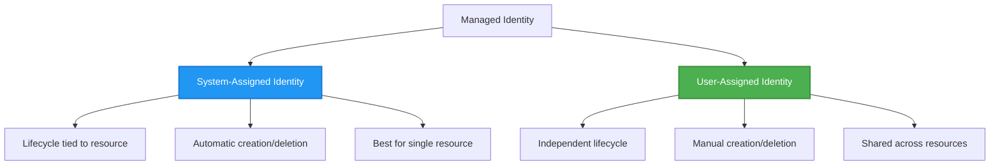

# أنماط المصادقة والهوية المُدارة

⏱️ **الوقت المتوقع**: ٤٥-٦٠ دقيقة قراءة؛ أضف وقتًا إضافيًا لدمج التمارين | 💰 **تأثير التكلفة**: الهوية / RBAC مجانية؛ الحوسبة المخزنة وKey Vault التي يتم نشرها قابلة للفوترة | ⭐ **التعقيد**: متوسط

> تمت المراجعة مقابل `azd 1.37.2` (نوفمبر ٢٠٢٦). تحتوي هذه الدرس على **مقتطفات تكامل توضيحية، وليست قالب `secure-app` كامل قابل للتنزيل**. أنشئ الملفات المشار إليها، وزود البنية التحتية المطابقة، واستبدل العناصر النائبة قبل النشر. لم يتم توفير موارد Azure أثناء المراجعة.

**📚 مسار التعلم:**
- ← السابق: [إدارة التكوين](configuration.md) - إدارة متغيرات البيئة والأسرار
- 🎯 **أنت هنا**: المصادقة والأمان (الهوية المُدارة، Key Vault، الأنماط الآمنة)
- → التالي: [البنية التحتية ككود](../chapter-04-infrastructure/README.md) - توفير ونشر الموارد
- 🏠 [الصفحة الرئيسية للدورة](../../README.md)

---

## ما ستتعلمه

عند إكمال هذا الدرس، ستتمكن من:
- فهم أنماط المصادقة في Azure (المفاتيح، سلاسل الاتصال، الهوية المُدارة)
- تنفيذ **الهوية المُدارة** للمصادقة بدون كلمات مرور
- تأمين الأسرار من خلال دمج **Azure Key Vault**
- تكوين **التحكم في الوصول المعتمد على الدور (RBAC)** لنشر AZD
- تطبيق أفضل ممارسات الأمان في تطبيقات الحاويات وخدمات Azure
- الانتقال من المصادقة المعتمدة على المفتاح إلى المصادقة المعتمدة على الهوية

## لماذا تعتبر الهوية المُدارة مهمة

### المشكلة: المصادقة التقليدية

**قبل الهوية المُدارة:**
```javascript
// ❌ SECURITY RISK: Hardcoded secrets in code
const connectionString = "Server=mydb.database.windows.net;User=admin;Password=P@ssw0rd123";
const storageKey = "xK7mN9pQ2wR5tY8uI0oP3aS6dF1gH4jK...";
const cosmosKey = "C2x7B9n4M1p8Q5w3E6r0T2y5U8i1O4p7...";
```

**المشاكل:**
- 🔴 **الأسرار المكشوفة** في الكود وملفات التكوين ومتغيرات البيئة
- 🔴 **تدوير بيانات الاعتماد** يحتاج إلى تغييرات في الكود وإعادة النشر
- 🔴 **كابوس التدقيق** - من وصل إلى ماذا ومتى؟
- 🔴 **الفوضى** - الأسرار متفرقة عبر أنظمة متعددة
- 🔴 **مخاطر الامتثال** - تفشل في عمليات تدقيق الأمان

### الحل: الهوية المُدارة

**بعد الهوية المُدارة:**
```javascript
// ✅ SECURE: No secrets in code
const credential = new DefaultAzureCredential();
const client = new BlobServiceClient(
  "https://mystorageaccount.blob.core.windows.net",
  credential  // Azure automatically handles authentication
);
```

**الفوائد:**
- ✅ **صفر أسرار** في الكود أو التكوين
- ✅ **تدوير تلقائي** - تديره Azure
- ✅ **سجل تدقيق كامل** في سجلات Microsoft Entra ID
- ✅ **أمان مركزي** - إدارة من بوابة Azure
- ✅ **جاهز للامتثال** - يفي بمعايير الأمان

**التشبيه**: المصادقة التقليدية مثل حمل مفاتيح مادية متعددة لأبواب مختلفة. الهوية المُدارة مثل وجود شارة أمنية تمنح الوصول تلقائيًا بناءً على هويتك — لا مفاتيح لتفقدها أو نسخها أو تدويرها.

---

## نظرة عامة على البنية

### تدفق المصادقة باستخدام الهوية المُدارة

```mermaid
sequenceDiagram
    participant App as Your Application<br/>(Container App)
    participant MI as Managed Identity<br/>(Microsoft Entra ID)
    participant KV as Key Vault
    participant Storage as Azure Storage
    participant DB as Azure SQL
    
    App->>MI: Request access token<br/>(automatic)
    MI->>MI: Verify identity<br/>(no password needed)
    MI-->>App: Return token for requested audience<br/>(lifetime varies)
    
    App->>KV: Get secret<br/>(using token)
    KV->>KV: Check RBAC permissions
    KV-->>App: Return secret value
    
    App->>Storage: Upload blob<br/>(using token)
    Storage->>Storage: Check RBAC permissions
    Storage-->>App: Success
    
    App->>DB: Query data<br/>(using token)
    DB->>DB: Check SQL permissions
    DB-->>App: Return results
    
    Note over App,DB: Request a separate token for each service audience;<br/>SDK credentials handle caching and renewal
```

### أنواع الهويات المُدارة



| الميزة | النظام المعين | المستخدم المعين |
|---------|----------------|---------------|
| **دورة الحياة** | مرتبط بالموارد | مستقل |
| **الإنشاء** | تلقائي مع المورد | إنشاء يدوي |
| **الحذف** | يحذف مع المورد | يبقى بعد حذف المورد |
| **المشاركة** | مورد واحد فقط | موارد متعددة |
| **حالة الاستخدام** | السيناريوهات البسيطة | سيناريوهات متعددة الموارد المعقدة |
| **اختيار القالب** | محدد في البنية التحتية | محدد في البنية التحتية |

---

## المتطلبات الأساسية

### الأدوات المطلوبة

يجب أن تكون قد قمت بتثبيتها بالفعل من الدروس السابقة:

```bash
# Verify Azure Developer CLI
azd version
# ✅ Expected: azd version 1.0.0 or higher

# Verify Azure CLI
az --version
# ✅ Expected: azure-cli 2.50.0 or higher
```

### متطلبات Azure

- اشتراك نشط في Azure
- أذونات لـ:
  - إنشاء الهويات المُدارة
  - تعيين أدوار RBAC
  - إنشاء موارد Key Vault
  - نشر تطبيقات الحاويات

### المتطلبات المعرفية

يجب أن تكون قد أكملت:
- [دليل التثبيت](../chapter-01-foundation/installation.md) - إعداد AZD
- [أساسيات AZD](../chapter-01-foundation/azd-basics.md) - المفاهيم الأساسية
- [إدارة التكوين](configuration.md) - متغيرات البيئة

---

## الدرس ١: فهم أنماط المصادقة

### النمط ١: سلاسل الاتصال (قديم - تجنب)

**كيف يعمل:**
```bash
# Connection string contains credentials
STORAGE_CONNECTION_STRING="DefaultEndpointsProtocol=https;AccountName=myaccount;AccountKey=xK7mN9pQ2wR5..."
COSMOS_CONNECTION_STRING="AccountEndpoint=https://myaccount.documents.azure.com:443/;AccountKey=C2x7..."
SQL_CONNECTION_STRING="Server=myserver.database.windows.net;User=admin;Password=P@ssw0rd..."
```

**المشاكل:**
- ❌ الأسرار ظاهرة في متغيرات البيئة
- ❌ مسجلة في أنظمة النشر
- ❌ صعب تدويرها
- ❌ لا يوجد سجل تدقيق للوصول

**متى يستخدم:** عندما يتطلب الخدمة المستهدفة مصادقة معتمدة على المفتاح. الأفضل استخدام الهوية حيثما تدعم؛ وإلا قم بتخزين المفاتيح بأمان وتدويرها، بما في ذلك في الإنتاج.

---

### النمط ٢: مراجع Key Vault (أفضل)

**كيف يعمل:**
**مقتطفات Bicep جزئية:** الحقول المطلوبة لـ vault، هوية تطبيق الحاوية، ومدخل `configuration.secrets` الخاص به محذوفة. `secretRef` تسمي سر تطبيق الحاوية؛ وهو **ليس نفسه** عنوان URL لـ Key Vault. لاستخدام Key Vault، عرّف هذا السر المُسمى باستخدام `keyVaultUrl` و `identity` المرخص.

```bicep
// Store secret in Key Vault
resource keyVault 'Microsoft.KeyVault/vaults@2023-02-01' = {
  name: 'mykv'
  properties: {
    enableRbacAuthorization: true
  }
}

// Reference in Container App
env: [
  {
    name: 'STORAGE_KEY'
    secretRef: 'storage-key'  // References Key Vault
  }
]
```

**الفوائد:**
- ✅ الأسرار مخزنة بأمان في Key Vault
- ✅ إدارة الأسرار مركزة
- ✅ تدوير بدون تغييرات في الكود

**القيود:**
- ⚠️ لا يزال يستخدم المفاتيح / كلمات المرور
- ⚠️ الحاجة لإدارة وصول Key Vault

**متى يستخدم:** خطوة انتقالية من سلاسل الاتصال إلى الهوية المُدارة.

---

### النمط ٣: الهوية المُدارة (أفضل ممارسة)

**كيف يعمل:**
**مقتطف Bicep:** دمج كتلة الهوية في تطبيق حاوية كامل وتزويد `storageAccount` وتعريف الدور. تعيين الدور يتطلب أيضًا معرف `name` الحتمي.

```bicep
// Enable managed identity
resource containerApp 'Microsoft.App/containerApps@2023-05-01' = {
  name: 'myapp'
  identity: {
    type: 'SystemAssigned'  // Automatically creates identity
  }
}

// Grant permissions
resource roleAssignment 'Microsoft.Authorization/roleAssignments@2022-04-01' = {
  name: guid(storageAccount.id, containerApp.id, storageBlobDataContributorRole)
  scope: storageAccount
  properties: {
    roleDefinitionId: storageBlobDataContributorRole
    principalId: containerApp.identity.principalId
    principalType: 'ServicePrincipal'
  }
}
```

**كود التطبيق:**
```javascript
// No secrets needed!
const { DefaultAzureCredential } = require('@azure/identity');
const { BlobServiceClient } = require('@azure/storage-blob');

const credential = new DefaultAzureCredential();
const blobServiceClient = new BlobServiceClient(
  'https://mystorageaccount.blob.core.windows.net',
  credential
);
```

**الفوائد:**
- ✅ صفر أسرار في الكود/التكوين
- ✅ تدوير تلقائي لبيانات الاعتماد
- ✅ سجل تدقيق كامل
- ✅ أذونات مبنية على RBAC
- ✅ جاهز للامتثال

**متى يستخدم:** الأفضل للتطبيقات المستضافة في Azure التي تصل إلى خدمات تدعم مصادقة Microsoft Entra.

---

### النمط ٤: المبادئ الخدمية (CI/CD والأتمتة)

الهوية المُدارة هي المعيار الذهبي *للموارد التي تعمل داخل Azure*. لكن ماذا عن الأشياء التي تعمل **خارج** Azure — مثل خط CI/CD على وكيل بناء، أو سكربت على حاسوبك المحمول لا يمكنه استخدام تسجيل الدخول التفاعلي؟ هنا يأتي دور **المبدأ الخدمي**: هوية غير بشرية مع بيانات اعتماد خاصة يمكن لعملية آلية تسجيل الدخول بها.

**كيف يعمل:**

أنشئ مبدأًا خدميًا نطاقه مجموعة موارد (أدنى الامتيازات):

```bash
az ad sp create-for-rbac \
  --name "myapp-cicd" \
  --role contributor \
  --scopes "/subscriptions/<sub-id>/resourceGroups/<rg-name>"
```

هذا يعرض معرف العميل، سر العميل، ومعرف المستأجر. يمكن لـ azd تسجيل الدخول بها بطريقة غير تفاعلية:

```bash
azd auth login \
  --client-id "<appId>" \
  --client-secret "<password>" \
  --tenant-id "<tenant>"
```

**فضل الاعتماد الاتحادي (OIDC) على الأسرار.** بدلًا من سر عميل طويل الأمد، قم بتكوين اعتماد اتحادي حتى يتبادل خط الأنابيب رمزًا قصير الأمد — لا سر لتسريبه أو تدويره:

```bash
azd auth login \
  --client-id "<appId>" \
  --federated-credential-provider "github" \
  --tenant-id "<tenant>"
```

> `azd pipeline config` يقوم بإعداده لك تلقائيًا. راجع الشروحات لـCI/CD في [الفصل 8](../chapter-08-production/production-ai-practices.md).

**الفوائد:**
- ✅ يعمل خارج Azure (وكلاء البناء، والأنظمة المحلية، والسحابات الأخرى)
- ✅ يمكن تحديد نطاقه إلى مجموعة موارد وأحد الأدوار فقط
- ✅ النوع الاتحادي (OIDC) لا يستخدم أي سر مخزن

**المقايضات:**
- ⚠️ النسخة المعتمدة على السر تحتاج إلى تخزين وتدوير بحذر
- ⚠️ سر مسرب يمنح صلاحيات ما يمكن للمبدأ الخدمي القيام به — حافظ على تحديد النطاقات بدقة

**متى يستخدم:** خطوط CI/CD والأتمتة التي لا يمكنها استخدام الهوية المُدارة. دائمًا فضل النوع الاتحادي/OIDC على سر العميل، وفضل الهوية المُدارة متى ما كانت الأحمال تعمل داخل Azure.

**تخزين بيانات الاعتماد بأمان:**
- لا تقم أبدًا بتسجيل الأسرار — استخدم متجر الأسرار الخاص بخط الأنابيب (أسرار GitHub Actions، مجموعات متغيرات Azure DevOps / Key Vault).
- حدد للمبدأ الخدمي أصغر دور ومجموعة موارد يحتاجها.
- اضبط انتهاء صلاحية وقم بتدويرها، أو أزل السر تمامًا باستخدام OIDC.

---

## الدرس ٢: تنفيذ الهوية المُدارة باستخدام AZD

### التنفيذ خطوة بخطوة

تعرض المقتطفات التالية كيفية دمج الهوية المُدارة في مشروع تطبيق حاوية. هي **ليست نسخة جاهزة للتشغيل**: وحدة التخزين، البنية التحتية الكاملة للبيئة المُدارة/التسجيل، ملف Dockerfile، وملف المعلمات غير كلها مزودة هنا. ابدأ من قالب تطبيق حاويات يعمل وادمج هذه الأنماط مع المحافظة على تكوين التسجيل وعلامات الخدمة الخاصة به.

### هيكل المشروع

```
secure-app/
├── azure.yaml                 # AZD configuration
├── infra/
│   ├── main.bicep            # Main infrastructure
│   ├── core/
│   │   ├── identity.bicep    # Managed identity setup
│   │   ├── keyvault.bicep    # Key Vault configuration
│   │   └── storage.bicep     # Storage with RBAC
│   └── app/
│       └── container-app.bicep
└── src/
    ├── app.js                # Application code
    ├── package.json
    └── Dockerfile
```

### ١. تكوين AZD (azure.yaml)

```yaml
name: secure-app
metadata:
  template: secure-app@1.0.0

services:
  api:
    project: ./src
    language: js
    host: containerapp

# Managed identity must be enabled in the infrastructure, not by this YAML.
```

### ٢. البنية التحتية: تمكين الهوية المُدارة

**ملف: `infra/main.bicep`**

```bicep
targetScope = 'subscription'

param environmentName string
param location string = 'eastus'
param containerAppsEnvironmentId string
param containerImage string

var tags = { 'azd-env-name': environmentName }

// Resource group
resource rg 'Microsoft.Resources/resourceGroups@2021-04-01' = {
  name: 'rg-${environmentName}'
  location: location
  tags: tags
}

// Storage Account
module storage './core/storage.bicep' = {
  name: 'storage'
  scope: rg
  params: {
    name: 'st${uniqueString(rg.id)}'
    location: location
    tags: tags
  }
}

// Key Vault
module keyVault './core/keyvault.bicep' = {
  name: 'keyvault'
  scope: rg
  params: {
    name: 'kv-${uniqueString(rg.id)}'
    location: location
    tags: tags
  }
}

// Container App with Managed Identity
module containerApp './app/container-app.bicep' = {
  name: 'container-app'
  scope: rg
  params: {
    name: 'ca-${environmentName}'
    location: location
    tags: tags
    storageAccountName: storage.outputs.name
    keyVaultName: keyVault.outputs.name
    containerAppsEnvironmentId: containerAppsEnvironmentId
    containerImage: containerImage
  }
}

// Grant Container App access to Storage
module storageRoleAssignment './core/role-assignment.bicep' = {
  name: 'storage-role'
  scope: rg
  params: {
    principalId: containerApp.outputs.identityPrincipalId
    roleDefinitionId: 'ba92f5b4-2d11-453d-a403-e96b0029c9fe'  // Storage Blob Data Contributor
    targetResourceType: 'storage'
    targetResourceName: storage.outputs.name
  }
}

// Grant Container App access to Key Vault
module kvRoleAssignment './core/role-assignment.bicep' = {
  name: 'kv-role'
  scope: rg
  params: {
    principalId: containerApp.outputs.identityPrincipalId
    roleDefinitionId: '4633458b-17de-408a-b874-0445c86b69e6'  // Key Vault Secrets User
    targetResourceType: 'keyvault'
    targetResourceName: keyVault.outputs.name
  }
}

// Outputs
output AZURE_STORAGE_ACCOUNT_NAME string = storage.outputs.name
output AZURE_KEY_VAULT_NAME string = keyVault.outputs.name
output APP_URL string = containerApp.outputs.url
```

### ٣. تطبيق الحاوية بهوية نظام معينة

**ملف: `infra/app/container-app.bicep`**

```bicep
param name string
param location string
param tags object = {}
param storageAccountName string
param keyVaultName string
param containerAppsEnvironmentId string
param containerImage string

resource containerApp 'Microsoft.App/containerApps@2023-05-01' = {
  name: name
  location: location
  tags: union(tags, { 'azd-service-name': 'api' })
  identity: {
    type: 'SystemAssigned'  // 🔑 Enable managed identity
  }
  properties: {
    managedEnvironmentId: containerAppsEnvironmentId
    configuration: {
      ingress: {
        external: true
        targetPort: 3000
      }
    }
    template: {
      containers: [
        {
          name: 'api'
          image: containerImage // Must exist; configure registry credentials for private images
          resources: {
            cpu: json('0.5')
            memory: '1Gi'
          }
          env: [
            {
              name: 'AZURE_STORAGE_ACCOUNT_NAME'
              value: storageAccountName
            }
            {
              name: 'AZURE_KEY_VAULT_NAME'
              value: keyVaultName
            }
            // 🔑 No secrets - managed identity handles authentication!
          ]
        }
      ]
    }
  }
}

// Output the identity for RBAC assignments
output identityPrincipalId string = containerApp.identity.principalId
output id string = containerApp.id
output url string = 'https://${containerApp.properties.configuration.ingress.fqdn}'
```

### ٤. وحدة تعيين دور RBAC

**ملف: `infra/core/role-assignment.bicep`**

```bicep
param principalId string
param roleDefinitionId string  // Azure built-in role ID
@allowed(['storage', 'keyvault'])
param targetResourceType string
param targetResourceName string

// Typed existing resources give Bicep a valid resource scope, not a string ID.
resource storageTarget 'Microsoft.Storage/storageAccounts@2023-01-01' existing = {
  name: targetResourceName
}
resource vaultTarget 'Microsoft.KeyVault/vaults@2023-02-01' existing = {
  name: targetResourceName
}

resource storageAssignment 'Microsoft.Authorization/roleAssignments@2022-04-01' = if (targetResourceType == 'storage') {
  name: guid(storageTarget.id, principalId, roleDefinitionId)
  scope: storageTarget
  properties: {
    roleDefinitionId: subscriptionResourceId('Microsoft.Authorization/roleDefinitions', roleDefinitionId)
    principalId: principalId
    principalType: 'ServicePrincipal'
  }
}

resource vaultAssignment 'Microsoft.Authorization/roleAssignments@2022-04-01' = if (targetResourceType == 'keyvault') {
  name: guid(vaultTarget.id, principalId, roleDefinitionId)
  scope: vaultTarget
  properties: {
    roleDefinitionId: subscriptionResourceId('Microsoft.Authorization/roleDefinitions', roleDefinitionId)
    principalId: principalId
    principalType: 'ServicePrincipal'
  }
}

// This module assigns at the target resource scope, not the whole resource group.
```

### ٥. كود التطبيق مع الهوية المُدارة

**ملف: `src/app.js`**

```javascript
const express = require('express');
const { DefaultAzureCredential } = require('@azure/identity');
const { BlobServiceClient } = require('@azure/storage-blob');
const { SecretClient } = require('@azure/keyvault-secrets');

const app = express();
const PORT = process.env.PORT || 3000;

// 🔑 Initialize credential (works automatically with managed identity)
const credential = new DefaultAzureCredential();

// Azure Storage setup
const storageAccountName = process.env.AZURE_STORAGE_ACCOUNT_NAME;
const blobServiceClient = new BlobServiceClient(
  `https://${storageAccountName}.blob.core.windows.net`,
  credential  // No keys needed!
);

// Key Vault setup
const keyVaultName = process.env.AZURE_KEY_VAULT_NAME;
const secretClient = new SecretClient(
  `https://${keyVaultName}.vault.azure.net`,
  credential  // No keys needed!
);

// Health check
app.get('/health', (req, res) => {
  res.json({ status: 'healthy', authentication: 'managed-identity' });
});

// Upload file to blob storage
app.post('/upload', async (req, res) => {
  try {
    const containerClient = blobServiceClient.getContainerClient('uploads');
    await containerClient.createIfNotExists();
    
    const blobName = `file-${Date.now()}.txt`;
    const blockBlobClient = containerClient.getBlockBlobClient(blobName);
    
    const content = 'Hello from managed identity!';
    await blockBlobClient.upload(content, Buffer.byteLength(content));
    
    res.json({
      success: true,
      blobName: blobName,
      message: 'File uploaded using managed identity!'
    });
  } catch (error) {
    console.error('Upload error:', error);
    res.status(500).json({ error: error.message });
  }
});

// Get secret from Key Vault
app.get('/secret/:name', async (req, res) => {
  try {
    const secretName = req.params.name;
    const secret = await secretClient.getSecret(secretName);
    
    res.json({
      name: secretName,
      retrieved: secret.value !== undefined, // Never return the secret value to callers
      message: 'Secret retrieved using managed identity!'
    });
  } catch (error) {
    console.error('Secret error:', error);
    res.status(500).json({ error: error.message });
  }
});

// List blob containers (demonstrates read access)
app.get('/containers', async (req, res) => {
  try {
    const containers = [];
    for await (const container of blobServiceClient.listContainers()) {
      containers.push(container.name);
    }
    
    res.json({
      containers: containers,
      count: containers.length,
      message: 'Containers listed using managed identity!'
    });
  } catch (error) {
    console.error('List error:', error);
    res.status(500).json({ error: error.message });
  }
});

app.listen(PORT, () => {
  console.log(`Secure API listening on port ${PORT}`);
  console.log('Authentication: Managed Identity (passwordless)');
});
```

**ملف: `src/package.json`**

```json
{
  "name": "secure-app",
  "version": "1.0.0",
  "dependencies": {
    "express": "^4.18.2",
    "@azure/identity": "^4.0.0",
    "@azure/storage-blob": "^12.17.0",
    "@azure/keyvault-secrets": "^4.7.0"
  },
  "scripts": {
    "start": "node app.js"
  }
}
```

### ٦. النشر والاختبار

شغّل هذه الأوامر **بعد** إكمال البنية التحتية المفقودة، ملف Dockerfile، و `main.parameters.json` المطابقة في مشروعك الخاص. قم بالمصادقة على azd باستخدام `azd auth login`؛ سجل الدخول بشكل منفصل عبر `az login` لفحوصات Azure CLI لاحقًا. نقاط النهاية المعروضة هي عروض توضيحية وتتطلب ضوابط وصول مناسبة قبل الاستخدام العام.

```bash
# Initialize AZD environment
azd init

# Deploy infrastructure and application
azd up

# Get the app URL
APP_URL=$(azd env get-value APP_URL)

# Test health check
curl $APP_URL/health
```

**✅ المخرجات المتوقعة:**
```json
{
  "status": "healthy",
  "authentication": "managed-identity"
}
```

**اختبار تحميل البُلو بوب:**
```bash
curl -X POST $APP_URL/upload
```

**✅ المخرجات المتوقعة:**
```json
{
  "success": true,
  "blobName": "file-1700404800000.txt",
  "message": "File uploaded using managed identity!"
}
```

**اختبار قائمة الحاويات:**
```bash
curl $APP_URL/containers
```

**✅ المخرجات المتوقعة:**
```json
{
  "containers": ["uploads"],
  "count": 1,
  "message": "Containers listed using managed identity!"
}
```

---

## أدوار Azure RBAC الشائعة

### معرفات الأدوار المدمجة للهوية المُدارة

| الخدمة | اسم الدور | معرف الدور | الأذونات |
|---------|-----------|---------|-------------|
| **التخزين** | قارئ بيانات تخزين البلو بوب | `2a2b9908-6ea1-4ae2-8e65-a410df84e7d1` | قراءة البلو بوب والحاويات |
| **التخزين** | مساهم بيانات تخزين البلو بوب | `ba92f5b4-2d11-453d-a403-e96b0029c9fe` | قراءة، كتابة، حذف البلو بوب |
| **التخزين** | مساهم بيانات قائمة التخزين | `974c5e8b-45b9-4653-ba55-5f855dd0fb88` | قراءة، كتابة، حذف قوائم / رسائل |
| **Key Vault** | مستخدم أسرار Key Vault | `4633458b-17de-408a-b874-0445c86b69e6` | قراءة الأسرار |
| **Key Vault** | ضابط أسرار Key Vault | `b86a8fe4-44ce-4948-aee5-eccb2c155cd7` | قراءة، كتابة، حذف الأسرار |
| **Cosmos DB** | قارئ بيانات Cosmos DB المدمج | `00000000-0000-0000-0000-000000000001` | قراءة بيانات Cosmos DB |
| **Cosmos DB** | مساهم بيانات Cosmos DB المدمج | `00000000-0000-0000-0000-000000000002` | قراءة، كتابة بيانات Cosmos DB |
| **SQL Database** | مساهم قاعدة بيانات SQL | `9b7fa17d-e63e-47b0-bb0a-15c516ac86ec` | إدارة موارد قاعدة البيانات؛ لا يمنح وصول بيانات SQL |
| **Service Bus** | مالك بيانات Azure Service Bus | `090c5cfd-751d-490a-894a-3ce6f1109419` | إرسال، استقبال، إدارة الرسائل |

### كيفية العثور على معرفات الدور

معرفان Cosmos DB لـ NoSQL أعلاه هما **تعريفات أدوار بيانات أصيلة في Cosmos**، وليسا معرفي أدوار اشتراك Azure RBAC. عيّنهم باستخدام `az cosmosdb sql role assignment create` (أو `Microsoft.DocumentDB/databaseAccounts/sqlRoleAssignments`)، وليس `az role assignment create`. وصول بيانات SQL يتطلب مستخدم قاعدة بيانات Entra وأذونات SQL.

```bash
# List all built-in roles
az role definition list --query "[].{Name:roleName, ID:name}" --output table

# Search for specific role
az role definition list --query "[?contains(roleName, 'Storage Blob')].{Name:roleName, ID:name}" --output table

# Get role details
az role definition list --name "Storage Blob Data Contributor"
```

---

## تمارين عملية

**متطلبات التكامل للثلاث تمارين:** قالب تطبيق الحاوية يعمل في مشروعك الخاص، موارد Bicep المطابقة، تسجيل الدخول إلى Azure CLI/azd، والسلطة على تعيين الأدوار المطلوبة. هي تكييفات موجهة، وليست بدايات محلية مستقلة؛ استبدل أسماء الموارد النموذجية بأسمائك المنشورة.

### التمرين ١: تمكين الهوية المُدارة للتطبيق القائم ⭐⭐ (متوسط)

**الهدف**: إضافة الهوية المُدارة إلى نشر تطبيق الحاوية القائم

**السيناريو**: لديك تطبيق حاوية يستخدم سلاسل الاتصال. قم بتحويله إلى هوية مُدارة.

**نقطة البداية**: تطبيق الحاوية مع هذا التكوين:

```bicep
// ❌ Current: Using connection string
env: [
  {
    name: 'STORAGE_CONNECTION_STRING'
    secretRef: 'storage-connection'
  }
]
```

**الخطوات**:

1. **تمكين الهوية المُدارة في Bicep:**

```bicep
resource containerApp 'Microsoft.App/containerApps@2023-05-01' = {
  name: 'myapp'
  identity: {
    type: 'SystemAssigned'  // Add this
  }
  // ... rest of configuration
}
```

2. **منح حق الوصول للتخزين:**

```bicep
// Get storage account reference
resource storageAccount 'Microsoft.Storage/storageAccounts@2023-01-01' existing = {
  name: storageAccountName
}

// Assign role
resource roleAssignment 'Microsoft.Authorization/roleAssignments@2022-04-01' = {
  name: guid(containerApp.id, 'ba92f5b4-2d11-453d-a403-e96b0029c9fe', storageAccount.id)
  scope: storageAccount
  properties: {
    roleDefinitionId: subscriptionResourceId('Microsoft.Authorization/roleDefinitions', 'ba92f5b4-2d11-453d-a403-e96b0029c9fe')
    principalId: containerApp.identity.principalId
    principalType: 'ServicePrincipal'
  }
}
```

3. **تحديث كود التطبيق:**

**قبل (سلسلة الاتصال):**
```javascript
const { BlobServiceClient } = require('@azure/storage-blob');

const blobServiceClient = BlobServiceClient.fromConnectionString(
  process.env.STORAGE_CONNECTION_STRING
);
```

**بعد (الهوية المُدارة):**
```javascript
const { DefaultAzureCredential } = require('@azure/identity');
const { BlobServiceClient } = require('@azure/storage-blob');

const credential = new DefaultAzureCredential();
const blobServiceClient = new BlobServiceClient(
  `https://${process.env.STORAGE_ACCOUNT_NAME}.blob.core.windows.net`,
  credential
);
```

4. **تحديث متغيرات البيئة:**

```bicep
env: [
  {
    name: 'STORAGE_ACCOUNT_NAME'
    value: storageAccountName  // Just the name, no secrets!
  }
  // Remove STORAGE_CONNECTION_STRING
]
```

5. **النشر والاختبار:**

```bash
# Redeploy
azd up

# Test that it still works
APP_URL=$(azd show --output json | jq -er '.services.api.ingressUrl')
curl --fail -X POST "$APP_URL/upload"
```

**✅ معايير النجاح:**
- ✅ التطبيق ينشر بدون أخطاء
- ✅ عمليات التخزين تعمل (تحميل، قائمة، تنزيل)
- ✅ لا توجد سلاسل اتصال في متغيرات البيئة
- ✅ الهوية مرئية في بوابة Azure ضمن لوحة "الهوية"

**التحقق:**

```bash
# Check managed identity is enabled
az containerapp show \
  --name myapp \
  --resource-group rg-myapp \
  --query "identity.type"
# ✅ Expected: "SystemAssigned"

# Check role assignment
az role assignment list \
  --assignee $(az containerapp show --name myapp --resource-group rg-myapp --query "identity.principalId" -o tsv) \
  --scope /subscriptions/{sub-id}/resourceGroups/rg-myapp/providers/Microsoft.Storage/storageAccounts/mystorageaccount
# ✅ Expected: Shows "Storage Blob Data Contributor" role
```

**الوقت**: ٢٠-٣٠ دقيقة

---

### التمرين ٢: وصول متعدد الخدمات باستخدام هوية مستخدم معينة ⭐⭐⭐ (متقدم)

**الهدف**: إنشاء هوية مستخدم معينة مشتركة عبر تطبيقات حاوية متعددة

**السيناريو**: لديك ٣ خدمات صغيرة جميعها تحتاج الوصول إلى نفس حساب التخزين وKey Vault.

**الخطوات**:

1. **إنشاء هوية مستخدم معينة:**

**الملف: `infra/core/identity.bicep`**

```bicep
param name string
param location string
param tags object = {}

resource userAssignedIdentity 'Microsoft.ManagedIdentity/userAssignedIdentities@2023-01-31' = {
  name: name
  location: location
  tags: tags
}

output id string = userAssignedIdentity.id
output principalId string = userAssignedIdentity.properties.principalId
output clientId string = userAssignedIdentity.properties.clientId
```

2. **تعيين الأدوار لهوية المستخدم المعينة:**

```bicep
// In main.bicep
module userIdentity './core/identity.bicep' = {
  name: 'user-identity'
  scope: rg
  params: {
    name: 'id-${environmentName}'
    location: location
    tags: tags
  }
}

// Grant Storage access
resource storageRoleAssignment 'Microsoft.Authorization/roleAssignments@2022-04-01' = {
  name: guid(storageAccount.id, environmentName, 'storage-contributor')
  scope: storageAccount
  properties: {
    roleDefinitionId: subscriptionResourceId('Microsoft.Authorization/roleDefinitions', 'ba92f5b4-2d11-453d-a403-e96b0029c9fe')
    principalId: userIdentity.outputs.principalId
    principalType: 'ServicePrincipal'
  }
}

// Grant Key Vault access
resource kvRoleAssignment 'Microsoft.Authorization/roleAssignments@2022-04-01' = {
  name: guid(keyVault.id, environmentName, 'kv-secrets-user')
  scope: keyVault
  properties: {
    roleDefinitionId: subscriptionResourceId('Microsoft.Authorization/roleDefinitions', '4633458b-17de-408a-b874-0445c86b69e6')
    principalId: userIdentity.outputs.principalId
    principalType: 'ServicePrincipal'
  }
}
```

3. **تعيين هوية لتطبيقات الحاويات المتعددة:**

```bicep
resource apiGateway 'Microsoft.App/containerApps@2023-05-01' = {
  name: 'api-gateway'
  identity: {
    type: 'UserAssigned'
    userAssignedIdentities: {
      '${userIdentity.outputs.id}': {}
    }
  }
  // ... rest of config
}

resource productService 'Microsoft.App/containerApps@2023-05-01' = {
  name: 'product-service'
  identity: {
    type: 'UserAssigned'
    userAssignedIdentities: {
      '${userIdentity.outputs.id}': {}
    }
  }
  // ... rest of config
}

resource orderService 'Microsoft.App/containerApps@2023-05-01' = {
  name: 'order-service'
  identity: {
    type: 'UserAssigned'
    userAssignedIdentities: {
      '${userIdentity.outputs.id}': {}
    }
  }
  // ... rest of config
}
```

4. **كود التطبيق (تستخدم جميع الخدمات نفس النمط):**

```javascript
const { ManagedIdentityCredential } = require('@azure/identity');
const { BlobServiceClient } = require('@azure/storage-blob');

// For user-assigned identity, specify the client ID
const credential = new ManagedIdentityCredential(
  process.env.AZURE_CLIENT_ID  // User-assigned identity client ID
);

// Alternative (choose ONE credential declaration):
// const { DefaultAzureCredential } = require('@azure/identity');
// const credential = new DefaultAzureCredential({
//   managedIdentityClientId: process.env.AZURE_CLIENT_ID
// });

const blobServiceClient = new BlobServiceClient(
  `https://${process.env.STORAGE_ACCOUNT_NAME}.blob.core.windows.net`,
  credential
);
```

قم بضبط وقت تشغيل كل تطبيق حاوية `AZURE_CLIENT_ID` إلى `userIdentity.outputs.clientId` و `STORAGE_ACCOUNT_NAME` إلى اسم التخزين الخاص بك في Bicep. مجرد تعيين الهوية أو تشغيل `azd env set` لا يهيئ هذه القيم عند وقت التشغيل.

5. **النشر والتحقق:**

```bash
azd up

# Test all services can access storage
# Replace with the actual ingress URLs reported for your three services
curl --fail -X POST "$API_GATEWAY_URL/upload"
curl --fail -X POST "$PRODUCT_SERVICE_URL/upload"
curl --fail -X POST "$ORDER_SERVICE_URL/upload"
```

**✅ معايير النجاح:**
- ✅ هوية واحدة مشتركة عبر 3 خدمات
- ✅ جميع الخدمات يمكنها الوصول إلى التخزين ومخزن المفاتيح
- ✅ الهوية تبقى إذا حذفت خدمة واحدة
- ✅ إدارة الصلاحيات مركزية

**مزايا الهوية المعينة من قبل المستخدم:**
- هوية واحدة للإدارة
- صلاحيات متسقة عبر الخدمات
- تبقى حتى بعد حذف الخدمة
- أفضل للهياكل المعقدة

**الوقت**: 30-40 دقيقة

---

### التمرين 3: تنفيذ تدوير أسرار مخزن المفاتيح ⭐⭐⭐ (متقدم)

**الهدف**: تخزين مفاتيح API الخاصة بطرف ثالث في مخزن المفاتيح والوصول إليها باستخدام الهوية المُدارة

**السيناريو**: يحتاج تطبيقك إلى استدعاء API خارجي (OpenAI، Stripe، SendGrid) يتطلب مفاتيح API.

**الخطوات**:

1. **إنشاء مخزن مفاتيح مع RBAC:**

**الملف: `infra/core/keyvault.bicep`**

```bicep
param name string
param location string
param tags object = {}

resource keyVault 'Microsoft.KeyVault/vaults@2023-02-01' = {
  name: name
  location: location
  tags: tags
  properties: {
    enableRbacAuthorization: true  // Use RBAC instead of access policies
    sku: {
      family: 'A'
      name: 'standard'
    }
    tenantId: subscription().tenantId
    enableSoftDelete: true
    softDeleteRetentionInDays: 90
  }
}

// Allow Container App to read secrets
output id string = keyVault.id
output name string = keyVault.name
output uri string = keyVault.properties.vaultUri
```

2. **تخزين الأسرار في مخزن المفاتيح:**

```bash
# Get Key Vault name
KV_NAME=$(azd env get-value AZURE_KEY_VAULT_NAME)

# Store third-party API keys
az keyvault secret set \
  --vault-name $KV_NAME \
  --name "OpenAI-ApiKey" \
  --value "sk-proj-xxxxxxxxxxxxx"

az keyvault secret set \
  --vault-name $KV_NAME \
  --name "Stripe-ApiKey" \
  --value "sk_live_xxxxxxxxxxxxx"

az keyvault secret set \
  --vault-name $KV_NAME \
  --name "SendGrid-ApiKey" \
  --value "SG.xxxxxxxxxxxxx"
```

3. **كود التطبيق لاسترجاع الأسرار:**

**الملف: `src/config.js`**

```javascript
const { DefaultAzureCredential } = require('@azure/identity');
const { SecretClient } = require('@azure/keyvault-secrets');

class Config {
  constructor() {
    this.credential = new DefaultAzureCredential();
    this.secretClient = new SecretClient(
      `https://${process.env.AZURE_KEY_VAULT_NAME}.vault.azure.net`,
      this.credential
    );
    this.cache = {};
  }

  async getSecret(secretName) {
    // Check cache first
    if (this.cache[secretName]) {
      return this.cache[secretName];
    }

    try {
      const secret = await this.secretClient.getSecret(secretName);
      this.cache[secretName] = secret.value;
      console.log(`✅ Retrieved secret: ${secretName}`);
      return secret.value;
    } catch (error) {
      console.error(`❌ Failed to get secret ${secretName}:`, error.message);
      throw error;
    }
  }

  async getOpenAIKey() {
    return this.getSecret('OpenAI-ApiKey');
  }

  async getStripeKey() {
    return this.getSecret('Stripe-ApiKey');
  }

  async getSendGridKey() {
    return this.getSecret('SendGrid-ApiKey');
  }
}

module.exports = new Config();
```

4. **استخدام الأسرار في التطبيق:**

**الملف: `src/app.js`**

يتطلب هذا **مقتطف التطبيق البديل** `npm install openai`، مفتاح طرف ثالث حقيقي، نموذج متاح، والبنية التحتية من مشروعك العامل. إنه يستدعي OpenAI مباشرة، وليس نشر Azure OpenAI. مفاتيح النائب أدناه لا تُخَوِّل أي طلب.

```javascript
const express = require('express');
const config = require('./config');
const { OpenAI } = require('openai');

const app = express();

// Initialize OpenAI with key from Key Vault
let openaiClient;

async function initializeServices() {
  const openaiKey = await config.getOpenAIKey();
  openaiClient = new OpenAI({ apiKey: openaiKey });
  console.log('✅ Services initialized with secrets from Key Vault');
}

app.post('/chat', async (req, res) => {
  try {
    const completion = await openaiClient.chat.completions.create({
      model: 'gpt-4.1',
      messages: [{ role: 'user', content: 'Hello!' }]
    });
    
    res.json({
      response: completion.choices[0].message.content,
      authentication: 'Key from Key Vault via Managed Identity'
    });
  } catch (error) {
    res.status(500).json({ error: error.message });
  }
});

// Start listening only after initialization succeeds.
initializeServices().then(() => {
  app.listen(3000, () => console.log('Key Vault demo running'));
}).catch(error => {
  console.error('Initialization failed:', error.message);
  process.exitCode = 1;
});
```

5. **النشر والاختبار:**

```bash
azd up

# Test that API keys work
curl -X POST https://myapp.azurecontainerapps.io/chat \
  -H "Content-Type: application/json" \
  -d '{"message":"Hello AI"}'
```

**✅ معايير النجاح:**
- ✅ لا توجد مفاتيح API في الكود أو متغيرات البيئة
- ✅ يسترجع التطبيق المفاتيح من مخزن المفاتيح
- ✅ APIs الخاصة بالطرف الثالث تعمل بشكل صحيح
- ✅ يمكنك تدوير المفاتيح بدون تغييرات في الكود

**تدوير سر:**

```bash
# Update secret in Key Vault
az keyvault secret set \
  --vault-name $KV_NAME \
  --name "OpenAI-ApiKey" \
  --value "sk-proj-NEW_KEY_HERE"

# Find the active revision name, then restart it to clear the in-process cache
az containerapp revision list --name myapp --resource-group rg-myapp --output table
az containerapp revision restart \
  --name myapp \
  --resource-group rg-myapp \
  --revision "<active-revision-name>"
```

**الوقت**: 25-35 دقيقة

---

## نقطة تحقق المعرفة

### 1. أنماط التوثيق ✓

اختبر فهمك:

- [ ] **س1**: ما هي أنماط التوثيق الثلاثة الرئيسية؟
  - **ج**: سلاسل الاتصال (القديمة)، مراجع مخزن المفاتيح (الانتقال)، الهوية المُدارة (الأفضل)

- [ ] **س2**: لماذا الهوية المُدارة أفضل من سلاسل الاتصال؟
  - **ج**: لا أسرار في الكود، تدوير تلقائي، سجل تدقيق كامل، صلاحيات RBAC

- [ ] **س3**: متى تستخدم هوية معينة من المستخدم بدلاً من المعينة من النظام؟
  - **ج**: عند مشاركة الهوية عبر موارد متعددة أو عندما تكون دورة حياة الهوية مستقلة عن دورة حياة المورد

**التحقق العملي:**
```bash
# Check what type of identity your app uses
az containerapp show \
  --name myapp \
  --resource-group rg-myapp \
  --query "identity.type"

# List all role assignments for the identity
az role assignment list \
  --assignee $(az containerapp show --name myapp --resource-group rg-myapp --query "identity.principalId" -o tsv)
```

---

### 2. RBAC والصلاحيات ✓

اختبر فهمك:

- [ ] **س1**: ما هو رقم دور "مساهم بيانات تخزين الكتلة"؟
  - **ج**: `ba92f5b4-2d11-453d-a403-e96b0029c9fe`

- [ ] **س2**: ما الصلاحيات التي يوفرها "مستخدم أسرار مخزن المفاتيح"؟
  - **ج**: وصول للقراءة فقط للأسرار (لا يمكن الإنشاء أو التحديث أو الحذف)

- [ ] **س3**: كيف تمنح تطبيق حاوية الوصول إلى Azure SQL؟
  - **ج**: قم بتكوين توثيق Microsoft Entra، أنشئ الهوية كمستخدم قاعدة بيانات، ومنح الصلاحيات اللازمة لـ SQL. "مساهم قاعدة بيانات SQL" يدير موارد Azure فقط؛ لا يخول الاستعلامات.

**التحقق العملي:**
```bash
# Find specific role
az role definition list --name "Storage Blob Data Contributor"

# Check what roles are assigned to your identity
PRINCIPAL_ID=$(az containerapp show --name myapp --resource-group rg-myapp --query "identity.principalId" -o tsv)
az role assignment list --assignee $PRINCIPAL_ID --output table
```

---

### 3. دمج مخزن المفاتيح ✓

اختبر فهمك:

- [ ] **س1**: كيف تفعل RBAC لمخزن المفاتيح بدلاً من سياسات الوصول؟
  - **ج**: ضبط `enableRbacAuthorization: true` في Bicep

- [ ] **س2**: أي مكتبة Azure SDK تتعامل مع توثيق الهوية المُدارة؟
  - **ج**: `@azure/identity` مع فئة `DefaultAzureCredential`

- [ ] **س3**: كم يبقى أسرار مخزن المفاتيح في ذاكرة التخزين المؤقت؟
  - **ج**: يعتمد على التطبيق؛ طبق استراتيجيتك الخاصة بالتخزين المؤقت

**التحقق العملي:**
```bash
# Test Key Vault access
az keyvault secret show \
  --vault-name $KV_NAME \
  --name "OpenAI-ApiKey" \
  --query "{name:name,enabled:attributes.enabled}"

# Check RBAC is enabled
az keyvault show \
  --name $KV_NAME \
  --query "properties.enableRbacAuthorization"
# ✅ Expected: true
```

---

## أفضل ممارسات الأمان

### ✅ يجب:

1. **استخدم دائمًا الهوية المُدارة في الإنتاج**
   ```bicep
   identity: {
     type: 'SystemAssigned'
   }
   ```

2. **استخدم أدوار RBAC بأقل صلاحيات ممكنة**
   - استخدم أدوار "القارئ" عند الإمكان
   - تجنب "مالك" أو "مساهم" إلا عند الضرورة

3. **خزن مفاتيح الطرف الثالث في مخزن المفاتيح**
   ```javascript
   const apiKey = await secretClient.getSecret('ThirdPartyApiKey');
   ```

4. **فعّل سجل التدقيق** (مقتطف مورد جزئي؛ ادمجه مع تعريفات المخزن ومساحة العمل)
   ```bicep
   resource vaultDiagnostics 'Microsoft.Insights/diagnosticSettings@2021-05-01-preview' = {
     name: 'vault-audit'
     scope: keyVault
     properties: {
       workspaceId: logAnalytics.id
       logs: [{ category: 'AuditEvent', enabled: true }]
     }
   }
   ```

5. **استخدم هويات مختلفة للبيئات التطويرية/التجريبية/الإنتاجية**
   ```bash
   azd env new dev
   azd env new staging
   azd env new prod
   ```

6. **دوّر الأسرار بانتظام**
   - عيّن تواريخ انتهاء على أسرار مخزن المفاتيح
   - آتم تدويرها باستخدام Azure Functions

### ❌ لا تفعل:

1. **لا ترمز الأسرار مباشرة في الكود**
   ```javascript
   // ❌ BAD
   const apiKey = "sk-proj-xxxxxxxxxxxxx";
   ```

2. **لا تستخدم سلاسل الاتصال في الإنتاج**
   ```javascript
   // ❌ BAD
   BlobServiceClient.fromConnectionString(process.env.STORAGE_CONNECTION_STRING)
   ```

3. **لا تمنح صلاحيات مفرطة**
   ```bicep
   // ❌ BAD - too much access
   roleDefinitionId: subscriptionResourceId('Microsoft.Authorization/roleDefinitions', '8e3af657-a8ff-443c-a75c-2fe8c4bcb635')
   
   // ✅ GOOD - least privilege
   roleDefinitionId: subscriptionResourceId('Microsoft.Authorization/roleDefinitions', '2a2b9908-6ea1-4ae2-8e65-a410df84e7d1')
   ```

4. **لا تسجل الأسرار**
   ```javascript
   // ❌ BAD
   console.log('API Key:', apiKey);
   
   // ✅ GOOD
   console.log('API Key retrieved successfully');
   ```

5. **لا تشارك هويات الإنتاج عبر البيئات**
   ```bicep
   // ❌ BAD - same identity for dev and prod
   // ✅ GOOD - separate identities per environment
   ```

---

## دليل استكشاف الأخطاء وإصلاحها

### المشكلة: "غير مصرح" عند الوصول إلى تخزين Azure

**الأعراض:**
```
Error: Unauthorized (403)
AuthorizationPermissionMismatch: This request is not authorized to perform this operation
```

**التشخيص:**

```bash
# Check if managed identity is enabled
az containerapp show \
  --name myapp \
  --resource-group rg-myapp \
  --query "identity.type"
# ✅ Expected: "SystemAssigned" or "UserAssigned"

# Check role assignments
PRINCIPAL_ID=$(az containerapp show --name myapp --resource-group rg-myapp --query "identity.principalId" -o tsv)
az role assignment list --assignee $PRINCIPAL_ID

# Expected: Should see "Storage Blob Data Contributor" or similar role
```

**الحلول:**

1. **منح دور RBAC الصحيح:**
```bash
STORAGE_ID=$(az storage account show --name mystorageaccount --resource-group rg-myapp --query "id" -o tsv)
az role assignment create \
  --assignee $PRINCIPAL_ID \
  --role "Storage Blob Data Contributor" \
  --scope $STORAGE_ID
```

2. **انتظر الانتشار (يمكن أن يستغرق 5-10 دقائق):**
```bash
# Check role assignment status
az role assignment list --assignee $PRINCIPAL_ID --scope $STORAGE_ID
```

3. **تحقق من أن كود التطبيق يستخدم الاعتماد الصحيح:**
```javascript
// Make sure you're using DefaultAzureCredential
const credential = new DefaultAzureCredential();
```

---

### المشكلة: رفض الوصول إلى مخزن المفاتيح

**الأعراض:**
```
Error: Forbidden (403)
The user, group or application does not have secrets get permission
```

**التشخيص:**

```bash
# Check Key Vault RBAC is enabled
az keyvault show \
  --name $KV_NAME \
  --query "properties.enableRbacAuthorization"
# ✅ Expected: true

# Check role assignments
az role assignment list \
  --assignee $PRINCIPAL_ID \
  --scope /subscriptions/{sub-id}/resourceGroups/rg-myapp/providers/Microsoft.KeyVault/vaults/$KV_NAME
```

**الحلول:**

1. **تمكين RBAC على مخزن المفاتيح:**
```bash
az keyvault update \
  --name $KV_NAME \
  --enable-rbac-authorization true
```

2. **منح دور مستخدم أسرار مخزن المفاتيح:**
```bash
KV_ID=$(az keyvault show --name $KV_NAME --query "id" -o tsv)
az role assignment create \
  --assignee $PRINCIPAL_ID \
  --role "Key Vault Secrets User" \
  --scope $KV_ID
```

---

### المشكلة: فشل DefaultAzureCredential محليًا

**الأعراض:**
```
Error: DefaultAzureCredential failed to retrieve a token
CredentialUnavailableError: No credential available
```

**التشخيص:**

```bash
# Check if you're logged in
az account show

# Check Azure CLI authentication
az ad signed-in-user show
```

**الحلول:**

1. **تسجيل الدخول إلى Azure CLI:**
```bash
az login
```

2. **تعيين اشتراك Azure:**
```bash
az account set --subscription "Your Subscription Name"
```

3. **لتطوير محلي، استخدم متغيرات البيئة:**
```bash
export AZURE_TENANT_ID="your-tenant-id"
export AZURE_CLIENT_ID="your-client-id"
export AZURE_CLIENT_SECRET="your-client-secret"
```

4. **أو استخدم اعتماد مختلف محليًا:**
```javascript
const { DefaultAzureCredential, AzureCliCredential } = require('@azure/identity');

// Use AzureCliCredential for local dev
const credential = process.env.NODE_ENV === 'production' 
  ? new DefaultAzureCredential()
  : new AzureCliCredential();
```

---

### المشكلة: استغراق تعيين الدور وقتًا طويلاً للانتشار

**الأعراض:**
- تم تعيين الدور بنجاح
- لا تزال تحصل على أخطاء 403
- وصول متقطع (يعمل أحيانًا، وأحيانًا لا)

**الشرح:**
قد يستغرق تغيير RBAC في Azure من 5 إلى 10 دقائق للانتشار عالميًا.

**الحل:**

```bash
# Wait and retry
echo "Waiting for RBAC propagation..."
sleep 300  # Wait 5 minutes

# Test access
curl --fail -X POST "$APP_URL/upload"

# If still failing, restart the app
az containerapp revision restart \
  --name myapp \
  --resource-group rg-myapp \
  --revision "<active-revision-name>"
```

---

## اعتبارات التكلفة

### تكاليف الهوية المُدارة

| المورد | التكلفة |
|----------|------|
| **الهوية المُدارة** | 🆓 **مجاني** - لا توجد رسوم |
| **تعيينات دور RBAC** | 🆓 **مجاني** - لا توجد رسوم |
| **طلبات توكن Microsoft Entra ID** | 🆓 **مجاني** - متضمن |
| **عمليات مخزن المفاتيح** | 0.03 دولار لكل 10,000 عملية |
| **تخزين أسرار مخزن المفاتيح** | تحقق من التسعير الحالي؛ لا تفترض رسوم تخزين شهرية لكل سر |

**الهوية المُدارة توفر المال عن طريق:**
- ✅ القضاء على عمليات مخزن المفاتيح للمصادقة بين الخدمات
- ✅ تقليل الحوادث الأمنية (لا تسرب بيانات اعتماد)
- ✅ تقليل العبء التشغيلي (لا تدوير يدوي)

لا يساوي عدد طلبات التطبيق عدد عمليات مخزن المفاتيح: تعتمد تكلفة قراءة الأسرار على التخزين المؤقت وأنماط التدوير. الهوية لا تلغي رسوم الحوسبة/التخزين. تحقق من [تسعير مخزن المفاتيح](https://azure.microsoft.com/pricing/details/key-vault/) وحاسبة تسعير Azure لمنطقتك بدلاً من الافتراض البسيط للتوفير الشهري استنادًا فقط إلى عدد الطلبات.

---

## تعلم المزيد

### الوثائق الرسمية
- [الهوية المُدارة في Azure](https://learn.microsoft.com/entra/identity/managed-identities-azure-resources/overview)
- [RBAC في Azure](https://learn.microsoft.com/azure/role-based-access-control/overview)
- [مخزن مفاتيح Azure](https://learn.microsoft.com/azure/key-vault/general/overview)
- [DefaultAzureCredential](https://learn.microsoft.com/dotnet/api/azure.identity.defaultazurecredential)

### وثائق SDK
- [@azure/identity (Node.js)](https://www.npmjs.com/package/@azure/identity)
- [Azure.Identity (C#)](https://www.nuget.org/packages/Azure.Identity/)
- [azure-identity (Python)](https://pypi.org/project/azure-identity/)

### الخطوات التالية في هذه الدورة
- ← السابق: [إدارة التكوين](configuration.md)
- → التالي: [البنية التحتية كرمز](../chapter-04-infrastructure/README.md)
- 🏠 [الصفحة الرئيسية للدورة](../../README.md)

### أمثلة ذات صلة
- [مثال Microsoft Foundry Models Chat](../../../../examples/azure-openai-chat) - يستخدم الهوية المُدارة لـ Microsoft Foundry Models
- [مثال الخدمات المصغرة](../../../../examples/microservices) - أنماط التوثيق لخدمات متعددة

---

## الخلاصة

**لقد تعلمت:**
- ✅ ثلاثة أنماط توثيق (سلاسل الاتصال، مخزن المفاتيح، الهوية المُدارة)
- ✅ كيف تفعّل وتكوّن الهوية المُدارة في AZD
- ✅ تعيين أدوار RBAC لخدمات Azure
- ✅ دمج مخزن المفاتيح لأسرار الطرف الثالث
- ✅ الهويات المعينة من المستخدم مقابل المعينة من النظام
- ✅ أفضل ممارسات الأمان واستكشاف الأخطاء وإصلاحها

**أهم النقاط:**
1. **استخدم دائمًا الهوية المُدارة في الإنتاج** - بدون أسرار، تدوير تلقائي
2. **استخدم أدوار RBAC بأقل صلاحيات** - امنح الصلاحيات الضرورية فقط
3. **خزن مفاتيح الطرف الثالث في مخزن المفاتيح** - إدارة أسرار مركزية
4. **استخدم هويات منفصلة لكل بيئة** - عزل التطوير، التجريب، والإنتاج
5. **فعّل سجل التدقيق** - تتبع من وصل إلى ماذا

**الخطوات التالية:**
1. أكمل التمارين العملية أعلاه
2. هاجر تطبيقًا موجودًا من سلاسل الاتصال إلى الهوية المُدارة
3. أعد زيارة سير النشر للمبتدئين: [المشروع الأول](../chapter-01-foundation/first-project.md)

---

<!-- CO-OP TRANSLATOR DISCLAIMER START -->
**تنويه**:
تمت ترجمة هذا المستند باستخدام خدمة الترجمة بالذكاء الاصطناعي [Co-op Translator](https://github.com/Azure/co-op-translator). بينما نسعى للدقة، يرجى العلم أن الترجمات الآلية قد تحتوي على أخطاء أو عدم دقة. يجب اعتبار المستند الأصلي بلغته الأصلية المصدر الرسمي والمعتمد. للمعلومات الهامة، يُنصح بالاستعانة بترجمة بشرية محترفة. نحن غير مسؤولين عن أي سوء فهم أو تفسير ناتج عن استخدام هذه الترجمة.
<!-- CO-OP TRANSLATOR DISCLAIMER END -->