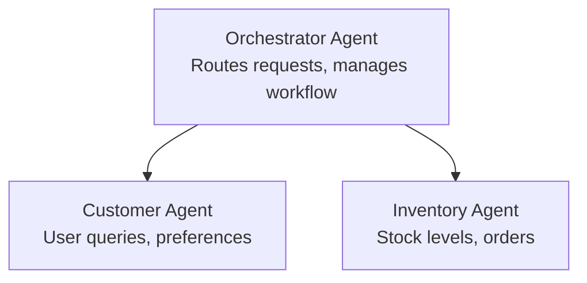

# الفصل 5: حلول الذكاء الاصطناعي متعددة الوكلاء

**📚 الدورة**: [AZD للمبتدئين](../../README.md) | **⏱️ المدة**: 2-3 ساعات | **⭐ التعقيد**: متقدم

---

## نظرة عامة

يغطي هذا الفصل أنماط معمارية متقدمة متعددة الوكلاء، تنسيق الوكلاء، والنشر الجاهز للإنتاج للذكاء الاصطناعي في السيناريوهات المعقدة.

> تم مراجعة إرشادات الأوامر مقابل المرجع الصادر `azd 1.37.2`. لم يتم تنفيذ النشر السحابي.

## أهداف التعلم

عند إكمال هذا الفصل، ستتمكن من:
- فهم أنماط معمارية متعددة الوكلاء
- نشر أنظمة وكلاء ذكاء اصطناعي منسقة
- تنفيذ الاتصال بين الوكلاء
- بناء حلول متعددة الوكلاء جاهزة للإنتاج

---

## 📚 الدروس

| # | الدرس | الوصف | الوقت |
|---|--------|-------------|------|
| 1 | [أساسيات متعددة الوكلاء](multi-agent-basics.md) | عملي: نشر تطبيق متعدد الوكلاء يعمل باستخدام `azd up` | 45 دقيقة |
| 2 | [أنماط التنسيق](../chapter-06-pre-deployment/coordination-patterns.md) | استراتيجيات تنسيق الوكلاء (يستمر في الفصل 6) | 30 دقيقة |
| 3 | [نشر قالب ARM](../../examples/retail-multiagent-arm-template/README.md) | مثال للنشر بضغطه واحدة | 30 دقيقة |

> **ابدأ بالدرس 1.** هو الدرس الوحيد العملي بالكامل والقابل للنشر في هذا الفصل. الدرس 2 موجود في الفصل 6 (مشترك مع تخطيط ما قبل النشر)، و[حل التجزئة متعددة الوكلاء](../../examples/retail-scenario.md) هو مخطط معماري — مرجع تصميم، وليس قالب أمر واحد.

---

## 🚀 بداية سريعة

```bash
# Option 1: Deploy the multi-agent template used in Lesson 1
azd init --template Azure-Samples/contoso-creative-writer .
azd up

# Option 2: Initialize a Foundry agent interactively (requires azure.ai.agents)
azd extension install azure.ai.agents
azd ai agent init
azd up
```

> **أي نهج؟** استخدم `azd init --template` للبدء من نموذج يعمل. استخدم `azd ai agent init` تفاعليًا، أو `azd ai agent init --template <path-to-azure.yaml>` لتبني مشروع وكيل قائم. راجع [مرجع AZD AI CLI](../chapter-08-production/production-ai-practices.md#azd-ai-cli-commands-and-extensions) لمتطلبات الإصدار وترحيل التقييم.

شغّل هذه البدائل في مجلدات فارغة منفصلة. إضافة الوكلاء `1.0.0-beta.23` تتطلب `azd >= 1.37.0`؛ تدفقها التفاعلي لا ينشئ خط أنابيب خدمة مخصصة في درس التنسيق.

---

## 🤖 معمارية متعددة الوكلاء



---

## 🎯 الحل المميز: التجزئة متعددة الوكلاء

يوضح [حل التجزئة متعددة الوكلاء](../../examples/retail-scenario.md):

- **وكيل العميل**: يدير تفاعلات وتفضيلات المستخدم
- **وكيل المخزون**: يدير المخزون ومعالجة الطلبات
- **المنسق**: ينسق بين الوكلاء
- **الذاكرة المشتركة**: إدارة السياق عبر الوكلاء

### الخدمات المستخدمة

| الخدمة | الغرض |
|---------|---------|
| نماذج Microsoft Foundry | فهم اللغة |
| Azure AI Search | كتالوج المنتجات |
| Cosmos DB | حالة الوكيل والذاكرة |
| Container Apps | استضافة الوكلاء |
| Application Insights | المراقبة |

---

## 🔗 التنقل

| الاتجاه | الفصل |
|-----------|---------|
| **السابق** | [الفصل 4: البنية التحتية](../chapter-04-infrastructure/README.md) |
| **التالي** | [الفصل 6: قبل النشر](../chapter-06-pre-deployment/README.md) |

---

## 📖 الموارد ذات الصلة

- [دليل وكلاء الذكاء الاصطناعي](../chapter-02-ai-development/agents.md)
- [ممارسات الذكاء الاصطناعي للإنتاج](../chapter-08-production/production-ai-practices.md)
- [تحرّي مشكلات الذكاء الاصطناعي](../chapter-07-troubleshooting/ai-troubleshooting.md)

---

<!-- CO-OP TRANSLATOR DISCLAIMER START -->
**تنويه**:
تمت ترجمة هذا المستند باستخدام خدمة الترجمة بالذكاء الاصطناعي [Co-op Translator](https://github.com/Azure/co-op-translator). بينما نسعى للدقة، يرجى العلم أن الترجمات الآلية قد تحتوي على أخطاء أو عدم دقة. يجب اعتبار المستند الأصلي بلغته الأصلية المصدر الرسمي والمعتمد. للمعلومات الهامة، يُنصح بالاستعانة بترجمة بشرية محترفة. نحن غير مسؤولين عن أي سوء فهم أو تفسير ناتج عن استخدام هذه الترجمة.
<!-- CO-OP TRANSLATOR DISCLAIMER END -->