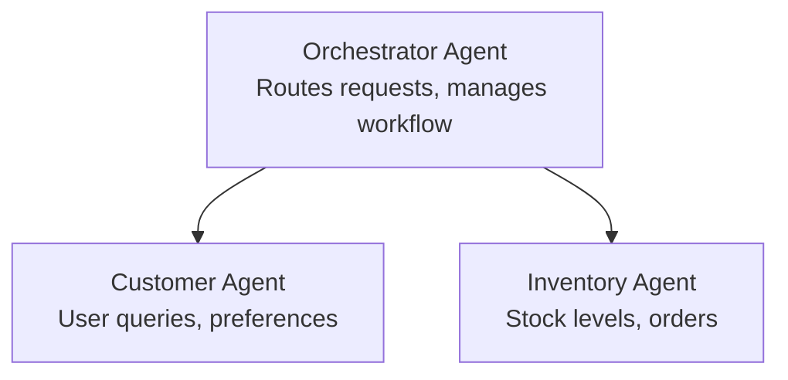

# الفصل 5: حلول الذكاء الاصطناعي المتعدد الوكلاء

**📚 الدورة**: [AZD للمبتدئين](../../README.md) | **⏱️ المدة**: 2-3 ساعات | **⭐ الصعوبة**: متقدم

---

## نظرة عامة

يغطي هذا الفصل أنماط المعمارية المتقدمة للذكاء الاصطناعي متعدد الوكلاء، تنسيق الوكلاء، ونشرات الذكاء الاصطناعي الجاهزة للإنتاج للسيناريوهات المعقدة.

> تم مراجعة إرشادات الأوامر مقابل المرجع `azd 1.37.2` الصادر. لم يتم تنفيذ نشرات السحابة.

## أهداف التعلم

من خلال إكمال هذا الفصل، سوف:
- تفهم أنماط المعمارية متعددة الوكلاء
- تنشر أنظمة وكلاء ذكاء اصطناعي منسقة
- تنفذ التواصل بين الوكلاء
- تبني حلول متعددة الوكلاء جاهزة للإنتاج

---

## 📚 الدروس

| # | الدرس | الوصف | الوقت |
|---|--------|-------------|------|
| 1 | [أساسيات تعدد الوكلاء](multi-agent-basics.md) | عملي: نشر تطبيق متعدد الوكلاء يعمل مع `azd up` | 45 دقيقة |
| 2 | [أنماط التنسيق](../chapter-06-pre-deployment/coordination-patterns.md) | استراتيجيات تنسيق الوكلاء (تستمر في الفصل 6) | 30 دقيقة |
| 3 | [نشر قالب ARM](../../examples/retail-multiagent-arm-template/README.md) | مثال النشر بنقرة واحدة | 30 دقيقة |

> **ابدأ بالدرس 1.** هو الدرس العملي الوحيد القابل للنشر بالكامل في هذا الفصل. الدرس 2 موجود في الفصل 6 (مشترك مع تخطيط ما قبل النشر)، و[حل تعدد وكلاء التجزئة](../../examples/retail-scenario.md) هو مخطط معماري—مرجع تصميم، وليس قالب أمر واحد.

---

## 🚀 البداية السريعة

```bash
# Option 1: Deploy the multi-agent template used in Lesson 1
azd init --template Azure-Samples/contoso-creative-writer .
azd up

# Option 2: Initialize a Foundry agent interactively with the GA bundle
azd ext install microsoft.foundry
azd ai agent init
azd up
```

> **أيهما تختار؟** استخدم `azd init --template` للبدء من عينة عاملة. استخدم `azd ai agent init` تفاعليًا، أو `azd ai agent init --template <path-to-azure.yaml>` لتبني مشروع وكيل قائم. راجع [مرجع AZD AI CLI](../chapter-08-production/production-ai-practices.md#azd-ai-cli-commands-and-extensions) لمتطلبات الإصدار وترحيل التقييم.

نفذ هذه البدائل في مجلدات فارغة منفصلة. يتطلب سير عمل GA Foundry `azd >= 1.37.0`؛ التدفق التفاعلي الخاص به لا ينشئ خط أنابيب خدمة مخصصة في درس التنسيق. لاختبار محلي، ونشر الشفرة، وتنظيف المشاريع الجديدة مقابل المعاد استخدامها، اتبع [دليل الوكيل المستضاف](../chapter-02-ai-development/microsoft-foundry-integration.md#hosted-agent-walkthrough-ga).

---

## 🤖 معمارية متعدد الوكلاء



---

## 🎯 الحل المميز: متعدد وكلاء التجزئة

يوضح [حل متعدد وكلاء التجزئة](../../examples/retail-scenario.md):

- **وكيل العميل**: يتعامل مع تفاعلات المستخدم والتفضيلات
- **وكيل المخزون**: يدير المخزون ومعالجة الطلبات
- **المنسق**: ينسق بين الوكلاء
- **الذاكرة المشتركة**: إدارة السياق بين الوكلاء

### الخدمات المستخدمة

| الخدمة | الغرض |
|---------|---------|
| نماذج Microsoft Foundry | فهم اللغة |
| Azure AI Search | كتالوج المنتجات |
| Cosmos DB | حالة الوكيل والذاكرة |
| تطبيقات الحاوية | استضافة الوكيل |
| Application Insights | المراقبة |

---

## 🔗 التنقل

| الاتجاه | الفصل |
|-----------|---------|
| **السابق** | [الفصل 4: البنية التحتية](../chapter-04-infrastructure/README.md) |
| **التالي** | [الفصل 6: ما قبل النشر](../chapter-06-pre-deployment/README.md) |

---

## 📖 مصادر مرتبطة

- [دليل وكلاء الذكاء الاصطناعي](../chapter-02-ai-development/agents.md)
- [ممارسات الإنتاج في الذكاء الاصطناعي](../chapter-08-production/production-ai-practices.md)
- [استكشاف مشكلات الذكاء الاصطناعي](../chapter-07-troubleshooting/ai-troubleshooting.md)

---

<!-- CO-OP TRANSLATOR DISCLAIMER START -->
**تنويه**:
تمت ترجمة هذا المستند باستخدام خدمة الترجمة بالذكاء الاصطناعي [Co-op Translator](https://github.com/Azure/co-op-translator). بينما نسعى للدقة، يرجى العلم أن الترجمات الآلية قد تحتوي على أخطاء أو عدم دقة. يجب اعتبار المستند الأصلي بلغته الأصلية المصدر الرسمي والمعتمد. للمعلومات الهامة، يُنصح بالاستعانة بترجمة بشرية محترفة. نحن غير مسؤولين عن أي سوء فهم أو تفسير ناتج عن استخدام هذه الترجمة.
<!-- CO-OP TRANSLATOR DISCLAIMER END -->