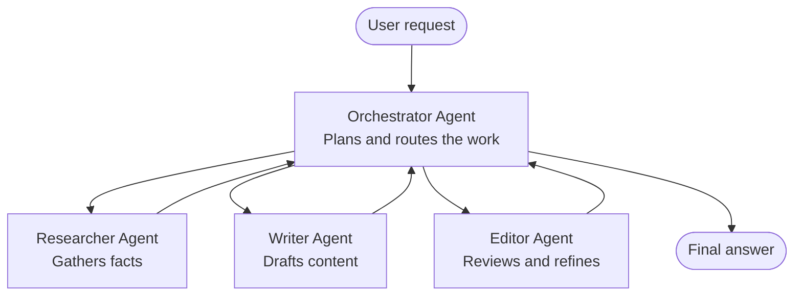

# أساسيات الوكلاء المتعددين - نشر نظام الذكاء الاصطناعي المنسق الأول الخاص بك

**تنقل الفصل:**
- **📚 الصفحة الرئيسية للدورة**: [AZD للمبتدئين](../../README.md)
- **📖 الفصل الحالي**: الفصل 5 - حلول الذكاء الاصطناعي متعددة الوكلاء
- **⬅️ السابق**: [الفصل 4: البنية التحتية](../chapter-04-infrastructure/README.md)
- **➡️ التالي**: [أنماط التنسيق](../chapter-06-pre-deployment/coordination-patterns.md)

> تم مراجعة إرشادات الأوامر مقابل المرجع `azd 1.37.2` المنشور. لم تُنفذ عمليات النشر السحابية.

## المقدمة

في الفصول السابقة قمت بنشر تطبيق واحد—وفي الفصل 2 نشرت وكيلا ذكاء اصطناعي واحدًا. تأخذك هذه الدرسة إلى الخطوة التالية: نشر **نظام متعدد الوكلاء**، حيث يعمل عدة وكلاء متخصصون معًا لحل مشكلة لا يستطيع أي وكيل واحد التعامل معها جيدًا بمفرده.

الخبر السار للمبتدئين: **لا تحتاج إلى أوامر جديدة.** حل الوكلاء المتعددين لا يزال مشروع azd. ستقوم `azd init`، `azd up`، اختبار، و`azd down`—وهو نفس سير العمل الذي تعرفه بالفعل. ما يتغير هو *شكل* التطبيق من الداخل.

## أهداف التعلم

بنهاية هذه الدرسة، ستتمكن من:
- فهم معنى "الوكلاء المتعددين" ومتى يستحق الأمر التعقيد الإضافي
- التعرف على الأدوار الشائعة في نظام متعدد الوكلاء (المنسق + المتخصصون)
- نشر قالب متعدد الوكلاء حقيقي وعملي باستخدام `azd up`
- فهم موارد أزور التي تدعم تطبيق متعدد الوكلاء
- معرفة كيفية التحقق من الحل وتخصيصه وإزالته بأمان

## نتائج التعلم

بعد الانتهاء من هذه الدرسة، ستكون قادرًا على:
- شرح الفرق بين وكيل واحد ونظام متعدد الوكلاء
- الاختيار بين وكيل واحد مع أدوات وتصميم متعدد الوكلاء حقيقي
- نشر واختبار قالب متعدد الوكلاء من البداية إلى النهاية باستخدام azd
- تحديد مكان تشغيل كل وكيل وكيفية تواصلهم
- تنظيف جميع الموارد لتجنب الرسوم المستمرة

---

## ما هو نظام الوكلاء المتعددين؟

الوكيل الواحد للذكاء الاصطناعي هو نموذج واحد مع مجموعة تعليمات وبعض الأدوات (اختياريًا). هذا يعمل جيدًا للمهام المركزة. لكن مع نمو المهمة—البحث، ثم الكتابة، ثم التحرير، ثم التحقق من الحقائق—جمع كل شيء في تعليمات واحدة يجعل الوكيل أبطأ، أقل موثوقية، وأكثر صعوبة في التصحيح.

نظام **الوكلاء المتعددين** يقسم العمل إلى متخصصين يقوم كل واحد منهم بمهمة واحدة بشكل جيد، بالتنسيق مع منسق:



### الدوران الذين سترونهما دائمًا

| الدور | الوظيفة | مثال |
|------|---------|---------|
| **المنسق** | يقرر *ما يحدث بعد ذلك* ويوجه العمل بين الوكلاء | "أولًا البحث، ثم الكتابة، ثم التحرير" |
| **المتخصص** | يقوم بمهمة مركزة واحدة ويعيد نتيجة | "مُبحِث" يجمع الحقائق فقط |

### هل تحتاج فعلًا إلى وكلاء متعددين؟

ابدأ ببساطة. لا تستخدم متعدد الوكلاء **إلا** عندما يكون أحد هذه صحيحًا:

- ✅ المهمة تتضمن **مراحل متميزة** تستفيد من تعليمات مختلفة (بحث vs كتابة vs مراجعة)
- ✅ تريد المتخصصين أن يعملوا **بالتوازي** لتوفير الوقت
- ✅ الخطوات المختلفة تحتاج إلى **أدوات أو مصادر بيانات مختلفة**
- ✅ تحتاج أن تكون كل خطوة **قابلة للاختبار والتصحيح بشكل مستقل**

إذا كانت مهمتك سؤال وإجابة بسيط أو استدعاء أداة بسيط، فـ **وكيل واحد مع أدوات** (الفصل 2) أبسط، أرخص، وأسهل في التشغيل.

> **نصيحة للمبتدئين:** "المزيد من الوكلاء" ليس "أفضل". كل وكيل يضيف تأخير، تكلفة، وشيء جديد للمراقبة. أضف الوكلاء فقط عندما ينقسم المشكلة بوضوح إلى أجزاء.

---

## طريقتان لبناء متعدد الوكلاء على أزور

| النهج | ما هو | الأنسب لـ |
|--------|---------|-------------|
| **وكيل واحد + أدوات** | وكيل Foundry واحد يستدعي الوظائف/الأدوات | سير عمل بسيط، البدء السريع |
| **عدة وكلاء منسقين** | عدة وكلاء مع منسق | مراحل متميزة، عمل متوازي، تخصص |

تركز هذه الدرسة على النهج الثاني باستخدام **قالب جاهز**، حتى تتمكن من رؤية نظام متعدد وكلاء واقعي يعمل قبل أن تبني نظامك الخاص.

---

## تمرين عملي: نشر تطبيق متعدد الوكلاء يعمل

سننشر **كاتب كونتوسو الإبداعي**، عينة رسمية من أزور تنسق وكلاء البحث، المنتج، الكتابة، والتحرير لإنتاج مقال. قبل المتابعة، تحقق من [المتطلبات والتكاليف للأُثلة](https://github.com/Azure-Samples/contoso-creative-writer#azure-account-requirements): تحتاج إلى حصة نموذج، بحث Azure AI، وصول Bing Grounding، Python، Docker، وربط متوافق مع Bash. توافر النموذج والمنطقة يعتمد على اشتراكك؛ لا يضمن اختيار منطقة معينة النشر.

### الخطوة 1: تهيئة القالب

```bash
# Create a working folder
mkdir creative-writer && cd creative-writer

# Initialize from the official multi-agent template
azd init --template Azure-Samples/contoso-creative-writer .
```

> تصفح المزيد من قوالب الوكلاء المتعددين في أي وقت في [معرض Awesome AZD AI](https://azure.github.io/awesome-azd/?tags=ai). خيارات أخرى مناسبة للمبتدئين تشمل `get-started-with-ai-agents` و`azure-ai-travel-agents`.

### الخطوة 2: المصادقة

```bash
# Required for azd workflows
azd auth login

# Also required by this sample's Azure CLI hooks
az login
```

### الخطوة 3: التحقق من البيئة

```bash
# init normally creates/selects an environment; confirm it before proceeding
azd env list
# Only if you need an additional environment:
# azd env new dev
```

### الخطوة 4: المعاينة ثم النشر

```bash
# See what will be created before spending anything (recommended)
azd provision --preview

# Provision infrastructure and deploy all agents in one step
azd up
```

`azd up` ستطالب بالإعدادات الناقصة للاشتراك والمنطقة، ثم تقوم بتوفير الموارد ونشر التطبيق. المعاينة لا تحجز حصة أو تضمن النجاح؛ قد تستمر وصلات القالب في العمل خلال معاينة التوفير، لذلك فحصها أولًا. لتمديد مدة انتظار azd لكل **نشر خدمة** (ليس توفير النموذج):

```bash
azd deploy --timeout 1800
```

مهلة الانتظار توقف azd عن الانتظار؛ لكنها لا تلغي النشر في أزور. تحقق من حالة المورد قبل إعادة المحاولة.

> **تنبيه حول التكلفة والسعة:** تطبيقات الوكلاء المتعددين تنشر نماذج ذكاء اصطناعي تستهلك الحصة وتتطلب تكلفة. إذا فشل `azd up` بسبب حصة النموذج، راجع [استكشاف أخطاء الذكاء الاصطناعي](../chapter-07-troubleshooting/ai-troubleshooting.md) لإصلاحات المنطقة والحصة، والفصل 6 [تخطيط السعة](../chapter-06-pre-deployment/capacity-planning.md).

---

## فهم ما نشرته

تطلق تطبيق متعدد الوكلاء نموذجي مثل هذا مجموعة من موارد أزور التي تتطابق مباشرة مع المسؤوليات في المخطط أعلاه:

| المورد | سبب وجوده |
|---------|-------------|
| **Microsoft Foundry / النماذج** | يستضيف نماذج اللغة التي يستخدمها كل وكيل |
| **بحث Azure AI** | يوفر للوكيل الباحث بيانات مرجعية للبحث |
| **تطبيقات الحاويات** (أو خدمة التطبيقات) | يستضيف المنسق وكود الوكلاء |
| **Cosmos DB** (في بعض العينات) | يخزن الحالة/الذاكرة المشتركة التي يمررها الوكلاء |
| **Application Insights** | يتتبع الطلبات *عبر* الوكلاء لتتمكن من تصحيح التدفق |

### كيف تتحدث الوكلاء مع بعضهم

في معظم عينات azd متعدد الوكلاء، **المنسق يعمل في كود التطبيق الخاص بك** (على سبيل المثال، باستخدام إطار عمل مثل Semantic Kernel أو Microsoft Agent Framework). يستدعي المنسق كل وكيل متخصص بالتتابع، يمرر النتائج، ويجمع الجواب النهائي. يتشارك الوكلاء السياق من خلال:

- **نداءات الوظائف/الأدوات** — المنسق يستدعي وكيلًا متخصصًا ويستلم نتيجة
- **الذاكرة المشتركة** — قاعدة بيانات (غالباً Cosmos DB) تحتفظ بالحالة التي يمكن لكل الوكلاء قراءتها
- **الرسائل/الأحداث** — للتواصل أضعف الترابط، يتواصل الوكلاء عبر قائمة انتظار أو خدمة حافلة

> **لماذا هذا مهم للتصحيح:** لأن كل خطوة منفصلة، يُظهر Application Insights *أي* وكيل كان بطيئًا أو فشل. هذا سبب رئيسي لتقسيم العمل بين الوكلاء أساسًا.

---

## تحقق من النشر

تأكد من أن النظام يعمل بالفعل قبل المتابعة:

```bash
# Show the deployed endpoints
azd show

# Open the app's monitoring dashboard
azd monitor

# Open Application Insights Logs (not a terminal log stream)
azd monitor --logs
```

ثم افتح عنوان URL للتطبيق من `azd show` واطلب مقالًا قصيرًا. استخدم عرض التصحيح في العينة لفحص سير عمل الوكلاء. يمكن للبحث في معاملات Application Insights إظهار الخطوات الفردية فقط إذا كانت العينة تضبطها وتربطها؛ azd لا يضيف مساحات الوكلاء تلقائيًا.

**معايير النجاح:**
- ✅ `azd show` يسرد نقطة نهاية قابلة للوصول
- ✅ الطلب ينتج نتيجة مرت بوضوح عبر عدة مراحل
- ✅ يعرض عرض التصحيح عدة خطوات للوكيل؛ إذا كان التتبع مفعلاً، تحقق من القياسات المناظرة بعد الاستيعاب

---

## التخصيص: إضافة أو تعديل وكيل

لأن كل وكيل هو مجرد تعليمات بالإضافة إلى أدوات، فالتخصيص ممكن:

1. **اعثر على تعريفات الوكيل** في القالب (غالبًا مجموعة ملفات `prompts/`، `agents/`، أو `*.prompty`).
2. **اضبط تعليمات الوكيل** — مثلاً، أخبر وكيل التحرير بفرض نغمة معينة أو عدد كلمات محدد.
3. **أعد نشر الكود فقط** (البنية التحتية لم تتغير):

   ```bash
   azd deploy
   ```

للمضي قدمًا مع مشروع وكيل Foundry *الخاص بك*، استخدم المجموعة GA مع AZD 1.37.0+ في مجلد فارغ منفصل:

```bash
azd ext install microsoft.foundry
azd ai agent init
azd up
azd ai agent invoke      # test, with response timing
```

اطلع على [الدليل الخاص بالوكيل المستضاف GA](../chapter-02-ai-development/microsoft-foundry-integration.md#hosted-agent-walkthrough-ga) للاختبار المحلي باستخدام Agent Inspector، نشر الكود عن بُعد، وتنظيف الملكية. تغطي أيضًا [مرجع AZD AI CLI](../chapter-08-production/production-ai-practices.md#azd-ai-cli-commands-and-extensions) امتداد التقييمات المنفصلة، التحسين، وحذف الوكيل.

---

## التنظيف

تطبيقات الوكلاء المتعددين تشغل عدة خدمات قابلة للفوترة. قم بإزالة كل شيء عندما تنتهي:

```bash
# Review the resources and confirm deletion interactively
azd down
```

الحذف مدمر. بالنسبة لمختبر قابل للتخلص منه، `azd down --force --purge` يتخطى الحذف وتأكيدات الحذف الناعم المدعومة؛ الحذف النهائي لا رجعة فيه حيثما كان مدعومًا ويمكن حظره بواسطة حماية الحذف النهائي. الحذف الناعم يتعلق بالاسترداد/إعادة استخدام الأسماء، وليس دليلًا في حد ذاته على الرسوم المستمرة. تحقق من الموارد المحتفظ بها والفوترة بعد التنظيف.

إذا قمت أيضًا بتهيئة وكيل مستضاف ضد مشروع Foundry موجود، `azd down` يترك وكيل ذلك المشروع وموارده الأخرى في مكانها. قم بإزالة الموارد غير المرغوب فيها التي تمتلكها بشكل منفصل فقط. بالنسبة لمشروع Foundry جديد تم إنشاؤه بواسطة بيئة AZD، `azd down` يحذف مجموعة الموارد وكل شيء فيها.

---

## ملاحظة حول أنظمة الوكلاء المتعددين في الإنتاج

حل [الوكلاء المتعددين للبيع بالتجزئة](../../examples/retail-scenario.md) في هذا المستودع هو **مخطط معماري**، وليس قالبًا بتنفيذ أمر واحد—يوثق كيف *سيتم* بناء نظام بيع تجزئة للإنتاج (ويُوضح أن البناء الكامل جهد كبير). استخدمه كمرجع تصميم *بعد* نشر نموذج عملي هنا. للمخاوف الإنتاجية (المرونة، التكلفة، المراقبة، الحوكمة)، تابع إلى [الفصل 8: ممارسات الذكاء الاصطناعي في الإنتاج](../chapter-08-production/production-ai-practices.md).

---

## ملخص

- يقسم نظام الوكلاء المتعددين العمل عبر متخصصين يتم تنسيقهم بواسطة مُنسق.
- استخدمه فقط عندما يحتوي المهمة على مراحل مميزة أو تعادل في التنفيذ أو أدوات مختلفة لكل خطوة—وإلا يُفضل وكيل واحد فقط.
- سير عمل azd لم يتغير: `azd init` → `azd up` → اختبار → `azd down`.
- قالب حقيقي مثل `contoso-creative-writer` يتيح لك رؤية وتخصيص تطبيق وُكلاء متعددين يعمل اليوم.
- تتبع Application Insights عبر الوكلاء هو أحد أكبر الفوائد العملية لتصميم الوكلاء المتعددين.

---

## 🔗 التنقل

| الاتجاه | الدرس |
|-----------|--------|
| **السابق** | [الفصل 4: البنية التحتية](../chapter-04-infrastructure/README.md) |
| **التالي** | [نماذج التنسيق](../chapter-06-pre-deployment/coordination-patterns.md) |

## 📖 الموارد المتعلقة

- [دليل وكلاء الذكاء الاصطناعي](../chapter-02-ai-development/agents.md)
- [نماذج التنسيق](../chapter-06-pre-deployment/coordination-patterns.md)
- [ممارسات الذكاء الاصطناعي في الإنتاج](../chapter-08-production/production-ai-practices.md)
- [استكشاف مشكلات الذكاء الاصطناعي](../chapter-07-troubleshooting/ai-troubleshooting.md)

---

<!-- CO-OP TRANSLATOR DISCLAIMER START -->
**تنويه**:
تمت ترجمة هذا المستند باستخدام خدمة الترجمة بالذكاء الاصطناعي [Co-op Translator](https://github.com/Azure/co-op-translator). بينما نسعى للدقة، يرجى العلم أن الترجمات الآلية قد تحتوي على أخطاء أو عدم دقة. يجب اعتبار المستند الأصلي بلغته الأصلية المصدر الرسمي والمعتمد. للمعلومات الهامة، يُنصح بالاستعانة بترجمة بشرية محترفة. نحن غير مسؤولين عن أي سوء فهم أو تفسير ناتج عن استخدام هذه الترجمة.
<!-- CO-OP TRANSLATOR DISCLAIMER END -->