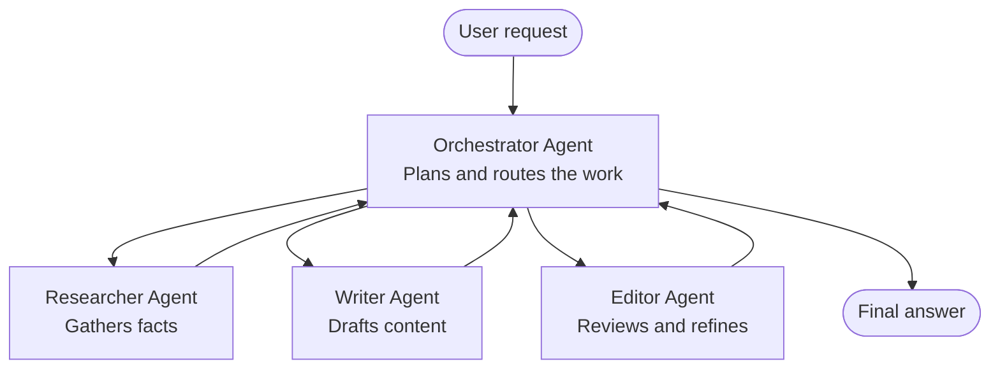

# أساسيات الأنظمة متعددة الوكلاء - نشر أول نظام ذكاء اصطناعي منسق لديك

**تنقل الفصل:**
- **📚 الصفحة الرئيسية للدورة**: [AZD للمبتدئين](../../README.md)
- **📖 الفصل الحالي**: الفصل 5 - حلول الذكاء الاصطناعي متعددة الوكلاء
- **⬅️ السابق**: [الفصل 4: البنية التحتية](../chapter-04-infrastructure/README.md)
- **➡️ التالي**: [أنماط التنسيق](../chapter-06-pre-deployment/coordination-patterns.md)

> تم مراجعة إرشادات الأوامر مقابل المرجع الصادر `azd 1.37.2`. لم يتم تنفيذ عمليات النشر السحابية.

## المقدمة

في الفصول السابقة نشرت تطبيقًا واحدًا — وفي الفصل 2 نشرت وكيلاً واحدًا للذكاء الاصطناعي. تأخذك هذه الدرسة الخطوة التالية: نشر **نظام متعدد الوكلاء**، حيث يعمل عدة وكلاء متخصصين معًا لحل مشكلة لا يمكن لأي وكيل واحد التعامل معها جيدًا بمفرده.

الخبر السار للمبتدئين: **لا تحتاج إلى أوامر جديدة.** لا يزال حل متعدد الوكلاء مشروعًا azd. ستقوم بـ `azd init`، `azd up`، اختبار، و `azd down` — بالضبط نفس سير العمل الذي تعرفه بالفعل. ما يتغير هو *شكل* التطبيق من الداخل.

## أهداف التعلم

بنهاية هذا الدرس، ستكون قادرًا على:
- فهم معنى "متعدد الوكلاء" ومتى يستحق التعقيد الإضافي
- التعرف على الأدوار الشائعة في نظام متعدد الوكلاء (المنسق + المتخصصين)
- نشر قالب متعدد وكلاء حقيقي وفعال باستخدام `azd up`
- فهم موارد Azure الداعمة لتطبيق متعدد الوكلاء
- معرفة كيفية التحقق من الحل وتخصيصه وإزالته بأمان

## مخرجات التعلم

بعد إكمال هذا الدرس، ستكون قادرًا على:
- شرح الفرق بين وكيل واحد ونظام متعدد الوكلاء
- الاختيار بين وكيل واحد مزود بالأدوات وتصميم متعدد وكلاء حقيقي
- نشر واختبار قالب متعدد الوكلاء من البداية إلى النهاية باستخدام azd
- تحديد مكان تشغيل كل وكيل وكيفية تواصلهم
- تنظيف جميع الموارد لتجنب التكاليف المستمرة

---

## ما هو نظام متعدد الوكلاء؟

الوكيل الواحد للذكاء الاصطناعي هو نموذج واحد مع مجموعة تعليمات وبعض الأدوات (اختياري). هذا يعمل جيدًا للمهام المركزة. لكن مع نمو المهمة — البحث، ثم الكتابة، ثم التحرير، ثم التحقق من الحقائق — حشو كل شيء في نموذج واحد يجعل الوكيل أبطأ، وأقل موثوقية، وأكثر صعوبة في التصحيح.

نظام متعدد الوكلاء يجزئ العمل إلى متخصصين يقوم كل منهم بوظيفة واحدة بشكل جيد، ويتم التنسيق بينهم بواسطة منسق:



### الدوران اللذان ستراهما دائمًا

| الدور | الوظيفة | المثال |
|------|---------|----------|
| **المنسق** | يحدد *ما الذي يحدث بعد ذلك* ويوجه العمل بين الوكلاء | "أولًا البحث، ثم الكتابة، ثم التحرير" |
| **المتخصص** | يقوم بوظيفة مركزة واحدة ويعيد النتيجة | "باحث" يجمع الحقائق فقط |

### هل تحتاج فعلاً إلى وكلاء متعددين؟

ابدأ ببساطة. استخدم النظام متعدد الوكلاء **فقط** إذا كان أحد هذه الشروط صحيحًا:

- ✅ المهمة لها **مراحل مميزة** تستفيد من تعليمات مختلفة (بحث مقابل كتابة مقابل مراجعة)
- ✅ تريد للمتخصصين العمل **بالتوازي** لتوفير الوقت
- ✅ كل خطوة تحتاج إلى **أدوات أو مصادر بيانات مختلفة**
- ✅ تحتاج أن تكون كل خطوة **قابلة للاختبار والتصحيح بشكل مستقل**

إذا كانت مهمتك سؤالًا وإجابة أو استدعاء أداة بسيطة، فإن **وكيل واحد مع أدوات** (الفصل 2) أبسط، وأرخص، وأسهل في التشغيل.

> **نصيحة للمبتدئين:** "المزيد من الوكلاء" ليس دائمًا "أفضل". كل وكيل يضيف تأخيرًا، تكلفة، وأمرًا جديدًا للمراقبة. أضف وكلاء فقط عندما ينقسم المشكلة بوضوح إلى أجزاء.

---

## طريقتان لبناء نظام متعدد وكلاء على Azure

| الطريقة | ما هي | الأفضل لـ |
|----------|-----------|----------|
| **وكيل واحد + أدوات** | وكيل Foundry واحد يستدعي وظائف/أدوات | سير عمل بسيط، للبدء |
| **عدة وكلاء منسقين** | عدة وكلاء مع منسق | مراحل مميزة، عمل متوازي، تخصص |

يركز هذا الدرس على الطريقة الثانية باستخدام **قالب جاهز**، حتى ترى نظام متعدد وكلاء حقيقي يعمل قبل أن تبني بنفسك.

---

## تطبيق عملي: نشر تطبيق متعدد وكلاء يعمل

سننشر **كاتب Contoso Creative Writer**، مثال رسمي من Azure ينسق بين وكلاء البحث، المنتج، الكتابة، والتحرير لإنتاج مقال. قبل المتابعة، تحقق من [المتطلبات والتكاليف المسبقة للعينة](https://github.com/Azure-Samples/contoso-creative-writer#azure-account-requirements): يحتاج إلى حصة نموذجية، Azure AI Search، وصول Bing Grounding، Python، Docker، وخطافات متوافقة مع Bash. توفر النموذج والمنطقة يعتمد على اشتراكك؛ لا يضمن اختيار منطقة معينة النشر.

### الخطوة 1: تهيئة القالب

```bash
# Create a working folder
mkdir creative-writer && cd creative-writer

# Initialize from the official multi-agent template
azd init --template Azure-Samples/contoso-creative-writer .
```

> استعرض المزيد من قوالب متعددة الوكلاء في أي وقت في [معرض AZD AI الرائع](https://azure.github.io/awesome-azd/?tags=ai). خيارات أخرى مناسبة للمبتدئين تشمل `get-started-with-ai-agents` و `azure-ai-travel-agents`.

### الخطوة 2: المصادقة

```bash
# Required for azd workflows
azd auth login

# Also required by this sample's Azure CLI hooks
az login
```

### الخطوة 3: التحقق من البيئة

```bash
# init normally creates/selects an environment; confirm it before proceeding
azd env list
# Only if you need an additional environment:
# azd env new dev
```

### الخطوة 4: المعاينة، ثم النشر

```bash
# See what will be created before spending anything (recommended)
azd provision --preview

# Provision infrastructure and deploy all agents in one step
azd up
```

`azd up` سيطلب إعدادات الاشتراك والمنطقة المفقودة، ثم يقوم بتوفير الموارد ونشر التطبيق. المعاينة لا تحفظ الحصة ولا تضمن النجاح؛ قد تعمل الخطافات أثناء معاينة التوفير، فافحصها أولاً. لتمديد مدة انتظار azd لكل **نشر خدمة** (ليس توفير نموذج):

```bash
azd deploy --timeout 1800
```

توقف المهلة azd عن الانتظار؛ لكنها لا تلغي النشر في Azure. افحص حالة المورد قبل إعادة المحاولة.

> **تنبيه حول التكلفة والسعة:** تطبيقات متعددة الوكلاء تنشر نماذج ذكاء اصطناعي تستهلك الحصة وتتسبب في التكاليف. إذا فشل `azd up` في الحصة النموذجية، راجع [استكشاف أخطاء الذكاء الاصطناعي](../chapter-07-troubleshooting/ai-troubleshooting.md) لإصلاحات المنطقة والحصة، والفصل 6 [تخطيط السعة](../chapter-06-pre-deployment/capacity-planning.md).

---

## فهم ما نشرته

تطبيق متعدد وكلاء نموذجي كهذا يوفر مجموعة من موارد Azure التي تتطابق مباشرة مع المسؤوليات في المخطط أعلاه:

| المورد | سبب وجوده |
|----------|----------------|
| **Microsoft Foundry / النماذج** | يستضيف نماذج اللغة التي يستخدمها كل وكيل |
| **Azure AI Search** | يوفر لوكيل الباحث بيانات أساسية للبحث |
| **تطبيقات الحاويات** (أو خدمة التطبيقات) | يستضيف المنسق وكود الوكلاء |
| **Cosmos DB** (في بعض العينات) | يخزن الحالة/الذاكرة المشتركة التي تمر بين الوكلاء |
| **Application Insights** | يتتبع الطلبات *عبر* الوكلاء لتتمكن من تصحيح الأخطاء في التدفق |

### كيف يتحدث الوكلاء مع بعضهم البعض

في معظم عينات azd متعددة الوكلاء، **المنسق يعمل في كود التطبيق الخاص بك** (مثال، باستخدام إطار عمل مثل Semantic Kernel أو Microsoft Agent Framework). يستدعي المنسق كل وكيل متخصص بالتتابع، يمرر النتائج، ويجمع الإجابة النهائية. الوكلاء يشاركون السياق عبر:

- **استدعاءات الوظائف/الأدوات** — المنسق يستدعي متخصصًا ويحصل على نتيجة
- **الذاكرة المشتركة** — قاعدة بيانات (غالبًا Cosmos DB) تحوي حالة يمكن للوكلاء قراءتها
- **الرسائل/الأحداث** — للتوصيل الفضفاض، يتواصل الوكلاء عبر طابور أو خدمة حافلة

> **لماذا هذا مهم للتصحيح:** لأن كل خطوة منفصلة، يُظهر Application Insights *أي* وكيل كان بطيئًا أو فشل. هذا سبب رئيسي لتجزئة العمل بين الوكلاء في المقام الأول.

---

## التحقق من النشر

تحقق من أن النظام يعمل فعليًا قبل المتابعة:

```bash
# Show the deployed endpoints
azd show

# Open the app's monitoring dashboard
azd monitor

# Open Application Insights Logs (not a terminal log stream)
azd monitor --logs
```

ثم افتح عنوان URL للتطبيق من `azd show` واطلب مقالًا قصيرًا. استخدم عرض التصحيح للعينة لفحص سير عمل الوكيل. يمكن لبحث المعاملات في Application Insights إظهار الخطوات الفردية فقط إذا قامت العينة بالت instrument وربطها؛ لا يضيف azd أطرًا زمنية للوكلاء تلقائيًا.

**معايير النجاح:**
- ✅ `azd show` يعرض نقطة نهاية يمكن الوصول إليها
- ✅ الطلب ينتج نتيجة مرت بوضوح عبر مراحل متعددة
- ✅ عرض التصحيح يظهر خطوات متعددة للوكلاء؛ إذا كان التتبع مفعّلًا، تحقق من بيانات القياس المقابلة بعد المعالجة

---

## التخصيص: إضافة أو ضبط وكيل

بما أن كل وكيل هو مجرد تعليمات بالإضافة إلى أدوات، فالتخصيص ممكن وبسيط:

1. **ابحث عن تعريفات الوكلاء** في القالب (غالبًا مجموعة ملفات `prompts/`، `agents/`، أو `*.prompty`).
2. **ضبط تعليمات الوكيل** — على سبيل المثال، أخبر وكيل المحرر بفرض نغمة أو عدد كلمات محدد.
3. **إعادة نشر الكود فقط** (البنية التحتية كما هي):

   ```bash
   azd deploy
   ```

للمضي قدمًا مع مشروع وكيل Foundry *خاص بك*، استخدم التهيئة التفاعلية لامتداد الوكيل:

```bash
azd extension install azure.ai.agents
azd ai agent init
azd up
azd ai agent invoke      # test, with response timing
```

راجع [الفصل 2: الوكلاء](../chapter-02-ai-development/agents.md) و [مرجع AZD AI CLI](../chapter-08-production/production-ai-practices.md#azd-ai-cli-commands-and-extensions) لدورة الحياة الكاملة: agent `invoke`، سير عمل امتداد التقييمات المنفصلة `azd ai eval`، agent `optimize`، و agent `delete`.

---

## التنظيف

تطبيقات متعددة الوكلاء تشغل عدة خدمات قابلة للفوترة. قم بإزالة كل شيء عند الانتهاء:

```bash
# Review the resources and confirm deletion interactively
azd down
```

الحذف مدمر. لمختبر يمكن التخلص منه، `azd down --force --purge` يتخطى الحذف وتأكيدات الحذف الناعم المدعومة؛ الحذف النهائي لا يمكن التراجع عنه حيثما كان مدعومًا، وقد يمنعه حماية الحذف. الحذف الناعم هو اعتبار لاسترجاع/إعادة استخدام الأسماء، وليس دليلًا على تكاليف مستمرة. تحقق من الموارد المحتفظ بها والفوترة بعد التنظيف.

---

## ملاحظة عن أنظمة متعددة وكلاء للإنتاج

يعتبر [حل التجزئة متعدد الوكلاء](../../examples/retail-scenario.md) في هذا المستودع **مخطط بنية** وليس قالب أمر واحد — يوثق كيفية بناء نظام تجزئة للإنتاج *وكيف* يُبنَى (ويؤكد أن البناء الكامل جهد كبير). استخدمه كمرجع تصميم *بعد* نشر عينة تعمل هنا. لمراعاة الإنتاج (المرونة، التكلفة، المراقبة، الحوكمة)، تابع إلى [الفصل 8: ممارسات الذكاء الاصطناعي للإنتاج](../chapter-08-production/production-ai-practices.md).

---

## الملخص

- نظام متعدد الوكلاء يجزئ العمل عبر متخصصين منسقين بواسطة منسق.
- استخدمه فقط عندما تكون المهمة ذات مراحل مميزة، العمل المتوازي، أو أدوات مختلفة لكل خطوة — خلاف ذلك، فضل وكيل واحد.
- سير عمل azd لم يتغير: `azd init` → `azd up` → اختبار → `azd down`.
- قالب حقيقي مثل `contoso-creative-writer` يتيح لك رؤية وتخصيص تطبيق متعدد وكلاء يعمل اليوم.
- تتبع Application Insights عبر الوكلاء هو من أكبر الفوائد العملية لتصميم متعدد الوكلاء.

---

## 🔗 التنقل

| الاتجاه | الدرس |
|-----------|--------|
| **السابق** | [الفصل 4: البنية التحتية](../chapter-04-infrastructure/README.md) |
| **التالي** | [أنماط التنسيق](../chapter-06-pre-deployment/coordination-patterns.md) |

## 📖 موارد ذات صلة

- [دليل وكلاء الذكاء الاصطناعي](../chapter-02-ai-development/agents.md)
- [أنماط التنسيق](../chapter-06-pre-deployment/coordination-patterns.md)
- [ممارسات الذكاء الاصطناعي للإنتاج](../chapter-08-production/production-ai-practices.md)
- [استكشاف أخطاء الذكاء الاصطناعي](../chapter-07-troubleshooting/ai-troubleshooting.md)

---

<!-- CO-OP TRANSLATOR DISCLAIMER START -->
**تنويه**:
تمت ترجمة هذا المستند باستخدام خدمة الترجمة بالذكاء الاصطناعي [Co-op Translator](https://github.com/Azure/co-op-translator). بينما نسعى للدقة، يرجى العلم أن الترجمات الآلية قد تحتوي على أخطاء أو عدم دقة. يجب اعتبار المستند الأصلي بلغته الأصلية المصدر الرسمي والمعتمد. للمعلومات الهامة، يُنصح بالاستعانة بترجمة بشرية محترفة. نحن غير مسؤولين عن أي سوء فهم أو تفسير ناتج عن استخدام هذه الترجمة.
<!-- CO-OP TRANSLATOR DISCLAIMER END -->