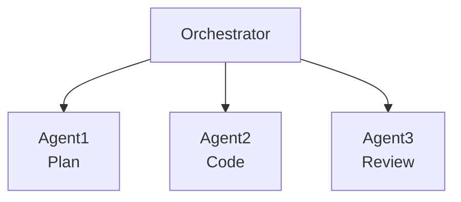
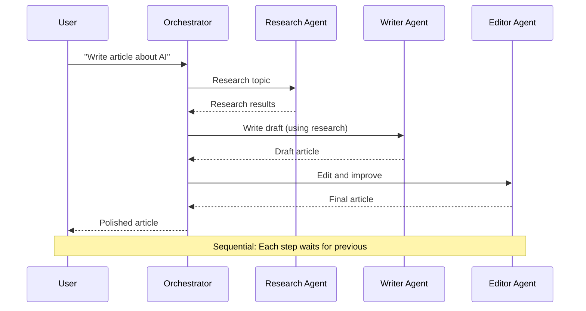
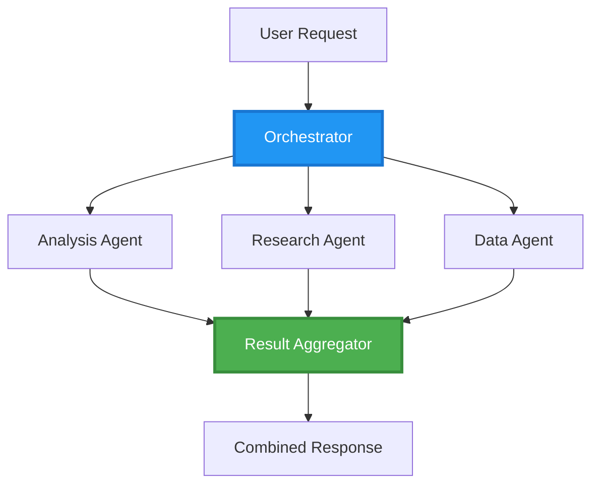
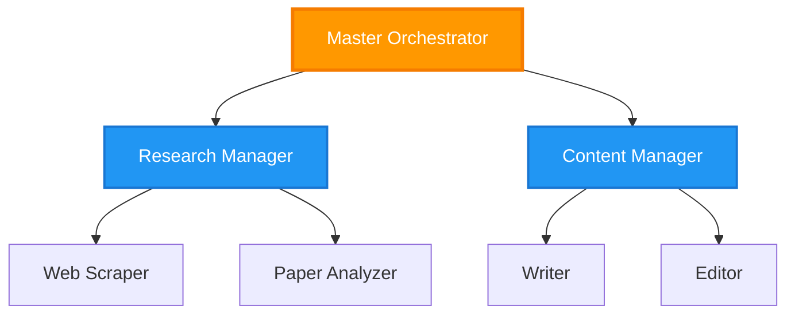
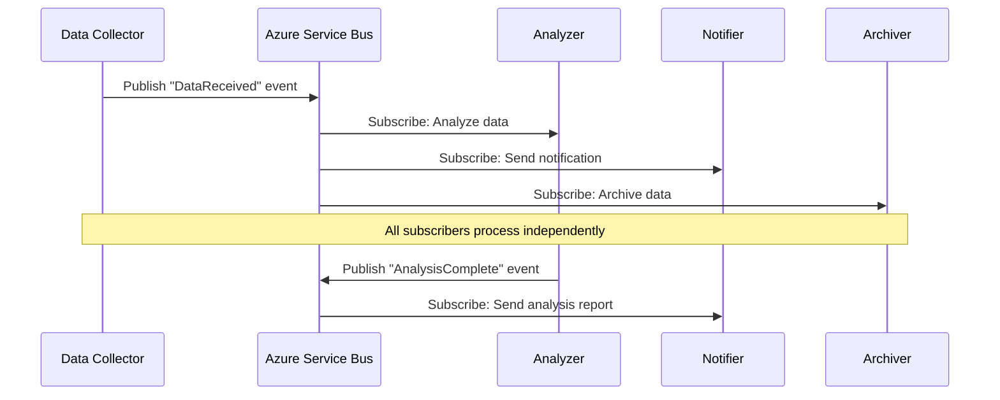
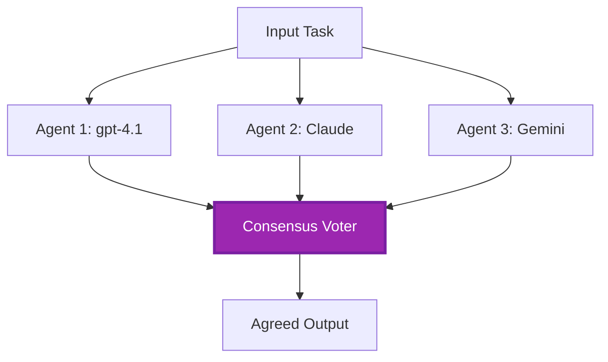
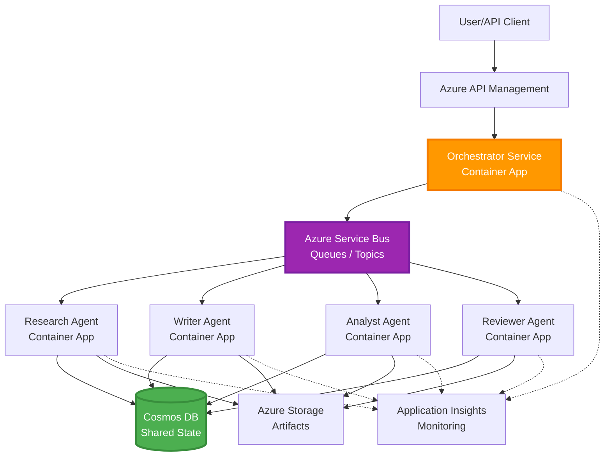

# أنماط تنسيق الوكلاء المتعددين

⏱️ **الوقت المقدر**: 60-75 دقيقة قراءة؛ عدة ساعات للتنفيذ | 💰 **التكلفة المقدرة**: تعتمد على عبء العمل | ⭐ **التعقيد**: متقدم

**📚 مسار التعلم:**
- ← السابق: [تخطيط السعة](capacity-planning.md) - استراتيجيات تحديد حجم الموارد والتوسع
- 🎯 **أنت هنا**: أنماط تنسيق الوكلاء المتعددين (التنسيق، التواصل، إدارة الحالة)
- → التالي: [اختيار SKU](sku-selection.md) - اختيار خدمات Azure المناسبة
- 🏠 [الصفحة الرئيسية للدورة](../../README.md)

---

## ما ستتعلمه

عند إكمال هذا الدرس، ستتمكن من:
- فهم أنماط **هيكلية الوكلاء المتعددين** ومتى تستخدمها
- تنفيذ **أنماط التنسيق** (مركزي، لامركزي، هرمي)
- تصميم استراتيجيات **تواصل الوكلاء** (متزامن، غير متزامن، قائم على الأحداث)
- إدارة **الحالة المشتركة** عبر الوكلاء الموزعين
- نشر **أنظمة الوكلاء المتعددين** على Azure باستخدام AZD
- تطبيق **أنماط التنسيق** لسيناريوهات الذكاء الاصطناعي في العالم الحقيقي
- مراقبة وتصحيح أنظمة الوكلاء الموزعة

## لماذا يعتبر تنسيق الوكلاء المتعددين مهمًا

### التطور: من وكيل واحد إلى وكلاء متعددين

**وكيل واحد (بسيط):**
```
User → Agent → Response
```
- ✅ سهل الفهم والتنفيذ
- ✅ سريع للمهام البسيطة
- ❌ محدود بقدرات النموذج الواحد
- ❌ لا يمكن تنفيذ المهام المعقدة بالتوازي
- ❌ لا يوجد تخصص

**نظام الوكلاء المتعددين (متقدم):**

- ✅ وكلاء متخصصون لمهام محددة
- ✅ تنفيذ متوازي للسرعة
- ✅ معياري وسهل الصيانة
- ✅ أفضل في تدفقات العمل المعقدة
- ⚠️ يتطلب منطق تنسيق

**تشبيه**: الوكيل الواحد مثل شخص واحد يقوم بكل المهام. الوكلاء المتعددون مثل فريق كل عضو فيه لديه مهارات متخصصة (باحث، مبرمج، مراجع، كاتب) يعملون معًا.

---

## أنماط التنسيق الأساسية

### النمط 1: التنسيق التسلسلي (سلسلة المسؤولية)

**متى يستخدم**: يجب إتمام المهام بترتيب محدد، كل وكيل يبني على مخرجات السابق.



**الفوائد:**
- ✅ تدفق بيانات واضح
- ✅ سهل التصحيح
- ✅ ترتيب تنفيذ قابل للتوقع

**القيود:**
- ❌ أبطأ (بدون توازي)
- ❌ فشل واحد يوقف السلسلة بأكملها
- ❌ لا يمكن التعامل مع المهام المترابطة

**أمثلة على الاستخدام:**
- خط إنتاج إنشاء المحتوى (بحث → كتابة → تحرير → نشر)
- توليد التعليمات البرمجية (تخطيط → تنفيذ → اختبار → نشر)
- توليد التقارير (جمع البيانات → تحليل → تصور → ملخص)

---

### النمط 2: التنسيق المتوازي (التفرع/الإلتقاء)

**متى يستخدم**: المهام المستقلة يمكن تنفيذها في وقت واحد، ويتم دمج النتائج في النهاية.



**الفوائد:**
- ✅ سريع (تنفيذ متوازي)
- ✅ متحمل للأخطاء (نتائج جزئية مقبولة)
- ✅ قابل للتوسع أفقيًا

**القيود:**
- ⚠️ قد تصل النتائج بترتيب غير متسلسل
- ⚠️ يحتاج لمنطق تجميع
- ⚠️ إدارة حالة معقدة

**أمثلة على الاستخدام:**
- جمع بيانات من مصادر متعددة (APIs + قواعد بيانات + سحب الويب)
- تحليل تنافسي (عدة نماذج تولد حلول، يتم اختيار الأفضل)
- خدمات الترجمة (ترجمة إلى لغات متعددة في نفس الوقت)

---

### النمط 3: التنسيق الهرمي (المدير-العامل)

**متى يستخدم**: تدفقات عمل معقدة بها مهام فرعية، تتطلب التفويض.



**الفوائد:**
- ✅ يتعامل مع تدفقات العمل المعقدة
- ✅ معياري وسهل الصيانة
- ✅ حدود مسؤولية واضحة

**القيود:**
- ⚠️ بنية أكثر تعقيدًا
- ⚠️ زمن استجابة أعلى (طبقات تنسيق متعددة)
- ⚠️ يتطلب تنسيق متقدم

**أمثلة على الاستخدام:**
- معالجة مستندات المؤسسات (تصنيف → توجيه → معالجة → أرشفة)
- خطوط أنابيب بيانات متعددة المراحل (استيعاب → تنظيف → تحويل → تحليل → تقرير)
- تدفقات العمل الآلية المعقدة (تخطيط → تخصيص الموارد → تنفيذ → مراقبة)

---

### النمط 4: التنسيق القائم على الأحداث (النشر-الاشتراك)

**متى يستخدم**: يحتاج الوكلاء إلى التفاعل مع الأحداث، ويرغب في ربط فضفاض.



**الفوائد:**
- ✅ ربط فضفاض بين الوكلاء
- ✅ سهولة إضافة وكلاء جدد (مجرد الاشتراك)
- ✅ معالجة غير متزامنة
- ✅ مرن (ثبات الرسائل)

**القيود:**
- ⚠️ الاتساق النهائي
- ⚠️ تصحيح أخطاء معقد
- ⚠️ تحديات ترتيب الرسائل

**أمثلة على الاستخدام:**
- أنظمة المراقبة في الوقت الحقيقي (التنبيهات، اللوحات، السجلات)
- إشعارات متعددة القنوات (البريد الإلكتروني، الرسائل النصية، التنبيهات، Slack)
- خطوط أنابيب معالجة البيانات (عدة مستهلكين لنفس البيانات)

---

### النمط 5: التنسيق القائم على الإجماع (التصويت/النصاب)

**متى يستخدم**: يحتاج إلى اتفاق من عدة وكلاء قبل المتابعة.



**الفوائد:**
- ✅ دقة أعلى (آراء متعددة)
- ✅ متحمل للأخطاء (فشل الأقليات مقبول)
- ✅ ضمان الجودة مدمج

**القيود:**
- ❌ مكلف (مكالمات لنماذج متعددة)
- ❌ أبطأ (انتظار كل الوكلاء)
- ⚠️ الحاجة إلى حل النزاعات

**أمثلة على الاستخدام:**
- التحكم في المحتوى (مراجعة المحتوى بنماذج متعددة)
- مراجعة الشفرة (عدة أدوات تحليلات/تدقيق)
- التشخيص الطبي (عدة نماذج ذكاء اصطناعي، والتحقق من خبير)

---

## نظرة عامة على الهيكلية

### نظام وكلاء متعددين متكامل على Azure



**المكونات الرئيسية:**

| المكون | الغرض | خدمة Azure |
|-----------|---------|---------------|
| **بوابة API** | نقطة الدخول، تحديد المعدل، التحقق | إدارة API |
| **المنسق** | ينسق تدفقات عمل الوكلاء | تطبيقات الحاويات |
| **طابور الرسائل** | التواصل غير المتزامن | خدمة الناقل / مراكز الأحداث |
| **الوكلاء** | عمال ذكاء اصطناعي متخصصون | تطبيقات الحاويات / الدوال |
| **متجر الحالة** | الحالة المشتركة، تتبع المهام | قاعدة بيانات كوزموس |
| **تخزين الأثار** | المستندات، النتائج، السجلات | تخزين الكتل |
| **المراقبة** | التتبع الموزع، السجلات | رؤى التطبيق |

طوابير/مواضيع خدمة الناقل ومراكز الأحداث خدمات مختلفة مع نماذج تسليم/استهلاك مختلفة؛ مراكز الأحداث ليست بديلاً مباشرًا لشيفرة عامل خدمة الناقل أدناه. التوازي، الرسائل المستمرة، وتصويت النماذج لا يضمن من تلقاء نفسها تحمل الأخطاء أو دقة أعلى.

---

## المتطلبات المسبقة

### الأدوات المطلوبة

```bash
# Verify Azure Developer CLI
azd version
# Command reference baseline: azd 1.37.2

# Verify Azure CLI
az --version
# ✅ Expected: azure-cli 2.50.0 or higher

# Verify Docker (for local testing)
docker --version
# ✅ Expected: Docker version 20.10 or higher
```

### متطلبات Azure

- اشتراك Azure نشط
- أذونات لإنشاء:
  - تطبيقات الحاويات
  - نطاقات خدمة الناقل
  - حسابات قاعدة بيانات كوزموس
  - حسابات التخزين
  - رؤى التطبيق

### المتطلبات المعرفية المسبقة

يجب أن تكون قد أكملت:
- [إدارة التكوين](../chapter-03-configuration/configuration.md)
- [المصادقة والأمان](../chapter-03-configuration/authsecurity.md)
- [مثال الخدمات المصغرة](../../../../examples/microservices)

---

## دليل التنفيذ

> **مقاطع تصميم، وليست مختبرًا قابلًا للنشر:** شجرة المشروع وعلامات `File:` أدناه تصف الملفات التي يجب إنشاؤها في مشروعك الخاص؛ هذا المستودع لا يحتوي على تطبيق `multi-agent-system` كامل. القطع الناقصة تشمل قوالب main/parameter، بيئة/سجل تطبيقات الحاويات، ملفات Docker وقفل التبعيات، إعداد قاعدة بيانات/حاوية كوزموس، نشر النماذج، تكوين الهوية/الأدوار، قواعد التوسع، والعمال/الطوابير المتوازية. لا تتوقع من `azd init` إنشاء هذه الملفات أو من `azd up` نشر المقاطع كما هي. للنقطة الانطلاق القابلة للتنفيذ، أكمل [أساسيات الوكلاء المتعددين](../chapter-05-multi-agent/multi-agent-basics.md).

**افتراضات وقت التشغيل:** Python 3.10+، `azure-servicebus`، `azure-cosmos`، `openai`، Flask، و(للمراقبة) `azure-monitor-opentelemetry`؛ ضع `shared` على مسار استيراد Python في كل صورة خدمة. يجب أن تكون حاوية `agent-state/tasks` في كوزموس موجودة مسبقًا بمفتاح التقسيم `/id`. الاتصالات القائمة على المفاتيح تبسط هذه المقاطع، وليست إرشادات للإنتاج: يفضل الهويات المُدارة ذات الأدوار ذات النطاق المحدود لخدمة الناقل/كوزموس/OpenAI. لا تعرض المفاتيح في المخرجات أو السجلات.

توصيل خدمة الناقل هو **مرة واحدة على الأقل**. حافظ على الإتساق لكل مهمة **ولكل خطوة**، استخدم التزامن التفاؤلي (ETags) لقراءة/تعديل/كتابة الحالة، وجدد أقفال الرسائل أثناء المعالجة الطويلة. مدير الحالة البسيط أدناه هو تسلسلي فقط ولا ينفذ هذه الضمانات الإنتاجية.

### هيكلية المشروع

```
multi-agent-system/
├── azure.yaml                    # AZD configuration
├── infra/
│   ├── main.bicep               # Main infrastructure
│   ├── core/
│   │   ├── servicebus.bicep     # Message queue
│   │   ├── cosmos.bicep         # State store
│   │   ├── storage.bicep        # Artifact storage
│   │   └── monitoring.bicep     # Application Insights
│   └── app/
│       ├── orchestrator.bicep   # Orchestrator service
│       └── agent.bicep          # Agent template
└── src/
    ├── orchestrator/            # Orchestration logic
    │   ├── app.py
    │   ├── workflows.py
    │   └── Dockerfile
    ├── agents/
    │   ├── research/            # Research agent
    │   ├── writer/              # Writer agent
    │   ├── analyst/             # Analyst agent
    │   └── reviewer/            # Reviewer agent
    └── shared/
        ├── state_manager.py     # Shared state logic
        └── message_handler.py   # Message handling
```

---

## الدرس 1: نمط التنسيق التسلسلي

### التنفيذ: خط إنتاج إنشاء المحتوى

لنصمم خط إنتاج تسلسلي: بحث → كتابة → تحرير. النشر خارج هذا المثال.

### 1. تكوين AZD

**الملف: `azure.yaml`**

```yaml
name: content-pipeline
metadata:
  template: multi-agent-sequential@1.0.0

services:
  orchestrator:
    project: ./src/orchestrator
    language: python
    host: containerapp
  
  research-agent:
    project: ./src/agents/research
    language: python
    host: containerapp
  
  writer-agent:
    project: ./src/agents/writer
    language: python
    host: containerapp
  
  editor-agent:
    project: ./src/agents/editor
    language: python
    host: containerapp
```

### 2. البنية التحتية: خدمة الناقل للتنسيق

**الملف: `infra/core/servicebus.bicep`**

```bicep
param name string
param location string
param tags object = {}

resource serviceBusNamespace 'Microsoft.ServiceBus/namespaces@2022-10-01-preview' = {
  name: name
  location: location
  tags: tags
  sku: {
    name: 'Standard'
    tier: 'Standard'
  }
  properties: {
    minimumTlsVersion: '1.2'
  }
}

// Queue for orchestrator → research agent
resource researchQueue 'Microsoft.ServiceBus/namespaces/queues@2022-10-01-preview' = {
  parent: serviceBusNamespace
  name: 'research-tasks'
  properties: {
    maxDeliveryCount: 3
    lockDuration: 'PT5M'
    deadLetteringOnMessageExpiration: true
  }
}

// Queue for research agent → writer agent
resource writerQueue 'Microsoft.ServiceBus/namespaces/queues@2022-10-01-preview' = {
  parent: serviceBusNamespace
  name: 'writer-tasks'
  properties: {
    maxDeliveryCount: 3
    lockDuration: 'PT5M'
  }
}

// Queue for writer agent → editor agent
resource editorQueue 'Microsoft.ServiceBus/namespaces/queues@2022-10-01-preview' = {
  parent: serviceBusNamespace
  name: 'editor-tasks'
  properties: {
    maxDeliveryCount: 3
    lockDuration: 'PT5M'
  }
}

output namespace string = serviceBusNamespace.name
// Do not output RootManageSharedAccessKey. Resolve scoped credentials
// securely or use managed identity in the application and scale rules.
```

### 3. مدير الحالة المشتركة

**الملف: `src/shared/state_manager.py`**

```python
from azure.cosmos import CosmosClient, PartitionKey
from datetime import datetime, timezone
import os

class StateManager:
    """Manages shared state across agents using Cosmos DB"""
    
    def __init__(self):
        endpoint = os.environ['COSMOS_ENDPOINT']
        key = os.environ['COSMOS_KEY']
        
        self.client = CosmosClient(endpoint, key)
        self.database = self.client.get_database_client('agent-state')
        self.container = self.database.get_container_client('tasks')
    
    def create_task(self, task_id: str, task_type: str, input_data: dict):
        """Create a new task"""
        task = {
            'id': task_id,
            'type': task_type,
            'status': 'pending',
            'input': input_data,
            'created_at': datetime.now(timezone.utc).isoformat(),
            'steps': []
        }
        self.container.create_item(task)
        return task
    
    def update_task_step(self, task_id: str, step_name: str, result: dict):
        """Update task with completed step"""
        task = self.container.read_item(task_id, partition_key=task_id)
        
        task['steps'].append({
            'name': step_name,
            'completed_at': datetime.now(timezone.utc).isoformat(),
            'result': result
        })
        
        self.container.replace_item(task_id, task)
        return task
    
    def complete_task(self, task_id: str, final_result: dict):
        """Mark task as complete"""
        task = self.container.read_item(task_id, partition_key=task_id)
        task['status'] = 'completed'
        task['result'] = final_result
        task['completed_at'] = datetime.now(timezone.utc).isoformat()
        self.container.replace_item(task_id, task)
        return task
    
    def get_task(self, task_id: str):
        """Retrieve task state"""
        return self.container.read_item(task_id, partition_key=task_id)
```

### 4. خدمة المنسق

**الملف: `src/orchestrator/app.py`**

```python
from flask import Flask, request, jsonify
from azure.servicebus import ServiceBusClient, ServiceBusMessage
import json
import uuid
import os
from shared.state_manager import StateManager

app = Flask(__name__)
state_manager = StateManager()

# Service Bus connection
servicebus_connection_str = os.environ['SERVICEBUS_CONNECTION_STRING']
servicebus_client = ServiceBusClient.from_connection_string(servicebus_connection_str)

@app.route('/health', methods=['GET'])
def health():
    return jsonify({'status': 'healthy', 'service': 'orchestrator'})

@app.route('/create-content', methods=['POST'])
def create_content():
    """
    Sequential workflow: Research → Write → Edit (returns a draft; no publishing)
    """
    data = request.get_json(silent=True) or {}
    topic = data.get('topic')
    
    if not topic:
        return jsonify({'error': 'Topic required'}), 400
    
    # Create task in state store
    task_id = str(uuid.uuid4())
    task = state_manager.create_task(
        task_id=task_id,
        task_type='content_creation',
        input_data={'topic': topic}
    )
    
    # Send message to research agent (first step)
    sender = servicebus_client.get_queue_sender('research-tasks')
    message = ServiceBusMessage(
        body=json.dumps({
            'task_id': task_id,
            'topic': topic,
            'next_queue': 'writer-tasks'  # Where to send results
        }),
        content_type='application/json'
    )
    
    with sender:
        sender.send_messages(message)
    
    return jsonify({
        'task_id': task_id,
        'status': 'started',
        'workflow': 'sequential',
        'steps': ['research', 'write', 'edit'],
        'message': 'Content creation pipeline initiated'
    }), 202

@app.route('/task/<task_id>', methods=['GET'])
def get_task_status(task_id):
    """Check task status"""
    try:
        task = state_manager.get_task(task_id)
        return jsonify(task)
    except Exception as e:
        return jsonify({'error': str(e)}), 404

if __name__ == '__main__':
    app.run(host='0.0.0.0', port=8080)
```

### 5. وكيل البحث

**الملف: `src/agents/research/app.py`**

```python
from azure.servicebus import ServiceBusClient, ServiceBusMessage
from openai import AzureOpenAI
import json
import os
import time
from shared.state_manager import StateManager

# Initialize clients
state_manager = StateManager()
servicebus_client = ServiceBusClient.from_connection_string(
    os.environ['SERVICEBUS_CONNECTION_STRING']
)

openai_client = AzureOpenAI(
    api_key=os.environ['AZURE_OPENAI_API_KEY'],
    api_version="2024-10-21",
    azure_endpoint=os.environ['AZURE_OPENAI_ENDPOINT']
)

def process_research_task(message_data):
    """Process research request and pass to writer"""
    task_id = message_data['task_id']
    topic = message_data['topic']
    next_queue = message_data['next_queue']
    
    print(f"🔬 Researching: {topic}")
    
    # Call Microsoft Foundry Models for research
    response = openai_client.chat.completions.create(
        model=os.environ['AZURE_OPENAI_DEPLOYMENT'],
        messages=[
            {"role": "system", "content": "You are a research assistant. Provide comprehensive research on the given topic."},
            {"role": "user", "content": f"Research this topic thoroughly: {topic}"}
        ],
        max_tokens=1500
    )
    
    research_results = response.choices[0].message.content
    
    # Update state
    state_manager.update_task_step(
        task_id=task_id,
        step_name='research',
        result={'research': research_results}
    )
    
    # Send to next agent (writer)
    sender = servicebus_client.get_queue_sender(next_queue)
    message = ServiceBusMessage(
        body=json.dumps({
            'task_id': task_id,
            'topic': topic,
            'research': research_results,
            'next_queue': 'editor-tasks'
        }),
        content_type='application/json'
    )
    
    with sender:
        sender.send_messages(message)
    
    print(f"✅ Research complete for task {task_id}")

def main():
    """Listen to research queue"""
    receiver = servicebus_client.get_queue_receiver('research-tasks')
    
    print("🔬 Research Agent started, listening for tasks...")
    
    with receiver:
        while True:
            messages = receiver.receive_messages(max_wait_time=5)
            for message in messages:
                try:
                    message_data = json.loads(str(message))
                    process_research_task(message_data)
                    receiver.complete_message(message)
                except Exception as e:
                    print(f"❌ Error processing message: {e}")
                    receiver.abandon_message(message)

if __name__ == '__main__':
    main()
```

### 6. وكيل الكتابة

**الملف: `src/agents/writer/app.py`**

```python
from azure.servicebus import ServiceBusClient, ServiceBusMessage
from openai import AzureOpenAI
import json
import os
from shared.state_manager import StateManager

state_manager = StateManager()
servicebus_client = ServiceBusClient.from_connection_string(
    os.environ['SERVICEBUS_CONNECTION_STRING']
)

openai_client = AzureOpenAI(
    api_key=os.environ['AZURE_OPENAI_API_KEY'],
    api_version="2024-10-21",
    azure_endpoint=os.environ['AZURE_OPENAI_ENDPOINT']
)

def process_writing_task(message_data):
    """Write article based on research"""
    task_id = message_data['task_id']
    topic = message_data['topic']
    research = message_data['research']
    next_queue = message_data['next_queue']
    
    print(f"✍️ Writing article: {topic}")
    
    # Call Microsoft Foundry Models to write article
    response = openai_client.chat.completions.create(
        model=os.environ['AZURE_OPENAI_DEPLOYMENT'],
        messages=[
            {"role": "system", "content": "You are a professional writer. Write engaging, well-structured articles."},
            {"role": "user", "content": f"Based on this research:\n\n{research}\n\nWrite a comprehensive article about: {topic}"}
        ],
        max_tokens=2000
    )
    
    article_draft = response.choices[0].message.content
    
    # Update state
    state_manager.update_task_step(
        task_id=task_id,
        step_name='writing',
        result={'draft': article_draft}
    )
    
    # Send to editor
    sender = servicebus_client.get_queue_sender(next_queue)
    message = ServiceBusMessage(
        body=json.dumps({
            'task_id': task_id,
            'topic': topic,
            'draft': article_draft
        }),
        content_type='application/json'
    )
    
    with sender:
        sender.send_messages(message)
    
    print(f"✅ Article draft complete for task {task_id}")

def main():
    """Listen to writer queue"""
    receiver = servicebus_client.get_queue_receiver('writer-tasks')
    
    print("✍️ Writer Agent started, listening for tasks...")
    
    with receiver:
        while True:
            messages = receiver.receive_messages(max_wait_time=5)
            for message in messages:
                try:
                    message_data = json.loads(str(message))
                    process_writing_task(message_data)
                    receiver.complete_message(message)
                except Exception as e:
                    print(f"❌ Error: {e}")
                    receiver.abandon_message(message)

if __name__ == '__main__':
    main()
```

### 7. وكيل التحرير

**الملف: `src/agents/editor/app.py`**

```python
from azure.servicebus import ServiceBusClient
from openai import AzureOpenAI
import json
import os
from shared.state_manager import StateManager

state_manager = StateManager()
servicebus_client = ServiceBusClient.from_connection_string(
    os.environ['SERVICEBUS_CONNECTION_STRING']
)

openai_client = AzureOpenAI(
    api_key=os.environ['AZURE_OPENAI_API_KEY'],
    api_version="2024-10-21",
    azure_endpoint=os.environ['AZURE_OPENAI_ENDPOINT']
)

def process_editing_task(message_data):
    """Edit and finalize article"""
    task_id = message_data['task_id']
    topic = message_data['topic']
    draft = message_data['draft']
    
    print(f"📝 Editing article: {topic}")
    
    # Call Microsoft Foundry Models to edit
    response = openai_client.chat.completions.create(
        model=os.environ['AZURE_OPENAI_DEPLOYMENT'],
        messages=[
            {"role": "system", "content": "You are an expert editor. Improve grammar, clarity, and structure."},
            {"role": "user", "content": f"Edit and improve this article:\n\n{draft}"}
        ],
        max_tokens=2000
    )
    
    final_article = response.choices[0].message.content
    
    # Mark task as complete
    state_manager.complete_task(
        task_id=task_id,
        final_result={
            'topic': topic,
            'final_article': final_article,
            'word_count': len(final_article.split())
        }
    )
    
    print(f"✅ Article finalized for task {task_id}")

def main():
    """Listen to editor queue"""
    receiver = servicebus_client.get_queue_receiver('editor-tasks')
    
    print("📝 Editor Agent started, listening for tasks...")
    
    with receiver:
        while True:
            messages = receiver.receive_messages(max_wait_time=5)
            for message in messages:
                try:
                    message_data = json.loads(str(message))
                    process_editing_task(message_data)
                    receiver.complete_message(message)
                except Exception as e:
                    print(f"❌ Error: {e}")
                    receiver.abandon_message(message)

if __name__ == '__main__':
    main()
```

### 8. النشر والاختبار

هذه الأوامر تنطبق **فقط بعد تنفيذ الملفات الناقصة في المشروع**. تهيئة وكيل Foundry التفاعلي هي سير عمل منفصل؛ لا تُنشئ هذا التصميم لخدمة الناقل.

```bash
# In your completed custom project
azd up

# Alternative in a SEPARATE empty folder (agents beta.23 requires azd >= 1.37)
azd extension install azure.ai.agents
azd ai agent init
azd up
```

> راجع [أوامر AZD AI CLI](../chapter-08-production/production-ai-practices.md#azd-ai-cli-commands-and-extensions) لكل أعلام وخيارات `azd ai`.

```bash
# Get orchestrator URL
ORCHESTRATOR_URL=$(azd env get-values | grep ORCHESTRATOR_URL | cut -d '=' -f2 | tr -d '"')

# Create content
curl -X POST $ORCHESTRATOR_URL/create-content \
  -H "Content-Type: application/json" \
  -d '{"topic": "The Future of AI in Healthcare"}'
```

**✅ المخرجات المتوقعة:**
```json
{
  "task_id": "a1b2c3d4-e5f6-7890-abcd-ef1234567890",
  "status": "started",
  "workflow": "sequential",
  "steps": ["research", "write", "edit"],
  "message": "Content creation pipeline initiated"
}
```

**تحقق من تقدم المهمة:**
```bash
TASK_ID="a1b2c3d4-e5f6-7890-abcd-ef1234567890"
curl $ORCHESTRATOR_URL/task/$TASK_ID
```

**✅ المخرجات المتوقعة (مكتملة):**
```json
{
  "id": "a1b2c3d4-e5f6-7890-abcd-ef1234567890",
  "type": "content_creation",
  "status": "completed",
  "steps": [
    {
      "name": "research",
      "completed_at": "2025-11-19T10:30:00Z",
      "result": {"research": "..."}
    },
    {
      "name": "writing",
      "completed_at": "2025-11-19T10:32:00Z",
      "result": {"draft": "..."}
    }
  ],
  "result": {
    "topic": "The Future of AI in Healthcare",
    "final_article": "...",
    "word_count": 1500
  }
}
```

---

## الدرس 2: نمط التنسيق المتوازي

### التنفيذ: جامع أبحاث من مصادر متعددة

لننشئ نظامًا متوازيًا يجمع المعلومات من مصادر متعددة في نفس الوقت.

### المنسق المتوازي

**الملف: `src/orchestrator/parallel_workflow.py`**

```python
from flask import Flask, request, jsonify
from azure.servicebus import ServiceBusClient, ServiceBusMessage
import json
import uuid
import os
from shared.state_manager import StateManager

app = Flask(__name__)
state_manager = StateManager()

servicebus_client = ServiceBusClient.from_connection_string(
    os.environ['SERVICEBUS_CONNECTION_STRING']
)

@app.route('/research-parallel', methods=['POST'])
def research_parallel():
    """
    Parallel workflow: Multiple agents work simultaneously
    """
    data = request.json
    query = data.get('query')
    
    task_id = str(uuid.uuid4())
    task = state_manager.create_task(
        task_id=task_id,
        task_type='parallel_research',
        input_data={
            'query': query,
            'agents': ['web', 'academic', 'news', 'social']
        }
    )
    
    # Fan-out: publish sequentially; workers may process concurrently.
    agents = [
        ('web-research-queue', 'web'),
        ('academic-research-queue', 'academic'),
        ('news-research-queue', 'news'),
        ('social-research-queue', 'social')
    ]
    
    for queue_name, agent_type in agents:
        sender = servicebus_client.get_queue_sender(queue_name)
        message = ServiceBusMessage(
            body=json.dumps({
                'task_id': task_id,
                'query': query,
                'agent_type': agent_type,
                'result_queue': 'aggregation-queue'
            }),
            content_type='application/json'
        )
        
        with sender:
            sender.send_messages(message)
    
    return jsonify({
        'task_id': task_id,
        'status': 'started',
        'workflow': 'parallel',
        'agents_dispatched': 4,
        'message': 'Parallel research initiated'
    }), 202

if __name__ == '__main__':
    app.run(host='0.0.0.0', port=8080)
```

### منطق التجميع

**الملف: `src/agents/aggregator/app.py`**

```python
from azure.servicebus import ServiceBusClient
import json
import os
from collections import defaultdict
from shared.state_manager import StateManager

state_manager = StateManager()
servicebus_client = ServiceBusClient.from_connection_string(
    os.environ['SERVICEBUS_CONNECTION_STRING']
)

# Single-process demo only: not durable or shared across replicas.
# Production: use durable unique (task_id, agent_type) result records.
task_results = defaultdict(dict)
expected_agents = 4  # web, academic, news, social

def process_result(message_data):
    """Aggregate results from parallel agents"""
    task_id = message_data['task_id']
    agent_type = message_data['agent_type']
    result = message_data['result']
    
    # Store result
    task_results[task_id][agent_type] = {
        'agent': agent_type,
        'data': result
    }
    
    print(f"📊 Received result from {agent_type} agent ({len(task_results[task_id])}/{expected_agents})")
    
    # Check if all agents completed (fan-in)
    if len(task_results[task_id]) == expected_agents:
        print(f"✅ All agents completed for task {task_id}. Aggregating...")
        
        # Combine results
        aggregated = {
            'query': message_data['query'],
            'sources': list(task_results[task_id].values()),
            'summary': generate_summary(list(task_results[task_id].values()))
        }
        
        # Mark complete
        state_manager.complete_task(task_id, aggregated)
        
        # Clean up
        del task_results[task_id]
        
        print(f"✅ Aggregation complete for task {task_id}")

def generate_summary(results):
    """Generate summary from all sources"""
    summaries = [r['data'].get('summary', '') for r in results]
    return '\n\n'.join(summaries)

def main():
    """Listen to aggregation queue"""
    receiver = servicebus_client.get_queue_receiver('aggregation-queue')
    
    print("📊 Aggregator started, listening for results...")
    
    with receiver:
        while True:
            messages = receiver.receive_messages(max_wait_time=5)
            for message in messages:
                try:
                    message_data = json.loads(str(message))
                    process_result(message_data)
                    receiver.complete_message(message)
                except Exception as e:
                    print(f"❌ Error: {e}")
                    receiver.abandon_message(message)

if __name__ == '__main__':
    main()
```

**فوائد النمط المتوازي:**
- ⚡ **زمن استجابة محتمل أقل** (محصور بأبطأ عامل زائد حمل التنسيق)
- 🔄 **يدعم النتائج الجزئية** مع مواعيد نهائية وسياسة فشل صريحة (غير مفعلة في الجامع الأساسي)
- 📈 **قابل للتوسع** (إضافة وكلاء بسهولة)

---

## تمارين عملية

### التمرين 1: إضافة التعامل مع المهلة ⭐⭐ (متوسط)

**الهدف**: تنفيذ منطق المهلة حتى لا ينتظر الجامع إلى أجل غير مسمى للوكلاء البطيئين.

**نقطة البداية:** شغّل هذا المحاكاة المحلية للموعد النهائي قبل دمجه في عامل الطابور. المهلة التي تُتحقق فقط عند وصول رسالة أخرى لا تنفّذ إذا لم يرسل العامل المفقود شيئًا.

**الخطوات**:

1. **أضف تتبع المهلة إلى الجامع:**

```python
import asyncio

async def simulated_agent(name, delay):
    await asyncio.sleep(delay)
    return {'agent': name, 'result': 'done'}

async def main():
    tasks = [asyncio.create_task(simulated_agent(name, delay))
             for name, delay in [('web', 0.1), ('academic', 0.2),
                                 ('news', 0.3), ('social', 3)]]
    done, pending = await asyncio.wait(tasks, timeout=1)
    results = [task.result() for task in done]
    for task in pending:
        task.cancel()
    await asyncio.gather(*pending, return_exceptions=True)
    print({'completed_agents': len(results), 'timed_out': bool(pending)})
    assert len(results) == 3 and pending

asyncio.run(main())
```

2. **المخرجات المتوقعة:**

```text
{'completed_agents': 3, 'timed_out': True}
```

3. **تكامل نظام الطابور (مهمة تصميم):** احفظ موعد التوزيع النهائي والوكلاء المتوقعين عند إنشاء المهمة، نفذ مسح دورية للمهلة مستقلة عن النتائج الواردة، أكمل النتائج الجزئية بشكل ذري، وتجاهل الرسائل المتأخرة/المكررة للمهام المكتملة. المهلة المحلية لا تلغي العمال البعيدين.

لمشروعك المنفذ فقط:

```bash
azd deploy aggregator

# Submit task
curl -X POST $ORCHESTRATOR_URL/research-parallel \
  -H "Content-Type: application/json" \
  -d '{"query": "AI safety research"}'

# Check results after 30 seconds
curl $ORCHESTRATOR_URL/task/$TASK_ID
```

**✅ معايير النجاح:**
- ✅ الاختبار المحلي يعود بعد انتهاء المهلة البالغة ثانية واحدة حتى لو لم يكتمل وكيل
- ✅ الاستجابة تشير إلى نتائج جزئية (`"timed_out": true`)
- ✅ تُعاد النتائج المتوفرة (3 من أصل 4 وكلاء)

**الوقت**: 20-25 دقيقة

---

### التمرين 2: تنفيذ منطق إعادة المحاولة ⭐⭐⭐ (متقدم)

**الهدف**: إعادة محاولة مهام الوكلاء الفاشلة تلقائيًا قبل الاستسلام.

**الخطوات**:

1. **استخدم عدادات التوصيل في خدمة الناقل بدلًا من إعادة إدراج عدادات إعادة المحاولة المخصصة:**

```python
import json
import time
# Integration fragment: use a live peek-lock ServiceBusReceiver.
# Set queue maxDeliveryCount to 4 for one attempt + up to three retries.
```

2. **أضف معالج إعادة المحاولة إلى الوكلاء:**

```python
def process_with_retry(message, receiver, process_func):
    """Process message with automatic retry on failure"""
    try:
        message_data = json.loads(str(message))
        
        # Process the message
        process_func(message_data)
        
        # Success - complete
        receiver.complete_message(message)
        
    except Exception as e:
        if message.delivery_count < 4:
            # Bounded exponential delay: 5s, 10s, 20s.
            # Renew the lock if processing + waiting can exceed its duration.
            time.sleep(5 * 2 ** (message.delivery_count - 1))
            receiver.abandon_message(message)
        else:
            # Max retries exceeded - move to dead letter queue
            print(f"❌ Max attempts exceeded for message {message.message_id}")
            receiver.dead_letter_message(
                message,
                reason="MaxRetriesExceeded",
                error_description=str(e)
            )
```

3. **راقب طابور الرسائل غير القابلة للتسليم:**

```python
def monitor_dead_letters():
    """Check dead letter queue for failed messages"""
    receiver = servicebus_client.get_queue_receiver(
        'research-tasks',
        sub_queue='deadletter'
    )
    
    with receiver:
        messages = receiver.receive_messages(max_wait_time=5)
        for message in messages:
            print(f"☠️ Dead letter: {message.message_id}")
            print(f"Reason: {message.dead_letter_reason}")
            print(f"Description: {message.dead_letter_error_description}")
```

**✅ معايير النجاح:**
- ✅ تعاد المحاولة في المهام الفاشلة تلقائيًا (حتى 3 مرات)
- ✅ تراجع أسي بين المحاولات (5 ثوانٍ، 10 ثوانٍ، 20 ثانية)، مع تجديد قفل الرسالة عند الحاجة
- ✅ بعد أقصى عدد محاولات، تذهب الرسائل إلى طابور الرسائل غير القابلة للتسليم
- ✅ يمكن فحص رسائل الطابور غير القابلة للتسليم؛ إعادة التشغيل تحتاج سير عمل استرداد متسق منفصل

**الوقت**: 30-40 دقيقة

---

### التمرين 3: تنفيذ قاطع الدائرة ⭐⭐⭐ (متقدم)

**الهدف**: منع الفشل المتسلسل عن طريق إيقاف الطلبات إلى الوكلاء الفاشلين.

**الخطوات**:

1. **إنشاء فئة قاطع الدائرة:**

```python
from enum import Enum
from datetime import datetime, timedelta, timezone

class CircuitState(Enum):
    CLOSED = "closed"      # Normal operation
    OPEN = "open"          # Failing, reject requests
    HALF_OPEN = "half_open"  # Testing if recovered

class CircuitBreaker:
    def __init__(self, failure_threshold=5, timeout_seconds=60):
        self.failure_threshold = failure_threshold
        self.timeout_seconds = timeout_seconds
        self.failure_count = 0
        self.last_failure_time = None
        self.state = CircuitState.CLOSED
    
    def call(self, func):
        """Execute function with circuit breaker protection"""
        if self.state == CircuitState.OPEN:
            # Check if timeout expired
            if datetime.now(timezone.utc) - self.last_failure_time > timedelta(seconds=self.timeout_seconds):
                self.state = CircuitState.HALF_OPEN
                print("🔄 Circuit breaker: HALF_OPEN (testing)")
            else:
                raise Exception(f"Circuit breaker OPEN for agent. Try again in {self.timeout_seconds}s")
        
        try:
            result = func()
            
            # Success
            self.failure_count = 0 # Count consecutive failures only
            if self.state == CircuitState.HALF_OPEN:
                self.state = CircuitState.CLOSED
                self.failure_count = 0
                print("✅ Circuit breaker: CLOSED (recovered)")
            
            return result
            
        except Exception as e:
            self.failure_count += 1
            self.last_failure_time = datetime.now(timezone.utc)
            
            if self.failure_count >= self.failure_threshold:
                self.state = CircuitState.OPEN
                print(f"🔴 Circuit breaker: OPEN (too many failures)")
            
            raise
```

2. **تطبيقها على استدعاءات الوكلاء:**

```python
# In orchestrator
agent_circuits = {
    'web': CircuitBreaker(failure_threshold=5, timeout_seconds=60),
    'academic': CircuitBreaker(failure_threshold=5, timeout_seconds=60),
    'news': CircuitBreaker(failure_threshold=5, timeout_seconds=60),
    'social': CircuitBreaker(failure_threshold=5, timeout_seconds=60)
}

def send_to_agent(agent_type, message_data):
    """Send with circuit breaker protection"""
    circuit = agent_circuits[agent_type]
    
    try:
        circuit.call(lambda: send_message(agent_type, message_data))
    except Exception as e:
        print(f"⚠️ Skipping {agent_type} agent: {e}")
        # Continue with other agents
```

هذه الدائرة تحمي **عملية الإرسال** وليس إكمالها بواسطة العامل البعيد: إدخال رسالة بنجاح لا يدل على ما إذا كان الوكيل لا يزال نشطًا. `send_message` هي دالة الإرسال في تطبيقك. بالنسبة لدارات التنفيذ، قم بإدخال حالات فشل/انتهاء مهام الملاحظة في منسق دائم. هذه الفئة في الذاكرة هي عرض توضيحي ذو خيط واحد، وليست قاطع دائرة موزع.

3. **اختبر قاطع الدارة محليًا:**

```python
# Run after the class definition; no Azure changes required.
circuit = CircuitBreaker(failure_threshold=5, timeout_seconds=0)
def fail():
    raise RuntimeError("simulated failure")
for _ in range(5):
    try:
        circuit.call(fail)
    except RuntimeError:
        pass
assert circuit.state == CircuitState.OPEN
assert circuit.call(lambda: "recovered") == "recovered"
assert circuit.state == CircuitState.CLOSED
print("Circuit breaker recovery verified")
```

**✅ معايير النجاح:**
- ✅ بعد 5 حالات فشل، تفتح الدائرة (ترفض الطلبات)
- ✅ بعد 60 ثانية، تصبح الدائرة نصف مفتوحة (تختبر التعافي)
- ✅ يواصل الوكلاء الآخرون العمل بشكل طبيعي
- ✅ تغلق الدائرة تلقائيًا عند تعافي الوكيل

**المدة**: 40-50 دقيقة

---

## المراقبة وتصحيح الأخطاء

### التتبع الموزع باستخدام Application Insights

**ملف: `src/shared/tracing.py`**

```python
from azure.monitor.opentelemetry import configure_azure_monitor
from opentelemetry import trace
from opentelemetry.trace import SpanKind
import logging
import os

connection_string = os.environ.get('APPLICATIONINSIGHTS_CONNECTION_STRING')

# Configure once per process. Message send/receive trace-context propagation
# and agent attributes on exceptions need explicit instrumentation.
if connection_string:
    configure_azure_monitor(connection_string=connection_string, logger_name=__name__)
tracer = trace.get_tracer(__name__)

# Configure logging
logger = logging.getLogger(__name__)
logger.setLevel(logging.INFO)

def trace_agent_call(agent_name, task_id, operation_name, operation):
    """Trace agent operations"""
    with tracer.start_as_current_span(f'agent.{agent_name}.{operation_name}', kind=SpanKind.CLIENT) as span:
        span.set_attribute('agent', agent_name)
        span.set_attribute('task_id', task_id)
        span.set_attribute('operation', operation_name)
        
        try:
            result = operation()
            span.set_attribute('status', 'success')
            logger.info('Agent operation completed', extra={
                'agent': agent_name, 'task_id': task_id, 'operation': operation_name
            })
            return result
        except Exception as e:
            span.set_attribute('status', 'error')
            logger.exception('Agent operation failed', extra={
                'agent': agent_name, 'task_id': task_id, 'operation': operation_name
            })
            raise
```

### استعلامات Application Insights

**تتبع سير عمل متعدد الوكلاء:**

```kusto
// Trace complete workflow for a task
traces
| where customDimensions.task_id == "a1b2c3d4-..."
| project timestamp, message, customDimensions.agent, customDimensions.operation
| order by timestamp asc
```

**مقارنة أداء الوكلاء:**

```kusto
// Compare agent execution times
dependencies
| where name contains "agent"
| summarize 
    avg_duration = avg(duration),
    p95_duration = percentile(duration, 95),
    count = count()
  by agent = tostring(customDimensions.agent)
| order by avg_duration desc
```

**تحليل الفشل:**

```kusto
// Find which agents fail most
exceptions
| where customDimensions.agent != ""
| summarize 
    failure_count = count(),
    unique_errors = dcount(outerMessage)
  by agent = tostring(customDimensions.agent)
| order by failure_count desc
```

---

## تحليل التكلفة

### تكاليف نظام متعدد الوكلاء (تقديرات شهرية)

أرقام تخطيط توضيحية فقط، ليست عروض أسعار: المجموع أدناه هو **240-565 دولارًا شهريًا**. تحقق من الأسعار الإقليمية الحالية، وساعات النسخ النشطة/الخاملة، ومزيج رموز الإدخال/الإخراج، والتخزين، والقياس. الخادم بدون خادم لا يحتوي على حد أدنى لمعدل المرور المحجوز ولكنه لا يزال يحاسب على الطلبات والتخزين.

| المكون | التكوين | التكلفة |
|-----------|--------------|------|
| **المنسق** | تطبيق حاوية واحد (1 vCPU، 2GB) | 30-50 دولارًا |
| **4 وكلاء** | 4 تطبيقات حاوية (0.5 vCPU، 1GB لكل منها) | 60-120 دولارًا |
| **Service Bus** | المستوى القياسي، 10 ملايين رسالة | 10-20 دولارًا |
| **Cosmos DB** | بدون خادم، تخزين 5GB، 1 مليون وحدة طلب | 25-50 دولارًا |
| **تخزين Blob** | تخزين 10GB، 100 ألف عملية | 5-10 دولارات |
| **Application Insights** | استيعاب 5GB | 10-15 دولارًا |
| **نماذج Microsoft Foundry** | gpt-4.1، 10 ملايين رمز | 100-300 دولارًا |
| **الإجمالي** | | **240-565 دولارًا شهريًا** |

### استراتيجيات تحسين التكلفة

1. **استخدم الخادم بدون خادم حيثما أمكن:**
   ```bicep
   // Cosmos DB serverless (no minimum cost)
   properties: {
     databaseAccountOfferType: 'Standard'
     capabilities: [{ name: 'EnableServerless' }]
   }
   ```

2. **قلل عدد الوكلاء إلى الصفر عند الخمول:**
   ```bicep
   scale: {
     minReplicas: 0  // Requires a Service Bus/KEDA scale rule to wake workers
     maxReplicas: 10
   }
   ```

3. **استخدم التجميع لـ Service Bus:**
   ```python
   # Send messages in batches (cheaper)
   sender.send_messages([message1, message2, message3])
   ```

4. **قم بتخزين النتائج المستخدمة بشكل متكرر مؤقتًا:**
   ```python
   # Use Azure Cache for Redis
   if cache.exists(query_hash):
       return cache.get(query_hash)
   ```

---

## أفضل الممارسات

### ✅ قم بـ:

1. **استخدم العمليات المتطابقة idempotent**
   ```python
   # Pseudocode: implement a durable, atomic per-step deduplication claim.
   def process_task(task_id):
       raise NotImplementedError("Claim (task_id, step) atomically, execute, persist outcome")
   ```

2. **نفذ تسجيلًا شاملًا**
   ```python
   logger.info(f"Agent: {agent_name}, Task: {task_id}, Action: {action}")
   ```

3. **استخدم معرفات الترابط correlation IDs**
   ```python
   # Pass task_id through entire workflow
   message_data = {
       'task_id': task_id,  # Correlation ID
       'timestamp': datetime.utcnow().isoformat()
   }
   ```

4. **قم بتعيين TTL (مدة بقاء) للرسالة**
   ```bicep
   properties: {
     defaultMessageTimeToLive: 'PT1H'  // 1 hour max
   }
   ```

5. **راقب قوائم الحروف الميتة dead letter queues**
   ```python
   # Regular monitoring of failed messages
   monitor_dead_letters()
   ```

### ❌ لا تفعل:

1. **لا تنشئ تبعيات دائرية**
   ```python
   # ❌ BAD: Agent A → Agent B → Agent A (infinite loop)
   # ✅ GOOD: Define clear directed acyclic graph (DAG)
   ```

2. **لا تحجب خيوط الوكيل**
   ```python
   # ❌ BAD: Synchronous wait
   while not task_complete:
       time.sleep(1)
   
   # ✅ GOOD: Use message queue callbacks
   ```

3. **لا تتجاهل حالات الفشل الجزئية**
   ```python
   # ❌ BAD: Fail entire workflow if one agent fails
   # ✅ GOOD: Return partial results with error indicators
   ```

4. **لا تستخدم المحاولات اللامتناهية**
   ```python
   # ❌ BAD: retry forever
   # ✅ GOOD: max_retries = 3, then dead letter
   ```

---

## دليل استكشاف الأخطاء وإصلاحها

### المشكلة: الرسائل عالقة في قائمة الانتظار

**الأعراض:**
- تراكم الرسائل في القائمة
- الوكلاء لا يعالجون
- حالة المهمة عالقة عند "قيد الانتظار"

**التشخيص:**
```bash
# Check queue depth
az servicebus queue show \
  --resource-group "$RG_NAME" \
  --namespace-name mybus \
  --name research-tasks \
  --query "countDetails"

# Check agent logs using Azure CLI
az containerapp logs show --name research-agent --resource-group $RG_NAME --tail 50
```

**الحلول:**

1. **زيادة نسخ الوكيل:**
   ```bash
   az containerapp update \
     --resource-group "$RG_NAME" \
     --name research-agent \
     --min-replicas 3 \
     --max-replicas 10
   ```

2. **تحقق من قائمة الحروف الميتة:**
   ```bash
   az servicebus queue show \
     --resource-group "$RG_NAME" \
     --namespace-name mybus \
     --name research-tasks \
     --query "countDetails.deadLetterMessageCount"
   ```

---

### المشكلة: انتهاء وقت المهمة / لا تكتمل أبدًا

**الأعراض:**
- حالة المهمة تبقى "قيد التنفيذ"
- بعض الوكلاء يكملون، بينما لا يكمل الآخرون
- لا توجد رسائل خطأ

**التشخيص:**
```bash
# Check task state
curl $ORCHESTRATOR_URL/task/$TASK_ID

# Check Application Insights
# Run query: traces | where customDimensions.task_id == "..."
```

**الحلول:**

1. **نفذ مهلة في المجمع (التمرين 1)**

2. **تحقق من فشل الوكلاء باستخدام Azure Monitor:**
   ```bash
   # View logs via azd monitor
   azd monitor --logs
   
   # Or use Azure CLI to check specific container app logs
   az containerapp logs show --name <agent-name> --resource-group $RG_NAME --follow | grep "ERROR\|FAIL"
   ```

3. **تحقق من تشغيل جميع الوكلاء:**
   ```bash
   az containerapp list \
     --resource-group rg-agents \
     --query "[].{name:name, status:properties.runningStatus}"
   ```

---

## تعلم المزيد

### الوثائق الرسمية
- [Azure Service Bus](https://learn.microsoft.com/azure/service-bus-messaging/service-bus-messaging-overview)
- [Cosmos DB](https://learn.microsoft.com/azure/cosmos-db/introduction)
- [Container Apps DAPR](https://learn.microsoft.com/azure/container-apps/dapr-overview)
- [نماذج تنظيم وكلاء الذكاء الاصطناعي](https://learn.microsoft.com/azure/architecture/ai-ml/guide/ai-agent-design-patterns)

### الخطوات التالية في هذا المساق
- ← السابق: [تخطيط القدرة](capacity-planning.md)
- → التالي: [اختيار SKU](sku-selection.md)
- 🏠 [الصفحة الرئيسية للمساق](../../README.md)

### أمثلة ذات صلة
- [مثال خدمات مصغرة](../../../../examples/microservices) - أنماط تواصل الخدمة
- [مثال نماذج Microsoft Foundry](../../../../examples/azure-openai-chat) - تكامل الذكاء الاصطناعي

---

## ملخص

**لقد تعلمت:**
- ✅ خمسة أنماط تنسيق (تسلسلي، متوازي، هرمي، مدفوع بالحدث، توافق)
- ✅ بنية متعددة الوكلاء على Azure (Service Bus، Cosmos DB، تطبيقات الحاوية)
- ✅ إدارة الحالة عبر وكلاء موزعين
- ✅ التعامل مع انتهاء الوقت، المحاولات، وأقطاعات الدائرة
- ✅ مراقبة وتصحيح أنظمة موزعة
- ✅ استراتيجيات تحسين التكلفة

**النقاط الرئيسية:**
1. **اختر النمط الصحيح** - التسلسلي لسير العمل المرتب، المتوازي للسرعة، المدفوع بالحدث للمرونة
2. **أدر الحالة بحذر** - استخدم Cosmos DB أو ما شابه للحالة المشتركة
3. **تعامل مع الفشل بلطف** - انتهاء الوقت، المحاولات، أقطاعات الدائرة، قوائم الحروف الميتة
4. **راقب كل شيء** - التتبع الموزع ضروري لتصحيح الأخطاء
5. **حسن التكاليف** - قم بالتوسيع للصفر، استخدم الخادم بدون خادم، نفذ التخزين المؤقت

**الخطوات التالية:**
1. أكمل التمارين العملية
2. ابني نظامًا متعدد الوكلاء لحالتك الخاصة
3. ادرس [اختيار SKU](sku-selection.md) لتحسين الأداء والتكلفة

---

<!-- CO-OP TRANSLATOR DISCLAIMER START -->
**تنويه**:
تمت ترجمة هذا المستند باستخدام خدمة الترجمة بالذكاء الاصطناعي [Co-op Translator](https://github.com/Azure/co-op-translator). بينما نسعى للدقة، يرجى العلم أن الترجمات الآلية قد تحتوي على أخطاء أو عدم دقة. يجب اعتبار المستند الأصلي بلغته الأصلية المصدر الرسمي والمعتمد. للمعلومات الهامة، يُنصح بالاستعانة بترجمة بشرية محترفة. نحن غير مسؤولين عن أي سوء فهم أو تفسير ناتج عن استخدام هذه الترجمة.
<!-- CO-OP TRANSLATOR DISCLAIMER END -->