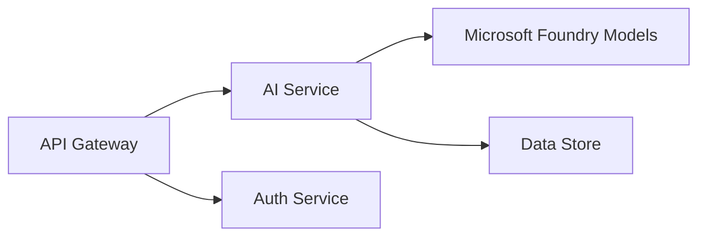
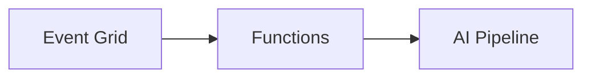

# الفصل 8: أنماط الإنتاج والمؤسسات

**📚 الدورة التدريبية**: [AZD للمبتدئين](../../README.md) | **⏱️ المدة**: 2-3 ساعات | **⭐ المستوى**: متقدم

---

## نظرة عامة

يغطي هذا الفصل أنماط النشر الجاهزة للمؤسسات، تعزيز الأمان، المراقبة، وتحسين التكاليف لأعباء عمل الذكاء الاصطناعي في الإنتاج.

هذا مرجع معماري، وليس قالب إنتاج كامل قابل للنشر. الأمثلة تتجاهل تفاصيل التكامل التي يجب توفيرها واختبارها في تطبيقك الخاص؛ قراءة قائمة التحقق لا تعني التأكد من جاهزية الإنتاج.

> **مراجعة الإصدار (2026-11-04):** تم التحقق من إرشادات AI CLI مقابل `azd 1.37.2`، الوكلاء `1.0.0-beta.23`، والتقييمات `1.0.0-beta.2` في الوثائق/المصدر. راجع [تغييرات الإصدار والإصلاحات](production-ai-practices.md#recent-release-changes-and-fixes) لمتطلبات التوافق وتفاصيل الترحيل؛ هذا ليس تحققًا مباشرًا من النشر.

## أهداف التعلم

بإكمال هذا الفصل، سوف تتعلم:
- نشر تطبيقات متعددة الأقاليم ذات مرونة عالية
- تنفيذ أنماط الأمان المؤسسية
- إعداد مراقبة شاملة
- تحسين التكاليف على نطاق واسع
- إعداد خطوط CI/CD باستخدام AZD

---

## 📚 الدروس

| # | الدرس | الوصف | الوقت |
|---|--------|-------------|------|
| 1 | [ممارسات إنتاج الذكاء الاصطناعي](production-ai-practices.md) | أنماط النشر للمؤسسات | 90 دقيقة |

---

## 🚀 قائمة التحقق للإنتاج

- [ ] نشر متعدد الأقاليم للمرونة
- [ ] هوية مُدارة للمصادقة (بدون مفاتيح)
- [ ] Application Insights للمراقبة
- [ ] إعداد ميزانيات وتنبيهات التكاليف
- [ ] تفعيل فحص الأمان
- [ ] دمج خط أنابيب CI/CD
- [ ] خطة استعادة الكوارث

---

## 🏗️ أنماط الهندسة المعمارية

### النمط 1: الذكاء الاصطناعي للخدمات المصغرة



### النمط 2: الذكاء الاصطناعي المعتمد على الأحداث



---

## 🔐 أفضل ممارسات الأمان

```bicep
// Illustrative properties from different resources, NOT a standalone Bicep file.
// Attach identity to the application host:
identity: {
  type: 'SystemAssigned'
}

// AI account properties (also require private endpoints, DNS and app connectivity):
properties: {
  publicNetworkAccess: 'Disabled'
  networkAcls: {
    defaultAction: 'Deny'
  }
}
```

---

## 💰 تحسين التكاليف

| الاستراتيجية | القيد الرئيسي |
|----------|---------|
| القياس إلى الصفر (تطبيقات الحاوية) | يتطلب مُشغل مناسب؛ ولا زالت الخدمات الأخرى تُكلف مالياً |
| استخدام مستويات الاستهلاك للتطوير | مقارنة تسعير الخدمة المختارة وحجم العمل |
| القياس المجدول | القياس من خلال البنية التحتية/الأتمتة المدعومة |
| الحجوزات/السعة المخصصة | فقط عند الدعم؛ الالتزامات قد تزيد التكاليف عند الخمول |

استخدم [نمط المورد الكامل للميزانية](production-ai-practices.md#2-cost-monitoring-and-budgets) مع تاريخ بدء صالح، ونطاق الفوترة، والمستلمين، والصلاحيات. تُرسل الميزانية التنبيهات؛ لكنها لا تحد الإنفاق. تعتمد التوفير على الاستخدام المقاس ولا تُضمن كنسب مئوية.

---

## 📊 إعداد المراقبة

```bash
# Open the Application Insights logs view (requires configured monitoring)
azd monitor --logs

# Check Application Insights
azd monitor --overview

# View metrics
az monitor metrics list --resource <resource-id>
```

---

## 🔗 التنقل

| الاتجاه | الفصل |
|-----------|---------|
| **السابق** | [الفصل 7: استكشاف الأخطاء وإصلاحها](../chapter-07-troubleshooting/README.md) |
| **إنهاء الدورة** | [الصفحة الرئيسية للدورة](../../README.md) |

---

## 📖 المصادر ذات الصلة

- [دليل وكلاء الذكاء الاصطناعي](../chapter-02-ai-development/agents.md)
- [Application Insights](../chapter-06-pre-deployment/application-insights.md)
- [حلول الوكلاء المتعددين](../chapter-05-multi-agent/README.md)
- [مثال على الخدمات المصغرة](../../examples/microservices/README.md)

---

<!-- CO-OP TRANSLATOR DISCLAIMER START -->
**تنويه**:
تمت ترجمة هذا المستند باستخدام خدمة الترجمة بالذكاء الاصطناعي [Co-op Translator](https://github.com/Azure/co-op-translator). بينما نسعى للدقة، يرجى العلم أن الترجمات الآلية قد تحتوي على أخطاء أو عدم دقة. يجب اعتبار المستند الأصلي بلغته الأصلية المصدر الرسمي والمعتمد. للمعلومات الهامة، يُنصح بالاستعانة بترجمة بشرية محترفة. نحن غير مسؤولين عن أي سوء فهم أو تفسير ناتج عن استخدام هذه الترجمة.
<!-- CO-OP TRANSLATOR DISCLAIMER END -->