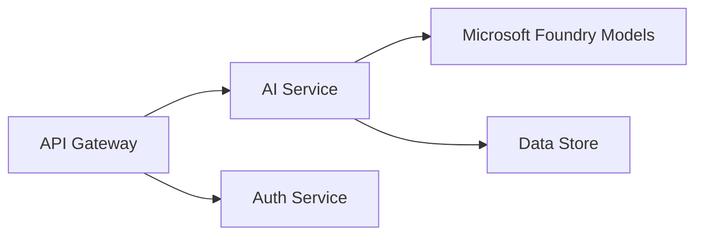
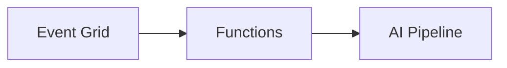

# الفصل 8: أنماط الإنتاج والمؤسسات

**📚 الدورة**: [AZD للمبتدئين](../../README.md) | **⏱️ المدة**: 2-3 ساعات | **⭐ التعقيد**: متقدم

---

## نظرة عامة

يغطي هذا الفصل أنماط النشر الجاهزة للمؤسسات، تعزيز الأمان، المراقبة، وتحسين التكلفة لأعباء عمل الذكاء الاصطناعي الإنتاجية.

هذا مرجع معماري، وليس قالب إنتاجي قابلاً للنشر بالكامل. الأمثلة تحذف تفاصيل التكامل التي يجب توفيرها واختبارها في تطبيقك الخاص؛ قراءة قائمة التحقق لا تُشهد بأهلية الإنتاج.

> **تحديث الإصدار العام لفوندري (2026-11-09):** استخدم `azd >= 1.37.0` وحزمة `microsoft.foundry` 1.0 المتاحة عمومًا لسير عمل فوندري؛ التقييمات يتم تثبيتها بشكل منفصل. راجع [نطاق الإصدار والهجرة](production-ai-practices.md#recent-release-changes-and-fixes) و[مثال خط أنابيب المصادقة](production-ai-practices.md#cicd-pipeline-configuration). هذا مراجعة وثائقية، وليس تحقق نشط من النشر أو حالة عامة شاملة للميزات الاختبارية الاختيارية.

## أهداف التعلم

عند إكمال هذا الفصل، ستتمكن من:
- نشر تطبيقات مقاومة عابرة للمناطق
- تنفيذ أنماط أمان المؤسسات
- تكوين مراقبة شاملة
- تحسين التكاليف عند النطاق الكبير
- إعداد خطوط تكامل وتسليم مستمر باستخدام AZD

---

## 📚 الدروس

| # | الدرس | الوصف | الوقت |
|---|--------|-------------|------|
| 1 | [ممارسات الذكاء الاصطناعي الإنتاجية](production-ai-practices.md) | أنماط النشر المؤسسي | 90 دقيقة |

---

## 🚀 قائمة التحقق للإنتاج

- [ ] نشر عابر للمناطق المتعددة للمرونة
- [ ] الهوية المدارة للمصادقة (بدون مفاتيح)
- [ ] Application Insights للمراقبة
- [ ] تكوين ميزانيات الإنفاق والتنبيهات
- [ ] تفعيل فحص الأمان
- [ ] تكامل خط أنابيب CI/CD
- [ ] خطة تعافي الكوارث

---

## 🏗️ أنماط البنية المعمارية

### النمط 1: الذكاء الاصطناعي عبر الخدمات الصغيرة



### النمط 2: الذكاء الاصطناعي المدفوع بالأحداث



---

## 🔐 أفضل ممارسات الأمان

```bicep
// Illustrative properties from different resources, NOT a standalone Bicep file.
// Attach identity to the application host:
identity: {
  type: 'SystemAssigned'
}

// AI account properties (also require private endpoints, DNS and app connectivity):
properties: {
  publicNetworkAccess: 'Disabled'
  networkAcls: {
    defaultAction: 'Deny'
  }
}
```

---

## 💰 تحسين التكلفة

| الاستراتيجية | القيد الرئيسي |
|----------|---------|
| التدرج للصفر (تطبيقات الحاويات) | يتطلب مشغل مناسب؛ خدمات أخرى لا تزال تفرض تكاليف |
| استخدام مستويات الاستهلاك للتطوير | مقارنة أسعار الخدمة المختارة وأعباء العمل |
| التدرج المجدول | التدرج عبر البنية التحتية/الأتمتة المدعومة |
| الحجوزات/السعة المحجوزة | فقط عندما تكون مدعومة؛ الالتزامات قد تزيد التكاليف الخاملة |

استخدم [نمط مورد الميزانية الكامل](production-ai-practices.md#2-cost-monitoring-and-budgets) مع تاريخ بدء صالح، نطاق الفوترة، المستقبلين، والأذونات. الميزانية ترسل تنبيهات؛ ولا تحد من الإنفاق. التوفير يعتمد على الاستخدام المقاس وليس نسب مضمونة.

---

## 📊 إعداد المراقبة

```bash
# Open the Application Insights logs view (requires configured monitoring)
azd monitor --logs

# Check Application Insights
azd monitor --overview

# View metrics
az monitor metrics list --resource <resource-id>
```

---

## 🔗 التنقل

| الاتجاه | الفصل |
|-----------|---------|
| **السابق** | [الفصل 7: استكشاف الأخطاء وإصلاحها](../chapter-07-troubleshooting/README.md) |
| **اكتمال الدورة** | [الصفحة الرئيسية للدورة](../../README.md) |

---

## 📖 الموارد ذات الصلة

- [دليل وكلاء الذكاء الاصطناعي](../chapter-02-ai-development/agents.md)
- [Application Insights](../chapter-06-pre-deployment/application-insights.md)
- [حلول الوكلاء المتعددين](../chapter-05-multi-agent/README.md)
- [مثال الخدمات الصغيرة](../../examples/microservices/README.md)

---

<!-- CO-OP TRANSLATOR DISCLAIMER START -->
**تنويه**:
تمت ترجمة هذا المستند باستخدام خدمة الترجمة بالذكاء الاصطناعي [Co-op Translator](https://github.com/Azure/co-op-translator). بينما نسعى للدقة، يرجى العلم أن الترجمات الآلية قد تحتوي على أخطاء أو عدم دقة. يجب اعتبار المستند الأصلي بلغته الأصلية المصدر الرسمي والمعتمد. للمعلومات الهامة، يُنصح بالاستعانة بترجمة بشرية محترفة. نحن غير مسؤولين عن أي سوء فهم أو تفسير ناتج عن استخدام هذه الترجمة.
<!-- CO-OP TRANSLATOR DISCLAIMER END -->