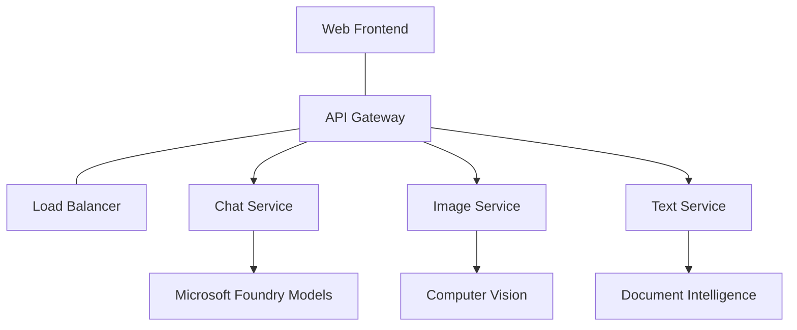

# أفضل ممارسات عبء عمل الذكاء الاصطناعي في الإنتاج مع AZD

**تنقل الفصل:**
- **📚 الصفحة الرئيسية للدورة**: [AZD للمبتدئين](../../README.md)
- **📖 الفصل الحالي**: الفصل ٨ - أنماط الإنتاج والمؤسسات
- **⬅️ الفصل السابق**: [الفصل ٧: استكشاف الأخطاء وإصلاحها](../chapter-07-troubleshooting/debugging.md)
- **⬅️ متعلق أيضًا**: [مختبر ورشة عمل الذكاء الاصطناعي](../chapter-02-ai-development/ai-workshop-lab.md)
- **🎯 إتمام الدورة**: [AZD للمبتدئين](../../README.md)

## نظرة عامة

يشرح هذا الدليل أنماط تصميم الذكاء الاصطناعي للإنتاج باستخدام Azure Developer CLI (AZD). هو مرجع تصميم، وليس تطبيقًا قابلاً للنشر أو شهادة إنتاجية.

**حدود المثال:** ما لم يتم وصفه صراحةً على أنه كامل، تفترض قصاصات Bicep المعلمات والموارد المرجعية من قالب محتوى. إنها تستثني صور/خطط المضيف، والهويات، وتعيينات الدور، وDNS، والمخرجات، والتكامل المطلوب الآخر. مسارات خدمة YAML وبرامج الربط/الاختبار هي ملفات توضيحية لإنشائها في **تطبيقك الخاص**؛ لا يوفرها هذا المساق. استخدم عينة AZD العاملة كأساس، وقم بتجميع البنية التحتية الكاملة، واختبرها في بيئة معزولة قبل الإنتاج.

## التحديات الرئيسية التي تم التعامل معها

تشمل المخاوف الإنتاجية الشائعة عمليات النشر متعددة الخدمات، وإدارة الهوية والأسرار، والتوسع، والتحكم في التكاليف، والمراقبة. لا يتم الادعاء هنا بانتشار مقاس.

## أنماط العمارة للذكاء الاصطناعي في الإنتاج

### النمط ١: عمارة خدمات دقيقة للذكاء الاصطناعي

**متى تستخدم**: تطبيقات ذكاء اصطناعي معقدة بقدرات متعددة



**تنفيذ AZD**:

```yaml
# azure.yaml
name: enterprise-ai-platform
services:
  web:
    project: ./web
    host: staticwebapp
  api-gateway:
    project: ./api-gateway
    host: containerapp
  chat-service:
    project: ./services/chat
    host: containerapp
  vision-service:
    project: ./services/vision
    host: containerapp
  text-service:
    project: ./services/text
    host: containerapp
```

### النمط ٢: معالجة الذكاء الاصطناعي القائمة على الأحداث

**متى تستخدم**: المعالجة الدفعية، تحليل المستندات، سير العمل غير المتزامن

```bicep
// Event Hub for AI processing pipeline
resource eventHub 'Microsoft.EventHub/namespaces@2024-01-01' = {
  name: eventHubNamespaceName
  location: location
  sku: {
    name: 'Standard'
    tier: 'Standard'
    capacity: 1
  }
}

// Service Bus for reliable message processing
resource serviceBus 'Microsoft.ServiceBus/namespaces@2024-01-01' = {
  name: serviceBusNamespaceName
  location: location
  sku: {
    name: 'Premium'
    tier: 'Premium'
    capacity: 1
  }
}

// Function App for processing
resource functionApp 'Microsoft.Web/sites@2023-01-01' = {
  name: functionAppName
  location: location
  kind: 'functionapp,linux'
  properties: {
    siteConfig: {
      appSettings: [
        {
          name: 'FUNCTIONS_EXTENSION_VERSION'
          value: '~4'
        }
        {
          name: 'AZURE_OPENAI_ENDPOINT'
          value: '@Microsoft.KeyVault(VaultName=${keyVault.name};SecretName=openai-endpoint)'
        }
      ]
    }
  }
}
```

ينشئ هذا قصاصات مساحة الأسماء، وليس محاور أو قوائم انتظار أو اشتراكات أو مشغلات دالة. يحتاج الدالة القابلة للتشغيل أيضًا إلى خطة استضافة، وتكوين وقت تشغيل/تخزين، وهوية مرفقة، RBAC، ووصول إلى الشبكة. تحتاج المرجعية إلى Key Vault إذن قراءة السر؛ عنوان نقطة النهاية نفسه ليس بيانات اعتماد.

## التفكير في صحة وكيل الذكاء الاصطناعي

عندما يتعطل تطبيق ويب تقليدي، تكون الأعراض معروفة: صفحة لا تحمل، API يعيد خطأ، أو فشل في نشر. يمكن لتطبيقات الذكاء الاصطناعي أن تتعطل بنفس الطرق—ولكنها قد تتصرف بشكل خاطئ بطرق أكثر دقة لا تنتج رسائل خطأ واضحة.

تساعدك هذه القسم على بناء نموذج ذهني لمراقبة أحمال عمل الذكاء الاصطناعي بحيث تعرف أين تبحث عندما لا تبدو الأمور صحيحة.

### كيف تختلف صحة الوكيل عن صحة التطبيق التقليدي

يمكن أن تحتوي التطبيقات التقليدية أيضًا على إخفاقات طفيفة في الصحة. يضيف وكيل الذكاء الاصطناعي جودة استجابة غير حتمية إلى المخاوف المعتادة المتعلقة بالتوفر والصحة. فكر في صحة الوكيل بطبقتين:

| الطبقة | ما تراقبه | أين تبحث |
|-------|--------------|---------------|
| **صحة البنية التحتية** | هل الخدمة تعمل؟ هل الموارد مخصصة؟ هل نقاط النهاية في متناول اليد؟ | `azd monitor`، صحة موارد بوابة Azure، سجلات الحاوية/التطبيق |
| **صحة السلوك** | هل يستجيب الوكيل بدقة؟ هل الاستجابات في الوقت المناسب؟ هل يتم استدعاء النموذج بشكل صحيح؟ | تتبع Application Insights، مقاييس تأخير نداء النموذج، سجلات جودة الاستجابة |

صحة البنية التحتية مألوفة—نفس الشيء لأي تطبيق azd. صحة السلوك هي الطبقة الجديدة التي تقدمها أحمال عمل الذكاء الاصطناعي.

### أين تبحث عندما لا تتصرف تطبيقات الذكاء الاصطناعي كما هو متوقع

إذا لم ينتج تطبيق الذكاء الاصطناعي الخاص بك النتائج المتوقعة، إليك قائمة تحقق مفهومية:

1. **ابدأ بالأساسيات.** هل التطبيق يعمل؟ هل يمكنه الوصول إلى تبعياته؟ تحقق من `azd monitor` وصحة الموارد كما تفعل مع أي تطبيق.
2. **تحقق من الاتصال بالنموذج.** هل ينجح تطبيقك في استدعاء نموذج الذكاء الاصطناعي؟ نداءات النموذج الفاشلة أو المنتهية مهلة هي أكثر أسباب مشكلات تطبيق الذكاء الاصطناعي شيوعًا وستظهر في سجلات التطبيق.
3. **افحص المدخلات والتأسيس بأمان.** قد تنتج الإجابات الخاطئة من الاسترجاع، التعليمات، قيود النموذج، أو تنفيذ الأدوات. استخدم بيانات تشخيصية خاضعة للتحكم في الوصول ومخفية؛ لا تفعل تسجيل المطالبات/الاستجابات بلا تمييز في الإنتاج.
4. **راجع زمن الاستجابة.** نداءات نموذج الذكاء الاصطناعي أبطأ من نداءات API النموذجية. إذا بدا تطبيقك بطيئًا، تحقق مما إذا كان وقت استجابة النموذج قد ازداد—قد يشير ذلك إلى تقييد، حدود السعة، أو ازدحام على مستوى المنطقة.
5. **راقب إشارات التكلفة.** قد تشير الزيادات غير المتوقعة في استخدام الرموز أو نداءات API إلى حلقة، مطالبة غير مضبوطة، أو محاولات متكررة مفرطة.

لست بحاجة إلى إتقان أدوات المراقبة على الفور. الخلاصة هي أن تطبيقات الذكاء الاصطناعي لديها طبقة إضافية من السلوك يجب مراقبتها، ومراقبة azd المدمجة (`azd monitor`) تمنحك نقطة بداية للتحقيق في كلتا الطبقتين.

---

## أفضل ممارسات الأمان

### ١. نموذج أمان الثقة الصفرية

**استراتيجية التنفيذ**:
- لا يوجد اتصال خدمة إلى خدمة بدون مصادقة
- جميع نداءات API تستخدم هويات مُدارة
- عزل الشبكة باستخدام نقاط نهاية خاصة
- ضوابط وصول بأقل الامتيازات

```bicep
// Managed Identity for each service
resource chatServiceIdentity 'Microsoft.ManagedIdentity/userAssignedIdentities@2023-01-31' = {
  name: 'chat-service-identity'
  location: location
}

// Role assignments with minimal permissions
resource openAIUserRole 'Microsoft.Authorization/roleAssignments@2022-04-01' = {
  scope: openAIAccount
  name: guid(openAIAccount.id, chatServiceIdentity.id, '5e0bd9bd-7b93-4f28-af87-19fc36ad61bd')
  properties: {
    roleDefinitionId: subscriptionResourceId('Microsoft.Authorization/roleDefinitions', '5e0bd9bd-7b93-4f28-af87-19fc36ad61bd')
    principalId: chatServiceIdentity.properties.principalId
    principalType: 'ServicePrincipal'
  }
}
```

### ٢. إدارة الأسرار الآمنة

**نمط تكامل Key Vault**:

```bicep
// Key Vault with proper access policies
resource keyVault 'Microsoft.KeyVault/vaults@2023-02-01' = {
  name: keyVaultName
  location: location
  properties: {
    tenantId: tenant().tenantId
    sku: {
      family: 'A'
      name: 'standard' // Premium is needed for HSM-backed keys, not ordinary secrets
    }
    enableRbacAuthorization: true  // Use RBAC instead of access policies
    enablePurgeProtection: true    // Prevent accidental deletion
    enableSoftDelete: true
    softDeleteRetentionInDays: 90
  }
}

// Optional legacy key-auth alternative; omit when using Entra ID.
resource openAIKeySecret 'Microsoft.KeyVault/vaults/secrets@2023-02-01' = {
  parent: keyVault
  name: 'openai-api-key'
  properties: {
    value: openAIAccount.listKeys().key1
    attributes: {
      enabled: true
    }
  }
}
```

عيّن هوية وقت التشغيل `Key Vault Secrets User` في النطاق المناسب واربطها بالمضيف؛ `enableRbacAuthorization` وحدها لا تمنح الوصول. يُفضل مصادقة الهوية المُدارة الخاصة بـ OpenAI باستخدام `disableLocalAuth: true`. المفتاح السري الاختياري منطقي فقط لحساب مُمكّن بالمفتاح عمدًا، ويحتاج رئيس التزويد أيضًا إلى إذن كتابة أسرار.

### ٣. أمان الشبكة

**تكوين نقطة النهاية الخاصة**:

```bicep
// Virtual Network for AI services
resource virtualNetwork 'Microsoft.Network/virtualNetworks@2023-04-01' = {
  name: vnetName
  location: location
  properties: {
    addressSpace: {
      addressPrefixes: ['10.0.0.0/16']
    }
    subnets: [
      {
        name: 'ai-services-subnet'
        properties: {
          addressPrefix: '10.0.1.0/24'
          privateEndpointNetworkPolicies: 'Disabled'
        }
      }
      {
        name: 'app-services-subnet'
        properties: {
          addressPrefix: '10.0.2.0/24'
          delegations: [
            {
              name: 'Microsoft.Web/serverFarms'
              properties: {
                serviceName: 'Microsoft.Web/serverFarms'
              }
            }
          ]
        }
      }
    ]
  }
}

// Private endpoints for all AI services
resource openAIPrivateEndpoint 'Microsoft.Network/privateEndpoints@2023-04-01' = {
  name: '${openAIAccountName}-pe'
  location: location
  properties: {
    subnet: {
      id: virtualNetwork.properties.subnets[0].id
    }
    privateLinkServiceConnections: [
      {
        name: 'openai-connection'
        properties: {
          privateLinkServiceId: openAIAccount.id
          groupIds: ['account']
        }
      }
    ]
  }
}
```

تتطلب نقاط النهاية الخاصة أيضًا مجموعات منطقة DNS الخاصة/روابط VNet وتكامل تطبيق VNet. لا تحظر تلقائيًا الوصول العام: عطل صراحة الوصول العام إلى حساب الذكاء الاصطناعي بعد التحقق من الاتصال الخاص والوصول للنشر.

## الأداء والتوسع

### ١. استراتيجيات التوسع التلقائي

**التوسع التلقائي لتطبيقات الحاويات**:

```bicep
resource containerApp 'Microsoft.App/containerApps@2023-05-01' = {
  name: containerAppName
  location: location
  properties: {
    configuration: {
      ingress: {
        external: true
        targetPort: 8000
        transport: 'http'
      }
    }
    template: {
      scale: {
        minReplicas: 2  // Always have 2 instances minimum
        maxReplicas: 50 // Scale up to 50 for high load
        rules: [
          {
            name: 'http-scaling'
            http: {
              metadata: {
                concurrentRequests: '20'  // Scale when >20 concurrent requests
              }
            }
          }
          {
            name: 'cpu-scaling'
            custom: {
              type: 'cpu'
              metadata: {
                type: 'Utilization'
                value: '70'  // Scale when CPU >70%
              }
            }
          }
        ]
      }
    }
  }
}
```

### ٢. استراتيجيات التخزين المؤقت

**Redis Cache لاستجابات الذكاء الاصطناعي**:

```bicep
// Legacy Azure Cache for Redis example (not recommended for new deployments)
resource redisCache 'Microsoft.Cache/redis@2023-04-01' = {
  name: redisCacheName
  location: location
  properties: {
    sku: {
      name: 'Premium'
      family: 'P'
      capacity: 1
    }
    enableNonSslPort: false
    minimumTlsVersion: '1.2'
    redisConfiguration: {
      'maxmemory-policy': 'allkeys-lru'
    }
    // Sharding distributes data; replication/failover provides availability.
    shardCount: 2
  }
}

// Cache configuration in application
var cacheConnectionString = '${redisCache.properties.hostName}:6380,password=${redisCache.listKeys().primaryKey},ssl=True,abortConnect=False'
```

Azure Cache لـ Redis Basic/Standard/Premium في [مسار التقاعد](https://learn.microsoft.com/azure/azure-cache-for-redis/retirement-faq). استخدم Azure Managed Redis للتصاميم الجديدة ومواصفات SKU، الهوية، وتكوين TLS الموثقة، بدلاً من نسخ هذا المورد القديم إلى نظام إنتاج جديد. خط أمر الاتصال هو عنصر نائب لا يعمل، ليس بيانات اعتماد. قم بتقسيم مفاتيح التخزين المؤقت حسب التفويض، النموذج/التعليمات، وإصدار الاسترجاع، مع انتهاء الصلاحية؛ يمكن لذاكرة التخزين المؤقت المشتركة للقراءة فقط أن تكشف بيانات مستخدم آخر.

### ٣. موازنة التحميل وإدارة المرور

**بوابة التطبيق مع WAF**:

```bicep
// Application Gateway with Web Application Firewall
resource applicationGateway 'Microsoft.Network/applicationGateways@2023-04-01' = {
  name: appGatewayName
  location: location
  properties: {
    sku: {
      name: 'WAF_v2'
      tier: 'WAF_v2'
      capacity: 2
    }
    webApplicationFirewallConfiguration: {
      enabled: true
      firewallMode: 'Prevention'
      ruleSetType: 'OWASP'
      ruleSetVersion: '3.2'
    }
    // Backend pools for AI services
    backendAddressPools: [
      {
        name: 'ai-services-pool'
        properties: {
          backendAddresses: [
            {
              fqdn: '${containerApp.properties.configuration.ingress.fqdn}'
            }
          ]
        }
      }
    ]
  }
}
```

هذا جزء من مورد البوابة: يحتاج النشر الحقيقي أيضًا إلى تكوين الشبكة الفرعية/عنوان IP للبوابة، عناوين وأرقام منافذ الواجهة الأمامية، مستمعي TLS/الشهادات، إعدادات HTTP الخلفية/المسوحات، قواعد التوجيه والأولويات، وسياسة WAF مراجعة. يجب أن تتوافق أسماء مضيف TLS/SNI والمصادقة مع خلفية تطبيق الحاويات.

## 💰 تحسين التكلفة

### ١. تحديد حجم الموارد المناسب

**تكوينات خاصة بالبيئة**:

هذه الأسماء هي **مدخلات نموذج مخصصة توضيحية**، ليست إعدادات AZD تلقائية. قم بربط كل منها بـ `infra/main.parameters.json`/Bicep وتكوين المضيف أولاً. على سبيل المثال، تستخدم عينة RAG `AZURE_SEARCH_SERVICE_SKU` و `AZURE_OPENAI_CHATGPT_DEPLOYMENT_CAPACITY`، وليست الأسماء العامة أدناه. أعطِ ذاكرة تطبيق الحاويات وحدة مدعومة مثل `1Gi` في المورد الفعلي. طبق تغييرات البنية التحتية باستخدام `azd up` أو `azd provision`؛ `azd deploy` وحدها لا تطبق تغييرات Bicep.

```bash
# Development environment
azd env new development
azd env set AZURE_OPENAI_SKU "S0"
azd env set AZURE_OPENAI_CAPACITY 10
azd env set AZURE_SEARCH_SKU "basic"
azd env set CONTAINER_CPU 0.5
azd env set CONTAINER_MEMORY 1.0

# Production environment  
azd env new production
azd env set AZURE_OPENAI_SKU "S0"
azd env set AZURE_OPENAI_CAPACITY 100
azd env set AZURE_SEARCH_SKU "standard"
azd env set CONTAINER_CPU 2.0
azd env set CONTAINER_MEMORY 4.0
```

### ٢. مراقبة التكلفة والميزانيات

```bicep
// Supply the first day of the current UTC month, e.g. 2026-11-01T00:00:00Z.
param budgetStartDate string

// Cost management and budgets
resource budget 'Microsoft.Consumption/budgets@2024-08-01' = {
  name: 'ai-workload-budget'
  properties: {
    timePeriod: {
      startDate: budgetStartDate
    }
    timeGrain: 'Monthly'
    amount: 2000  // In the billing currency, not necessarily USD
    category: 'Cost'
    notifications: {
      warning: {
        enabled: true
        operator: 'GreaterThan'
        threshold: 80
        contactEmails: [
          'finance@company.com'
          'engineering@company.com'
        ]
        contactRoles: [
          'Owner'
          'Contributor'
        ]
      }
      critical: {
        enabled: true
        operator: 'GreaterThan'
        threshold: 95
        contactEmails: [
          'cto@company.com'
        ]
      }
    }
  }
}
```

استبدل المستلمين المثالين وتحقق من النطاق/الأذونات. تستخدم تنبيهات الميزانية بيانات الفوترة المؤجلة ولا تفرض حد الإنفاق.

### ٣. تحسين استخدام الرموز

**إدارة تكلفة OpenAI**:

هذا مجرد تقدير يعتمد على الشخصيات لمعاينة واجهة المستخدم، **ليس** مُحقق حدود رموز النموذج. يجب أن يستخدم الكود الإنتاجي محلل الرموز المناسب للنموذج المنشور ويأخذ في الاعتبار تعليمات النظام، مخططات الأدوات، السجل، وميزانية المخرجات. ارفض رسالة مستخدم كبيرة الحجم بدلاً من تقصيرها بصمت.

```typescript
// Application-level token optimization
class TokenOptimizer {
  private readonly maxTokens = 4000;
  private readonly reserveTokens = 500;
  
  optimizePrompt(userInput: string, context: string): string {
    const availableTokens = this.maxTokens - this.reserveTokens;
    if (this.estimateTokens(userInput) + 8 >= availableTokens) {
      throw new Error("User input exceeds the illustrative prompt budget");
    }
    const estimatedTokens = this.estimateTokens(userInput + context) + 8;
    
    if (estimatedTokens > availableTokens) {
      // Truncate context, not user input
      context = this.truncateContext(context, Math.max(0, availableTokens - this.estimateTokens(userInput) - 8));
    }
    
    return `${context}\n\nUser: ${userInput}`;
  }
  
  private estimateTokens(text: string): number {
    // Rough estimation: 1 token ≈ 4 characters
    return Math.ceil(text.length / 4);
  }

  private truncateContext(text: string, estimatedBudget: number): string {
    return text.slice(0, Math.max(0, estimatedBudget) * 4);
  }
}
```

## المراقبة والرصد

### ١. Application Insights الشاملة

```bicep
// Application Insights with advanced features
resource applicationInsights 'Microsoft.Insights/components@2020-02-02' = {
  name: applicationInsightsName
  location: location
  kind: 'web'
  properties: {
    Application_Type: 'web'
    WorkspaceResourceId: logAnalyticsWorkspace.id
    SamplingPercentage: 100  // Ingestion setting; review cost and SDK sampling separately
    DisableIpMasking: false  // Retain IP masking
  }
}

// Custom metrics for AI operations
resource aiMetricAlerts 'Microsoft.Insights/metricAlerts@2018-03-01' = {
  name: 'ai-high-error-rate'
  location: 'global'
  properties: {
    description: 'Alert when failed request count exceeds 10 in five minutes'
    severity: 2
    enabled: true
    scopes: [
      applicationInsights.id
    ]
    evaluationFrequency: 'PT1M'
    windowSize: 'PT5M'
    criteria: {
      'odata.type': 'Microsoft.Azure.Monitor.SingleResourceMultipleMetricCriteria'
      allOf: [
        {
          name: 'high-error-rate'
          metricName: 'requests/failed'
          operator: 'GreaterThan'
          threshold: 10
          timeAggregation: 'Count'
        }
      ]
    }
  }
}
```

### ٢. مراقبة خاصة بالذكاء الاصطناعي

**لوحات القيادة المخصصة لمقاييس الذكاء الاصطناعي**:

```json
{
  "dashboard": {
    "name": "AI Application Monitoring",
    "tiles": [
      {
        "name": "OpenAI Request Volume",
        "query": "dependencies | where target contains 'openai' | summarize count() by bin(timestamp, 5m)"
      },
      {
        "name": "AI Response Latency",
        "query": "dependencies | where target contains 'openai' | summarize avg(duration) by bin(timestamp, 5m)"
      },
      {
        "name": "Token Usage",
        "query": "customMetrics | where name == 'openai_tokens_used' | summarize sum(value) by bin(timestamp, 1h)"
      },
      {
        "name": "Cost per Hour",
        "query": "customMetrics | where name == 'openai_cost' | summarize sum(value) by bin(timestamp, 1h)"
      }
    ]
  }
}
```

هذا JSON هو رسم تعريفي معرف بالتطبيق، ليس مخطط لوحة تحكم Azure قابل للاستيراد. تتطلب استعلامات الرموز/التكلفة ان يصدر تطبيقك تلك المقاييس المخصصة بالضبط؛ لم يتم إنشاؤها بواسطة AZD. عدل مرشحات التبعيات لأسماء نقاط النهاية/الشرائح النموذجية الفعلية.

### ٣. فحوصات الصحة ومراقبة الجهوزية

```bicep
// Application Insights availability tests
resource availabilityTest 'Microsoft.Insights/webtests@2022-06-15' = {
  name: 'ai-app-availability-test'
  location: location
  tags: {
    'hidden-link:${applicationInsights.id}': 'Resource'
  }
  properties: {
    SyntheticMonitorId: 'ai-app-availability-test'
    Name: 'AI Application Availability Test'
    Description: 'Tests AI application endpoints'
    Enabled: true
    Frequency: 300  // 5 minutes
    Timeout: 120    // 2 minutes
    Kind: 'standard'
    Locations: [
      {
        Id: 'us-east-2-azr'
      }
      {
        Id: 'us-west-2-azr'
      }
    ]
    Request: {
      RequestUrl: 'https://${webApp.properties.defaultHostName}/health'
      HttpVerb: 'GET'
      FollowRedirects: true
      ParseDependentRequests: false
    }
    ValidationRules: {
      ExpectedHttpStatusCode: 200
      SSLCheck: true
      SSLCertRemainingLifetimeCheck: 7
    }
  }
}
```

## التعافي من الكوارث والتوفر العالي

يفترض الاختبار السابق وجود App Service `webApp` وموارد Application Insights. اختبارات التوفر القياسية قابلة للفوترة وتتطلب نقطة نهاية قابلة للوصول؛ التطبيقات الخاصة فقط تحتاج إلى تصميم مراقبة خاصة مناسبة. اختبارات ping لعناوين URL قديمة؛ استخدم [اختبارات التوفر القياسية](https://learn.microsoft.com/azure/azure-monitor/app/availability).

### ١. النشر متعدد المناطق

```yaml
# azure.yaml - Multi-region configuration
name: ai-app-multiregion
services:
  api-primary:
    project: ./api
    host: containerapp
    env:
      AZURE_REGION: eastus
  api-secondary:
    project: ./api
    host: containerapp
    env:
      AZURE_REGION: westus2
```

```bicep
// Separate App Service topology, not the Container Apps declarations above
resource trafficManager 'Microsoft.Network/trafficManagerProfiles@2022-04-01' = {
  name: trafficManagerProfileName
  location: 'global'
  properties: {
    profileStatus: 'Enabled'
    trafficRoutingMethod: 'Priority'
    dnsConfig: {
      relativeName: trafficManagerProfileName
      ttl: 30
    }
    monitorConfig: {
      protocol: 'HTTPS'
      port: 443
      path: '/health'
      intervalInSeconds: 30
      toleratedNumberOfFailures: 3
      timeoutInSeconds: 10
    }
    endpoints: [
      {
        name: 'primary-endpoint'
        type: 'Microsoft.Network/trafficManagerProfiles/azureEndpoints'
        properties: {
          targetResourceId: primaryAppService.id
          endpointStatus: 'Enabled'
          priority: 1
        }
      }
      {
        name: 'secondary-endpoint'
        type: 'Microsoft.Network/trafficManagerProfiles/azureEndpoints'
        properties: {
          targetResourceId: secondaryAppService.id
          endpointStatus: 'Enabled'
          priority: 2
        }
      }
    ]
  }
}
```

لا تختار المتغيرات البيئية مواقع الموارد. يجب على IaC تخصيص مضيفين إقليميين مميزين وربط كل خدمة باستخدام علامات `resourceName` أو `azd-service-name`. مثال Traffic Manager هو **هيكلية App Service منفصلة** (`primaryAppService`/`secondaryAppService`)، ليس توجيه لإعلانات تطبيقات الحاويات. تتطلب تطبيقات الحاويات نقطة نهاية خارجية/باب أمامي مكون بشكل مناسب، توجيه TLS/نطاق مخصص، ومستشعرات الصحة.

### ٢. النسخ الاحتياطي للبيانات والاستعادة

```bicep
// Backup configuration for critical data
resource backupVault 'Microsoft.DataProtection/backupVaults@2023-05-01' = {
  name: backupVaultName
  location: location
  identity: {
    type: 'SystemAssigned'
  }
  properties: {
    storageSettings: [
      {
        datastoreType: 'VaultStore'
        type: 'LocallyRedundant'
      }
    ]
  }
}

```

لا يدعم الخزنة وحدها النسخ الاحتياطي. قم بتكوين **سياسة مدعومة خاصة بحمولة العمل وحالة النسخ الاحتياطي**، أذونات المصدر، الاحتفاظ، واختبارات الاستعادة باستخدام [مصفوفات دعم Azure Backup](https://learn.microsoft.com/azure/backup/backup-support-matrix). لا توجد سياسة Azure Backup عامة لنشر نماذج Azure OpenAI المستضافة. احتفظ بتعريفات البنية التحتية/النموذج في التحكم بالمصدر؛ احمِ المستندات المحملة، بيانات التطبيق، وقطع التفاصيل الدقيقة باستخدام ميزات النسخ الاحتياطي/التصدير المدعومة لكل خدمة دعم. عرّف واختبر RPO/RTO صراحة.

## صول DevOps وCI/CD

### ١. سير عمل GitHub Actions

```yaml
# .github/workflows/deploy-ai-app.yml
name: Deploy AI Application

on:
  push:
    branches: [main]
  pull_request:
    branches: [main]

jobs:
  test:
    runs-on: ubuntu-latest
    steps:
      - uses: actions/checkout@v4
      
      - name: Setup Python
        uses: actions/setup-python@v4
        with:
          python-version: '3.11'
          
      - name: Install dependencies
        run: |
          pip install -r requirements.txt
          pip install pytest
          
      - name: Run tests
        run: pytest tests/
        
      - name: AI Safety Tests
        run: |
          python scripts/test_ai_safety.py
          python scripts/validate_prompts.py

```

هذا هو **جزء الاختبار فقط** من سير العمل ويفترض أنك أنشأت `requirements.txt`، `tests/`، وبرنامجين أمان. أضف وظائف التزويد/النشر الموثوقة OIDC من [تكوين خط أنابيب CI/CD](#cicd-pipeline-configuration)، مع `needs: test`، دفعة موثوقة/مشغل يدوي، وبيئات GitHub المحمية. لا تنشر رمز طلب سحب غير موثوق به مع بيانات اعتماد السحابة. لا يوجد لدى مثبت جديد بيئة AZD محلية مختارة؛ قدم مدخلات البيئة/الاشتراك/الموقع واستخدم `azd auth login`، وليس فقط `azure/login`.

### ٢. التحقق من البنية التحتية

```bash
# scripts/validate_infrastructure.sh
#!/bin/bash
set -euo pipefail

echo "Validating AI infrastructure deployment..."

# Requires Azure CLI login and the resource group selected explicitly.
: "${AZURE_RESOURCE_GROUP:?Set AZURE_RESOURCE_GROUP}"
: "${AZURE_OPENAI_NAME:?Set AZURE_OPENAI_NAME}"
: "${AZURE_OPENAI_CHAT_DEPLOYMENT:?Set the actual deployment name}"

# A successful empty list is not proof that resources exist.
types=("Microsoft.CognitiveServices/accounts" "Microsoft.Search/searchServices"
       "Microsoft.Storage/storageAccounts" "Microsoft.KeyVault/vaults")
for resource_type in "${types[@]}"; do
    count=$(az resource list --resource-group "$AZURE_RESOURCE_GROUP" \
        --resource-type "$resource_type" --query "length(@)" -o tsv)
    if [[ "$count" -lt 1 ]]; then
        echo "ERROR: No $resource_type found in $AZURE_RESOURCE_GROUP"
        exit 1
    fi
done

# Validate OpenAI model deployments
echo "Validating OpenAI model deployments..."
state=$(az cognitiveservices account deployment show \
  --name "$AZURE_OPENAI_NAME" --resource-group "$AZURE_RESOURCE_GROUP" \
  --deployment-name "$AZURE_OPENAI_CHAT_DEPLOYMENT" \
  --query "properties.provisioningState" -o tsv)
if [[ "$state" != "Succeeded" ]]; then
    echo "ERROR: Required model deployment is not provisioned successfully"
    exit 1
fi

echo "Infrastructure validation completed successfully!"
```

المتوقع: خروج صفر ورسالة إكمال فقط عندما توجد كل الأنواع المتوقعة ولوحة نشر النموذج المسماة مفعلة. هذا يتحقق من حالة الجرد/التزويد، **ليس** صحة الموارد، البنية التحتية الدقيقة، RBAC، إمكانية الوصول إلى الشبكة، أو سلوك النموذج. عدل الأنواع المتوقعة وفقًا لهندستك، ثم قم بإجراء اختبار جاهزية تطبيق منفصل معتمد.

## قائمة تحقق الجاهزية للإنتاج

### الأمان ✅
- [ ] تستخدم جميع الخدمات هويات مُدارة
- [ ] الأسرار مخزنة في Key Vault
- [ ] تم تكوين نقاط النهاية الخاصة
- [ ] تنفيذ مجموعات أمان الشبكة
- [ ] RBAC بأقل امتياز ممكن
- [ ] تمكين WAF على نقاط النهاية العامة

### الأداء ✅
- [ ] تم تكوين التوسع التلقائي
- [ ] تنفيذ التخزين المؤقت
- [ ] إعداد موازنة التحميل
- [ ] CDN للمحتوى الثابت
- [ ] تجميع اتصال قاعدة البيانات
- [ ] تحسين استخدام الرموز

### المراقبة ✅
- [ ] تم تكوين Application Insights
- [ ] تعريف المقاييس المخصصة
- [ ] إعداد قواعد التنبيه
- [ ] إنشاء لوحة القيادة
- [ ] تنفيذ فحوصات الصحة
- [ ] سياسات احتفاظ السجلات

### الموثوقية ✅
- [ ] النشر متعدد المناطق
- [ ] خطة النسخ الاحتياطي والاستعادة
- [ ] تنفيذ قواطع الدائرة
- [ ] تكوين سياسات إعادة المحاولة
- [ ] التدهور التدريجي المتزن
- [ ] نقاط نهاية فحوصات الصحة

### إدارة التكلفة ✅
- [ ] تم تكوين تنبيهات الميزانية
- [ ] تحديد حجم الموارد المناسب
- [ ] تطبيق خصومات التطوير/الاختبار
- [ ] شراء مثيلات محجوزة
- [ ] لوحة مراقبة التكاليف
- [ ] مراجعات دورية للتكلفة

### الامتثال ✅
- [ ] استيفاء متطلبات إقامة البيانات
- [ ] تمكين تسجيل التدقيق
- [ ] تطبيق سياسات الامتثال
- [ ] تنفيذ قواعد الأمان الأساسية
- [ ] تقييمات أمنية دورية
- [ ] خطة استجابة للحوادث

## معايير الأداء

### أهداف الإنتاج التوضيحية

هذه أهداف SLO مثال للتفاوض واختبار التحميل، وليست معايير مقاسة أو ضمانات. يعتمد وقت الاستجابة على طول النموذج/المخرجات؛ يعتمد إنفاق الرموز الشهري على حركة المرور والأسعار، وليس عدد الرموز وحده.

| المقياس | الهدف | المراقبة |
|--------|--------|------------|
| **وقت الاستجابة** | < ٢ ثانية | Application Insights |
| **التوفر** | ٩٩.٩% | مراقبة الجهوزية |
| **معدل الخطأ** | < ٠.١% | سجلات التطبيق |
| **إنفاق النموذج** | < ٥٠٠ دولار/شهر (ميزانية نموذجية) | إدارة التكلفة |
| **المستخدمون المتزامنون** | ١٠٠٠+ | اختبار التحميل |
| **وقت الاسترداد** | < ساعة واحدة | اختبارات استرداد الكوارث |

### اختبار التحميل

فيما يلي مخطط لواجهة نص اختبار التحميل **يجب عليك تنفيذه**؛ هذا المستودع لا يوفر `scripts/load_test.py`. عرّف محتويات الطلب، المصادقة، أحمال العمل التمثيلية، تأكيدات النسبة المئوية للكمون/الأخطاء، وحد إنفاق في أداة اختبار التحميل التي تختارها قبل تشغيلها:

```bash
# Load testing script for AI applications
python scripts/load_test.py \
  --endpoint https://your-ai-app.azurewebsites.net \
  --concurrent-users 100 \
  --duration 300 \
  --ramp-up 60
```

## 🤝 أفضل ممارسات المجتمع

استنادًا إلى ملاحظات مجتمع Microsoft Foundry Discord:

### التوصيات الرئيسية من المجتمع:

1. **ابدأ صغيرًا وتوسع تدريجيًا**: ابدأ بأصناف أساسية وقم بالتوسع اعتمادًا على الاستخدام الفعلي
2. **راقب كل شيء**: قم بإعداد مراقبة شاملة من اليوم الأول
3. **أتمت الأمان**: استخدم البنية التحتية كرمز للأمان المتسق
4. **اختبر بدقة**: أدرج اختبارات خاصة بالذكاء الاصطناعي في خط أنابيبك
5. **خطط للتكاليف**: راقب استخدام الرموز وضبط تنبيهات الميزانية مبكرًا

### الأخطاء الشائعة التي يجب تجنبها:

- ❌ ترميز مفاتيح API صلبًا في الكود
- ❌ عدم إعداد مراقبة صحيحة
- ❌ تجاهل تحسين التكاليف
- ❌ عدم اختبار سيناريوهات الفشل
- ❌ النشر بدون فحوصات الصحة

## أوامر وإضافات AZD AI CLI

يتضمن AZD مجموعة متزايدة من الأوامر والإضافات الخاصة بالذكاء الاصطناعي التي تُبسّط سير عمل الذكاء الاصطناعي الإنتاجي. هذه الأدوات تربط بين تطوير محلي ونشر إنتاجي لأحمال عمل الذكاء الاصطناعي.

> **مراجعة الإصدار (2026-11-04):** تم التحقق من إرشادات CLI أدناه مع الإصدارات المنشورة لـ `azd` **1.37.2**، `azure.ai.agents` **1.0.0-beta.23**، و`azure.ai.evaluations` **1.0.0-beta.2**. تتطلب الوكلاء beta.23 `azd >= 1.37.0`؛ تتطلب التقييمات beta.2 `azd >= 1.33.0`. استخدم على الأقل 1.37.0 لسير العمل الموحد. هذه مراجعة وثائق/مصدر، وليست تحقق نشر Azure مباشر.

### إضافات AZD للذكاء الاصطناعي

يستخدم AZD نظام إضافات لإضافة قدرات مخصصة للذكاء الاصطناعي. قم بتثبيت وإدارة الإضافات عبر:

```bash
# List all available extensions (including AI)
azd extension list

# Inspect installed extension details
azd version
azd extension show azure.ai.agents

# Install the Foundry agents extension
azd extension install azure.ai.agents

# Install the separate Foundry evaluations extension
azd extension install azure.ai.evaluations

# Install the fine-tuning extension
azd extension install azure.ai.finetune

# Install the custom models extension
azd extension install azure.ai.models

# Upgrade all installed extensions
azd extension upgrade --all
```

**الإضافات الخاصة بالذكاء الاصطناعي المتاحة:**

| الإضافة | الغرض | الحالة |
|-----------|---------|--------|
| `azure.ai.agents` | إدارة خدمة وكيل Foundry | معاينة |
| `azure.ai.evaluations` | مجموعات بيانات التقييم، المقيمون، مجموعات التقييم، والتشغيلات | معاينة |
| `azure.ai.skills` | مهارات وكيل قابلة لإعادة الاستخدام | معاينة |
| `azure.ai.connections` | اتصالات Foundry (مصادر بيانات، أدوات) | معاينة |
| `azure.ai.finetune` | ضبط نموذج Foundry | معاينة |
| `azure.ai.models` | نماذج مخصصة لـ Foundry | معاينة |
| `azure.coding-agent` | تكوين وكيل الأكواد | متاحة |

> شغّل `azd extension list --installed` و`azd extension show azure.ai.evaluations` لفحص الإصدارات المثبتة. قم بترقية CLI الأساسية أولاً باستخدام [تعليمات التثبيت/التحديث](https://learn.microsoft.com/azure/developer/azure-developer-cli/install-azd) (لتثبيت Windows عبر winget: `winget upgrade Microsoft.Azd`)، ثم شغل `azd extension upgrade --all`. لا يوجد أمر أساسي `azd upgrade`. راجع التغييرات المؤثرة قبل ترقية أتمتة الإنتاج؛ لا تفترض أن ترقية الإضافة تحافظ على تنسيقات الأوامر أو التهيئة القديمة.

### التغييرات والإصلاحات الأخيرة في الإصدارات

| الإصدار | التغييرات لهذه الدورة |
|---------|------------------------------|
| `azd 1.37.0` | يضيف APIs المعاينة المستقرة للنشر ويصحح تحريرات الإضافات التي تعيد كتابة إعدادات `azure.yaml` غير المرتبطة. |
| `azd 1.37.1` | يصلح نشر Ctrl+C عبر الإضافات ويميز الإلغاءات/مهل الوقت عن الأخطاء العامة. |
| `azd 1.37.2` | يحسن التحقق من التجهيز: التحذيرات الحرجة افتراضيًا على **لا**، تفشل بدون تأكيد في التشغيل غير المراقب، والتوقف يتخطى خطافات ما بعد التجهيز. كما يصحح قيم البيئة غير المحلولة في قوائم الرفض لتكديس النشر عند تفعيل تلك الميزة الألفا. |
| وكلاء `beta.22` | ينقل التقييم إلى `azd ai eval`، يغيّر التحسين إلى API GA v1، يتطلب جمع `toolboxes`، ويفصل opt-ins لإطارات العمل المُدارة، والصوت، والمعاينة طويلة التشغيل. يصلح اختيار نموذج بيئي ومصادقة الصندوق. |
| وكلاء `beta.23` | يكشف `init --harness`؛ يصلح إخراج إجابة A2A 0.3، مسارات/وحدات الوكيل الغير صالح عبر طبقات البنية التحتية، تشخيصات مهلة التنشيط، وتحذيرات RBAC للمطور المحفوظة. |
| تقييمات `beta.2` | يتطلب تكوين تقييم camelCase، يضيف تأليف محادثة ثابت/محاكاة ومصادر ملفات محلية صريحة، ويصلح التعامل مع هوية/إصدار مجموعة البيانات، تعداد جودة البوابة، وتشخيصات التشغيل الفاشل. |

مهلة تنشيط الوكيل لا **تثبت** فشل النشر: تحقق من الإصدار المحاول وحالته قبل إعادة المحاولة. يمكن أن تبقى تحذيرات RBAC للمطور حتى عند نجاح التجهيز؛ حل الوصول المفقود قبل الاستدعاء كمطور.

المصادر: [إصدارات AZD](https://github.com/Azure/azure-dev/releases)، [إصدار الوكلاء beta.23](https://github.com/Azure/azure-dev/releases/tag/azd-ext-azure-ai-agents_1.0.0-beta.23)، [هجرة الوكلاء beta.22](https://github.com/Azure/azure-dev/releases/tag/azd-ext-azure-ai-agents_1.0.0-beta.22)، و[إصدار التقييمات beta.2](https://github.com/Azure/azure-dev/releases/tag/azd-ext-azure-ai-evaluations_1.0.0-beta.2).

**ما هي إضافات `skills` و `connections` الأحدث؟**

ظهرت إضافتان في المعاينة بجانب أدوات الوكيل وتستحقان الفهم حتى للمبتدئين:

- **`azure.ai.skills`** — **مهارة** هي قدرة قابلة لإعادة الاستخدام (أداة أو سلوك مُعبأ) يمكنك إرفاقها إلى وكيل واحد أو أكثر بدل إعادة تنفيذها كل مرة. فكر فيها ككتلة بناء مشتركة: عرّف مهارة "البحث في الوثائق" أو "التحقق من طلب" مرة واحدة، ثم أعد استخدامها عبر الوكلاء. هذا يحافظ على أنظمة الوكلاء المتعدد (الفصل 5) متناسقة ويتجنب النسخ واللصق.
- **`azure.ai.connections`** — **اتصال** هو رابط مُدار من مشروع Foundry الخاص بك إلى مورد خارجي يحتاجه وكلاؤك — مصدر بيانات (مثل Azure AI Search)، نقطة نهاية أداة، أو خدمة أخرى. الاتصالات تركز *أين* و*كيف* يصل الوكلاء إلى البيانات، لذا تعيش بيانات الاعتماد ونقاط النهاية في مكان محكوم واحد بدلاً من الانتشار في الكود.

لست بحاجة لهذه لنشر وكلائك الأوائل — استمر مع `azure.ai.agents` أثناء التعلم. استخدم `skills` عندما تجد نفسك تكرر نفس الأداة عبر الوكلاء، و`connections` عندما يشترك عدة وكلاء في نفس مصدر البيانات.

### تهيئة مشاريع الوكيل باستخدام `azd ai agent init`

أمر `azd ai agent init` ينشئ هيكل مشروع وكيل Microsoft Foundry. استخدم قالب مشروع `azure.yaml` الحالي، وليس ملف تعريف وكيل ضمني قديم:

```bash
# Initialize a new agent project from a local project template
azd ai agent init --template ./templates/support-agent/azure.yaml

# Initialize and target a specific Foundry project
azd ai agent init --template ./templates/support-agent/azure.yaml --project-id <foundry-project-id>

# Adopt the template into a different directory
azd ai agent init --template ./templates/support-agent/azure.yaml --src ./agents/my-agent
```

**العلامات الرئيسية:**

| العلامة | الوصف |
|------|-------------|
| `-t, --template` | مسار أو URI GitHub مدعوم إلى وثيقة مشروع `azure.yaml` |
| `-p, --project-id` | معرف مشروع Microsoft Foundry موجود لبيئة azd الخاصة بك |
| `-s, --src` | دليل المصدر للوكلاء المنشأين، أو الدليل المستهدف عند تبني مشروع |
| `--kind` | تهيئة وكيل `hosted`، `prompt`، أو معاينة `prompt-voice` |
| `--harness` | إطار تنفيذ اختياري لـ `--kind prompt`؛ يتطلب opt-in للمعاينة |
| `-e, --environment` | بيئة azd للاستخدام |

`--manifest`/`-m` اختصار مهجور لـ `--template`/`-t`؛ إعادة تسمية العلامة لا تحول ملف تعريف قديم إلى وثيقة مشروع حديثة. `--host containerapp` ليست علامة init وكيل حالية. بالنسبة لتطبيق Container Apps عادي، استخدم `azd init --template` مع قالب يعلن `host: containerapp`.

لمشروع موجود مع خدمة `azure.ai.project` واحدة بالضبط، `azd ai agent add support-agent --file ./agents/support-agent.yaml` يضيف أو يحدث تعريف الوكيل مباشرة بدون تجهيز أو نشر. ترفض أوامر وقت التشغيل التعريفات القديمة الضمنية `agent.yaml`/AgentManifest وتعريفات خدمة متداخلة `config:`؛ قم بترحيلها إلى خدمة `azure.ai.agent` حالية. عندما يطبع init خطوة `cd` التالية، شغّلها قبل `azd up`: init لا يغير دليل الصدفة الخاص بك.

**نصيحة للإنتاج**: استخدم `--project-id` للاتصال مباشرة بمشروع Foundry موجود، مع إبقاء شفرة الوكيل وموارد السحابة مرتبطة من البداية.

#### الميزات الاختيارية في المعاينة

الإطار المُدار، الصوت، والاستدعاء طويل التشغيل معطلون بشكل مستقل افتراضيًا. اضبط فقط المفتاح للمُيزة التي تحتاجها في **بيئة عملية الصدفة/CI**، وليس عبر `azd env set`:

| الميزة | متغير بيئة العملية |
|---------|------------------------------|
| الإطار المُدار (`init --kind prompt --harness ...`) | `AZD_ALPHA_ENABLE_AGENTS_MANAGED_HARNESS=true` |
| الصوت (`init --kind prompt-voice`) | `AZD_ALPHA_ENABLE_AGENTS_VOICE=true` |
| الاستدعاء طويل التشغيل | `AZD_ALPHA_ENABLE_AGENTS_LONG_RUNNING=true` |

على سبيل المثال، استخدم `export AZD_ALPHA_ENABLE_AGENTS_MANAGED_HARNESS=true` في Bash أو `$env:AZD_ALPHA_ENABLE_AGENTS_MANAGED_HARNESS = "true"` في PowerShell قبل تشغيل الأمر المعني. مفتاح واحد لا يُمكّن الآخرين. انظر [README الوكلاء الصادر](https://github.com/Azure/azure-dev/blob/azd-ext-azure-ai-agents_1.0.0-beta.23/cli/azd/extensions/azure.ai.agents/README.md) لجميع المفاتيح والقيود في المعاينة.

### إدارة دورة حياة الوكيل

استخدم `azure.ai.agents` للاختبار، الفحص، التحسين، وإيقاف الوكلاء، والإضافة المنفصلة `azure.ai.evaluations` لقياس الجودة:

```bash
# Invoke a deployed agent and view server response timing
# (total latency and time to first byte)
azd ai agent invoke

# Show the live endpoint configuration before changing it
azd ai agent endpoint show

# Download the deployed source of a code-based hosted agent
# (with SHA-256 verification)
azd ai agent code download

# Delete a hosted agent and all of its versions
# (--force terminates active sessions)
azd ai agent delete --force
```

**نظرة عامة على دورة الحياة:**

| المرحلة | الأمر | استخدام الإنتاج |
|-------|---------|----------------|
| اختبار | `azd ai agent invoke` | تحقق من الاستجابات وقس الكمون قبل الإصدار |
| فحص | `azd ai agent endpoint show` | استعرض المصادقة/التهيئة للنقطة النهائية؛ اكتشف التغييرات المؤثرة مبكرًا |
| قياس | `azd ai eval init`، `generate`، `run start` | عرّف، انشر، ونفّذ تقييمات قابلة للتكرار |
| تحسين | `azd ai agent optimize --eval <evaluation-name> --optimize-model <optimizer-deployment>` | أعد استخدام تقييم متوافق لتحسين الوكيل |
| استرداد | `azd ai agent code download` | استرجع المصدر المنشور بالضبط للتدقيق/التراجع |
| إيقاف | `azd ai agent delete --force` | فكك وكيلًا وإصداراته نظيفًا |

> هذه أوامر معاينة وقد تتغير بين إصدارات الإضافة. شغّل `azd ai agent --help` لرؤية الأوامر الفرعية المتاحة في الإصدار المثبت لديك.

`endpoint show` يدعم الوكلاء المستضافين، جهاز المُطالبة، والصوت، لكن تحديثات النقاط النهائية خاصة بالمستضافين فقط؛ الوكلاء العاملين في سير العمل غير مدعومين. تنزيل الكود ومثال إيقاف الوكيل المستضاف أعلاه ليست عمليات عامة لكل نوع وكيل.

#### ترحيل التقييم وفحوص الجودة

بدءًا من الوكلاء **1.0.0-beta.22 (2026-10-23)**، أوامر `azd ai agent eval` القديمة توفر إرشادات ترحيل بدلاً من سير عمل التقييم السابق. لا تكرر أمثلة `eval generate --dataset ...` القديمة: التقييم الآن تحت **`azd ai eval`**.

في مشروع وكيل مُهيأ، تحقق من الهوية باستخدام `azd auth login`، أكد بيئة مشروع Foundry / المحدد، وثبت `azure.ai.evaluations`. نشر نموذج حكم مطلوب لتسجيل الاستدلال على النموذج؛ يمكن أن يتطلب إنشاء المحادثة والمحاكاة اختيار نماذج منفصلة ويتكبد رسوم إضافية.

```bash
# Scaffold evals/ and wire an azure.ai.eval service into azure.yaml
azd ai eval init

# Optionally synthesize a rubric and dataset from the agent
azd ai eval generate

# Review generated files, then register datasets, evaluators, and eval groups
azd up

# Start an evaluation and wait for its results
azd ai eval run start --wait

# Inspect runs and available test-case output
azd ai eval run list
azd ai eval run show <run-id>
azd ai eval run output list <run-id>
```

اتبع الاختيارات التفاعلية والخطوات المطبوعة بدلاً من افتراض تسجيل الأصول المنشأة بالفعل. عادةً يعيش تكوين التقييم في `evals/azure.eval.yaml`، يشير إليه خدمة `azure.ai.eval` في `azure.yaml`. المفاتيح **camelCase** (`evaluationLevel`، `maxSamples`، `initializationParameters`، `dataMapping`)؛ مفاتيح التهيئة القديمة snake_case مرفوضة. تحل المسارات داخل التهيئة المشار إليها نسبةً لذلك الملف، وليس لجذر المستودع.

لتقييمات المحادثة، اختر **ثابت** لتسجيل نصوص مكتملة بدون استدعاء وكيل، أو **محاكاة** لإنشاء محادثات بناءً على سيناريوهات البذور. تحتاج المحاكاة إلى هدف وكيل، نموذج محاكاة، واختيار نموذج حكم منفصل. للأوامر التي تعمل بدون مراقبة، زود المدخلات التي يدرجها `azd ai eval init --help` و`azd ai eval generate --help`؛ لا تفترض أن نموذج الإنشاء هو نفسه الحكم أو المحاكاة.

في CI، عيّن سياسة جودة صريحة باستخدام `azd ai eval run start --help` (`--fail-on`) وتعامل مع خروج مضيف غير صفري كفشل. التشغيل المكتمل ليس تلقائياً مرورًا للجودة. راجع الصفوف الفاشلة/المعطوبة و التشخيصات؛ أعداد النتائج المفقودة أو غير المتناسقة ليست دليلاً على النجاح. مجموعات البيانات المسجلة تحتفظ بهويتها/إصدار خدمتها؛ لا يمكن لـ `--max-samples` تقطيع مجموعة بيانات مسجلة. انشر مجموعة بيانات أصغر عمدًا، أو استخدم مصدر ملف محلي مدعوم.

```bash
# Example CI policy: at least 90% of all test cases must pass
azd ai eval run start --wait --fail-on "pass-rate=0.9"
```

بوابة معدل المرور تستخدم حالات الاختبار الناجحة مقسومة على إجمالي حالات الاختبار؛ الصفوف الفاشلة، المعطوبة، المتخطاة، وغير الناجحة تحتسب ضدها. لا تجمع البوابة مع `--no-wait`، الذي يعود قبل توفر حكم.

#### ترحيل تهيئة التحسين

يستخدم التحسين الآن API GA v1. لإعادة استخدام تقييم **مستوى الدوران مدعوم بمجموعة بيانات** متوافق من سير العمل الجديد:

```bash
# Replace placeholders with the evaluation name and optimizer model deployment
azd ai agent optimize --eval-config ./evals/azure.eval.yaml --eval <evaluation-name> --optimize-model <optimizer-deployment>
```

يختار `--eval` تقييماً؛ يختار `--eval-config` ملف التكوين الخاص به (بما في ذلك التعريفات المدعومة بملف). بدلاً من ذلك، يأخذ `--config` **طلب واجهة برمجة تطبيقات تحسين مستقل** بصيغة YAML أو JSON. لا تمرر وكيل `eval.yaml` القديم أو الجديد `azure.eval.yaml` إلى `--config`، ولا تدمج `--config` مع `--eval`/`--eval-config`. التقييمات القائمة على المحادثة أو التتبع أو المحاكاة ليست قابلة للاستبدال مع الاختصار المدعوم لتحسين مجموعة البيانات؛ استخدم تنسيق طلب التحسين المدعوم لتلك السيناريوهات. راجع المرشحين قبل تطبيقهم أو نشرهم.

انظر إلى [مرجع التقييمات للإصدار المراجع](https://github.com/Azure/azure-dev/blob/azd-ext-azure-ai-evaluations_1.0.0-beta.2/cli/azd/extensions/azure.ai.evaluations/README.md) و[مصدر أمر التحسين للإصدار المراجع](https://github.com/Azure/azure-dev/blob/azd-ext-azure-ai-agents_1.0.0-beta.23/cli/azd/extensions/azure.ai.agents/internal/cmd/optimize.go) للاطلاع على الخيارات الدقيقة.

#### معاينة نشر وكيل مستضاف للقراءة فقط

بالنسبة لبيئة موجودة مرتبطة بـ Foundry مع خدمة موحدة `azure.ai.agent` لـ `kind: hosted`، قارن التكوين المدعوم قبل النشر:

```bash
azd deploy <service-name> --preview --no-prompt
```

لا تقوم هذه المعاينة بنشر الوكيل. إنها ليست اختلافًا كاملاً في البنية التحتية/الأمان: وكلاء الطلبات/الصوت/سير العمل، تخطيطات التكوين القديمة، وبعض الإعدادات المستضافة خارج نطاقها. نتيجة `unknown` ليست موافقة للنشر. ليس هناك أمر `azd ai agent deploy` مستقل أو الأمر `--dry-run` للوكيل؛ استخدم سير نشر الأساس.

### بروتوكول سياق النموذج (MCP) مع `azd mcp`

يتضمن AZD دعم خادم MCP مدمج (ألفا)، مما يتيح للوكلاء والأدوات الذكية التفاعل مع مصادر Azure الخاصة بك عبر بروتوكول موحد:

```bash
# Start the MCP server for your project
azd mcp start

# Review current Copilot consent rules for tool execution
azd copilot consent list
```

يعرض خادم MCP سياق مشروع azd الخاص بك — البيئات، الخدمات، وموارد Azure — لأدوات التطوير المدعومة بالذكاء الاصطناعي. هذا يمكّن من:

- **النشر بمساعدة الذكاء الاصطناعي**: السماح لوكلاء الترميز بالاستعلام عن حالة مشروعك وتحفيز عمليات النشر
- **اكتشاف الموارد**: يمكن لأدوات الذكاء الاصطناعي اكتشاف موارد Azure التي يستخدمها مشروعك
- **إدارة البيئة**: يمكن للوكلاء التبديل بين بيئات التطوير/الإعداد/الإنتاج

### إنشاء البنية التحتية باستخدام `azd infra generate`

لأعباء عمل الذكاء الاصطناعي الإنتاجية، يمكنك إنشاء وتخصيص البنية التحتية ككود بدلاً من الاعتماد على التوفير التلقائي:

```bash
# Generate supported infrastructure for this project type
azd infra generate
```

يعتمد الدعم على المشروع/المضيف والمزودين المثبتين؛ هذا ليس أمر هندسة عكسية عام لموارد Azure التعسفية أو وعدًا بإنشاء كل من Bicep وTerraform. نفّذ `azd infra generate --help` وتحقق من التنسيق المُولد. حيثما كان مدعومًا، يتيح لك كتابة IaC على القرص:
- مراجعة وتدقيق البنية التحتية قبل النشر
- إضافة سياسات أمان مخصصة (قواعد الشبكة، النقاط النهائية الخاصة)
- الاندماج مع عمليات مراجعة IaC الحالية
- التحكم في نسخ تغييرات البنية التحتية بشكل منفصل عن كود التطبيق

### خطافات دورة حياة الإنتاج

تتيح لك خطافات AZD حقن منطق مخصص في كل مرحلة من مراحل دورة حياة النشر — وهو أمر حيوي لسير عمل الذكاء الاصطناعي الإنتاجي:

```yaml
# azure.yaml - Production hooks example
name: ai-production-app
hooks:
  preprovision:
    shell: sh
    run: scripts/validate-quotas.sh    # Check AI model quota before provisioning
  postprovision:
    shell: sh
    run: scripts/verify-networking.sh  # Verify IaC-provisioned private connectivity
  predeploy:
    shell: sh
    run: scripts/run-ai-safety-tests.sh  # Run prompt safety checks
  postdeploy:
    shell: sh
    run: scripts/smoke-test.sh           # Verify agent responses post-deploy
services:
  agent-api:
    project: ./src/agent
    host: containerapp
    hooks:
      predeploy:
        shell: sh
        run: scripts/validate-model-access.sh  # Per-service hook
```

```bash
# Run a specific hook manually during development
azd hooks run predeploy
```

**الخطافات الإنتاجية الموصى بها لأعباء عمل الذكاء الاصطناعي:**

| الخطاف | حالة الاستخدام |
|------|----------|
| `preprovision` | التحقق من حصص الاشتراك لسعة نموذج الذكاء الاصطناعي |
| `postprovision` | التحقق من الاتصال الخاص ومخرجات المورد المطلوبة |
| `predeploy` | إجراء اختبارات سلامة الذكاء الاصطناعي، التحقق من قوالب الطلب |
| `postdeploy` | اختبار التدخين لاستجابات الوكيل، التحقق من اتصال النموذج |

### تكوين خط أنابيب CI/CD

استخدم `azd pipeline config` لربط مشروعك بـ GitHub Actions أو Azure Pipelines مع مصادقة Azure الآمنة:

```bash
# Configure CI/CD pipeline (interactive)
azd pipeline config

# Configure with a specific provider
azd pipeline config --provider github
```

هذا الأمر:
- ينشئ أو يهيئ هوية خط الأنابيب؛ راجع نطاق / أذونات الدور المنشأ بدلاً من الافتراض بأقل امتيازات
- يهيئ بيانات الاعتماد الفيدرالية (لا أسرار مخزنة)
- ينشئ أو يُحدث ملف تعريف خط الأنابيب الخاص بك
- يضبط المتغيرات البيئية المطلوبة في نظام CI/CD الخاص بك

#### خطوة بخطوة: أول خط أنابيب GitHub Actions خاص بك

إليك الدليل الكامل من مشروع azd العامل إلى عمليات النشر الآلي في كل دفعة دفع.

**1. تأكد من وجود مشروعك على GitHub**

```bash
git init
git add .
git commit -m "Initial azd project"
gh repo create my-ai-app --private --source=. --push
```

**2. نفذ تكوين خط الأنابيب**

```bash
azd pipeline config --provider github
```

سيقوم azd، بشكل تفاعلي:
- بسؤالك عن اشتراك Azure والبيئة المستهدفة
- بإنشاء **تسجيل تطبيق + رئيس خدمة** لـ Entra لخط الأنابيب
- بإعداد **بيانات الاعتماد الفيدرالية (OIDC)** — ليصادق GitHub على Azure برموز قصيرة المدى و**لا يُخزن أي أسرار**
- بدفع **المتغيرات** المطلوبة إلى مستودع GitHub الخاص بك (`AZURE_CLIENT_ID`، `AZURE_TENANT_ID`، `AZURE_SUBSCRIPTION_ID`، `AZURE_ENV_NAME`، `AZURE_LOCATION`)

**3. فهم سير العمل المتولد**

لقالب مدعوم، قم بتكوين/مراجعة `.github/workflows/azure-dev.yml`. الأجزاء الرئيسية تبدو هكذا (يجب أن يوفر القالب سلسلة أدوات التطبيق ومعلمات البيئة):

```yaml
# .github/workflows/azure-dev.yml
on:
  push:
    branches: [ main ]
  workflow_dispatch:        # lets you run it manually too

permissions:
  id-token: write           # required for OIDC federated login
  contents: read

jobs:
  build:
    runs-on: ubuntu-latest
    env:
      AZURE_CLIENT_ID: ${{ vars.AZURE_CLIENT_ID }}
      AZURE_TENANT_ID: ${{ vars.AZURE_TENANT_ID }}
      AZURE_SUBSCRIPTION_ID: ${{ vars.AZURE_SUBSCRIPTION_ID }}
      AZURE_ENV_NAME: ${{ vars.AZURE_ENV_NAME }}
      AZURE_LOCATION: ${{ vars.AZURE_LOCATION }}
    steps:
      - uses: actions/checkout@v4
      - name: Install azd
        uses: Azure/setup-azd@v2
      - name: Log in with OIDC
        run: azd auth login --client-id "$AZURE_CLIENT_ID" --federated-credential-provider "github" --tenant-id "$AZURE_TENANT_ID"
      - name: Provision infrastructure
        run: azd provision --no-prompt
      - name: Deploy application
        run: azd deploy --no-prompt
```

**4. تحقق من أنه يعمل**

```bash
# Push a change to trigger the pipeline
git commit -am "Trigger pipeline" --allow-empty
git push
```

افتح علامة التبويب **Actions** في مستودع GitHub الخاص بك وشاهد سير العمل يعمل `azd provision` و `azd deploy` تلقائيًا.

> **لماذا تهم بيانات الاعتماد الفيدرالية:** كانت خطوط الأنابيب القديمة تخزن سر العميل في GitHub. تزيل بيانات اعتماد OIDC الفيدرالية ذلك السر تمامًا — يطلب GitHub رمزًا قصير المدى في وقت التشغيل، وهو أكثر أمانًا ولا يوجد ما يدور أو يتسرب. هذا هو الإعداد الافتراضي الذي يهيئه `azd pipeline config`.

> **الأسرار مقابل المتغيرات:** يتم وضع المعرفات غير الحساسة (`AZURE_CLIENT_ID`، إلخ) في **المتغيرات** بالمستودع. إذا كان تطبيقك بحاجة فعلية إلى سر وقت البناء، أضفه كـ **سر** في GitHub وارجعه بـ `${{ secrets.NAME }}` — ويفضل استخدام Key Vault + الهوية المدارة عند وقت التشغيل (انظر [الفصل 3](../chapter-03-configuration/authsecurity.md)).

**سير العمل الإنتاجي مع تكوين خط الأنابيب:**

```bash
# 1. Set up production environment
azd env new production
azd env set AZURE_OPENAI_CAPACITY 100

# 2. Configure the pipeline
azd pipeline config --provider github

# 3. Review the generated trigger, provisioning/deployment steps, and approvals
```

#### خطوة بخطوة: خطوط أنابيب Azure DevOps

تفضل Azure DevOps على GitHub Actions؟ يدعمه azd بشكل أصلي مع مزود `azdo`. التقريب متطابق تقريبًا — يولد azd ملف خط الأنابيب، ينشئ اتصال خدمة، ويربط المصادقة.

**1. تأكد من وجود مشروع Azure DevOps**

تحتاج إلى منظمة ومشروع في `https://dev.azure.com/<your-org>`. أنشئ رمز وصول شخصي (PAT) بصلاحيات **البناء (قراءة وتنفيذ)**، و **الكود (قراءة وكتابة)**، و **اتصالات الخدمة (قراءة، استعلام وإدارة)** — سيطلبك azd لذلك.

**2. قم بتكوين خط الأنابيب**

```bash
azd pipeline config --provider azdo
```

سيقوم azd بـ:
- طرح سؤال عن منظمتك ومشروع Azure DevOps
- إنشاء (أو إعادة استخدام) **اتصال خدمة** إلى Azure باستخدام رئيس خدمة
- إعداد **مصادقة هوية العمل الفيدرالية (OIDC)** بحيث لا يتم تخزين سر العميل
- تكوين تعريف خط الأنابيب (عادة `.azdo/pipelines/azure-dev.yml`) من قالب خط أنابيب المشروع

**3. راجع خط الأنابيب المُولد**

استخدم خط الأنابيب المُولد للمشروع، بما في ذلك **اتصال خدمة Azure وخطوات مصادقة AZD**. يظهر دليل [إعداد Azure Pipelines الرسمي](https://learn.microsoft.com/azure/developer/azure-developer-cli/pipeline-azure-pipelines) المقتطف المثبت أدناه؛ هذا هو **للتركيب فقط**، وليس سير نشر موثّق قابل للتشغيل:

```yaml
# .azdo/pipelines/azure-dev.yml (installer fragment only)
trigger:
  - main

pool:
  vmImage: ubuntu-latest

steps:
  - task: setup-azd@0
    displayName: Install azd
```

ثبت امتداد AZD Azure DevOps إذا لم يكن هذا المهمة متوفرة في منظمتك. لا تُنسخ خطوات `azd provision`/`azd deploy` نصية عارية بدون مصادقة: وجود اتصال خدمة مهيأ لا يقوم تلقائيًا بتسجيل كل عملية في AZD. اتبع تسجيل دخول OIDC وسياق المهمة المصرح به في القالب المُولد، وقدّم البيئة/الاشتراك/الموقع المحدد.

**4. مصدر المتغيرات**

يخزن azd قيم البيئة (`AZURE_ENV_NAME`، `AZURE_LOCATION`، `AZURE_SUBSCRIPTION_ID`) كمجموعة **متغيرات** في Azure DevOps حتى يستطيع خط الأنابيب قراءتها. يمكنك عرضها وتحريرها تحت **Pipelines → Library**.

> **نفس فائدة OIDC كـ GitHub:** يقوم مزود `azdo` أيضًا بإعداد مصادقة هوية العمل الفيدرالية افتراضيًا، لذا لا يتم تخزين سر العميل في اتصال الخدمة — يقوم Azure DevOps بتبادل رمز قصير المدى وقت التشغيل. قدّم `--auth-type client-credentials` فقط إذا لم تتمكن منظمتك من استخدام OIDC بعد.

**5. تشغيله**

```bash
git commit -am "Add Azure DevOps pipeline" --allow-empty
git push
```

افتح **Pipelines** في Azure DevOps لمشاهدة `azd provision` و `azd deploy` يعملان.

### إضافة مكونات باستخدام `azd add`

أضف خدمات Azure تدريجياً إلى مشروع قائم:

```bash
# Add a new service component interactively
azd add
```

هذا مفيد بشكل خاص لتوسيع تطبيقات الذكاء الاصطناعي الإنتاجية—على سبيل المثال، إضافة خدمة بحث متجهة، نقطة نهاية وكيل جديدة، أو مكون مراقبة إلى نشر قائم.

## موارد إضافية

- **إطار العمل المصمم جيدًا لـ Azure**: [إرشادات أعباء عمل الذكاء الاصطناعي](https://learn.microsoft.com/azure/well-architected/ai/)
- **توثيق Microsoft Foundry**: [الوثائق الرسمية](https://learn.microsoft.com/azure/ai-studio/)
- **قوالب المجتمع**: [عينات Azure](https://github.com/Azure-Samples)
- **مجتمع Discord**: [قناة #Azure](https://discord.gg/microsoft-azure)
- **مهارات الوكيل لـ Azure**: [microsoft/github-copilot-for-azure على skills.sh](https://skills.sh/microsoft/github-copilot-for-azure) - مهارات وكيل قابلة لإعادة الاستخدام لـ Azure AI، Foundry، النشر، تحسين التكلفة والتشخيصات. قم بالتثبيت في محررك:
  ```bash
  npx skills add microsoft/github-copilot-for-azure
  ```

---

**تنقل الفصل:**
- **📚 الصفحة الرئيسية للدورة**: [AZD للمبتدئين](../../README.md)
- **📖 الفصل الحالي**: الفصل 8 - أنماط الإنتاج والمؤسسات
- **⬅️ الفصل السابق**: [الفصل 7: استكشاف الأخطاء وإصلاحها](../chapter-07-troubleshooting/debugging.md)
- **⬅️ ذات صلة أيضًا**: [مختبر ورشة عمل الذكاء الاصطناعي](../chapter-02-ai-development/ai-workshop-lab.md)
- **🎯 إكمال الدورة**: [AZD للمبتدئين](../../README.md)

**تذكر**: أعباء عمل الذكاء الاصطناعي الإنتاجية تتطلب تخطيطًا دقيقًا ومراقبة وتحسينًا مستمرًا. ابدأ بهذه الأنماط وقم بتكييفها وفقًا لمتطلباتك الخاصة.

---

<!-- CO-OP TRANSLATOR DISCLAIMER START -->
**تنويه**:
تمت ترجمة هذا المستند باستخدام خدمة الترجمة بالذكاء الاصطناعي [Co-op Translator](https://github.com/Azure/co-op-translator). بينما نسعى للدقة، يرجى العلم أن الترجمات الآلية قد تحتوي على أخطاء أو عدم دقة. يجب اعتبار المستند الأصلي بلغته الأصلية المصدر الرسمي والمعتمد. للمعلومات الهامة، يُنصح بالاستعانة بترجمة بشرية محترفة. نحن غير مسؤولين عن أي سوء فهم أو تفسير ناتج عن استخدام هذه الترجمة.
<!-- CO-OP TRANSLATOR DISCLAIMER END -->