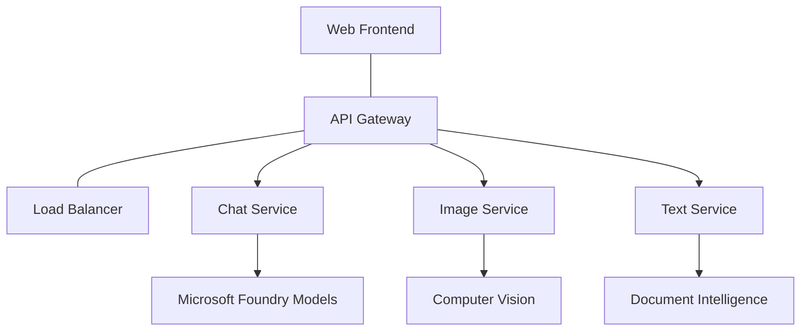

# أفضل الممارسات لأحمال العمل للذكاء الاصطناعي في الإنتاج باستخدام AZD

**التنقل بين الفصول:**
- **📚 الصفحة الرئيسية للدورة**: [AZD للمبتدئين](../../README.md)
- **📖 الفصل الحالي**: الفصل 8 - أنماط الإنتاج والمؤسسات
- **⬅️ الفصل السابق**: [الفصل 7: استكشاف الأخطاء وإصلاحها](../chapter-07-troubleshooting/debugging.md)
- **⬅️ أيضاً مرتبط**: [مختبر ورشة عمل الذكاء الاصطناعي](../chapter-02-ai-development/ai-workshop-lab.md)
- **🎯 إكمال الدورة**: [AZD للمبتدئين](../../README.md)

## نظرة عامة

يشرح هذا الدليل أنماط تصميم الذكاء الاصطناعي للإنتاج باستخدام Azure Developer CLI (AZD). إنه مرجع تصميم، وليس تطبيقاً قابلاً للنشر أو شهادة إنتاج.

**حدود المثال:** ما لم يُقدم صراحة ككامل، تفترض مقتطفات Bicep المعلمات والموارد المشار إليها من قالب يحتوي عليها. إنها تحذف صور/خطط المضيف، الهويات، تعيينات الدور، DNS، المخرجات، والتكاملات المطلوبة الأخرى. مسارات خدمة YAML ونصوص الربط/الاختبار هي ملفات توضيحية لإنشائها في **تطبيقك الخاص**؛ وهي ليست متضمنة في هذه الدورة. استخدم عينة AZD عاملة كأساس، وقم بتجميع البنية التحتية الكاملة، واختبرها في بيئة معزولة قبل الإنتاج.

## التحديات الرئيسية التي يعالجها

تشمل الاهتمامات الشائعة في الإنتاج نشر خدمات متعددة، إدارة الهوية والأسرار، التوسع، التحكم في التكاليف، والمراقبة. لا يتم هنا الادعاء بأي انتشار مقاس.

## أنماط البنية المعمارية للذكاء الاصطناعي في الإنتاج

### النمط 1: بنية ذكاء اصطناعي قائمة على الخدمات الدقيقة

**متى يستخدم**: التطبيقات المعقدة للذكاء الاصطناعي ذات القدرات المتعددة



**تنفيذ AZD**:

```yaml
# azure.yaml
name: enterprise-ai-platform
services:
  web:
    project: ./web
    host: staticwebapp
  api-gateway:
    project: ./api-gateway
    host: containerapp
  chat-service:
    project: ./services/chat
    host: containerapp
  vision-service:
    project: ./services/vision
    host: containerapp
  text-service:
    project: ./services/text
    host: containerapp
```

### النمط 2: معالجة الذكاء الاصطناعي المدفوعة بالأحداث

**متى يستخدم**: المعالجة الدفعية، تحليل الوثائق، سير العمل غير المتزامن

```bicep
// Event Hub for AI processing pipeline
resource eventHub 'Microsoft.EventHub/namespaces@2024-01-01' = {
  name: eventHubNamespaceName
  location: location
  sku: {
    name: 'Standard'
    tier: 'Standard'
    capacity: 1
  }
}

// Service Bus for reliable message processing
resource serviceBus 'Microsoft.ServiceBus/namespaces@2024-01-01' = {
  name: serviceBusNamespaceName
  location: location
  sku: {
    name: 'Premium'
    tier: 'Premium'
    capacity: 1
  }
}

// Function App for processing
resource functionApp 'Microsoft.Web/sites@2023-01-01' = {
  name: functionAppName
  location: location
  kind: 'functionapp,linux'
  properties: {
    siteConfig: {
      appSettings: [
        {
          name: 'FUNCTIONS_EXTENSION_VERSION'
          value: '~4'
        }
        {
          name: 'AZURE_OPENAI_ENDPOINT'
          value: '@Microsoft.KeyVault(VaultName=${keyVault.name};SecretName=openai-endpoint)'
        }
      ]
    }
  }
}
```

هذا ينشئ مقتطفات مساحة الاسم، وليس مراكز أو قوائم انتظار أو اشتراكات أو مشغلات وظيفة. وظيفة قابلة للتشغيل تحتاج أيضًا إلى خطة استضافة، وتكوين وقت التشغيل/التخزين، وهوية مرتبطة، وRBAC، والوصول إلى الشبكة. يجب أن يكون مرجع Key Vault لديه إذن لقراءة السر؛ عنوان نقطة النهاية نفسه ليس بيانات اعتماد.

## التفكير في صحة وكيل الذكاء الاصطناعي

عندما يتعطل تطبيق ويب تقليدي، تكون الأعراض مألوفة: صفحة لا تُحمّل، API تُرجع خطأ، أو فشل نشر. تطبيقات الذكاء الاصطناعي يمكن أن تتعطل بنفس الطرق - لكنها يمكن أن تتصرف بشكل غير صحيح بطرق أدق لا تنتج رسائل خطأ واضحة.

يساعدك هذا القسم على بناء نموذج ذهني لمراقبة أحمال عمل الذكاء الاصطناعي لتعرف أين تبحث عندما لا تبدو الأمور على ما يرام.

### كيف تختلف صحة الوكيل عن صحة التطبيق التقليدي

يمكن أن تحتوي التطبيقات التقليدية على إخفاقات دقيقة في الصحة أيضًا. يضيف وكيل الذكاء الاصطناعي جودة استجابة غير حتمية إلى مخاوف التوفر والصحة المعتادة. فكر في صحة الوكيل على مستويين:

| الطبقة | ما الذي تراقبه | أين تبحث |
|-------|--------------|---------------|
| **صحة البنية التحتية** | هل الخدمة تعمل؟ هل الموارد مُخصصة؟ هل نقاط النهاية متاحة؟ | `azd monitor`، صحة المورد في بوابة Azure، سجلات الحاوية/التطبيق |
| **صحة السلوك** | هل يرد الوكيل بدقة؟ هل الردود في الوقت المناسب؟ هل يتم استدعاء النموذج بشكل صحيح؟ | تتبعات Application Insights، مقاييس تأخير استدعاء النموذج، سجلات جودة الاستجابة |

صحة البنية التحتية مألوفة - هي نفسها لأي تطبيق azd. صحة السلوك هي الطبقة الجديدة التي تقدمها أحمال عمل الذكاء الاصطناعي.

### أين تبحث عندما لا تتصرف تطبيقات الذكاء الاصطناعي كما هو متوقع

إذا لم ينتج تطبيق الذكاء الاصطناعي النتائج المتوقعة، إليك قائمة تحقق مفاهيمية:

1. **ابدأ بالأساسيات.** هل التطبيق يعمل؟ هل يمكنه الوصول إلى التبعيات؟ تحقق من `azd monitor` وصحة المورد كما تفعل مع أي تطبيق.
2. **تحقق من اتصال النموذج.** هل يستدعي تطبيقك نموذج الذكاء الاصطناعي بنجاح؟ المكالمات الفاشلة أو التي انتهى وقتها للنموذج هي السبب الأكثر شيوعًا لمشكلات تطبيقات الذكاء الاصطناعي وستظهر في سجلات التطبيق الخاص بك.
3. **افحص المُدخلات والتأصيل بأمان.** يمكن أن تنتج الإجابات الخاطئة عن الاسترجاع، التعليمات، قيود النموذج، أو تنفيذ الأدوات. استخدم بيانات تشخيص محمية بالوصول والتحرير؛ لا تُفعل تسجيل الحث/الاستجابة العشوائي في الإنتاج.
4. **راجع تأخير الاستجابة.** استدعاءات نموذج الذكاء الاصطناعي أبطأ من استدعاءات API النموذجية. إذا كان التطبيق يبدو بطيئًا، تحقق مما إذا كانت أوقات استجابة النموذج قد زادت — مما قد يشير إلى تقييد، حدود سعة، أو ازدحام على مستوى المنطقة.
5. **راقب إشارات التكاليف.** الارتفاعات غير المتوقعة في استخدام الرموز أو استدعاءات API يمكن أن تشير إلى حلقة، أو مطالبة خاطئة التكوين، أو محاولات مفرطة.

لا تحتاج إلى إتقان أدوات الرصد فورًا. المفتاح هو أن تطبيقات الذكاء الاصطناعي لديها طبقة إضافية من السلوك للمراقبة، ورصد azd المدمج (`azd monitor`) يمنحك نقطة انطلاق للتحقيق في كلا الطبقتين.

---

## أفضل ممارسات الأمان

### 1. نموذج الأمان ثنائي الثقة (Zero-Trust)

**استراتيجية التنفيذ**:
- لا تواصل خدمة-لخدمة بدون مصادقة
- جميع استدعاءات API تستخدم هويات مُدارة
- عزلة الشبكة باستخدام نقاط نهاية خاصة
- ضوابط الوصول بدرجات أقل امتياز

```bicep
// Managed Identity for each service
resource chatServiceIdentity 'Microsoft.ManagedIdentity/userAssignedIdentities@2023-01-31' = {
  name: 'chat-service-identity'
  location: location
}

// Role assignments with minimal permissions
resource openAIUserRole 'Microsoft.Authorization/roleAssignments@2022-04-01' = {
  scope: openAIAccount
  name: guid(openAIAccount.id, chatServiceIdentity.id, '5e0bd9bd-7b93-4f28-af87-19fc36ad61bd')
  properties: {
    roleDefinitionId: subscriptionResourceId('Microsoft.Authorization/roleDefinitions', '5e0bd9bd-7b93-4f28-af87-19fc36ad61bd')
    principalId: chatServiceIdentity.properties.principalId
    principalType: 'ServicePrincipal'
  }
}
```

### 2. إدارة الأسرار بأمان

**نمط تكامل Key Vault**:

```bicep
// Key Vault with proper access policies
resource keyVault 'Microsoft.KeyVault/vaults@2023-02-01' = {
  name: keyVaultName
  location: location
  properties: {
    tenantId: tenant().tenantId
    sku: {
      family: 'A'
      name: 'standard' // Premium is needed for HSM-backed keys, not ordinary secrets
    }
    enableRbacAuthorization: true  // Use RBAC instead of access policies
    enablePurgeProtection: true    // Prevent accidental deletion
    enableSoftDelete: true
    softDeleteRetentionInDays: 90
  }
}

// Optional legacy key-auth alternative; omit when using Entra ID.
resource openAIKeySecret 'Microsoft.KeyVault/vaults/secrets@2023-02-01' = {
  parent: keyVault
  name: 'openai-api-key'
  properties: {
    value: openAIAccount.listKeys().key1
    attributes: {
      enabled: true
    }
  }
}
```

امنح هوية وقت التشغيل `Key Vault Secrets User` على النطاق المناسب واربطها بالمضيف؛ وحده `enableRbacAuthorization` لا يمنح وصولًا. نفضل مصادقة هوية Managed OpenAI مع `disableLocalAuth: true`. السر الاختياري منطقي فقط لحساب مجهز بمفتاح متعمد، والكيان الموّفر يحتاج أيضًا إذنًا لكتابة الأسرار.

### 3. أمان الشبكة

**تكوين نقاط النهاية الخاصة**:

```bicep
// Virtual Network for AI services
resource virtualNetwork 'Microsoft.Network/virtualNetworks@2023-04-01' = {
  name: vnetName
  location: location
  properties: {
    addressSpace: {
      addressPrefixes: ['10.0.0.0/16']
    }
    subnets: [
      {
        name: 'ai-services-subnet'
        properties: {
          addressPrefix: '10.0.1.0/24'
          privateEndpointNetworkPolicies: 'Disabled'
        }
      }
      {
        name: 'app-services-subnet'
        properties: {
          addressPrefix: '10.0.2.0/24'
          delegations: [
            {
              name: 'Microsoft.Web/serverFarms'
              properties: {
                serviceName: 'Microsoft.Web/serverFarms'
              }
            }
          ]
        }
      }
    ]
  }
}

// Private endpoints for all AI services
resource openAIPrivateEndpoint 'Microsoft.Network/privateEndpoints@2023-04-01' = {
  name: '${openAIAccountName}-pe'
  location: location
  properties: {
    subnet: {
      id: virtualNetwork.properties.subnets[0].id
    }
    privateLinkServiceConnections: [
      {
        name: 'openai-connection'
        properties: {
          privateLinkServiceId: openAIAccount.id
          groupIds: ['account']
        }
      }
    ]
  }
}
```

نقاط النهاية الخاصة تحتاج أيضًا إلى مجموعات مناطق DNS خاصة/روابط VNet وتكامل تطبيق VNet. لا تمنع تلقائيًا الوصول العام: قم بإيقاف الوصول الشبكي العام لحساب AI صراحةً بعد التحقق من الاتصال الخاص والوصول للنشر.

## الأداء والتوسع

### 1. استراتيجيات التوسع التلقائي

**التوسع التلقائي لتطبيقات الحاويات**:

```bicep
resource containerApp 'Microsoft.App/containerApps@2023-05-01' = {
  name: containerAppName
  location: location
  properties: {
    configuration: {
      ingress: {
        external: true
        targetPort: 8000
        transport: 'http'
      }
    }
    template: {
      scale: {
        minReplicas: 2  // Always have 2 instances minimum
        maxReplicas: 50 // Scale up to 50 for high load
        rules: [
          {
            name: 'http-scaling'
            http: {
              metadata: {
                concurrentRequests: '20'  // Scale when >20 concurrent requests
              }
            }
          }
          {
            name: 'cpu-scaling'
            custom: {
              type: 'cpu'
              metadata: {
                type: 'Utilization'
                value: '70'  // Scale when CPU >70%
              }
            }
          }
        ]
      }
    }
  }
}
```

### 2. استراتيجيات التخزين المؤقت

**Redis Cache لردود الذكاء الاصطناعي**:

```bicep
// Legacy Azure Cache for Redis example (not recommended for new deployments)
resource redisCache 'Microsoft.Cache/redis@2023-04-01' = {
  name: redisCacheName
  location: location
  properties: {
    sku: {
      name: 'Premium'
      family: 'P'
      capacity: 1
    }
    enableNonSslPort: false
    minimumTlsVersion: '1.2'
    redisConfiguration: {
      'maxmemory-policy': 'allkeys-lru'
    }
    // Sharding distributes data; replication/failover provides availability.
    shardCount: 2
  }
}

// Cache configuration in application
var cacheConnectionString = '${redisCache.properties.hostName}:6380,password=${redisCache.listKeys().primaryKey},ssl=True,abortConnect=False'
```

Azure Cache for Redis Basic/Standard/Premium في [مسار التقاعد](https://learn.microsoft.com/azure/azure-cache-for-redis/retirement-faq). استخدم Azure Managed Redis للتصاميم الجديدة ودليل SKU، الهوية، وتكوين TLS الموثّق، بدلاً من نسخ هذا المورد القديم إلى نظام إنتاج جديد. سطر سلسلة الاتصال هو عنصر نائب غير وظيفي، ليس بيانات اعتماد. قسّم مفاتيح الكاش حسب التفويض، النموذج/التعليمات، وإصدار الاسترجاع، مع انتهاء صلاحية؛ يمكن لذاكرة تخزين مؤقت مشتركة للقراءة فقط أن تكشف بيانات مستخدم آخر.

### 3. موازنة التحميل وإدارة المرور

**بوابة التطبيق مع WAF**:

```bicep
// Application Gateway with Web Application Firewall
resource applicationGateway 'Microsoft.Network/applicationGateways@2023-04-01' = {
  name: appGatewayName
  location: location
  properties: {
    sku: {
      name: 'WAF_v2'
      tier: 'WAF_v2'
      capacity: 2
    }
    webApplicationFirewallConfiguration: {
      enabled: true
      firewallMode: 'Prevention'
      ruleSetType: 'OWASP'
      ruleSetVersion: '3.2'
    }
    // Backend pools for AI services
    backendAddressPools: [
      {
        name: 'ai-services-pool'
        properties: {
          backendAddresses: [
            {
              fqdn: '${containerApp.properties.configuration.ingress.fqdn}'
            }
          ]
        }
      }
    ]
  }
}
```

هذا مورد بوابة جزئي: النشر الحقيقي يحتاج أيضًا إلى تكوين شبكة فرعية/IP للبوابة، عناوين IP وأبواب أمامية، مستمعي وشهادات TLS، إعدادات/مستشعرات HTTP الخلفية، قواعد وأولويات التوجيه، وسياسة WAF مُراجعة. يجب أن تتطابق أسماء المضيف/SNI الخاصة بـ TLS والمصادقة مع خلفية تطبيق الحاوية.

## 💰 تحسين التكلفة

### 1. ضبط حجم المورد المناسب

**التكوينات الخاصة بالبيئة**:

هذه الأسماء هي **مدخلات نموذج مخصص توضيحية**، ليست إعدادات AZD تلقائية. قم بتعيين كل منها إلى `infra/main.parameters.json`/Bicep وتكوين المضيف أولًا. على سبيل المثال، يستخدم نموذج RAG `AZURE_SEARCH_SERVICE_SKU` و `AZURE_OPENAI_CHATGPT_DEPLOYMENT_CAPACITY`، وليس الأسماء العامة أدناه. قدم لذاكرة تطبيق الحاويات وحدة مدعومة مثل `1Gi` في المورد الفعلي. طبق تغييرات البنية التحتية باستخدام `azd up` أو `azd provision`؛ `azd deploy` وحده لا يطبق تغييرات Bicep.

```bash
# Development environment
azd env new development
azd env set AZURE_OPENAI_SKU "S0"
azd env set AZURE_OPENAI_CAPACITY 10
azd env set AZURE_SEARCH_SKU "basic"
azd env set CONTAINER_CPU 0.5
azd env set CONTAINER_MEMORY 1.0

# Production environment  
azd env new production
azd env set AZURE_OPENAI_SKU "S0"
azd env set AZURE_OPENAI_CAPACITY 100
azd env set AZURE_SEARCH_SKU "standard"
azd env set CONTAINER_CPU 2.0
azd env set CONTAINER_MEMORY 4.0
```

### 2. مراقبة التكاليف والميزانيات

```bicep
// Supply the first day of the current UTC month, e.g. 2026-11-01T00:00:00Z.
param budgetStartDate string

// Cost management and budgets
resource budget 'Microsoft.Consumption/budgets@2024-08-01' = {
  name: 'ai-workload-budget'
  properties: {
    timePeriod: {
      startDate: budgetStartDate
    }
    timeGrain: 'Monthly'
    amount: 2000  // In the billing currency, not necessarily USD
    category: 'Cost'
    notifications: {
      warning: {
        enabled: true
        operator: 'GreaterThan'
        threshold: 80
        contactEmails: [
          'finance@company.com'
          'engineering@company.com'
        ]
        contactRoles: [
          'Owner'
          'Contributor'
        ]
      }
      critical: {
        enabled: true
        operator: 'GreaterThan'
        threshold: 95
        contactEmails: [
          'cto@company.com'
        ]
      }
    }
  }
}
```

استبدل المستلمين في المثال وتحقق من النطاق/الأذونات. تنبيهات الميزانية تستخدم بيانات الفواتير المؤجلة ولا تفرض حدًا للإنفاق.

### 3. تحسين استخدام الرموز

**إدارة تكلفة OpenAI**:

هذا مجرد تخمين يعتمد على الحروف لمعاينة واجهة المستخدم، **ليس** مدقق حد رموز النموذج. يجب على الكود الإنتاجي استخدام مُجزئ كلمات مناسب للنموذج المنشور وأخذ تعليمات النظام، مخططات الأدوات، التاريخ، وميزانية الخرج بعين الاعتبار. ارفض رسالة مستخدم كبيرة الحجم بدلاً من تقصيرها بصمت.

```typescript
// Application-level token optimization
class TokenOptimizer {
  private readonly maxTokens = 4000;
  private readonly reserveTokens = 500;
  
  optimizePrompt(userInput: string, context: string): string {
    const availableTokens = this.maxTokens - this.reserveTokens;
    if (this.estimateTokens(userInput) + 8 >= availableTokens) {
      throw new Error("User input exceeds the illustrative prompt budget");
    }
    const estimatedTokens = this.estimateTokens(userInput + context) + 8;
    
    if (estimatedTokens > availableTokens) {
      // Truncate context, not user input
      context = this.truncateContext(context, Math.max(0, availableTokens - this.estimateTokens(userInput) - 8));
    }
    
    return `${context}\n\nUser: ${userInput}`;
  }
  
  private estimateTokens(text: string): number {
    // Rough estimation: 1 token ≈ 4 characters
    return Math.ceil(text.length / 4);
  }

  private truncateContext(text: string, estimatedBudget: number): string {
    return text.slice(0, Math.max(0, estimatedBudget) * 4);
  }
}
```

## المراقبة والرصد

### 1. رؤى التطبيق الشاملة

```bicep
// Application Insights with advanced features
resource applicationInsights 'Microsoft.Insights/components@2020-02-02' = {
  name: applicationInsightsName
  location: location
  kind: 'web'
  properties: {
    Application_Type: 'web'
    WorkspaceResourceId: logAnalyticsWorkspace.id
    SamplingPercentage: 100  // Ingestion setting; review cost and SDK sampling separately
    DisableIpMasking: false  // Retain IP masking
  }
}

// Custom metrics for AI operations
resource aiMetricAlerts 'Microsoft.Insights/metricAlerts@2018-03-01' = {
  name: 'ai-high-error-rate'
  location: 'global'
  properties: {
    description: 'Alert when failed request count exceeds 10 in five minutes'
    severity: 2
    enabled: true
    scopes: [
      applicationInsights.id
    ]
    evaluationFrequency: 'PT1M'
    windowSize: 'PT5M'
    criteria: {
      'odata.type': 'Microsoft.Azure.Monitor.SingleResourceMultipleMetricCriteria'
      allOf: [
        {
          name: 'high-error-rate'
          metricName: 'requests/failed'
          operator: 'GreaterThan'
          threshold: 10
          timeAggregation: 'Count'
        }
      ]
    }
  }
}
```

### 2. مراقبة مخصصة للذكاء الاصطناعي

**لوحات معلومات مخصصة لمقاييس الذكاء الاصطناعي**:

```json
{
  "dashboard": {
    "name": "AI Application Monitoring",
    "tiles": [
      {
        "name": "OpenAI Request Volume",
        "query": "dependencies | where target contains 'openai' | summarize count() by bin(timestamp, 5m)"
      },
      {
        "name": "AI Response Latency",
        "query": "dependencies | where target contains 'openai' | summarize avg(duration) by bin(timestamp, 5m)"
      },
      {
        "name": "Token Usage",
        "query": "customMetrics | where name == 'openai_tokens_used' | summarize sum(value) by bin(timestamp, 1h)"
      },
      {
        "name": "Cost per Hour",
        "query": "customMetrics | where name == 'openai_cost' | summarize sum(value) by bin(timestamp, 1h)"
      }
    ]
  }
}
```

هذا JSON هو مخطط عرفه التطبيق، وليس نموذج لوحة تحكم بوابة Azure قابلة للاستيراد. تتطلب استعلامات الرموز/التكاليف إصدار تلك المقاييس المخصصة بالذات من تطبيقك؛ لم ينشئها AZD. عدّل فلاتر التبعيات لأسماء نقاط النهاية/الفترات الحقيقية لنموذجك.

### 3. فحوصات الصحة ومراقبة وقت التشغيل

```bicep
// Application Insights availability tests
resource availabilityTest 'Microsoft.Insights/webtests@2022-06-15' = {
  name: 'ai-app-availability-test'
  location: location
  tags: {
    'hidden-link:${applicationInsights.id}': 'Resource'
  }
  properties: {
    SyntheticMonitorId: 'ai-app-availability-test'
    Name: 'AI Application Availability Test'
    Description: 'Tests AI application endpoints'
    Enabled: true
    Frequency: 300  // 5 minutes
    Timeout: 120    // 2 minutes
    Kind: 'standard'
    Locations: [
      {
        Id: 'us-east-2-azr'
      }
      {
        Id: 'us-west-2-azr'
      }
    ]
    Request: {
      RequestUrl: 'https://${webApp.properties.defaultHostName}/health'
      HttpVerb: 'GET'
      FollowRedirects: true
      ParseDependentRequests: false
    }
    ValidationRules: {
      ExpectedHttpStatusCode: 200
      SSLCheck: true
      SSLCertRemainingLifetimeCheck: 7
    }
  }
}
```

## التعافي من الكوارث والتوفر العالي

يفترض الاختبار السابق وجود App Service `webApp` وموارد Application Insights. اختبارات التوفر القياسية قابلة للفوترة وتتطلب نقطة نهاية قابلة للوصول؛ التطبيقات الخاصة فقط تحتاج إلى تصميم مراقبة خاصة مناسب. اختبارات تلقيط URL مهملة؛ استخدم [اختبارات التوفر القياسية](https://learn.microsoft.com/azure/azure-monitor/app/availability).

### 1. النشر متعدد المناطق

```yaml
# azure.yaml - Multi-region configuration
name: ai-app-multiregion
services:
  api-primary:
    project: ./api
    host: containerapp
    env:
      AZURE_REGION: eastus
  api-secondary:
    project: ./api
    host: containerapp
    env:
      AZURE_REGION: westus2
```

```bicep
// Separate App Service topology, not the Container Apps declarations above
resource trafficManager 'Microsoft.Network/trafficManagerProfiles@2022-04-01' = {
  name: trafficManagerProfileName
  location: 'global'
  properties: {
    profileStatus: 'Enabled'
    trafficRoutingMethod: 'Priority'
    dnsConfig: {
      relativeName: trafficManagerProfileName
      ttl: 30
    }
    monitorConfig: {
      protocol: 'HTTPS'
      port: 443
      path: '/health'
      intervalInSeconds: 30
      toleratedNumberOfFailures: 3
      timeoutInSeconds: 10
    }
    endpoints: [
      {
        name: 'primary-endpoint'
        type: 'Microsoft.Network/trafficManagerProfiles/azureEndpoints'
        properties: {
          targetResourceId: primaryAppService.id
          endpointStatus: 'Enabled'
          priority: 1
        }
      }
      {
        name: 'secondary-endpoint'
        type: 'Microsoft.Network/trafficManagerProfiles/azureEndpoints'
        properties: {
          targetResourceId: secondaryAppService.id
          endpointStatus: 'Enabled'
          priority: 2
        }
      }
    ]
  }
}
```

متغيرات البيئة لا تختار مواقع الموارد. IaC يجب أن يوفّر مضيفين إقليميين مميزين ويربط كل خدمة بعلامات `resourceName` أو `azd-service-name`. مثال Traffic Manager هو **طوبولوجيا منفصلة لخدمة التطبيق** (`primaryAppService`/`secondaryAppService`)، وليس توجيه لتصريحات Container Apps. يتطلب Container Apps نقطة نهاية خارجية/باب أمامي مكون بشكل مناسب، وتوجيه TLS/النطاق المخصص، وفحوصات الصحة.

### 2. النسخ الاحتياطي واستعادة البيانات

```bicep
// Backup configuration for critical data
resource backupVault 'Microsoft.DataProtection/backupVaults@2023-05-01' = {
  name: backupVaultName
  location: location
  identity: {
    type: 'SystemAssigned'
  }
  properties: {
    storageSettings: [
      {
        datastoreType: 'VaultStore'
        type: 'LocallyRedundant'
      }
    ]
  }
}

```

لا يقوم الخزنة وحدها بعمل نسخ احتياطي. قم بتكوين **سياسة مدعومة محددة لحمولة العمل وحالة النسخ الاحتياطي**، أذونات المصدر، الاحتفاظ، واختبارات الاستعادة باستخدام [مصفوفات دعم نسخ Azure الاحتياطي](https://learn.microsoft.com/azure/backup/backup-support-matrix). لا توجد سياسة نسخ احتياطي Azure عامة لنشر نموذج Azure OpenAI المستضاف. احتفظ بتعاريف نشر البنية التحتية/النموذج في التحكم بالمصدر؛ احمِ المستندات المُحمّلة، بيانات التطبيق، وقطع التخصيص باستخدام ميزات النسخ الاحتياطي/التصدير المدعومة لكل خدمة داعمة. عرّف واختبر صراحةً RPO/RTO.

## التكامل مع DevOps و CI/CD

### 1. سير عمل GitHub Actions

```yaml
# .github/workflows/deploy-ai-app.yml
name: Deploy AI Application

on:
  push:
    branches: [main]
  pull_request:
    branches: [main]

jobs:
  test:
    runs-on: ubuntu-latest
    steps:
      - uses: actions/checkout@v4
      
      - name: Setup Python
        uses: actions/setup-python@v4
        with:
          python-version: '3.11'
          
      - name: Install dependencies
        run: |
          pip install -r requirements.txt
          pip install pytest
          
      - name: Run tests
        run: pytest tests/
        
      - name: AI Safety Tests
        run: |
          python scripts/test_ai_safety.py
          python scripts/validate_prompts.py

```

هذا هو **جزء الاختبار فقط** من سير العمل ويفترض أنك أنشأت `requirements.txt`، `tests/`، ونصوص السلامة الاثنين. أضف وظائف توفير/نشر OIDC المصادق عليها من [تكوين خط أنابيب CI/CD](#cicd-pipeline-configuration)، مع `needs: test`، دَفعة/محفز يدوي موثوق، وبيئات GitHub محمية. لا تنشر كود طلب السحب غير الموثوق به مع بيانات اعتماد السحابة. لا يحتوي المشغل الجديد على بيئة azd محلية محددة؛ قدم مدخلات البيئة/الاشتراك/الموقع واستخدم `azd auth login`، وليس فقط `azure/login`.

### 2. التحقق من صحة البنية التحتية

```bash
# scripts/validate_infrastructure.sh
#!/bin/bash
set -euo pipefail

echo "Validating AI infrastructure deployment..."

# Requires Azure CLI login and the resource group selected explicitly.
: "${AZURE_RESOURCE_GROUP:?Set AZURE_RESOURCE_GROUP}"
: "${AZURE_OPENAI_NAME:?Set AZURE_OPENAI_NAME}"
: "${AZURE_OPENAI_CHAT_DEPLOYMENT:?Set the actual deployment name}"

# A successful empty list is not proof that resources exist.
types=("Microsoft.CognitiveServices/accounts" "Microsoft.Search/searchServices"
       "Microsoft.Storage/storageAccounts" "Microsoft.KeyVault/vaults")
for resource_type in "${types[@]}"; do
    count=$(az resource list --resource-group "$AZURE_RESOURCE_GROUP" \
        --resource-type "$resource_type" --query "length(@)" -o tsv)
    if [[ "$count" -lt 1 ]]; then
        echo "ERROR: No $resource_type found in $AZURE_RESOURCE_GROUP"
        exit 1
    fi
done

# Validate OpenAI model deployments
echo "Validating OpenAI model deployments..."
state=$(az cognitiveservices account deployment show \
  --name "$AZURE_OPENAI_NAME" --resource-group "$AZURE_RESOURCE_GROUP" \
  --deployment-name "$AZURE_OPENAI_CHAT_DEPLOYMENT" \
  --query "properties.provisioningState" -o tsv)
if [[ "$state" != "Succeeded" ]]; then
    echo "ERROR: Required model deployment is not provisioned successfully"
    exit 1
fi

echo "Infrastructure validation completed successfully!"
```

المتوقع: خروج صفر ورسالة الانتهاء فقط عندما توجد جميع الأنواع المتوقعة ويتم توفير نشر النموذج المسمى. هذا يفحص حالة الجرد/التوفير، **ليس** صحة المورد، الطوبولوجيا الدقيقة، RBAC، الوصول الشبكي، أو سلوك النموذج. عدّل الأنواع المتوقعة لتناسب عمليتك المعمارية، ثم أجرِ اختبار جاهزية تطبيق مصادق عليه منفصل.

## قائمة التحقق للاستعداد للإنتاج

### الأمان ✅
- [ ] جميع الخدمات تستخدم هويات مُدارة
- [ ] الأسرار مخزنة في Key Vault
- [ ] تم تكوين نقاط النهاية الخاصة
- [ ] تم تنفيذ مجموعات أمان الشبكة
- [ ] RBAC مع أقل امتياز
- [ ] تم تفعيل WAF على نقاط النهاية العامة

### الأداء ✅
- [ ] تم تكوين التوسع التلقائي
- [ ] تم تنفيذ التخزين المؤقت
- [ ] تم إعداد موازنة التحميل
- [ ] CDN للمحتوى الثابت
- [ ] تجميع اتصال قاعدة البيانات
- [ ] تحسين استخدام الرموز

### المراقبة ✅
- [ ] تم تكوين Application Insights
- [ ] تم تعريف مقاييس مخصصة
- [ ] تم إعداد قواعد التنبيه
- [ ] تم إنشاء لوحة البيانات
- [ ] تم تنفيذ فحوصات الصحة
- [ ] سياسات احتفاظ السجلات

### الموثوقية ✅
- [ ] نشر متعدد المناطق
- [ ] خطة النسخ الاحتياطي والاستعادة
- [ ] تنفيذ قواطع الدارات
- [ ] تكوين سياسات الإعادة المحاولة
- [ ] التدهور التدريجي بأناقة
- [ ] نقاط نهاية فحوصات الصحة

### إدارة التكلفة ✅
- [ ] تم تكوين تنبيهات الميزانية
- [ ] ضبط حجم المورد المناسب
- [ ] تطبيق خصومات التطوير/الاختبار
- [ ] شراء حالات محجوزة
- [ ] لوحة مراقبة التكاليف
- [ ] مراجعات تكاليف منتظمة

### الامتثال ✅
- [ ] تلبية متطلبات إقامة البيانات
- [ ] تفعيل تسجيل التدقيق
- [ ] تطبيق سياسات الامتثال
- [ ] تنفيذ خطوط الأساس الأمنية
- [ ] تقييمات أمنية منتظمة
- [ ] خطة الاستجابة للحوادث

## معايير الأداء

### أهداف الإنتاج التوضيحية

هذه هي أهداف مستوى الخدمة (SLO) لتفاوض واختبار التحميل، ليست معايير مقاسة أو ضمانات. تعتمد زمن الاستجابة على طول النموذج/الإخراج؛ تعتمد الإنفاق الشهري على الرموز على حركة المرور والأسعار، وليس على عدد الرموز فقط.

| المقياس | الهدف | المراقبة |
|--------|--------|------------|
| **زمن الاستجابة** | أقل من ثانيتين | Application Insights |
| **التوفر** | 99.9% | مراقبة وقت التشغيل |
| **معدل الخطأ** | أقل من 0.1% | سجلات التطبيق |
| **الإنفاق على النموذج** | أقل من 500 دولار/شهر (ميزانية مثال) | إدارة التكاليف |
| **المستخدمون المتزامنون** | 1000+ | اختبار التحميل |
| **زمن الاسترداد** | < ساعة واحدة | اختبارات استرداد الكوارث |

### اختبار الحمل

التالي هو مخطط واجهة لسكريبت اختبار حمولة **يجب عليك تنفيذه**؛ هذا المستودع لا يوفر `scripts/load_test.py`. حدد حمولة الطلب، المصادقة، عبء العمل التمثيلي، تأكيدات النسبة المئوية للزمن/الأخطاء، وحد حد الإنفاق في أداة اختبار الحمل التي تختارها قبل تشغيلها:

```bash
# Load testing script for AI applications
python scripts/load_test.py \
  --endpoint https://your-ai-app.azurewebsites.net \
  --concurrent-users 100 \
  --duration 300 \
  --ramp-up 60
```

## 🤝 أفضل ممارسات المجتمع

بناءً على ملاحظات مجتمع Microsoft Foundry في Discord:

### أهم التوصيات من المجتمع:

1. **ابدأ صغيرًا، ثم زد تدريجياً**: ابدأ بـ SKUs الأساسية وزد بناءً على الاستخدام الفعلي
2. **راقب كل شيء**: قم بضبط المراقبة الشاملة من اليوم الأول
3. **آتم الأمان**: استخدم البنية التحتية ككود لأمان متسق
4. **اختبر بدقة**: ضمّن اختبارات مخصصة للذكاء الاصطناعي في خط الأنابيب الخاص بك
5. **خطط للتكاليف**: راقب استخدام الرموز وحدد تنبيهات الميزانية مبكرًا

### الأخطاء الشائعة التي يجب تجنبها:

- ❌ ترميز مفاتيح API مباشرة في الكود
- ❌ عدم ضبط مراقبة مناسبة
- ❌ تجاهل تحسين التكاليف
- ❌ عدم اختبار سيناريوهات الفشل
- ❌ النشر بدون فحوصات صحة

## أوامر AZD AI وملحقاتها

يحتوي AZD على مجموعة متزايدة من أوامر الذكاء الاصطناعي المحددة وملحقات تسهل تدفقات العمل الإنتاجية للذكاء الاصطناعي. هذه الأدوات تسد الفجوة بين التطوير المحلي والنشر الإنتاجي لأعباء عمل الذكاء الاصطناعي.

> **تحديث Foundry GA (2026-11-09):** وصل حزمة `microsoft.foundry` إلى **1.0 / التوفر العام** في [5 نوفمبر 2026](https://devblogs.microsoft.com/azure-sdk/microsoft-foundry-azure-developer-cli-ga/). استخدم **`azd >= 1.37.0`** لهذا التدفق العمل. يتم الاحتفاظ بمراجعة `azd 1.37.2` السابقة، وكل من الوكلاء beta.23، والتقييمات beta.2 أدناه كتاريخ للهجرة، وليس كإصدار حزمة حالي. هذه مراجعة وثائق / مصدر، وليست تحقق نشر مباشر أو تأكيد بأن كل ملحق اختياري، API، أو ميزة معاينة متاحة بشكل عام.

### ملحقات AZD للذكاء الاصطناعي

تستخدم AZD نظام ملحقات لإضافة قدرات خاصة بالذكاء الاصطناعي. قم بتثبيت وإدارة الملحقات مع:

```bash
# List all available extensions (including AI)
azd extension list

# Inspect installed versions
azd version
azd ext list --installed

# Install the GA Foundry bundle
azd ext install microsoft.foundry

# Install the separate Foundry evaluations extension
azd extension install azure.ai.evaluations

# Install the fine-tuning extension
azd extension install azure.ai.finetune

# Install the custom models extension
azd extension install azure.ai.models

# Upgrade the Foundry bundle
azd ext upgrade microsoft.foundry
```

**الملحقات المتاحة للذكاء الاصطناعي:**

| الملحق | الغرض | الحالة |
|-----------|---------|--------|
| `microsoft.foundry` | حزمة ميتا تثبت السبع ملحقات الأساسية أدناه؛ لا تملك مجموعة أوامر خاصة بها | حزمة GA 1.0 |
| `azure.ai.agents` | `azd ai agent`: إعداد الوكيل والتنفيذ المحلي والعمليات | مضمنة؛ إصدارات مستقلة |
| `azure.ai.connections` | `azd ai connection`: اتصالات المشروع | مضمنة؛ إصدارات مستقلة |
| `azure.ai.inspector` | `azd ai inspector`: واجهة مفتش الوكيل المحلية | مضمنة؛ إصدارات مستقلة |
| `azure.ai.projects` | `azd ai project`: موارد المشروع ونشر النماذج | مضمنة؛ إصدارات مستقلة |
| `azure.ai.routines` | `azd ai routine`: الجداول الزمنية والمحفزات | مضمنة؛ إصدارات مستقلة |
| `azure.ai.skills` | `azd ai skill`: إرشادات السلوك القابلة لإعادة الاستخدام | مضمنة؛ إصدارات مستقلة |
| `azure.ai.toolboxes` | `azd ai toolbox`: مجموعات الأدوات المعنونة بالإصدارات | مضمنة؛ إصدارات مستقلة |
| `azure.ai.evaluations` | مجموعات بيانات التقييم، والعناصر المقيمة، ومجموعات التقييم، والتنفيذات | تثبيت/إصدار منفصل |
| `azure.ai.dataset` | تسجيل مجموعة البيانات والعنونة | تثبيت/إصدار منفصل |
| `azure.ai.finetune` | ضبط النموذج Foundry | تثبيت/إصدار منفصل |
| `azure.ai.models` | نماذج مخصصة Foundry | تثبيت/إصدار منفصل |

لا يزال تثبيت `azure.ai.agents` بشكل فردي مدعومًا ويثبت تبعياته؛ الحزمة هي الافتراضية للدورة لسيناريو GA. إصدار الحزمة GA ليس ضمانًا لحالة إصدار للميزات الاختيارية لمكوناتها. راجع [تغليف الملحقات والتحقق](https://learn.microsoft.com/azure/foundry/agents/how-to/install-cli-foundry-extensions) وفحص مساعدة الأوامر قبل استخدامها.

> قم بترقية CLI الأساسية أولاً بـ `azd update` أو باستخدام [طريقة التثبيت/التحديث المناسبة](https://learn.microsoft.com/azure/developer/azure-developer-cli/install-azd)، ثم نفذ `azd ext upgrade microsoft.foundry`. حدّث التقييمات المثبتة بشكل منفصل حسب الحاجة بـ `azd ext upgrade azure.ai.evaluations`. لا يوجد أمر `azd upgrade` أساسي. قم بتسجيل ومراجعة الملحقات التي لها إصدارات مستقلة في التشغيل الآلي للإنتاج؛ الترقية لا تهاجر تلقائيًا الإعداد القديم.

### تغييرات وإصلاحات الإصدار الأخيرة

| الإصدار | ما يتغير لهذه الدورة |
|---------|------------------------------|
| `microsoft.foundry` 1.0 GA (2026-11-05) | الافتراضي هو حزمة السبع ملحقات، احتفظ بإعدادات الوكيل/النشر في `azure.yaml`، اختبر محلياً باستخدام مفتش الوكيل وحمّل الكود للبناء عن بعد في Foundry. ثبت التقييمات بشكل منفصل وأعد تثبيت الملحقات المطلوبة على مشغلات CI. |
| `azd 1.37.0` | يضيف APIs معاينة نشر مستقرة ويصلح إعادة كتابة إعدادات `azure.yaml` غير المتعلقة عند تعديل الملحقات. |
| `azd 1.37.1` | يصلح انتشار Ctrl+C عبر الملحقات ويميز الإلغاء/انتهاء المهلة عن الفشل العام. |
| `azd 1.37.2` | يحسن تحقق التزويد: التحذيرات الحرجة افتراضياً على **لا**، يفشل بدون تأكيد في التشغيلات غير المراقبة، ويتخطى الإلغاء حلقات ما بعد التزويد. يصلح أيضًا قيم البيئة غير المحلولة في قوائم رفض تكوينات نشر الأكوام عند تمكين ميزة ألفا هذه. |
| وكلاء `beta.22` | يهاجر التقييم إلى `azd ai eval`، يغير التحسين إلى API GA v1، يتطلب جمع `toolboxes`، ويفصل المتحكم في الأدوات المدارة، الصوت، واختيار المعاينة طويلة التشغيل. يصلح اختيار النموذج الخاص بالبيئة ومصادقة صندوق الأدوات. |
| وكلاء `beta.23` | يكشف `init --harness`؛ يصلح إخراج إجابات A2A 0.3، مسارات/وحدات الوكيل الموجهة غير الصالحة عبر طبقات البنية التحتية، تشخيصات انتهاء مهلة التفعيل، وتحذيرات RBAC المطور المحتفظ بها. |
| تقييمات `beta.2` | تتطلب تركيب تقييم camelCase، تضيف تأليف المحادثات الثابتة/المحاكاة ومصادر الملفات المحلية الصريحة، وتصلح هوية مجموعة البيانات / إدارة الإصدار، حسابات بوابات الجودة، وتشخيصات تشغيل فاشلة. |

انتهاء مهلة تفعيل الوكيل لا يُثبت فشل النشر: افحص النسخة التي تمت محاولتها وحالتها قبل إعادة المحاولة. يمكن أن تبقى تحذيرات RBAC المطور حتى لو نجح التزويد؛ حل نقص الوصول قبل الاستدعاء كذاك المطور.

الصفوف البيتا أعلاه تصف إصلاحات سابقة وحدود الهجرة، وليست مطلبًا لتثبيت المشاريع الجديدة على تلك الإصدارات.

المصادر: [إعلان Foundry GA](https://devblogs.microsoft.com/azure-sdk/microsoft-foundry-azure-developer-cli-ga/)، [إصدارات AZD](https://github.com/Azure/azure-dev/releases)، [إصدار وكلاء beta.23](https://github.com/Azure/azure-dev/releases/tag/azd-ext-azure-ai-agents_1.0.0-beta.23)، [هجرة وكلاء beta.22](https://github.com/Azure/azure-dev/releases/tag/azd-ext-azure-ai-agents_1.0.0-beta.22)، و[إصدار تقييمات beta.2](https://github.com/Azure/azure-dev/releases/tag/azd-ext-azure-ai-evaluations_1.0.0-beta.2).

**ما هي ملحقات `skills` و `connections` المجمعة؟**

يتم تثبيتها مع الحزمة الأساسية لكنها تخدم أغراضًا مختلفة:

- **`azure.ai.skills`** — **مهارة** تحزم إرشادات سلوك قابلة لإعادة الاستخدام للوكلاء. شارك تعليمات مراجعة عبر الوكلاء بدلاً من نسخها. المهارة نفسها لا تنفذ أداة ولا تمنح وصولاً إلى البيانات؛ استخدم صناديق الأدوات وكود التطبيق للتنفيذ.
- **`azure.ai.connections`** — **اتصال** هو رابط مدار من مشروع Foundry الخاص بك إلى مورّد خارجي يحتاجه وكلاؤك—مصدر بيانات (كالـ Azure AI Search)، نقطة نهاية أداة، أو خدمة أخرى. تركز الاتصالات *مكان* و *كيفية* وصول الوكلاء إلى البيانات، فتعيش بيانات الاعتماد ونقاط النهاية في مكان موحّد بدلًا من التشتت عبر الكود.

ليس من الضروري تكوين كل قدرة من القدرات المجمعة لنشر وكيلك الأول. استخدم المهارات حين يتشارك الوكلاء إرشادات السلوك، والاتصالات حين يتشاركون الموارد الخارجية.

### تهيئة مشاريع الوكلاء بـ `azd ai agent init`

أمر `azd ai agent init` ينشئ هيكل مشروع وكيل Microsoft Foundry. للحصول على مثال تنفيذ قابل للتشغيل يضم بايثون 3.13+ وuv الحالي، اتبع [دليل الوكيل المستضاف GA](../chapter-02-ai-development/microsoft-foundry-integration.md#hosted-agent-walkthrough-ga). أوامر الأسفل توضح تبني **قالب مشروعك** الحالي `azure.yaml`؛ القالب المحلي المسمي هذا غير مزود بالدورة:

```bash
# Initialize a new agent project from a local project template
azd ai agent init --template ./templates/support-agent/azure.yaml

# Initialize and target a specific Foundry project
azd ai agent init --template ./templates/support-agent/azure.yaml --project-id <foundry-project-id>

# Adopt the template into a different directory
azd ai agent init --template ./templates/support-agent/azure.yaml --src ./agents/my-agent
```

**أعلام رئيسية:**

| العلم | الوصف |
|------|-------------|
| `-t, --template` | مسار أو URI جيتهاب معتمد لوثيقة مشروع `azure.yaml` |
| `-p, --project-id` | معرف مشروع Microsoft Foundry موجود لبيئة azd الخاصة بك |
| `-s, --src` | دليل المصدر للوكلاء المُولدَين، أو دليل الهدف عند تبني مشروع |
| `--deploy-mode code` | رفع المصدر للبناء عن بعد في Foundry بدل بناء حاوية محلية |
| `--model-deployment` | إعادة استخدام نشر نموذج مسمى موجود أثناء التهيئة |
| `--kind` | تهيئة وكيل `hosted`، `prompt`، أو المعاينة `prompt-voice` |
| `--harness` | هيكل تنفيذ اختياري لـ `--kind prompt`؛ يتطلب اختياره المسبق |
| `-e, --environment` | بيئة azd المراد استخدامها |

`--manifest`/`-m` هو اسم مستعار مهجور لـ `--template`/`-t`؛ إعادة تسمية العلم لا تحول مانيڤست قديم لوثيقة مشروع حالية. `--host containerapp` ليس علم تهيئة وكيل حالي. لتطبيق عادي Container Apps، استخدم `azd init --template` بقالب يعلن `host: containerapp`.

لمشروع قائم به خدمة `azure.ai.project` واحدة فقط، يضيف `azd ai agent add support-agent --file ./agents/support-agent.yaml` تعريف وكيل مباشر أو يحدثه بدون توفير أو نشر. أوامر وقت التشغيل ترفض تعاريف `agent.yaml`/AgentManifest الصريحة القديمة وتعريف خدمات متداخلة `config:`؛ هاجرها إلى خدمة `azure.ai.agent` الحالية. عند طباعة تهيئة `cd` للخطوة التالية، نفذها قبل `azd up`: التهيئة لا تغير مجلد الشل الخاص بك.

**نصيحة للإنتاج**: استخدم `--project-id` للاتصال مباشرة بمشروع Foundry موجود، مع إبقاء كود وكيلك وموارد السحابة مرتبطة من البداية.

#### ميزات معاينة اختيارية

الهيكل المدَار، والصوت، والاستدعاء طويل الأمد معطلة بشكل مستقل افتراضيًا. اضبط فقط المفتاح الخاص بالميزة التي تحتاجها في **بيئة عملية الشل/CI**، وليس باستخدام `azd env set`:

| الميزة | متغير بيئة العملية |
|---------|------------------------------|
| الهيكل المدَار (`init --kind prompt --harness ...`) | `AZD_ALPHA_ENABLE_AGENTS_MANAGED_HARNESS=true` |
| الصوت (`init --kind prompt-voice`) | `AZD_ALPHA_ENABLE_AGENTS_VOICE=true` |
| الاستدعاء طويل الأمد | `AZD_ALPHA_ENABLE_AGENTS_LONG_RUNNING=true` |

على سبيل المثال، استخدم `export AZD_ALPHA_ENABLE_AGENTS_MANAGED_HARNESS=true` في Bash أو `$env:AZD_ALPHA_ENABLE_AGENTS_MANAGED_HARNESS = "true"` في PowerShell قبل تشغيل الأمر المناسب. مفتاح واحد لا يشغّل المفاتيح الأخرى. راجع [README الوكلاء الصادر](https://github.com/Azure/azure-dev/blob/azd-ext-azure-ai-agents_1.0.0-beta.23/cli/azd/extensions/azure.ai.agents/README.md) لجميع مفاتيح المعاينة والقيود.

### إدارة دورة حياة الوكيل

ملحق `azure.ai.agents` في الحزمة يدعم الاختبار المحلي وعمليات الوكلاء المنشورين. ثبت `azure.ai.evaluations` بشكل منفصل لقياس الجودة:

```bash
# Start the local agent and Agent Inspector (leave running)
azd ai agent run

# From a second terminal in the project directory
azd ai agent invoke --local "Explain how this agent is deployed."

# Invoke a deployed agent and view server response timing
# (total latency and time to first byte)
azd ai agent invoke

# Show the live endpoint configuration before changing it
azd ai agent endpoint show

# Download the deployed source of a code-based hosted agent
# (with SHA-256 verification)
azd ai agent code download

# Delete a hosted agent and all of its versions
# (--force terminates active sessions)
azd ai agent delete --force
```

**لمحة عن دورة الحياة:**

| المرحلة | الأمر | استخدام الإنتاج |
|-------|---------|----------------|
| اختبار محلي | `azd ai agent run`، ثم `azd ai agent invoke --local "Test prompt"` | فحص الطلبات والردود قبل النشر؛ مكالمات نموذج Azure ما زالت تفرض رسومًا |
| النشر | `azd deploy` | في وضع الكود، بناء المصدر المرفوع عن بعد في Foundry |
| الاختبار | `azd ai agent invoke` | تحقق من الردود وقيس زمن الاستجابة قبل الإصدار |
| التشخيص | `azd ai agent doctor`، `azd ai agent monitor --follow` | فحص الإعداد/الأذونات وبث سجلات الوكيل |
| الفحص | `azd ai agent endpoint show` | مراجعة مصادقة/إعداد نهاية النقطة؛ اكتشاف تغييرات مدمرة مبكرًا |
| القياس | `azd ai eval init`، `generate`، `run start` | تعريف، نشر، وتنفيذ تقييمات قابلة للتكرار |
| التحسين | `azd ai agent optimize --eval <evaluation-name> --optimize-model <optimizer-deployment>` | إعادة استخدام تقييم متوافق لتحسين الوكيل |
| الاسترداد | `azd ai agent code download` | استرداد المصدر المنشور الدقيق للمراجعة/التراجع |
| التقاعد | `azd ai agent delete --force` | إيقاف وكيل وإصداراته بشكل نظيف |

> شغّل `azd ai agent --help` لفحص الأوامر في نسختك المثبتة. الحزمة GA؛ ميزات المعاينة الخاضعة للتحكم المستقل ما زالت اختيارية. قبل التنظيف، فرّق بين حذف الوكيل وحذف المشروع: `azd down` يحذف مجموعة موارد مشروع تم إنشاؤه حديثًا، لكنه يترك موارد المشاريع المعاد استخدامها في مكانها. اتبع [إرشادات التنظيف](../chapter-02-ai-development/microsoft-foundry-integration.md#7-clean-up-deliberately).

`endpoint show` يدعم وكلاء مستضافين، ومطالبات، وصوت، لكن تحديثات النهاية خاصة بالمستضاف فقط؛ وكلاء سير العمل غير مدعومين. تحميل الكود ومثال تقاعد الوكيل المستضاف أعلاه ليست عمليات عامة لكل نوع وكيل.

#### هجرة التقييم والفحوصات النوعية

بدءًا من وكلاء **1.0.0-beta.22 (2026-10-23)**، توفر أوامر `azd ai agent eval` القديمة إرشادات هجرة بدلاً من تدفق عمل التقييم القديم. لا تنسخ أمثلة `eval generate --dataset ...` القديمة: صار التقييم الآن تحت **`azd ai eval`**.

في مشروع وكيل مُهيأ، قم بالمصادقة باستخدام `azd auth login`، أكد البيئة/مشروع Foundry المحدد، وقم بتثبيت `azure.ai.evaluations`. مطلوب نشر نموذج الحكم للتسجيل بناءً على النموذج؛ يمكن أن تتطلب المحاكاة التوليدية والمحادثة اختيارات نماذج خاصة بها وتتحمل رسومًا إضافية.

```bash
# Generate a draft rubric and dataset from the deployed agent
azd ai eval generate

# After reviewing the assets, configure a named evaluation
azd ai eval init --name quality

# Review generated files, then register datasets, evaluators, and eval groups
azd up

# Start an evaluation and wait for its results
azd ai eval run start --eval quality --wait

# Inspect runs and available test-case output
azd ai eval run list
azd ai eval run show <run-id>
azd ai eval run output list <run-id>
```

في مثال إعلان GA، اختر **Dataset and evaluator** و **Turn** أثناء التوليد، ثم اختر تلك الأصول التي تمت مراجعتها ونموذج الحكم أثناء التهيئة. اتبع الخطوات التالية المطبوعة بدلاً من افتراض أن الأصول المولدة مسجلة بالفعل. يمكنك أيضًا التهيئة مقابل مجموعة بيانات/معيار مراجعة موجودة بدون توليد بيانات جديدة. عادةً ما تكون تكوينات التقييم موجودة في `evals/azure.eval.yaml`، المشار إليها بواسطة خدمة `azure.ai.eval` في `azure.yaml`. المفاتيح تكون بصيغة **camelCase** (`evaluationLevel`، `maxSamples`، `initializationParameters`، `dataMapping`)؛ يتم رفض مفاتيح التكوين القديمة بصيغة snake_case. تُحل المسارات داخل تكوين مشار إليه نسبةً إلى هذا الملف، وليس إلى جذر المستودع.

لتقييمات المحادثة، اختر **static** لتسجيل المحاضر المكتملة دون استدعاء وكيل، أو **simulation** لتوليد المحادثات من بذور السيناريو. تحتاج المحاكاة إلى هدف وكيل، ونموذج محاكاة، واختيار نموذج حكم منفصل. للأوامر غير الموجهة، قدم المدخلات التي يسردها `azd ai eval init --help` و`azd ai eval generate --help`؛ لا تفترض أن نموذج التوليد هو نفسه نموذج الحكم أو المحاكاة.

بالنسبة لـ CI، قم بتكوين سياسة جودة صريحة باستخدام `azd ai eval run start --help` (`--fail-on`) وتعامَل مع خروج مضيف غير صفري كفشل. لا يعني التشغيل المكتمل تلقائيًا اجتياز الجودة. راجع الصفوف التي فشلت أو أخطأت والتشخيصات؛ الأعداد المفقودة أو غير المتناسقة للنتائج ليست دليلًا على النجاح. تحتفظ مجموعات البيانات المسجلة بهويتها/إصدار خدمتها؛ لا يمكن لـ `--max-samples` تقطيع مجموعة بيانات مسجلة. انشر مجموعة بيانات أصغر عمدًا، أو استخدم مصدر ملف محلي مدعوم.

```bash
# Example CI policy: at least 90% of all test cases must pass
azd ai eval run start --eval quality --wait --no-prompt --fail-on "pass-rate=0.9"
```

يستخدم بوابة معدل النجاح اختبار الحالات التي اجتازت مقسومة على إجمالي الحالات؛ تحسب الصفوف الفاشلة أو التي حدث بها خطأ أو التي تم تخطيها ضدها. لا تدمج بوابة مع `--no-wait`، الذي يرجع قبل توفر الحكم.

#### ترحيل تكوين التحسين

يستخدم التحسين الآن واجهة برمجة تطبيقات GA v1. لإعادة استخدام تقييم **مستوى الدوران، مدعوم من مجموعة بيانات** متوافق من سير العمل الجديد:

```bash
# Replace placeholders with the evaluation name and optimizer model deployment
azd ai agent optimize --eval-config ./evals/azure.eval.yaml --eval <evaluation-name> --optimize-model <optimizer-deployment>
```

يختار `--eval` تقييمًا؛ يختار `--eval-config` ملف تكوينه (بما في ذلك التعريفات المدعومة من ملف). بدلاً من ذلك، يأخذ `--config` **طلب تحسين مستقل لواجهة برمجة التطبيقات** بصيغة YAML أو JSON. لا تمرر `eval.yaml` لوكيل قديم أو `azure.eval.yaml` الجديد إلى `--config`، ولا تدمج `--config` مع `--eval`/`--eval-config`. التقييمات المستندة إلى المحادثة أو التتبع أو المحاكاة ليست قابلة للاستبدال بمفتاح التحسين المدعوم من مجموعة البيانات؛ استخدم صيغة طلب التحسين المدعومة لتلك السيناريوهات. راجع المرشحين قبل تطبيقهم أو نشرهم.

انظر [مرجع التقييمات للإصدار المراجع](https://github.com/Azure/azure-dev/blob/azd-ext-azure-ai-evaluations_1.0.0-beta.2/cli/azd/extensions/azure.ai.evaluations/README.md) و [مصدر أمر التحسين للإصدار المراجع](https://github.com/Azure/azure-dev/blob/azd-ext-azure-ai-agents_1.0.0-beta.23/cli/azd/extensions/azure.ai.agents/internal/cmd/optimize.go) للحصول على الخيارات الدقيقة.

#### معاينة نشر وكيل مستضاف للقراءة فقط

لبيئة مرتبطة بـ Foundry موجودة بخدمة `azure.ai.agent` موحدة من `kind: hosted`، قارن التكوين المدعوم قبل النشر:

```bash
azd deploy <service-name> --preview --no-prompt
```

لا ينشر هذا المعاين الوكيل. ليس اختلافًا كاملاً في البنية التحتية/الأمان: وكلاء الموجه/الصوت/سير العمل، تخطيطات التكوين القديمة، وبعض الإعدادات المستضيفة خارج نطاقه. نتيجة `unknown` ليست موافقة على النشر. لا يوجد أمر `azd ai agent deploy` مستقل أو أمر `--dry-run` للوكيل؛ استخدم سير نشر الجوهر.

### بروتوكول سياق النموذج (MCP) مع `azd mcp`

يتضمن AZD دعم خادم MCP مدمج (ألفا)، مما يمكّن وكلاء وأدوات الذكاء الاصطناعي من التفاعل مع موارد Azure الخاصة بك من خلال بروتوكول موحد:

```bash
# Start the MCP server for your project
azd mcp start

# Review current Copilot consent rules for tool execution
azd copilot consent list
```

يعرض خادم MCP سياق مشروع azd الخاص بك — البيئات والخدمات وموارد Azure — لأدوات التطوير المدعومة بالذكاء الاصطناعي. وهذا يمكّن:

- **النشر المدعوم بالذكاء الاصطناعي**: دع وكلاء الترميز يستعلمون عن حالة مشروعك ويشغلون عمليات النشر
- **اكتشاف الموارد**: يمكن لأدوات الذكاء الاصطناعي اكتشاف الموارد المستخدمة في مشروع Azure الخاص بك
- **إدارة البيئة**: يمكن للوكلاء التنقل بين بيئات التطوير/الاختبار/الإنتاج

### توليد البنية التحتية مع `azd infra generate`

لأحمال عمل الذكاء الاصطناعي الإنتاجية، يمكنك توليد وتخصيص البنية التحتية ككود بدلاً من الاعتماد على التوفير التلقائي:

```bash
# Generate supported infrastructure for this project type
azd infra generate
```

يعتمد الدعم على المشروع/المضيف والمزودين المثبتين؛ هذا ليس أمرًا عامًا للهندسة العكسية لموارد Azure تعسفية أو وعدًا بتوليد Bicep وTerraform معًا. شغّل `azd infra generate --help` وتفقد الصيغة المنتجة. حيثما يدعم، كتابة IaC إلى القرص تتيح لك:
- مراجعة وتدقيق البنية التحتية قبل النشر
- إضافة سياسات أمان مخصصة (قواعد الشبكة، نقاط النهاية الخاصة)
- التكامل مع عمليات مراجعة IaC الحالية
- التحكم في إصدارات تغييرات البنية التحتية بشكل منفصل عن كود التطبيق

### خطافات دورة حياة الإنتاج

تمكنك خطافات AZD من حقن منطق مخصص في كل مرحلة من مراحل دورة حياة النشر — أمر حاسم لأحمال عمل الذكاء الاصطناعي الإنتاجية:

```yaml
# azure.yaml - Production hooks example
name: ai-production-app
hooks:
  preprovision:
    shell: sh
    run: scripts/validate-quotas.sh    # Check AI model quota before provisioning
  postprovision:
    shell: sh
    run: scripts/verify-networking.sh  # Verify IaC-provisioned private connectivity
  predeploy:
    shell: sh
    run: scripts/run-ai-safety-tests.sh  # Run prompt safety checks
  postdeploy:
    shell: sh
    run: scripts/smoke-test.sh           # Verify agent responses post-deploy
services:
  agent-api:
    project: ./src/agent
    host: containerapp
    hooks:
      predeploy:
        shell: sh
        run: scripts/validate-model-access.sh  # Per-service hook
```

```bash
# Run a specific hook manually during development
azd hooks run predeploy
```

**خطافات الإنتاج الموصى بها لأحمال عمل الذكاء الاصطناعي:**

| الخطاف | حالة الاستخدام |
|------|----------|
| `preprovision` | التحقق من حصص الاشتراك لسعة نموذج الذكاء الاصطناعي |
| `postprovision` | التحقق من الاتصال الخاص والمخرجات المطلوبة للموارد |
| `predeploy` | إجراء اختبارات السلامة للذكاء الاصطناعي، التحقق من نماذج الموجهات |
| `postdeploy` | اختبار استجابات الوكيل، التحقق من اتصال النموذج |

### تكوين خط أنابيب CI/CD

تحقق أولاً من المشروع محليًا وأكمل `azd up` ناجحة. ثم استخدم `azd pipeline config` لربطها بـ GitHub Actions أو Azure Pipelines مع مصادقة Azure الآمنة:

```bash
# Configure CI/CD pipeline (interactive)
azd pipeline config

# Configure with a specific provider
azd pipeline config --provider github
```

هذا الأمر:
- ينشئ أو يكوّن هوية خط الأنابيب؛ راجع نطاق/أذونات الدور المولدة بدلاً من افتراض الأقل امتيازًا
- يكوّن بيانات اعتماد موحدة (لا أسرار مخزنة)
- ينشئ أو يحدث ملف تعريف خط الأنابيب الخاص بك
- يضبط متغيرات البيئة المطلوبة في نظام CI/CD الخاص بك

#### خطوة بخطوة: أول خط أنابيب GitHub Actions

إليك الشرح الكامل من مشروع azd يعمل إلى عمليات نشر مؤتمتة عند كل دفع.

**1. تأكد من أن مشروعك على GitHub**

```bash
git init
git add .
git commit -m "Initial azd project"
gh repo create my-ai-app --private --source=. --push
```

**2. تشغيل تكوين خط الأنابيب**

```bash
azd pipeline config --provider github
```

سيطلب azd، بشكل تفاعلي:
- السؤال عن الاشتراك في Azure والبيئة المستهدفة
- إنشاء تسجيل تطبيق وموكل خدمة في Entra لخط الأنابيب
- إعداد بيانات اعتماد موحدة (OIDC) — بحيث يقوم GitHub بالمصادقة إلى Azure باستخدام رموز قصيرة العمر و **لا يتم تخزين أي أسرار**
- دفع **المتغيرات** المطلوبة إلى مستودع GitHub الخاص بك (`AZURE_CLIENT_ID`، `AZURE_TENANT_ID`، `AZURE_SUBSCRIPTION_ID`، `AZURE_ENV_NAME`، `AZURE_LOCATION`)

**3. فهم سير العمل المولد**

بالنسبة لقالب مدعوم، قم بتكوين/مراجعة `.github/workflows/azure-dev.yml`. المثال التالي Foundry يحتفظ بالإعدادات التالية: تسجيل الدخول باستخدام OIDC، إعدادات البيئة المستهدفة، وينصب الحزمة GA بالإضافة إلى التقييمات على الجهاز المشغل. أضف متطلبات سلسلة أدوات تطبيقك ومقدمي البنية التحتية؛ بالنسبة لـ Terraform، احتفظ بإعداداته المولدة، الحالة عن بُعد، وخطوات المصادقة. اختر وأثبت إصدار AZD المراجع على أو أعلى من 1.37.0؛ يستخدم هذا المقتطف الحد الأدنى للإصدار في الإعلان.

```yaml
# .github/workflows/azure-dev.yml
on:
  push:
    branches: [ main ]
  workflow_dispatch:        # lets you run it manually too

permissions:
  id-token: write           # required for OIDC federated login
  contents: read

concurrency:
  group: foundry-production-deployment
  cancel-in-progress: false

jobs:
  build:
    runs-on: ubuntu-latest
    env:
      AZURE_CLIENT_ID: ${{ vars.AZURE_CLIENT_ID }}
      AZURE_TENANT_ID: ${{ vars.AZURE_TENANT_ID }}
      AZURE_SUBSCRIPTION_ID: ${{ vars.AZURE_SUBSCRIPTION_ID }}
      AZURE_ENV_NAME: ${{ vars.AZURE_ENV_NAME }}
      AZURE_LOCATION: ${{ vars.AZURE_LOCATION }}
    steps:
      - uses: actions/checkout@v4
      - name: Install azd
        uses: Azure/setup-azd@v2
        with:
          version: 1.37.0
      - name: Install Foundry extensions
        run: azd ext install microsoft.foundry azure.ai.evaluations
      - name: Log in with OIDC
        run: azd auth login --client-id "$AZURE_CLIENT_ID" --federated-credential-provider "github" --tenant-id "$AZURE_TENANT_ID"
      - name: Provision infrastructure
        run: azd provision --no-prompt
      - name: Deploy application
        run: azd deploy --no-prompt
      - name: Evaluate deployed agent
        run: azd ai eval run start --eval quality --wait --no-prompt --fail-on "pass-rate=0.9"
```

تتطلب خطوة التقييم وجود `evals/azure.eval.yaml` ملتزم، ومرجع الخدمة في `azure.yaml`، وأصول اختبار غير سرية مراجعة، وحق الوصول لخط الأنابيب إلى مجموعات البيانات والمقيمين ونشر النموذج المشار إليه. قم بتكوين تقييم `quality` قبل تمكين هذه الخطوة؛ إذا لم يستخدم مشروعك هذا، استثنِ كلًا من الخطوة وتركيب التقييمات. التشغيل المكتمل وحده ليس بوابة جودة: يتطلب هذا المثال اجتياز 90% على الأقل من جميع الحالات.

استخدم بيئة AZD منفصلة والموافقات المناسبة لكل مرحلة. مجموعة التزامن تسلسل سير العمل هذا فقط، وليس الأدوات أو المستودعات الأخرى التي تحدث نفس الوكيل. امنح الأذونات المطلوبة للموارد وFoundry لهوية خط الأنابيب واحفظ أي بيانات اعتماد تشغيل ضرورية في الأسرار، وليس في التكوين الملتزم. انظر [الدليل الكامل لـ Foundry CI/CD](https://learn.microsoft.com/azure/foundry/agents/how-to/set-up-ci-cd-cli) لمتطلبات المزود المحددة.

**4. تحقق من أنه يعمل**

```bash
# Push a change to trigger the pipeline
git commit -am "Trigger pipeline" --allow-empty
git push
```

افتح علامة التبويب **Actions** في مستودع GitHub الخاص بك وشاهد سير العمل `azd provision` و`azd deploy` يعملان تلقائيًا.

> **لماذا بيانات الاعتماد الموحدة مهمة:** كانت خطوط الأنابيب القديمة تخزن سر عميل في GitHub. تزيل بيانات اعتماد OIDC الموحدة ذلك السر تمامًا—يطلب GitHub رمزًا قصير العمر في وقت التشغيل، وهو أكثر أمانًا ولا يحتاج إلى تدوير أو تسرب. هذا هو الإعداد الافتراضي الذي يضبطه `azd pipeline config`.

> **الأسرار مقابل المتغيرات:** المعرفات غير الحساسة (`AZURE_CLIENT_ID`، إلخ) توضع في **متغيرات** المستودع. إذا كنت تحتاج بالفعل إلى سر أثناء بناء التطبيق، أضفه كسـ **سر** في GitHub وارجعه بـ `${{ secrets.NAME }}`—لكن يفضل استخدام Key Vault + الهوية المُدارة أثناء التشغيل (انظر [الفصل 3](../chapter-03-configuration/authsecurity.md)).

**سير عمل الإنتاج مع تكوين خط الأنابيب:**

```bash
# 1. Set up production environment
azd env new production
azd env set AZURE_OPENAI_CAPACITY 100

# 2. Configure the pipeline
azd pipeline config --provider github

# 3. Review the generated trigger, provisioning/deployment steps, and approvals
```

#### خطوة بخطوة: خطوط أنابيب Azure DevOps

تفضل Azure DevOps على GitHub Actions؟ يدعمه azd بشكل أصلي مع مزود `azdo`. التدفق شبه مطابق — azd يولد ملف الخط الأنابيب، ينشئ اتصال خدمة، ويربط المصادقة.

**1. تأكد من أن لديك مشروع Azure DevOps**

تحتاج إلى منظمة ومشروع على `https://dev.azure.com/<your-org>`. أنشئ رمز وصول شخصي (PAT) مع الأذونات: **البناء (قراءة وتنفيذ)**، **الكود (قراءة وكتابة)**، و**اتصالات الخدمة (قراءة واستعلام وإدارة)** — سيطلب منك azd ذلك.

**2. قم بتكوين خط الأنابيب**

```bash
azd pipeline config --provider azdo
```

سيقوم azd بـ:
- السؤال عن منظمة Azure DevOps ومشروعك
- إنشاء (أو إعادة استخدام) **اتصال خدمة** إلى Azure باستخدام وكيل خدمة
- تكوين **وحدة هوية العمل الموحدة (OIDC)** بحيث لا يتم تخزين أي سر عميل
- تكوين تعريف خط أنابيب (عادةً `.azdo/pipelines/azure-dev.yml`) من قالب خط الأنابيب الخاص بالمشروع

**3. راجع خط الأنابيب المولد**

استخدم خط الأنابيب المولد للمشروع، بما في ذلك **اتصال خدمة Azure وخطوات مصادقة AZD**. يظهر دليل [إعداد Azure Pipelines الرسمي](https://learn.microsoft.com/azure/developer/azure-developer-cli/pipeline-azure-pipelines) الجزء التالي من المثبت؛ هذا **للتثبيت فقط**، وليس سير نشر مصادق يمكن تشغيله:

```yaml
# .azdo/pipelines/azure-dev.yml (installer fragment only)
trigger:
  - main

pool:
  vmImage: ubuntu-latest

steps:
  - task: setup-azd@0
    displayName: Install azd
```

ثبّت امتداد AZD لـ Azure DevOps إذا لم يكن هذا الإجراء متاحًا في مؤسستك. للتحقق من وظائف Foundry، تحقق من AZD 1.37.0+ وقم بتثبيت `microsoft.foundry` على العامل، بالإضافة إلى `azure.ai.evaluations` عند الحاجة إلى التقييمات. لا تنسخ خطوات shell `azd provision`/`azd deploy` المجردة بدون مصادقة: مجرد تكوين اتصال خدمة لا يعني تسجيل كل عملية تلقائيًا في AZD. تابع تسجيل دخول OIDC وسياق المهمة المصرح به من القالب المولد، وزود البيئة/الاشتراك/الموقع المحدد.

**4. من أين تأتي المتغيرات**

يخزن azd قيم البيئة (`AZURE_ENV_NAME`، `AZURE_LOCATION`، `AZURE_SUBSCRIPTION_ID`) كـ **مجموعة متغيرات** في Azure DevOps حتى يتمكن خط الأنابيب من قراءتها. يمكنك عرضها وتحريرها ضمن **Pipelines → Library**.

> **نفس ميزة OIDC مثل GitHub:** يقوم مزود `azdo` أيضًا بتكوين وحدة هوية العمل الموحدة افتراضيًا، لذا لا يتم تخزين سر عميل في اتصال الخدمة — يتبادل Azure DevOps رمزًا قصير العمر في وقت التشغيل. مرر `--auth-type client-credentials` فقط إذا لم تتمكن مؤسستك من استخدام OIDC بعد.

**5. شغّله**

```bash
git commit -am "Add Azure DevOps pipeline" --allow-empty
git push
```

افتح **Pipelines** في Azure DevOps لمشاهدة `azd provision` و`azd deploy` يعملان.

### إضافة مكونات مع `azd add`

أضف خدمات Azure تدريجيًا إلى مشروع موجود:

```bash
# Add a new service component interactively
azd add
```

هذا مفيد بشكل خاص لتوسيع تطبيقات الذكاء الاصطناعي الإنتاجية — على سبيل المثال، إضافة خدمة بحث بالموجهات، نقطة نهاية وكيل جديدة، أو مكون مراقبة إلى نشر قائم.

## موارد إضافية

- **إطار عمل Azure المصمم جيدًا**: [إرشادات أحمال عمل الذكاء الاصطناعي](https://learn.microsoft.com/azure/well-architected/ai/)
- **توثيق Microsoft Foundry**: [التوثيقات الرسمية](https://learn.microsoft.com/azure/ai-studio/)
- **قوالب المجتمع**: [عينات Azure](https://github.com/Azure-Samples)
- **مجتمع Discord**: [قناة #Azure](https://discord.gg/microsoft-azure)
- **مهارات الوكيل لـ Azure**: [microsoft/github-copilot-for-azure على skills.sh](https://skills.sh/microsoft/github-copilot-for-azure) - مهارات وكيل قابلة لإعادة الاستخدام لـ Azure AI، Foundry، النشر، تحسين التكلفة، والتشخيص. ثبّتها في محررك:
  ```bash
  npx skills add microsoft/github-copilot-for-azure
  ```

---

**تنقل الفصل:**
- **📚 الصفحة الرئيسية للدورة**: [AZD للمبتدئين](../../README.md)
- **📖 الفصل الحالي**: الفصل 8 - أنماط الإنتاج والمؤسسات
- **⬅️ الفصل السابق**: [الفصل 7: استقصاء الأخطاء](../chapter-07-troubleshooting/debugging.md)
- **⬅️ ذات صلة أيضًا**: [مختبر ورشة عمل الذكاء الاصطناعي](../chapter-02-ai-development/ai-workshop-lab.md)
- **🎯 إكمال الدورة**: [AZD للمبتدئين](../../README.md)

**تذكر**: تتطلب أحمال عمل الذكاء الاصطناعي في الإنتاج تخطيطًا دقيقًا، ومراقبة، وتحسينًا مستمرًا. ابدأ بهذه الأنماط وقم بتكييفها مع متطلباتك الخاصة.

---

<!-- CO-OP TRANSLATOR DISCLAIMER START -->
**تنويه**:
تمت ترجمة هذا المستند باستخدام خدمة الترجمة بالذكاء الاصطناعي [Co-op Translator](https://github.com/Azure/co-op-translator). بينما نسعى للدقة، يرجى العلم أن الترجمات الآلية قد تحتوي على أخطاء أو عدم دقة. يجب اعتبار المستند الأصلي بلغته الأصلية المصدر الرسمي والمعتمد. للمعلومات الهامة، يُنصح بالاستعانة بترجمة بشرية محترفة. نحن غير مسؤولين عن أي سوء فهم أو تفسير ناتج عن استخدام هذه الترجمة.
<!-- CO-OP TRANSLATOR DISCLAIMER END -->