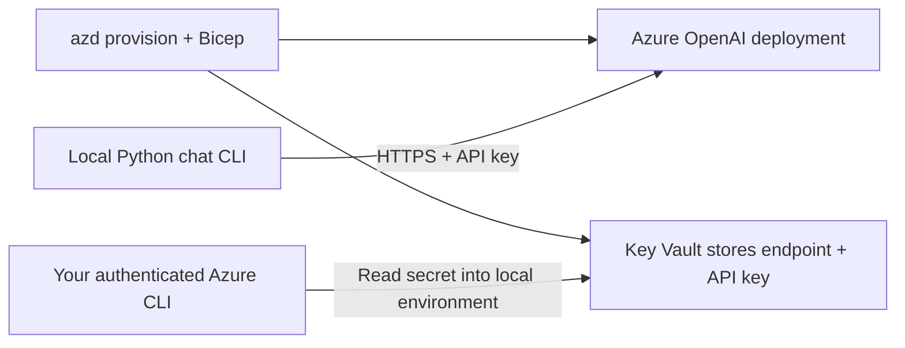

# دردشة Azure OpenAI — CLI محلي وبنية تحتية لـ AZD

**المستوى:** متوسطة · **المدة:** 35-60 دقيقة بما في ذلك الإعداد

يقوم هذا المثال بتوفير **موارد Azure OpenAI و Key Vault**، ثم يشغّل
واجهة سطر أوامر تفاعلية للدردشة بلغة بايثون **على جهازك**. لا يستضيف تطبيق ويب
أو تطبيق حاوية. النموذج الافتراضي هو `gpt-4.1`، الإصدار `2025-04-14`، مع
قدرة نشر `GlobalStandard` 20. تحقق من التوافر والحصة الحالية في
منطقتك المختارة قبل التوفير؛ يمكن أن تتغير تواريخ دورة حياة النموذج.

## أهداف التعلم

- توفير بنية تحتية للنماذج باستخدام Bicep و azd.
- استرداد مفتاح API من Key Vault دون وضعه في مخرجات النشر.
- إرسال طلبات إكمالات الدردشة والحفاظ على سجل المحادثة.
- تفسير عدد الرموز وقيود تقديرات التكلفة.



لا يوجد دمج وقت تشغيل بمعرف مُدار، أو تجاوز الفشل متعدد المناطق، أو محدد معدل مخصص،
وضع البث، أو حوسبة مستضافة في هذا المثال. تقوم مكتبة OpenAI SDK
بإجراء محاولتين إعادة محاولة على الأكثر للأخطاء القابلة لإعادة المحاولة؛ تقوم CLI بالإبلاغ عن الأخطاء المتبقية.

## المتطلبات المسبقة

- إصدار مستقر حالي [azd](https://learn.microsoft.com/azure/developer/azure-developer-cli/install-azd)
  (الإصدار المنشور في وقت المراجعة: 1.37.2).
- [Azure CLI](https://learn.microsoft.com/cli/azure/install-azure-cli).
- بايثون **3.10+** (يوصى بـ 3.11) وبيئة افتراضية.
- اشتراك Azure مع أذونات لإنشاء موارد خدمات الإدراك وخزنة المفاتيح
  ونشر النماذج وقراءة أسرار الخزنة.
- التوافر الإقليمي وحصة `GlobalStandard` لـ `gpt-4.1`. تعتمد متطلبات الوصول
  على الاشتراك والميزة؛ لا يوجد إطار زمني مضمون للموافقة.

```bash
azd version
az version
python --version
azd auth login
az login
```

هذه جلسات مصادقة منفصلة. اختر نفس الاشتراك في كلا الأداتين قبل
تنفيذ الأوامر أدناه.

## بداية سريعة (باش)

نفّذ من جذر المستودع:

```bash
cd examples/azure-openai-chat
azd env new myopenai
azd provision
```

اختر منطقة مدعومة. إنشاء الموارد ينشئ مجموعة موارد، حساب OpenAI،
نشر النموذج، خزنة المفاتيح، وأسرار `openai-endpoint`/`openai-api-key`.
لا توجد **خدمات لنشرها** في `azure.yaml`.

حمّل المخرجات غير السرية واسترجع السر في الصدفة الحالية الخاصة بك:

```bash
export AZURE_OPENAI_ENDPOINT="$(azd env get-value AZURE_OPENAI_ENDPOINT)"
export AZURE_OPENAI_MODEL="$(azd env get-value AZURE_OPENAI_MODEL)"
KV_NAME="$(azd env get-value AZURE_KEY_VAULT_NAME)"
export AZURE_OPENAI_API_KEY="$(az keyvault secret show \
  --vault-name "$KV_NAME" --name openai-api-key --query value --output tsv)"

python -m venv .venv
source .venv/bin/activate
python -m pip install -r src/requirements.txt
python src/chat.py
```

في PowerShell، فعّل باستخدام `.\.venv\Scripts\Activate.ps1` وعَيّن متغيرات البيئة
باستخدام `$env:AZURE_OPENAI_ENDPOINT = azd env get-value AZURE_OPENAI_ENDPOINT`
(وبالمثل للنموذج). استخرج مفتاح API باستخدام
`$env:AZURE_OPENAI_API_KEY = az keyvault secret show --vault-name $KV_NAME --name openai-api-key --query value -o tsv`.
عيّن `$KV_NAME = azd env get-value AZURE_KEY_VAULT_NAME` أولًا.

لا تطبع أو تدفع أو تلصق مفتاح API في تقارير المشكلات. يقرأ CLI متغيرات
بيئة العملية؛ فهو **لا** يستخرج أسرار Key Vault أو يحمل ملفات `.env`.
`config.py` يتحقق من نقطة النهاية، حد الرمز، والحرارة عند بدء التشغيل.

الإخراج المتوقع (المحتوى والاستخدام يختلفان):

```text
Azure OpenAI Chat Application
Model: gpt-4.1
...
You: Say hello in one sentence.
Assistant: Hello! How can I help you today?
[Tokens: ... | Cost: $...]
```

الأوامر: `stats` تُظهر الإجماليات، `clear` يمسح سجل المحادثة، و
`quit`/`exit` ينهي الجلسة. لا توجد أوامر `--stream`، `--show-tokens`، `tokens`،
أو `cost`.

## تحقق من النشر

بعد تحميل متغيرات الصدفة أعلاه:

```bash
curl --fail-with-body \
  "${AZURE_OPENAI_ENDPOINT%/}/openai/deployments/${AZURE_OPENAI_MODEL}/chat/completions?api-version=2024-10-21" \
  -H "Content-Type: application/json" \
  -H "api-key: $AZURE_OPENAI_API_KEY" \
  -d '{"messages":[{"role":"user","content":"Say hello!"}],"max_tokens":50}'

az keyvault secret list --vault-name "$KV_NAME" --query "[].name" -o table
```

النجاح: تُرجع API حالة HTTP 200 مع `choices[0].message.content` و `usage`؛
تسرد الخزنة `openai-api-key` و `openai-endpoint`. لا يكفي نجاح نشر ARM
وحده للتحقق من الاستدلال.

## الملفات والتكوين

```text
azure.yaml                         # Infrastructure-only AZD project
infra/main.bicep                   # Subscription deployment
infra/main.parameters.json         # Environment, location, principal ID
infra/resources/openai.bicep       # Account + model
infra/resources/keyvault.bicep     # Vault + deploying user's secret access policy
infra/resources/secrets.bicep      # Writes secrets, no key output
src/chat.py                        # Interactive CLI
src/config.py                      # Environment validation
src/requirements.txt               # Python packages
```

لتغيير النموذج/الإصدار/السعة المخصصة، حرّر الافتراضات في
`infra/main.bicep` وشغّل `azd provision`. تعيين `AZURE_OPENAI_MODEL` في الصدفة الخاصة بك
يختار فقط **اسم نشر موجود**؛ لا ينشر نموذجًا آخر.

| متغير وقت التشغيل | الافتراضي / المصدر |
|---|---|
| `AZURE_OPENAI_ENDPOINT` | مطلوب؛ خروج azd غير السري |
| `AZURE_OPENAI_API_KEY` | مطلوب؛ استرجع من Key Vault |
| `AZURE_OPENAI_MODEL` | `gpt-4.1`؛ اسم نشر Azure |
| `AZURE_OPENAI_MAX_TOKENS` | 800 (نطاق التحقق 1–4096) |
| `AZURE_OPENAI_TEMPERATURE` | 0.7 (النطاق 0–2) |
| `AZURE_OPENAI_INPUT_PRICE_PER_1K` | 0.002 دولار أمريكي؛ معدل إدخال توضيحي غير مخزن مؤقتًا |
| `AZURE_OPENAI_OUTPUT_PRICE_PER_1K` | 0.008 دولار أمريكي؛ معدل إخراج توضيحي |

## التكاليف والقيود الأمنية

عرض التكلفة هو **تقدير**، وليس فوترة Azure. يتم ضرب استخدام رموز API
بالمعدلات المُهيأة ولا يأخذ في الاعتبار خصومات الإدخال المخزن مؤقتًا،
الاختلافات الإقليمية/وفقًا لنوع المنتج، الضرائب، تغييرات الأسعار، أو المكالمات الفاشلة/المعاد تجربتها.
قم بتجاوز **كلا المعدلين** عند استخدام نموذج أو نوع منتج آخر وتحقق من
[تسعير Azure OpenAI الحالي](https://azure.microsoft.com/pricing/details/cognitive-services/openai-service/).

كمثال، 100 طلب باستخدام 500 رمز إدخال غير مخزن مؤقت و200 رمز إخراج لكل منها
بالمعدلات الافتراضية تكلف `100 × (500/1000 × .002 + 200/1000 × .008) = $0.26`.
عمليات/تخزين Key Vault تتكبد رسومًا منفصلة. لا توجد رسوم ثابتة بقيمة 50 دولارًا شهريًا
لهذا الـ CLI المحلي ولا يوجد حوسبة مستضافة في القالب.

يستخدم الخزانة سياسة وصول للمالك المُنَفذ؛ وليس مثالًا لتطبيق RBAC أو
مع هوية مدارة. تستخدم نقاط نهاية عامة ومصادقة بمفتاح API
لأغراض التعليم. قم بتقييد الأذونات وأضف الضوابط المناسبة للهوية/الشبكة
قبل تكييفه للإنتاج.

## تمارين عملية

### 1. تحقق من السياق وأعد تعيينه

**ابدأ:** تشغيل CLI. **الهدف:** ملاحظة السجل.
قل "تذكر كلمة سيدر"، ثم اسأل "ما الكلمة التي طلبت مني تذكّرها؟"
شغّل `stats`؛ يجب أن تُحتسب دورتان ناجحتان كرسائل متبادلة.
شغّل `clear` و `stats`؛ يجب أن تكون الرسائل المتبادلة صفرًا (إجماليات الرموز تبقى).
صياغة النموذج الدقيقة ليست حتمية.

### 2. غيّر حد الاستجابة

**ابدأ:** اخرج من CLI، مع الاحتفاظ بنفس الواجهة الطرفية.
شغّل `export AZURE_OPENAI_MAX_TOKENS=100`، أعد تشغيل `python src/chat.py`، واطلب
شرح قصير عن azd. تحقق من أن الشعار يعرض 100.
استعادة باستخدام `unset AZURE_OPENAI_MAX_TOKENS`. حد الرد الأصغر لا
يقلل من رموز التاريخ المرسلة بالفعل.

### مشكلات شائعة

- **عدم وجود متغيرات البيئة:** عملية التزويد لا تصدر قيم القشرة؛
  كرر خطوات التصدير. يحتاج الطرف الجديد إلى هذه القيم مرة أخرى.
- **403 قراءة Key Vault:** تحقق من اشتراك / تسجيل دخول Azure CLI والمالك
  في سياسة الوصول للـ Vault. قد تستغرق تغييرات السياسة وقتًا للانتشار.
- **404 الاستدلال:** تحقق من اسم النشر، ونقطة النهاية، وحالة النشر.
- **429 الاستدلال:** انتظر إعادة تعيين حدود المعدل؛ تحقق من حصة النموذج الإقليمية.
  يقوم CLI بإزالة المحاولات الفاشلة من التاريخ حتى لا يؤدي إعادة المحاولة إلى تكرارها.
- **طول السياق:** العينة لا تقص المحادثات الطويلة؛ استخدم `clear`.
- **النموذج غير متاح / متقاعد:** استشر توافر النموذج الحالي وقم بتحديث
  النموذج / الإصدار / SKU معًا؛ إصدار API وإصدار النموذج إعدادات مختلفة.

## التنظيف والخطوات التالية

```bash
azd down
unset AZURE_OPENAI_API_KEY
```

فترة الاحتفاظ بالحذف الناعم لـ Key Vault هي سبعة أيام؛ الحذف النهائي يتطلب أذونات منفصلة.
لا يوجد مجموعة اختبارات ملتزمة؛ لا تقم بتشغيل أمر `pytest tests/` غير موجود.
أضف اختبارات API وهمية قبل توسيع الكود.

[أمثلة الحاويات](../../../../examples/container-app) · [مخطط هيكل البيع بالتجزئة](../retail-scenario.md) ·
[الصفحة الرئيسية للدورة](../../README.md) · [الإبلاغ عن مشكلة](https://github.com/microsoft/AZD-for-beginners/issues)

---

<!-- CO-OP TRANSLATOR DISCLAIMER START -->
**تنويه**:
تمت ترجمة هذا المستند باستخدام خدمة الترجمة بالذكاء الاصطناعي [Co-op Translator](https://github.com/Azure/co-op-translator). بينما نسعى للدقة، يرجى العلم أن الترجمات الآلية قد تحتوي على أخطاء أو عدم دقة. يجب اعتبار المستند الأصلي بلغته الأصلية المصدر الرسمي والمعتمد. للمعلومات الهامة، يُنصح بالاستعانة بترجمة بشرية محترفة. نحن غير مسؤولين عن أي سوء فهم أو تفسير ناتج عن استخدام هذه الترجمة.
<!-- CO-OP TRANSLATOR DISCLAIMER END -->