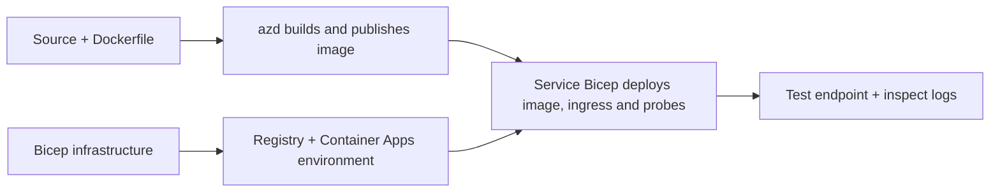

# أمثلة لنشر تطبيق الحاوية باستخدام AZD

يحتوي هذا الدليل على عينتين تعليميتين مع شفرة المصدر، وملفات Docker،
وبنية تحتية Bicep، و`azure.yaml`. لا يتم تحضير أي منهما للإنتاج.

## اختر مثالًا

| العينة | ما هو المطبق | المتطلبات المسبقة |
|---|---|---|
| [واجهة Flask بسيطة](../../../../examples/container-app/simple-flask-api) | واجهة CRUD بلغة Python مفردة، عناصر في الذاكرة، فحوصات الصحة، توسيع HTTP | معرفة أساسية بسطر الأوامر وHTTP |
| [خدمتان مصغرتان](../../../../examples/container-app/microservices) | بوابة Node.js، خدمة منتج داخلية للقراءة فقط بلغة Python، الاتصالات عن بُعد والتوسيع | أكمل عينة الخدمة المفردة أولاً |

خذ 30 إلى 60 دقيقة متضمنة الإعداد والتحقق. تختلف أوقات توفير Azure.

## المتطلبات المسبقة

- [واجهة سطر أوامر مطور Azure](https://learn.microsoft.com/azure/developer/azure-developer-cli/install-azd)
- [واجهة سطر أوامر Azure](https://learn.microsoft.com/cli/azure/install-azure-cli) لأوامر التحقق
- دُكر مع تشغيل الخادم الخاص به لبناء هذه الصور الحاوية
- اشتراك Azure مع أذونات إنشاء الموارد وحصة إقليمية كافية
- باش للأمثلة القائمة على الصدفة، أو أوامر PowerShell المعادلة

```bash
azd version
az version
docker info
azd auth login
az login
```

للأداتين جلسات تسجيل دخول منفصلة. استخدم azd المستقر الحالي؛ الإصدار المنشور الحالي
وقت المراجعة هو 1.37.2. الإصدارات الدنيا القديمة ليست
ضمان توافق.

## بدء سريع

من جذر المستودع:

```bash
cd examples/container-app/simple-flask-api
azd env new flask-demo
azd up
API_URL=$(azd env get-value API_ENDPOINT)
curl --fail-with-body "${API_URL}/health"
```

متوقع: HTTP 200 مع `"status": "healthy"`. اتبع ملف README الخاص بالعينة لإنشاء،
قراءة، تحديث، وحذف عنصر، ولتفقد السجلات.



يستخدم التوفير الأولي صورة hello-world عامة على المنفذ 80. الخدمة المحددة
تتيح ملفات معلمات Bicep لـ `azd deploy` استبدالها بصورة التطبيق المُبنية
ومنفذ التطبيق / الاستقصاءات الصحيح (8000 لفلاسك/المنتج، 8080 للبوابة).
احتفظ بهذه الملفات مع إعدادات `azure.yaml` `module` الخاصة بها.

## التكوين: ما الذي يغير ماذا

`azure.yaml` تختار مجلدات المصدر، اللغات، المضيفين، ووحدات النشر.
يتم تعريف CPU / الذاكرة للحاوية، الدخول، الاستقصاءات، عدد النسخ، وقواعد التوسع
في **Bicep**، وليس في خصائص خدمة `resources` أو `scale` أو `regions` تعسفية.

`azd env set SOME_VALUE ...` يخزن قيمة محلياً. يغير المورد المنشور فقط عندما يستهلك هذا المورد بشكل صريح
معلمة أو تعيين بيئة أو خطاف.
القيمة. هذه الأمثلة لا تستهلك `MAX_REPLICAS`، `SCALE_TO_ZERO_TIMEOUT`،
`CONTAINER_APP_REPLICA_TYPE`، أو إعدادات الكناري المخصصة من قيم بيئة azd.
عدّل ملف Bicep ذي الصلة وقم بتشغيل `azd up` لإعادة التزويد والنشر.

لا تضع مصدر التطبيق تحت `infra/`. يجب أن يشير `project` إلى دليل المصدر
الذي يحتوي على ملف Dockerfile وكشف التبعيات.

## المراقبة والتكاليف

- `azd monitor --logs` يفتح عرض بوابة؛ ليست تدفق سجل طرفية.
  استخدم `az containerapp logs show --follow` مع اسم المورد الفعلي.
- تكتب واجهة برمجة التطبيقات البسيطة سجلات stdout التي تم جمعها من خلال تطبيقات الحاويات/تحليلات السجلات.
  مورد Application Insights المخصص لها غير مزود بأدوات تلقائيًا.
- يستخدم بوابة الخدمات الصغيرة SDK الخاص بـ Application Insights لـ Node.js؛ تقوم خدمة Python
  بتصدير تتبعات سجلات التطبيق. لم يتم تكوين تتبع الطلب/الاعتماد الكامل لـ Python.

- يمكن أن يقلل التكبير إلى الصفر من رسوم الحوسبة، لكن التسجيل والتخزين والتحليل
  لا يزال بإمكانه تحقيق تكاليف. الإعدادات الافتراضية للخدمات الصغيرة تبقي النسخ مفعلة.
  قدّر منطقتك والاستخدام في
  [حاسبة تسعير Azure](https://azure.microsoft.com/pricing/calculator/).

## أنماط متقدمة — لم تُدرج التنفيذات

هذه اتجاهات تصميم، وليست مشاريع محلية إضافية أو مقتطفات نسخ وتشغيل:

- **البيانات الدائمة والمصادقة:** استبدل مخازن الذاكرة وأضف
  مصادقة/تخويل Microsoft Entra ID قبل الإنتاج.
- **أزرق-أخضر/كاناري:** استخدم وضع مراجعة متعددة لتطبيقات الحاويات، تسميات المراجعة،
  أوزان حركة المرور، التحقق من الصحة، وإجراءات التراجع.
  لا يوجد تكوين `deploymentStrategy: canary` azd في هذه الأمثلة.
  راجع [إدارة المراجعة](https://learn.microsoft.com/azure/container-apps/revisions).
- **متعدد المناطق:** أنشئ بيئات وتطبيقات منفصلة في Bicep وصمم
  التوجيه العالمي واتساق البيانات. قائمة خدمة `regions` ليست آلية نشر azd.
  آلية النشر.
- **عمال الطابور:** أضف مصدر العامل، والاعتمادات، وموارد الطابور، وهوية مُدارة بأدوار مستوى البيانات، وقاعدة مقياس معتمدة. لا تقم بالنسخ
 
  مسار `src/worker` فارغ وتوقع مشروعًا قابلاً للتشغيل.
- **Dapr:** توفير المكونات، تكوين الـ sidecar، تثبيت SDK المطابق،
  وتنفيذ معالجة أخطاء الحالة / النشر والاشتراك.
- **الأسرار:** استخدم الهوية المُدارة وتعيينات الأدوار حيثما أمكن. مجرد
  إنشاء خزنة مفاتيح لا يمنح التطبيقات حق الوصول أو تحميل الأسرار.

## التنظيف

من مجلد العينة:

```bash
azd down
```

راجع مطالبات الحذف وأكد أن مجموعة الموارد المخصصة قد تم إزالتها.
لا تستخدم هذه العينات كأساس للإنتاج دون تصميم واختبارات إضافية.

[فهرس الأمثلة](../README.md) · [الصفحة الرئيسية للدورة](../../README.md) ·
[توثيق تطبيقات الحاوية](https://learn.microsoft.com/azure/container-apps/) ·
[الإبلاغ عن مشكلة](https://github.com/microsoft/AZD-for-beginners/issues)

---

<!-- CO-OP TRANSLATOR DISCLAIMER START -->
**تنويه**:
تمت ترجمة هذا المستند باستخدام خدمة الترجمة بالذكاء الاصطناعي [Co-op Translator](https://github.com/Azure/co-op-translator). بينما نسعى للدقة، يرجى العلم أن الترجمات الآلية قد تحتوي على أخطاء أو عدم دقة. يجب اعتبار المستند الأصلي بلغته الأصلية المصدر الرسمي والمعتمد. للمعلومات الهامة، يُنصح بالاستعانة بترجمة بشرية محترفة. نحن غير مسؤولين عن أي سوء فهم أو تفسير ناتج عن استخدام هذه الترجمة.
<!-- CO-OP TRANSLATOR DISCLAIMER END -->