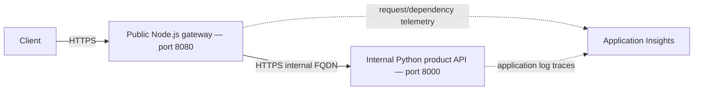

# خدمات صغيرة ذات خدمتين — تطبيقات حاويات أزور

**المستوى:** متوسط · **الوقت:** 45–60 دقيقة بما في ذلك الإعداد

يُنفذ هذا المثال التعليمي **بوابة API بنود.جي إس** و **خدمة منتجات بايثون للقراءة فقط**. يتضمن المصدر، ملفات دوكر، Bicep، وتكوين azd.
لا يعد نظامًا جاهزًا للإنتاج.


## ما الذي ستتعلمه

- نشر خدمتين بشكل مستقل.
- استخدام اسم مضيف backend داخلي كامل مؤهل عبر HTTPS.
- التحقق من استجابات النجاح، عدم العثور، والخدمة غير المتوفرة.
- فهم القياسات الحدودية للتوسع المستقل والقياس عن بعد.



يحتوي كتالوج المنتجات على خمسة منتجات ثابتة في الذاكرة. لا توجد **معالجات POST، PUT، أو DELETE**، أو قاعدة بيانات، أو Service Bus، أو خدمة طلب/مستخدم/إشعارات، أو كود C# أو Go. هذه أفكار تطوير مستقبلي، وليست ميزات مشمولة.
لا تقوم البوابة بمصادقة المستخدمين؛ الدخول الداخلي ليس بديلًا عن تفويض التطبيق.

البوابة لا تقوم بمصادقة المستخدمين؛ الدخول الداخلي ليس بديلاً
عن تفويض التطبيق.

## المتطلبات المسبقة

أكمل أولاً [واجهة برمجة تطبيقات Flask الأحادية](../../../../../examples/container-app/simple-flask-api).
قم بتثبيت azd المستقر الحالي (الإصدار المنشور وقت المراجعة: 1.37.2)، Azure CLI،
وDocker مع تشغيل الخادم. تحتاج إلى اشتراك Azure، أذونات إنشاء الموارد،
وحصة إقليمية لتطبيقات الحاويات.

```bash
azd version
az version
docker info
azd auth login
az login
```

استخدم نفس الاشتراك في كلا أداتي سطر الأوامر. الأوامر أدناه تستخدم Bash.

## النشر والتحقق

من جذر المستودع:

```bash
cd examples/container-app/microservices
azd env new microservices-demo
azd up
GATEWAY_URL=$(azd env get-value API_GATEWAY_URL)
RG_NAME=$(azd env get-value AZURE_RESOURCE_GROUP)
GATEWAY_NAME=$(azd env get-value API_GATEWAY_NAME)
PRODUCT_NAME=$(azd env get-value PRODUCT_SERVICE_NAME)

curl --fail-with-body "${GATEWAY_URL}/health"
curl --fail-with-body "${GATEWAY_URL}/api/products"
curl --fail-with-body "${GATEWAY_URL}/api/products/1"
curl -i "${GATEWAY_URL}/api/products/999"
```

**نجاح:** الحالة 200 للصحة؛ 200 للقائمة مع **خمسة** منتجات؛ المنتج 1 هو كمبيوتر محمول
بسعر 999.99 ومخزون 50؛ المنتج غير المعروف يرجع 404.
تشمل الردود أوصافًا؛ تختلف الطوابع الزمنية.

يستخدم التهيئة الأولية صور hello-world العامة على المنفذ 80 حتى لا يحاول
سحب صور غير موجودة من سجل فارغ. تستبدل وحدات Bicep الخاصة بالخدمة
وملفات المعلمات هذه بالصور المبنية ومنافذ التطبيق / المجسات أثناء
`azd deploy`. تحافظ المعلمات الرئيسية على أسماء الصور المنشورة للتهيئة اللاحقة.

## الخدمات والشبكات

| الخدمة | النقاط النهاية المكشوفة | الموارد الافتراضية |
|---|---|---|
| البوابة | GET `/`، `/health`، `/api/products`، `/api/products/:id` | 1 vCPU، 2 GiB، 2–20 نسخ |
| المنتج | GET `/`، `/health`، `/products`، `/products/<id>` | 0.5 vCPU، 1 GiB، 1–10 نسخ |

يحتوي دخول المنتج على `external: false` و `allowInsecure: false`. يقوم Bicep بحقن
`PRODUCT_SERVICE_URL=https://<actual-internal-fqdn>` في البوابة. HTTP سيكون
إعادة التوجيه؛ يتطابق HTTPS مع الدخول المُكون. يجب أن يتطابق اسم DNS القصير مع
**اسم تطبيق الحاوية الفعلي**، وليس مفتاح الخدمة المنطقي `product-service`.
لا تحاول الاتصال بالرابط الداخلي مباشرة من جهاز الكمبيوتر المحمول الخاص بك.

لدى البوابة مهلة خمس ثوانٍ لمكالمات المنتج. تُعتبر معرفات المنتجات المفقودة
على أنها 404؛ أما فشل النقل/الفشل الآخر في الخلفية فتعيد 503. تتحقق البوابة
`/health` فقط من البوابة، وليس من توفر الخلفية.

## الملفات والتكوين

```text
azure.yaml
infra/main.bicep
infra/main.parameters.json
infra/abbreviations.json
infra/core/container-apps-environment.bicep
infra/core/monitor.bicep
infra/app/api-gateway.bicep
infra/app/api-gateway.parameters.json
infra/app/product-service.bicep
infra/app/product-service.parameters.json
src/api-gateway/{app.js,package.json,Dockerfile}
src/product-service/{main.py,requirements.txt,Dockerfile}
```

يتم ضبط التوسع، CPU/الذاكرة، المنافذ، والإختبارات في `infra/app/*.bicep`. غيّر تلك
الملفات وقم بتشغيل `azd up` لتطبيق البنية التحتية وإعادة النشر. لا يوجد
`GATEWAY_MAX_REPLICAS` مُتغير بيئي في هذا المثال.

للتغييرات المتعلقة فقط بالكود:

```bash
azd deploy product-service
azd deploy api-gateway
```

تستخدم صورة Node الإصدار 22؛ تستخدم صورة Python الإصدار 3.11. كلاهما يرتبط بـ
`0.0.0.0`. يستخدم الدخول/الاختبارات المنفذ 8080 (البوابة) و8000 (المنتج) على التوالي.

## التطوير المحلي باستخدام Docker

شغل من دليل هذا المثال. استخدم شبكة معرفة من قبل المستخدم، **ولا تستخدم `localhost`
لتصل من حاوية إلى أخرى**:

```bash
docker network create azd-microservices-demo
docker build -t local-product ./src/product-service
docker build -t local-gateway ./src/api-gateway
docker run -d --name azd-product --network azd-microservices-demo local-product
docker run -d --name azd-gateway --network azd-microservices-demo \
  -p 8080:8080 -e PRODUCT_SERVICE_URL=http://azd-product:8000 local-gateway
curl --fail-with-body http://localhost:8080/api/products
```

المتوقع: خمسة منتجات. يُستخدم HTTP فقط لشبكة Docker المحلية هذه.

```bash
docker stop azd-product azd-gateway
docker rm azd-product azd-gateway
docker network rm azd-microservices-demo
```

## المراقبة

```bash
az containerapp logs show --name "$GATEWAY_NAME" --resource-group "$RG_NAME" --follow
# In a separate terminal:
az containerapp logs show --name "$PRODUCT_NAME" --resource-group "$RG_NAME" --tail 100
```

يفتح `azd monitor --logs` عرض بوابة؛ لا يُبث سجلات الطرفية.
تجمع SDK الخاصة بـ Node طلبات/اعتماديات البوابة. يصدّر `AzureLogHandler` في Python
**مسارات السجلات**، وليس طلبات Flask التلقائية، أو اعتماديات SQL، أو التتبع
الموزع الكامل. OpenCensus هو SDK قديم؛ يُفضل استخدام Azure Monitor OpenTelemetry
عند توسيع هذا المثال.

في سجلات Application Insights، قم بإنشاء طلبات وافحص:

```kusto
requests
| where timestamp > ago(1h)
| where name contains "products"
| summarize RequestCount=count(), AvgDuration=avg(duration) by bin(timestamp, 5m)
```

لرسائل تطبيق Python:

```kusto
traces
| where timestamp > ago(1h)
| where message contains "products"
| project timestamp, message, severityLevel
```

اسمح بتأخير في الاستيعاب وعينة؛ لا تتوقع عدد طلبات دقيق أو زمن استجابة مضمون.
لا يتم تكوين تنبيهات أو لوحات معلومات مخصصة.

## تمارين عملية

### التمرين 1: تعديل الكتالوج

**نقطة البداية:** `src/product-service/main.py`.
**الهدف:** التحقق من نشر الخدمة بشكل مستقل.
غيّر مخزون اللابتوب من 50 إلى 49 في قائمة `products` الثابتة، وشغل
`azd deploy product-service`، ثم اطلب `${GATEWAY_URL}/api/products/1`.

**معايير النجاح / الحل:** HTTP 200 مع `"stock":49`. استعد 50 وأعد النشر.
**مشكلة شائعة:** تعديل البوابة بدلاً من الخدمة المالكة للكتالوج.
هذا يغيّر بيانات المصدر، وليس قاعدة بيانات مخزون دائمة.

### التمرين 2: التحقق من تكوين النسخ

**نقطة البداية:** `infra/app/product-service.bicep`.
**الهدف:** ملاحظة تغيير في البنية التحتية بدون التخمين في التوسع التلقائي.
غيّر `minReplicas: 1` إلى `minReplicas: 2`، شغّل `azd up`، ثم:

```bash
az containerapp show --name "$PRODUCT_NAME" --resource-group "$RG_NAME" \
  --query properties.template.scale -o json
```

**معايير النجاح:** الحد الأدنى المكون هو 2 والحد الأقصى يبقى 10.
استعد الحد الأدنى 1 وشغل `azd up`.
**مشكلة شائعة:** لا يطبق `azd deploy` وحده تغييرات على البنية التحتية المشتركة غير المتعلقة.
لا تضبط `maxReplicas` على الصفر كمحاكاة لفشل.
هذا يتحقق من التكوين، وليس اختبار حمل أو عدد نسخ فوري مضمون.

### التمرين 3: اختبار التعامل مع الخدمة غير المتوفرة محليًا

**نقطة البداية:** كلا الحاويتين المحليتين من Docker أعلاه تعملان.
**الهدف:** التمييز بين فشل الخلفية ومنتج مفقود.
أوقف فقط حاوية المنتج:

```bash
docker stop azd-product
curl -i http://localhost:8080/api/products
docker start azd-product
curl --fail-with-body http://localhost:8080/api/products
```

**معايير النجاح:** أثناء التوقف، تعيد البوابة 503 مع
`"error":"Product service unavailable"`؛ بعد إعادة التشغيل، تعيد القائمة 200.
حاول مرة أخرى بعد تأخير بدء قصير إذا لزم الأمر.
**مشكلة شائعة:** إيقاف البوابة يختبر فشل مختلف (لا استجابة HTTP).

## التكاليف والفجوات الإنتاجية

النسخ الدنيا الافتراضية تبقي الحوسبة تعمل. تفرض السجلات والمراقبة أيضاً
رسومًا. لا يوجد إجمالي ثابت 50 دولارًا شهريًا تم التحقق منه: قدر CPU/الذاكرة الإقليمية،
ساعات النسخ، الطلبات، السجل، واحتفاظ السجلات في
[حاسبة تسعير Azure](https://azure.microsoft.com/pricing/calculator/).
احذف موارد التعلم على الفور.

يشمل العمل الإنتاجي المصادقة/التفويض، هويات مدارة محدودة النطاق،
البيانات الدائمة، التحقق من المدخلات/الردود، أدوات الرصد المدعومة،
اختبارات الحمل/الفشل، CI/CD، التنبيهات، وإجراءات الاسترداد. إضافة خدمة طلب،
قائمة انتظار، أو قاعدة بيانات هي مهمة تنفيذ منفصلة، ليست تمرينًا منجزًا
أو ميزة متاحة هنا.

## استكشاف الأخطاء والتنظيف

- **الصورة غير موجودة أثناء التوفير الأول:** يجب أن يستخدم bootstrap الصورة العامة؛
  تحقق من معلمات الصورة الرئيسية الافتراضية وتعيينات وحدات النشر.
- **503 للمنتجات:** تحقق من سجلات المنتج، مراجعة الصورة، والرابط الداخلي HTTPS المحقون.
- **404 مسار غير متوقع:** واجهة برمجة تطبيق المنتج للقراءة فقط؛ تحقق من المسار، وليس معالج CRUD غير موجود.
- **لا توجد بيانات قياس عن بعد:** تحقق من سلاسل الاتصال وقت التشغيل دون كشفها و
  اسمح بتأخير الاستيعاب. لا تُملأ جداول طلبات Python بواسطة معالج السجلات الخاص بها.

من دليل هذا المثال:

```bash
azd down
```

راجع تنبيهات الحذف وتحقق من إزالة مجموعة الموارد المخصصة.

[السابق: Flask API](../../../../../examples/container-app/simple-flask-api) · [التالي: تطبيق قاعدة البيانات](../../../../../examples/database-app) ·
[تطوير AI](../../../docs/chapter-02-ai-development/README.md) ·
[الصفحة الرئيسية للدورة](../../../README.md) · [الإبلاغ عن مشكلة](https://github.com/microsoft/AZD-for-beginners/issues)

---

<!-- CO-OP TRANSLATOR DISCLAIMER START -->
**تنويه**:
تمت ترجمة هذا المستند باستخدام خدمة الترجمة بالذكاء الاصطناعي [Co-op Translator](https://github.com/Azure/co-op-translator). بينما نسعى للدقة، يرجى العلم أن الترجمات الآلية قد تحتوي على أخطاء أو عدم دقة. يجب اعتبار المستند الأصلي بلغته الأصلية المصدر الرسمي والمعتمد. للمعلومات الهامة، يُنصح بالاستعانة بترجمة بشرية محترفة. نحن غير مسؤولين عن أي سوء فهم أو تفسير ناتج عن استخدام هذه الترجمة.
<!-- CO-OP TRANSLATOR DISCLAIMER END -->