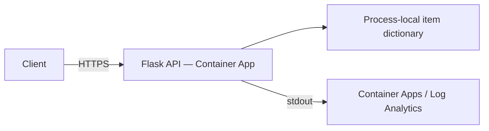

# واجهة برمجة تطبيقات Flask بسيطة — تطبيقات حاويات Azure

**المستوى:** مبتدئ · **الوقت:** 30–45 دقيقة بما في ذلك الإعداد

انشر واجهة برمجة تطبيقات CRUD باستخدام Python Flask مع Azure Developer CLI (azd). الشفرة المصدرية، Dockerfile،
Bicep، ومعلمات النشر مضمنة. هذا **نموذج تعليمي** وليس
واجهة API جاهزة للإنتاج.

## ما سوف تتعلمه

- بناء ونشر حاوية من خلال azd.
- تكوين الدخول وفحوصات الحياة / الجاهزية.
- التحقق من استجابات CRUD وفحص سجلات التطبيق.
- فهم سبب كون البيانات المحفوظة في الذاكرة غير مناسبة للتطبيقات الدائمة.



**مهم:** العناصر محفوظة في عملية واحدة. الافتراضي هو **عامل Gunicorn واحد،
0–1 نسخ**، لتجنب تعارض البيانات عبر العمال/النسخ عمداً.
تُفقد العناصر عند إعادة التشغيل أو تغيير النسخة أو التوسع إلى الصفر. زيادة عدد النسخ
تتطلب تخزينًا دائمًا مشتركًا. لا تحتوي الواجهة على مصادقة أو ترخيص.

## المتطلبات الأساسية

- [azd المستقر الحالي](https://learn.microsoft.com/azure/developer/azure-developer-cli/install-azd)
  (الإصدار المنشور عند وقت المراجعة: 1.37.2).
- [Azure CLI](https://learn.microsoft.com/cli/azure/install-azure-cli) للتحقق.
- Docker مع تشغيل الخادم الخاص به؛ مطلوب لبناء الصورة المحلية الافتراضية.
- اشتراك Azure، أذونات إنشاء الموارد، وحصة إقليمية لتطبيقات الحاويات.
- Bash للأوامر أدناه (أو PowerShell مكافئ).
- Python 3.11 للتطوير المحلي الاختياري.

```bash
azd version
az version
docker info
azd auth login
az login
```

أدوات CLI لها جلسات تسجيل دخول منفصلة. استخدم نفس الاشتراك في كليهما.

## بدء سريع

من الجذر الخاص بالمستودع:

```bash
cd examples/container-app/simple-flask-api
azd env new flask-demo
azd up
API_URL=$(azd env get-value API_ENDPOINT)
RG_NAME=$(azd env get-value AZURE_RESOURCE_GROUP)
API_NAME=$(azd env get-value API_NAME)
curl --fail-with-body "${API_URL}/health"
```

المتوقع: HTTP 200 و JSON مع `"status":"healthy"`،
`"service":"simple-flask-api"`، ووقت توقيع UTC الحالي.
عادةً ما يستغرق إعداد النشر وبناء الصورة عدة دقائق؛ تختلف الأوقات.

يستخدم الإعداد الأولي صورة عامة hello-world تستمع على المنفذ 80.
`azure.yaml` يختار `infra/app/api.bicep` وملف المعلمات المطابق لها
لنشر الخدمة، والذي يبدل الصورة، الدخول، والفحوصات إلى المنفذ 8000.
لا تحذف معلمات النشر تلك.

## تحقق من CRUD

شغّل ما يلي بالتسلسل بينما يكون نفس النسخ نشطًا:

```bash
# Create: HTTP 201; note the returned id (1 for a fresh process).
curl -i -X POST "${API_URL}/api/items" \
  -H "Content-Type: application/json" \
  -d '{"name":"Test Item","description":"My first item"}'

# Read list: HTTP 200, total 1 in a fresh process.
curl --fail-with-body "${API_URL}/api/items"

# Replace 1 if your create response returned another id.
curl --fail-with-body "${API_URL}/api/items/1"
curl -i -X PUT "${API_URL}/api/items/1" \
  -H "Content-Type: application/json" -d '{"name":"Updated Item"}'
curl -i -X DELETE "${API_URL}/api/items/1"
curl -i "${API_URL}/api/items/1"
```

النجاح: POST 201، القراءة/PUT 200، DELETE 204 بدون جسم، ثم عنصر مفقود 404.
JSON معطوب / غير كائن أو اسم فارغ يعيد 400.
إذا اختفى عنصر بين الطلبات، تحقق من إعادة التشغيل أو التوسع إلى الصفر؛
هذا قيد متعمد في الذاكرة وليس تخزينًا دائمًا.

| نقطة النهاية | الطرق |
|---|---|
| `/` | GET — معلومات الخدمة |
| `/health` | GET — حياة / جاهزية |
| `/api/items` | GET, POST |
| `/api/items/{id}` | GET, PUT, DELETE |

## السجلات والتكوين

```bash
az containerapp logs show --name "$API_NAME" --resource-group "$RG_NAME" --follow
```

المتوقع: بدء Gunicorn، سجلات وصول الطلبات، ورسائل التطبيق.
`azd monitor --logs` يفتح عرض بوابة؛ لا يبث إلى الطرفية.
تم توفير Application Insights لكنه **غير مزود بالأدوات من خلال شفرة Flask هذه**؛
استخدم Container Apps/Log Analytics لسجلات stdout.

حرر `infra/app/api.bicep` لوحدة المعالجة المركزية/الذاكرة، حدود النسخ، أو قواعد التوسع، ثم
شغل `azd up`. القيم الافتراضية هي 0.5 vCPU، 1 جيجابايت، الحد الأدنى 0 / الحد الأقصى 1 نسخة،
وحاجز HTTP بـ 50 طلب متزامن. التوسع إلى الصفر قد يضيف زمن استجابة بداية باردة.

قيم `azd env set MAX_REPLICAS`، `API_KEY`، `LOG_LEVEL`، أو
`SCALE_TO_ZERO_TIMEOUT` العشوائية ليست **موصولة إلى هذا القالب أو التطبيق**.
تعيين قيمة لا يجعلها تلقائيًا متغير بيئة وقت التشغيل.
الصورة تربط المنفذ 8000 صراحة؛ حدث Dockerfile، Bicep للدخول، والفحوص
معًا إذا غيّرت المنفذ.

## الملفات

```text
azure.yaml
infra/main.bicep
infra/main.parameters.json
infra/app/container-apps.bicep       # Environment, registry, monitoring
infra/app/api.bicep                  # App, ingress, probes, scale settings
infra/app/api.parameters.json        # Image and resource values for azd deploy
src/app.py
src/Dockerfile
src/requirements.txt
```

## التطوير المحلي

من دليل المثال هذا:

```bash
python -m venv .venv
source .venv/bin/activate  # PowerShell: .\.venv\Scripts\Activate.ps1
python -m pip install -r src/requirements.txt
python src/app.py
```

في نافذة طرفية أخرى، اختبر `http://localhost:8000/health` ونقاط نهاية CRUD.
أو انشئ وشغّل الصورة الفعلية:

```bash
docker build -t flask-api:local ./src
docker run --rm -p 8000:8000 flask-api:local
```

لتغييرات الشفرة فقط بعد النشر الأول، شغل `azd deploy api`.
لتغييرات Bicep، شغل `azd up` لإعادة الإعداد والنشر.

## تمارين عملية

### 1. التحقق من رفض الإدخال

**نقطة البداية:** الواجهة المنشورة، `API_URL` أعلاه.
**الهدف:** التحقق من أن الواجهة ترفض أشكال JSON غير الصالحة والأسماء المفقودة.

```bash
curl -i -X POST "${API_URL}/api/items" \
  -H "Content-Type: application/json" -d '[]'
curl -i -X POST "${API_URL}/api/items" \
  -H "Content-Type: application/json" -d '{"name":""}'
```

**معايير النجاح / الحل:** كلاهما يعيد 400 مع خطأ JSON، وليس 500.
**المشكلة الشائعة:** إغفال رأس content-type لـ JSON.

### 2. إضافة نقطة نهاية للقراءة فقط

**نقطة البداية:** `src/app.py`. **الهدف:** تمديد وإعادة نشر الواجهة.
أضف هذا قبل كتلة `if __name__ == '__main__':`:

```python
@app.route('/version', methods=['GET'])
def version():
    return jsonify({'version': '1.0.0'})
```

شغّل `azd deploy api`، ثم `curl --fail-with-body "${API_URL}/version"`.
**معايير النجاح:** HTTP 200 و `{"version":"1.0.0"}`.
**المشكلة الشائعة:** وضع المسار بعد استدعاء الحجب `app.run()` عند
الاختبار باستخدام `python src/app.py`.

### نقطة تحقق المعرفة

لماذا عامل واحد غير كافٍ للبيانات الدائمة؟ لأن حتى العملية الواحدة تفقد
قاموسها عند إعادة التشغيل. نسخة الإنتاج تحتاج تخزينًا دائمًا مشتركًا،
مصادقة، تفويض، ترحيل، اختبارات، ومراقبة تشغيلية.

## التكاليف واستكشاف الأخطاء وإصلاحها

هذا ليس نشرًا مضمونًا بمبلغ $0: سجل Basic وتخزين السجل / الاستيعاب
يمكن أن يتكبد تكاليف حتى عندما يكون حوسبة التطبيق صفراً. استخدم
[حاسبة التسعير](https://azure.microsoft.com/pricing/calculator/) لمنطقتك.

- **فشل بناء Docker:** تأكد من `docker info`، الوصول إلى الشبكة، والاعتمادات.
- **تطبيق غير صحي:** افحص سجلات الكونسول / النظام وتحقق من توافق منفذ الصورة، الدخول،
  والفحوص. يجب ألا يُفحَص عنصر نائب على منفذ Flask.
- **403 / أذونات:** تحقق من الاشتراك وأذونات إنشاء الموارد.
- **اختفاء العناصر:** تعيد حالة الذاكرة المؤقتة تعيينها عند إعادة التشغيل/التوسع إلى الصفر؛ أضف قاعدة بيانات
  للسلوك الدائم.

## التنظيف والخطوات التالية

```bash
azd down
```

راجع طلب الحذف وتأكد من إزالة مجموعة الموارد المخصصة.
لا تستخدم التنظيف المدمر على مجموعة موارد تحتوي على بيانات غير مرتبطة.

[التالي: تطبيق قاعدة بيانات](../../../../../examples/database-app) · [الخدمات المصغرة](../../../../../examples/container-app/microservices) ·
[نظرة عامة على الحاويات](../README.md) · [الصفحة الرئيسية للدورة](../../../README.md) ·
[الإبلاغ عن مشكلة](https://github.com/microsoft/AZD-for-beginners/issues)

---

<!-- CO-OP TRANSLATOR DISCLAIMER START -->
**تنويه**:
تمت ترجمة هذا المستند باستخدام خدمة الترجمة بالذكاء الاصطناعي [Co-op Translator](https://github.com/Azure/co-op-translator). بينما نسعى للدقة، يرجى العلم أن الترجمات الآلية قد تحتوي على أخطاء أو عدم دقة. يجب اعتبار المستند الأصلي بلغته الأصلية المصدر الرسمي والمعتمد. للمعلومات الهامة، يُنصح بالاستعانة بترجمة بشرية محترفة. نحن غير مسؤولين عن أي سوء فهم أو تفسير ناتج عن استخدام هذه الترجمة.
<!-- CO-OP TRANSLATOR DISCLAIMER END -->