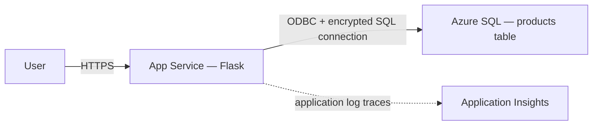

# فلاسک و Azure SQL على خدمة التطبيقات

**المستوى:** متوسط · **الوقت:** 30–60 دقيقة بما في ذلك المتطلبات الأساسية

تقوم هذه العينة بنشر واجهة برمجة تطبيقات قراءة Python Flask إلى **خدمة تطبيقات لينيكس** وقاعدة بيانات Azure SQL أساسية.
يشمل المصدر وBicep وتكوين azd. إنها تطبيق تعليمي، وليست بنية قاعدة بيانات جاهزة للإنتاج.


## ما ستتعلمه

- توفير موارد خدمة التطبيقات وSQL والمراقبة باستخدام Bicep.
- تكوين اتصال SQL مشفر بدون حفظ بيانات الاعتماد.
- تهيئة مخطط قبل بدء عمال Gunicorn.
- التحقق من البيانات المزرعة، والاستجابات لعدم العثور، وصحة قاعدة البيانات.



الموارد: مجموعة موارد مخصصة، خطة خدمة تطبيق Linux B1، تطبيق ويب Python 3.11،
خادم SQL وقاعدة بيانات أساسية 2 جيجابايت، Insights للتطبيق، وتحليلات السجلات.
يستخدم تطبيق الويب **نشر المصدر/ZIP وتثبيت التبعيات بواسطة Oryx**؛
`azd deploy` لا يبني أو ينشر ملف Dockerfile الاختياري.

## المتطلبات الأساسية

- أحدث إصدار مستقر من [azd](https://learn.microsoft.com/azure/developer/azure-developer-cli/install-azd)
  (الإصدار المنشور وقت المراجعة: 1.37.2).
- [Azure CLI](https://learn.microsoft.com/cli/azure/install-azure-cli) للتحقق.
- اشتراك Azure، أذونات لإنشاء الموارد المذكورة، وحصة إقليمية.
- Python **3.11** للتطوير المحلي؛ قد تتطلب `pyodbc==5.0.1` المرتكبة
  أدوات بناء أصلية على إصدارات Python الأحدث.
- Microsoft ODBC Driver 18 (أو 17) لـ SQL Server على الأجهزة المحلية. `pip install
  pyodbc` لا يقوم بتثبيت برنامج التشغيل للنظام. انظر
  [تثبيت ODBC](https://learn.microsoft.com/sql/connect/odbc/download-odbc-driver-for-sql-server).
- Docker فقط إذا كنت تختبر الحاوية الاختيارية محليًا.

```bash
azd version
az version
azd auth login
az login
```

استخدم نفس الاشتراك في كلا الأداتين. الأوامر أدناه تستخدم Bash.

## النشر

من جذر المستودع:

```bash
cd examples/database-app
azd env new sql-demo
azd provision
azd deploy
WEB_URL=$(azd env get-value WEB_APP_URI)
WEB_NAME=$(azd env get-value WEB_APP_NAME)
RG_NAME=$(azd env get-value AZURE_RESOURCE_GROUP)
```

اختر منطقة مدعومة. `sqlAdminLogin` الافتراضي هو `sqladmin`؛ القيمة المطلوبة
`sqlAdminPassword` هي معلمة آمنة. قدم كلمة مرور قوية عند الطلب.
احتفظ ببيانات اعتماد النشر خارج Git وتقارير المشكلات. الاتصال الحالي
يتوقع إدخال السلسلة نص كلمة مرور بدون محددات سلسلة الاتصال مثل
`;`؛ قم بتعديل الهروب قبل استخدام مثل هذه القيم.

يحدد Bicep أمر بدء تشغيل يقوم بتشغيل `init_database()` **قبل** Gunicorn
يبدأ العاملون. هذا ضروري لأن استيراد `app:app` لا ينفذ
كتلة `if __name__ == '__main__'` في بايثون. على قاعدة بيانات جديدة، يؤدي التهيئة
إلى إنشاء `products` وإدخال خمسة صفوف. هو نموذج تعليمي بسيط، وليس
إطار عمل هجرة متزامن؛ استخدم الهجرات المناسبة قبل توسيع عدد النسخ.

يختار التطبيق برنامج تشغيل Microsoft ODBC الإصدار 18 المثبت، ثم 17، إذا لم يذكر في
سلسلة الاتصال اسم برنامج تشغيل صراحة. إذا لم يتوفر أي منهما، يفشل بدء التشغيل مع
خطأ تثبيت يمكن اتخاذ إجراء حياله. تحقق من توفر برنامج التشغيل في وقت تشغيل
خدمة التطبيقات المحدد بدلاً من الافتراض.

## التحقق

```bash
curl --fail-with-body "${WEB_URL}/"
curl --fail-with-body "${WEB_URL}/health"
curl --fail-with-body "${WEB_URL}/products"
curl --fail-with-body "${WEB_URL}/products/1"
curl -i "${WEB_URL}/products/999"
```

المتوقع:

- يُرجع `/` معلومات نقطة النهاية.
- يُرجع `/health` الحالة 200 مع `{"status":"healthy","database":"connected"}`.
- يُرجع `/products` خمسة منتجات مُزرعة على قاعدة بيانات جديدة.
- يُرجع `/products/1` جهاز كمبيوتر محمول بسعر 1299.99.
- منتج غير موجود يُرجع 404 مع `{"error":"Product not found"}`.

واجهة برمجة التطبيقات للقراءة فقط. لا توجد مسارات POST/PUT/DELETE أو واجهة مستخدم للمتصفح.
يؤدي فشل الاتصال بقاعدة البيانات إلى إرجاع 503 من `/health`؛ ليست حالة نجاح.

## الملفات والتكوين

```text
azure.yaml                         # Python App Service source deployment
infra/main.bicep
infra/main.parameters.json
infra/abbreviations.json
infra/resources/sql-server.bicep
infra/resources/sql-database.bicep
infra/resources/app-service-plan.bicep
infra/resources/web-app.bicep       # Settings + initialization/startup command
infra/resources/app-insights.bicep
src/web/app.py
src/web/requirements.txt
src/web/Dockerfile                 # Optional local container, not the azd target
.env.sample
```

يُمرر `SQL_CONNECTION_STRING` كمعامل Bicep آمن إلى وحدة تطبيق الويب
ويُخزن في إعدادات خدمة التطبيقات، وليس في نواتج النشر.
يقوم `APPLICATIONINSIGHTS_CONNECTION_STRING` بتكوين تصدير السجلات.
يُفعل `SCM_DO_BUILD_DURING_DEPLOYMENT=true` تثبيت التبعيات على جانب الخادم.
تعيين قيم `azd env` عشوائياً لا يغير تلقائيًا إعدادات التطبيق.

قاعدة `0.0.0.0` لجدار حماية SQL تسمح بالاتصالات من **خدمات Azure،
بما في ذلك اشتراكات عملاء آخرين**، حسب مصادقة SQL. ليست مقصورة على
هذا التطبيق أو الاشتراك فقط. الوصول إلى الشبكة العامة لـ SQL مفعل.
استخدم الشبكات ذات النطاق المحدود وهوية تطبيق غير مسؤول قبل الإنتاج.

## التطوير المحلي

استخدم بايثون 3.11 وبرنامج تشغيل Microsoft SQL ODBC المثبت:

```bash
python -m venv .venv
source .venv/bin/activate  # PowerShell: .\.venv\Scripts\Activate.ps1
python -m pip install -r src/web/requirements.txt
export SQL_CONNECTION_STRING='Server=tcp:YOUR_SERVER.database.windows.net,1433;Database=YOUR_DATABASE;UID=YOUR_USER;PWD=YOUR_PASSWORD;Encrypt=yes;TrustServerCertificate=no;Connection Timeout=30;'
python src/web/app.py
```

استبدل المحتويات بعناية. ملف `.env` المنسوخ **لا يتم تحميله تلقائيًا**
بواسطة هذا التطبيق. بدلاً من ذلك، قم بتصدير المتغيرات في الصدفة الحالية.
من أجل Azure SQL من كمبيوتر محمول، قم مؤقتًا بالسماح فقط لعناوين IP العامة الخاصة بك:

```bash
SQL_SERVER=$(azd env get-value SQL_SERVER_NAME)
MY_IP=YOUR_PUBLIC_IP
az sql server firewall-rule create -g "$RG_NAME" -s "$SQL_SERVER" \
  -n AllowMyLearningIP --start-ip-address "$MY_IP" --end-ip-address "$MY_IP"
```

أزل القاعدة بعد الاختبار:

```bash
az sql server firewall-rule delete -g "$RG_NAME" -s "$SQL_SERVER" -n AllowMyLearningIP
```

اختبار الحاوية الاختياري من دليل المثال هذا:

```bash
docker build -t sql-flask:local src/web
docker run --rm -p 8000:8000 -e SQL_CONNECTION_STRING sql-flask:local
```

يقوم هذا الصورة بتثبيت برنامج تشغيل 18 باستخدام مستودع حزم Debian 12 المطابق
لقاعدة Bookworm، يهيئ قاعدة البيانات مرة واحدة، ثم يبدأ Gunicorn.

## المراقبة واستكشاف الأخطاء وإصلاحها

فعّل/تابع سجلات تطبيق نظام ملفات خدمة التطبيقات عند تشخيص بدء التشغيل:

```bash
az webapp log config --name "$WEB_NAME" --resource-group "$RG_NAME" \
  --application-logging filesystem --level information
az webapp log tail --name "$WEB_NAME" --resource-group "$RG_NAME"
```

يصدر هذا الكود **أثر سجلات التطبيق** من خلال معالج OpenCensus القديم.
لا يكوّن تتبع الطلبات/التبعيات التلقائي في Flask، أو المقاييس الحية،
تدقيق SQL، إعدادات التشخيص، أو التنبيهات. تلك تتطلب إعدادًا منفصلًا.
للمراقبة الجديدة، يفضل Azure Monitor OpenTelemetry.

في سجلات Application Insights، بعد إجراء طلبات API:

```kusto
traces
| where timestamp > ago(1h)
| where message contains "products" or message contains "Health check"
| project timestamp, message, severityLevel
```

اسمح بتأخير الالتقاط. نشاط جدول الطلب أو المقاييس الحية ليس معياراً لإكمال
هذا التتبع الخاص بالسجلات فقط.

- **برنامج التشغيل مفقود:** تحقق من `pyodbc.drivers()` في وقت التشغيل وقم بتثبيت
  برنامج تشغيل Microsoft ODBC مدعوم. حزمة بايثون وحدها ليست كافية.
- **فشل الاتصال:** تحقق من إعدادات SQL، بيانات الاعتماد، جدار الحماية، والاشتراك المحدد.
  لا تعطّل التشفير لتجاوز الخطأ.
- **جدول المنتجات مفقود:** تأكد من أن أمر بدء التشغيل Bicep تم نشره؛
  بدء تشغيل `gunicorn app:app` وحده يتخطى التهيئة.
- **فشل بناء الحزمة:** استخدم بايثون 3.11 أو قدم متطلبات البناء الأصلية.
- **بيانات السعر صفر:** الصفر هو سعر عشري صحيح؛ يجب أن يتسلسل كـ 0.0،
  وليس `null`.

## التمارين العملية

### التمرين 1: التحقق من سلوك المنتج المفقود

**نقطة البداية:** API منشور و`WEB_URL` أعلاه.
**الهدف:** التمييز بين صف مفقود وقاعدة بيانات معطلة.
اطلب `/health` و`/products/999` باستخدام الأوامر أعلاه.
**معايير النجاح / الجواب:** الحالة 200 صحيحة، المنتج غير موجود 404 (ليس 500 أو 503).
**مشكلة شائعة:** افتراض أن استجابة غير موجودة تثبت أن اتصال SQL معطل.

### التمرين 2: تغيير قيمة مزروعة

**نقطة البداية:** محرر استعلامات Azure SQL، متصل بقاعدة البيانات النموذجية.
**الهدف:** إظهار أن بيانات API مخزنة في SQL بدلاً من ذاكرة العملية.

```sql
UPDATE products SET price = 0 WHERE id = 1;
SELECT id, name, price FROM products WHERE id = 1;
```

اطلب `${WEB_URL}/products/1`. **معايير النجاح:** السعر هو `0.0`، وليس `null`.
استعد القيمة:

```sql
UPDATE products SET price = 1299.99 WHERE id = 1;
```

**مشكلة شائعة:** تحرير قائمة البذور في بايثون لا يقوم بتحديث الصفوف الموجودة في SQL.
لا تجري تمارين المخطط/البيانات على قاعدة بيانات إنتاج.

### التمرين 3: إضافة نقطة نهاية عددية للقراءة فقط

**نقطة البداية:** `src/web/app.py`.
**الهدف:** توسيع API باستخدام استعلام تجميعي بدون معلمات.
أضف هذا قبل كتلة `if __name__ == '__main__':`:

```python
@app.route('/product-count')
def product_count():
    from contextlib import closing
    with closing(get_db_connection()) as conn, closing(conn.cursor()) as cursor:
        cursor.execute("SELECT COUNT(*) FROM products")
        return jsonify({'count': cursor.fetchone()[0]})
```

شغّل `azd deploy web`، ثم اطلب `${WEB_URL}/product-count`.
**معايير النجاح:** 200 مع `{"count":5}` على قاعدة البيانات المزروعة دون تعديل.
**مشكلة شائعة:** تغيير المسار مع نسيان إعادة النشر.
للإنتاج، أضف معالجة الأخطاء/الاختبارات؛ هذا التمرين القصير يركز على الاستعلام.

## التكاليف، الفجوات الإنتاجية، والتنظيف

يتم دفع فاتورة خدمة التطبيقات B1 وقاعدة البيانات الأساسية أثناء توفيرها. إيقاف
تطبيق الويب لا يؤدي إلى إيقاف فاتورة خطة خدمة التطبيقات. قد تضيف السجلات والتخزين تكاليف.
استخدم [حاسبة أسعار Azure](https://azure.microsoft.com/pricing/calculator/)
للأسعار الإقليمية الحالية. التبديل إلى F1 يتطلب أيضًا تعطيل `alwaysOn`؛
ليس بديلاً بحجم سطر واحد. SQL بدون خادم ليس مجانيًا تلقائيًا.

يشمل العمل الإنتاجي هوية تطبيق ذات أقل امتيازات (ليس مسؤول SQL)،
المصادقة/التفويض، الشبكات الخاصة، الهجرات الآمنة، مراجعة تجمع الاتصال/دورة الحياة،
القياس عن بعد، التدقيق، التنبيهات، الاختبارات، وإجراءات الاسترداد.
التخزين المؤقت Redis والجداول الإضافية هي أفكار تطوير، وليست تمارين منفذة.

من دليل المثال هذا:

```bash
azd down
```

راجع طلب الحذف وتحقق من إزالة مجموعة الموارد المخصصة.
لا تحذف المجموعات التي تحتوي على بيانات غير مرتبطة.

[أمثلة الحاويات](../../../../examples/container-app) ·
[تطوير الذكاء الاصطناعي](../../docs/chapter-02-ai-development/README.md) ·
[الصفحة الرئيسية للدورة](../../README.md) · [الإبلاغ عن مشكلة](https://github.com/microsoft/AZD-for-beginners/issues)

---

<!-- CO-OP TRANSLATOR DISCLAIMER START -->
**تنويه**:
تمت ترجمة هذا المستند باستخدام خدمة الترجمة بالذكاء الاصطناعي [Co-op Translator](https://github.com/Azure/co-op-translator). بينما نسعى للدقة، يرجى العلم أن الترجمات الآلية قد تحتوي على أخطاء أو عدم دقة. يجب اعتبار المستند الأصلي بلغته الأصلية المصدر الرسمي والمعتمد. للمعلومات الهامة، يُنصح بالاستعانة بترجمة بشرية محترفة. نحن غير مسؤولين عن أي سوء فهم أو تفسير ناتج عن استخدام هذه الترجمة.
<!-- CO-OP TRANSLATOR DISCLAIMER END -->