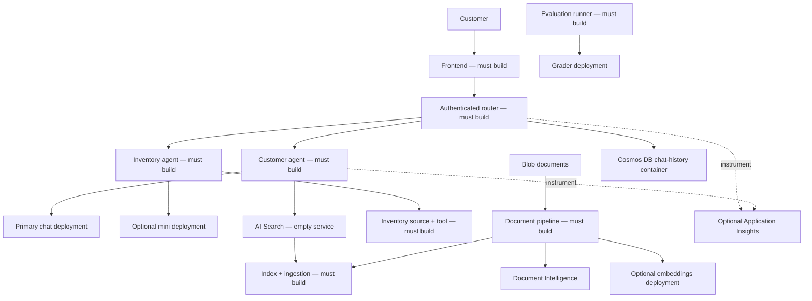

# دعم العملاء متعدد الوكلاء — مخطط هندسة التجزئة

**الفصل 5: حلول الذكاء الاصطناعي متعددة الوكلاء**

- [الصفحة الرئيسية للدورة](../README.md)
- [الفصل 5](../docs/chapter-05-multi-agent/README.md)
- [المتطلبات الأساسية: دمج الذكاء الاصطناعي](../docs/chapter-02-ai-development/microsoft-foundry-integration.md)
- [التالي: تخطيط الطاقة الاستيعابية](../docs/chapter-06-pre-deployment/capacity-planning.md)
- [هيكلية البنية التحتية لـ ARM](retail-multiagent-arm-template/README.md)

> **دليل التصميم، وليس تطبيقًا عمليًا.** ملفات تنفيذ التجزئة الوحيدة
> هي `azuredeploy.json`، `azuredeploy.parameters.json`، و`deploy.sh` في
> `retail-multiagent-arm-template/`. حاويات الموجه/الواجهة الأمامية هي مجرد نماذج ترحيبية.
> لا يوجد وكيل تجزئة، واجهة مستخدم، خط تدفق الإدخال، مقيم، ماسح، أو
> مجموعة اختبار التطبيق محليًا.

## نظرة عامة

**الهدف:** تصميم نظام دعم عملاء مع وكيل للعميل ووكيل للمخزون،
تحديد ما توفره البنية التحتية، وتخطيط العقود المفقودة للتطبيق وعمليات التحقق.


**الجمهور المستهدف:** المطورون الذين أكملوا البيئة المحلية
[عينة الدردشة](../../../examples/azure-openai-chat) و [عينة حاوية خدمتين](../../../examples/container-app/microservices).
اسمح من 2 إلى 3 ساعات للدراسة المعمارية. بناء التطبيق هو مشروع منفصل:
تُعد 80-120 ساعة تطوير تقديرًا تخطيطيًا توضيحيًا للمطورين المتمرسين، **وليس وعدًا بالتسليم**؛
تتطلب تهيئة الإنتاج، والاختبارات، ومراجعة الأمان، والعمليات عملًا إضافيًا.


### مخرجات التعلم

- شرح التوجيه، التأصيل، أذونات الأدوات، وملكية المحادثة.
- التمييز بين معرفات النماذج، أسماء النشر، إصدارات API، وإصدارات ARM.
- تصميم استيعاب واسترجاع الوثائق بأبعاد متجهات متطابقة.
- تحديد متطلبات وظيفية، تقييمية، واسترداد من الفشل قابلة للتحقق.
- فصل أهداف العمارة الاختيارية عن الموارد التي تم توفيرها فعليًا.

## هندسة الحل



هذه هي **هندسة تطبيق مستهدفة**، وليست رسمًا تخطيطيًا لخدمات الوكيل العاملة.
يقوم هيكل ARM بإنشاء الخدمات الأساسية وحاويتين كبدائل فقط.
لا تشمل الباب الأمامي، السجل، الهويات المُدارة، تعيين الأدوار،
النقاط النهائية الخاصة، التحويل الاحتياطي، تمكين التطبيق، والتنبيهات.

### المسؤوليات والعقود

| المكون | السلوك المطلوب | الأدلة قبل اعتباره مكتملًا |
|---|---|---|
| الواجهة الأمامية | التحقق من هوية المستخدمين، عرض الدردشة، تحميل الوثائق بأمان | اختبارات واجهة المستخدم والتحميل، أخطاء قابلة للوصول |
| الموجه | تفويض الطلبات، اختيار الوكيل، ربط أدوات الاتصال/انتهاء المهلة | اختبارات التوجيه، فحوصات التفويض، اختبارات الفشل |
| وكيل العميل | تأصيل الإجابات بناءً على السياسات/المنتجات في المصادر المعتمدة | اقتباسات صحيحة، الامتناع عند غياب البيانات |
| أداة المخزون | قراءة الأسطول الرسمي بأذونات محدودة | اختبارات المخزون الحتمية؛ لا اختراع للتوافر |
| خط معالجة الوثائق | استخراج، تقسيم، تضمين، فهرسة، تحديث/حذف | تجهيزات مفهرسة وسلوك إعادة المحاولة/رسائل الخطأ |
| تخزين المحادثة | عزل المستخدمين، تطبيق الاحتفاظ | اختبارات التفويض بين المستخدمين وتمديد العمر الافتراضي |
| مشغل التقييم | مقارنة المخرجات بالحقائق والبنية التقييمية | التغطية، عدد حالات الفشل، تقارير قابلة لإعادة الإنتاج |

فكر في الموجه كمكتب استقبال والأدوات كنظم داخلية مقيدة: 
اختيار متخصص لا يعني تفويض الوصول إلى سجلات كل عميل.
طبق التحقق من الهوية والأذونات في كود التطبيق وخدمات البيانات، وليس في مطالبات المستخدم.

## البنية التحتية مقابل التطبيق

اقرأ [README الهيكل](retail-multiagent-arm-template/README.md) قبل 
التهيئة. يحتوي على قائمة بالموارد الدقيقة، الأوضاع، التكاليف، والقيود.

| الاستخدام المنطقي | اسم نشر ARM | النموذج / الإصدار | المنطقة الافتراضية |
|---|---|---|---|
| دردشة العميل | `gpt-4.1-chat` | `gpt-4.1` / `2025-04-14` | `eastus2` |
| المخزون | `gpt-4.1-mini-inventory` | `gpt-4.1-mini` / `2025-04-14` | `westus2`، اختياري |
| التضمينات | `text-embedding-ada-002` | `text-embedding-ada-002` / `2` | `francecentral`، اختياري |
| التقييم | `gpt-4.1-grader` | `gpt-4.1` / `2025-04-14` | المنطقة الأساسية افتراضيًا |

تحقق من توفر النموذج/الإصدار/SKU والرصيد في **كل منطقة**. دردشة/صغير/مصحح
يستخدم `GlobalStandard`؛ التضمينات تستخدم `Standard`. رسوم وحدة السعة إلى TPM
خاصة بالنموذج. لا تضف وحدات سعة مختلفة كضمان رصيد شامل.

وسيط `model` لطلب Azure OpenAI هو **اسم النشر**، وليس بالضرورة معرف نموذج الكتالوج.
إصدار API لمستوى البيانات `2024-10-21`
مختلف عن إصدار نموذج `2025-04-14` وموارد ARM `apiVersion`.
لا يمكن إصلاح نموذج غير متوفر بتغيير إصدار API فقط.

`--no-multi-region` يتخطى الحسابات الثانوية وحسابات التضمين. يبقى حساب دردشة أساسي
وحساب مصحح مستقل. الحسابات المنفصلة للنماذج لا توفر تحويل تلقائي؛ يتطلب ذلك توجيه التطبيق،
نشرات متوافقة، فحوصات صحة، حدود إعادة المحاولة، ومراجعة إقامة البيانات.


## خارطة طريق التنفيذ

### 1. ابدأ بتفاعل واحد مختبر

قبل تهيئة الهيكل الكبير، استخدم عينة الدردشة المحلية لإنشاء
الاتصال بالاستدلال. حدد سؤال عميل تمثيلي، مصدر الإجابة المعتمد،
الاستشهاد المتوقع، وسلوك الفشل عند غياب المصدر.

### 2. حدد التوجيه وحدود الأدوات

أنشئ مصدر الموجه الخاص بك، بيان التبعية، الملف Dockerfile، والاختبارات. عقد توضيحي
يمكن أن يكون `POST /chat` مع `{"message":"...","conversation_id":"..."}`.
**هذه النقطة نهاية اقتراح تصميم؛ لم يُنفذ في قالب ARM.**

تحقق من أنواع/حدود المحتوى، استخلص هوية المستخدم من التحقق،
طبق ملكية المحادثة، نفذ انقضاء مهلات الطلب، وارجع رموز أخطاء مفيدة.
لا تعامل فشل HTTP أو الردود الفارغة كنتاج ناجح للوكيل.

### 3. طبق التأصيل والاستيعاب

قالب ARM لا ينشئ فهرس بحث. هذه **مقتطف JSON مرجعي
لتتكيف في تعريف فهرسك الخاص**، وليس ملفًا موجودًا في المستودع:

```json
{
  "name": "retail-product-index",
  "fields": [
    {"name": "id", "type": "Edm.String", "key": true},
    {"name": "title", "type": "Edm.String", "searchable": true},
    {"name": "content", "type": "Edm.String", "searchable": true},
    {"name": "category", "type": "Edm.String", "filterable": true},
    {
      "name": "content_vector",
      "type": "Collection(Edm.Single)",
      "searchable": true,
      "dimensions": 1536,
      "vectorSearchProfile": "retail-profile"
    }
  ],
  "vectorSearch": {
    "algorithms": [{"name": "retail-hnsw", "kind": "hnsw"}],
    "profiles": [{"name": "retail-profile", "algorithm": "retail-hnsw"}]
  }
}
```

يربط الملف التعريفي حقل المتجه بالخوارزمية. يجب أن تتطابق الأبعاد مع
الإنتاج الفعلي للتضمين (1536 لهذا نشر `ada-002`). للاسترجاع عبر Python،
استخدم `azure.search.documents.models.VectorizedQuery` بدلاً من
قاموس ناقص يفتقد نوع استعلام المتجه:

```python
# Reference function only: supply an authenticated async SearchClient and an embedding.
from azure.search.documents.models import VectorizedQuery

async def retrieve(search_client, embedding):
    results = await search_client.search(
        search_text=None,
        vector_queries=[VectorizedQuery(
            vector=embedding,
            k_nearest_neighbors=5,
            fields="content_vector"
        )],
        select=["id", "title", "content"]
    )
    return [document async for document in results]
```

أنشئ تنفيذ استيعاب منفصل يقوم بـ:

1. تفويض الوصول للتحميل والتحقق من نوع وحجم المحتوى.
2. قراءة الكتل الخاصة باستخدام مكالمات SDK المصادق عليها. URL كتلة خاصة لوحده
   **ليس** مدخلًا مقروءًا لـ Document Intelligence؛ أرسل البايتات التي تم تنزيلها مع
   `AnalyzeDocumentRequest(bytes_source=...)` أو استخدم SAS قصير الأمد ومحدد النطاق بعد مراجعة متطلبات الوصول.
3. استخراج النص، تقسيمه ليناسب حدود التضمين، وتوليد التضمينات.
4. إنشاء مفاتيح وثائق ثابتة صالحة وتحميل القطع مع المتجهات المطابقة.
5. التحقق من نتائج الفهرسة لكل وثيقة، التعامل مع المحاولات، وتحديث/حذف البيانات القديمة.


تحقق من أنواع القيم، وافرل علامات الاقتباس في السلاسل النصية. تحتاج فلاتر boolean والرقمية
إلى قيم لفظية مtyped، ليست سلاسل نصية مقيدة.


### 4. التأصيل على الويب

**تم إيقاف Bing Search v7 في 11 أغسطس 2025.** المورد القديم `Microsoft.Bing/accounts`
والأمثلة `api.bing.microsoft.com/v7.0/search` ليست مسار تنفيذ مدعوم.
قيّم تكامل تأصيل مدعوم حاليًا في
Microsoft Foundry بالإضافة إلى SDK، الأذونات، الفوترة، ومتطلبات الاستشهاد؛
لم يتم تنفيذ أي منها هنا. ليست بديلاً مباشرًا لنقطة النهاية المتوقفة.

### 5. أضف القياسات والتقييم

إنشاء Application Insights لا يفعّل تعليمات الكود. استخدم تفعيل Azure Monitor OpenTelemetry عند بناء تطبيق جديد،
انقل سياق التتبع بين الخدمات، وتجنب تسجيل مطالبات المستخدم، الوثائق، أو الأسرار.
تقصير الاستعلام لا يعممه.


قياس مدة الطلب، أخطاء التوجيه/الأدوات، صلة الاسترجاع، صحة الاستشهاد،
استخدام الرموز، والامتناع. خزّن حقائق المخزون/السياسة الحقيقية
بجانب حالات التقييم: لا يستطيع المصحح تحديد الدقة الواقعية
من سؤال وإجابة فقط.

نشر المصحح ليس مشغل تقييم. طبق معيارًا مُرقمًا، 
مخرجاً منظمًا/تحقق بنية، فحوصات مدى الدرجات، عدد حالات فشل النقل،
والحالات التي تم مراجعتها يدويًا. أبلغ عن الحالات غير المكتملة/الخطأ بشكل منفصل؛ لا تحولها إلى درجات ناجحة أو تضمّنها بصمت كردود نموذج صفر الجودة.


وبالمثل، بعض فحوصات الكلمات الدلالية ليست شهادة أمان. يجب أن يجعل طلب HTTP الفاشل،
أو غياب استراتيجية الاختبار، أو الرد الفارغ الاختبار **غير حاسم أو فاشل**، لا ينتج درجة "100% آمنة".
قم بالاختبار المفوض باستخدام الأدوات والمراجعة البشرية الملائمة قبل أي إدعاء بجهوزية الإنتاج.


### 6. نشر تطبيقك

أنشئ مجلدات المصدر، البيانات الوصفية، الاختبارات، السجل، وأذونات سحب الصور الخاصة بك. استبدل العناصر النائبة بالصور المُنشأة وحدّث المنافذ والمستشعرات
لتتناسب مع منفذ الاستماع في كل تطبيق. اضبط متغيرات بيئة التشغيل في Bicep
أو في تعيين بيئة azd مدعوم صريح.


لا يوجد قاموس `config` عام تحت خدمة azd ينشئ تلقائيًا
متغيرات بيئة وقت التشغيل. `azd env set` يغير فقط الموارد التي
تستهلك تلك القيم بشكل صريح. لا يتم تنفيذ أي كَناري، قائمة مناطق، أو خطاف ضبط دقيق
في هذا الهيكل الأساسي.

## تمارين تصميم تطبيقية

هذه عبارة عن **تمارين معمارية**، وليست بيانات تدعي وجود رمز بداية تجارة قابل للتنفيذ.

### التمرين 1: تحقق من الحدود

**نقطة البداية:** الملفات الثلاثة في `retail-multiagent-arm-template/`.
**الهدف:** التمييز بين توفير الموارد ووظائف التطبيق.
افتح `azuredeploy.json`، وحدد كل من صور الحاويات وقيم `targetPort`،
ثم أدرج مكونات التطبيق الغائبة عن المستودع.

**معايير النجاح / الجواب:** كلتا الصورتين هما عناصر نائبة hello-world تستمع
على المنفذ 80؛ الوكلاء، واجهة الدردشة، معالجات الموجه، الفهرس/الاستيعاب، المقيم، والماسح
غائبون. طلب جذر نائب ناجح لا يتحقق من `/chat`.
**مشكلة شائعة:** تفسير أسماء الموارد مثل `retail-router` كرمز يعمل.

### التمرين 2: تتبع تكوين المتجه

**نقطة البداية:** JSON الفهرس أعلاه.
**الهدف:** فهم العلاقة بين الحقل → الملف الشخصي → الخوارزمية.
حدد القيم التي يجب تغييرها عند التبديل إلى نموذج تضمين ب
أبعاد إخراج مختلفة، ثم فحص وظيفة `retrieve`.

**معايير النجاح / الجواب:** غيّر الحقل `dimensions` إلى الطول الفعلي للمتجه؛
حافظ على `vectorSearchProfile` متطابقًا مع ملف شخصي معلن وخوارزميته؛
يجب أن يسمي استعلام `fields` حقل المتجه. أعد إنشاء متجهات الوثائق الحالية
عند تغيير نموذج التضمين.
**مشكلة شائعة:** تغيير اسم النموذج فقط مع الاحتفاظ بمتجهات غير متوافقة.

### التمرين 3: تعريف اختبار فشل

**نقطة البداية:** جدول المسؤوليات.
**الهدف:** منع النجاح الكاذب.
اكتب السلوك المتوقع لواجهة برمجة تطبيقات المخزون غير المتوفرة، فهرس بحث بدون
مستندات مطابقة، وطلب تقييم يعيد HTTP 503.

**معايير النجاح / الجواب:** لا قيم مخزون مخترعة؛ الامتناع الصريح أو
التصعيد عند فقدان السياق؛ تبلغ التقييم عن فشل في النقل بدلاً
من نجاح في الجودة أو الأمان. أضف اختبارات قابلة للتنفيذ عند بناء التطبيق.
**مشكلة شائعة:** التقاط كل استثناء والاستمرار بإجابة فارغة.

## التكاليف، استكشاف الأخطاء، والتنظيف

- البنية التحتية لها تكاليف مستمرة حتى مع فروغ فهارس البحث والتطبيقات النائبة.
  استخدم الأسعار الإقليمية الحالية؛ لا يعني "الحد الأدنى" أو متعدد المناطق أنه مجاني.
- تكاليف الرموز تعتمد على النموذج، الإدخال المخزن مؤقتًا/غير المخزن، الإخراج، وتوزيع SKU.
  يمكن للتوجيه توفير المال فقط إذا بررت عبء العمل المقاس ونتائج الجودة ذلك؛
  لا ضمان لتوفير ثابت بين 60-80%.
- تحقق من توافر النموذج والحصة قبل التوفير؛ ميّز بين أخطاء الأذونات،
  اسم التوزيع، المنطقة، إصدار النموذج، وإصدار API.
- لا تقم بتشغيل `setup-data.sh` المفقودة، أدوات CLI للمقيم، أو أوامر `pytest tests/`.
  تنفيذاتها جزء من سجل تطويرك الخلفي.
- الهيكل الأساسي مخصص لـ ARM فقط: اتبع
  [تعليمات التحقق والتنظيف](retail-multiagent-arm-template/README.md).
  `azd down` لا يدير تلك الموارد.

## موارد ذات صلة

- [عينة دردشة محلية عاملة](../../../examples/azure-openai-chat)
- [عينة حاويتين لخدمتين عاملتين](../../../examples/container-app/microservices)
- [فهارس متجهات بحث AI](https://learn.microsoft.com/azure/search/vector-search-how-to-create-index)
- [وثائق تطبيقات الحاوية](https://learn.microsoft.com/azure/container-apps/)
- [استكشاف الأخطاء](../docs/chapter-07-troubleshooting/common-issues.md)
- [الإبلاغ عن مشكلة](https://github.com/microsoft/AZD-for-beginners/issues)

---

<!-- CO-OP TRANSLATOR DISCLAIMER START -->
**تنويه**:
تمت ترجمة هذا المستند باستخدام خدمة الترجمة بالذكاء الاصطناعي [Co-op Translator](https://github.com/Azure/co-op-translator). بينما نسعى للدقة، يرجى العلم أن الترجمات الآلية قد تحتوي على أخطاء أو عدم دقة. يجب اعتبار المستند الأصلي بلغته الأصلية المصدر الرسمي والمعتمد. للمعلومات الهامة، يُنصح بالاستعانة بترجمة بشرية محترفة. نحن غير مسؤولين عن أي سوء فهم أو تفسير ناتج عن استخدام هذه الترجمة.
<!-- CO-OP TRANSLATOR DISCLAIMER END -->