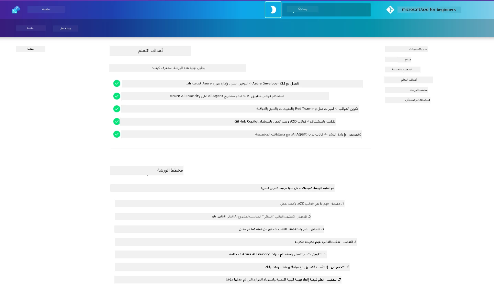

<div align="center">
  <div style="background: linear-gradient(135deg, #0078d4, #106ebe); border-radius: 10px; padding: 20px; margin: 20px 0; box-shadow: 0 4px 15px rgba(0, 120, 212, 0.3); border: 2px solid #005a9e;">
    <h2 style="color: white; margin: 0; font-size: 24px; text-shadow: 1px 1px 2px rgba(0,0,0,0.3);">
      🎯 ورشة عمل AZD لمطوري الذكاء الاصطناعي
    </h2>
    <p style="color: white; margin: 10px 0 0 0; font-size: 16px; text-shadow: 1px 1px 2px rgba(0,0,0,0.3);">
      <strong>ورشة عمل تفعيلية لبناء تطبيقات الذكاء الاصطناعي باستخدام واجهة أوامر مطور أزور (Azure Developer CLI).</strong><br>
      أكمل 7 وحدات لإتقان قوالب AZD وسير العمل لنشر الذكاء الاصطناعي.
    </p>
    <div style="margin-top: 15px;">
      <span style="background: rgba(255,255,255,0.2); padding: 5px 10px; border-radius: 15px; color: white; font-size: 14px;">
        📅 تمت مراجعة الإرشادات المصدر: نوفمبر 2026
      </span>
    </div>
  </div>
</div>

# ورشة عمل AZD لمطوري الذكاء الاصطناعي

مرحباً بكم في ورشة العمل التفعيلية لتعلم Azure Developer CLI (AZD) مع التركيز على نشر تطبيقات الذكاء الاصطناعي. تساعدك هذه الورشة على اكتساب فهم عملي لقوالب AZD في 3 خطوات:

1. **الاكتشاف** - اكتشف القالب المناسب لك.
1. **النشر** - انشر وتحقق من أنه يعمل
1. **التخصيص** - عدل وكرر لتجعله ملكك!

خلال هذه الورشة، ستتعرف أيضاً على أدوات سير تطوير أساسية لمساعدتك في تبسيط رحلة التطوير الشاملة.

<br/>

## دليل عبر المتصفح

دروس الورشة مكتوبة بلغة Markdown. يمكنك التنقل فيها مباشرة على GitHub - أو إطلاق معاينة عبر المتصفح كما هو موضح في لقطة الشاشة أدناه.



لاستخدام هذا الخيار - قم بعمل فورك للمستودع إلى ملفك الشخصي، ثم أطلق GitHub Codespaces. بمجرد تفعيل طرفية VS Code، اكتب هذا الأمر:

تعمل هذه المعاينة عبر المتصفح في GitHub Codespaces، حاويات التطوير (dev containers)، أو نسخة محلية مع تثبيت Python وMkDocs.

```bash title="" linenums="0"
python -m pip install -r requirements-dev.txt
python -m mkdocs serve --config-file workshop/mkdocs.yml
```

نفذ هذه الأوامر من **جذر مستودع الدورة**، وليس من عينة الذكاء الاصطناعي المهيأة بشكل مستقل. اجعل المعاينة أمامك للحفاظ على ظهور الأخطاء؛ أوقفها باستخدام Ctrl+C. للتحقق من الموقع دون خدمته، شغّل `python -m mkdocs build --strict --config-file workshop/mkdocs.yml`.

خلال ثوانٍ، سترى مربع حوار منبثق. اختر الخيار `Open in browser`. سيفتح الدليل المستند إلى الويب الآن في تبويب جديد في المتصفح. بعض مزايا هذه المعاينة:

1. **بحث مدمج** - عثر على الكلمات المفتاحية أو الدروس بسرعة.
1. **أيقونة النسخ** - حرّك المؤشر فوق الكتل البرمجية لمشاهدة هذا الخيار
1. **تبديل السمة** - التبديل بين السمات الداكنة والفاتحة
1. **الحصول على المساعدة** - انقر على أيقونة Discord في التذييل للانضمام!

<br/>

## نظرة عامة على الورشة

**المدة:** 3-4 ساعات  
**المستوى:** مبتدئ إلى متوسط  
**المتطلبات المسبقة:** إلمام بـ Azure ومفاهيم الذكاء الاصطناعي وأدوات VS Code وسطر الأوامر.

هذه ورشة عمل تفعيلية تتعلم فيها بالممارسة. بمجرد إكمال التمارين، نوصي بمراجعة مناهج AZD للمبتدئين لمواصلة رحلة تعلمك في أفضل ممارسات الأمان والإنتاجية.

| الوقت| الوحدة  | الهدف |
|:---|:---|:---|
| 15 دقيقة | [المقدمة](docs/instructions/0-Introduction.md) | وضع الأساس، وفهم الأهداف |
| 30 دقيقة | [اختيار قالب الذكاء الاصطناعي](docs/instructions/1-Select-AI-Template.md) | استكشاف الخيارات واختيار البداية | 
| 30 دقيقة | [التحقق من قالب الذكاء الاصطناعي](docs/instructions/2-Validate-AI-Template.md) | نشر الحل الافتراضي إلى Azure |
| 30 دقيقة | [تفكيك قالب الذكاء الاصطناعي](docs/instructions/3-Deconstruct-AI-Template.md) | استكشاف الهيكل والتكوين |
| 30 دقيقة | [تكوين قالب الذكاء الاصطناعي](docs/instructions/4-Configure-AI-Template.md) | تفعيل وتجربة الميزات المتوفرة |
| 30 دقيقة | [تخصيص قالب الذكاء الاصطناعي](docs/instructions/5-Customize-AI-Template.md) | تكييف القالب مع احتياجاتك |
| 30 دقيقة | [تفكيك البنية التحتية](docs/instructions/6-Teardown-Infrastructure.md) | التنظيف وإطلاق الموارد |
| 15 دقيقة | [الخاتمة والخطوات التالية](docs/instructions/7-Wrap-up.md) | موارد التعلم، تحدي الورشة |

<br/>

## ما ستتعلمه

فكر في قالب AZD كصندوق رمل تعليمي لاستكشاف القدرات والأدوات المختلفة لتطوير نهاية إلى نهاية على Microsoft Foundry. بنهاية هذه الورشة، يجب أن تمتلك إحساساً بديهيًا بالأدوات والمفاهيم المختلفة ضمن هذا السياق.

| المفهوم  | الهدف |
|:---|:---|
| **واجهة أوامر مطور أزور (Azure Developer CLI)** | فهم أوامر الأدوات وسير العمل|
| **قوالب AZD**| فهم هيكل المشروع والتكوين|
| **عميل الذكاء الاصطناعي في أزور**| توفير ونشر مشروع Microsoft Foundry  |
| **بحث الذكاء الاصطناعي في أزور**| تمكين هندسة السياق بواسطة العملاء |
| **الرصد والمراقبة**| استكشاف التتبع، الرصد والتقييمات |
| **الفريق الأحمر**| استكشاف الاختبار الهجومي والتدابير |

<br/>

## هيكل الورشة

تم هيكلة الورشة لتأخذك في رحلة من اكتشاف القالب، إلى النشر، التفكيك، والتخصيص - باستخدام قالب المبتدئين الرسمي [البدء مع عملاء الذكاء الاصطناعي](https://github.com/Azure-Samples/get-started-with-ai-agents) كأساس.

### [الوحدة 1: اختيار قالب الذكاء الاصطناعي](docs/instructions/1-Select-AI-Template.md) (30 دقيقة)

- ما هي قوالب الذكاء الاصطناعي؟
- أين يمكنني إيجاد قوالب الذكاء الاصطناعي؟
- كيف أبدأ في بناء عملاء الذكاء الاصطناعي؟
- **المعمل**: بداية سريعة في Codespaces أو حاوية التطوير

### [الوحدة 2: التحقق من قالب الذكاء الاصطناعي](docs/instructions/2-Validate-AI-Template.md) (30 دقيقة)

- ما هو هيكل قالب الذكاء الاصطناعي؟
- ما هو سير عمل تطوير AZD؟
- كيف يمكنني الحصول على مساعدة في تطوير AZD؟
- **المعمل**: نشر والتحقق من قالب العملاء الذكاء الاصطناعي

### [الوحدة 3: تفكيك قالب الذكاء الاصطناعي](docs/instructions/3-Deconstruct-AI-Template.md) (30 دقيقة)

- استكشف بيئتك في `.azure/` 
- استكشف إعداد الموارد في `infra/` 
- استكشف تكوين AZD في `azure.yaml`s
- **المعمل**: تعديل متغيرات البيئة وإعادة النشر

### [الوحدة 4: تكوين قالب الذكاء الاصطناعي](docs/instructions/4-Configure-AI-Template.md) (30 دقيقة)
- استكشاف: التوليد المعزز بالاسترجاع
- استكشاف: تقييم العميل والفريق الأحمر
- استكشاف: التتبع والمراقبة
- **المعمل**: استكشاف عميل الذكاء الاصطناعي + الرصد

### [الوحدة 5: تخصيص قالب الذكاء الاصطناعي](docs/instructions/5-Customize-AI-Template.md) (30 دقيقة)
- تحديد: وثيقة متطلبات المنتج مع متطلبات السيناريو
- تكوين: متغيرات البيئة لـ AZD
- تنفيذ: حلقات دورة الحياة للمهام الإضافية
- **المعمل**: تخصيص القالب للسيناريو الخاص بي

### [الوحدة 6: تفكيك البنية التحتية](docs/instructions/6-Teardown-Infrastructure.md) (30 دقيقة)
- ملخص: ما هي قوالب AZD؟
- ملخص: لماذا نستخدم واجهة أوامر مطوري أزور؟
- الخطوات التالية: جرب قالبًا مختلفًا!
- **المعمل**: إزالة البنية التحتية والتنظيف

<br/>

## تحدي الورشة

تريد تحدي نفسك لفعل المزيد؟ إليك بعض اقتراحات المشاريع - أو شارك أفكارك معنا!!

| المشروع | الوصف |
|:---|:---|
|1. **تفكيك قالب ذكاء اصطناعي معقد** | استخدم سير العمل والأدوات التي أوضحناها وانظر إذا كنت تستطيع نشر والتحقق وتخصيص قالب حل ذكاء اصطناعي مختلف. _ما الذي تعلمته؟_|
|2. **التخصيص وفق سينارك**  | حاول كتابة وثيقة متطلبات منتج (PRD) لسيناريو مختلف. ثم استخدم GitHub Copilot في مستودع القالب في نموذج العميل - واطلب منه توليد سير تخصيص لك. _ما الذي تعلمته؟ كيف يمكنك تحسين هذه الاقتراحات؟_|
| | |

## هل لديك ملاحظات؟

1. اطرح مشكلة في هذا المستودع - وقم بتعليمها `Workshop` للتسهيل.
1. انضم إلى خادم Discord الخاص بـ Microsoft Foundry - تواصل مع أقرانك!


| | | 
|:---|:---|
| **📚 الصفحة الرئيسية للدورة**| [AZD للمبتدئين](../README.md)|
| **📖 التوثيق** | [البدء باستخدام قوالب الذكاء الاصطناعي](https://learn.microsoft.com/en-us/azure/ai-foundry/how-to/develop/ai-template-get-started)|
| **🛠️ قوالب الذكاء الاصطناعي** | [قوالب Microsoft Foundry](https://ai.azure.com/templates) |
|**🚀 الخطوات التالية** | [ابدأ الورشة](#workshop-overview) |
| | |

<br/>

---

**التنقل:** [الدورة الرئيسية](../README.md) | [المقدمة](docs/instructions/0-Introduction.md) | [الوحدة 1: اختيار القالب](docs/instructions/1-Select-AI-Template.md)

**هل أنت مستعد لبدء بناء تطبيقات الذكاء الاصطناعي باستخدام AZD؟**

[ابدأ الورشة: المقدمة →](docs/instructions/0-Introduction.md)

---

<!-- CO-OP TRANSLATOR DISCLAIMER START -->
**تنويه**:
تمت ترجمة هذا المستند باستخدام خدمة الترجمة بالذكاء الاصطناعي [Co-op Translator](https://github.com/Azure/co-op-translator). بينما نسعى للدقة، يرجى العلم أن الترجمات الآلية قد تحتوي على أخطاء أو عدم دقة. يجب اعتبار المستند الأصلي بلغته الأصلية المصدر الرسمي والمعتمد. للمعلومات الهامة، يُنصح بالاستعانة بترجمة بشرية محترفة. نحن غير مسؤولين عن أي سوء فهم أو تفسير ناتج عن استخدام هذه الترجمة.
<!-- CO-OP TRANSLATOR DISCLAIMER END -->