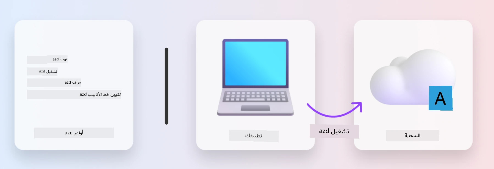
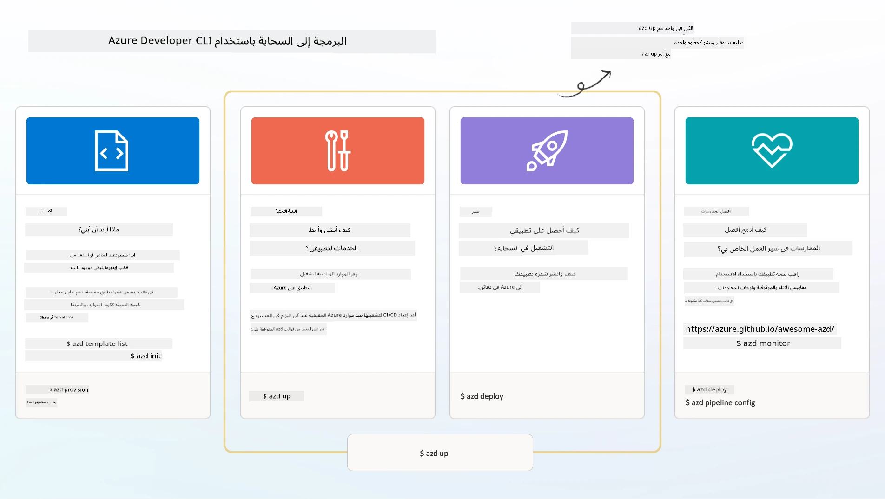

# 1. اختر قالبًا

!!! tip "بنهاية هذه الوحدة ستكون قادرًا على"

    - [ ] Describe what AZD templates are
    - [ ] Discover and use AZD templates for AI
    - [ ] Get started with the AI Agents template
    - [ ] **Lab 1:** AZD Quickstart in Codespaces or a dev container

---

## 1. مثال للبناء

بناء تطبيق ذكاء اصطناعي حديث وجاهز للمؤسسات _من الصفر_ قد يكون مهمة شاقة. إنه يشبه إلى حد ما بناء منزلك الجديد بنفسك، لبنة تلو الأخرى. نعم، يمكن فعل ذلك! لكنه ليس الطريقة الأكثر فعالية للوصول إلى النتيجة المرجوة!

بدلًا من ذلك، نبدأ غالبًا بمخطط تصميم _موجود_، ونعمل مع مهندس معماري لتخصيصه وفقًا لمتطلباتنا الشخصية. وهذا هو النهج الذي يجب اتباعه عند بناء التطبيقات الذكية. أولاً، ابحث عن بنية تصميم جيدة تناسب مجال مشكلتك. ثم اعمل مع مهندس حلول لتخصيص وتطوير الحل لسيناريو محدد خاص بك.

لكن من أين يمكننا العثور على هذه المخططات التصميمية؟ وكيف نجد مهندسًا راغبًا في تعليمنا كيفية تخصيص ونشر هذه المخططات بأنفسنا؟ في هذه الورشة، نجيب عن تلك الأسئلة من خلال تقديم ثلاث تقنيات لك:

1. [Azure Developer CLI](https://aka.ms/azd) - أداة مفتوحة المصدر تسرع مسار المطور من التطوير المحلي (البناء) إلى النشر في السحابة (الشحن).
1. [Microsoft Foundry Templates](https://ai.azure.com/templates) - مستودعات موحدة مفتوحة المصدر تحتوي على كود نموذجي، وبنى تحتية وملفات تكوين لنشر بنية حل ذكاء اصطناعي.
1. [GitHub Copilot Agent Mode](https://code.visualstudio.com/docs/copilot/chat/chat-agent-mode) - وكيل ترميز مستند إلى معرفة Azure، يمكنه إرشادنا في التنقل عبر قاعدة البيانات البرمجية وإجراء التعديلات - باستخدام لغة طبيعية.

مع هذه الأدوات بين أيدينا، يمكننا الآن _اكتشاف_ القالب المناسب، _نشره_ للتحقق من فعاليته، و_تخصيصه_ ليناسب سيناريوهاتنا الخاصة. هيا بنا نبدأ ونتعلم كيف تعمل هذه الأدوات.


---

## 2. Azure Developer CLI

أداة سطر الأوامر [Azure Developer CLI](https://learn.microsoft.com/en-us/azure/developer/azure-developer-cli/) (أو `azd`) هي أداة مفتوحة المصدر يمكنها تسريع رحلتك من الكود إلى السحابة بمجموعة من الأوامر السهلة للمطورين التي تعمل بشكل متسق عبر بيئة التطوير المتكاملة (IDE) وبيئات الدمج المستمر/التسليم المستمر (CI/CD).

مع `azd`، يمكن أن تكون رحلتك للنشر بسيطة مثل:

- `azd init` - تهيئة مشروع ذكاء اصطناعي جديد من قالب AZD موجود.
- `azd up` - توفير البنية التحتية ونشر التطبيق الخاص بك في خطوة واحدة.
- `azd monitor` - الحصول على مراقبة وتشخيصات في الوقت الحقيقي لتطبيقك المنشور.
- `azd pipeline config` - إعداد خطوط أنابيب CI/CD لأتمتة النشر إلى Azure.

**🎯 | تمرين**: <br/> استكشف أداة سطر الأوامر `azd` في بيئة ورشة العمل الحالية الخاصة بك الآن. يمكن أن يكون هذا GitHub Codespaces أو حاوية تطوير، أو نسخة محلية مع تثبيت المتطلبات الأساسية. ابدأ بكتابة هذا الأمر لترى ماذا يمكن للأداة أن تفعل:

```bash title="" linenums="0"
azd help
```



---

## 3. قالب AZD

لكي تتمكن `azd` من تحقيق ذلك، تحتاج إلى معرفة البنية التحتية التي يجب توفيرها، وإعدادات التكوين التي يجب فرضها، والتطبيق الذي سيتم نشره. وهنا يأتي دور [قوالب AZD](https://learn.microsoft.com/en-us/azure/developer/azure-developer-cli/azd-templates?tabs=csharp).

قوالب AZD هي مستودعات مفتوحة المصدر تجمع بين كود العينة وملفات البنية التحتية والتكوين المطلوبة لنشر هندسة الحل.
باستخدام نهج _البنية التحتية ككود_ (IaC)، تسمح بتعريفات موارد القالب وإعدادات التكوين أن تكون خاضعة للتحكم في النسخ (تمامًا مثل كود مصدر التطبيق) - مما يخلق سير عمل قابل لإعادة الاستخدام ومتسق عبر مستخدمي ذلك المشروع.

عند إنشاء قالب AZD خاص بـ _حالتك_ أو إعادة استخدامه، ضع في اعتبارك هذه الأسئلة:

1. ماذا تبني؟ → هل هناك قالب يحتوي على كود مبدئي لتلك الحالة؟
1. كيف تم تصميم الحل الخاص بك؟ → هل هناك قالب يحتوي على الموارد اللازمة؟
1. كيف يتم نشر الحل الخاص بك؟ → فكر في `azd deploy` مع أدوات المعالجة المسبقة/اللاحقة!
1. كيف يمكنك تحسينه أكثر؟ → فكر في المراقبة المدمجة وخطوط الأنابيب الأوتوماتيكية!

**🎯 | تمرين**: <br/> 
زر معرض [Awesome AZD](https://azure.github.io/awesome-azd/) واستخدم المرشحات لاستكشاف أكثر من 250 قالب متاح حاليًا. انظر إذا كان بإمكانك العثور على واحد يتناسب مع متطلبات _حالتك_.



---

## 4. قوالب تطبيقات الذكاء الاصطناعي

لتطبيقات مدعومة بالذكاء الاصطناعي، تقدم Microsoft قوالب متخصصة تتميز بـ **Microsoft Foundry** و **Foundry Agents**. هذه القوالب تسرع طريقك لبناء تطبيقات ذكية وجاهزة للإنتاج.

### قوالب Microsoft Foundry وFoundry Agents

اختر قالبًا أدناه للنشر. كل قالب متاح على [Awesome AZD](https://azure.github.io/awesome-azd/) ويمكن تهيئته بأمر واحد فقط.

| القالب | الوصف | أمر النشر |
|----------|-------------|----------------|
| **[دردشة AI مع RAG](https://github.com/Azure-Samples/azure-search-openai-demo)** | تطبيق دردشة مبني على البحث | `azd init -t Azure-Samples/azure-search-openai-demo .` |
| **[البدء مع وكلاء AI](https://github.com/Azure-Samples/get-started-with-ai-agents)** | تطبيق دردشة مدعوم بوكلاء؛ يستخدم طوال ورشة العمل هذه | `azd init -t Azure-Samples/get-started-with-ai-agents .` |
| **[البدء مع دردشة AI](https://github.com/Azure-Samples/get-started-with-ai-chat)** | تطبيق دردشة AI مبدئي | `azd init -t Azure-Samples/get-started-with-ai-chat .` |

هذه بدائل: قم بتهيئة **قالب واحد** في مجلده الفارغ الخاص. يعمل `.` اللاحق على اختيار هذا المجلد؛ وحذفه في إصدارات AZD الحالية ينشئ مجلد فرعي باسم القالب. التهيئة تقوم بتحميل المشروع؛ `azd up` ينفذ النشر القابل للفوترة بعد مراجعتك للمتطلبات الأساسية، الموارد، دعم المنطقة، والحصة.

### بدء سريع

1. **تصفح القوالب**: زر [https://azure.github.io/awesome-azd/](https://azure.github.io/awesome-azd/) وقم بتصفية حسب `AI`، `Agents`، أو `Microsoft Foundry`
2. **اختر قالبك**: اختر واحدًا يناسب حالتك
3. **تهيئة**: شغّل أمر `azd init` للقالب الذي اخترته
4. **نشر**: شغّل `azd up` لتوفير ونشر

**🎯 | تمرين**: <br/>
اختر واحدًا من القوالب أعلاه بناءً على حالتك:

- **هل تتابع هذه الورشة؟** → اختر **البدء مع وكلاء AI**
- **تبني دردشة مبنية على البحث؟** → استكشف **دردشة AI مع RAG** بشكل منفصل
- **تحتاج إلى هندسة مختلفة؟** → ابحث في المعرض وتحقق من المستودع الفعلي، حالة التنفيذ، والمتطلبات الأساسية

```bash title="Initialize the workshop template in an empty directory" linenums="0"
azd init -t Azure-Samples/get-started-with-ai-agents .
azd auth login
azd up
```

!!! info "اكتشف المزيد من القوالب"
    يحتوي [معرض Awesome AZD](https://azure.github.io/awesome-azd/) على أكثر من 250 قالبًا. استخدم المرشحات للعثور على القوالب التي تناسب متطلباتك الخاصة من حيث اللغة، الإطار، وخدمات Azure.

---

<!-- CO-OP TRANSLATOR DISCLAIMER START -->
**تنويه**:
تمت ترجمة هذا المستند باستخدام خدمة الترجمة بالذكاء الاصطناعي [Co-op Translator](https://github.com/Azure/co-op-translator). بينما نسعى للدقة، يرجى العلم أن الترجمات الآلية قد تحتوي على أخطاء أو عدم دقة. يجب اعتبار المستند الأصلي بلغته الأصلية المصدر الرسمي والمعتمد. للمعلومات الهامة، يُنصح بالاستعانة بترجمة بشرية محترفة. نحن غير مسؤولين عن أي سوء فهم أو تفسير ناتج عن استخدام هذه الترجمة.
<!-- CO-OP TRANSLATOR DISCLAIMER END -->