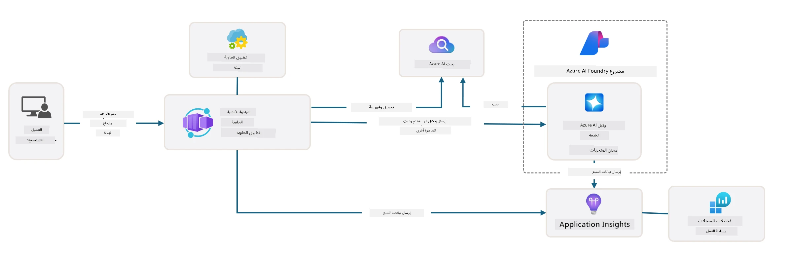
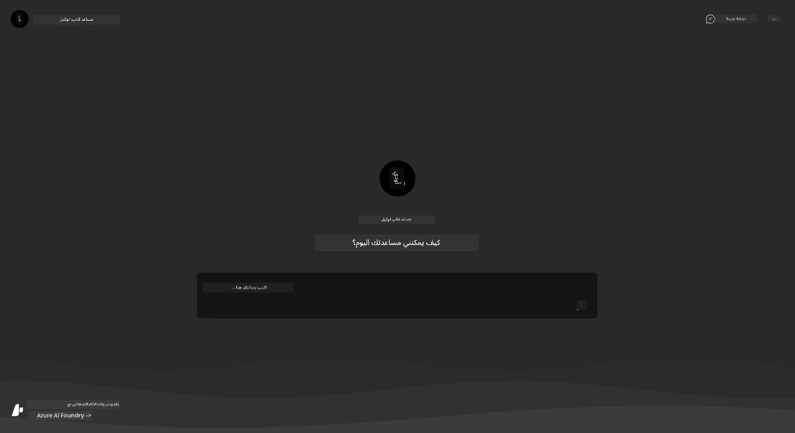

# 2. التحقق من صحة النموذج

> تم مراجعة التوجيهات المصدرية مقابل AZD 1.37.2 والعينة الحالية في 4 نوفمبر 2026. لقطات الشاشة توضيحية؛ قد تتغير تنقلات البوابة، الافتراضات الافتراضية للنموذج، وتوافر الخدمة. هذه المراجعة لم تقم بنشر Azure حي.

!!! tip "بنهاية هذه الوحدة ستكون قادرًا على"

    - [ ] Identify the sample's prerequisites and intended resources
    - [ ] Deploy the selected template into an intentional environment
    - [ ] Verify the application and agent behavior separately from deployment success
    - [ ] **Lab 2:** Record evidence of a working baseline, or an actionable deployment blocker

---

## 1. التحقق من المتطلبات المسبقة

يدير [Azure Developer CLI](https://learn.microsoft.com/azure/developer/azure-developer-cli/) نشر التطبيقات باستخدام تهيئة النموذج، البنية التحتية، والرمز. تحقق من نسختك المثبتة:

```bash
azd version
```

استخدم [تعليمات التثبيت/التحديث الحالية](https://learn.microsoft.com/azure/developer/azure-developer-cli/install-azd) إذا لزم الأمر. تعلن العينة التي تمت مراجعتها عن AZD `>=1.14.0`، لكن يُنصح بالنسخة المدعومة الحالية. تمتلك الامتدادات الاختيارية للذكاء الاصطناعي متطلبات إصدارات منفصلة؛ لا تتطلب دورة العمل العادية `azd up` في هذه العينة امتداد الوكلاء.

قبل البدء بالتوفير، اقرأ إعداد حساب Azure في العينة [Azure account setup](https://github.com/Azure-Samples/get-started-with-ai-agents/blob/main/docs/azure_account_setup.md) ودليل النشر [deployment guide](https://github.com/Azure-Samples/get-started-with-ai-agents/blob/main/docs/deployment.md). تحقق من الاشتراك، الأذونات، توافر النموذج، الحصة الإقليمية، والتكاليف المتوقعة. لا يضمن حساب Azure المجاني الوصول أو الاستخدام المجاني لكل خدمة مطلوبة.

## 2. افتح العينة المختارة

استخدم مستودع [Get Started with AI Agents](https://github.com/Azure-Samples/get-started-with-ai-agents) الذي تم تهيئته في الوحدة 1. إذا لم تقم بتهيئته، اختر أحد البدائل التالية:

- افتح [Codespace للعينة](https://github.com/codespaces/new/Azure-Samples/get-started-with-ai-agents).
- استنسخ العينة واتبع إعداد الحاوية/التطوير المحلي.
- في **دليل فارغ**، شغّل:

```bash
azd init --template Azure-Samples/get-started-with-ai-agents .
```

لا تهيئ نموذجًا ثانيًا فوق مشروع موجود. نفذ الأوامر التالية من جذر العينة الذي يحتوي على `azure.yaml`، ليس من جذر مستودع الدورة.

تستضيف العينة تطبيق دردشة مدعوم بالوكيل في Container Apps وتوفر موارد Foundry الداعمة. استعرض البنية الحالية والخدمات الاختيارية بدلاً من اعتبار لقطة شاشة قديمة كمخزون الموارد المحدد تمامًا.



## 3. انشر عن قصد

```bash
azd auth login
azd up
```

راجع المطالبات:

1. اختر اسم بيئة AZD فريد.
2. اختر الاشتراك المقصود، وليس ببساطة الاشتراك المعروض أولاً.
3. اختر منطقة مدعومة من النموذج/الإصدار/SKU المطلوب ومن حصتك.
4. اقرأ مخرجات التوفير، النشر، وخطاف ما بعد النشر.

الافتراضات التي تمت مراجعتها تتضمن `gpt-5-mini`، الإصدار `2025-08-07`، و `GlobalStandard`. تحقق من نموذجك المهيأ و[تركيبات النموذج/المنطقة المدعومة](https://learn.microsoft.com/azure/ai-services/agents/concepts/model-region-support). لا توجد منطقة مضمونة عمليًا للعمل دائمًا.

تختلف مدة النشر. إذا فشل التوفير، احتفظ بالخطأ وقم بإصلاح سببه قبل إعادة المحاولة. لا تحذف النشر أو تمسح الموارد نهائيًا كخطوة استكشافية عامة.

## 4. تحقق من التطبيق

```bash
azd show
```

افتح نقطة النهاية لـ `api_and_frontend`، أو ابحث عن تطبيق الحاوية في مجموعة الموارد للنشر في [بوابة Azure](https://portal.azure.com/). اتبع تعليمات الوصول/المصادقة في العينة إذا كان تسجيل الدخول مطلوبًا؛ لا تقم بإلغاء تفعيل المصادقة لجعل اختبار التدخين ينجح.



جرّب بعض [الأسئلة النموذجية](https://github.com/Azure-Samples/get-started-with-ai-agents/blob/main/docs/sample_questions.md):

- سؤال واقعي عام.
- سؤال يجب أن يكون جوابه موجودًا في مستندات العينة المحملة.
- سؤال لا يمكن الإجابة عليه من تلك المستندات.

تحقق من تحميل واجهة المستخدم، استجابة API، استخدام البيانات المتوقعة للاسترجاع، تطابق الاقتباسات مع محتوى المصدر، والتعامل السليم مع الأسئلة غير المدعومة. رسالة `azd up` الناجحة وحدها لا تكفي لتأكيد هذه النتائج.

## 5. فحص الوكيل المنشور

افتح مشروعك في [بوابة Foundry](https://ai.azure.com/). في التدفق الذي تم مراجعته، اختر **Build** ثم **Agents** وابحث عن الوكيل الذي أنشأته العينة. قد تتغير تسميات التنقل.

سجّل:

- اسم الوكيل والإصدار.
- نشر النموذج المهيأ له.
- التعليمات الفعلية والأدوات المفعلة.
- الملفات أو فهرس البحث المتصلة، وما إذا اكتمل الإعداد بنجاح.

تستخدم العينة التي تمت مراجعتها معرّف وكيل بالشكل `agent_name:agent_version` لاختباراتها التقييمية. لا تنسخ معرف وكيل/سلسلة كلاسيكي من لقطة شاشة قديمة إلى سير عمل API أحدث.

قارن المستندات المحمّلة مع `src/files/` في نسختك المهيأة. أظهرت لقطات الشاشة السابقة 32 ملفًا؛ هذا العدد ليس افتراضيًا مضمونًا حاليًا. تحقق من أي إجابة حول العملاء/المنتجات النموذجية مقابل المصدر التركيبي الفعلي، ولا تقم برفع بيانات عملاء حقيقية في هذا التمرين.

## 6. قارن مع ملعب الوكيل

افتح ملعب الوكيل المختار في Foundry واطرح نفس سؤال الاسترجاع. قارن الإصدار المهيأ للوكيل، الأدوات، الاقتباسات، وجودة الإجابة مع التطبيق المنشور.

الردود احتمالية؛ المطابقة كلمة بكلمة ليست المعيار. إذا اختلفت النتائج اختلافًا كبيرًا، تحقق من أن التطبيق والملعب يستهدفان نفس المشروع، الوكيل/الإصدار، ومصدر المعرفة.

## 7. تحقق من متطلبات المراقبة

دليل المراقبة في العينة [observability guide](https://github.com/Azure-Samples/get-started-with-ai-agents/blob/main/docs/observability.md) هو المصدر الموثوق لتتبع، التقييم، وإعداد الفرق الحمراء.

في الافتراضات المراجعة للبنية التحتية، تم تمكين Application Insights لكن **تتبع العميل معطل** (`ENABLE_AZURE_MONITOR_TRACING=false`). إنشاء مورد مراقبة لا يثبت أن التطبيق يصدر تتبعات. تغطي الوحدة 5 تمكين التتبع وتوليد طلب اختبار.

استخدم سجلات تطبيق Container App لفحص أخطاء بدء التشغيل/API. في Foundry، تحقق من وجهات نظر التتبع والمراقبة المتاحة للوكيل. تتطلب إدخالات التقييم التهيئة ذات الصلة، المقيمين/المنطقة المدعومة، والطلبات الفعلية؛ لا تظهر تلقائيًا لكل تشغيل.

اترك تقاط محتوى المطالبات/الاستجابة معطلًا إلا إذا تمت مراجعة خصوصيته، الاحتفاظ به، الوصول إليه، ومتطلبات التعتيم.

## 8. فهم قيم البيئة

يخزن AZD البيئة المختارة تحت `.azure/<environment-name>/`. يمكن قراءة المدخلات الدائمة ونواتج النشر باستخدام:

```bash
azd env list
azd env get-value AZURE_ENV_NAME
azd env get-value AZURE_LOCATION
```

يقوم `azd env get-values` بإدراج كل القيم، والتي قد تشمل تهيئة حساسة. لا تلصق تلك المخرجات في المشكلات أو السجلات العامة.

يستخدم AZD البيئة المختارة عند تنفيذ أوامره/خطافاته، بينما يمكن لمتغيرات بيئة العملية أيضًا التأثير على الأوامر والنماذج. هذا **لا** يصدر القيم إلى القشرة الأصلية أو كل عملية Python تبدأ بشكل مستقل. اتبع تعليمات التطوير المحلي في العينة [local development instructions](https://github.com/Azure-Samples/get-started-with-ai-agents/blob/main/docs/local_development.md).

يمكن تطبيق الافتراضات الافتراضية للنموذج في `infra/main.parameters.json` دون الظهور كقيم محلية صريحة. تعيين متغير تعسفي لا يغير البنية التحتية ما لم يستهلكه النموذج.

على سبيل المثال، لاختيار الافتراضات المراجعة للنموذج بشكل صريح:

```bash
azd env set AZURE_AI_AGENT_MODEL_NAME gpt-5-mini
azd env set AZURE_AI_AGENT_MODEL_VERSION 2025-08-07
azd env set AZURE_AI_AGENT_DEPLOYMENT_SKU GlobalStandard
azd provision --preview
azd up
```

راجع التوافق، السعة، التوفر، والتغييرات المخططة أولاً. تتطلب تحديثات البنية التحتية التوفير؛ `azd deploy` وحده غير كافٍ. عادة لا تتطلب تغييرات النموذج المدعوم تفكيك التطبيق بأكمله.

يستخرج `azd env refresh` مخرجات النشر لبيئة يمكن الوصول إليها؛ لا يعيد بناء كل المدخلات المخصصة، يزامن الأسرار، أو يستبدل إدارة التهيئة.

## 9. سجّل خط الأساس الخاص بك

- [ ] تم التحقق من البيئة الصحيحة، الاشتراك، المنطقة، والنموذج.
- [ ] اكتمل التوفير، النشر، وخطافات الإعداد المطلوبة بدون أخطاء عالقة.
- [ ] تم التحقق من وصول التطبيق، الدردشة، الاسترجاع، والاقتباسات.
- [ ] تم تحديد الوكيل/الإصدار ومصدر المعرفة.
- [ ] تم توثيق متطلبات المراقبة وأي عوائق متبقية.

تابع إلى [تفكيك نموذج](3-Deconstruct-AI-Template.md).

---

<!-- CO-OP TRANSLATOR DISCLAIMER START -->
**تنويه**:
تمت ترجمة هذا المستند باستخدام خدمة الترجمة بالذكاء الاصطناعي [Co-op Translator](https://github.com/Azure/co-op-translator). بينما نسعى للدقة، يرجى العلم أن الترجمات الآلية قد تحتوي على أخطاء أو عدم دقة. يجب اعتبار المستند الأصلي بلغته الأصلية المصدر الرسمي والمعتمد. للمعلومات الهامة، يُنصح بالاستعانة بترجمة بشرية محترفة. نحن غير مسؤولين عن أي سوء فهم أو تفسير ناتج عن استخدام هذه الترجمة.
<!-- CO-OP TRANSLATOR DISCLAIMER END -->