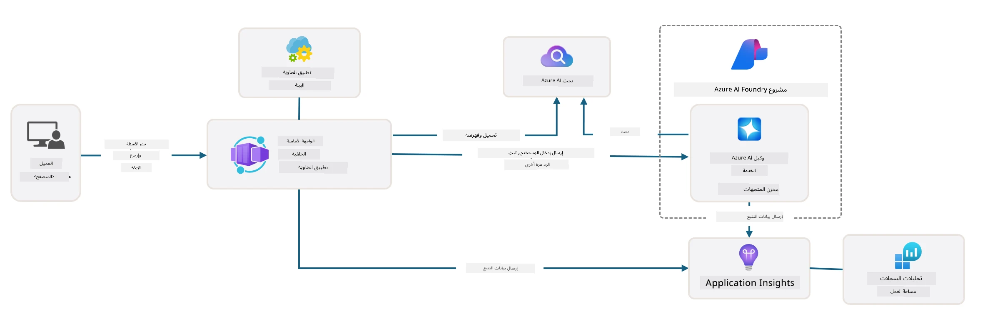

# 3. تفكيك قالب

!!! tip "بنهاية هذه الوحدة ستكون قادراً على"

    - [ ] Use GitHub Copilot and optional MCP tools for Azure documentation and read-only exploration
    - [ ] Identify the template's application, infrastructure, configuration, and test entry points
    - [ ] Verify generated explanations against actual repository files
    - [ ] **Lab 3:** Trace one request and one configuration input through the project

---

## 1. تفعيل GitHub Copilot

افتح نموذج AI المُهيأ في VS Code وقم بتمكين [GitHub Copilot](https://code.visualstudio.com/docs/copilot/chat/chat-agent-mode). سجّل الدخول بحساب لديه خطة مؤهلة؛ حدود الاستخدام تختلف. اطلب من Copilot شرح المستودع قبل السماح بالتغييرات.

### خوادم MCP الاختيارية

يمكن لهذه الخدمات توفير أدوات إضافية:

- [خادم Azure MCP](https://learn.microsoft.com/azure/developer/azure-mcp-server/overview)
- [خادم Microsoft Learn MCP](https://learn.microsoft.com/training/support/mcp)

في VS Code، راجع [إرشادات تكوين MCP](https://code.visualstudio.com/docs/copilot/chat/mcp-servers) وأنشئ `.vscode/mcp.json` إذا لزم الأمر:

```json
{
  "servers": {
    "Azure MCP Server": {
      "type": "stdio",
      "command": "npx",
      "args": ["-y", "@azure/mcp@latest", "server", "start"]
    },
    "microsoft.docs.mcp": {
      "type": "http",
      "url": "https://learn.microsoft.com/api/mcp"
    }
  }
}
```

يتطلب أمر `npx` تثبيت مدعوم لـ Node.js/npm وينزل شفرة تنفيذية. راجع الحزمة وقم بتثبيت نسخة معتمدة لإعداد فريق يمكن تكراره. ابدأ الخوادم باستخدام ضوابط MCP في VS Code وافحص الأدوات المتاحة؛ قد تتغير الأسماء بين الإصدارات.

**المصادقة منفصلة.** استخدم `azd auth login` لـ AZD. اتبع تدفق المصادقة الموثق لأدوات Azure MCP؛ تسجيل الدخول إلى AZD فقط لا ينشئ جلسة MCP. استخدم `az login` بشكل منفصل عند استدعاء تمرين أو خطاف Azure CLI.

جرب الأوامر القارئة فقط:

1. "استخدم Microsoft Learn MCP للعثور على توثيق تكوين Azure Developer CLI."
2. "اشرح `azure.yaml` في هذا المستودع؛ استشهد بالملفات التي تنفّذ كل خطاف."
3. "باستخدام أدوات Azure MCP المتوفرة، أدرج مواردي التي نشرتها دون تعديل أي شيء."

تحقق من المستأجر/الاشتراك المختار وكل استدعاء أداة مقترح. لا توافق على إنشاء موارد أو حذفها أو تغييرات الوصول لمجرد استكشاف البنية.

## 2. فهم البنية

يستضيف النموذج واجهة خلفية Python FastAPI وواجهة أمامية React/TypeScript في Azure Container Apps. يتواصل الواجهة الخلفية مع وكيل في مشروع Microsoft Foundry. تعتمد الاسترجاع والمراقبة على ميزات القالب المفعلة والإعداد الناجح؛ ولا تُضمن فقط لأن التطبيق تم نشره.



قارن هذا المخطط مع [دليل النشر الحالي](https://github.com/Azure-Samples/get-started-with-ai-agents/blob/main/docs/deployment.md) ومواردك الفعلية. تحقق من نشر النموذج المُعد، أدوات الوكيل، الهوية المدارة، تعيينات الأدوار، وموارد AI Search/Application Insights الاختيارية.

**تمرين:** اطلب من Copilot تتبع طلب الدردشة من الواجهة الأمامية عبر واجهة الـ API إلى Foundry، مع مراجع ملفات ودوال. افتح تلك المراجع وتحقق من الشرح. لا تستنتج المصادقة أو التوجيه أو التفويض المطبقة فقط من المخطط.

## 3. هيكل المستودع

المسارات المحددة التالية فُحصت مقابل النموذج في 4 نوفمبر 2026. تظل مراجعتك المُهيأة هي المصدر الصحيح:

```text
get-started-with-ai-agents/
  azure.yaml
  docker-compose.yaml
  requirements-dev.txt
  .devcontainer/
  infra/
    main.bicep
    main.parameters.json
    api.bicep
    core/
  src/
    Dockerfile
    pyproject.toml
    requirements.txt
    api/
      main.py
      routes.py
      search_index_manager.py
    frontend/
      package.json
      src/
    files/
  scripts/
    validate_env_vars.sh
    validate_env_vars.ps1
    postdeploy.sh
    postdeploy.ps1
  tests/
    test_evaluation.py
    test_red_teaming.py
  docs/
    deployment.md
    deploy_customization.md
    ai_search.md
    observability.md
    local_development.md
    troubleshooting.md
```

### البنية التحتية والتكوين

يُنسق `infra/main.bicep` الموارد؛ يوصل `main.parameters.json` مدخلات القالب بقيم بيئة AZD. يختار `azure.yaml` خدمة التطبيق وخطافات دورة الحياة. تتبع مدخلاً مثل `USE_AZURE_AI_SEARCH_SERVICE` عبر هذه الملفات لمعرفة ما يتغير فعلياً.

### التطبيق والهوية

اقرأ `src/api/` و`src/frontend/` معاً. حدد أين يُنشأ الوكيل أو يُسترجع، وأين تُكوَّن التعليمات/الأدوات، وأي هوية يستخدمها كل استدعاء Azure. ملفات النموذج تحت `src/files/` هي بيانات توضيحية، وليست كتالوج إنتاجي أو نموذج تفويض.

### الاختبارات والمراقبة

نقاط الدخول الحالية للتقييم والفريق الأحمر تحت `tests/`؛ مراجع الأدلة القديمة `evals/` و`airedteaming/` أصبحت قديمة لهذا النموذج. اقرأ `docs/observability.md` للمتطلبات والتكاليف قبل تشغيل اختبارات السحابة. هذه الاختبارات بلغة Python منفصلة عن ملحق AZD الاختياري `azure.ai.evaluations`.

## 4. تحقق من نتائجك

- حدد مسار واجهة الـ API، تفاعل الوكيل، وشيفرة الاسترجاع لسؤال نموذجي واحد.
- فسّر أي هوية تصل إلى Foundry وأي تكوين يختار نقطة النهاية الخاصة به.
- اعثر على البرامج النصية الفعلية قبل النشر وبعده وسلوكها في التعامل مع الأخطاء.
- أدرج أي تبعيات أو ميزات اختيارية غائبة عن نشر تطبيقك.

تابع إلى [تكوين قالب](4-Configure-AI-Template.md).

---

<!-- CO-OP TRANSLATOR DISCLAIMER START -->
**تنويه**:
تمت ترجمة هذا المستند باستخدام خدمة الترجمة بالذكاء الاصطناعي [Co-op Translator](https://github.com/Azure/co-op-translator). بينما نسعى للدقة، يرجى العلم أن الترجمات الآلية قد تحتوي على أخطاء أو عدم دقة. يجب اعتبار المستند الأصلي بلغته الأصلية المصدر الرسمي والمعتمد. للمعلومات الهامة، يُنصح بالاستعانة بترجمة بشرية محترفة. نحن غير مسؤولين عن أي سوء فهم أو تفسير ناتج عن استخدام هذه الترجمة.
<!-- CO-OP TRANSLATOR DISCLAIMER END -->