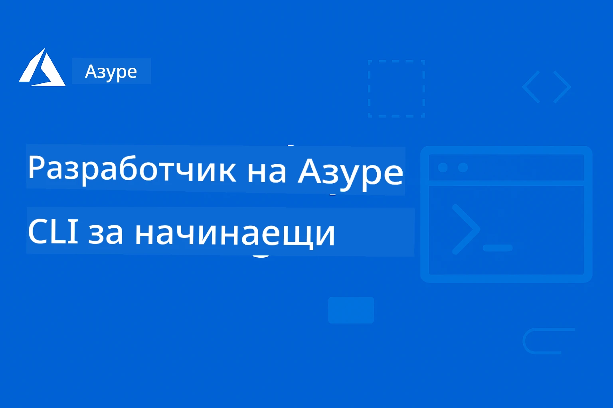

# AZD за начинаещи: Структуриран учебен път

 

[](https://github.com/microsoft/AZD-for-beginners)
[](https://GitHub.com/microsoft/azd-for-beginners/network/)
[](https://github.com/microsoft/AZD-for-beginners)

[](https://discord.com/invite/nkVh3dp)
[](https://discord.gg/nTYy5BXMWG)

---

### Автоматизирани преводи (Винаги актуални)

<!-- CO-OP TRANSLATOR LANGUAGES TABLE START -->
[Арабски](../ar/README.md) | [Бенгалски](../bn/README.md) | [Български](./README.md) | [Бирмански (Мианмар)](../my/README.md) | [Китайски (опростен)](../zh-CN/README.md) | [Китайски (традиционен, Хонконг)](../zh-HK/README.md) | [Китайски (традиционен, Макао)](../zh-MO/README.md) | [Китайски (традиционен, Тайван)](../zh-TW/README.md) | [Хърватски](../hr/README.md) | [Чешки](../cs/README.md) | [Датски](../da/README.md) | [Холандски](../nl/README.md) | [Естонски](../et/README.md) | [Фински](../fi/README.md) | [Френски](../fr/README.md) | [Немски](../de/README.md) | [Гръцки](../el/README.md) | [Иврит](../he/README.md) | [Хинди](../hi/README.md) | [Унгарски](../hu/README.md) | [Индонезийски](../id/README.md) | [Италиански](../it/README.md) | [Японски](../ja/README.md) | [Каннада](../kn/README.md) | [Кхмерски](../km/README.md) | [Корейски](../ko/README.md) | [Литовски](../lt/README.md) | [Малайски](../ms/README.md) | [Малаялам](../ml/README.md) | [Маратхи](../mr/README.md) | [Непалски](../ne/README.md) | [Нигерийски Пиджин](../pcm/README.md) | [Норвежки](../no/README.md) | [Персийски (Фарси)](../fa/README.md) | [Полски](../pl/README.md) | [Португалски (Бразилия)](../pt-BR/README.md) | [Португалски (Португалия)](../pt-PT/README.md) | [Пенджаби (Гурмухи)](../pa/README.md) | [Румънски](../ro/README.md) | [Руски](../ru/README.md) | [Сръбски (кирилица)](../sr/README.md) | [Словашки](../sk/README.md) | [Словенски](../sl/README.md) | [Испански](../es/README.md) | [Суахили](../sw/README.md) | [Шведски](../sv/README.md) | [Тагалог (Филипински)](../tl/README.md) | [Тамилски](../ta/README.md) | [Телугу](../te/README.md) | [Тайски](../th/README.md) | [Турски](../tr/README.md) | [Украински](../uk/README.md) | [Урду](../ur/README.md) | [Виетнамски](../vi/README.md)

> **Предпочитате да клонирате локално?**
>
> Това хранилище включва преводи на 50+ езика, което значително увеличава размера на изтеглянето. За да клонирате без преводи, използвайте sparse checkout:
>
> **Bash / macOS / Linux:**
> ```bash
> git clone --filter=blob:none --sparse https://github.com/microsoft/AZD-for-beginners.git
> cd AZD-for-beginners
> git sparse-checkout set --no-cone '/*' '!translations' '!translated_images'
> ```
>
> **CMD (Windows):**
> ```cmd
> git clone --filter=blob:none --sparse https://github.com/microsoft/AZD-for-beginners.git
> cd AZD-for-beginners
> git sparse-checkout set --no-cone "/*" "!translations" "!translated_images"
> ```
>
> Това ви дава всичко необходимо за завършване на курса с много по-бързо изтегляне.
<!-- CO-OP TRANSLATOR LANGUAGES TABLE END -->

## 🆕 Какво ново в azd днес

> 📌 **Foundry GA актуализация (2026-11-09):** Пакетът **`microsoft.foundry` 1.0 вече е официално достъпен**, обявен на [5 ноември 2026 г.](https://devblogs.microsoft.com/azure-sdk/microsoft-foundry-azure-developer-cli-ga/). Използвайте **`azd >= 1.37.0`** и го инсталирайте с `azd ext install microsoft.foundry`. Следвайте [hosted-agent walkthrough](docs/chapter-02-ai-development/microsoft-foundry-integration.md#hosted-agent-walkthrough-ga) за настройка, локално тестване и внедряване. Тази актуализация е базирана на публикувани указания, а не на живо Azure внедряване; GA на пакета не прави всяка опционална функция, разширение или SDK общодостъпни.

Azure Developer CLI поддържа много типове приложения, включително уеб приложения, API-та и AI агенти, чрез поддържани хостове, шаблони и разширения.

Ето какво означава това за вас:

- **GA пакет за разработка с Foundry.** `microsoft.foundry` инсталира седем основни разширения, включително агенти, проекти и Agent Inspector. Кодът на агентите и настройките за внедряване остават обединени в `azure.yaml`.
- **Тествайте локално, след това внедрете вашия код.** Използвайте `azd ai agent init --deploy-mode code`, `azd provision` и `azd ai agent run`, за да инспектирате локални заявки и отговори. След това използвайте `azd deploy` за отдалечено изграждане във Foundry, без локална контейнерна компилация.
- **Отделете измерване на качеството.** Инсталирайте **`azure.ai.evaluations`** за `azd ai eval generate`, `init` и `run start`; то не е включено в пакета. Запазете прегледаните набори данни и рубрики заедно с кода си. По-старите проекти трябва да следват [ръководството за миграция към оценка и оптимизация](docs/chapter-08-production/production-ai-practices.md#evaluation-migration-and-quality-checks).
- **Повторно използвайте конфигурацията в CI/CD.** След успешно `azd up`, конфигурирайте pipeline с `azd pipeline config`. Инсталирайте пакета на runner-а и запазете генерираните настройки за удостоверяване и среда.
- **По-гладки всекидневни основи.** Последните версии направиха `azd init` идемпотентни (безопасни за повторно изпълнение), направиха `azd auth login` автоматично изчистване на остарели токени и добавиха приятен `azd tool` подканващ диалог при първо стартиране.
- **Основният работен процес не се е променил.** Независимо дали внедрявате todo приложение, микросервиз или мултиагентско AI решение, командите са същите.

> **Забележка за потребителите на Aspire:** Microsoft вече нарича продукта просто **Aspire** (преди ".NET Aspire"). Поддръжката на azd за Aspire остава непроменена – само името е актуализирано.

Ако сте използвали azd преди, AI поддръжката е естествено разширение – не отделен инструмент или напреднал курс. Ако започвате отначало, ще научите един работен процес, който работи за всичко.

---

## 🚀 Какво е Azure Developer CLI (azd)?

**Azure Developer CLI (azd)** е потребителски приятен инструмент с команден ред, който улеснява внедряването на приложения в Azure. Вместо ръчно да създавате и свързвате десетки Azure ресурси, можете да внедрите цели приложения с една команда.

### Магията на `azd up`

```bash
# This single command does everything:
# ✅ Creates all Azure resources  
# ✅ Configures networking and security
# ✅ Builds your application code
# ✅ Deploys to Azure
# ✅ Gives you a working URL
azd up
```

Шаблонът осигурява конфигурация на приложението и инфраструктурата. Успешното внедряване все още изисква поддържани услуги/модели, достатъчна квота и разрешения, правилни входни данни и проверка на внедреното приложение. `azd up` не прави шаблона автоматично сигурен, съвместим или готов за продукция.

---

## ❓ Azure Developer CLI срещу Azure CLI: Каква е разликата?

Това е най-често задаваният въпрос от начинаещи. Ето простият отговор:

| Функция | **Azure CLI (`az`)** | **Azure Developer CLI (`azd`)** |
|---------|---------------------|--------------------------------|
| **Цел** | Управление на отделни Azure ресурси | Внедряване на цели приложения |
| **Насока** | Фокус върху инфраструктурата | Фокус върху приложението |
| **Пример** | `az webapp create --name myapp...` | `azd up` |
| **Крива на обучение** | Трябва да знаете Azure услуги | Просто трябва да познавате приложението си |
| **Най-подходящ за** | DevOps, инфраструктура | Разработчици, прототипиране |

### Прост пример

- **Azure CLI** е като да имате всички инструменти за строеж на къща - чукове, триони, пирони. Можете да построите всичко, но трябва да знаете строителство.
- **Azure Developer CLI** е като да наемете строителен предприемач - вие описвате какво искате, а той се грижи за строежа.

### Кога да използвате кое

| Сценарий | Използвайте това |
|----------|----------|
| "Искам бързо да внедря уеб приложението си" | `azd up` |
| "Трябва да създам само акаунт за съхранение" | `az storage account create` |
| "Строя пълно AI приложение" | `azd init --template azure-search-openai-demo` |
| "Трябва да отстраня грешка в конкретен Azure ресурс" | `az resource show` |
| "Искам да внедря в конфигурирана продукционна среда" | Прегледайте конфигурацията, достъпа, разходите и оперативните проверки преди `azd up --environment production` |

### Те работят заедно!

AZD и Azure CLI имат отделна автентикация и конфигурация. Използвайте `azd auth login` за AZD и `az login`, когато хук или диагностична команда изрично изисква Azure CLI. Можете да използвате и двете:
```bash
# Deploy your app with AZD
azd up

# Then fine-tune specific resources with Azure CLI
az webapp config set --name myapp --always-on true
```

---

## 🌟 Намиране на шаблони в Awesome AZD

Не започвайте от нулата! **Awesome AZD** е обществена колекция на готови за внедряване шаблони:

| Ресурс | Описание |
|----------|-------------|
| 🔗 [**Awesome AZD Gallery**](https://azure.github.io/awesome-azd/) | Разгледайте 200+ шаблона с внедряване с един клик |
| 🔗 [**Изпратете шаблон**](https://github.com/Azure/awesome-azd/issues) | Споделете вашия собствен шаблон с общността |
| 🔗 [**GitHub хранилище**](https://github.com/Azure/awesome-azd) | Отметнете и разгледайте изходния код |

### Популярни AI шаблони от Awesome AZD

Изберете един шаблон в собствена празна директория; долните команди са алтернативи. `.` инициализира тази директория.

```bash
# RAG Chat with Microsoft Foundry Models + AI Search
azd init --template azure-search-openai-demo .

# Quick AI Chat Application
azd init --template openai-chat-app-quickstart .

# AI Agents with Foundry Agents
azd init --template get-started-with-ai-agents .
```

---

## 🎯 Начало за 3 стъпки

Преди да започнете, уверете се, че машината ви е готова за шаблона, който искате да внедрите:

**Windows:**
```powershell
.\validate-setup.ps1
```

**macOS / Linux:**
```bash
bash ./validate-setup.sh
```

Ако някоя от необходимите проверки не мине, поправете я първо и след това продължете с бързия старт.

### Стъпка 1: Инсталирайте AZD (2 минути)

**Windows:**
```powershell
winget install microsoft.azd
```

**macOS:**
```bash
brew tap azure/azd && brew install azd
```

**Linux:**
```bash
curl -fsSL https://aka.ms/install-azd.sh | bash
```

### Стъпка 2: Удостоверяване за AZD

```bash
# Optional if you plan to use Azure CLI commands directly in this course
az login

# Required for AZD workflows
azd auth login
```

Ако не сте сигурни кое ви трябва, следвайте цялостния процес в [Инсталация и настройка](docs/chapter-01-foundation/installation.md#authentication-setup).

### Стъпка 3: Внедрете първото си приложение

```bash
# Initialize from a template
azd init --template todo-nodejs-mongo .

# Deploy to Azure (creates everything!)
azd up
```

**🎉 Това е всичко!** Вашето приложение вече е онлайн в Azure.

### Почистване (Не забравяйте!)

```bash
# Remove all resources when done experimenting
azd down --force --purge
```

---

## 📚 Как да използвате този курс

Този курс е проектиран за **степенно обучение** - започнете откъдето ви е удобно и се разраствайте:

| Вашият опит | Започнете тук |
|-----------------|------------|
| **Нов в Azure** | [Глава 1: Основи](#-chapter-1-foundation--quick-start) |
| **Знаете Azure, нов в AZD** | [Глава 1: Основи](#-chapter-1-foundation--quick-start) |
| **Искате да внедрите AI приложения** | [Глава 2: Разработка с акцент върху AI](#-chapter-2-ai-first-development-recommended-for-ai-developers) |
| **Искате практически опит** | [🎓 Интерактивен уъркшоп](workshop/README.md) - 3-4 часа воден лабораторен урок |
| **Имате нужда от продукционни модели** | [Глава 8: Производство и предприятие](#-chapter-8-production--enterprise-patterns) |

### Бърза настройка

1. **Форкнете това хранилище**: [](https://GitHub.com/microsoft/azd-for-beginners/fork)
2. **Клонирайте го**: `git clone https://github.com/YOUR-USERNAME/azd-for-beginners.git`
3. **Потърсете помощ**: [Общността в Azure Discord](https://discord.com/invite/ByRwuEEgH4)

> **Предпочитате да клонирате локално?**

> Това хранилище включва над 50 езикови превода, което значително увеличава размера на изтегляне. За да клонирате без преводи, използвайте sparse checkout:
> ```bash
> git clone --filter=blob:none --sparse https://github.com/microsoft/AZD-for-beginners.git
> cd AZD-for-beginners
> git sparse-checkout set --no-cone '/*' '!translations' '!translated_images'
> ```
> Това ви дава всичко необходимо, за да завършите курса с много по-бързо изтегляне.


## Преглед на курса

Овладейте Azure Developer CLI (azd) чрез структурирани глави, създадени за прогресивно обучение. **Специален фокус върху внедряването на AI приложения с интеграция на Microsoft Foundry.**

### Защо този курс е есенциален за съвременните разработчици

Разработчиците, които внедряват AI натоварвания, обикновено имат нужда от насоки за:
- Сложни многосервизни AI архитектури
- Най-добри практики за внедряване на AI в продукция  
- Интеграция и конфигурация на Azure AI услуги
- Оптимизация на разходите за AI натоварвания
- Отстраняване на проблеми, специфични за AI внедряване

### Учебни цели

Като завършите този структуриран курс, ще:
- **Овладеете основите на AZD**: Основни концепции, инсталация и конфигурация
- **Внедрите AI приложения**: Използвайте AZD с Microsoft Foundry услуги
- **Прилагате Infrastructure as Code**: Управление на Azure ресурси с Bicep шаблони
- **Отстранявате проблеми при внедрявания**: Решаване на често срещани проблеми и отстраняване на грешки
- **Оптимизирате за продукция**: Сигурност, мащабиране, мониторинг и управление на разходите
- **Създавате многоагентни решения**: Внедряване на сложни AI архитектури

## Преди да започнете: Акаунти, достъп и предпоставки

Преди да започнете Глава 1, уверете се, че имате следното. Стъпките за инсталация по-късно в този урок предполагат, че тези основи вече са покрити.

- **Абонамент за Azure**: Можете да използвате съществуващ абонамент от работното си място или личен акаунт, или да създадете [безплатен пробен](https://aka.ms/azurefreetrial) за започване.
- **Разрешение за създаване на Azure ресурси**: За повечето упражнения трябва да имате поне достъп **Contributor** върху целевия абонамент или група ресурси. Някои глави също предполагат, че можете да създавате групи ресурси, управлявани идентичности и RBAC разрешения.
- [**GitHub акаунт**](https://github.com): Полезен за форкване на хранилището, проследяване на лични промени и използване на GitHub Codespaces за работилницата.
- **Изисквания към среди за изпълнение на шаблони**: Някои шаблони изискват локални инструменти като Node.js, Python, Java или Docker. Стартирайте валидатора за настройка преди започване, за да откриете липсващи инструменти навреме.
- **Основни познания за терминал**: Не е нужно да сте експерт, но трябва да можете уверено да стартирате команди като `git clone`, `azd auth login` и `azd up`.

> **Работите ли в корпоративен абонамент?**
> Ако вашата Azure среда се управлява от администратор, потвърдете предварително, че можете да внедрявате ресурси в абонамента или групата ресурси, която планирате да използвате. Ако не, поискайте sandbox абонамент или достъп Contributor преди да започнете.

> **Нов потребител на Azure?**
> Започнете със собствен Azure пробен или pay-as-you-go абонамент на https://aka.ms/azurefreetrial, за да можете да изпълните упражненията от край до край без да чакате одобрения на ниво клиент.

## 🗺️ Карта на курса: Бърза навигация по глави

Всяка глава има отделен README с учебни цели, бързи стартирания и упражнения:

| Глава | Тема | Уроци | Продължителност | Сложност |
|---------|-------|---------|----------|------------|
| **[Гл. 1: Основи](docs/chapter-01-foundation/README.md)** | Запознаване | [Основи на AZD](docs/chapter-01-foundation/azd-basics.md) &#124; [Инсталация](docs/chapter-01-foundation/installation.md) &#124; [Първи проект](docs/chapter-01-foundation/first-project.md) | 30-45 мин | ⭐ |
| **[Гл. 2: AI разработка](docs/chapter-02-ai-development/README.md)** | AI-първи приложения | [Интеграция с Foundry](docs/chapter-02-ai-development/microsoft-foundry-integration.md) &#124; [AI агенти](docs/chapter-02-ai-development/agents.md) &#124; [Внедряване на модели](docs/chapter-02-ai-development/ai-model-deployment.md) &#124; [Работилница](docs/chapter-02-ai-development/ai-workshop-lab.md) | 1-2 ч | ⭐⭐ |
| **[Гл. 3: Конфигурация](docs/chapter-03-configuration/README.md)** | Автентикация и сигурност | [Конфигурация](docs/chapter-03-configuration/configuration.md) &#124; [Автентикация и сигурност](docs/chapter-03-configuration/authsecurity.md) | 45-60 мин | ⭐⭐ |
| **[Гл. 4: Инфраструктура](docs/chapter-04-infrastructure/README.md)** | IaC & внедряване | [Ръководство за внедряване](docs/chapter-04-infrastructure/deployment-guide.md) &#124; [Провизиране](docs/chapter-04-infrastructure/provisioning.md) | 1-1.5 ч | ⭐⭐⭐ |
| **[Гл. 5: Многоагентни решения](docs/chapter-05-multi-agent/README.md)** | AI агент решения | [Търговски сценарий](examples/retail-scenario.md) &#124; [Патерни за координация](docs/chapter-06-pre-deployment/coordination-patterns.md) | 2-3 ч | ⭐⭐⭐⭐ |
| **[Гл. 6: Предварителна подготовка](docs/chapter-06-pre-deployment/README.md)** | Планиране и валидиране | [Проверки преди полет](docs/chapter-06-pre-deployment/preflight-checks.md) &#124; [Планиране на капацитета](docs/chapter-06-pre-deployment/capacity-planning.md) &#124; [Избор на SKU](docs/chapter-06-pre-deployment/sku-selection.md) &#124; [App Insights](docs/chapter-06-pre-deployment/application-insights.md) | 1 ч | ⭐⭐ |
| **[Гл. 7: Отстраняване на проблеми](docs/chapter-07-troubleshooting/README.md)** | Дебъг и коригиране | [Чести проблеми](docs/chapter-07-troubleshooting/common-issues.md) &#124; [Дебъгване](docs/chapter-07-troubleshooting/debugging.md) &#124; [AI проблеми](docs/chapter-07-troubleshooting/ai-troubleshooting.md) | 1-1.5 ч | ⭐⭐ |
| **[Гл. 8: Продукция](docs/chapter-08-production/README.md)** | Корпоративни патерни | [Практики за продукция](docs/chapter-08-production/production-ai-practices.md) | 2-3 ч | ⭐⭐⭐⭐ |
| **[🎓 Работилница](workshop/README.md)** | Практическа лаборатория | [Въведение](workshop/docs/instructions/0-Introduction.md) &#124; [Избор](workshop/docs/instructions/1-Select-AI-Template.md) &#124; [Валидиране](workshop/docs/instructions/2-Validate-AI-Template.md) &#124; [Разглобяване](workshop/docs/instructions/3-Deconstruct-AI-Template.md) &#124; [Конфигурация](workshop/docs/instructions/4-Configure-AI-Template.md) &#124; [Персонализиране](workshop/docs/instructions/5-Customize-AI-Template.md) &#124; [Демонтаж](workshop/docs/instructions/6-Teardown-Infrastructure.md) &#124; [Обобщение](workshop/docs/instructions/7-Wrap-up.md) | 3-4 ч | ⭐⭐ |

**Обща продължителност на курса:** ~10-14 часа | **Изграждане на умения:** Начинаещ → Готов за продукция

---

## 📚 Учебни глави

*Изберете учебния си път според нивото на опит и целите*

### 🚀 Глава 1: Основи и бързо стартиране
**Предварителни изисквания**: Azure абонамент, основни познания за команден ред  
**Продължителност**: 30-45 минути  
**Сложност**: ⭐

#### Какво ще научите
- Разбиране на основите на Azure Developer CLI
- Инсталиране на AZD на вашата платформа
- Вашето първо успешно внедряване

#### Учебни ресурси
- **🎯 Започнете тук**: [Какво е Azure Developer CLI?](#-what-is-azure-developer-cli-azd)
- **📖 Теория**: [Основи на AZD](docs/chapter-01-foundation/azd-basics.md) - Основни концепции и терминология
- **⚙️ Настройка**: [Инсталация и настройка](docs/chapter-01-foundation/installation.md) - Платформено-специфични ръководства
- **🛠️ Практика**: [Вашият първи проект](docs/chapter-01-foundation/first-project.md) - Подробно ръководство
- **📋 Бърз справочник**: [Таблица с команди](resources/cheat-sheet.md)

#### Практически упражнения
```bash
# Quick installation check
azd version

# Deploy your first application
azd init --template todo-nodejs-mongo .
azd up
```

**💡 Резултат от глава**: Успешно внедряване на просто уеб приложение в Azure с помощта на AZD

**✅ Валидиране на успеха:**
```bash
# After completing Chapter 1, you should be able to:
azd version              # Shows installed version
azd init --template todo-nodejs-mongo  # Initializes project
azd up                  # Deploys to Azure
azd show                # Displays running app URL
# Application opens in browser and works
azd down --force --purge  # Cleans up resources
```

**📊 Време за изпълнение:** 30-45 минути  
**📈 Умение след завършване:** Можете самостоятелно да внедрявате основни приложения

---

### 🤖 Глава 2: AI-първи разработки (Препоръчително за AI разработчици)
**Предварителни изисквания**: Глава 1 завършена  
**Продължителност**: 1-2 часа  
**Сложност**: ⭐⭐

#### Какво ще научите
- Интеграция на Microsoft Foundry с AZD
- Внедряване на AI-захранвани приложения
- Разбиране на конфигурациите на AI услуги

#### Учебни ресурси
- **🎯 Започнете тук**: [Интеграция с Microsoft Foundry](docs/chapter-02-ai-development/microsoft-foundry-integration.md)
- **🤖 AI агенти**: [Ръководство за AI агенти](docs/chapter-02-ai-development/agents.md) - Внедряване на интелигентни агенти с AZD
- **📖 Патерни**: [Внедряване на AI модели](docs/chapter-02-ai-development/ai-model-deployment.md) - Управление и внедряване на AI модели
- **🛠️ Работилница**: [AI workshop лаборатория](docs/chapter-02-ai-development/ai-workshop-lab.md) - Подгответе AI решения за AZD
- **🎥 Интерактивно ръководство**: [Материали от работилницата](workshop/README.md) - Обучение в браузър с MkDocs * среда DevContainer
- **📋 Шаблони**: [Microsoft Foundry шаблони](#featured-microsoft-foundry-templates)
- **📝 Примери**: [Примери за внедряване с AZD](examples/README.md)

#### Практически упражнения
```bash
# Deploy your first AI application
azd init --template azure-search-openai-demo .
azd up

# Try additional AI templates
azd init --template openai-chat-app-quickstart .
azd init --template agent-openai-python-prompty .
```

**💡 Резултат от глава**: Внедряване и конфигуриране на AI чат приложение с RAG възможности

**✅ Валидиране на успеха:**
```bash
# After Chapter 2, you should be able to:
azd init --template azure-search-openai-demo .
azd up
# Test the AI chat interface
# Ask questions and get AI-powered responses with sources
# Verify search integration works
azd monitor  # Check Application Insights shows telemetry
azd down --force --purge
```

**📊 Време за изпълнение:** 1-2 часа  
**📈 Ниво на умения след:** Можете да внедрявате AI учебни приложения и да идентифицирате допълнителни изисквания за продукционна готовност
**💰 Осведоменост за разходи:** Разберете за разходите $80-150/месец за разработка, $300-3500/месец за продукция

#### 💰 Обмисляне на разходите за AI внедрявания

**Разработка на среда (Оценка $80-150/месец):**
- Microsoft Foundry модели (Плащане според използване): $0-50/месец (в зависимост от използваните токени)
- AI Search (Базов слой): $75/месец
- Container Apps (Консумация): $0-20/месец
- Съхранение (Стандартно): $1-5/месец

**Продукционна среда (Оценка $300-3,500+/месец):**
- Microsoft Foundry модели (PTU за постоянна производителност): $3,000+/месец ИЛИ плащане според използване при голям обем
- AI Search (Стандартен слой): $250/месец
- Container Apps (Посветен): $50-100/месец
- Application Insights: $5-50/месец
- Съхранение (Премиум): $10-50/месец

**💡 Съвети за оптимизация на разходите:**
- Проверете ценообразуването за предвиждане на модел и специфичните кредитни акаунти; Azure OpenAI не включва универсално месечно безплатно ограничение от 50,000 токена
- Стартирайте `azd down` за изтриване на ресурси, когато вече не са необходими, след като прегледате избраната среда
- Започнете с таксуване на база консумация, обновете до PTU само за продукция
- Използвайте `azd provision --preview` за проверка на планираната инфраструктура, след това оразмерете ресурсите с Azure Pricing Calculator
- Активирайте авто-мащабиране: плащайте само за реална употреба

**Мониторинг на разходите:**
```bash
# Inspect planned resources (this does not calculate prices)
azd provision --preview

# Monitor actual costs in Azure Portal
az consumption budget list --resource-group <your-rg>
```

---

### ⚙️ Глава 3: Конфигурация и автентикация
**Предварителни изисквания**: Глава 1 завършена  
**Продължителност**: 45-60 минути  
**Сложност**: ⭐⭐

#### Какво ще научите
- Конфигурация и управление на среда
- Най-добри практики за автентикация и сигурност
- Именуване и организация на ресурси

#### Учебни ресурси
- **📖 Конфигурация**: [Ръководство за конфигурация](docs/chapter-03-configuration/configuration.md) - Настройка на среда
- **🔐 Сигурност**: [Автентикационни патерни и управлявани идентичности](docs/chapter-03-configuration/authsecurity.md) - Автентикационни патерни
- **📝 Примери**: [Пример със база данни](examples/database-app/README.md) - AZD бази данни примери

#### Практически упражнения
- Конфигуриране на няколко среди (dev, staging, prod)
- Настройка на автентикация с управлявани идентичности
- Прилагане на специфични конфигурации за среди

**💡 Резултат от глава**: Управлявайте множество среди с правилна автентикация и сигурност

---

### 🏗️ Глава 4: Infrastructure as Code и внедряване
**Предварителни изисквания**: Глави 1-3 завършени  
**Продължителност**: 1-1.5 часа  
**Сложност**: ⭐⭐⭐

#### Какво ще научите
- Разширени патерни за внедряване
- Infrastructure as Code с Bicep
- Стратегии за провизиране на ресурси

#### Учебни ресурси
- **📖 Внедряване**: [Ръководство за внедряване](docs/chapter-04-infrastructure/deployment-guide.md) - Пълни работни процеси
- **🏗️ Провизиране**: [Управление на Azure ресурси](docs/chapter-04-infrastructure/provisioning.md) - Управление на ресурси в Azure
- **📝 Примери**: [Пример с Container App](../../examples/container-app) - Контейнеризирани внедрявания

#### Практически упражнения
- Създаване на персонализирани Bicep шаблони
- Внедряване на многосервизни приложения
- Прилагане на стратегии за синьо-зелено внедряване

**💡 Резултат от глава**: Внедряване на сложни многосервизни приложения с помощта на персонализирани инфраструктурни шаблони

---

### 🎯 Глава 5: Многоагентни AI решения (Напреднали)
**Предварителни изисквания**: Глави 1-2 завършени  
**Продължителност**: 2-3 часа  
**Сложност**: ⭐⭐⭐⭐

#### Какво ще научите
- Патерни за многоагентна архитектура
- Оркестрация и координация на агенти
- Готови за продукция AI внедрявания

#### Учебни ресурси
- **🤖 Представен дизайн**: [Решение за многопотребителска търговия](examples/retail-scenario.md) - Архитектурен план, не пълно приложение
- **🛠️ ARM шаблони**: [Пакет ARM шаблони](../../examples/retail-multiagent-arm-template) - Инфраструктурен скелет; прегледайте предпоставки и липсващи компоненти на приложението
- **📖 Архитектура**: [Патерни за координация на множество агенти](docs/chapter-06-pre-deployment/coordination-patterns.md) - Патерни

#### Практически упражнения
```bash
# Inspect the retail infrastructure scaffold before choosing to deploy it
cd examples/retail-multiagent-arm-template
cat README.md

# After an intentional deployment, inspect infrastructure state
az deployment group show --resource-group <rg-name> --name <deployment-name>
```

**💡 Резултат от главата**: Разберете дизайна на многопотребителски агенти и идентифицирайте нужната реализация, валидация и експлоатационна работа извън инфраструктурния скелет

---

### 🔍 Глава 6: Проверка и планиране преди внедряване
**Предпоставки**: Завършена Глава 4  
**Продължителност**: 1 час  
**Сложност**: ⭐⭐

#### Какво ще научите
- Планиране на капацитет и валидиране на ресурси
- Стратегии за избор на SKU
- Проверки преди полет и автоматизация

#### Ресурси за обучение
- **📊 Планиране**: [Планиране на капацитет](docs/chapter-06-pre-deployment/capacity-planning.md) - Валидиране на ресурси
- **💰 Избор**: [Избор на SKU](docs/chapter-06-pre-deployment/sku-selection.md) - Икономични решения
- **✅ Валидация**: [Проверки преди полет](docs/chapter-06-pre-deployment/preflight-checks.md) - Автоматизирани скриптове

#### Практически упражнения
- Стартирайте скриптове за валидиране на капацитет
- Оптимизирайте избора на SKU за разходи
- Изпълнете автоматизирани проверки преди внедряване

**💡 Резултат от главата**: Валидирайте и оптимизирайте внедрявания преди изпълнение

---

### 🚨 Глава 7: Отстраняване на неизправности и дебъгване
**Предпоставки**: Завършена която и да е глава за внедряване  
**Продължителност**: 1-1.5 часа  
**Сложност**: ⭐⭐

#### Какво ще научите
- Систематични подходи за дебъгване
- Чести проблеми и решения
- Отстраняване на неизправности, специфични за AI

#### Ресурси за обучение
- **🔧 Чести проблеми**: [Чести проблеми](docs/chapter-07-troubleshooting/common-issues.md) - ЧЗВ и решения
- **🕵️ Дебъгване**: [Ръководство за дебъгване](docs/chapter-07-troubleshooting/debugging.md) - Стъпка по стъпка стратегии
- **🤖 AI проблеми**: [Отстраняване на AI проблеми](docs/chapter-07-troubleshooting/ai-troubleshooting.md) - Проблеми с AI услуги

#### Практически упражнения
- Диагностициране на провали при внедряване
- Решаване на проблеми с удостоверяване
- Дебъгване на свързаността с AI услуги

**💡 Резултат от главата**: Независимо диагностициране и разрешаване на често срещани проблеми при внедряване

---

### 🏢 Глава 8: Производствени и корпоративни патерни
**Предпоставки**: Завършени Глави 1-4  
**Продължителност**: 2-3 часа  
**Сложност**: ⭐⭐⭐⭐

#### Какво ще научите
- Стратегии за производство и внедряване
- Корпоративни сигурностни патерни
- Мониторинг и оптимизация на разходите

#### Ресурси за обучение
- **🏭 Производство**: [Най-добри практики за AI в производство](docs/chapter-08-production/production-ai-practices.md) - Корпоративни патерни
- **📝 Примери**: [Пример с микросервизи](../../examples/microservices) - Сложни архитектури
- **📊 Мониторинг**: [Интеграция с Application Insights](docs/chapter-06-pre-deployment/application-insights.md) - Мониторинг

#### Практически упражнения
- Изпълнявайте корпоративни сигурностни патерни
- Настройте комплексен мониторинг
- Внедряване в производство с адекватно управление

**💡 Резултат от главата**: Внедряване на корпоративно приложими приложения с пълни производствени възможности

---

## 🎓 Преглед на работилницата: Практическо обучение

> **⚠️ СЪСТОЯНИЕ НА РАБОТИЛНИЦАТА: Активна разработка**  
> Материалите за работилницата се разработват и усъвършенстват в момента. Основните модули функционират, но някои напреднали секции са незавършени. Активно работим за завършване на цялото съдържание. [Проследете напредъка →](workshop/README.md)

### Интерактивни материали за работилницата
**Цялостно практическо обучение с браузър-базирани инструменти и ръководени упражнения**

Материалите на нашата работилница осигуряват структурирано, интерактивно учебно изживяване, което допълва горната учебна програма на базата на глави. Работилницата е предназначена както за самостоятелно обучение, така и за сесии с преподавател.

#### 🛠️ Характеристики на работилницата
- **Интерфейс в браузър**: Пълна работилница с MkDocs, с функция за търсене, копиране и тематични настройки
- **Интеграция с GitHub Codespaces**: Настройка на среда за разработка с един клик
- **Структуриран учебен път**: 8 модула с ръководени упражнения (общо 3-4 часа)
- **Прогресивна методология**: Въвеждане → Избор → Валидация → Деконструкция → Конфигурация → Персонализация → Демонтаж → Обобщение
- **Интерактивна среда DevContainer**: Предварително конфигурирани инструменти и зависимости

#### 📚 Структура на модулите в работилницата
Работилницата следва **8-модулна прогресивна методология**, която ви води от откриване до овладяване на внедряването:

| Модул | Тема | Какво ще правите | Продължителност |
|--------|-------|----------------|----------|
| **0. Въведение** | Преглед на работилницата | Разберете учебните цели, предпоставки и структура на работилницата | 15 мин |
| **1. Избор** | Откриване на шаблони | Изследвайте AZD шаблони и изберете подходящия AI шаблон за вашия сценарий | 20 мин |
| **2. Валидация** | Внедряване и проверка | Внедрете шаблона с `azd up` и валидирайте инфраструктурата | 30 мин |
| **3. Деконструкция** | Разбиране на структурата | Използвайте GitHub Copilot за изследване на архитектурата на шаблона, Bicep файлове и организация на кода | 30 мин |
| **4. Конфигурация** | Подробности за azure.yaml | Овладейте конфигурацията на `azure.yaml`, lifecycle hooks и променливи на средата | 30 мин |
| **5. Персонализация** | Направете го свой | Активиране на AI търсене, проследяване, оценка и персонализация за вашия сценарий | 45 мин |
| **6. Демонтаж** | Изчистване | Безопасно премахнете ресурсите с `azd down --purge` | 15 мин |
| **7. Обобщение** | Следващи стъпки | Прегледайте постижения, ключови концепции и продължете обучението си | 15 мин |

**Поток на работилницата:**
```
Introduction → Selection → Validation → Deconstruction → Configuration → Customization → Teardown → Wrap-up
     ↓            ↓           ↓              ↓               ↓              ↓            ↓           ↓
  Overview    Find the     Deploy &      Explore        Master         Customize     Clean up    Review &
             right        verify        code &        azure.yaml      for your      resources   next steps
             template                   structure                     scenario
```

#### 🚀 Започване на работилницата
```bash
# Option 1: GitHub Codespaces (Recommended)
# Click "Code" → "Create codespace on main" in the repository

# Option 2: Local Development
git clone https://github.com/microsoft/azd-for-beginners.git
cd azd-for-beginners/workshop
# Follow the setup instructions in workshop/README.md
```

#### 🎯 Очаквани резултати от работилницата
След завършване на работилницата участниците ще:
- **Внедряват AI приложения в производство**: Използват AZD с Microsoft Foundry услуги
- **Майсторят многопотребителски архитектури**: Изпълняват координирани решения с AI агенти
- **Внедряват най-добри практики за сигурност**: Конфигурират удостоверяване и контрол на достъпа
- **Оптимизират за мащабиране**: Дизайн на икономични и производителни внедрявания
- **Отстраняват неизправности при внедряване**: Решават често срещани проблеми самостоятелно

#### 📖 Ресурси за работилницата
- **🎥 Интерактивно ръководство**: [Материали за работилницата](workshop/README.md) - Браузър-базирана учебна среда
- **📋 Инструкции по модули**:
  - [0. Въведение](workshop/docs/instructions/0-Introduction.md) - Преглед и цели на работилницата
  - [1. Избор](workshop/docs/instructions/1-Select-AI-Template.md) - Откриване и избор на AI шаблони
  - [2. Валидация](workshop/docs/instructions/2-Validate-AI-Template.md) - Внедряване и проверка на шаблони
  - [3. Деконструкция](workshop/docs/instructions/3-Deconstruct-AI-Template.md) - Изследване на архитектурата на шаблона
  - [4. Конфигурация](workshop/docs/instructions/4-Configure-AI-Template.md) - Овладяване на azure.yaml
  - [5. Персонализация](workshop/docs/instructions/5-Customize-AI-Template.md) - Персонализиране според вашия сценарий
  - [6. Демонтаж](workshop/docs/instructions/6-Teardown-Infrastructure.md) - Освобождаване на ресурси
  - [7. Обобщение](workshop/docs/instructions/7-Wrap-up.md) - Преглед и следващи стъпки
- **🛠️ AI лаборатория**: [AI Workshop Lab](docs/chapter-02-ai-development/ai-workshop-lab.md) - AI-ориентирани упражнения
- **💡 Бърз старт**: [Ръководство за настройка на работилницата](workshop/README.md#browser-based-guide) - Конфигуриране на средата

**Идеални за**: Корпоративно обучение, университетски курсове, самостоятелно обучение и интензивни курсове за разработчици.

---

## 📖 Задълбочено разглеждане: Възможности на AZD

Освен основите, AZD предлага мощни функции за производствено внедряване:

- **Внедряване по шаблон** - Използвайте предварително изградени шаблони за често срещани приложни патерни
- **Инфраструктура като код** - Управлявайте Azure ресурси с Bicep или Terraform  
- **Интегрирани работни потоци** - Безпроблемно осигурявайте, внедрявайте и наблюдавайте приложения
- **Ориентирано към разработчик** - Оптимизирано за ефективност и удобство на разработчиците

### **AZD + Microsoft Foundry: Идеално за AI внедрявания**

**Защо AZD за AI решения?** AZD адресира основните предизвикателства, пред които са изправени AI разработчиците:

- **AI-готови шаблони** - Предварително конфигурирани шаблони за Microsoft Foundry модели, Azure AI услуги и ML задачи
- **Сигурни AI внедрявания** - Вградени сигурностни патерни за AI услуги, API ключове и крайни точки на модели  
- **Производствени AI патерни** - Най-добри практики за мащабируеми и икономични AI приложения
- **Краен до краен AI работен поток** - От разработка на модел до производствено внедряване с адекватен мониторинг
- **Оптимизация на разходи** - Умно разпределение и мащабиране на ресурси за AI натоварвания
- **Интеграция с Microsoft Foundry** - Безпроблемна връзка с каталога на модели и крайни точки на Microsoft Foundry

---

## 🎯 Библиотека с шаблони и примери

### Представени: Шаблони на Microsoft Foundry
**Започнете тук, ако внедрявате AI приложения!**

> **Забележка:** Тези шаблони демонстрират различни AI патерни. Някои са външни Azure проби, други са локални реализации.

| Шаблон | Глава | Сложност | Услуги | Тип |
|----------|---------|------------|----------|------|
| [**Започнете с AI чат**](https://github.com/Azure-Samples/get-started-with-ai-chat) | Глава 2 | ⭐⭐ | AzureOpenAI + Azure AI Model Inference API + Azure AI Search + Azure Container Apps + Application Insights | Външен |
| [**Започнете с AI агенти**](https://github.com/Azure-Samples/get-started-with-ai-agents) | Глава 2 | ⭐⭐ | Foundry Agents + AzureOpenAI + Azure AI Search + Azure Container Apps + Application Insights| Външен |
| [**Демо с Azure Search + OpenAI**](https://github.com/Azure-Samples/azure-search-openai-demo) | Глава 2 | ⭐⭐ | Azure OpenAI + Azure AI Search + Container Apps (по подразбиране) + Storage | Външен |
| [**Бърз старт с OpenAI чат приложение**](https://github.com/Azure-Samples/openai-chat-app-quickstart) | Глава 2 | ⭐ | AzureOpenAI + Container Apps + Application Insights | Външен |
| [**OpenAI AI агент с Python Prompty**](https://github.com/Azure-Samples/agent-openai-python-prompty) | Глава 5 | ⭐⭐⭐ | AzureOpenAI + Azure Functions + Prompty | Външен |
| [**Contoso Chat RAG**](https://github.com/Azure-Samples/contoso-chat) | Глава 8 | ⭐⭐⭐⭐ | AzureOpenAI + AI Search + Cosmos DB + Container Apps | Външен |
| [**Решение за многопроцесорен търговски агент**](examples/retail-scenario.md) | Глава 5 | ⭐⭐⭐⭐ | Предложена архитектура и инфраструктурен скелет; изисква се реализация на приложението | **Локален план** |

### Представени: Пълни учебни сценарии
**Производствени шаблони на приложения, свързани с учебните глави**

| Шаблон | Учебна глава | Сложност | Ключови знания |
|----------|------------------|------------|--------------|
| [**бърз старт openai чат приложение**](https://github.com/Azure-Samples/openai-chat-app-quickstart) | Глава 2 | ⭐ | Основни AI внедрителни патерни |
| [**демо azure search openai**](https://github.com/Azure-Samples/azure-search-openai-demo) | Глава 2 | ⭐⭐ | Реализация на RAG с Azure AI Search |
| [**започнете с AI агенти**](https://github.com/Azure-Samples/get-started-with-ai-agents) | Глава 2 | ⭐⭐ | Чат с агент и спецификационни тестове за оценка |
| [**agent-openai-python-prompty**](https://github.com/Azure-Samples/agent-openai-python-prompty) | Глава 5 | ⭐⭐⭐ | Рамка за агент и повикване на функции |
| [**contoso-chat**](https://github.com/Azure-Samples/contoso-chat) | Глава 8 | ⭐⭐⭐ | Корпоративна AI оркестрация |
| [**решение за многопроцесорен търговски агент**](examples/retail-scenario.md) | Глава 5 | ⭐⭐⭐⭐ | Многопотребителска архитектура с агенти за клиенти и инвентар |

### Тип на учене чрез примери

> **📌 Локални срещу външни примери:**  
> **Локални примери** (в това хранилище) = Прегледайте README на примера за статус на реализация и предпоставки
> **Външни примери** (Azure проби) = Клонирайте от свързаните хранилища

#### Локални примери (готови за използване)
- [**Решение за многопроцесорен търговски агент**](examples/retail-scenario.md) - Архитектурен план с инфраструктурен скелет ARM
  - Предложени роли: агенти за клиенти и инвентар
  - Мониторинг, оценка и приложение трябва да бъдат реализирани и валидирани
  - Само предоставянето на ресурси не създава работещо търговско приложение

#### Локални примери - Контейнерни приложения (Глави 2-5)
**Изчерпателни примери за внедряване на контейнери в това хранилище:**
- [**Примери за контейнерни приложения**](examples/container-app/README.md) - Пълен наръчник за внедряване на контейнери
  - [Прост Flask API](../../examples/container-app/simple-flask-api) - Основен REST API с мащабиране до нула
  - [Архитектура с микросервизи](../../examples/container-app/microservices) - Образец с две услуги; укрепването за производство е допълнителна работа
  - Бърз старт, производствени и напреднали модели за внедряване
  - Насоки за мониторинг, сигурност и оптимизация на разходите

#### Външни примери - Прости приложения (Глави 1-2)
**Клонирайте тези хранилища с Azure проби за начало:**
- [Просто уеб приложение - Node.js + MongoDB](https://github.com/Azure-Samples/todo-nodejs-mongo) - Основни модели за внедряване
- [Статичен уебсайт - React SPA](https://github.com/Azure-Samples/todo-csharp-sql-swa-func) - Внедряване на статично съдържание
- [Container App - Python Flask](https://github.com/Azure-Samples/container-apps-store-api-microservice) - Разгръщане на REST API

#### Външни примери - Интеграция на база данни (Глава 3-4)  
- [Database App - C# + SQL](https://github.com/Azure-Samples/todo-csharp-sql) - Патерни за свързване към база данни
- [Functions + Cosmos DB](https://github.com/Azure-Samples/todo-python-mongo-swa-func) - Безсървърен работен процес за данни

#### Външни примери - Напреднали патерни (Глави 4-8)
- [Java Microservices](https://github.com/Azure-Samples/java-microservices-aca-lab) - Многоуслужни архитектури
- [Container Apps Jobs](https://github.com/Azure-Samples/container-apps-jobs) - Фоново обработване  
- [Enterprise ML Pipeline](https://github.com/Azure/mlops-v2) - Референтни патерни за MLOps; не е директен AZD шаблон

### Външни колекции с шаблони
- [**Официална галерия с шаблони AZD**](https://azure.github.io/awesome-azd/) - Курирана колекция от официални и общностни шаблони
- [**Шаблони Azure Developer CLI**](https://learn.microsoft.com/en-us/azure/developer/azure-developer-cli/azd-templates) - Документация на шаблони в Microsoft Learn
- [**Директория с примери**](examples/README.md) - Локални учебни примери с подробни обяснения

---

## 📚 Учебни ресурси и препратки

### Бързи препратки
- [**Ръководство с команди**](resources/cheat-sheet.md) - Основни azd команди, организирани по глави
- [**Глосарий**](resources/glossary.md) - Терминология за Azure и azd  
- [**Често задавани въпроси**](resources/faq.md) - Чести въпроси, организирани по учебна глава
- [**Учебно ръководство**](resources/study-guide.md) - Обширни практически упражнения

### Практически работилници
- [**Работилница за AI**](docs/chapter-02-ai-development/ai-workshop-lab.md) - Направете AI решенията си готови за разгръщане с AZD (2-3 часа)
- [**Интерактивна работилница**](workshop/README.md) - 8-модулни насочени упражнения с MkDocs и GitHub Codespaces
  - Следва: Въведение → Избор → Валидиране → Деконструкция → Конфигуриране → Персонализация → Демонтаж → Обобщение

### Външни учебни ресурси
- [Документация за Azure Developer CLI](https://learn.microsoft.com/en-us/azure/developer/azure-developer-cli/)
- [Център за Azure архитектура](https://learn.microsoft.com/en-us/azure/architecture/)
- [Калкулатор за ценообразуване на Azure](https://azure.microsoft.com/pricing/calculator/)
- [Статус на Azure](https://status.azure.com/)

### AI умения за вашия редактор
- [**Умения за Microsoft Azure на skills.sh**](https://skills.sh/microsoft/github-copilot-for-azure) - 37 отворени умения за агент за Azure AI, Foundry, разгръщане, диагностика, оптимизация на разходи и други. Инсталирайте ги в GitHub Copilot, Cursor, Claude Code или който и да е поддържан агент:
  ```bash
  npx skills add microsoft/github-copilot-for-azure
  ```

---

## 🔧 Бързо ръководство за отстраняване на проблеми

**Чести проблеми, с които начинаещите се сблъскват, и незабавни решения:**

<details>
<summary><strong>❌ "azd: команда не е намерена"</strong></summary>

```bash
# Install AZD first
# Windows (PowerShell):
winget install microsoft.azd

# macOS:
brew tap azure/azd && brew install azd

# Linux:
curl -fsSL https://aka.ms/install-azd.sh | bash

# Verify installation
azd version
```
</details>

<details>
<summary><strong>❌ "Абонамент не е намерен" или "Абонаментът не е зададен"</strong></summary>

```bash
# List available subscriptions
az account list --output table

# Set default subscription
az account set --subscription "<subscription-id-or-name>"

# Set for AZD environment
azd env set AZURE_SUBSCRIPTION_ID "<subscription-id>"

# Verify
az account show
```
</details>

<details>
<summary><strong>❌ "InsufficientQuota" или "Квотата е надвишена"</strong></summary>

```bash
# Try different Azure region
azd env set AZURE_LOCATION "westus2"
azd up

# Or use smaller SKUs in development
# Edit infra/main.parameters.json:
{
  "sku": "B1"  // Instead of "P1V2"
}
```
</details>

<details>
<summary><strong>❌ "azd up" неуспешен на половината път</strong></summary>

```bash
# Option 1: Inspect the error and retry after correcting its cause
azd show
azd up --debug

# Option 2: Just fix infrastructure
azd provision

# Option 3: Check detailed status
azd show

# Option 4: Check logs in Azure Monitor
azd monitor --logs
```
</details>

<details>
<summary><strong>❌ "Неуспешна автентикация" или "Токенът е изтекъл"</strong></summary>

```bash
# Re-authenticate for AZD
azd auth logout
azd auth login

# Optional: refresh Azure CLI too if you are running az commands
az logout
az login

# Verify authentication
az account show
```
</details>

<details>
<summary><strong>❌ "Ресурсът вече съществува" или конфликт на имена</strong></summary>

```bash
# Inspect the conflicting resource before changing or deleting anything.
# For an isolated new deployment, create a separate environment:
azd env new dev-v2
azd up
```
</details>

<details>
<summary><strong>❌ Разгръщането на шаблона отнема твърде много време</strong></summary>

**Нормални времена за изчакване:**
- Прост уеб апликейшън: 5-10 минути
- Апликация с база данни: 10-15 минути
- AI приложения: 15-25 минути (Обезпечаването на OpenAI е бавно)

```bash
# Check progress
azd show

# If stuck >30 minutes, check Azure Portal:
azd monitor --overview
# Look for failed deployments
```
</details>

<details>
<summary><strong>❌ "Достъпът е отказан" или "Забранено"</strong></summary>

```bash
# Check your Azure role
az role assignment list --assignee $(az account show --query user.name -o tsv)

# You need at least "Contributor" role
# Ask your Azure admin to grant:
# - Contributor (for resources)
# - User Access Administrator (for role assignments)
```
</details>

<details>
<summary><strong>❌ Не мога да намеря URL на разположеното приложение</strong></summary>

```bash
# Show all service endpoints
azd show

# Or open Azure Portal
azd monitor

# Check specific service
azd env get-values
# Look for *_URL variables
```
</details>

### 📚 Пълни ресурси за отстраняване на проблеми

- **Ръководство за чести проблеми:** [Подробни решения](docs/chapter-07-troubleshooting/common-issues.md)
- **Проблеми, специфични за AI:** [Отстраняване на AI проблеми](docs/chapter-07-troubleshooting/ai-troubleshooting.md)
- **Ръководство за дебъг:** [Стъпка по стъпка отстраняване на грешки](docs/chapter-07-troubleshooting/debugging.md)
- **Получаване на помощ:** [Azure Discord](https://discord.gg/microsoft-azure) #azure-developer-cli

---

## 🎓 Завършване на курса и сертифициране

### Проследяване на напредъка
Следете напредъка на обучението си през всяка глава:

- [ ] **Глава 1**: Основи и бърз старт ✅
- [ ] **Глава 2**: AI-първо разработване ✅  
- [ ] **Глава 3**: Конфигурация и удостоверяване ✅
- [ ] **Глава 4**: Инфраструктура като код и разгръщане ✅
- [ ] **Глава 5**: Многоагентски AI решения ✅
- [ ] **Глава 6**: Предварителна проверка и планиране на разгръщането ✅
- [ ] **Глава 7**: Отстраняване на проблеми и дебъгване ✅
- [ ] **Глава 8**: Производствени и корпоративни патерни ✅

### Проверка на знанията
След завършване на всяка глава, потвърдете знанията си чрез:
1. **Практическо упражнение**: Попълнете ръчното разгръщане от главата
2. **Проверка на знания**: Прегледайте секцията с FAQ за главата
3. **Обсъждане в общността**: Споделете опита си в Azure Discord
4. **Следваща глава**: Преминете към следващото ниво на сложност

### Ползи от завършване на курса
След завършване на всички глави ще имате:
- **Производствен опит**: Разположени реални AI приложения в Azure
- **Професионални умения**: Възможности за разгръщане в корпоративна среда  
- **Признание от общността**: Активен член на общността на Azure разработчици
- **Кариерно развитие**: Търсени умения за AZD и AI разгръщане

---

## 🤝 Общество и поддръжка

### Получаване на помощ и съдействие
- **Технически проблеми**: [Докладване на грешки и заявки за функции](https://github.com/microsoft/azd-for-beginners/issues)
- **Въпроси за обучение**: [Общност Microsoft Azure Discord](https://discord.gg/microsoft-azure) и [](https://discord.gg/nTYy5BXMWG)
- **Помощ за AI**: Присъединете се към [](https://discord.gg/nTYy5BXMWG)
- **Документация**: [Официална документация за Azure Developer CLI](https://learn.microsoft.com/en-us/azure/developer/azure-developer-cli/)

### Инсайти от общността в Microsoft Foundry Discord

**Обсъждани теми от общността:**
- Разгръщания с много услуги, управление на удостоверения и готовност за продукция
- Шаблони за AI, ръководства за отстраняване на проблеми и добри практики

**Присъединете се към нашата общност, за да:**
- Споделяте вашия опит с AZD + AI и да получите помощ
- Достъпвате ранни прегледи на нови AI шаблони
- Приносите към добрите практики за AI разгръщане
- Влияете на бъдещото развитие на AI + AZD функционалности

### Принос към курса
Каним ви да допринасяте! Моля, прочетете нашето [Ръководство за принос](CONTRIBUTING.md) за подробности относно:
- **Подобрение на съдържанието**: Усъвършенстване на съществуващите глави и примери
- **Нови примери**: Добавяне на реални сценарии и шаблони  
- **Превод**: Помощ при поддръжката на мултиезикова поддръжка
- **Докладване на грешки**: Подобряване на точността и яснота
- **Обществени стандарти**: Следване на нашите приобщаващи указания за общността

---

## 📄 Информация за курса

### Лиценз
Този проект е лицензиран под лиценз MIT - вижте файла [LICENSE](../../LICENSE) за подробности.

### Свързани учебни ресурси от Microsoft

Нашият екип създава и други комплексни учебни курсове:

<!-- CO-OP TRANSLATOR OTHER COURSES START -->
### LangChain
[](https://aka.ms/langchain4j-for-beginners)
[](https://aka.ms/langchainjs-for-beginners?WT.mc_id=m365-94501-dwahlin)
[](https://github.com/microsoft/langchain-for-beginners?WT.mc_id=m365-94501-dwahlin)
---

### Azure / Edge / MCP / Агентите
[](https://github.com/microsoft/AZD-for-beginners?WT.mc_id=academic-105485-koreyst)
[](https://github.com/microsoft/edgeai-for-beginners?WT.mc_id=academic-105485-koreyst)
[](https://github.com/microsoft/mcp-for-beginners?WT.mc_id=academic-105485-koreyst)
[](https://github.com/microsoft/ai-agents-for-beginners?WT.mc_id=academic-105485-koreyst)

---
 
### Генеративна AI серия
[](https://github.com/microsoft/generative-ai-for-beginners?WT.mc_id=academic-105485-koreyst)
[-9333EA?style=for-the-badge&labelColor=E5E7EB&color=9333EA)](https://github.com/microsoft/Generative-AI-for-beginners-dotnet?WT.mc_id=academic-105485-koreyst)
[-C084FC?style=for-the-badge&labelColor=E5E7EB&color=C084FC)](https://github.com/microsoft/generative-ai-for-beginners-java?WT.mc_id=academic-105485-koreyst)
[-E879F9?style=for-the-badge&labelColor=E5E7EB&color=E879F9)](https://github.com/microsoft/generative-ai-with-javascript?WT.mc_id=academic-105485-koreyst)

---
 
### Основно обучение
[](https://aka.ms/ml-beginners?WT.mc_id=academic-105485-koreyst)
[](https://aka.ms/datascience-beginners?WT.mc_id=academic-105485-koreyst)
[](https://aka.ms/ai-beginners?WT.mc_id=academic-105485-koreyst)
[](https://github.com/microsoft/Security-101?WT.mc_id=academic-96948-sayoung)
[](https://aka.ms/webdev-beginners?WT.mc_id=academic-105485-koreyst)
[](https://aka.ms/iot-beginners?WT.mc_id=academic-105485-koreyst)
[](https://github.com/microsoft/xr-development-for-beginners?WT.mc_id=academic-105485-koreyst)

---
 
### Серия Copilot
[](https://aka.ms/GitHubCopilotAI?WT.mc_id=academic-105485-koreyst)
[](https://github.com/microsoft/mastering-github-copilot-for-dotnet-csharp-developers?WT.mc_id=academic-105485-koreyst)
[](https://github.com/microsoft/CopilotAdventures?WT.mc_id=academic-105485-koreyst)
<!-- CO-OP TRANSLATOR OTHER COURSES END -->

---

## 🗺️ Навигация в курса

**🚀 Готови ли сте да започнете обучението?**

**Начинаещи**: Започнете с [Глава 1: Основи и Бърз старт](#-chapter-1-foundation--quick-start)  
**AI разработчици**: Преминете към [Глава 2: AI-първо разработване](#-chapter-2-ai-first-development-recommended-for-ai-developers)  
**Опитни разработчици**: Започнете с [Глава 3: Конфигурация и удостоверяване](#️-chapter-3-configuration--authentication)

**Следващи стъпки**: [Започнете Глава 1 - Основи на AZD](docs/chapter-01-foundation/azd-basics.md) →

---

<!-- CO-OP TRANSLATOR DISCLAIMER START -->
**Отказ от отговорност**:
Този документ е преведен с помощта на AI преводачески услуга [Co-op Translator](https://github.com/Azure/co-op-translator). Въпреки че се стремим към точност, моля имайте предвид, че автоматизираните преводи могат да съдържат грешки или неточности. Оригиналният документ на неговия роден език трябва да се счита за авторитетен източник. За критична информация се препоръчва професионален човешки превод. Ние не носим отговорност за каквито и да е недоразумения или неправилни тълкувания, произтичащи от използването на този превод.
<!-- CO-OP TRANSLATOR DISCLAIMER END -->