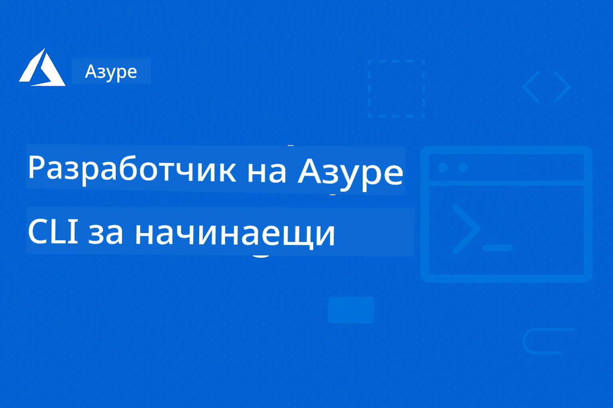

# AZD за начинаещи: Структуриран учебен път

 

[](https://GitHub.com/microsoft/azd-for-beginners/watchers/)
[](https://GitHub.com/microsoft/azd-for-beginners/network/)
[](https://GitHub.com/microsoft/azd-for-beginners/stargazers/)

[](https://discord.com/invite/nkVh3dp)
[](https://discord.gg/nTYy5BXMWG)

---

### Автоматизирани преводи (Винаги актуални)

<!-- CO-OP TRANSLATOR LANGUAGES TABLE START -->
[Arabic](../ar/README.md) | [Bengali](../bn/README.md) | [Bulgarian](./README.md) | [Burmese (Myanmar)](../my/README.md) | [Chinese (Simplified)](../zh-CN/README.md) | [Chinese (Traditional, Hong Kong)](../zh-HK/README.md) | [Chinese (Traditional, Macau)](../zh-MO/README.md) | [Chinese (Traditional, Taiwan)](../zh-TW/README.md) | [Croatian](../hr/README.md) | [Czech](../cs/README.md) | [Danish](../da/README.md) | [Dutch](../nl/README.md) | [Estonian](../et/README.md) | [Finnish](../fi/README.md) | [French](../fr/README.md) | [German](../de/README.md) | [Greek](../el/README.md) | [Hebrew](../he/README.md) | [Hindi](../hi/README.md) | [Hungarian](../hu/README.md) | [Indonesian](../id/README.md) | [Italian](../it/README.md) | [Japanese](../ja/README.md) | [Kannada](../kn/README.md) | [Khmer](../km/README.md) | [Korean](../ko/README.md) | [Lithuanian](../lt/README.md) | [Malay](../ms/README.md) | [Malayalam](../ml/README.md) | [Manipuri (Meitei Mayek)](../mni/README.md) | [Marathi](../mr/README.md) | [Nepali](../ne/README.md) | [Nigerian Pidgin](../pcm/README.md) | [Norwegian](../no/README.md) | [Persian (Farsi)](../fa/README.md) | [Polish](../pl/README.md) | [Portuguese (Brazil)](../pt-BR/README.md) | [Portuguese (Portugal)](../pt-PT/README.md) | [Punjabi (Gurmukhi)](../pa/README.md) | [Romanian](../ro/README.md) | [Russian](../ru/README.md) | [Serbian (Cyrillic)](../sr/README.md) | [Slovak](../sk/README.md) | [Slovenian](../sl/README.md) | [Spanish](../es/README.md) | [Swahili](../sw/README.md) | [Swedish](../sv/README.md) | [Tagalog (Filipino)](../tl/README.md) | [Tamil](../ta/README.md) | [Telugu](../te/README.md) | [Thai](../th/README.md) | [Turkish](../tr/README.md) | [Ukrainian](../uk/README.md) | [Urdu](../ur/README.md) | [Vietnamese](../vi/README.md)

> **Предпочитате да клонирате локално?**
>
> Това хранилище включва преводи на 50+ езика, което значително увеличава размера на изтегляне. За да клонирате без преводи, използвайте спарс чекаут:
>
> **Bash / macOS / Linux:**
> ```bash
> git clone --filter=blob:none --sparse https://github.com/microsoft/AZD-for-beginners.git
> cd AZD-for-beginners
> git sparse-checkout set --no-cone '/*' '!translations' '!translated_images'
> ```
>
> **CMD (Windows):**
> ```cmd
> git clone --filter=blob:none --sparse https://github.com/microsoft/AZD-for-beginners.git
> cd AZD-for-beginners
> git sparse-checkout set --no-cone "/*" "!translations" "!translated_images"
> ```
>
> Това ви дава всичко необходимо, за да завършите курса с много по-бързо изтегляне.
<!-- CO-OP TRANSLATOR LANGUAGES TABLE END -->

## 🆕 Какво е новото в azd днес

> 📌 Този курс е валидиран срещу **`azd 1.27.1`** (юли 2026). Стартирайте `azd version` за да проверите своя билд, и `azd upgrade` за да получите последната версия.

Azure Developer CLI се разви отвъд традиционните уеб приложения и API-та. Днес azd е единственият инструмент за разгръщане на **всяко** приложение в Azure — включително приложения с изкуствен интелект и интелигентни агенти.

Ето какво означава това за вас:

- **AI агентите вече са първокласни натоварвания в azd.** Можете да инициализирате, разгръщате и управлявате AI агентски проекти с помощта на същия `azd init` → `azd up` работен поток, който вече познавате.
- **Пълен жизнен цикъл на агента от CLI.** Разширението `azure.ai.agents` вече обхваща целия процес – `azd ai agent init` за създаване, `azd ai agent invoke` за тестване (с изход за време на отговор), `azd ai agent eval generate` и `azd ai agent optimize` за измерване и подобряване на качеството и `azd ai agent delete` за почистване.
- **Повече AI компоненти.** Нови пре-прегледни разширения – `azure.ai.skills` и `azure.ai.connections` – ви позволяват да управлявате многократно използваеми умения на агенти и връзки с Foundry директно чрез azd.
- **Интеграция с Microsoft Foundry** носи разгръщане на модели, хостинг на агенти и конфигурация на AI услуги директно в екосистемата на шаблоните на azd.
- **По-гладки ежедневни основи.** Последните версии направиха `azd init` идемпотентен (безопасен за повторно изпълнение), направиха `azd auth login` да изчиства автоматично остарели токени и добавиха приятен `azd tool` първоначален сетъп диалог.
- **Основният работен процес не се е променил.** Независимо дали разгръщате todo приложение, микросървис или многоагентно AI решение, командите са същите.

> **Бележка за потребителите на Aspire:** Microsoft вече нарича продукта просто **Aspire** (преди ".NET Aspire"). Поддръжката на Aspire в azd не се е променила — само името е обновено.

Ако сте използвали azd преди, поддръжката на AI е естествено разширение — не отделен инструмент или напреднал курс. Ако започвате от нулата, ще научите един работен поток, който работи за всичко.

---

## 🚀 Какво е Azure Developer CLI (azd)?

**Azure Developer CLI (azd)** е команден инструмент, приятелски за разработчици, който опростява разгръщането на приложения в Azure. Вместо ръчно да създавате и свързвате десетки Azure ресурси, можете да разгърнете цели приложения с една команда.

### Магията на `azd up`

```bash
# This single command does everything:
# ✅ Creates all Azure resources  
# ✅ Configures networking and security
# ✅ Builds your application code
# ✅ Deploys to Azure
# ✅ Gives you a working URL
azd up
```

**Това е всичко!** Никакво щракане в Azure Portal, никакви сложни ARM шаблони за учене първо, никаква ръчна конфигурация – само работещи приложения в Azure.

---

## ❓ Azure Developer CLI срещу Azure CLI: Каква е разликата?

Това е най-често задаваният въпрос от начинаещите. Ето простият отговор:

| Характеристика | **Azure CLI (`az`)** | **Azure Developer CLI (`azd`)** |
|---------|---------------------|--------------------------------|
| **Цел** | Управление на отделни Azure ресурси | Разгръщане на цели приложения |
| **Мислене** | Фокусирано върху инфраструктура | Фокусирано върху приложения |
| **Пример** | `az webapp create --name myapp...` | `azd up` |
| **Крива на учене** | Трябва да познавате Azure услугите | Просто познавайте приложението си |
| **Най-подходящо за** | DevOps, инфраструктура | Разработчици, прототипиране |

### Проста аналогия

- **Azure CLI** е като да имате всички инструменти за строеж на къща - чукове, триони, пирони. Можете да построите всичко, но трябва да знаете строителство.
- **Azure Developer CLI** е като да наемете строителен предприемач - вие описвате какво искате, а той се грижи за строежа.

### Кога да използвате всеки от тях

| Сценарий | Използвайте това |
|----------|----------|
| "Искам бързо да разположа уеб приложението си" | `azd up` |
| "Имам нужда само да създам акаунт за съхранение" | `az storage account create` |
| "Строя пълно AI приложение" | `azd init --template azure-search-openai-demo` |
| "Имам нужда да дебъгна конкретен Azure ресурс" | `az resource show` |
| "Искам разгръщане готово за продукция за минути" | `azd up --environment production` |

### Те работят заедно!

AZD използва Azure CLI под капака. Можете да използвате и двата:
```bash
# Deploy your app with AZD
azd up

# Then fine-tune specific resources with Azure CLI
az webapp config set --name myapp --always-on true
```

---

## 🌟 Намерете шаблони в Awesome AZD

Не започвайте от нулата! **Awesome AZD** е обществена колекция от готови за разгръщане шаблони:

| Ресурс | Описание |
|----------|-------------|
| 🔗 [**Awesome AZD Gallery**](https://azure.github.io/awesome-azd/) | Прегледайте 200+ шаблона с разгръщане с един клик |
| 🔗 [**Изпратете шаблон**](https://github.com/Azure/awesome-azd/issues) | Допринесете със свой собствен шаблон за общността |
| 🔗 [**GitHub хранилище**](https://github.com/Azure/awesome-azd) | Дайте звезда и разгледайте изходния код |

### Популярни AI шаблони от Awesome AZD

```bash
# RAG Chat with Microsoft Foundry Models + AI Search
azd init --template azure-search-openai-demo

# Quick AI Chat Application
azd init --template openai-chat-app-quickstart

# AI Agents with Foundry Agents
azd init --template get-started-with-ai-agents
```

---

## 🎯 Първи стъпки в 3 стъпки

Преди да започнете, уверете се, че вашата машина е готова за шаблона, който искате да разположите:

**Windows:**
```powershell
.\validate-setup.ps1
```

**macOS / Linux:**
```bash
bash ./validate-setup.sh
```

Ако някоя от необходимите проверки се провали, поправете я първо и после продължете с бързия старт.

### Стъпка 1: Инсталирайте AZD (2 минути)

**Windows:**
```powershell
winget install microsoft.azd
```

**macOS:**
```bash
brew tap azure/azd && brew install azd
```

**Linux:**
```bash
curl -fsSL https://aka.ms/install-azd.sh | bash
```

### Стъпка 2: Автентикация за AZD

```bash
# Optional if you plan to use Azure CLI commands directly in this course
az login

# Required for AZD workflows
azd auth login
```

Ако не сте сигурни кое ви трябва, следвайте цялостния процес в [Инсталация и настройка](docs/chapter-01-foundation/installation.md#authentication-setup).

### Стъпка 3: Разгърнете първото си приложение

```bash
# Initialize from a template
azd init --template todo-nodejs-mongo

# Deploy to Azure (creates everything!)
azd up
```

**🎉 Готово!** Вашето приложение вече е онлайн в Azure.

### Почистете след себе си (Не забравяйте!)

```bash
# Remove all resources when done experimenting
azd down --force --purge
```

---

## 📚 Как да използвате този курс

Този курс е проектиран за **прогресивно обучение** — започнете там, където ви е удобно и напредвайте:

| Вашият опит | Започнете тук |
|-----------------|------------|
| **Напълно нови в Azure** | [Глава 1: Основи](#-chapter-1-foundation--quick-start) |
| **Знаете Azure, нови в AZD** | [Глава 1: Основи](#-chapter-1-foundation--quick-start) |
| **Искате да разгръщате AI приложения** | [Глава 2: AI-първо разработване](#-chapter-2-ai-first-development-recommended-for-ai-developers) |
| **Искате практическа работа** | [🎓 Интерактивен работен тренинг](workshop/README.md) – 3-4 часа водено обучение |
| **Имате нужда от производствени модели** | [Глава 8: Производство и предприятия](#-chapter-8-production--enterprise-patterns) |

### Бърза настройка

1. **Форкнете това хранилище**: [](https://GitHub.com/microsoft/azd-for-beginners/fork)
2. **Клонирайте го**: `git clone https://github.com/YOUR-USERNAME/azd-for-beginners.git`
3. **Получете помощ**: [Azure Discord общност](https://discord.com/invite/ByRwuEEgH4)

> **Предпочитате да клонирате локално?**

> Това хранилище включва преводи на 50+ езика, което значително увеличава размера на изтегляне. За да клонирате без преводи, използвайте спарс чекаут:
> ```bash
> git clone --filter=blob:none --sparse https://github.com/microsoft/AZD-for-beginners.git
> cd AZD-for-beginners
> git sparse-checkout set --no-cone '/*' '!translations' '!translated_images'
> ```
> Това ви дава всичко необходимо, за да завършите курса с много по-бързо изтегляне.


## Обзор на курса

Усвоявайте Azure Developer CLI (azd) чрез структурираните глави, създадени за прогресивно учене. **Специален акцент върху разгръщането на AI приложения с интеграция на Microsoft Foundry.**

### Защо този курс е важен за съвременните разработчици

Въз основа на прозрения от общността Microsoft Foundry Discord, **45% от разработчиците искат да използват AZD за AI натоварвания,** но срещат предизвикателства с:
- Комплексни многоуслугови AI архитектури
- Най-добри практики за разгръщане на AI в продукция  
- Интеграция и конфигурация на Azure AI услуги
- Оптимизация на разходите за AI натоварвания
- Отстраняване на конкретни за AI проблеми при разгръщане

### Обучителни цели

Като завършите този структуриран курс, вие ще:
- **Овладеете основите на AZD**: Основни концепции, инсталация и конфигурация
- **Разгърнете AI приложения**: Използвайте AZD с Microsoft Foundry услуги
- **Прилагане на инфраструктура като код**: Управлявайте ресурси в Azure с Bicep шаблони
- **Отстраняване на проблеми с внедрявания**: Решавайте често срещани проблеми и отстранявайте грешки
- **Оптимизиране за продукция**: Сигурност, мащабиране, мониторинг и управление на разходите
- **Създаване на многo-агентски решения**: Внедряване на сложни AI архитектури

## Преди да започнете: Акаунти, достъп и предположения

Преди да започнете Глава 1, уверете се, че следните условия са изпълнени. Стъпките за инсталиране по-нататък в това ръководство предполагат, че тези основи вече са уредени.

- **Абонамент в Azure**: Можете да използвате съществуващ абонамент от работата си или личен акаунт, или да създадете [безплатен пробен период](https://aka.ms/azurefreetrial), за да започнете.
- **Разрешение за създаване на ресурси в Azure**: За повечето упражнения трябва да имате поне достъп **Contributor** върху целевия абонамент или група ресурси. Някои глави може също да предполагат, че можете да създавате групи ресурси, управлявани идентичности и RBAC назначения.
- [**GitHub акаунт**](https://github.com): Полезен е за форкване на хранилището, проследяване на собствени промени и използване на GitHub Codespaces за работилницата.
- **Изисквания за изпълнение на шаблони**: Някои шаблони изискват локални инструменти като Node.js, Python, Java или Docker. Стартирайте валидатора на настройката преди започване, за да хванете липсващи инструменти рано.
- **Основни умения за командния ред**: Не е необходимо да сте експерт, но трябва да се чувствате удобно с изпълнението на команди като `git clone`, `azd auth login` и `azd up`.

> **Работите в корпоративен абонамент?**
> Ако вашата среда в Azure се управлява от администратор, предварително потвърдете, че можете да внедрявате ресурси в абонамента или групата ресурси, които планирате да използвате. Ако не, поискайте песъчников абонамент или достъп Contributor, преди да започнете.

> **Нови сте в Azure?**
> Започнете с вашия собствен пробен или плащащ по използване абонамент на https://aka.ms/azurefreetrial, за да можете да завършите упражненията изцяло, без да чакате одобрения на ниво на наемател.

## 🗺️ Карта на курса: Бърза навигация по глави

Всяка глава има специален README с учебни цели, бързи стартирания и упражнения:

| Глава | Тема | Уроци | Продължителност | Сложност |
|---------|-------|---------|----------|------------|
| **[Гл. 1: Основи](docs/chapter-01-foundation/README.md)** | За започване | [AZD Основи](docs/chapter-01-foundation/azd-basics.md) &#124; [Инсталация](docs/chapter-01-foundation/installation.md) &#124; [Първи проект](docs/chapter-01-foundation/first-project.md) | 30-45 мин | ⭐ |
| **[Гл. 2: Разработка на AI](docs/chapter-02-ai-development/README.md)** | AI-първи приложения | [Интеграция с Foundry](docs/chapter-02-ai-development/microsoft-foundry-integration.md) &#124; [AI Агенти](docs/chapter-02-ai-development/agents.md) &#124; [Внедряване на модели](docs/chapter-02-ai-development/ai-model-deployment.md) &#124; [Работилница](docs/chapter-02-ai-development/ai-workshop-lab.md) | 1-2 ч | ⭐⭐ |
| **[Гл. 3: Конфигурация](docs/chapter-03-configuration/README.md)** | Удостоверяване & Сигурност | [Конфигурация](docs/chapter-03-configuration/configuration.md) &#124; [Удостоверяване & Сигурност](docs/chapter-03-configuration/authsecurity.md) | 45-60 мин | ⭐⭐ |
| **[Гл. 4: Инфраструктура](docs/chapter-04-infrastructure/README.md)** | IaC & Внедряване | [Ръководство за внедряване](docs/chapter-04-infrastructure/deployment-guide.md) &#124; [Настройване](docs/chapter-04-infrastructure/provisioning.md) | 1-1.5 ч | ⭐⭐⭐ |
| **[Гл. 5: Многo-агентски](docs/chapter-05-multi-agent/README.md)** | AI Агентски решения | [Търговски сценарий](examples/retail-scenario.md) &#124; [Шаблони за координация](docs/chapter-06-pre-deployment/coordination-patterns.md) | 2-3 ч | ⭐⭐⭐⭐ |
| **[Гл. 6: Предварително внедряване](docs/chapter-06-pre-deployment/README.md)** | Планиране & Валидиране | [Проверки преди стартиране](docs/chapter-06-pre-deployment/preflight-checks.md) &#124; [Капацитетно планиране](docs/chapter-06-pre-deployment/capacity-planning.md) &#124; [Избор на SKU](docs/chapter-06-pre-deployment/sku-selection.md) &#124; [App Insights](docs/chapter-06-pre-deployment/application-insights.md) | 1 ч | ⭐⭐ |
| **[Гл. 7: Отстраняване на проблеми](docs/chapter-07-troubleshooting/README.md)** | Отстраняване на грешки & поправяне | [Чести проблеми](docs/chapter-07-troubleshooting/common-issues.md) &#124; [Отстраняване на грешки](docs/chapter-07-troubleshooting/debugging.md) &#124; [AI проблеми](docs/chapter-07-troubleshooting/ai-troubleshooting.md) | 1-1.5 ч | ⭐⭐ |
| **[Гл. 8: Продукция](docs/chapter-08-production/README.md)** | Корпоративни шаблони | [Практики за продукция](docs/chapter-08-production/production-ai-practices.md) | 2-3 ч | ⭐⭐⭐⭐ |
| **[🎓 Работилница](workshop/README.md)** | Практическа лаборатория | [Въведение](workshop/docs/instructions/0-Introduction.md) &#124; [Избор](workshop/docs/instructions/1-Select-AI-Template.md) &#124; [Валидиране](workshop/docs/instructions/2-Validate-AI-Template.md) &#124; [Демонтаж](workshop/docs/instructions/3-Deconstruct-AI-Template.md) &#124; [Конфигурация](workshop/docs/instructions/4-Configure-AI-Template.md) &#124; [Персонализиране](workshop/docs/instructions/5-Customize-AI-Template.md) &#124; [Демонтиране](workshop/docs/instructions/6-Teardown-Infrastructure.md) &#124; [Обобщение](workshop/docs/instructions/7-Wrap-up.md) | 3-4 ч | ⭐⭐ |

**Общо време за курса:** ~10-14 часа | **Напредък в уменията:** От начинаещ до готов за продукция

---

## 📚 Учебни глави

*Изберете своя учебен път според опита и целите си*

### 🚀 Глава 1: Основи и бързо стартиране
**Предварителни изисквания**: Абонамент в Azure, основни познания за командния ред  
**Продължителност**: 30-45 минути  
**Сложност**: ⭐

#### Какво ще научите
- Основи на Azure Developer CLI
- Инсталиране на AZD на вашата платформа
- Вашето първо успешно внедряване

#### Учебни ресурси
- **🎯 Започнете от тук**: [Какво е Azure Developer CLI?](#what-is-azure-developer-cli)
- **📖 Теория**: [АЗД Основи](docs/chapter-01-foundation/azd-basics.md) - Основни понятия и терминология
- **⚙️ Настройка**: [Инсталация и настройка](docs/chapter-01-foundation/installation.md) - Ръководства според платформа
- **🛠️ Практика**: [Вашият първи проект](docs/chapter-01-foundation/first-project.md) - Стъпка по стъпка урок
- **📋 Бърз справочник**: [Чийтшит за команди](resources/cheat-sheet.md)

#### Практически упражнения
```bash
# Quick installation check
azd version

# Deploy your first application
azd init --template todo-nodejs-mongo
azd up
```

**💡 Резултат от главата**: Успешно внедряване на проста уеб приложения в Azure с помощта на AZD

**✅ Проверка на успеха:**
```bash
# After completing Chapter 1, you should be able to:
azd version              # Shows installed version
azd init --template todo-nodejs-mongo  # Initializes project
azd up                  # Deploys to Azure
azd show                # Displays running app URL
# Application opens in browser and works
azd down --force --purge  # Cleans up resources
```

**📊 Времева инвестиция:** 30-45 минути  
**📈 Ниво на умения след:** Може самостоятелно да внедрява основни приложения
**📈 Ниво на умения след:** Може самостоятелно да внедрява основни приложения

---

### 🤖 Глава 2: Разработка с AI на първо място (Препоръчва се за AI разработчици)
**Предварителни изисквания**: Глава 1 завършена  
**Продължителност**: 1-2 часа  
**Сложност**: ⭐⭐

#### Какво ще научите
- Интеграция на Microsoft Foundry с AZD
- Внедряване на AI-задвижвани приложения
- Разбиране на конфигурациите на AI услуги

#### Учебни ресурси
- **🎯 Започнете от тук**: [Интеграция с Microsoft Foundry](docs/chapter-02-ai-development/microsoft-foundry-integration.md)
- **🤖 AI Агенти**: [Ръководство за AI Агенти](docs/chapter-02-ai-development/agents.md) - Внедряване на интелигентни агенти с AZD
- **📖 Шаблони**: [Внедряване на AI модели](docs/chapter-02-ai-development/ai-model-deployment.md) - Внедряване и управление на AI модели
- **🛠️ Работилница**: [AI Работилница](docs/chapter-02-ai-development/ai-workshop-lab.md) - Подгответе вашите AI решения за AZD
- **🎥 Интерактивно ръководство**: [Материали за работилницата](workshop/README.md) - Обучение в браузър с MkDocs * DevContainer среда
- **📋 Шаблони**: [Шаблони на Microsoft Foundry](#featured-microsoft-foundry-templates)
- **📝 Примери**: [Примери за внедряване с AZD](examples/README.md)

#### Практически упражнения
```bash
# Deploy your first AI application
azd init --template azure-search-openai-demo
azd up

# Try additional AI templates
azd init --template openai-chat-app-quickstart
azd init --template agent-openai-python-prompty
```

**💡 Резултат от главата**: Внедрете и конфигурирайте AI-задвижван чат със способности RAG

**✅ Проверка на успеха:**
```bash
# After Chapter 2, you should be able to:
azd init --template azure-search-openai-demo
azd up
# Test the AI chat interface
# Ask questions and get AI-powered responses with sources
# Verify search integration works
azd monitor  # Check Application Insights shows telemetry
azd down --force --purge
```

**📊 Времева инвестиция:** 1-2 часа  
**📈 Ниво на умения след:** Може да внедрява и конфигурира AI приложения готови за продукция  
**💰 Осъзнаване на разходите:** Разберете разходи от $80-150/месец за разработка, $300-3500/месец за продукция

#### 💰 Съображения за разходи при AI внедрявания

**Среда за разработка (приблизително $80-150/месец):**
- Модели на Microsoft Foundry (плащане според използването): $0-50/месец (зависи от използвани токени)
- AI Search (Базово ниво): $75/месец
- Контейнерни приложения (според използването): $0-20/месец
- Съхранение (Стандарт): $1-5/месец

**Продукционна среда (приблизително $300-3,500+/месец):**
- Модели на Microsoft Foundry (PTU за постоянна производителност): $3,000+/месец ИЛИ плащане според използването при голям обем
- AI Search (Стандартно ниво): $250/месец
- Контейнерни приложения (Посветени): $50-100/месец
- Application Insights: $5-50/месец
- Съхранение (Премиум): $10-50/месец

**💡 Съвети за оптимизация на разходите:**
- Използвайте **Безплатно ниво** Microsoft Foundry модели за учене (включени 50,000 токена месечно Azure OpenAI)
- Стартирайте `azd down` за освобождаване на ресурси, когато не разработвате активно
- Започнете с таксуване според консумацията, надстройте до PTU само за продукция
- Използвайте `azd provision --preview` за оценка на разходите преди внедряването
- Активирайте авто-мащабиране: плащайте само за реалната употреба

**Мониторинг на разходите:**
```bash
# Check estimated monthly costs
azd provision --preview

# Monitor actual costs in Azure Portal
az consumption budget list --resource-group <your-rg>
```

---

### ⚙️ Глава 3: Конфигурация и удостоверяване
**Предварителни изисквания**: Глава 1 завършена  
**Продължителност**: 45-60 минути  
**Сложност**: ⭐⭐

#### Какво ще научите
- Конфигуриране и управление на средата
- Най-добри практики за удостоверяване и сигурност
- Именуване и организиране на ресурси

#### Учебни ресурси
- **📖 Конфигурация**: [Ръководство за конфигуриране](docs/chapter-03-configuration/configuration.md) - Настройване на средата
- **🔐 Сигурност**: [Шаблони за удостоверяване и управлявана идентичност](docs/chapter-03-configuration/authsecurity.md) - Шаблони за удостоверяване
- **📝 Примери**: [Пример с база данни](examples/database-app/README.md) - AZD бази данни примери

#### Практически упражнения
- Конфигурирайте множество среди (dev, staging, prod)
- Настройте удостоверяване с управлявана идентичност
- Прилагайте среди-специфични конфигурации

**💡 Резултат от главата**: Управлявайте множество среди с правилно удостоверяване и сигурност

---

### 🏗️ Глава 4: Инфраструктура като код и внедряване
**Предварителни изисквания**: Глави 1-3 завършени  
**Продължителност**: 1-1.5 часа  
**Сложност**: ⭐⭐⭐

#### Какво ще научите
- Разширени шаблони за внедряване
- Инфраструктура като код с Bicep
- Стратегии за осигуряване на ресурси

#### Учебни ресурси
- **📖 Внедряване**: [Ръководство за внедряване](docs/chapter-04-infrastructure/deployment-guide.md) - Пълни работни потоци
- **🏗️ Настройване**: [Осигуряване на ресурси](docs/chapter-04-infrastructure/provisioning.md) - Управление на Azure ресурси
- **📝 Примери**: [Пример с контейнерни приложения](../../examples/container-app) - Внедрявания с контейнери

#### Практически упражнения
- Създаване на персонализирани Bicep шаблони
- Внедряване на многослужбени приложения
- Прилагане на стратегии за синьо-зелено внедряване

**💡 Резултат от главата**: Внедряване на сложни многослужбени приложения с персонализирани инфраструктурни шаблони

---

### 🎯 Глава 5: Многo-агентски AI решения (Разширено)
**Предварителни изисквания**: Глави 1-2 завършени  
**Продължителност**: 2-3 часа  
**Сложност**: ⭐⭐⭐⭐

#### Какво ще научите
- Архитектурни шаблони за многo-агентски системи
- Оркестрация и координация на агенти
- AI внедрявания готови за продукция

#### Учебни ресурси
- **🤖 Представен проект**: [Многo-агентско търговско решение](examples/retail-scenario.md) - Пълна реализация
- **🛠️ ARM шаблони**: [Пакет с ARM шаблони](../../examples/retail-multiagent-arm-template) - Еднократно внедряване
- **📖 Архитектура**: [Шаблони за координация на многo-агентски системи](docs/chapter-06-pre-deployment/coordination-patterns.md) - Шаблони

#### Практически упражнения
```bash
# Deploy the complete retail multi-agent solution
cd examples/retail-multiagent-arm-template
./deploy.sh

# Explore agent configurations
az deployment group show --resource-group <rg-name> --name <deployment-name>
```

**💡 Резултат от главата**: Внедряване и управление на готово за продукция многo-агентско AI решение с агенти за клиенти и инвентар

---

### 🔍 Глава 6: Предварително валидиране и планиране преди внедряването
**Предварителни изисквания**: Глава 4 завършена  
**Продължителност**: 1 час  
**Сложност**: ⭐⭐

#### Какво ще научите
- Планиране на капацитета и валидиране на ресурси
- Стратегии за избор на SKU
- Проверки и автоматизация преди стартиране

#### Учебни ресурси
- **📊 Планиране**: [Планиране на капацитета](docs/chapter-06-pre-deployment/capacity-planning.md) - Валидация на ресурсите
- **💰 Избор**: [Избор на SKU](docs/chapter-06-pre-deployment/sku-selection.md) - Икономични решения
- **✅ Валидация**: [Проверки преди стартиране](docs/chapter-06-pre-deployment/preflight-checks.md) - Автоматизирани скриптове

#### Практическо обучение
- Стартирайте скриптове за валидация на капацитет
- Оптимизирайте избора на SKU за разходи
- Реализирайте автоматизирани проверки преди внедряване

**💡 Резултат от главата**: Валидирайте и оптимизирайте внедряванията преди изпълнение

---

### 🚨 Глава 7: Отстраняване на неизправности и дебъгинг
**Предварителни условия**: Завършена някоя глава за внедряване  
**Продължителност**: 1-1.5 часа  
**Сложност**: ⭐⭐

#### Какво ще научите
- Систематични подходи към дебъгинг
- Често срещани проблеми и решения
- Отстраняване на проблеми, специфични за AI

#### Учебни ресурси
- **🔧 Често срещани проблеми**: [Често срещани проблеми](docs/chapter-07-troubleshooting/common-issues.md) - ЧЗВ и решения
- **🕵️ Дебъгинг**: [Ръководство за дебъгинг](docs/chapter-07-troubleshooting/debugging.md) - Стратегии стъпка по стъпка
- **🤖 AI проблеми**: [Отстраняване на AI проблеми](docs/chapter-07-troubleshooting/ai-troubleshooting.md) - Проблеми с AI услуги

#### Практическо обучение
- Диагностицирайте неуспехи при внедряване
- Разрешете проблеми с удостоверяване
- Отстранете проблеми с връзката към AI услуги

**💡 Резултат от главата**: Самостоятелно диагностициране и разрешаване на често срещани проблеми при внедряване

---

### 🏢 Глава 8: Патерни за производство и предприятия
**Предварителни условия**: Завършени глави 1-4  
**Продължителност**: 2-3 часа  
**Сложност**: ⭐⭐⭐⭐

#### Какво ще научите
- Стратегии за внедряване в продукция
- Патерни за сигурност в предприятия
- Мониторинг и оптимизация на разходите

#### Учебни ресурси
- **🏭 В продукция**: [Най-добри практики за AI в продукция](docs/chapter-08-production/production-ai-practices.md) - Патерни за предприятия
- **📝 Примери**: [Пример за микросервизи](../../examples/microservices) - Комплексни архитектури
- **📊 Мониторинг**: [Интеграция на Application Insights](docs/chapter-06-pre-deployment/application-insights.md) - Мониторинг

#### Практическо обучение
- Реализирайте патерни за сигурност за предприятия
- Настройте комплексен мониторинг
- Внедрете в продукция с правилно управление

**💡 Резултат от главата**: Внедрявайте корпоративни приложения с пълни производствени възможности

---

## 🎓 Обзор на работилницата: Практическо обучение

> **⚠️ СЪСТОЯНИЕ НА РАБОТИЛНИЦАТА: Активна разработка**  
> Материалите за работилницата в момента се разработват и усъвършенстват. Основните модули функционират, но някои напреднали секции са незавършени. Активно работим за завършване на цялото съдържание. [Проследете напредъка →](workshop/README.md)

### Интерактивни материали за работилницата
**Цялостно практическо обучение с браузър-базирани инструменти и водени упражнения**

Нашите учебни материали предоставят структурирано, интерактивно обучение, допълващо учебната програма, базирана на глави по-горе. Работилницата е предназначена както за самостоятелно обучение, така и за обучения с инструктор.

#### 🛠️ Характеристики на работилницата
- **Интерфейс базиран на браузър**: Пълна работилница, задвижвана от MkDocs с търсене, копиране и функции за теми
- **Интеграция с GitHub Codespaces**: Настройка на среда за разработка с един клик
- **Структуриран учебен път**: 8-модулни водени упражнения (общо 3-4 часа)
- **Прогресивна методология**: Въведение → Избор → Валидация → Деконструкция → Конфигурация → Персонализиране → Демонтаж → Обобщение
- **Интерактивна среда DevContainer**: Предварително конфигурирани инструменти и зависимости

#### 📚 Структура на модулите на работилницата
Работилницата следва **8-модулна прогресивна методология**, която ви води от запознаване до овладяване на внедряване:

| Модул | Тема | Какво ще правите | Продължителност |
|--------|-------|----------------|----------|
| **0. Въведение** | Обзор на работилницата | Разбиране на учебните цели, предварителни условия и структура на работилницата | 15 мин |
| **1. Избор** | Откриване на шаблони | Разглеждане на AZD шаблони и избор на подходящ AI шаблон за вашия сценарий | 20 мин |
| **2. Валидация** | Внедряване и проверка | Внедрявайте шаблона с `azd up` и валидирайте работата на инфраструктурата | 30 мин |
| **3. Деконструкция** | Разбиране на структурата | Използвайте GitHub Copilot за разглеждане на архитектура на шаблона, Bicep файлове и организиране на кода | 30 мин |
| **4. Конфигурация** | Детайлен анализ на azure.yaml | Овладяване на конфигурацията с `azure.yaml`, lifecycle hooks и променливи на средата | 30 мин |
| **5. Персонализиране** | Направете го свой | Активирайте AI Search, проследяване, оценка и персонализирайте за вашия сценарий | 45 мин |
| **6. Демонтаж** | Почистване | Безопасно деинсталиране на ресурси с `azd down --purge` | 15 мин |
| **7. Обобщение** | Следващи стъпки | Преглед на постиженията, основни концепции и продължаване на обучението | 15 мин |

**Поток на работилницата:**
```
Introduction → Selection → Validation → Deconstruction → Configuration → Customization → Teardown → Wrap-up
     ↓            ↓           ↓              ↓               ↓              ↓            ↓           ↓
  Overview    Find the     Deploy &      Explore        Master         Customize     Clean up    Review &
             right        verify        code &        azure.yaml      for your      resources   next steps
             template                   structure                     scenario
```

#### 🚀 Започване на работилницата
```bash
# Option 1: GitHub Codespaces (Recommended)
# Click "Code" → "Create codespace on main" in the repository

# Option 2: Local Development
git clone https://github.com/microsoft/azd-for-beginners.git
cd azd-for-beginners/workshop
# Follow the setup instructions in workshop/README.md
```

#### 🎯 Резултати от обучението в работилницата
Като завършат работилницата, участниците ще:
- **Внедряват AI приложения за продукция**: Използват AZD с Microsoft Foundry услуги
- **Овладеят многоагентни архитектури**: Имплементират координирани AI агентни решения
- **Прилагат най-добри практики за сигурност**: Конфигурират удостоверяване и контрол на достъп
- **Оптимизират за мащабируемост**: Проектират икономични и производителни внедрявания
- **Отстраняват проблеми при внедряване**: Самостоятелно разрешават често срещани проблеми

#### 📖 Ресурси на работилницата
- **🎥 Интерактивен гид**: [Материали за работилницата](workshop/README.md) - Обучителна среда през браузър
- **📋 Инструкции по модули**:
  - [0. Въведение](workshop/docs/instructions/0-Introduction.md) - Обзор и цели на работилницата
  - [1. Избор](workshop/docs/instructions/1-Select-AI-Template.md) - Намиране и избор на AI шаблони
  - [2. Валидация](workshop/docs/instructions/2-Validate-AI-Template.md) - Внедряване и проверка на шаблони
  - [3. Деконструкция](workshop/docs/instructions/3-Deconstruct-AI-Template.md) - Разглеждане на архитектурата на шаблона
  - [4. Конфигурация](workshop/docs/instructions/4-Configure-AI-Template.md) - Овладяване на azure.yaml
  - [5. Персонализиране](workshop/docs/instructions/5-Customize-AI-Template.md) - Персонализиране за вашия сценарий
  - [6. Демонтаж](workshop/docs/instructions/6-Teardown-Infrastructure.md) - Почистване на ресурси
  - [7. Обобщение](workshop/docs/instructions/7-Wrap-up.md) - Преглед и следващи стъпки
- **🛠️ AI лаборатория за работилницата**: [AI Workshop Lab](docs/chapter-02-ai-development/ai-workshop-lab.md) - Упражнения, фокусирани върху AI
- **💡 Бърз старт**: [Ръководство за настройка на работилницата](workshop/README.md#quick-start) - Конфигурация на средата

**Подходящо за**: Корпоративно обучение, университетски курсове, самостоятелно обучение и курсове за разработчици.

---

## 📖 Задълбочен анализ: Възможности на AZD

Освен основите, AZD предоставя мощни функции за внедряване в продукция:

- **Внедряване на база шаблони** - Използване на предварително изградени шаблони за често използвани приложения
- **Инфраструктура като код** - Управление на ресурси в Azure чрез Bicep или Terraform  
- **Интегрирани работни процеси** - Безпроблемно предоставяне, внедряване и мониторинг на приложения
- **Подходящ за разработчици** - Оптимизиран за продуктивност и опит на разработчиците

### **AZD + Microsoft Foundry: Идеални за AI внедрявания**

**Защо AZD за AI решения?** AZD решава основните предизвикателства, пред които са изправени AI разработчиците:

- **AI-гoтови шаблони** - Предварително конфигурирани шаблони за Microsoft Foundry модели, Azure AI услуги и ML задачи
- **Сигурни AI внедрявания** - Вградени патерни за сигурност за AI услуги, API ключове и крайни точки на модели  
- **Патерни за продукционно AI** - Най-добри практики за мащабируеми и икономични внедрявания на AI приложения
- **Цялостни AI работни процеси** - От разработка на модел до продукционно внедряване с подходящ мониторинг
- **Оптимизация на разходи** - Умно разпределение на ресурси и мащабиране за AI задачи
- **Интеграция с Microsoft Foundry** - Безпроблемна връзка с каталога на Microsoft Foundry модели и крайни точки

---

## 🎯 Библиотека с шаблони и примери

### Представени: Microsoft Foundry шаблони
**Започнете тук, ако внедрявате AI приложения!**

> **Забележка:** Тези шаблони демонстрират различни AI патерни. Някои са външни Azure примери, други са локални реализации.

| Шаблон | Глава | Сложност | Услуги | Тип |
|----------|---------|------------|----------|------|
| [**Започнете чат с AI**](https://github.com/Azure-Samples/get-started-with-ai-chat) | Глава 2 | ⭐⭐ | AzureOpenAI + Azure AI Model Inference API + Azure AI Search + Azure Container Apps + Application Insights | Външен |
| [**Започнете с AI агенти**](https://github.com/Azure-Samples/get-started-with-ai-agents) | Глава 2 | ⭐⭐ | Foundry Agents + AzureOpenAI + Azure AI Search + Azure Container Apps + Application Insights| Външен |
| [**Демо с Azure Search + OpenAI**](https://github.com/Azure-Samples/azure-search-openai-demo) | Глава 2 | ⭐⭐ | AzureOpenAI + Azure AI Search + App Service + Storage | Външен |
| [**Бърз старт на OpenAI чат приложение**](https://github.com/Azure-Samples/openai-chat-app-quickstart) | Глава 2 | ⭐ | AzureOpenAI + Container Apps + Application Insights | Външен |
| [**Agent OpenAI Python Prompty**](https://github.com/Azure-Samples/agent-openai-python-prompty) | Глава 5 | ⭐⭐⭐ | AzureOpenAI + Azure Functions + Prompty | Външен |
| [**Contoso Chat RAG**](https://github.com/Azure-Samples/contoso-chat) | Глава 8 | ⭐⭐⭐⭐ | AzureOpenAI + AI Search + Cosmos DB + Container Apps | Външен |
| [**Решение за търговия с много агенти**](examples/retail-scenario.md) | Глава 5 | ⭐⭐⭐⭐ | AzureOpenAI + AI Search + Storage + Container Apps + Cosmos DB | **Локален** |

### Представени: Пълни учебни сценарии
**Приложни шаблони готови за продукция, свързани с учебните глави**

| Шаблон | Учебна глава | Сложност | Ключово обучение |
|----------|------------------|------------|--------------|
| [**openai-chat-app-quickstart**](https://github.com/Azure-Samples/openai-chat-app-quickstart) | Глава 2 | ⭐ | Основни AI патерни за внедряване |
| [**azure-search-openai-demo**](https://github.com/Azure-Samples/azure-search-openai-demo) | Глава 2 | ⭐⭐ | Реализация на RAG с Azure AI Search |
| [**ai-document-processing**](https://github.com/Azure-Samples/ai-document-processing) | Глава 4 | ⭐⭐ | Интеграция за интелигентност на документи |
| [**agent-openai-python-prompty**](https://github.com/Azure-Samples/agent-openai-python-prompty) | Глава 5 | ⭐⭐⭐ | Рамка за агенти и извикване на функции |
| [**contoso-chat**](https://github.com/Azure-Samples/contoso-chat) | Глава 8 | ⭐⭐⭐ | Оркестрация на корпоративен AI |
| [**retail-multi-agent-solution**](examples/retail-scenario.md) | Глава 5 | ⭐⭐⭐⭐ | Многоагентна архитектура с агенти за клиенти и инвентар |

### Учене по тип пример

> **📌 Локални срещу външни примери:**  
> **Локални примери** (в това хранилище) = Готови за незабавна употреба  
> **Външни примери** (Azure Samples) = Клониране от свързани хранилища

#### Локални примери (Готови за употреба)
- [**Решение за търговия с много агенти**](examples/retail-scenario.md) - Пълна продукционно готова реализация с ARM шаблони
  - Многоагентна архитектура (агенти за клиенти + инвентар)
  - Комплексен мониторинг и оценка
  - Внедряване с един клик чрез ARM шаблон

#### Локални примери - Контейнерни приложения (Глави 2-5)
**Комплексни примери за внедряване на контейнери в това хранилище:**
- [**Примери за контейнерни приложения**](examples/container-app/README.md) - Пълно ръководство за внедряване на контейнери
  - [Просто Flask API](../../examples/container-app/simple-flask-api) - Основно REST API със скалиране до нула
  - [Микросервизна архитектура](../../examples/container-app/microservices) - Продукционно готово многоуслугково внедряване
  - Бърз старт, продукция и напреднали патерни за внедряване
  - Насоки за мониторинг, сигурност и оптимизация на разходите

#### Външни примери - Простички приложения (Глави 1-2)
**Клонирайте тези хранилища с Azure Samples, за да започнете:**
- [Просто уеб приложение - Node.js + MongoDB](https://github.com/Azure-Samples/todo-nodejs-mongo) - Основни патерни за внедряване
- [Статичен уебсайт - React SPA](https://github.com/Azure-Samples/todo-csharp-sql-swa-func) - Внедряване на статично съдържание
- [Контейнерно приложение - Python Flask](https://github.com/Azure-Samples/container-apps-store-api-microservice) - Внедряване на REST API

#### Външни примери - Интеграция на база данни (Глави 3-4)  
- [Приложение с база данни - C# + SQL](https://github.com/Azure-Samples/todo-csharp-sql) - Патерни за връзка към база данни
- [Функции + Cosmos DB](https://github.com/Azure-Samples/todo-python-mongo-swa-func) - Безсървърен работен процес с данни

#### Външни примери - Напреднали патерни (Глави 4-8)
- [Java микросервизи](https://github.com/Azure-Samples/java-microservices-aca-lab) - Многоуслугкови архитектури
- [Задачи в контейнерни приложения](https://github.com/Azure-Samples/container-apps-jobs) - Фонови процеси  
- [ML конвейер за предприятия](https://github.com/Azure-Samples/mlops-v2) - Продукционно готови ML патерни

### Външни колекции с шаблони
- [**Официална галерия с AZD шаблони**](https://azure.github.io/awesome-azd/) - Курирана колекция с официални и общностни шаблони
- [**Шаблони за Azure Developer CLI**](https://learn.microsoft.com/en-us/azure/developer/azure-developer-cli/azd-templates) - Документация за Microsoft Learn шаблони
- [**Директория с примери**](examples/README.md) - Локални учебни примери с подробни обяснения

---

## 📚 Учебни ресурси и препратки

### Бързи препратки
- [**Команден лист**](resources/cheat-sheet.md) - Основни azd команди, организирани по глави
- [**Речник**](resources/glossary.md) - Терминология на Azure и azd  
- [**Често задавани въпроси**](resources/faq.md) - Често задавани въпроси, организирани по учебни глави
- [**Учебно ръководство**](resources/study-guide.md) - Изчерпателни практически упражнения

### Практически работилници
- [**AI работилница**](docs/chapter-02-ai-development/ai-workshop-lab.md) - Направете вашите AI решения готови за AZD-деплой (2-3 часа)
- [**Интерактивна работилница**](workshop/README.md) - 8-модулни ръководени упражнения с MkDocs и GitHub Codespaces
  - Следва: Въведение → Избор → Проверка → Деконструкция → Конфигурация → Персонализация → Демонтаж → Обобщение

### Външни учебни ресурси
- [Документация на Azure Developer CLI](https://learn.microsoft.com/en-us/azure/developer/azure-developer-cli/)
- [Център за архитектура на Azure](https://learn.microsoft.com/en-us/azure/architecture/)
- [Калкулатор на цени на Azure](https://azure.microsoft.com/pricing/calculator/)
- [Статус на Azure](https://status.azure.com/)

### Умения на AI агент за вашия редактор
- [**Microsoft Azure умения на skills.sh**](https://skills.sh/microsoft/github-copilot-for-azure) - 37 отворени агентски умения за Azure AI, Foundry, деплой, диагностика, оптимизация на разходите и др. Инсталирайте ги в GitHub Copilot, Cursor, Claude Code или в който и да е поддържан агент:
  ```bash
  npx skills add microsoft/github-copilot-for-azure
  ```

---

## 🔧 Бързо ръководство за отстраняване на неизправности

**Често срещани проблеми при начинаещи и незабавни решения:**

<details>
<summary><strong>❌ "azd: команда не е намерена"</strong></summary>

```bash
# Install AZD first
# Windows (PowerShell):
winget install microsoft.azd

# macOS:
brew tap azure/azd && brew install azd

# Linux:
curl -fsSL https://aka.ms/install-azd.sh | bash

# Verify installation
azd version
```
</details>

<details>
<summary><strong>❌ "Абонамент не е намерен" или "Абонаментът не е зададен"</strong></summary>

```bash
# List available subscriptions
az account list --output table

# Set default subscription
az account set --subscription "<subscription-id-or-name>"

# Set for AZD environment
azd env set AZURE_SUBSCRIPTION_ID "<subscription-id>"

# Verify
az account show
```
</details>

<details>
<summary><strong>❌ "Няма достатъчно квота" или "Квотата е надвишена"</strong></summary>

```bash
# Try different Azure region
azd env set AZURE_LOCATION "westus2"
azd up

# Or use smaller SKUs in development
# Edit infra/main.parameters.json:
{
  "sku": "B1"  // Instead of "P1V2"
}
```
</details>

<details>
<summary><strong>❌ "azd up" се проваля на половината път</strong></summary>

```bash
# Option 1: Clean and retry
azd down --force --purge
azd up

# Option 2: Just fix infrastructure
azd provision

# Option 3: Check detailed status
azd show

# Option 4: Check logs in Azure Monitor
azd monitor --logs
```
</details>

<details>
<summary><strong>❌ "Неуспешна автентикация" или "Токенът е изтекъл"</strong></summary>

```bash
# Re-authenticate for AZD
azd auth logout
azd auth login

# Optional: refresh Azure CLI too if you are running az commands
az logout
az login

# Verify authentication
az account show
```
</details>

<details>
<summary><strong>❌ "Ресурсът вече съществува" или конфликт при именуването</strong></summary>

```bash
# AZD generates unique names, but if conflict:
azd down --force --purge

# Then retry with fresh environment
azd env new dev-v2
azd up
```
</details>

<details>
<summary><strong>❌ Разгръщането на шаблон отнема твърде много време</strong></summary>

**Нормално време за изчакване:**
- Просто уеб приложение: 5-10 минути
- Приложение с база данни: 10-15 минути
- AI приложения: 15-25 минути (забавяне при OpenAI активиране)

```bash
# Check progress
azd show

# If stuck >30 minutes, check Azure Portal:
azd monitor --overview
# Look for failed deployments
```
</details>

<details>
<summary><strong>❌ "Достъпът е отказан" или "Забранено"</strong></summary>

```bash
# Check your Azure role
az role assignment list --assignee $(az account show --query user.name -o tsv)

# You need at least "Contributor" role
# Ask your Azure admin to grant:
# - Contributor (for resources)
# - User Access Administrator (for role assignments)
```
</details>

<details>
<summary><strong>❌ Не може да се намери URL адресът на разгърнатото приложение</strong></summary>

```bash
# Show all service endpoints
azd show

# Or open Azure Portal
azd monitor

# Check specific service
azd env get-values
# Look for *_URL variables
```
</details>

### 📚 Пълни ресурси за отстраняване на неизправности

- **Ръководство за често срещани проблеми:** [Подробни решения](docs/chapter-07-troubleshooting/common-issues.md)
- **Проблеми, свързани с AI:** [Отстраняване на AI проблеми](docs/chapter-07-troubleshooting/ai-troubleshooting.md)
- **Ръководство за отстраняване на грешки:** [Стъпка по стъпка отстраняване](docs/chapter-07-troubleshooting/debugging.md)
- **Помощ:** [Azure Discord](https://discord.gg/microsoft-azure) #azure-developer-cli

---

## 🎓 Завършване на курса и сертификация

### Проследяване на напредъка
Проследявайте напредъка си в ученето през всяка глава:

- [ ] **Глава 1**: Основи и бърз старт ✅
- [ ] **Глава 2**: AI-ориентирано развитие ✅  
- [ ] **Глава 3**: Конфигурация и автентикация ✅
- [ ] **Глава 4**: Инфраструктура като код и разгръщане ✅
- [ ] **Глава 5**: Многoагентни AI решения ✅
- [ ] **Глава 6**: Предварителна валидация и планиране на разгръщането ✅
- [ ] **Глава 7**: Отстраняване на проблеми и дебъгване ✅
- [ ] **Глава 8**: Продуктивни и корпоративни шаблони ✅

### Проверка на знанията
След завършване на всяка глава, потвърдете знанията си чрез:
1. **Практическо упражнение**: Завършете практическото разгръщане на главата
2. **Проверка на знания**: Прегледайте секцията с често задавани въпроси за вашата глава
3. **Обсъждане в общността**: Споделете опита си в Azure Discord
4. **Следваща глава**: Преминете към следващото ниво на сложност

### Предимства при завършване на курса
След като завършите всички глави, ще имате:
- **Опит в продукция**: Разгърнати реални AI приложения в Azure
- **Професионални умения**: Възможности за корпоративно разгръщане  
- **Признание от общността**: Активен член на разработчиците на Azure
- **Кариерно развитие**: Търсени експертни знания за AZD и AI внедряване

---

## 🤝 Общност и поддръжка

### Получаване на помощ и поддръжка
- **Технически проблеми**: [Докладвайте бъгове и поискайте функции](https://github.com/microsoft/azd-for-beginners/issues)
- **Въпроси за учене**: [Общност Microsoft Azure Discord](https://discord.gg/microsoft-azure) и [](https://discord.gg/nTYy5BXMWG)
- **Специализирана AI помощ**: Присъединете се към [](https://discord.gg/nTYy5BXMWG)
- **Документация**: [Официална документация на Azure Developer CLI](https://learn.microsoft.com/en-us/azure/developer/azure-developer-cli/)

### Възгледи от общността в Microsoft Foundry Discord

**Последни резултати от анкета в #Azure канал:**
- **45%** от разработчиците искат да използват AZD за AI задачи
- **Основни предизвикателства**: Многосервизни разгръщания, управление на идентификационни данни, готовност за продукция  
- **Най-поискано**: AI-специфични шаблони, ръководства за отстраняване, най-добри практики

**Присъединете се към нашата общност, за да:**
- Споделяте вашия опит с AZD + AI и получавате помощ
- Достъпвате ранни версии на нови AI шаблони
- Допринасяте за най-добрите практики при AI разгръщане
- Влияете на бъдещото развитие на AI + AZD функции

### Съдействие за курса
Каним ви да допринасяте! Моля, прочетете нашето [Ръководство за приноси](CONTRIBUTING.md) за информация относно:
- **Подобряване на съдържанието**: Подобряване на съществуващи глави и примери
- **Нови примери**: Добавяне на реални сценарии и шаблони  
- **Превод**: Помощ за поддръжка на многоезична поддръжка
- **Доклади за бъгове**: Подобряване на точността и яснота
- **Общностни стандарти**: Следване на включващи общностни насоки

---

## 📄 Информация за курса

### Лиценз
Този проект е лицензиран под MIT License - вижте файла [LICENSE](../../LICENSE) за подробности.

### Свързани учебни ресурси на Microsoft

Нашият екип създава и други изчерпателни учебни курсове:

<!-- CO-OP TRANSLATOR OTHER COURSES START -->
### LangChain
[](https://aka.ms/langchain4j-for-beginners)
[](https://aka.ms/langchainjs-for-beginners?WT.mc_id=m365-94501-dwahlin)
[](https://github.com/microsoft/langchain-for-beginners?WT.mc_id=m365-94501-dwahlin)
---

### Azure / Edge / MCP / Агenti
[](https://github.com/microsoft/AZD-for-beginners?WT.mc_id=academic-105485-koreyst)
[](https://github.com/microsoft/edgeai-for-beginners?WT.mc_id=academic-105485-koreyst)
[](https://github.com/microsoft/mcp-for-beginners?WT.mc_id=academic-105485-koreyst)
[](https://github.com/microsoft/ai-agents-for-beginners?WT.mc_id=academic-105485-koreyst)

---
 
### Серия за генеративен AI
[](https://github.com/microsoft/generative-ai-for-beginners?WT.mc_id=academic-105485-koreyst)
[-9333EA?style=for-the-badge&labelColor=E5E7EB&color=9333EA)](https://github.com/microsoft/Generative-AI-for-beginners-dotnet?WT.mc_id=academic-105485-koreyst)
[-C084FC?style=for-the-badge&labelColor=E5E7EB&color=C084FC)](https://github.com/microsoft/generative-ai-for-beginners-java?WT.mc_id=academic-105485-koreyst)
[-E879F9?style=for-the-badge&labelColor=E5E7EB&color=E879F9)](https://github.com/microsoft/generative-ai-with-javascript?WT.mc_id=academic-105485-koreyst)

---
 
### Основно обучение
[](https://aka.ms/ml-beginners?WT.mc_id=academic-105485-koreyst)
[](https://aka.ms/datascience-beginners?WT.mc_id=academic-105485-koreyst)
[](https://aka.ms/ai-beginners?WT.mc_id=academic-105485-koreyst)
[](https://github.com/microsoft/Security-101?WT.mc_id=academic-96948-sayoung)
[](https://aka.ms/webdev-beginners?WT.mc_id=academic-105485-koreyst)
[](https://aka.ms/iot-beginners?WT.mc_id=academic-105485-koreyst)
[](https://github.com/microsoft/xr-development-for-beginners?WT.mc_id=academic-105485-koreyst)

---
 
### Серия Copilot
[](https://aka.ms/GitHubCopilotAI?WT.mc_id=academic-105485-koreyst)
[](https://github.com/microsoft/mastering-github-copilot-for-dotnet-csharp-developers?WT.mc_id=academic-105485-koreyst)
[](https://github.com/microsoft/CopilotAdventures?WT.mc_id=academic-105485-koreyst)
<!-- CO-OP TRANSLATOR OTHER COURSES END -->

---

## 🗺️ Навигация в курса

**🚀 Готови ли сте да започнете да учите?**

**Начинаещи**: Започнете с [Глава 1: Основи и бърз старт](#-chapter-1-foundation--quick-start)  
**Разработчици на AI**: Преминете към [Глава 2: AI-ориентирано развитие](#-chapter-2-ai-first-development-recommended-for-ai-developers)  
**Опитни разработчици**: Започнете с [Глава 3: Конфигурация и автентикация](#️-chapter-3-configuration--authentication)

**Следващи стъпки**: [Започнете Глава 1 - Основи на AZD](docs/chapter-01-foundation/azd-basics.md) →

---

<!-- CO-OP TRANSLATOR DISCLAIMER START -->
**Отказ от отговорност**:
Този документ е преведен с помощта на AI преводачески услуга [Co-op Translator](https://github.com/Azure/co-op-translator). Въпреки че се стремим към точност, моля имайте предвид, че автоматизираните преводи могат да съдържат грешки или неточности. Оригиналният документ на неговия роден език трябва да се счита за авторитетен източник. За критична информация се препоръчва професионален човешки превод. Ние не носим отговорност за каквито и да е недоразумения или неправилни тълкувания, произтичащи от използването на този превод.
<!-- CO-OP TRANSLATOR DISCLAIMER END -->