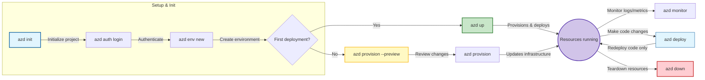
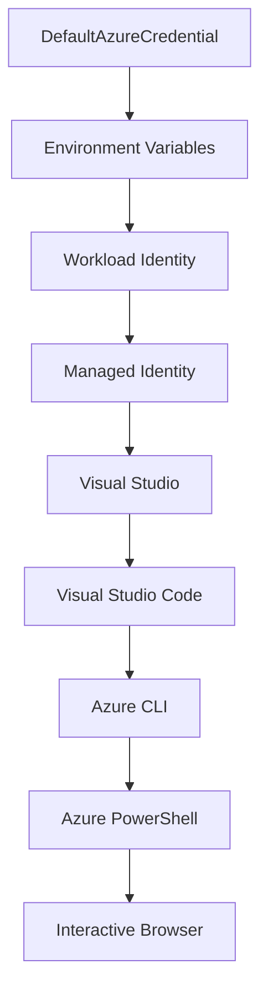

# Основи на AZD - Основни концепции и принципи

**Навигация в глава:**
- **📚 Начална страница на курса**: [AZD За начинаещи](../../README.md)
- **📖 Текуща глава**: Глава 1 - Основи и бърз старт
- **⬅️ Предишна**: [Преглед на курса](../../README.md#-chapter-1-foundation--quick-start)
- **➡️ Следваща**: [Инсталация и настройка](installation.md)
- **🚀 Следваща глава**: [Глава 2: Разработка с приоритет на ИИ](../chapter-02-ai-development/microsoft-foundry-integration.md)

## Въведение

> Прегледано спрямо `azd 1.37.2` (ноември 2026 г.). Bash командите използват цитирани заместители, които трябва да замените. Шаблонните работни процеси използват `.` за инициализиране на текущата директория; без аргумент за директория, инициализацията на шаблони създава подпапка и не променя работната директория на конзолата ви. Разширените фрагменти са илюстративни, не пълни проекти.

Този урок ви запознава с Azure Developer CLI (azd), мощен инструмент за команден ред, който ускорява вашето пътуване от локалната разработка до разгръщането в Azure. Ще научите основните концепции, ключовите функции и ще разберете как azd опростява разгръщането на приложения, изградени за облака.

## Цели за обучение

Към края на този урок ще:
- Разберете какво е Azure Developer CLI и каква е основната му цел
- Научите основните концепции за шаблони, среди и услуги
- Изследвате ключови функции, включително разработка, базирана на шаблони и инфраструктура като код
- Разберете структурата на проект azd и работния процес
- Бъдете подготвени за инсталиране и конфигуриране на azd за вашата среда за разработка

## Резултати от обучението

След завършване на този урок ще можете да:
- Обясните ролята на azd в съвременните облачни работни процеси
- Идентифицирате компонентите на структура на проект azd
- Описвате как шаблоните, средите и услугите работят заедно
- Разберете ползите от инфраструктурата като код с azd
- Познавате различните azd команди и техните цели

## Какво е Azure Developer CLI (azd)?

Azure Developer CLI (azd) е инструмент за команден ред, създаден да ускори вашето пътуване от локална разработка до разгръщане в Azure. Той опростява процеса на изграждане, разгръщане и управление на приложения, родени за облака, в Azure.

### Какво можете да разгръщате с azd?

azd поддържа широк спектър от работни натоварвания — и списъкът расте. Днес можете да използвате azd за разгръщане на:

| Тип работна натоварване | Примери | Същият работен процес? |
|------------------------|---------|-----------------------|
| **Традиционни приложения** | Уеб приложения, REST API, статични сайтове | ✅ `azd up` |
| **Услуги и микросървиси** | Контейнерни приложения, Функционални приложения, многосервисни бекенди | ✅ `azd up` |
| **Приложения с ИИ възможности** | Чат приложения с Microsoft Foundry Models, RAG решения с AI Search | ✅ `azd up` |
| **Интелигентни агенти** | Агенти хоствани във Foundry, мултиагентни оркестрации | ✅ `azd up` |

Основната идея е, че **цикълът на живот на azd остава еднакъв, независимо какво разгръщате**. Инициализирате проект, предоставяте инфраструктура, разгръщате кода, следите приложението си и почиствате — независимо дали е прост уебсайт или сложен ИИ агент.

Тази непрекъснатост е по дизайн. azd третира ИИ възможностите като още една услуга, която вашето приложение може да използва, нещо, което не е фундаментално различно. Чат крайна точка, поддържана от Microsoft Foundry Models, е от гледна точка на azd просто още една услуга за конфигуриране и разгръщане.

### 🎯 Защо да използваме AZD? Сравнение от реалния свят

Нека сравним разгръщане на просто уеб приложение с база данни:

#### ❌ БЕЗ AZD: Ръчно разгръщане в Azure (30+ минути)

**Илюстративно сравнение с Bash, не е стартер за изпълнимо приложение.** Предполага се, че вече имате код на приложението, уникални имена на ресурси, удостоверяване в Azure CLI и необходимите разширения на CLI. Използвайте упражнението с шаблон по-долу за поддържана крайно-до-край пътека.

```bash
# Step 1: Create resource group
az group create --name myapp-rg --location eastus

# Step 2: Create App Service Plan
az appservice plan create --name myapp-plan \
  --resource-group myapp-rg \
  --sku B1 --is-linux

# Step 3: Create Web App
az webapp create --name myapp-web-unique123 \
  --resource-group myapp-rg \
  --plan myapp-plan \
  --runtime "NODE:22-lts"

# Step 4: Create Cosmos DB account (10-15 minutes)
az cosmosdb create --name myapp-cosmos-unique123 \
  --resource-group myapp-rg \
  --kind MongoDB

# Step 5: Create database
az cosmosdb mongodb database create \
  --account-name myapp-cosmos-unique123 \
  --resource-group myapp-rg \
  --name tododb

# Step 6: Create collection
az cosmosdb mongodb collection create \
  --account-name myapp-cosmos-unique123 \
  --resource-group myapp-rg \
  --database-name tododb \
  --name todos

# Step 7: Get connection string
CONN_STR=$(az cosmosdb keys list \
  --name myapp-cosmos-unique123 \
  --resource-group myapp-rg \
  --type connection-strings \
  --query "connectionStrings[0].connectionString" -o tsv)

# Step 8: Configure app settings
az webapp config appsettings set \
  --name myapp-web-unique123 \
  --resource-group myapp-rg \
  --settings MONGODB_URI="$CONN_STR"

# Step 9: Enable logging
az webapp log config --name myapp-web-unique123 \
  --resource-group myapp-rg \
  --application-logging filesystem \
  --detailed-error-messages true

# Step 10: Set up Application Insights
az monitor app-insights component create \
  --app myapp-insights \
  --location eastus \
  --resource-group myapp-rg

# Step 11: Link App Insights to Web App
INSTRUMENTATION_KEY=$(az monitor app-insights component show \
  --app myapp-insights \
  --resource-group myapp-rg \
  --query "instrumentationKey" -o tsv)

az webapp config appsettings set \
  --name myapp-web-unique123 \
  --resource-group myapp-rg \
  --settings APPINSIGHTS_INSTRUMENTATIONKEY="$INSTRUMENTATION_KEY"

# Step 12: Build application locally
npm install
npm run build

# Step 13: Create deployment package
zip -r app.zip . -x "*.git*" "node_modules/*"

# Step 14: Deploy application
az webapp deployment source config-zip \
  --resource-group myapp-rg \
  --name myapp-web-unique123 \
  --src app.zip

# Step 15: Wait and pray it works 🙏
# (No automated validation, manual testing required)
```

**Проблеми:**
- ❌ Над 15 команди за запомняне и изпълнение в ред
- ❌ 30-45 минути ръчна работа
- ❌ Лесно е да се направят грешки (правописни, грешни параметри)
- ❌ Креденциалите изискват явно управление; логовете и трасето на конзолата могат да ги разкрият
- ❌ Няма автоматично връщане назад при неуспех
- ❌ Трудно за възпроизвеждане от членове на екипа
- ❌ Винаги различно (непроизводимо)

#### ✅ С AZD: Автоматизирано разгръщане (5 команди, 10-15 минути)

```bash
# Step 1: Initialize from template
azd init --template todo-nodejs-mongo .

# Step 2: Authenticate
azd auth login

# Step 3: Select the environment created during init
azd env select dev

# Step 4: Preview changes (optional but recommended)
azd provision --preview

# Step 5: Deploy everything
azd up

# ✨ Done! Everything is deployed, configured, and monitored
```

**Ползи:**
- ✅ **5 команди** вместо над 15 ръчни стъпки
- ✅ **Общо 10-15 минути** (основно чакане за Azure)
- ✅ **По-малко ръчни грешки** - постоянен, базиран на шаблони работен процес
- ✅ **Сигурно управление на тайни** - много шаблони използват управлявано от Azure съхранение на тайни
- ✅ **Възпроизводими разгръщания** - същият работен процес всеки път
- ✅ **Възпроизводими дефиниции на инфраструктура** - според квоти, наличност на региони и версии на шаблони
- ✅ **Подходящо за екипи** - всеки може да разгръща със същите команди
- ✅ **Инфраструктура като Код** - Bicep шаблони с контрол на версиите
- ✅ **Мониторинг, дефиниран от шаблона** - Application Insights, когато е включен в шаблона

### Време и надеждност

Измерените времена са приблизителни, не са еталонни стойности. azd намалява броя команди, които трябва да координирате, но не гарантира времетраене на разгръщането, не елиминира грешки и не осигурява автоматично връщане на приложението или базата данни. Поддържайте работещи версии в системата за контрол на изходния код и тествайте процедурите за възстановяване.

## Основни концепции

### Шаблони
Шаблоните са основата на azd. Те съдържат:
- **Код на приложението** - Вашият изходен код и зависимости
- **Дефиниции на инфраструктура** - Azure ресурси, дефинирани в Bicep или Terraform
- **Конфигурационни файлове** - Настройки и променливи на средата
- **Сценарии за разгръщане** - Автоматизирани работни процеси за разгръщане

### Среди
Средите представляват различни цели за разгръщане:
- **Разработка** - За тестване и разработка
- **Тестване** - Предпроизводствена среда
- **Производство** - Жива продуктивна среда

Всяка среда поддържа своя собствена:
- Име и стойности на средата; изолацията на ресурсите зависи от инфраструктурния шаблон
- Конфигурационни настройки
- Състояние на разгръщането

### Услуги
Услугите в `azure.yaml` описват компоненти на приложението, които могат да бъдат разгръщани:
- **Фронтенд** - Уеб приложения, SPA
- **Бекенд** - API, микросървиси

Базите данни и съхранението обикновено се предоставят като инфраструктурни ресурси, а не като специализирани домакини на услуги като `host: postgres`.

## Ключови функции

### 1. Разработка, базирана на шаблони
```bash
# Browse available templates
azd template list

# Initialize from a template
azd init --template "<template-name>" .
```

### 2. Инфраструктура като код
- **Bicep** - Специализиран език за домейна на Azure
- **Terraform** - Инструмент за инфраструктура в мултиоблака
- Bicep се компилира в ARM шаблони; чистият ARM JSON не е отделен вграден `infra.provider`.

### 3. Интегрирани работни процеси
```bash
# Complete deployment workflow
azd up            # Provision + Deploy this is hands off for first time setup

# 🧪 NEW: Preview infrastructure changes before deployment (SAFE)
azd provision --preview    # Simulate infrastructure deployment without making changes

azd provision     # Create Azure resources if you update the infrastructure use this
azd deploy        # Deploy application code or redeploy application code once update
azd down          # Clean up resources
```

#### 🛡️ Безопасно планиране на инфраструктура с предварителен преглед
Командата `azd provision --preview` е революционна за безопасни разгръщания:
- **Анализ без изпълнение** - Показва какво ще бъде създадено, модифицирано или изтрито
- **Без прилагане на инфраструктура** - Преглежда промените в доставчика; първо проверете куки на проекта, тъй като те могат да изпълняват команди със странични ефекти
- **Екипно сътрудничество** - Споделяне на резултати от предварителен преглед преди разгръщане
- **Вход за планиране на разходите** - Преглежда предложените SKU, след което ги оценява с Azure Pricing Calculator; предварителният преглед не изчислява цени

```bash
# Example preview workflow
azd provision --preview           # See what will change
# Review the output, discuss with team
azd provision                     # Apply changes with confidence
```

### 📊 Визуализация: Работен процес на разработката с AZD



**Обяснение на работния процес:**
1. **Init** - Започнете с шаблон или нов проект
2. **Auth** - Аутентикация с Azure
3. **Срода** - Създаване на изолирана среда за разгръщане
4. **Preview** - 🆕 Винаги преглеждайте промените в инфраструктурата първо (безопасна практика)
5. **Provision** - Създаване/актуализиране на Azure ресурси
6. **Deploy** - Изпращане на вашия код на приложението
7. **Monitor** - Наблюдение на производителността на приложението
8. **Iterate** - Правене на промени и повторно разгръщане на кода
9. **Cleanup** - Премахване на ресурси при приключване

### 4. Управление на среди
```bash
# Create and manage environments
azd env new "<environment-name>"
azd env select "<environment-name>"
azd env list
```

### 5. Разширения и ИИ команди

azd използва система от разширения, за да добавя възможности извън основния CLI. Това е особено полезно за ИИ работни натоварвания:

```bash
# List available extensions
azd extension list

# Install the GA Foundry bundle (requires azd >= 1.37.0)
azd ext install microsoft.foundry

# Initialize an AI agent project interactively
azd ai agent init

# Test a deployed agent (shows latency and time-to-first-byte)
azd ai agent invoke

# Start the MCP server for AI-assisted development (Alpha)
azd mcp start
```

**Цикъл на живот на агента, от край до край.** GA `microsoft.foundry` пакетът включва `azure.ai.agents` и още шест основни разширения. Инсталирайте `azure.ai.evaluations` отделно за оценка. Използвайте `azd >= 1.37.0` за този работен процес. Не е нужно да ги имате всички от първия ден:

| Етап | Команда | Какво прави |
|-------|---------|--------------|
| **Създаване на скелет** | `azd ai agent init --template <path-to-azure.yaml>` | Приема текущ шаблон на проект за агент |
| **Локално стартиране** | `azd ai agent run`, после `azd ai agent invoke --local "Test prompt"` в друг терминал | Проверява локалната активност в Agent Inspector; повикванията към моделите използват Azure |
| **Разгръщане** | `azd deploy` | За агенти в кодов режим, качва изходния код за отдалечено изграждане във Foundry |
| **Тестване** | `azd ai agent invoke` | Извиква агента и показва времето за реакция |
| **Измерване** | `azd ai eval init`, `generate`, `run start` | Конфигурира, разгръща и стартира оценки с отделното разширение |
| **Подобряване** | `azd ai agent optimize --eval <evaluation-name> --optimize-model <optimizer-deployment>` | Преизползва съвместима оценка за оптимизиране на агента |
| **Инспекция** | `azd ai agent endpoint show` | Вижда настройката на живия крайна точка |
| **Почистване** | `azd ai agent delete` | Изтрива хостван агент и всички версии на агента |

> Започнете с [пътеводител за хостван агент при GA](../chapter-02-ai-development/microsoft-foundry-integration.md#hosted-agent-walkthrough-ga), който обхваща предварителни изисквания, осигуряване и безопасно почистване. Разширенията са описани по-подробно в справката [AZD AI CLI команди](../chapter-08-production/production-ai-practices.md#azd-ai-cli-commands-and-extensions).

## 📁 Структура на проекта

Типична структура на проект azd:
```
my-app/
├── .azure/                  # Local environments and selected-environment config
│   ├── config.json
│   └── dev/.env
├── .devcontainer/          # Development container config
├── .github/workflows/      # GitHub Actions
├── .vscode/               # VS Code settings
├── infra/                 # Infrastructure code
│   ├── main.bicep        # Main infrastructure template
│   ├── main.parameters.json
│   └── modules/          # Reusable modules
├── src/                  # Application source code
│   ├── api/             # Backend services
│   └── web/             # Frontend application
├── azure.yaml           # azd project configuration
└── README.md
```

## 🔧 Конфигурационни файлове

### azure.yaml
Основният конфигурационен файл на проекта:
```yaml
name: my-awesome-app
metadata:
  template: my-template@1.0.0

services:
  web:
    project: ./src/web
    language: js
    host: appservice
  api:
    project: ./src/api
    language: js
    host: appservice

hooks:
  preprovision:
    shell: pwsh
    run: echo "Preparing to provision..."
```

### .azure/config.json
Местен за проекта избор на подразбираща се среда (илюстративно; управлява се от azd):
```json
{
  "defaultEnvironment": "dev"
}
```

## 🎪 Общи работни процеси с практически упражнения

> **💡 Съвет за учене:** Следвайте тези упражнения по ред, за да развиете уменията си с AZD постепенно.

### 🎯 Упражнение 1: Инициализирайте първия си проект

**Цел:** Създаване на AZD проект и разглеждане на неговата структура

**Стъпки:**
```bash
# Use a proven template
mkdir azd-basics-practice
cd azd-basics-practice
# Choose "dev" for the environment name when prompted
azd init --template todo-nodejs-mongo .

# Explore the generated files
ls -la  # View all files including hidden ones

# Key files created:
# - azure.yaml (main config)
# - infra/ (infrastructure code)
# - src/ (application code)
```

**✅ Успех:** Имате azure.yaml, директории infra/ и src/

---

### 🎯 Упражнение 2: Разгърнете в Azure

**Цел:** Завършване на крайно-до-край разгръщане

**Стъпки:**
```bash
# 1. Authenticate
azd auth login

# 2. Select the dev environment created in Exercise 1
azd env select dev
azd env set AZURE_LOCATION eastus

# 3. Preview changes (RECOMMENDED)
azd provision --preview

# 4. Deploy everything
azd up

# 5. Verify deployment
azd show    # View your app URL
```

**Очаквано време:** 10-15 минути  
**✅ Успех:** URL адресът на приложението се отваря в браузъра

---

### 🎯 Упражнение 3: Множество среди

**Цел:** Разгърнете в dev и staging

**Стъпки:**
```bash
# Already have dev, create staging
azd env new staging
azd env set AZURE_LOCATION westus2
azd up

# Switch between them
azd env list
azd env select dev
```

**✅ Успех:** Две отделни групи ресурси в Azure Portal

**Почистване:** Упражнение 3 създава второ разгръщане с таксуване. Изтрийте и двете, когато приключите:

```bash
azd down --environment dev
azd down --environment staging
```

---

### 🛡️ Разрушително почистване: `azd down --force --purge`

Когато умишлено искате да изтриете Azure ресурсите на избраната среда:

```bash
azd down --force --purge
```

**Какво прави:**
- `--force`: Без подкана за потвърждение
- `--purge`: Също така изтрива трайно поддържаните меки изтрити ресурси (например Key Vaults), ако защитата на почистване го позволява. Не изтрива локалната директория `.azure/`.

**Използвайте когато:** сте приключили с временна среда. Не използвайте разрушително почистване като първа реакция при грешка в удостоверяването, квотата или конфигурацията.

---

## 🎪 Оригинална справка за работен процес

### Стартиране на нов проект
```bash
# Method 1: Use existing template
azd init --template todo-nodejs-mongo .

# Method 2: Start from scratch
azd init

# Method 3: Use current directory
azd init .
```

### Цикъл на разработката
```bash
# Set up development environment
azd auth login
azd env new dev
azd env select dev

# Deploy everything
azd up

# Make changes and redeploy
azd deploy

# Clean up when done
azd down --force --purge # Deletes this environment's discovered Azure resources; review before forcing deletion.
```

## Разбиране на `azd down --force --purge`
Командата `azd down --force --purge` е мощен начин да разрушите напълно вашата azd среда и всички свързани ресурси. Ето разбивка на действията на всеки флаг:
```
--force
```
- Прескача подкани за потвърждение.
- Полезно за автоматизация или скриптове, когато ръчно въвеждане не е възможно.
- Не заобикаля разрешения, защита на почистване или неуспехи при изтриване.

```
--purge
```
Трайно изтрива поддържани меки изтрити Azure ресурси без допълнително потвърждение. Остава в сила защитата от почистване и разрешенията. **Не** премахва локални среди или папката `.azure/`.


### Защо да използвате и двете?
Използвайте и двете само когато възнамерявате да изтриете Azure ресурсите на избраната среда и да изчистите възстановими ресурси. Това е разрушително почистване, не общ ремонт или нулиране на локално състояние.

Особено полезно след ръчно изтриване на ресурси в Azure портала или при смяна на шаблони, среди или именуване на групи ресурси.


### Управление на множество среди
```bash
# Create staging environment
azd env new staging
azd env select staging
azd up

# Switch back to dev
azd env select dev

# Compare environments
azd env list
```

## 🔐 Удостоверяване и креденциали

Разграничете удостоверяването за разгръщане (`azd auth login`) от удостоверяването за SDK на приложението (`DefaultAzureCredential`). Това са отделни неща. По подразбиране azd не използва креденциалите на Azure CLI.

### Удостоверяване с Azure CLI (`az login`)

Стартирайте `azd auth login` за azd. Следните Azure CLI команди са по избор и удостоверяват `az` отделно:

```bash
# Interactive login (opens browser)
az login

# Login with specific tenant
az login --tenant "<tenant-id>"

# Login with service principal
az login --service-principal -u "<app-id>" -p "<password>" --tenant "<tenant-id>"

# Check current login status
az account show

# List available subscriptions
az account list --output table

# Set default subscription
az account set --subscription "<subscription-id>"
```

### Работен поток за удостоверяване
1. **Интерактивно влизане**: Отваря вашия стандартен браузър за удостоверяване
2. **Поток на код на устройството**: За среди без достъп до браузър
3. **Служебен принципал**: За автоматизация и CI/CD сценарии
4. **Управлявана самоличност**: За приложения, хоствани в Azure

### Верига на DefaultAzureCredential

`DefaultAzureCredential` е тип удостоверяване, който предоставя опростено изживяване при автентикация, като автоматично опитва няколко източника на удостоверяване в определен ред:

#### Верига от удостоверяване за SDK на приложението

Точната верига зависи от езика на Azure Identity SDK, версията, инсталираните плъгини и опциите. Тази диаграма е концептуална, а не фиксирана последователност за удостоверяване на azd; скорошните SDK могат също да включват удостоверяване чрез Azure Developer CLI.


#### 1. Променливи на средата
```bash
# Set environment variables for service principal
export AZURE_CLIENT_ID="<app-id>"
export AZURE_CLIENT_SECRET="<password>"
export AZURE_TENANT_ID="<tenant-id>"
```

#### 2. Удостоверяване на товара (Kubernetes/GitHub Actions)
Използва се автоматично в:
- Azure Kubernetes Service (AKS) с удостоверяване на товара
- GitHub Actions с OIDC федерация
- Други федеративни сценарии с идентичност

#### 3. Управлявана самоличност
За Azure ресурси като:
- Виртуални машини
- App Service
- Azure Functions
- Инстанции на контейнери

```bash
# Inspect a deployed Container App's configured identity (requires az login)
az containerapp show --name "<app-name>" --resource-group "<rg-name>" --query identity
```

#### 4. Интеграция с инструменти за разработчици
- **Visual Studio**: Автоматично използва влезлия акаунт
- **VS Code**: Поддръжката зависи от SDK и съответната брокер/плъгин конфигурация
- **Azure CLI**: Използва `az login` идентификационни данни (най-често за локална разработка)

### Настройка на удостоверяване в AZD

```bash
# Method 1: Direct azd authentication (recommended)
azd auth login

# Method 2: Direct azd authentication
azd auth login --use-device-code  # For headless environments

# Method 3: Check authentication status
azd auth login --check-status

# Method 4: Logout and re-authenticate
azd auth logout
azd auth login
```

### Най-добри практики за удостоверяване

#### За локална разработка
```bash
# 1. Log in to azd
azd auth login

# 2. Select the subscription for this initialized environment
azd env set AZURE_SUBSCRIPTION_ID "<subscription-id>"

# 3. Check azd sign-in details (read the status message)
azd auth login --check-status
```

#### За CI/CD конвейери
```yaml
# Partial GitHub Actions steps: assumes checkout, azd installation,
# required AZURE_* environment values, and pipeline secret configuration.
- name: Deploy with azd
  run: |
    azd auth login --client-id ${{ secrets.AZURE_CLIENT_ID }} \
                    --client-secret ${{ secrets.AZURE_CLIENT_SECRET }} \
                    --tenant-id ${{ secrets.AZURE_TENANT_ID }}
    azd up --no-prompt
```

#### За продукционни среди
- Използвайте **Управлявана самоличност** при работа в Azure ресурси
- Използвайте **Служебен принципал** за автоматизирани сценарии
- Избягвайте съхранението на удостоверителни данни в код или конфигурационни файлове
- Използвайте **Azure Key Vault** за чувствителна конфигурация

### Чести проблеми с удостоверяването и решения

#### Проблем: "Не е намерен абонамент"
```bash
# Solution: Set default subscription
az account list --output table
az account set --subscription "<subscription-id>"
azd env set AZURE_SUBSCRIPTION_ID "<subscription-id>"
```

#### Проблем: "Недостатъчни разрешения"
```bash
# Solution: Check and assign required roles
az role assignment list --assignee $(az account show --query user.name --output tsv)

# Common required roles:
# - Contributor (for resource management)
# - User Access Administrator (for role assignments)
```

#### Проблем: "Токенът е изтекъл"
```bash
# Solution: Re-authenticate
az logout
az login
azd auth logout
azd auth login
```

### Удостоверяване в различни сценарии

#### Локална разработка
```bash
# Personal development account
az login
azd auth login
```

#### Екипна разработка
```bash
# Use specific tenant for organization
az login --tenant contoso.onmicrosoft.com
azd auth login --tenant-id "<tenant-id>"
```

#### Мулти-тенант сценарии
```bash
# Switch between tenants
az login --tenant tenant1.onmicrosoft.com
azd auth login --tenant-id "<tenant-1-id>"
# Select an environment configured with tenant 1's subscription
azd env select tenant1-dev
# Deploy to tenant 1
azd up

az login --tenant tenant2.onmicrosoft.com  
azd auth login --tenant-id "<tenant-2-id>"
azd env select tenant2-dev
# Deploy to tenant 2
azd up
```

### Съображения за сигурност

1. **Съхранение на удостоверителни данни**: Никога не съхранявайте удостоверителни данни в изходния код
2. **Ограничаване на обхвата**: Използвайте принципа на най-малко привилегии за служебни принципали
3. **Ротация на токени**: Редовно въртете тайните на служебния принципал
4. **Одиторска следа**: Наблюдавайте удостоверяването и дейностите по внедряване
5. **Мрежова сигурност**: Използвайте частни крайни точки когато е възможно

### Отстраняване на проблеми с удостоверяването

```bash
# Debug authentication issues
azd auth login --check-status
az account show
az account get-access-token

# Common diagnostic commands
whoami                          # Current user context
az ad signed-in-user show      # Microsoft Entra ID user details
az group list                  # Test resource access
```

## Откриване на команди

### Откриване
```bash
azd template list              # Browse templates
azd template list --help       # Template discovery options
azd init --help               # Initialization options
```

### Управление на проект
```bash
azd show                     # Project overview
azd env list                # Available environments and selected default
azd config show            # Configuration settings
```

### Мониторинг
```bash
azd monitor                  # Open Azure portal monitoring
azd monitor --logs           # View application logs
azd monitor --live           # View live metrics
azd pipeline config          # Set up CI/CD
```

## Най-добри практики

### 1. Използвайте значими имена
```bash
# Good
azd env new production-east
azd init --template todo-nodejs-mongo .

# Avoid
azd env new env1
azd init --template template1 .
```

### 2. Използвайте шаблони
- Започнете с налични шаблони
- Персонализирайте според нуждите си
- Създавайте многократно използваеми шаблони за вашата организация

### 3. Изолация на средите
- Използвайте отделни среди за развитие/стейджинг/продукция
- Никога не внедрявайте директно в продукция от локална машина
- Използвайте CI/CD конвейери за продукционни внедрявания

### 4. Управление на конфигурацията
- Използвайте управлявана самоличност и Key Vault за тайни; обикновените `azd env set` стойности са локален обикновен текст
- Дръжте конфигурацията под контрол на версиите
- Документирайте настройки, специфични за средата

## Напредък в ученето

### Начинаещ (Седмица 1-2)
1. Инсталирайте azd и се удостоверете
2. Внедрете прост шаблон
3. Разберете структурата на проекта
4. Научете основни команди (up, down, deploy)

### Средно ниво (Седмица 3-4)
1. Персонализирайте шаблоните
2. Управлявайте множество среди
3. Разберете инфраструктурен код
4. Настройте CI/CD конвейери

### Напреднали (Седмица 5+)
1. Създайте персонализирани шаблони
2. Разширени инфраструктурни модели
3. Много-регионални внедрявания
4. Корпоративни конфигурации

## Следващи стъпки

**📖 Продължете с глава 1:**
- [Инсталиране и настройка](installation.md) - Инсталирайте и конфигурирайте azd
- [Вашият първи проект](first-project.md) - Завършете практическо ръководство
- [Ръководство за конфигурация](../chapter-03-configuration/configuration.md) - Разширени опции за конфигурация

**🎯 Готови за следващата глава?**
- [Глава 2: Разработка с първо място за AI](../chapter-02-ai-development/microsoft-foundry-integration.md) - Започнете изграждането на AI приложения

## Допълнителни ресурси

- [Преглед на Azure Developer CLI](https://learn.microsoft.com/en-us/azure/developer/azure-developer-cli/)
- [Галерия на шаблони](https://azure.github.io/awesome-azd/)
- [Общностни примери](https://github.com/Azure-Samples)

---

## 🙋 Често задавани въпроси

### Общо задавани въпроси

**В: Каква е разликата между AZD и Azure CLI?**

О: Azure CLI (`az`) е за управление на отделни Azure ресурси. AZD (`azd`) е за управление на цели приложения:

```bash
# Azure CLI - Low-level resource management
az webapp create --name myapp --resource-group rg
az sql server create --name myserver --resource-group rg
# ...many more commands needed

# AZD - Application-level management
azd up  # Deploys entire app with all resources
```

**Мислете за това така:**
- `az` = Работа с отделни Лего тухлички
- `azd` = Работа с цял комплект Лего

---

**В: Трябва ли да знам Bicep или Terraform, за да използвам AZD?**

О: Не! Започнете с шаблоните:
```bash
# Use existing template - no IaC knowledge needed
azd init --template todo-nodejs-mongo .
azd up
```

Можете да научите Bicep по-късно, за да персонализирате инфраструктурата. Шаблоните предоставят работещи примери, от които да се учите.

---

**В: Колко струва да работя с AZD шаблони?**

О: Цените варират в зависимост от регион, SKU, време на работа, режим на база данни и използване на модели. Развойна среда може да носи значителни месечни такси дори в режим на изчакване; не приемайте общ диапазон от $50-150:

```bash
# Preview resource changes (not prices)
azd provision --preview

# Always cleanup when not using
azd down --force --purge  # Removes all resources
```

**Професионален съвет:** Използвайте безплатни нива където са налични:
- App Service: ниво F1 (безплатно)
- Azure OpenAI: няма общо гарантиран месечен безплатен брой токени; проверете текущата цена на моделите и офертите
- Cosmos DB: сметките с резервирана пропускливост могат да активират безплатно ниво; шаблоните за безсървърни решения не се квалифицират автоматично

---

**В: Мога ли да използвам AZD с вече съществуващи Azure ресурси?**

О: Да, но е по-лесно да започнете отначало. AZD работи най-добре когато управлява целия жизнен цикъл. За вече съществуващи ресурси:

```bash
# Option 1: Import existing resources (advanced)
azd init
# Then modify infra/ to reference existing resources

# Option 2: Start fresh (recommended)
azd init --template "<verified-template-name>" .
azd up  # Creates new environment
```

---

**В: Как да споделя моя проект с колеги?**

О: Коментирайте AZD проекта в Git (НО НЕ и папката .azure):

```bash
# Already in .gitignore by default
.azure/        # Contains secrets and environment data
*.env          # Environment variables

# Team members then:
git clone "<your-repo>"
# Change into the cloned repository before running the remaining commands.
azd auth login
azd env new "<their-name>-dev"
azd up
```

Всички получават еднаква инфраструктура от същите шаблони.

---

### Въпроси за отстраняване на проблеми

**В: "azd up" се провали по средата. Какво да направя?**

О: Проверете грешката, оправете я, след това опитайте отново:

```bash
# Capture detailed diagnostics (redact sensitive values before sharing)
azd up --debug

# Common fixes:

# 1. If quota exceeded:
azd env set AZURE_LOCATION "westus2"  # Try different region

# 2. If resource name conflict:
azd down --force --purge  # Clean slate
azd up  # Retry

# 3. If auth expired:
az login
azd auth login
azd up
```

**Най-чест проблем:** Избран е грешен абонамент в Azure
```bash
az account list --output table
az account set --subscription "<correct-subscription>"
azd env set AZURE_SUBSCRIPTION_ID "<correct-subscription-id>"
```

---

**В: Как да внедря само промените в кода без повторно осигуряване на инфраструктурата?**

О: Използвайте `azd deploy` вместо `azd up`:

```bash
azd up          # First time: provision + deploy (slow)

# Make code changes...

azd deploy      # Subsequent times: deploy only (fast)
```

Сравнение на скоростта:
- `azd up`: 10-15 минути (осигурява инфраструктура)
- `azd deploy`: 2-5 минути (само код)

---

**В: Мога ли да персонализирам инфраструктурните шаблони?**

О: Да! Редактирайте Bicep файловете в `infra/`:

```bash
# After azd init
cd infra/
code main.bicep  # Edit in VS Code

# Preview changes
azd provision --preview

# Apply changes
azd provision
```

**Съвет:** Започнете с малко - първо сменете SKU:
```bicep
// infra/main.bicep
sku: {
  name: 'B1'  // Change to 'P1V2' for production
}
```

---

**В: Как мога да изтрия всичко, създадено от AZD?**

О: Една команда премахва всички ресурси:

```bash
azd down --force --purge

# This deletes:
# - Azure resources/resource groups discovered for the selected environment
# - Supported soft-deleted resources, if purge protection allows
# Local .azure files remain; shared/external resources may remain too.
```

**Винаги изпълнявайте това, когато:**
- Приключите с тестването на шаблон
- Превключвате към друг проект
- Искате да започнете отначало

**Проверка на разходите:** Потвърдете изтриването в Azure и проверете за запазени/споделени ресурси. Вече начислени такси все още важат.

---

**В: Какво да направя, ако случайно изтрия ресурси в Azure Portal?**

О: Състоянието на AZD може да излезе извън синхрон. Подход с чист старт:

```bash
# 1. Delete remaining resources only if that is your intent
azd down --force --purge

# 2. Start fresh
azd up

# Alternative: Let AZD detect and fix
azd provision  # Will create missing resources
```

---

### Разширени въпроси

**В: Мога ли да използвам AZD в CI/CD конвейери?**

О: Да! Пример с GitHub Actions:

```yaml
# .github/workflows/deploy.yml
name: Deploy with AZD

on:
  push:
    branches: [main]

jobs:
  deploy:
    runs-on: ubuntu-latest
    steps:
      - uses: actions/checkout@v4
      
      - name: Install azd
        run: curl -fsSL https://aka.ms/install-azd.sh | bash
      
      - name: Azure Login
        run: |
          azd auth login \
            --client-id ${{ secrets.AZURE_CLIENT_ID }} \
            --client-secret ${{ secrets.AZURE_CLIENT_SECRET }} \
            --tenant-id ${{ secrets.AZURE_TENANT_ID }}
      
      - name: Deploy
        env:
          AZURE_ENV_NAME: dev
          AZURE_LOCATION: ${{ vars.AZURE_LOCATION }}
          AZURE_SUBSCRIPTION_ID: ${{ vars.AZURE_SUBSCRIPTION_ID }}
        run: azd up --no-prompt
```

---

**В: Как да управлявам тайни и чувствителни данни?**

О: Използвайте Key Vault експлицитно. `azd env set` записва обикновени стойности във файла на локалната среда; той не създава автоматично хранилище, не задава роли и не инжектира тайни в приложението ви.

```bash
# Interactive: create/select a Key Vault secret and save its reference
azd env set-secret DATABASE_PASSWORD
```

Вие трябва да имате съответните разрешения за хранилището. Вашата инфраструктура/приложение още трябва да свърже тайната към потребителя и да предостави достъп на самоличността при изпълнение. Не печатайте разкритите стойности на тайни в логове.

**Никога не комитвайте:**
- папката `.azure/` (съдържа данни за средата)
- файловете `.env` (локални тайни)
- Стринговете за връзка

---

**В: Мога ли да внедря в множество региони?**

О: Да, създайте среда за всеки регион:

```bash
# East US environment
azd env new prod-eastus
azd env set AZURE_LOCATION eastus
azd up

# West Europe environment
azd env new prod-westeurope
azd env set AZURE_LOCATION westeurope
azd up

# Each environment is independent
azd env list
```

За истински мулти-регионални приложения персонализирайте Bicep шаблоните да внедряват едновременно в множество региони.

---

**В: Къде мога да получа помощ, ако заседна?**

1. **Документация на AZD:** https://learn.microsoft.com/azure/developer/azure-developer-cli/
2. **GitHub Issues:** https://github.com/Azure/azure-dev/issues
3. **Discord:** [Azure Discord](https://discord.gg/microsoft-azure) - канал #azure-developer-cli
4. **Stack Overflow:** Таг `azure-developer-cli`
5. **Този курс:** [Ръководство за отстраняване на проблеми](../chapter-07-troubleshooting/common-issues.md)

**Професионален съвет:** Преди да питате, изпълнете:
```bash
azd show       # Shows current state
azd version    # Shows your version
```
Включете тази информация във вашия въпрос за по-бърза помощ.

---

## 🎓 Какво следва?

Вече разбирате основите на AZD. Изберете своя път:

### 🎯 За начинаещи:
1. **Следващо:** [Инсталиране и настройка](installation.md) - Инсталирайте AZD на вашата машина
2. **После:** [Вашият първи проект](first-project.md) - Внедрете първото си приложение
3. **Практика:** Завършете всичките 3 упражнения в този урок

### 🚀 За AI разработчици:
1. **Прескочете към:** [Глава 2: Разработка с първо място за AI](../chapter-02-ai-development/microsoft-foundry-integration.md)
2. **Внедрете:** В празна проектна директория започнете с `azd init --template get-started-with-ai-chat .`
3. **Научете:** Изграждайте докато внедрявате

### 🏗️ За опитни разработчици:
1. **Прегледайте:** [Ръководство за конфигурация](../chapter-03-configuration/configuration.md) - Разширени настройки
2. **Изследвайте:** [Инфраструктура като код](../chapter-04-infrastructure/provisioning.md) - Задълбочено в Bicep
3. **Създавайте:** Създавайте персонализирани шаблони за вашия стек

---

**Навигация на главата:**
- **📚 Начална страница на курса**: [AZD за начинаещи](../../README.md)
- **📖 Текуща глава**: Глава 1 - Основи и бърз старт  
- **⬅️ Предишна**: [Преглед на курса](../../README.md#-chapter-1-foundation--quick-start)
- **➡️ Следваща**: [Инсталиране и настройка](installation.md)
- **🚀 Следваща глава**: [Глава 2: Разработка с първо място за AI](../chapter-02-ai-development/microsoft-foundry-integration.md)

---

<!-- CO-OP TRANSLATOR DISCLAIMER START -->
**Отказ от отговорност**:
Този документ е преведен с помощта на AI преводачески услуга [Co-op Translator](https://github.com/Azure/co-op-translator). Въпреки че се стремим към точност, моля имайте предвид, че автоматизираните преводи могат да съдържат грешки или неточности. Оригиналният документ на неговия роден език трябва да се счита за авторитетен източник. За критична информация се препоръчва професионален човешки превод. Ние не носим отговорност за каквито и да е недоразумения или неправилни тълкувания, произтичащи от използването на този превод.
<!-- CO-OP TRANSLATOR DISCLAIMER END -->