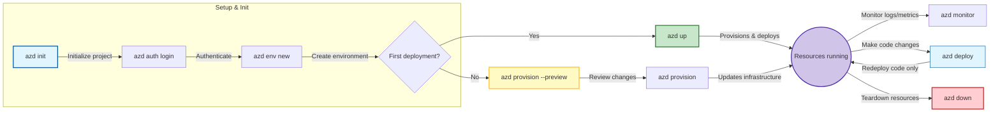
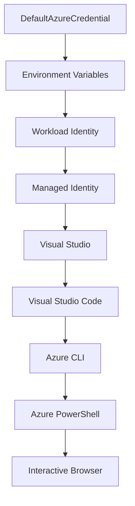

# Основи на AZD - Основни концепции и принципи

**Навигация в главата:**
- **📚 Начало на курса**: [AZD за начинаещи](../../README.md)
- **📖 Текуща глава**: Глава 1 - Основи и бърз старт
- **⬅️ Предишна**: [Преглед на курса](../../README.md#-chapter-1-foundation--quick-start)
- **➡️ Следваща**: [Инсталация и настройка](installation.md)
- **🚀 Следваща глава**: [Глава 2: AI-първо разработване](../chapter-02-ai-development/microsoft-foundry-integration.md)

## Въведение

> Прегледано спрямо `azd 1.37.2` (ноември 2026 г.). Bash командите използват цитирани запълващи места, които трябва да замените. Шаблонните работни потоци използват `.` за инициализиране на текущата директория; без аргумент за директория, инициализацията на шаблона създава поддиректория и не променя работната директория на шел сесията ви. Разширените откъси са илюстративни, не са пълни проекти.

Този урок ви запознава с Azure Developer CLI (azd), мощен инструмент за команден ред, който ускорява вашето пътуване от локална разработка към разгръщане в Azure. Ще научите основните концепции, ключови функции и ще разберете как azd опростява разгръщането на нативни за облака приложения.

## Цели за учене

В края на този урок ще:
- Разберете какво е Azure Developer CLI и неговото основно предназначение
- Научите основните концепции за шаблони, среди и услуги
- Изследвате ключови характеристики като шаблонно-ориентирана разработка и инфраструктура като код
- Разберете структурата на проекта azd и работния процес
- Бъдете подготвени да инсталирате и конфигурирате azd за вашата среда за разработка

## Резултати от обучението

След завършване на този урок ще можете да:
- Обясните ролята на azd в съвременните работни потоци за разработка в облака
- Идентифицирате компонентите на структурата на проект azd
- Опишете как шаблоните, средите и услугите работят заедно
- Разберете ползите от инфраструктурата като код с azd
- Разпознавате различни azd команди и техните предназначения

## Какво е Azure Developer CLI (azd)?

Azure Developer CLI (azd) е инструмент за команден ред, създаден да ускори вашето пътуване от локална разработка до разгръщане в Azure. Той опростява процеса на изграждане, разгръщане и управление на нативни за облака приложения в Azure.

### Какво можете да разгръщате с azd?

azd поддържа широк спектър от работни натоварвания – и списъкът продължава да расте. Днес можете да използвате azd за разгръщане на:

| Вид работно натоварване | Примери | Същ работен поток? |
|---------------|----------|----------------|
| **Традиционни приложения** | Уеб приложения, REST API, статични сайтове | ✅ `azd up` |
| **Услуги и микросървиси** | Контейнерни приложения, Функционални приложения, многосервисни бекендове | ✅ `azd up` |
| **Приложения с изкуствен интелект** | Чат приложения с Microsoft Foundry модели, RAG решения с AI Search | ✅ `azd up` |
| **Интелигентни агенти** | Агентите, хоствани от Foundry, мултиагентни оркестрации | ✅ `azd up` |

Основната повеля е, че **жизненият цикъл на azd остава същият независимо от това какво разгръщате**. Инициализирате проект, подготвяте инфраструктурата, разгръщате кода си, наблюдавате приложението и почиствате – независимо дали е прост уебсайт или сложен AI агент.

Тази непрекъснатост е по дизайн. azd третира AI възможностите като още един вид услуга, която приложението ви може да използва, а не като нещо принципно различно. Чат крайна точка, поддържана от Microsoft Foundry модели, от гледна точка на azd е просто още една услуга за конфигуриране и разгръщане.

### 🎯 Защо да използвате AZD? Сравнение от реалния свят

Нека сравним разгръщането на прост уеб ап с база данни:

#### ❌ БЕЗ AZD: Ръчно разгръщане в Azure (над 30 минути)

**Илюстративно сравнение на Bash, не работещ стартов код.** Предполага съществуващ код на приложението, уникални имена на ресурси, удостоверяване в Azure CLI и всички необходими разширения. Използвайте упражнението с шаблон по-долу за поддържания пълен път.

```bash
# Step 1: Create resource group
az group create --name myapp-rg --location eastus

# Step 2: Create App Service Plan
az appservice plan create --name myapp-plan \
  --resource-group myapp-rg \
  --sku B1 --is-linux

# Step 3: Create Web App
az webapp create --name myapp-web-unique123 \
  --resource-group myapp-rg \
  --plan myapp-plan \
  --runtime "NODE:22-lts"

# Step 4: Create Cosmos DB account (10-15 minutes)
az cosmosdb create --name myapp-cosmos-unique123 \
  --resource-group myapp-rg \
  --kind MongoDB

# Step 5: Create database
az cosmosdb mongodb database create \
  --account-name myapp-cosmos-unique123 \
  --resource-group myapp-rg \
  --name tododb

# Step 6: Create collection
az cosmosdb mongodb collection create \
  --account-name myapp-cosmos-unique123 \
  --resource-group myapp-rg \
  --database-name tododb \
  --name todos

# Step 7: Get connection string
CONN_STR=$(az cosmosdb keys list \
  --name myapp-cosmos-unique123 \
  --resource-group myapp-rg \
  --type connection-strings \
  --query "connectionStrings[0].connectionString" -o tsv)

# Step 8: Configure app settings
az webapp config appsettings set \
  --name myapp-web-unique123 \
  --resource-group myapp-rg \
  --settings MONGODB_URI="$CONN_STR"

# Step 9: Enable logging
az webapp log config --name myapp-web-unique123 \
  --resource-group myapp-rg \
  --application-logging filesystem \
  --detailed-error-messages true

# Step 10: Set up Application Insights
az monitor app-insights component create \
  --app myapp-insights \
  --location eastus \
  --resource-group myapp-rg

# Step 11: Link App Insights to Web App
INSTRUMENTATION_KEY=$(az monitor app-insights component show \
  --app myapp-insights \
  --resource-group myapp-rg \
  --query "instrumentationKey" -o tsv)

az webapp config appsettings set \
  --name myapp-web-unique123 \
  --resource-group myapp-rg \
  --settings APPINSIGHTS_INSTRUMENTATIONKEY="$INSTRUMENTATION_KEY"

# Step 12: Build application locally
npm install
npm run build

# Step 13: Create deployment package
zip -r app.zip . -x "*.git*" "node_modules/*"

# Step 14: Deploy application
az webapp deployment source config-zip \
  --resource-group myapp-rg \
  --name myapp-web-unique123 \
  --src app.zip

# Step 15: Wait and pray it works 🙏
# (No automated validation, manual testing required)
```

**Проблеми:**
- ❌ Над 15 команди за запомняне и изпълнение в ред
- ❌ 30-45 минути ръчна работа
- ❌ Лесно е да се допуснат грешки (правописни, грешни параметри)
- ❌ Удостоверенията изискват специално управление; debug логовете и следенето на шел могат да ги разкрият
- ❌ Няма автоматично връщане назад ако нещо се провали
- ❌ Трудно за повторение от членовете на екипа
- ❌ Винаги различно (не е възпроизводимо)

#### ✅ С AZD: Автоматизирано разгръщане (5 команди, 10-15 минути)

```bash
# Step 1: Initialize from template
azd init --template todo-nodejs-mongo .

# Step 2: Authenticate
azd auth login

# Step 3: Select the environment created during init
azd env select dev

# Step 4: Preview changes (optional but recommended)
azd provision --preview

# Step 5: Deploy everything
azd up

# ✨ Done! Everything is deployed, configured, and monitored
```

**Предимства:**
- ✅ **5 команди** срещу 15+ ръчни стъпки
- ✅ **10-15 минути** общо време (основно изчакване на Azure)
- ✅ **По-малко ръчни грешки** – последователен, шаблонно-ориентиран работен процес
- ✅ **Сигурно управление на тайни** – много шаблони използват съхранение на тайни, управлявано от Azure
- ✅ **Повторяеми разгръщания** – същия работен поток всеки път
- ✅ **Повторяеми дефиниции на инфраструктура** – зависят от квоти, наличност на региони и версии на шаблони
- ✅ **Готовност за екип** – всеки може да разграни с едни и същи команди
- ✅ **Инфраструктура като код** – версиирани Bicep шаблони
- ✅ **Шаблонно дефиниран мониторинг** – Application Insights, когато е включен в шаблона

### Време и надеждност

Посоченото време са ориентировъчни, не е стандарт за качество. azd намалява броя на командите, които трябва да координирате, но не гарантира продължителността на разгръщането, не елиминира грешки и не осигурява автоматично връщане на приложение/база данни. Дръжте работещи версии в контрол на версиите и тествайте процедурите за възстановяване.

## Основни концепции

### Шаблони
Шаблоните са основата на azd. Те съдържат:
- **Код на приложението** – изходен код и зависимости
- **Дефиниции на инфраструктурата** – Azure ресурси, описани в Bicep или Terraform
- **Конфигурационни файлове** – настройки и променливи на средата
- **Скриптове за разгръщане** – автоматизирани работни потоци за разгръщане

### среди
Средите представляват различни цели за разгръщане:
- **Разработка** – за тестване и разработка
- **Сцениране** – предпроизводствена среда
- **Производство** – жива производствена среда

Всяка среда поддържа своя собствена:
- Име на средата и стойности; изолацията на ресурсите зависи от шаблона на инфраструктурата
- Конфигурационни настройки
- Състояние на разгръщане

### Услуги
Услугите в `azure.yaml` описват компонентите на приложението, които могат да се разгръщат:
- **Фронтенд** – уеб приложения, SPA
- **Бекенд** – API, микросървиси

Базите данни и съхранението обикновено се подготвят като инфраструктурни ресурси, а не като измислени услуги, например `host: postgres`.

## Основни характеристики

### 1. Шаблонно-ориентирана разработка
```bash
# Browse available templates
azd template list

# Initialize from a template
azd init --template "<template-name>" .
```

### 2. Инфраструктура като код
- **Bicep** – специфичния за Azure език за описание на инфраструктура
- **Terraform** – мултиоблачна инфраструктурна платформа
- Bicep компилира в ARM шаблони; raw ARM JSON не е отделна вградена `infra.provider`.

### 3. Интегрирани работни потоци
```bash
# Complete deployment workflow
azd up            # Provision + Deploy this is hands off for first time setup

# 🧪 NEW: Preview infrastructure changes before deployment (SAFE)
azd provision --preview    # Simulate infrastructure deployment without making changes

azd provision     # Create Azure resources if you update the infrastructure use this
azd deploy        # Deploy application code or redeploy application code once update
azd down          # Clean up resources
```

#### 🛡️ Безопасно планиране на инфраструктура с преглед
Командата `azd provision --preview` е изключително важна за безопасните разгръщания:
- **Симулация на изпълнение** – Показва какво ще бъде създадено, променено или изтрито
- **Без прилагане на инфраструктура** – Преглежда промени при доставчика; първо проверете проектните хук-и, тъй като хук-овете могат да изпълняват команди със странични ефекти
- **Екипно сътрудничество** – Споделяне на резултатите от прегледа преди разгръщане
- **Вход за планиране на разходите** – Преглежда предложените SKU-та и след това ги ценообразува с Azure Pricing Calculator; прегледът не калкулира цени

```bash
# Example preview workflow
azd provision --preview           # See what will change
# Review the output, discuss with team
azd provision                     # Apply changes with confidence
```

### 📊 Визуализация: Работен процес на разработка с AZD



**Обяснение на работния процес:**
1. **Init** – Започнете с шаблон или нов проект
2. **Auth** – Удостоверяване с Azure
3. **Среда** – Създаване на изолирана среда за разгръщане
4. **Преглед** – 🆕 Винаги първо преглеждайте промените в инфраструктурата (безопасна практика)
5. **Provision** – Създаване/актуализиране на Azure ресурси
6. **Deploy** – Качване на кода на приложението
7. **Наблюдение** – Следене на представянето на приложението
8. **Итерация** – Правене на промени и прекачване на кода
9. **Почистване** – Премахване на ресурси след приключване

### 4. Управление на среди
```bash
# Create and manage environments
azd env new "<environment-name>"
azd env select "<environment-name>"
azd env list
```

### 5. Разширения и AI команди

azd използва система от разширения, за да добавя възможности извън основния CLI. Това е особено полезно при AI натоварвания:

```bash
# List available extensions
azd extension list

# Install the Foundry agents extension
azd extension install azure.ai.agents

# Initialize an AI agent project interactively
azd ai agent init

# Test a deployed agent (shows latency and time-to-first-byte)
azd ai agent invoke

# Start the MCP server for AI-assisted development (Alpha)
azd mcp start
```

**Жизнен цикъл на агента, от край до край.** Използвайте `azure.ai.agents` за операции с жизнения цикъл на агента и инсталирайте `azure.ai.evaluations` отделно за оценка. Използвайте `azd >= 1.37.0` за комбиниран работен процес. Не е нужно да имате всичко това от първия ден:

| Етап | Команда | Какво прави |
|-------|---------|--------------|
| **Scaffold** | `azd ai agent init --template <path-to-azure.yaml>` | Приема текущ шаблон на проект за агент |
| **Test** | `azd ai agent invoke` | Извиква агента и показва времето за отговор |
| **Measure** | `azd ai eval init`, `generate`, `run start` | Конфигурира, разгръща и изпълнява оценки чрез отделното разширение |
| **Improve** | `azd ai agent optimize --eval <evaluation-name> --optimize-model <optimizer-deployment>` | Реизползва съвместима оценка за оптимизиране на агента |
| **Inspect** | `azd ai agent endpoint show` | Показва конфигурацията на живата крайна точка |
| **Clean up** | `azd ai agent delete` | Изтрива хостван агент и всички негови версии |

> Разширенията са разгледани подробно в [Глава 2: AI-първо разработване](../chapter-02-ai-development/agents.md) и в справочника [AZD AI CLI Commands](../chapter-08-production/production-ai-practices.md#azd-ai-cli-commands-and-extensions).

## 📁 Структура на проекта

Типична структура на проект azd:
```
my-app/
├── .azure/                  # Local environments and selected-environment config
│   ├── config.json
│   └── dev/.env
├── .devcontainer/          # Development container config
├── .github/workflows/      # GitHub Actions
├── .vscode/               # VS Code settings
├── infra/                 # Infrastructure code
│   ├── main.bicep        # Main infrastructure template
│   ├── main.parameters.json
│   └── modules/          # Reusable modules
├── src/                  # Application source code
│   ├── api/             # Backend services
│   └── web/             # Frontend application
├── azure.yaml           # azd project configuration
└── README.md
```

## 🔧 Конфигурационни файлове

### azure.yaml
Основен конфигурационен файл на проекта:
```yaml
name: my-awesome-app
metadata:
  template: my-template@1.0.0

services:
  web:
    project: ./src/web
    language: js
    host: appservice
  api:
    project: ./src/api
    language: js
    host: appservice

hooks:
  preprovision:
    shell: pwsh
    run: echo "Preparing to provision..."
```

### .azure/config.json
Локален за проекта избор на среда по подразбиране (илюстративно; управлявано от azd):
```json
{
  "defaultEnvironment": "dev"
}
```

## 🎪 Често използвани работни потоци с упражнения

> **💡 Съвет за учене:** Следвайте тези упражнения в ред, за да развиете уменията си с AZD постепенно.

### 🎯 Упражнение 1: Инициализирайте първия си проект

**Цел:** Създаване на проект AZD и разглеждане на структурата му

**Стъпки:**
```bash
# Use a proven template
mkdir azd-basics-practice
cd azd-basics-practice
# Choose "dev" for the environment name when prompted
azd init --template todo-nodejs-mongo .

# Explore the generated files
ls -la  # View all files including hidden ones

# Key files created:
# - azure.yaml (main config)
# - infra/ (infrastructure code)
# - src/ (application code)
```

**✅ Успех:** Имаме azure.yaml, директории infra/ и src/

---

### 🎯 Упражнение 2: Разгръщане в Azure

**Цел:** Завършете цялостно разгръщане

**Стъпки:**
```bash
# 1. Authenticate
azd auth login

# 2. Select the dev environment created in Exercise 1
azd env select dev
azd env set AZURE_LOCATION eastus

# 3. Preview changes (RECOMMENDED)
azd provision --preview

# 4. Deploy everything
azd up

# 5. Verify deployment
azd show    # View your app URL
```

**Очаквано време:** 10-15 минути  
**✅ Успех:** URL адресът на приложението се отваря в браузър

---

### 🎯 Упражнение 3: Множество среди

**Цел:** Разгръщане в dev и staging

**Стъпки:**
```bash
# Already have dev, create staging
azd env new staging
azd env set AZURE_LOCATION westus2
azd up

# Switch between them
azd env list
azd env select dev
```

**✅ Успех:** Две отделни групи ресурси в Azure Portal

**Почистване:** Упражнение 3 създава второ плащано разгръщане. Изтрийте и двете когато приключите:

```bash
azd down --environment dev
azd down --environment staging
```

---

### 🛡️ Разрушително почистване: `azd down --force --purge`

Когато умишлено искате да изтриете Azure ресурсите на избраната среда:

```bash
azd down --force --purge
```

**Какво прави:**
- `--force`: Без потвърждаващи въпроси
- `--purge`: Освен това постоянно изтрива поддържани изтрити ресурси с възможност за soft-delete (например Key Vaults), ако защитата от изтриване го позволява. Не изтрива локалната директория `.azure/`.

**Използвайте когато:** приключите със среда за еднократна употреба. Не използвайте разрушително почистване като първия отговор на грешка при удостоверяване, квоти или конфигурация.

---

## 🎪 Оригинален справочник за работния поток

### Стартиране на нов проект
```bash
# Method 1: Use existing template
azd init --template todo-nodejs-mongo .

# Method 2: Start from scratch
azd init

# Method 3: Use current directory
azd init .
```

### Цикъл на разработка
```bash
# Set up development environment
azd auth login
azd env new dev
azd env select dev

# Deploy everything
azd up

# Make changes and redeploy
azd deploy

# Clean up when done
azd down --force --purge # Deletes this environment's discovered Azure resources; review before forcing deletion.
```

## Разбиране на `azd down --force --purge`
Командата `azd down --force --purge` е мощен начин да разрушите напълно своята azd среда и всички свързани ресурси. Ето какво прави всеки флаг:
```
--force
```
- Пропуска потвърждаващи въпроси.
- Полезно за автоматизация или скриптове, където ръчното въвеждане не е възможно.
- Не заобикаля разрешения, защита от изтриване или провали при изтриване.

```
--purge
```
Постоянно изтрива поддържаните в Azure ресурси, маркирани за софтуерно изтриване, без допълнително потвърждение. Все още важат защита срещу премахване и разрешения. Той **не** премахва локални среди или папката `.azure/`.


### Защо да използваме и двете?
Използвайте и двете само ако възнамерявате да изтриете Azure ресурсите на избраната среда и да премахнете възстановимите ресурси окончателно. Това е разрушително почистване, а не общ ремонт или нулиране на локалното състояние.

Особено полезно е след ръчни изтривания на ресурси в портала на Azure или при смяна на шаблони, среди или имената на групите с ресурси.


### Управление на множество среди
```bash
# Create staging environment
azd env new staging
azd env select staging
azd up

# Switch back to dev
azd env select dev

# Compare environments
azd env list
```

## 🔐 Аутентикация и удостоверения

Разграничете аутентикацията за разгръщане (`azd auth login`) от аутентикацията на SDK за приложението (`DefaultAzureCredential`). Те са отделни. azd по подразбиране не използва удостоверенията на Azure CLI.

### Аутентикация в Azure CLI (`az login`)

Стартирайте `azd auth login` за azd. Следните команди на Azure CLI са по избор и аутентикират командите `az` поотделно:

```bash
# Interactive login (opens browser)
az login

# Login with specific tenant
az login --tenant "<tenant-id>"

# Login with service principal
az login --service-principal -u "<app-id>" -p "<password>" --tenant "<tenant-id>"

# Check current login status
az account show

# List available subscriptions
az account list --output table

# Set default subscription
az account set --subscription "<subscription-id>"
```

### Поток на аутентикация
1. **Интерактивно влизане**: Отваря браузъра по подразбиране за аутентикация
2. **Поток с код за устройство**: За среди без достъп до браузър
3. **Служебен Принципал**: За автоматизация и CI/CD сценарии
4. **Управлявана самоличност**: За приложения, хоствани в Azure

### Верига DefaultAzureCredential

`DefaultAzureCredential` е тип удостоверение, който предоставя опростено преживяване при аутентикация, като автоматично опитва няколко източника на удостоверения в определен ред:

#### Верига от удостоверения на Application SDK

Точната верига зависи от езика на Azure Identity SDK, версията, инсталираните плъгини и опциите. Тази диаграма е концептуална, не фиксирана последователност на автентикация в azd; скорошните SDK могат да включват и удостоверения на Azure Developer CLI.


#### 1. Променливи на средата
```bash
# Set environment variables for service principal
export AZURE_CLIENT_ID="<app-id>"
export AZURE_CLIENT_SECRET="<password>"
export AZURE_TENANT_ID="<tenant-id>"
```

#### 2. Идентичност на работното натоварване (Kubernetes/GitHub Actions)
Използва се автоматично в:
- Azure Kubernetes Service (AKS) с идентичност на работното натоварване
- GitHub Actions с OIDC федерация
- Други сценарии с федеративна идентичност

#### 3. Управлявана идентичност
За Azure ресурси като:
- Виртуални машини
- App Service
- Azure Functions
- Контейнерни инстанции

```bash
# Inspect a deployed Container App's configured identity (requires az login)
az containerapp show --name "<app-name>" --resource-group "<rg-name>" --query identity
```

#### 4. Интеграция с инструменти за разработка
- **Visual Studio**: Автоматично използва влязлата в акаунта учетна запись
- **VS Code**: Поддръжката зависи от SDK и поддържаната конфигурация на брокер/плъгин
- **Azure CLI**: Използва `az login` удостоверения (най-често при локална разработка)

### Настройка на автентикация в AZD

```bash
# Method 1: Direct azd authentication (recommended)
azd auth login

# Method 2: Direct azd authentication
azd auth login --use-device-code  # For headless environments

# Method 3: Check authentication status
azd auth login --check-status

# Method 4: Logout and re-authenticate
azd auth logout
azd auth login
```

### Най-добри практики за автентикация

#### За локална разработка
```bash
# 1. Log in to azd
azd auth login

# 2. Select the subscription for this initialized environment
azd env set AZURE_SUBSCRIPTION_ID "<subscription-id>"

# 3. Check azd sign-in details (read the status message)
azd auth login --check-status
```

#### За CI/CD конвейери
```yaml
# Partial GitHub Actions steps: assumes checkout, azd installation,
# required AZURE_* environment values, and pipeline secret configuration.
- name: Deploy with azd
  run: |
    azd auth login --client-id ${{ secrets.AZURE_CLIENT_ID }} \
                    --client-secret ${{ secrets.AZURE_CLIENT_SECRET }} \
                    --tenant-id ${{ secrets.AZURE_TENANT_ID }}
    azd up --no-prompt
```

#### За продукционни среди
- Използвайте **Управлявана идентичност** при работа върху Azure ресурси
- Използвайте **Служебен Principal** за автоматизационни сценарии
- Избягвайте съхраняването на удостоверения в код или конфигурационни файлове
- Използвайте **Azure Key Vault** за чувствителна конфигурация

### Чести проблеми с автентикацията и решения

#### Проблем: "Не е намерен абонамент"
```bash
# Solution: Set default subscription
az account list --output table
az account set --subscription "<subscription-id>"
azd env set AZURE_SUBSCRIPTION_ID "<subscription-id>"
```

#### Проблем: "Недостатъчни права"
```bash
# Solution: Check and assign required roles
az role assignment list --assignee $(az account show --query user.name --output tsv)

# Common required roles:
# - Contributor (for resource management)
# - User Access Administrator (for role assignments)
```

#### Проблем: "Токенът е изтекъл"
```bash
# Solution: Re-authenticate
az logout
az login
azd auth logout
azd auth login
```

### Автентикация в различни сценарии

#### Локална разработка
```bash
# Personal development account
az login
azd auth login
```

#### Екипна разработка
```bash
# Use specific tenant for organization
az login --tenant contoso.onmicrosoft.com
azd auth login --tenant-id "<tenant-id>"
```

#### Многоклиентски сценарии
```bash
# Switch between tenants
az login --tenant tenant1.onmicrosoft.com
azd auth login --tenant-id "<tenant-1-id>"
# Select an environment configured with tenant 1's subscription
azd env select tenant1-dev
# Deploy to tenant 1
azd up

az login --tenant tenant2.onmicrosoft.com  
azd auth login --tenant-id "<tenant-2-id>"
azd env select tenant2-dev
# Deploy to tenant 2
azd up
```

### Съображения за сигурност

1. **Съхранение на удостоверения**: Никога не съхранявайте удостоверения в изходен код
2. **Ограничаване на обхвата**: Използвайте принципа на най-малко привилегии за служебни principal-и
3. **Ротация на токени**: Редовно сменяйте тайните на служебния principal
4. **Одитен запис**: Следете активностите за автентикация и разполагане
5. **Мрежова сигурност**: Използвайте частни крайни точки когато е възможно

### Отстраняване на проблеми с автентикация

```bash
# Debug authentication issues
azd auth login --check-status
az account show
az account get-access-token

# Common diagnostic commands
whoami                          # Current user context
az ad signed-in-user show      # Microsoft Entra ID user details
az group list                  # Test resource access
```

## Откриване на команди

### Откриване
```bash
azd template list              # Browse templates
azd template list --help       # Template discovery options
azd init --help               # Initialization options
```

### Управление на проекти
```bash
azd show                     # Project overview
azd env list                # Available environments and selected default
azd config show            # Configuration settings
```

### Мониторинг
```bash
azd monitor                  # Open Azure portal monitoring
azd monitor --logs           # View application logs
azd monitor --live           # View live metrics
azd pipeline config          # Set up CI/CD
```

## Най-добри практики

### 1. Използвайте смислени имена
```bash
# Good
azd env new production-east
azd init --template todo-nodejs-mongo .

# Avoid
azd env new env1
azd init --template template1 .
```

### 2. Използвайте шаблони
- Започнете с налични шаблони
- Персонализирайте според вашите нужди
- Създавайте повторно използваеми шаблони за вашата организация

### 3. Изолиране на средата
- Използвайте отделни среди за разработка/преди продукция/продукция
- Никога не разгръщайте директно в продукцията от локална машина
- Използвайте CI/CD конвейери за продукционни разгръщания

### 4. Управление на конфигурацията
- Използвайте управлявана идентичност и Key Vault за тайни; обикновените `azd env set` стойности са локален ясен текст
- Пазете конфигурацията под контрол на версиите
- Документирайте настройки специфични за средата

## Напредък в обучението

### Начинаещи (Седмица 1-2)
1. Инсталирайте azd и се автентикирайте
2. Разгърнете прост шаблон
3. Разберете структурата на проекта
4. Научете основни команди (up, down, deploy)

### Средно ниво (Седмица 3-4)
1. Персонализирайте шаблони
2. Управлявайте няколко среди
3. Разберете инфраструктурен код
4. Настройте CI/CD конвейери

### Напреднали (Седмица 5+)
1. Създавайте персонализирани шаблони
2. Напреднали инфраструктурни модели
3. Разгръщания в няколко региона
4. Конфигурации от корпоративен клас

## Следващи стъпки

**📖 Продължете с Глава 1:**
- [Инсталация и настройка](installation.md) - Инсталирайте и конфигурирайте azd
- [Вашият първи проект](first-project.md) - Завършете практически урок
- [Ръководство за конфигурация](../chapter-03-configuration/configuration.md) - Разширени опции за конфигурация

**🎯 Готови за следващата глава?**
- [Глава 2: Разработка с AI на първо място](../chapter-02-ai-development/microsoft-foundry-integration.md) - Започнете да изграждате AI приложения

## Допълнителни ресурси

- [Преглед на Azure Developer CLI](https://learn.microsoft.com/en-us/azure/developer/azure-developer-cli/)
- [Галерия с шаблони](https://azure.github.io/awesome-azd/)
- [Образци от общността](https://github.com/Azure-Samples)

---

## 🙋 Често задавани въпроси

### Общи въпроси

**В: Каква е разликата между AZD и Azure CLI?**

О: Azure CLI (`az`) е за управление на отделни Azure ресурси. AZD (`azd`) е за управление на цели приложения:

```bash
# Azure CLI - Low-level resource management
az webapp create --name myapp --resource-group rg
az sql server create --name myserver --resource-group rg
# ...many more commands needed

# AZD - Application-level management
azd up  # Deploys entire app with all resources
```

**Помислете по този начин:**
- `az` = Работа с отделни Лего тухлички
- `azd` = Работа с цели Лего комплекти

---

**В: Нужно ли е да знам Bicep или Terraform, за да използвам AZD?**

О: Не! Започнете с шаблоните:
```bash
# Use existing template - no IaC knowledge needed
azd init --template todo-nodejs-mongo .
azd up
```

Можете да научите Bicep по-късно за персонализиране на инфраструктурата. Шаблоните предоставят работещи примери за учене.

---

**В: Колко струва изпълнението на шаблони на AZD?**

О: Разходите варират според региона, SKU, времето на работа, режима на база данни и използването на модел. Разработваща среда може да генерира съществени месечни такси дори когато е в покой; не приемайте универсален диапазон $50-150:

```bash
# Preview resource changes (not prices)
azd provision --preview

# Always cleanup when not using
azd down --force --purge  # Removes all resources
```

**Професионален съвет:** Използвайте безплатни нива, когато са налични:
- App Service: Ниво F1 (безплатно)
- Azure OpenAI: няма общо гарантирано месечно безплатно количество токени; проверете цените за текущия модел и оферта
- Cosmos DB: сметки с провизиран презапас могат да се включат в безплатно ниво; безсървърните шаблони не се квалифицират автоматично

---

**В: Мога ли да използвам AZD с вече съществуващи Azure ресурси?**

О: Да, но е по-лесно да започнете отначало. AZD работи най-добре, когато управлява целия жизнен цикъл. За съществуващи ресурси:

```bash
# Option 1: Import existing resources (advanced)
azd init
# Then modify infra/ to reference existing resources

# Option 2: Start fresh (recommended)
azd init --template "<verified-template-name>" .
azd up  # Creates new environment
```

---

**В: Как да споделя проекта си с колеги?**

О: Коментирайте AZD проекта в Git (НО НЕ .azure папката):

```bash
# Already in .gitignore by default
.azure/        # Contains secrets and environment data
*.env          # Environment variables

# Team members then:
git clone "<your-repo>"
# Change into the cloned repository before running the remaining commands.
azd auth login
azd env new "<their-name>-dev"
azd up
```

Всеки получава идентична инфраструктура от същите шаблони.

---

### Въпроси при отстраняване на проблеми

**В: „azd up“ не успя на половината път. Какво да направя?**

О: Проверете грешката, оправете я и опитайте отново:

```bash
# Capture detailed diagnostics (redact sensitive values before sharing)
azd up --debug

# Common fixes:

# 1. If quota exceeded:
azd env set AZURE_LOCATION "westus2"  # Try different region

# 2. If resource name conflict:
azd down --force --purge  # Clean slate
azd up  # Retry

# 3. If auth expired:
az login
azd auth login
azd up
```

**Най-чест проблем:** Избран е грешен Azure абонамент
```bash
az account list --output table
az account set --subscription "<correct-subscription>"
azd env set AZURE_SUBSCRIPTION_ID "<correct-subscription-id>"
```

---

**В: Как да разположа само промени в кода без повторно провизиране?**

О: Използвайте `azd deploy` вместо `azd up`:

```bash
azd up          # First time: provision + deploy (slow)

# Make code changes...

azd deploy      # Subsequent times: deploy only (fast)
```

Сравнение на скоростта:
- `azd up`: 10-15 минути (провизира инфраструктура)
- `azd deploy`: 2-5 минути (само код)

---

**В: Мога ли да персонализирам шаблоните за инфраструктура?**

О: Да! Редактирайте Bicep файловете в `infra/`:

```bash
# After azd init
cd infra/
code main.bicep  # Edit in VS Code

# Preview changes
azd provision --preview

# Apply changes
azd provision
```

**Съвет:** Започнете с малко - променяйте SKU първо:
```bicep
// infra/main.bicep
sku: {
  name: 'B1'  // Change to 'P1V2' for production
}
```

---

**В: Как да изтрия всичко, което AZD създаде?**

О: Една команда премахва всички ресурси:

```bash
azd down --force --purge

# This deletes:
# - Azure resources/resource groups discovered for the selected environment
# - Supported soft-deleted resources, if purge protection allows
# Local .azure files remain; shared/external resources may remain too.
```

**Винаги изпълнявайте, когато:**
- Приключили сте с тестване на шаблон
- Превключвате към друг проект
- Искате да започнете отначало

**Проверка на разходите:** Потвърдете изтриването в Azure и проверете за задържани/споделени ресурси. Предишните начислени такси остават валидни.

---

**В: Какво ако случайно изтрия ресурси в Azure Portal?**

О: Състоянието на AZD може да се разсинхронизира. Подход с нов старт:

```bash
# 1. Delete remaining resources only if that is your intent
azd down --force --purge

# 2. Start fresh
azd up

# Alternative: Let AZD detect and fix
azd provision  # Will create missing resources
```

---

### Разширени въпроси

**В: Мога ли да използвам AZD в CI/CD конвейери?**

О: Да! Пример с GitHub Actions:

```yaml
# .github/workflows/deploy.yml
name: Deploy with AZD

on:
  push:
    branches: [main]

jobs:
  deploy:
    runs-on: ubuntu-latest
    steps:
      - uses: actions/checkout@v4
      
      - name: Install azd
        run: curl -fsSL https://aka.ms/install-azd.sh | bash
      
      - name: Azure Login
        run: |
          azd auth login \
            --client-id ${{ secrets.AZURE_CLIENT_ID }} \
            --client-secret ${{ secrets.AZURE_CLIENT_SECRET }} \
            --tenant-id ${{ secrets.AZURE_TENANT_ID }}
      
      - name: Deploy
        env:
          AZURE_ENV_NAME: dev
          AZURE_LOCATION: ${{ vars.AZURE_LOCATION }}
          AZURE_SUBSCRIPTION_ID: ${{ vars.AZURE_SUBSCRIPTION_ID }}
        run: azd up --no-prompt
```

---

**В: Как управлявам тайни и чувствителни данни?**

О: Използвайте изрично Key Vault. `azd env set` записва обикновени стойности в локален файл за среди; той не създава автоматично хранилище, не задава роли и не вкарва тайни в приложението ви.

```bash
# Interactive: create/select a Key Vault secret and save its reference
azd env set-secret DATABASE_PASSWORD
```

Трябват ви подходящи права за хранилището. В инфраструктурата/приложението трябва да свържете тайната с нейния потребител и да разрешите достъп на идентичността за изпълнение. Не печатайте разрешени тайни в логове.

**Никога не комитвайте:**
- `.azure/` папката (съдържа данни за средата)
- `.env` файлове (локални тайни)
- Връзки за свързване (connection strings)

---

**В: Мога ли да разположа в няколко региона?**

О: Да, създайте среда за всеки регион:

```bash
# East US environment
azd env new prod-eastus
azd env set AZURE_LOCATION eastus
azd up

# West Europe environment
azd env new prod-westeurope
azd env set AZURE_LOCATION westeurope
azd up

# Each environment is independent
azd env list
```

За истински многорегионални приложения персонализирайте Bicep шаблоните за едновременно разгръщане в няколко региона.

---

**В: Къде мога да получа помощ, ако съм блокиран?**

1. **Документация на AZD:** https://learn.microsoft.com/azure/developer/azure-developer-cli/
2. **GitHub Issues:** https://github.com/Azure/azure-dev/issues
3. **Discord:** [Azure Discord](https://discord.gg/microsoft-azure) - канал #azure-developer-cli
4. **Stack Overflow:** Таг `azure-developer-cli`
5. **Този курс:** [Ръководство за отстраняване на проблеми](../chapter-07-troubleshooting/common-issues.md)

**Професионален съвет:** Преди да питате, изпълнете:
```bash
azd show       # Shows current state
azd version    # Shows your version
```
Включете тази информация в въпроса си за по-бърза помощ.

---

## 🎓 Какво следва?

Вече разбирате основите на AZD. Изберете своя път:

### 🎯 За начинаещи:
1. **Следва:** [Инсталация и настройка](installation.md) - Инсталирайте AZD на вашата машина
2. **След това:** [Вашият първи проект](first-project.md) - Разположете първото си приложение
3. **Практика:** Завършете всички 3 упражнения в този урок

### 🚀 За AI разработчици:
1. **Прескочете към:** [Глава 2: Разработка с AI на първо място](../chapter-02-ai-development/microsoft-foundry-integration.md)
2. **Разположете:** В празна проектна директория започнете с `azd init --template get-started-with-ai-chat .`
3. **Научете:** Строите, докато разгръщате

### 🏗️ За опитни разработчици:
1. **Прегледайте:** [Ръководство за конфигурация](../chapter-03-configuration/configuration.md) - Разширени настройки
2. **Изследвайте:** [Инфраструктура като код](../chapter-04-infrastructure/provisioning.md) - Задълбочен преглед на Bicep
3. **Създавайте:** Персонализирани шаблони за вашия стек

---

**Навигация на главата:**
- **📚 Начало на курса**: [AZD за начинаещи](../../README.md)
- **📖 Настояща глава**: Глава 1 - Основи и бърз старт  
- **⬅️ Предишна**: [Преглед на курса](../../README.md#-chapter-1-foundation--quick-start)
- **➡️ Следваща**: [Инсталация и настройка](installation.md)
- **🚀 Следваща глава**: [Глава 2: Разработка с AI на първо място](../chapter-02-ai-development/microsoft-foundry-integration.md)

---

<!-- CO-OP TRANSLATOR DISCLAIMER START -->
**Отказ от отговорност**:
Този документ е преведен с помощта на AI преводачески услуга [Co-op Translator](https://github.com/Azure/co-op-translator). Въпреки че се стремим към точност, моля имайте предвид, че автоматизираните преводи могат да съдържат грешки или неточности. Оригиналният документ на неговия роден език трябва да се счита за авторитетен източник. За критична информация се препоръчва професионален човешки превод. Ние не носим отговорност за каквито и да е недоразумения или неправилни тълкувания, произтичащи от използването на този превод.
<!-- CO-OP TRANSLATOR DISCLAIMER END -->