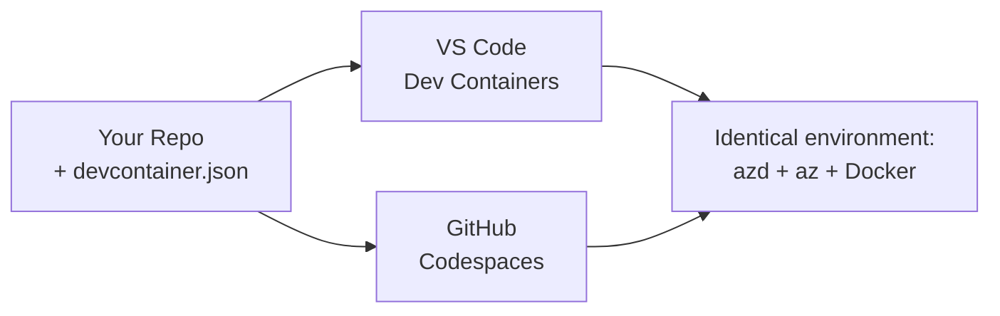

# Dev Контейнери & GitHub Codespaces за azd

**Навигация в главата:**
- **📚 Начало на курса**: [AZD за начинаещи](../../README.md)
- **📖 Текуща глава**: Глава 1 - Основи и бърз старт
- **⬅️ Предишна**: [Bring Your Own App](bring-your-own-app.md)
- **🚀 Следваща глава**: [Глава 2: Разработка с приоритет върху AI](../chapter-02-ai-development/README.md)

> Цел на прегледа на командите и конфигурацията: `azd 1.37.2` (ноември 2026). Изграждане на контейнери и разгръщания в Azure не са изпълнени като част от този преглед.

## Въведение

Инсталирането на azd, подходящата изпълнителна среда за езика, Docker и Azure CLI на всяка машина е досадно — и това е главната причина един урок, който "работи на моята машина", да не сработи на друга. **Dev контейнер** решава този проблем, като описва целия ви инструментариум в един файл. Всеки, който отвори проекта във VS Code или GitHub Codespaces, получава точно същата среда с предварително инсталиран azd. Този урок ще ви покаже как да добавите такъв.

## Цели на обучението

В края на този урок ще:
- Разберете какво е dev контейнер и защо помага с azd
- Добавите минимален `.devcontainer/devcontainer.json` към проект
- Включите azd, Azure CLI и Docker чрез Dev Container *features*
- Отворите проекта в GitHub Codespaces или VS Code

## Резултати от обучението

След приключване на урока ще можете:
- Да създадете `devcontainer.json` за azd проект
- Да добавите azd и Azure инструменти без ръчна инсталация
- Да стартирате `azd up` от контейнер или Codespace

---

## Какво е dev контейнер?

Dev контейнер е базирана на Docker развойна среда, дефинирана чрез `.devcontainer/devcontainer.json` файл във вашето репозитори. Когато отворите проекта:

- **VS Code** (с разширението Dev Containers) изгражда контейнера и се свързва с него.
- **GitHub Codespaces** изгражда същия контейнер в облака и ви предоставя браузърен редактор.

По този начин всеки участник получава идентични инструменти — без да се пита "инсталирал ли си azd?".



---

## Стъпка 1: Създаване на файла devcontainer

Създайте `.devcontainer/devcontainer.json` в корена на вашия проект:

```json
{
  "name": "azd-project",
  "image": "mcr.microsoft.com/devcontainers/base:bookworm",
  "features": {
    "ghcr.io/devcontainers/features/azure-cli:1": {},
    "ghcr.io/azure/azure-dev/azd:0": { "version": "1.37.2" },
    "ghcr.io/devcontainers/features/docker-in-docker:2": {},
    "ghcr.io/devcontainers/features/node:1": {}
  },
  "customizations": {
    "vscode": {
      "extensions": [
        "ms-azuretools.azure-dev",
        "ms-azuretools.vscode-bicep"
      ]
    }
  },
  "forwardPorts": [3000],
  "postCreateCommand": "azd version"
}
```

Какво прави всяка част:

| Ключ | Цел |
|-----|---------|
| `image` | Базова ОС за контейнера |
| `features` | Предварително компилирани инсталатори — тук: Azure CLI, **azd**, Docker и Node.js |
| `customizations.vscode.extensions` | Автоматично инсталира разширенията за azd и Bicep във VS Code |
| `forwardPorts` | Отваря порт на приложението ви към браузъра |
| `postCreateCommand` | Изпълнява се веднъж след изграждането на контейнера (тук - проверка на здравето) |

> Версията на функцията (`azd:0`) и инсталираната версия на CLI са различни. Задайте опцията `version` на функцията на `"1.37.2"` за да фиксирате CLI; не използвайте версия на CLI като tag за функцията.

---

## Стъпка 2: Съобразете функцията с езика на вашето приложение

Заменете функцията `node` с тази за езика на вашето приложение:

```jsonc
// Python project
"ghcr.io/devcontainers/features/python:1": {},

// .NET project
"ghcr.io/devcontainers/features/dotnet:2": {},

// Java project
"ghcr.io/devcontainers/features/java:1": {},

// Go project
"ghcr.io/devcontainers/features/go:1": {}
```

Запазете `docker-in-docker` когато изграждате образи локално. Конфигуриран отдалечен ACR билд (`docker.remoteBuild: true`) е алтернатива; типът хост сам по себе си не винаги изисква локален Docker.

---

## Стъпка 3: Отворете го

**Във VS Code:**
1. Инсталирайте разширението **Dev Containers**.
2. Отворете папката на проекта.
3. Изберете **Reopen in Container**, когато ви бъде подканено (или изпълнете *Dev Containers: Reopen in Container*).

**В GitHub Codespaces:**
1. Качете репото в GitHub.
2. Кликнете на **Code → Codespaces → Create codespace on main**.
3. Изчакайте контейнерът да се изгради — azd е готов в терминала.

---

## Стъпка 4: Разгръщане от вътре в контейнера

Контейнерът има предварително инсталиран azd, така че нормалният работен процес просто работи:

```bash
azd auth login --use-device-code   # device code is handy inside Codespaces
azd up
```

> **Защо `--use-device-code`?** В отдалечен контейнер или Codespace няма локален браузър за пренасочване, затова вход с device-code е надеждният път. Ще копирате код в браузър, за да завършите влизането.

---

## Често срещани проблеми

| Проблем | Решение |
|---------|---------|
| `azd up` не може да изгради образ | Добавете функцията `docker-in-docker` |
| Вход в браузър се задържа в Codespaces | Използвайте `azd auth login --use-device-code` |
| Инструментите са различни между съотборниците | Фиксирайте CLI чрез опцията `version` на функцията azd и фиксирайте изпълнителните среди за езика |
| Приложението не е достъпно в браузъра | Добавете порта към `forwardPorts` |

---

## Обобщение

- Dev контейнер прави инструментариума ви azd възпроизвеждаем за всеки.
- Добавете azd, Azure CLI и Docker чрез Dev Container *features*.
- Съобразете езиковата функция с вашето приложение и запазете `docker-in-docker` за хостове на контейнери.
- Използвайте вход с device-code при работа в Codespaces.

---

## 🔗 Навигация

| Посока | Ресурс |
|---------|----------|
| **Предишна** | [Bring Your Own App](bring-your-own-app.md) |
| **Начало на глава** | [Глава 1: Основи и бърз старт](README.md) |
| **Следваща глава** | [Глава 2: Разработка с приоритет върху AI](../chapter-02-ai-development/README.md) |

## 📖 Свързани ресурси

- [Инсталация и настройка](installation.md)
- [Листовка с команди](../../resources/cheat-sheet.md)
- [Официална спецификация на Dev Containers](https://containers.dev/)
- [azd Dev Container функция](https://github.com/Azure/azure-dev/tree/main/ext/devcontainer)

---

<!-- CO-OP TRANSLATOR DISCLAIMER START -->
**Отказ от отговорност**:
Този документ е преведен с помощта на AI преводачески услуга [Co-op Translator](https://github.com/Azure/co-op-translator). Въпреки че се стремим към точност, моля имайте предвид, че автоматизираните преводи могат да съдържат грешки или неточности. Оригиналният документ на неговия роден език трябва да се счита за авторитетен източник. За критична информация се препоръчва професионален човешки превод. Ние не носим отговорност за каквито и да е недоразумения или неправилни тълкувания, произтичащи от използването на този превод.
<!-- CO-OP TRANSLATOR DISCLAIMER END -->