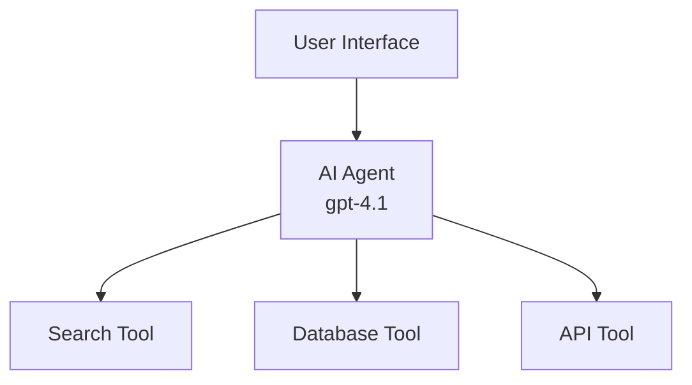
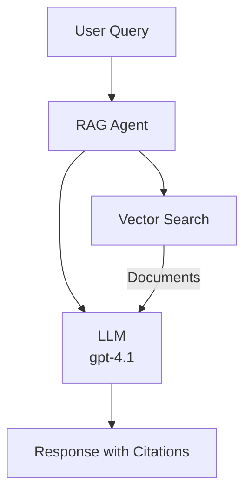
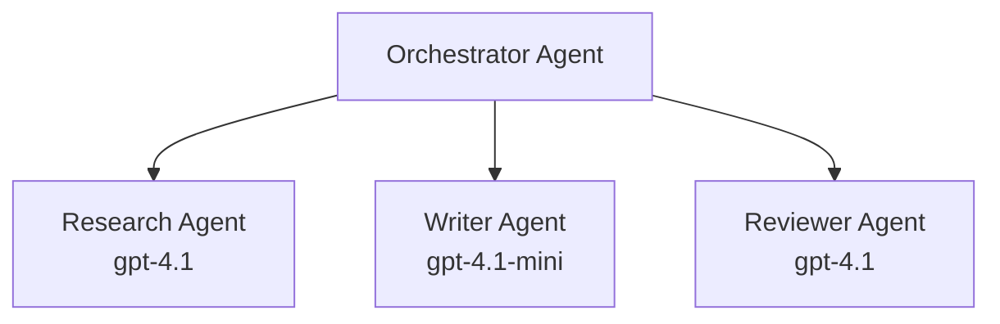

# AI агенти с Azure Developer CLI

**Навигация в главата:**
- **📚 Начало на курса**: [AZD за начинаещи](../../README.md)
- **📖 Текуща глава**: Глава 2 - AI-първоначална разработка
- **⬅️ Предишна**: [Интеграция с Microsoft Foundry](microsoft-foundry-integration.md)
- **➡️ Следваща**: [Деплоймент на AI модели](ai-model-deployment.md)
- **🚀 Напреднали**: [Мултиагентни решения](../../examples/retail-scenario.md)

---

## Въведение

AI агентите са автономни програми, които могат да възприемат околната среда, да вземат решения и да предприемат действия за постигане на конкретни цели. За разлика от обикновените чатботове, които отговарят на подканващи команди, агентите могат:

- **Да използват инструменти** - Да извикват API-та, да търсят в бази данни, да изпълняват код
- **Да планират и разсъждават** - Да разделят сложни задачи на стъпки
- **Да учат от контекста** - Да поддържат памет и да адаптират поведението си
- **Да си сътрудничат** - Да работят с други агенти (мултиагентни системи)

Това ръководство ви показва как да разположите AI агенти в Azure, използвайки Azure Developer CLI (azd).

Използването на контекст на разговор не е обучение на модел: постоянната памет, контролът на достъпа и запазването трябва да бъдат имплементирани/конфигурирани от приложението.

> **Преглед на изданието (2026-11-04):** Примерите с CLI бяха проверени спрямо документацията/източника на `azd` `1.37.2`, `azure.ai.agents` `1.0.0-beta.23` и `azure.ai.evaluations` `1.0.0-beta.2`, а не чрез жив Azure деплоймент. Използвайте `azd >= 1.37.0` за комбинираната работна схема. Вижте [последни промени и поправки](../chapter-08-production/production-ai-practices.md#recent-release-changes-and-fixes) преди да надграждате по-стари проекти.

## Цели на обучението

След завършване на това ръководство вие ще:
- Разберете какво представляват AI агентите и как се различават от чатботовете
- Разположите предварително изградени AI агентни шаблони с помощта на AZD
- Конфигурирате Foundry агенти за персонализирани агенти
- Имплементирате базови агентни модели (използване на инструменти, RAG, мултиагентни)
- Следите и отстранявате грешки при разположените агенти

## Резултати от обучението

След завършване ще можете да:
- Разположите AI агент приложения в Azure с една команда
- Конфигурирате инструменти и възможности на агента
- Имплементирате генерация с допълнително извличане на информация (RAG) с агенти
- Проектирате мултиагентни архитектури за сложни работни потоци
- Отстранявате често срещани проблеми при разполагане на агенти

---

## 🤖 Какво прави един агент различен от чатбот?

| Характеристика | Чатбот | AI агент |
|---------|---------|----------|
| **Поведение** | Отговаря на команди | Извършва автономни действия |
| **Инструменти** | Може да използва извличане или инструменти | Обикновено използва инструменти в целенасочена циклична работа |
| **Памет** | Зависи от приложението | Постоянна памет само ако е експлицитно реализирана |
| **Планиране** | Еднократен отговор | Многостъпков процес на разсъждение |
| **Сътрудничество** | Единичен субект | Може да работи с други агенти |

### Простата аналогия

- **Чатбот** = Помощник, който отговаря на въпроси на информационен щанд
- **AI агент** = Личен асистент, който може да провежда обаждания, да запазва срещи и да изпълнява задачи за вас

---

## 🚀 Бързо начало: Разположете първия си агент

Изберете една опция в **нова празна работна директория**. Крайният `.` се инициализира там; без изрично зададена дестинация, текущият AZD може да създаде подпапка с името на шаблона и не променя директорията на вашия терминал. Поддържайте отделни шаблони/среда в отделни директории.

Времето/цените по-долу са илюстративни, а не потвърдени оферти. Проверявайте текущите изисквания, ценообразуване, квоти на моделите и опционални услуги за всеки пример преди разполагането.

### Опция 1: Foundry Agents шаблон (Препоръчително)

```bash
# Initialize the AI agents template
azd init --template get-started-with-ai-agents .

# Deploy to Azure
azd up
```

**Какво се разполага:** Текущата инфраструктура и избрани опции в примера определят модела, инструментите, хостинга и ресурсите за мониторинг. Прегледайте README файла и `infra/` преди да започнете; не предполагайте, че всеки агентен шаблон включва Търсене или уеб интерфейс.

**Време:** ~15-20 минути
**Цена:** ~$100-150/месец (разработка)

### Опция 2: Креативни писателски агенти с Prompty

```bash
# Initialize the Prompty-based agent template
azd init --template https://github.com/Azure-Samples/contoso-creative-writer .

# Deploy to Azure
azd up
```

**Какво се разполага:** FastAPI/Prompty мултиагентен писателски пример, използващ Azure OpenAI, Bing Grounding и Azure AI Search. Първоначалното `agent-openai-python-prompty` хранилище пренасочва тук; това не е минимален Azure Functions шаблон за агент за времето. Следвайте текущия README за хостинг, квоти и изисквания за Bing Grounding.

**Време:** ~10-15 минути
**Цена:** ~$50-100/месец (разработка)

### Опция 3: RAG чат агент

```bash
# Initialize RAG chat template
azd init --template azure-search-openai-demo .

# Deploy to Azure
azd up
```

**Какво се разполага:**
- ✅ Microsoft Foundry модели
- ✅ Azure AI Search с примерни данни
- ✅ Пайплайн за обработка на документи
- ✅ Чат интерфейс с цитирания

**Време:** ~15-25 минути
**Цена:** ~$80-150/месец (разработка)

### Опция 4: AZD AI Agent Init (Преглед на проектния шаблон)

Използвайте `azd ai agent init` интерактивно или приемете текущ предприятиен AI агент проект с `azure.yaml` и `--template`/`-t`. Старият `--manifest`/`-m` вариант е остарял псевдоним, не конвертор за наследствени манифести.

```bash
# Install the AI agents extension
azd extension install azure.ai.agents

# Optional: verify the installed preview version
azd extension show azure.ai.agents

# Initialize from a current agent project template (supply your template path)
azd ai agent init --template ./templates/support-agent/azure.yaml

# Deploy to Azure
azd up

# Test the deployed agent (shows latency + time-to-first-byte)
azd ai agent invoke
```

**Кога да използвате `azd ai agent init` спрямо `azd init --template`:**

| Подход | Най-добър за | Как работи |
|----------|----------|------|
| `azd init --template` | Стартиране от работещ примерен app | Клонира цял проект с код + инфраструктура |
| `azd ai agent init --template` | Приемане на текущ Foundry агент проект | Използва документ и определения на `azure.yaml` проект |

> **Подсказка:** Използвайте `azd init --template` при учене (Опции 1-3 по-горе). Използвайте `azd ai agent init` за Foundry агентния работен процес. За добавяне на директно агентно дефиниране към съществуващ проект, вижте [насоки за инициализация и миграция](../chapter-08-production/production-ai-practices.md#initializing-agent-projects-with-azd-ai-agent-init).

След `azd up`, използвайте `azd ai agent invoke` за тест, отделното `azure.ai.evaluations` разширение (`azd ai eval init`, `generate` и `run start`) за измерване на качеството, и `azd ai agent optimize` за подобряване с помощта на новата конфигурация за оценка. Агентите beta.22 замениха наследствения работен процес за оценка и промениха формата на `--config` за оптимизация. Вижте [миграция на оценка](../chapter-08-production/production-ai-practices.md#evaluation-migration-and-quality-checks) и [миграция на оптимизация](../chapter-08-production/production-ai-practices.md#optimization-configuration-migration) преди да използвате по-стари примери.

---

## 🏗️ Модели на архитектурата на агентите

### Модел 1: Един агент с инструменти

Най-простият модел на агент – един агент, който може да използва множество инструменти.



**Подходящ за:**
- Ботове за клиентска поддръжка
- Помощници за изследвания
- Агенти за анализ на данни

**Свързан пример за приложение:** `azure-search-openai-demo` демонстрира RAG, не общоцикличен агент с произволни инструменти.

### Модел 2: RAG агент (генериране с повишено извличане)

Агент, който извлича релевантни документи преди да генерира отговори.



**Подходящ за:**
- Бази данни с корпоративни знания
- Системи за въпроси и отговори с документи
- Съответствие и правни изследвания

**AZD шаблон:** `azure-search-openai-demo`

### Модел 3: Мултиагентна система

Няколко специализирани агенти, работещи заедно по сложни задачи.



**Подходящ за:**
- Генериране на сложни съдържания
- Мултистепенни работни процеси
- Задачи, изискващи различни експертизи

**Научете повече:** [Модели за координация на мултиагенти](../chapter-06-pre-deployment/coordination-patterns.md)

---

## ⚙️ Конфигуриране на инструменти на агенти

Агентите стават мощни, когато могат да използват инструменти. Ето как да конфигурирате често срещани инструменти:

### Конфигуриране на инструменти във Foundry агенти

Този **класически фрагмент от Agent Service SDK** е насочен към `azure-ai-projects==1.0.0` и `azure-ai-agents==1.1.0` с `azure-identity`. Това не е по-новият versioned-agent/Responses API, използван от някои текущи шаблони на Foundry, нито разширението `azure.ai.agents` AZD (различен пакет). Не смесвайте тези поколения API. Задайте `PROJECT_ENDPOINT` на класическа крайна точка за проект в Foundry и `MODEL_DEPLOYMENT_NAME` на съществуващо поддържано разгръщане на модел; удостоверете се с `az login` локално и дайте необходимите разрешения за проекта.

```python
# agent_config.py
import os
from azure.ai.projects import AIProjectClient
from azure.ai.agents.models import FunctionTool
from azure.identity import DefaultAzureCredential

def search_knowledge_base(query: str) -> str:
    """Search the demonstration knowledge base.

    :param query: Search text.
    :return: Matching demonstration information.
    """
    # Local fixture only, not a production search implementation.
    return "Demo policy: returns are accepted within 30 days."

project_client = AIProjectClient(
    endpoint=os.environ["PROJECT_ENDPOINT"],
    credential=DefaultAzureCredential(),
)
search_tool = FunctionTool(functions={search_knowledge_base})
project_client.agents.enable_auto_function_calls(search_tool)
agent = project_client.agents.create_agent(
    model=os.environ["MODEL_DEPLOYMENT_NAME"],
    name="Support Agent",
    instructions="Use search_knowledge_base for policy questions. Label results as demo data.",
    tools=search_tool.definitions,
)
```

Регистрацията на схема за функция не изпълнява Python на услугата. В този SDK, `enable_auto_function_calls` плюс `agents.runs.create_and_process(...)` изпълнява регистрирани обратни повиквания във вашия клиентски процес. Вижте [публикувания пример в SDK](https://github.com/Azure/azure-sdk-for-python/blob/azure-ai-agents_1.1.0/sdk/ai/azure-ai-agents/samples/agents_tools/sample_agents_auto_function_call.py). Затворете клиента и изтрийте демонстрационните агенти/нишки, когато приключите.

### Конфигуриране на околната среда

Следните имена са **илюстративни входни данни за персонализирани шаблони**, не вградени AZD ключове. Първо прокарайте всяка стойност през `infra/main.parameters.json`, инфраструктурата и приложния код. Само `azd env set` не променя инструментите или инструкциите на агента.

```bash
# Set up agent-specific environment variables
azd env set AZURE_OPENAI_MODEL "gpt-4.1"
azd env set AGENT_INSTRUCTIONS "You are a helpful assistant..."
azd env set ENABLE_CODE_INTERPRETER "true"
azd env set ENABLE_FILE_SEARCH "true"

# Apply wired infrastructure and application changes
azd up
```

---

## 📊 Наблюдение на агенти

### Интеграция с Application Insights

Ако избраният от вас шаблон осигурява Application Insights и конфигурира инструментариум:

```bash
# Open monitoring dashboard
azd monitor --overview

# Open the Application Insights logs view (not a streaming log tail)
azd monitor --logs

# View live metrics
azd monitor --live
```

### Ключови показатели за следене

| Показател | Описание | Цел |
|--------|-------------|--------|
| Време за отговор | Време за генериране на отговор | < 5 секунди |
| Използване на токени | Токени на заявка | Следете за разходи |
| Успешност на повикване на инструмент | % успешни изпълнения на инструмент | > 95% |
| Процент грешки | Провалени заявки към агента | < 1% |
| Удовлетвореност на потребителите | Оценки от обратна връзка | > 4.0/5.0 |

### Персонализирано логване за агенти

```python
import os
from azure.monitor.opentelemetry import configure_azure_monitor
from opentelemetry import trace

# Configure Azure Monitor with OpenTelemetry
configure_azure_monitor(
    connection_string=os.environ["APPLICATIONINSIGHTS_CONNECTION_STRING"]
)

tracer = trace.get_tracer(__name__)

def log_agent_interaction(user_query, agent_response, tools_used, latency_ms):
    with tracer.start_as_current_span("agent_interaction") as span:
        span.set_attributes({
            "query_length": len(user_query),  # Do not log raw prompts or personal data
            "response_length": len(agent_response),
            "tools_used": tools_used,
            "latency_ms": latency_ms
        })
```

> **Забележка:** Инсталирайте необходимия пакет: `pip install azure-monitor-opentelemetry`. Той носи зависимостите на OpenTelemetry; пространството за имената на импорта не е изискване за инсталиране на пакет, наречен `opentelemetry`.

---

## 💰 Съображения за разходите

### Прогнозни месечни разходи по модел

Това са ориентировъчни диапазони за планиране, не оферти или лимити за разходи. Регионът, токените на модела, SKU за търсене/изчисление, сесиите за инструменти, съхранение и трафик могат да ги надвишат. Проверете указанията за разходи на примера и цените на Azure преди `azd up`.

| Модел | Среда за разработка | Производство |
|---------|-----------------|------------|
| Един агент | $50-100 | $200-500 |
| RAG агент | $80-150 | $300-800 |
| Мултиагент (2-3 агенти) | $150-300 | $500-1,500 |
| Корпоративен мултиагент | $300-500 | $1,500-5,000+ |

### Съвети за оптимизация на разходите

1. **Използвайте gpt-4.1-mini за прости задачи** (само ако вашият шаблон приема този вход)
   ```bash
   azd env set AZURE_OPENAI_MODEL "gpt-4.1-mini"
   ```

2. **Прилагайте ограничено кеширане за безопасни, повторни заявки.** Включете разрешения на наемател/потребител, разгръщане на модел, инструкции и версия на извличане в ключа на кеша; задайте срок на годност. Не споделяйте отговори с частни разговори чрез кеш за заявки, обхващащ целия процес. Обектът агент в SDK няма общ метод `agent.run()`.

3. **Задавайте лимити на токени за всяко изпълнение**
   ```python
   # Set max_completion_tokens when running the agent, not during creation
   run = project_client.agents.runs.create_and_process(
       thread_id=thread.id,
       agent_id=agent.id,
       max_completion_tokens=1000  # Budget across the run; may finish as incomplete
   )
   ```

4. **Мащабирайте годните Container Apps до нула, когато не се използват**
   ```bash
   # Custom-template input: must map to template.scale.minReplicas
   azd env set MIN_REPLICAS "0"
   ```
   Приложете инфраструктурната промяна с `azd provision` или `azd up`. Мащабирането до нула изисква подходящ спусък и не спира разходите за търсене, съхранение или модел/инструмент.

---

## 🔧 Отстраняване на проблеми с агенти

### Чести проблеми и решения

<details>
<summary><strong>❌ Агентът не отговаря на повиквания към инструменти</strong></summary>

```bash
# Inspect the application deployment (not the agent's registered tools)
azd show

# Verify OpenAI deployment
az cognitiveservices account deployment list \
  --name $AZURE_OPENAI_NAME \
  --resource-group $RG_NAME

# Check agent logs
azd monitor --logs
```

**Чести причини:**
- Несъответствие в подписа на функцията на инструмента
- Липсващи необходими разрешения
- Недостъпна крайна точка за API
</details>

<details>
<summary><strong>❌ Висока латентност при отговорите на агента</strong></summary>

```bash
# Check Application Insights for bottlenecks
azd monitor --live

# Consider using a faster model
azd env set AZURE_OPENAI_MODEL "gpt-4.1-mini"
azd up
```

**Съвети за оптимизация:**
- Използвайте поточни отговори
- Прилагайте кеширане на отговори
- Намалете размера на контекстовия прозорец
</details>

<details>
<summary><strong>❌ Агентът връща неправилна или халюцинирана информация</strong></summary>

```python
# Improve with better system prompts
instructions = """
You are a helpful assistant. IMPORTANT:
- Only answer based on provided context
- If you don't know, say "I don't know"
- Always cite your sources
- Never make up information
"""

# Use these instructions in the agent definition.
# For classic file search, first upload/index documents in a vector store,
# then use FileSearchTool(vector_store_ids=[...]) and pass both its
# .definitions and .resources when creating the agent.
```
 Инструкциите и извличането намаляват риска; нито едно не гарантира фактически отговори. Оценявайте земни и неотносими въпроси спрямо известни отговори.
</details>

<details>
<summary><strong>❌ Грешки от превишаване на лимитите на токените</strong></summary>

```python
# Implement context window management
def truncate_context(messages, max_tokens=8000, model="gpt-4.1"):
    """Approximate content-only budget for objects with .content strings."""
    import tiktoken
    encoding = tiktoken.encoding_for_model(model)
    total_tokens = 0
    truncated = []
    
    for msg in reversed(messages):
        msg_tokens = len(encoding.encode(msg.content))
        if total_tokens + msg_tokens > max_tokens:
            break
        truncated.insert(0, msg)
        total_tokens += msg_tokens
    
    return truncated
```
 Този помощник изключва роли/схеми на инструменти, системни инструкции, токени за изображения и протоколен оувърхед. Запазете място за тях и за завършването; не разделяйте двойки повикване/резултат на инструмент или изхвърляйте необходими системни инструкции. Инсталирайте `tiktoken` поотделно. Той не е генерален валидатор на контекстов прозорец.
</details>

---

## 🎓 Практически упражнения

### Упражнение 1: Разгръщане на основен агент (20 минути)

**Цел:** Разгърнете първия си AI агент с помощта на AZD

```bash
# Step 1: Initialize template
azd init --template get-started-with-ai-agents .

# Step 2: Login to Azure
azd auth login
# If you work across tenants, add --tenant-id <tenant-id>

# Step 3: Deploy
azd up

# Step 4: Test the agent
# Expected output after deployment:
#   Deployment Complete!
#   Endpoint: https://<app-name>.<region>.azurecontainerapps.io
# Open the URL shown in the output and try asking a question

# Step 5: View monitoring
azd monitor --overview

# Step 6: Clean up
azd down --force --purge
```

**Критерии за успех:**
- [ ] Агентът отговаря на въпроси
- [ ] Може да достъпи таблото за наблюдение чрез `azd monitor`
- [ ] Ресурсите са успешно почистени

### Упражнение 2: Добавяне на персонализиран инструмент (30 минути)

**Цел:** Разширете агента с персонализиран инструмент

**Стартова точка:** Използвайте класическия SDK клиент от [Конфигуриране на инструменти](#tool-configuration-in-foundry-agents), а не произволен шаблон с различно поколение SDK.

1. Добавете този детерминиран фикстур към `agent_config.py`:
   ```python
   def get_weather(location: str) -> str:
       """Return demonstration weather, not live conditions.

       :param location: City name.
       :return: A clearly labelled fixture.
       """
       print(f"TOOL_CALLED: {location}")
       return f"Demo weather in {location}: Sunny, 72°F (fixture, not live)"
   ```
2. Заменете блока за регистрация и създаване на инструмента за търсене с:
   ```python
   weather_tool = FunctionTool(functions={get_weather})
   project_client.agents.enable_auto_function_calls(weather_tool)
   agent = project_client.agents.create_agent(
       model=os.environ["MODEL_DEPLOYMENT_NAME"],
       name="Weather Agent",
       instructions="Call get_weather for weather questions; explain that it returns demo data.",
       tools=weather_tool.definitions,
   )
   thread = project_client.agents.threads.create()
   try:
       project_client.agents.messages.create(
           thread_id=thread.id, role="user", content="Use get_weather for Seattle."
       )
       run = project_client.agents.runs.create_and_process(
           thread_id=thread.id, agent_id=agent.id
       )
       if run.status != "completed":
           raise RuntimeError(f"Run status: {run.status}; error: {run.last_error}")
       for message in project_client.agents.messages.list(thread_id=thread.id):
           for text in message.text_messages:
               print(text.text.value)
   finally:
       project_client.agents.threads.delete(thread.id)
       project_client.agents.delete_agent(agent.id)
       project_client.close()
   ```
3. Изпълнете локално (това извиква съществуващия Azure проект и причинява такси за модела):
   ```bash
   python agent_config.py
   # Expected: TOOL_CALLED: Seattle, then a completed answer labelled demo data.
   ```

**Критерии за успех:**
- [ ] Агентът разпознава въпроси свързани с времето
- [ ] Инструментът е извикан правилно
- [ ] Отговорът включва информация за времето

### Упражнение 3: Създаване на RAG агент (45 минути)

**Цел:** Създайте агент, който отговаря на въпроси от вашите документи

```bash
# Step 1: Deploy RAG template
azd init --template azure-search-openai-demo .
azd up

# Step 2: Upload your documents
# For the sample's local ingestion path, place supported files in data/.
# Run from the sample root after following its Python environment setup:
./scripts/prepdocs.sh
# Windows PowerShell equivalent: .\\scripts\\prepdocs.ps1

# Step 3: Test with domain-specific questions
# Open the web app URL from the azd up output
# Ask questions about your uploaded documents
# Responses should include citation references like [doc.pdf]
```

**Критерии за успех:**
- [ ] Агентът отговаря от качените документи
- [ ] Отговорите включват цитати
- [ ] Въпроси извън обхвата се обработват без неподдържани твърдения (без гаранция за всеки бъдещ въпрос)

Ако `USE_CLOUD_INGESTION=true`, вместо това използвайте пробния работен процес за облачно зареждане/качване; локалният обвивател умишлено пропуска зареждането. След теста, стартирайте `azd down` в RAG среда и прегледайте ресурсите за изтриване.

---

## 📚 Следващи стъпки

Сега, когато разбирате AI агентите, разгледайте тези напреднали теми:

| Тема | Описание | Връзка |
|-------|-------------|------|
| **Мулти-Агентни Системи** | Създаване на системи с множество сътрудничещи агенти | [Retail Multi-Agent Example](../../examples/retail-scenario.md) |
| **Координационни модели** | Научете модели за оркестрация и комуникация | [Coordination Patterns](../chapter-06-pre-deployment/coordination-patterns.md) |
| **Продължително внедряване** | Разгръщане на агенти, готови за предприятия | [Production AI Practices](../chapter-08-production/production-ai-practices.md) |
| **Оценка на агенти** | Тествайте и оценявайте работата на агента | [AI Troubleshooting](../chapter-07-troubleshooting/ai-troubleshooting.md) |
| **AI Workshop Lab** | Практическа работа: Направете вашето AI решение готово за AZD | [AI Workshop Lab](ai-workshop-lab.md) |

---

## 📖 Допълнителни ресурси

### Официална документация
- [Microsoft Foundry Agent Service](https://learn.microsoft.com/azure/ai-services/agents/)
- [Microsoft Foundry Agent Service Quickstart](https://learn.microsoft.com/azure/ai-services/agents/quickstart)
- [Semantic Kernel Agent Framework](https://learn.microsoft.com/semantic-kernel/)

### AZD шаблони за агенти
- [Започнете с AI агенти](https://github.com/Azure-Samples/get-started-with-ai-agents)
- [Креативни писателски агенти с Prompty](https://github.com/Azure-Samples/contoso-creative-writer)
- [Azure Search OpenAI демонстрация](https://github.com/Azure-Samples/azure-search-openai-demo)

### Общностни ресурси
- [Awesome AZD - шаблони за агенти](https://azure.github.io/awesome-azd/?tags=ai-agents)
- [Azure AI Discord](https://discord.gg/microsoft-azure)
- [Microsoft Foundry Discord](https://discord.gg/nTYy5BXMWG)

### Умения за агенти за вашия редактор
- [**Microsoft Azure Agent Skills**](https://skills.sh/microsoft/github-copilot-for-azure) - Инсталирайте многоразови AI агентски умения за Azure разработка в GitHub Copilot, Cursor или всеки поддържан агент. Включва умения за [Azure AI](https://skills.sh/microsoft/github-copilot-for-azure/azure-ai), [Microsoft Foundry](https://skills.sh/microsoft/github-copilot-for-azure/microsoft-foundry), [внедряване](https://skills.sh/microsoft/github-copilot-for-azure/azure-deploy) и [диагностика](https://skills.sh/microsoft/github-copilot-for-azure/azure-diagnostics):
  ```bash
  npx skills add microsoft/github-copilot-for-azure
  ```

---

**Навигация**
- **Предишен урок**: [Microsoft Foundry Integration](microsoft-foundry-integration.md)
- **Следващ урок**: [AI Model Deployment](ai-model-deployment.md)

---

<!-- CO-OP TRANSLATOR DISCLAIMER START -->
**Отказ от отговорност**:
Този документ е преведен с помощта на AI преводачески услуга [Co-op Translator](https://github.com/Azure/co-op-translator). Въпреки че се стремим към точност, моля имайте предвид, че автоматизираните преводи могат да съдържат грешки или неточности. Оригиналният документ на неговия роден език трябва да се счита за авторитетен източник. За критична информация се препоръчва професионален човешки превод. Ние не носим отговорност за каквито и да е недоразумения или неправилни тълкувания, произтичащи от използването на този превод.
<!-- CO-OP TRANSLATOR DISCLAIMER END -->