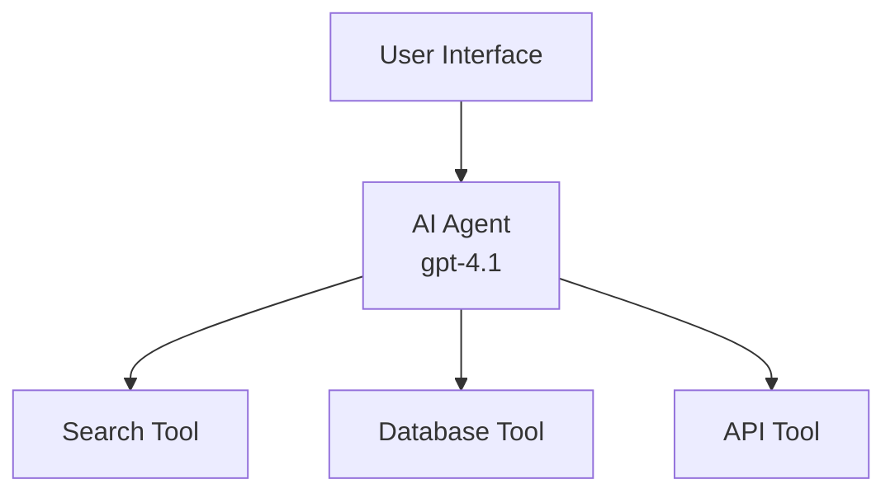
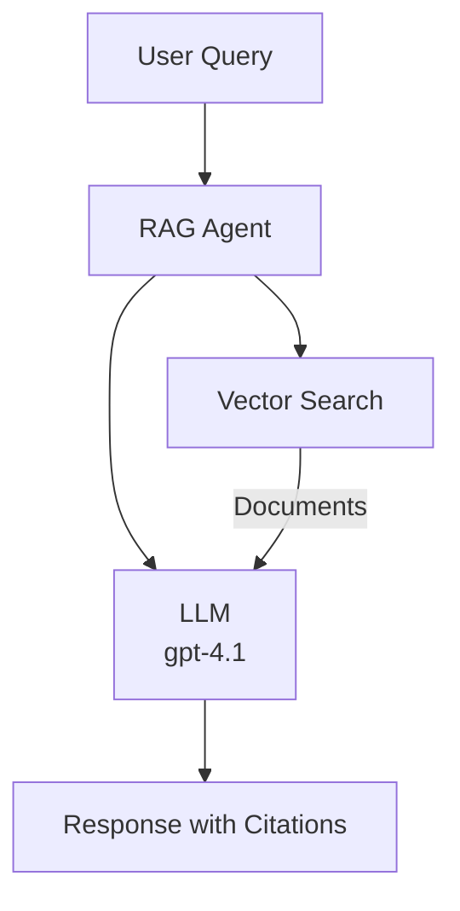
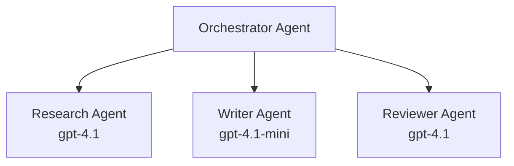

# AI агенти с Azure Developer CLI

**Навигация в глава:**
- **📚 Начална страница на курса**: [AZD за начинаещи](../../README.md)
- **📖 Текуща глава**: Глава 2 - AI-първо разработване
- **⬅️ Предишна**: [Интеграция с Microsoft Foundry](microsoft-foundry-integration.md)
- **➡️ Следваща**: [Деплоймънт на AI модел](ai-model-deployment.md)
- **🚀 Разширено**: [Решения с множество агенти](../../examples/retail-scenario.md)

---

## Въведение

AI агентите са автономни програми, които могат да възприемат обкръжението си, да вземат решения и да предприемат действия за постигане на конкретни цели. За разлика от прости чатботове, които отговарят на въпроси, агентите могат:

- **Да използват инструменти** - Да извикват API, да търсят в бази данни, да изпълняват код
- **Да планират и разсъждават** - Да разделят сложни задачи на стъпки
- **Да учат от контекста** - Да поддържат памет и да адаптират поведението си
- **Да си сътрудничат** - Да работят с други агенти (многоагентни системи)

Това ръководство ви показва как да внедрите AI агенти в Azure, използвайки Azure Developer CLI (azd).

Използването на контекст в разговора не е обучение на модел: постоянната памет, контролът на достъпа и оцеляването трябва да бъдат имплементирани/настроени от приложението.

> **Foundry GA ъпдейт (2026-11-09):** Инсталирайте общодостъпния пакет `microsoft.foundry` 1.0 с `azd >= 1.37.0`. Оценките се инсталират отделно; опционалните функции във визуализация и класическият SDK фрагмент по-долу не са включени в GA чрез пакета. Тези насоки се базират на [GA обявата](https://devblogs.microsoft.com/azure-sdk/microsoft-foundry-azure-developer-cli-ga/) и документацията, а не на реално Azure внедряване.

## Учебни цели

След завършване на това ръководство, ще можете:
- Да разберете какво са AI агенти и как се различават от чатботове
- Да внедрите предварително изградени шаблони за AI агенти с AZD
- Да конфигурирате Foundry агенти за персонализирани агенти
- Да приложите базови шаблони за агенти (използване на инструменти, RAG, многоагентен)
- Да наблюдавате и дебъгвате внедрените агенти

## Резултати от обучението

След завършване ще можете:
- Да внедрите AI агент приложения в Azure с една команда
- Да конфигурирате инструменти и възможности на агента
- Да реализирате Retrieval-Augmented Generation (RAG) с агенти
- Да проектирате многоагентни архитектури за сложни работни потоци
- Да диагностицирате често срещани проблеми при внедряване на агенти

---

## 🤖 Какво прави агента различен от чатбот?

| Характеристика | Чатбот | AI агент |
|---------|---------|----------|
| **Поведение** | Отговаря на запитвания | Предприема автономни действия |
| **Инструменти** | Може да използва търсене или инструменти | Обикновено използва инструменти в целенасочен цикъл |
| **Памет** | Зависеща от приложението | Постоянна памет само ако е изрично имплементирана |
| **Планиране** | Един отговор | Мултистъпково разсъждение |
| **Сътрудничество** | Единна единица | Може да работи с други агенти |

### Прост аналог

- **Чатбот** = Помощник на информационно бюро, който отговаря на въпроси
- **AI агент** = Личен асистент, който може да прави обаждания, да записва срещи и да изпълнява задачи за вас

---

## 🚀 Бърз старт: Внедрете първия си агент

Изберете една опция в **нова празна работна директория**. Краен `.` инициализира там; без изрична дестинация, текущият AZD може да създаде поддиректория с името на шаблона, без да сменя директорията на шел. Дръжте отделните шаблони/среда в отделни директории.

Времето/разходите по-долу са илюстративни, не са валидирани оферти. Проверете текущите предпоставки, цени, квоти на модела и опционални услуги на всеки пример преди внедряване.

### Опция 1: Шаблон Foundry Agents (Препоръчван)

```bash
# Initialize the AI agents template
azd init --template get-started-with-ai-agents .

# Deploy to Azure
azd up
```

**Какво се внедрява:** инфраструктурата и избраните опции на примера определят модела, инструментите, хостинга и мониторинга. Прегледайте README и `infra/` преди конфигуриране; не приемайте, че всеки шаблон агент включва Търсене или уеб интерфейс.

**Време:** ~15-20 минути
**Разходи:** ~$100-150/месец (разработка)

### Опция 2: Креативно писане с Промпти агенти

```bash
# Initialize the Prompty-based agent template
azd init --template https://github.com/Azure-Samples/contoso-creative-writer .

# Deploy to Azure
azd up
```

**Какво се внедрява:** FastAPI/Prompty многоагентен писателски пример, използващ Azure OpenAI, Bing Grounding и Azure AI Search. Предишното `agent-openai-python-prompty` хранилище пренасочва тук; не е минимален шаблон за Azure Functions за агент на времето. Следвайте актуалното README за хостинг, квоти на модел и предпоставки за Bing Grounding.

**Време:** ~10-15 минути
**Разходи:** ~$50-100/месец (разработка)

### Опция 3: RAG чат агент

```bash
# Initialize RAG chat template
azd init --template azure-search-openai-demo .

# Deploy to Azure
azd up
```

**Какво се внедрява:**
- ✅ Microsoft Foundry модели
- ✅ Azure AI Search с примерни данни
- ✅ Технологичен поток за обработка на документи
- ✅ Чат интерфейс с цитати

**Време:** ~15-25 минути
**Разходи:** ~$80-150/месец (разработка)

### Опция 4: Хостван агент с GA Foundry пакет

Използвайте [пълен walkthrough за хостван агент](microsoft-foundry-integration.md#hosted-agent-walkthrough-ga) за основния пример на Python Agent Framework Responses API. Този път за внедряване изисква Python 3.13+, текущ uv, Foundry разрешения и регионална квота за модели. Автентикирайте локалните SDK извиквания отделно при използване на идентификационни данни за Azure CLI.

```bash
azd auth login
azd ext install microsoft.foundry
```

В празната директория инициализирайте примера:

```text
azd ai agent init --template https://github.com/microsoft-foundry/foundry-samples/blob/main/samples/python/hosted-agents/agent-framework/responses/01-basic/azure.yaml --deploy-mode code --src .
```

Изберете нов или съществуващ проект, прегледайте `azure.yaml` и изпълнете `azd provision`. Използвайте `azd ai agent run` за отваряне на Agent Inspector и, от друг терминал в тази директория, изпълнете `azd ai agent invoke --local "Explain how this agent is hosted."`. След локална проверка, използвайте `azd deploy` и `azd ai agent invoke "Explain how this agent is hosted."` за сравнение на внедрения отговор. Foundry изгражда изходния код отдалечено; локално изграждане на контейнер не е необходимо.

**Кога да използвате `azd ai agent init` вместо `azd init --template`:**

| Подход | Най-подходящ за | Как работи |
|----------|----------|------|
| `azd init --template` | Започващ с работещ пример | Клонира цялото шаблонно хранилище с код и инфраструктура |
| `azd ai agent init --template` | Приемане на текущ проект с Foundry агент | Използва проектен документ `azure.yaml` и неговите дефиниции |

> **Съвет:** Опциите 1-3 започват от пълни шаблони на приложения; опция 4 учи за работния процес на GA хостван агент. Нито една команда за инициализация не мигрира автоматично наследствени манифести на агенти. За добавяне на директна дефиниция на агент към съществуващ проект, вижте [насоки за инициализация и миграция](../chapter-08-production/production-ai-practices.md#initializing-agent-projects-with-azd-ai-agent-init).

Инсталирайте `azure.ai.evaluations` отделно за генериране и преглед на тестови данни/рубрики, конфигуриране на оценка и нейното изпълнение с `azd ai eval`. Оптимизацията може да използва съвместима оценка; преглеждайте кандидатите преди експлицитно внедряване. Следвайте [процеса на оценка](../chapter-08-production/production-ai-practices.md#evaluation-migration-and-quality-checks) и [миграцията на оптимизация](../chapter-08-production/production-ai-practices.md#optimization-configuration-migration) преди повторна употреба на стари примери. За почистване ресурсите на повторно използван проект Foundry остават след `azd down`; новосъздаден проект изтрива ресурсната група. Вижте [насоките за почистване](microsoft-foundry-integration.md#7-clean-up-deliberately).

---

## 🏗️ Архитектурни шаблони на агенти

### Шаблон 1: Един агент с инструменти

Най-простият шаблон за агент - един агент, който може да използва множество инструменти.



**Подходящ за:**
- Ботове за клиентска поддръжка
- Изследователски асистенти
- Агенти за анализ на данни

**Свързан пример:** `azure-search-openai-demo` демонстрира RAG, а не генерален цикъл на агент с произволни инструменти.

### Шаблон 2: RAG агент (Retrieval-Augmented Generation)

Агент, който извлича релевантни документи преди генериране на отговор.



**Подходящ за:**
- Ентърпрайз бази знания
- Системи за въпроси и отговори с документи
- Законодателни и комплайънс изследвания

**AZD шаблон:** `azure-search-openai-demo`

### Шаблон 3: Многоагентна система

Множество специализирани агенти, работещи заедно по сложни задачи.



**Подходящ за:**
- Сложна генерация на съдържание
- Мултистъпкови работни потоци
- Задачи изискващи различна експертиза

**Научете повече:** [Многоагентни координационни шаблони](../chapter-06-pre-deployment/coordination-patterns.md)

---

## ⚙️ Конфигуриране на инструменти на агенти

Агентите стават мощни, когато могат да използват инструменти. Ето как да конфигурирате общи инструменти:

### Конфигуриране на инструменти в Foundry Agents

Този **класически фрагмент на Agent Service SDK** е насочен към `azure-ai-projects==1.0.0` и `azure-ai-agents==1.1.0` с `azure-identity`. Не е новата версия of versioned-agent/Responses API, използвана в някои сегашни Foundry шаблони, нито `azure.ai.agents` AZD разширението (различен пакет). Не смесвайте тези API поколения. Задайте `PROJECT_ENDPOINT` към класическа крайна точка на Foundry проект и `MODEL_DEPLOYMENT_NAME` към съществуващо поддържано внедряване на модел; автентикирайте с `az login` локално и предоставете необходимите разрешения за проекта.

```python
# agent_config.py
import os
from azure.ai.projects import AIProjectClient
from azure.ai.agents.models import FunctionTool
from azure.identity import DefaultAzureCredential

def search_knowledge_base(query: str) -> str:
    """Search the demonstration knowledge base.

    :param query: Search text.
    :return: Matching demonstration information.
    """
    # Local fixture only, not a production search implementation.
    return "Demo policy: returns are accepted within 30 days."

project_client = AIProjectClient(
    endpoint=os.environ["PROJECT_ENDPOINT"],
    credential=DefaultAzureCredential(),
)
search_tool = FunctionTool(functions={search_knowledge_base})
project_client.agents.enable_auto_function_calls(search_tool)
agent = project_client.agents.create_agent(
    model=os.environ["MODEL_DEPLOYMENT_NAME"],
    name="Support Agent",
    instructions="Use search_knowledge_base for policy questions. Label results as demo data.",
    tools=search_tool.definitions,
)
```

Регистрирането на схема на функция не изпълнява Python на услугата. В този SDK `enable_auto_function_calls` плюс `agents.runs.create_and_process(...)` изпълнява регистрирани обратни повиквания в клиентския ви процес. Вижте [публикуван пример за SDK](https://github.com/Azure/azure-sdk-for-python/blob/azure-ai-agents_1.1.0/sdk/ai/azure-ai-agents/samples/agents_tools/sample_agents_auto_function_call.py). Затворете клиента и изтрийте демонстрационни агенти/нишки при приключване.

### Конфигуриране на средата

Следните имена са **илюстративни входни данни за персонализирани шаблони**, а не вградени AZD превключватели. Първо предайте всяка стойност през `infra/main.parameters.json`, инфраструктура и приложен код. Само `azd env set` не променя инструментите или инструкциите на агента.

```bash
# Set up agent-specific environment variables
azd env set AZURE_OPENAI_MODEL "gpt-4.1"
azd env set AGENT_INSTRUCTIONS "You are a helpful assistant..."
azd env set ENABLE_CODE_INTERPRETER "true"
azd env set ENABLE_FILE_SEARCH "true"

# Apply wired infrastructure and application changes
azd up
```

---

## 📊 Мониторинг на агенти

### Интеграция на Application Insights

Ако избраният от вас шаблон предоставя Application Insights и настройва инструментацията:

```bash
# Open monitoring dashboard
azd monitor --overview

# Open the Application Insights logs view (not a streaming log tail)
azd monitor --logs

# View live metrics
azd monitor --live
```

### Ключови метрики за следене

| Метрика | Описание | Цел |
|--------|-------------|--------|
| Забавяне на отговор | Време за генериране на отговор | < 5 секунди |
| Използване на токени | Токени на заявка | Следете за разходи |
| Процент на успешни повиквания на инструмент | % успешни изпълнения на инструменти | > 95% |
| Процент грешки | Неуспешни заявки към агента | < 1% |
| Удовлетвореност на потребители | Оценки от обратна връзка | > 4.0/5.0 |

### Персонализирано логване за агенти

```python
import os
from azure.monitor.opentelemetry import configure_azure_monitor
from opentelemetry import trace

# Configure Azure Monitor with OpenTelemetry
configure_azure_monitor(
    connection_string=os.environ["APPLICATIONINSIGHTS_CONNECTION_STRING"]
)

tracer = trace.get_tracer(__name__)

def log_agent_interaction(user_query, agent_response, tools_used, latency_ms):
    with tracer.start_as_current_span("agent_interaction") as span:
        span.set_attributes({
            "query_length": len(user_query),  # Do not log raw prompts or personal data
            "response_length": len(agent_response),
            "tools_used": tools_used,
            "latency_ms": latency_ms
        })
```

> **Забележка:** Инсталирайте необходимия пакет: `pip install azure-monitor-opentelemetry`. Той включва зависимости от OpenTelemetry; import namespace не е изискване за инсталиране на пакет с име `opentelemetry`.

---

## 💰 Обмисляне на разходите

### Приблизителни месечни разходи по шаблон

Това са илюстративни диапазони за планиране, не оферти или тавани на разходи. Регион, токени на модел, търсене/изчислителни SKU, сесии на инструменти, съхранение и трафик могат да ги надхвърлят. Проверете насоките за разходи и ценообразуването в Azure преди `azd up`.

| Шаблон | Разработка | Производство |
|---------|-----------------|------------|
| Един агент | $50-100 | $200-500 |
| RAG агент | $80-150 | $300-800 |
| Многоагентна система (2-3 агенти) | $150-300 | $500-1,500 |
| Корпоративна многоагентна система | $300-500 | $1,500-5,000+ |

### Съвети за оптимизиране на разходи

1. **Използвайте gpt-4.1-mini за прости задачи** (само ако вашият шаблон го използва)
   ```bash
   azd env set AZURE_OPENAI_MODEL "gpt-4.1-mini"
   ```

2. **Прилагайте обхватно кеширане за безопасни, повторяеми заявки.** Включвайте наемател/потребителска автентикация, внедряване на модел, инструкции и версия на извличане в кеш ключа; задайте срока на валидност. Не споделяйте лични отговори в кеш, достъпен само за заявки в цял процес. Обект агент в SDK няма универсален `agent.run()` метод.

3. **Задавайте лимити на токени на изпълнение**
   ```python
   # Set max_completion_tokens when running the agent, not during creation
   run = project_client.agents.runs.create_and_process(
       thread_id=thread.id,
       agent_id=agent.id,
       max_completion_tokens=1000  # Budget across the run; may finish as incomplete
   )
   ```

4. **Мащабирайте подходящите Container Apps до нула, когато не се използват**
   ```bash
   # Custom-template input: must map to template.scale.minReplicas
   azd env set MIN_REPLICAS "0"
   ```
   Прилагайте инфраструктурни промени с `azd provision` или `azd up`. Мащабирането до нула изисква подходящ тригер и не спира Търсене, съхранение или такси за модели/инструменти.

---

## 🔧 Отстраняване на проблеми с агенти

### Често срещани проблеми и решения

<details>
<summary><strong>❌ Агентът не отговаря на повиквания на инструменти</strong></summary>

```bash
# Inspect the application deployment (not the agent's registered tools)
azd show

# Verify OpenAI deployment
az cognitiveservices account deployment list \
  --name $AZURE_OPENAI_NAME \
  --resource-group $RG_NAME

# Check agent logs
azd monitor --logs
```

**Често срещани причини:**
- Неспазване на подписа на функцията на инструмента
- Липсващи необходими разрешения
- API крайната точка не е достъпна
</details>

<details>
<summary><strong>❌ Високо забавяне при отговорите на агента</strong></summary>

```bash
# Check Application Insights for bottlenecks
azd monitor --live

# Consider using a faster model
azd env set AZURE_OPENAI_MODEL "gpt-4.1-mini"
azd up
```

**Съвети за оптимизация:**
- Използвайте поточни отговори
- Прилагайте кеширане на отговори
- Намалете размера на прозореца за контекст
</details>

<details>
<summary><strong>❌ Агентът връща неправилна или халюцинаторна информация</strong></summary>

```python
# Improve with better system prompts
instructions = """
You are a helpful assistant. IMPORTANT:
- Only answer based on provided context
- If you don't know, say "I don't know"
- Always cite your sources
- Never make up information
"""

# Use these instructions in the agent definition.
# For classic file search, first upload/index documents in a vector store,
# then use FileSearchTool(vector_store_ids=[...]) and pass both its
# .definitions and .resources when creating the agent.
```
 Инструкциите и извличането намаляват риска; нито едно не гарантира фактически отговори. Оценявайте въпросите с фундаментална и извън обхвата информация спрямо известни отговори.
</details>

<details>
<summary><strong>❌ Грешки при превишаване на лимит токени</strong></summary>

```python
# Implement context window management
def truncate_context(messages, max_tokens=8000, model="gpt-4.1"):
    """Approximate content-only budget for objects with .content strings."""
    import tiktoken
    encoding = tiktoken.encoding_for_model(model)
    total_tokens = 0
    truncated = []
    
    for msg in reversed(messages):
        msg_tokens = len(encoding.encode(msg.content))
        if total_tokens + msg_tokens > max_tokens:
            break
        truncated.insert(0, msg)
        total_tokens += msg_tokens
    
    return truncated
```
 Този помощник изключва схеми на роли/инструменти, системни инструкции, токени за изображения и протоколен оувърхед. Запазете място за тях и за завършване; не разделяйте двойките повикване на инструмент/резултат и не изхвърляйте задължителните системни инструкции. Инсталирайте `tiktoken` отделно. Не е универсален валидатор за прозорец на контекст.
</details>

---

## 🎓 Практически упражнения

### Упражнение 1: Внедряване на базов агент (20 минути)

**Цел:** Внедрете първия си AI агент с AZD

```bash
# Step 1: Initialize template
azd init --template get-started-with-ai-agents .

# Step 2: Login to Azure
azd auth login
# If you work across tenants, add --tenant-id <tenant-id>

# Step 3: Deploy
azd up

# Step 4: Test the agent
# Expected output after deployment:
#   Deployment Complete!
#   Endpoint: https://<app-name>.<region>.azurecontainerapps.io
# Open the URL shown in the output and try asking a question

# Step 5: View monitoring
azd monitor --overview

# Step 6: Review the listed resources and confirm cleanup
azd down
```

**Критерии за успех:**
- [ ] Агентът отговаря на въпроси
- [ ] Има достъп до таблото за мониторинг чрез `azd monitor`
- [ ] Ресурсите са успешно почистени

### Упражнение 2: Добавяне на потребителски инструмент (30 минути)

**Цел:** Разширете агент с персонализиран инструмент

**Начална точка:** Използвайте класическия SDK клиент от [Tool Configuration](#tool-configuration-in-foundry-agents), а не произволен шаблон с различно SDK поколение.

1. Добавете този детерминистичен фикстур към `agent_config.py`:
   ```python
   def get_weather(location: str) -> str:
       """Return demonstration weather, not live conditions.

       :param location: City name.
       :return: A clearly labelled fixture.
       """
       print(f"TOOL_CALLED: {location}")
       return f"Demo weather in {location}: Sunny, 72°F (fixture, not live)"
   ```
2. Заменете регистрацията и създаването на search-tool с:
   ```python
   weather_tool = FunctionTool(functions={get_weather})
   project_client.agents.enable_auto_function_calls(weather_tool)
   agent = project_client.agents.create_agent(
       model=os.environ["MODEL_DEPLOYMENT_NAME"],
       name="Weather Agent",
       instructions="Call get_weather for weather questions; explain that it returns demo data.",
       tools=weather_tool.definitions,
   )
   thread = project_client.agents.threads.create()
   try:
       project_client.agents.messages.create(
           thread_id=thread.id, role="user", content="Use get_weather for Seattle."
       )
       run = project_client.agents.runs.create_and_process(
           thread_id=thread.id, agent_id=agent.id
       )
       if run.status != "completed":
           raise RuntimeError(f"Run status: {run.status}; error: {run.last_error}")
       for message in project_client.agents.messages.list(thread_id=thread.id):
           for text in message.text_messages:
               print(text.text.value)
   finally:
       project_client.agents.threads.delete(thread.id)
       project_client.agents.delete_agent(agent.id)
       project_client.close()
   ```
3. Стартирайте локално (това извиква съществуващия Azure проект и начислява такси за модела):
   ```bash
   python agent_config.py
   # Expected: TOOL_CALLED: Seattle, then a completed answer labelled demo data.
   ```

**Критерии за успех:**
- [ ] Агентът разпознава въпроси, свързани с времето
- [ ] Инструментът се извиква правилно
- [ ] Отговорът включва информация за времето

### Упражнение 3: Създаване на RAG агент (45 минути)

**Цел:** Създайте агент, който отговаря на въпроси от вашите документи

```bash
# Step 1: Deploy RAG template
azd init --template azure-search-openai-demo .
azd up

# Step 2: Upload your documents
# For the sample's local ingestion path, place supported files in data/.
# Run from the sample root after following its Python environment setup:
./scripts/prepdocs.sh
# Windows PowerShell equivalent: .\\scripts\\prepdocs.ps1

# Step 3: Test with domain-specific questions
# Open the web app URL from the azd up output
# Ask questions about your uploaded documents
# Responses should include citation references like [doc.pdf]
```

**Критерии за успех:**
- [ ] Агентът отговаря на базата на качени документи
- [ ] Отговорите включват цитати
- [ ] Въпроси извън обхвата се обработват без неподдържани твърдения (не гарантира за всеки бъдещ въпрос)

Ако `USE_CLOUD_INGESTION=true`, използвайте вместо това примерния облачен работен процес за приемане/качване; локалният обвивен код умишлено пропуска приемането. След теста, стартирайте `azd down` в RAG средата и прегледайте ресурсите за изтриване.

---

## 📚 Следващи стъпки

Сега, когато разбирате AI агентите, изследвайте тези напреднали теми:

| Тема | Описание | Връзка |
|-------|-------------|------|
| **Мулти-агентни системи** | Изграждайте системи с множество сътрудничещи агенти | [Retail Multi-Agent Example](../../examples/retail-scenario.md) |
| **Координационни модели** | Научете модели за оркестрация и комуникация | [Coordination Patterns](../chapter-06-pre-deployment/coordination-patterns.md) |
| **Производствено внедряване** | Внедряване на готови за предприятие агенти | [Production AI Practices](../chapter-08-production/production-ai-practices.md) |
| **Оценка на агенти** | Тествайте и оценявайте производителността на агентите | [AI Troubleshooting](../chapter-07-troubleshooting/ai-troubleshooting.md) |
| **AI Workshop Lab** | Практическо: Направете AI решението си готово за AZD | [AI Workshop Lab](ai-workshop-lab.md) |

---

## 📖 Допълнителни ресурси

### Официална документация
- [Microsoft Foundry Agent Service](https://learn.microsoft.com/azure/ai-services/agents/)
- [Microsoft Foundry Agent Service Quickstart](https://learn.microsoft.com/azure/ai-services/agents/quickstart)
- [Semantic Kernel Agent Framework](https://learn.microsoft.com/semantic-kernel/)

### AZD шаблони за агенти
- [Започнете с AI агенти](https://github.com/Azure-Samples/get-started-with-ai-agents)
- [Агенти за творческо писане с Prompty](https://github.com/Azure-Samples/contoso-creative-writer)
- [Демо на Azure Search OpenAI](https://github.com/Azure-Samples/azure-search-openai-demo)

### Ресурси от общността
- [Awesome AZD - Шаблони за агенти](https://azure.github.io/awesome-azd/?tags=ai-agents)
- [Azure AI Discord](https://discord.gg/microsoft-azure)
- [Microsoft Foundry Discord](https://discord.gg/nTYy5BXMWG)

### Умения за агенти за вашия редактор
- [**Умения за Microsoft Azure агенти**](https://skills.sh/microsoft/github-copilot-for-azure) - Инсталирайте многократно използваеми AI умения за агенти за разработка с Azure в GitHub Copilot, Cursor или друг поддържан агент. Включва умения за [Azure AI](https://skills.sh/microsoft/github-copilot-for-azure/azure-ai), [Microsoft Foundry](https://skills.sh/microsoft/github-copilot-for-azure/microsoft-foundry), [внедряване](https://skills.sh/microsoft/github-copilot-for-azure/azure-deploy) и [диагностика](https://skills.sh/microsoft/github-copilot-for-azure/azure-diagnostics):
  ```bash
  npx skills add microsoft/github-copilot-for-azure
  ```

---

**Навигация**
- **Предишен урок**: [Microsoft Foundry Integration](microsoft-foundry-integration.md)
- **Следващ урок**: [AI Model Deployment](ai-model-deployment.md)

---

<!-- CO-OP TRANSLATOR DISCLAIMER START -->
**Отказ от отговорност**:
Този документ е преведен с помощта на AI преводачески услуга [Co-op Translator](https://github.com/Azure/co-op-translator). Въпреки че се стремим към точност, моля имайте предвид, че автоматизираните преводи могат да съдържат грешки или неточности. Оригиналният документ на неговия роден език трябва да се счита за авторитетен източник. За критична информация се препоръчва професионален човешки превод. Ние не носим отговорност за каквито и да е недоразумения или неправилни тълкувания, произтичащи от използването на този превод.
<!-- CO-OP TRANSLATOR DISCLAIMER END -->