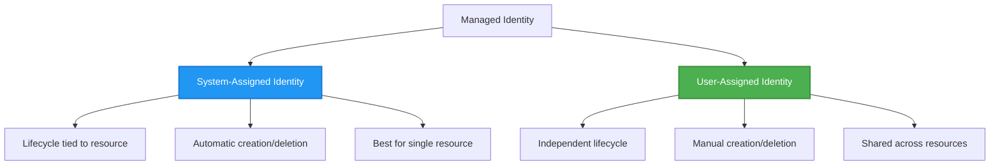

# Модели за удостоверяване и управлявана идентичност

⏱️ **Предполагаемо време**: 45-60 минути четене; осигурете допълнително време за интегриране на упражнения | 💰 **Въздействие върху разходите**: Идентичност/RBAC са безплатни; изчисления, съхранение и Key Vault, които се разполагат, са таксувани | ⭐ **Сложност**: Средно ниво

> Прегледано спрямо `azd 1.37.2` (ноември 2026). Този урок съдържа **илюстративни фрагменти за интеграция, а не пълен изтегляем `secure-app` шаблон**. Създайте препратените файлове, осигурете съответстваща инфраструктура и заменете запълващите места преди разгръщане. По време на прегледа не са създавани ресурси в Azure.

**📚 Учебна пътека:**
- ← Предишен: [Управление на конфигурацията](configuration.md) - Управление на променливи на средата и тайни
- 🎯 **В момента сте тук**: Удостоверяване и сигурност (Управлявана идентичност, Key Vault, сигурни модели)
- → Следващ: [Инфраструктура като код](../chapter-04-infrastructure/README.md) - Създаване и разполагане на ресурси
- 🏠 [Начална страница на курса](../../README.md)

---

## Какво ще научите

След завършване на този урок ще:
- Разберете моделите за удостоверяване в Azure (ключове, низове за връзка, управлявана идентичност)
- Изпълните **Управлявана идентичност** за удостоверяване без пароли
- Осигурите тайни чрез интеграция с **Azure Key Vault**
- Конфигурирате **контрол на достъпа на базата на роли (RBAC)** за разгръщания с AZD
- Приложите най-добри практики за сигурност в Container Apps и услуги на Azure
- Мигрирате от удостоверяване, базирано на ключове, към удостоверяване, базирано на идентичност

## Защо управляваната идентичност е важна

### Проблемът: Традиционно удостоверяване

**Преди управляваната идентичност:**
```javascript
// ❌ SECURITY RISK: Hardcoded secrets in code
const connectionString = "Server=mydb.database.windows.net;User=admin;Password=P@ssw0rd123";
const storageKey = "xK7mN9pQ2wR5tY8uI0oP3aS6dF1gH4jK...";
const cosmosKey = "C2x7B9n4M1p8Q5w3E6r0T2y5U8i1O4p7...";
```

**Проблеми:**
- 🔴 **Разкрити тайни** в кода, конфигурационните файлове, променливите на средата
- 🔴 **Ротация на креденциалите** изисква промени в кода и повторно разгръщане
- 🔴 **Нощни морски на одита** - кой е имал достъп до какво и кога?
- 🔴 **Разпръснати тайни** - тайни, разпилени в множество системи
- 🔴 **Рискове за съответствие** - не преминава сигурностните одити

### Решението: Управлявана идентичност

**След управляваната идентичност:**
```javascript
// ✅ SECURE: No secrets in code
const credential = new DefaultAzureCredential();
const client = new BlobServiceClient(
  "https://mystorageaccount.blob.core.windows.net",
  credential  // Azure automatically handles authentication
);
```

**Предимства:**
- ✅ **Никакви тайни** в кода или конфигурацията
- ✅ **Автоматична ротация** - Azure се грижи за това
- ✅ **Пълен отчет за одит** в логовете на Microsoft Entra ID
- ✅ **Централизирана сигурност** - управление в Azure портала
- ✅ **Подготовка за съответствие** - отговаря на стандартите за сигурност

**Аналогия**: Традиционното удостоверяване е като носене на множество физически ключове за различни врати. Управляваната идентичност е като имате служебна карта за достъп, която автоматично дава достъп въз основа на това кой сте — няма ключове, които да се губят, копират или въртят.

---

## Общ архитектурен преглед

### Поток на удостоверяване с управлявана идентичност

```mermaid
sequenceDiagram
    participant App as Your Application<br/>(Container App)
    participant MI as Managed Identity<br/>(Microsoft Entra ID)
    participant KV as Key Vault
    participant Storage as Azure Storage
    participant DB as Azure SQL
    
    App->>MI: Request access token<br/>(automatic)
    MI->>MI: Verify identity<br/>(no password needed)
    MI-->>App: Return token for requested audience<br/>(lifetime varies)
    
    App->>KV: Get secret<br/>(using token)
    KV->>KV: Check RBAC permissions
    KV-->>App: Return secret value
    
    App->>Storage: Upload blob<br/>(using token)
    Storage->>Storage: Check RBAC permissions
    Storage-->>App: Success
    
    App->>DB: Query data<br/>(using token)
    DB->>DB: Check SQL permissions
    DB-->>App: Return results
    
    Note over App,DB: Request a separate token for each service audience;<br/>SDK credentials handle caching and renewal
```

### Видове управлявани идентичности



| Функция | Системно присвоена | Потребителски присвоена |
|---------|----------------|---------------|
| **Животен цикъл** | Свързана с ресурса | Независима |
| **Създаване** | Автоматично с ресурса | Ръчно създаване |
| **Изтриване** | Изтрива се с ресурса | Запазва се след изтриване на ресурса |
| **Споделяне** | Само за един ресурс | За множество ресурси |
| **Случай на използване** | Прости случаи | Сложни сценарии с многоресурсно използване |
| **Избор на шаблон** | Определя се в инфраструктурата | Определя се в инфраструктурата |

---

## Предварителни условия

### Необходими инструменти

Трябва вече да имате инсталирани следните от предишните уроци:

```bash
# Verify Azure Developer CLI
azd version
# ✅ Expected: azd version 1.0.0 or higher

# Verify Azure CLI
az --version
# ✅ Expected: azure-cli 2.50.0 or higher
```

### Изисквания от Azure

- Активен абонамент за Azure
- Права да:
  - Създават управлявани идентичности
  - Присвояват роли по RBAC
  - Създават ресурси Key Vault
  - Разгръщат Container Apps

### Предварителни знания

Трябва да сте завършили:
- [Ръководство за инсталация](../chapter-01-foundation/installation.md) - настройка на AZD
- [Основи на AZD](../chapter-01-foundation/azd-basics.md) - основни концепции
- [Управление на конфигурацията](configuration.md) - променливи на средата

---

## Урок 1: Разбиране на моделите за удостоверяване

### Модел 1: Низове за връзка (стар, избягвайте)

**Как работи:**
```bash
# Connection string contains credentials
STORAGE_CONNECTION_STRING="DefaultEndpointsProtocol=https;AccountName=myaccount;AccountKey=xK7mN9pQ2wR5..."
COSMOS_CONNECTION_STRING="AccountEndpoint=https://myaccount.documents.azure.com:443/;AccountKey=C2x7..."
SQL_CONNECTION_STRING="Server=myserver.database.windows.net;User=admin;Password=P@ssw0rd..."
```

**Проблеми:**
- ❌ Тайните са видими в променливите на средата
- ❌ Регистрират се в системите за разгръщане
- ❌ Трудна ротация
- ❌ Няма отчет за достъп

**Кога да се използва:** Когато целевата услуга изисква удостоверяване с ключ. Предпочитайте идентичността където е възможно; в противен случай съхранявайте ключовете защитено и ги сменяйте редовно, включително в продукция.

---

### Модел 2: Препратки към Key Vault (по-добър)

**Как работи:**
**Частични Bicep фрагменти:** необходими полета за Key Vault, идентичност на Container App и нейната `configuration.secrets` са изпуснати. `secretRef` именува тайна на Container App; това **не е самият** URI на Key Vault. За да използвате Key Vault, дефинирайте тази именувана тайна с `keyVaultUrl` и оторизиран `identity`.

```bicep
// Store secret in Key Vault
resource keyVault 'Microsoft.KeyVault/vaults@2023-02-01' = {
  name: 'mykv'
  properties: {
    enableRbacAuthorization: true
  }
}

// Reference in Container App
env: [
  {
    name: 'STORAGE_KEY'
    secretRef: 'storage-key'  // References Key Vault
  }
]
```

**Предимства:**
- ✅ Тайни се съхраняват защитено в Key Vault
- ✅ Централизирано управление на тайните
- ✅ Ротация без промени в кода

**Ограничения:**
- ⚠️ Все още се използват ключове/пароли
- ⚠️ Трябва да се управлява достъпът до Key Vault

**Кога да се използва:** Преходна стъпка от низове за връзка към управлявана идентичност.

---

### Модел 3: Управлявана идентичност (Най-добра практика)

**Как работи:**
**Частичен Bicep:** включете блока за идентичност в завършен Container App и осигурете `storageAccount` и дефиниция на ролята. Присвояване на роля изисква и детерминистичен `name`.

```bicep
// Enable managed identity
resource containerApp 'Microsoft.App/containerApps@2023-05-01' = {
  name: 'myapp'
  identity: {
    type: 'SystemAssigned'  // Automatically creates identity
  }
}

// Grant permissions
resource roleAssignment 'Microsoft.Authorization/roleAssignments@2022-04-01' = {
  name: guid(storageAccount.id, containerApp.id, storageBlobDataContributorRole)
  scope: storageAccount
  properties: {
    roleDefinitionId: storageBlobDataContributorRole
    principalId: containerApp.identity.principalId
    principalType: 'ServicePrincipal'
  }
}
```

**Код на приложението:**
```javascript
// No secrets needed!
const { DefaultAzureCredential } = require('@azure/identity');
const { BlobServiceClient } = require('@azure/storage-blob');

const credential = new DefaultAzureCredential();
const blobServiceClient = new BlobServiceClient(
  'https://mystorageaccount.blob.core.windows.net',
  credential
);
```

**Предимства:**
- ✅ Без тайни в кода/конфигурацията
- ✅ Автоматична ротация на креденциалите
- ✅ Пълен отчет за одит
- ✅ Роли и разрешения базирани на RBAC
- ✅ Подготовка за съответствие

**Кога да се използва:** Предпочитано за приложения, хоствани в Azure, които достъпват услуги с поддръжка на удостоверяване Microsoft Entra.

---

### Модел 4: Service Principals (CI/CD и автоматизация)

Управляваната идентичност е златният стандарт *за ресурси, работещи вътре в Azure*. Но какво за неща, които работят **извън** Azure — като CI/CD конвейер на агента за сборка, или скрипт на вашия лаптоп, който не може да използва вашето интерактивно влизане? Там идва **service principal**: нечовешка идентичност със свои собствени креденциали, с която може да се впише автоматизиран процес.

**Как работи:**

Създайте service principal с ограничение до група ресурси (минимални права):

```bash
az ad sp create-for-rbac \
  --name "myapp-cicd" \
  --role contributor \
  --scopes "/subscriptions/<sub-id>/resourceGroups/<rg-name>"
```

Това извежда client ID, client secret, и tenant ID. azd може да се впише с тях по безинтерактивен начин:

```bash
azd auth login \
  --client-id "<appId>" \
  --client-secret "<password>" \
  --tenant-id "<tenant>"
```

**Предпочитайте федеративни креденциали (OIDC) пред тайни.** Вместо дългоживеещ client secret, конфигурирайте федеративен креденциал така че конвейерът да обменя краткотраен токен — няма тайна, която да изтече или върти:

```bash
azd auth login \
  --client-id "<appId>" \
  --federated-credential-provider "github" \
  --tenant-id "<tenant>"
```

> `azd pipeline config` настройва това автоматично за вас. Вижте CI/CD интерактивните примери в [Глава 8](../chapter-08-production/production-ai-practices.md).

**Предимства:**
- ✅ Работи извън Azure (агенти за сборка, локално, други облаци)
- ✅ Може да се ограничи до една група ресурси с една роля
- ✅ Федеративният (OIDC) вариант не използва съхранена тайна

**Недостатъци:**
- ⚠️ Вариантът с тайна изисква внимателно съхранение и ротация
- ⚠️ Изтекла тайна дава всички права, които има SP — дръжте обхватите тесни

**Кога да се използва:** За CI/CD конвейери и автоматизация, които не могат да използват управлявана идентичност. Винаги предпочитайте **федеративния/OIDC** вариант пред client secret, и по възможност управлявана идентичност когато работният товар е в Azure.

**Безопасно съхранение на креденциали:**
- Никога не комитвайте тайни — използвайте хранилището за тайни на конвейера (GitHub Actions secrets, Azure DevOps variable groups / Key Vault).
- Ограничете SP до най-малката необходима роля и група ресурси.
- Задайте срок на валидност и въртете, или изключете напълно тайната с OIDC.

---

## Урок 2: Изпълнение на управлявана идентичност с AZD

### Стъпка по стъпка имплементация

Следващите фрагменти показват как да интегрирате управлявана идентичност в проект на Container App. Те **не са стартер за директно копиране и пускане**: модулът за съхранение, пълната инфраструктура за управлявана среда/регистър, Dockerfile и параметричният файл не са напълно предоставени тук. Започнете от работещ шаблон за Container Apps и интегрирайте тези модели, запазвайки конфигурацията на регистъра и таговете на услугите.

### Структура на проекта

```
secure-app/
├── azure.yaml                 # AZD configuration
├── infra/
│   ├── main.bicep            # Main infrastructure
│   ├── core/
│   │   ├── identity.bicep    # Managed identity setup
│   │   ├── keyvault.bicep    # Key Vault configuration
│   │   └── storage.bicep     # Storage with RBAC
│   └── app/
│       └── container-app.bicep
└── src/
    ├── app.js                # Application code
    ├── package.json
    └── Dockerfile
```

### 1. Конфигурирайте AZD (azure.yaml)

```yaml
name: secure-app
metadata:
  template: secure-app@1.0.0

services:
  api:
    project: ./src
    language: js
    host: containerapp

# Managed identity must be enabled in the infrastructure, not by this YAML.
```

### 2. Инфраструктура: Активирайте управлявана идентичност

**Файл: `infra/main.bicep`**

```bicep
targetScope = 'subscription'

param environmentName string
param location string = 'eastus'
param containerAppsEnvironmentId string
param containerImage string

var tags = { 'azd-env-name': environmentName }

// Resource group
resource rg 'Microsoft.Resources/resourceGroups@2021-04-01' = {
  name: 'rg-${environmentName}'
  location: location
  tags: tags
}

// Storage Account
module storage './core/storage.bicep' = {
  name: 'storage'
  scope: rg
  params: {
    name: 'st${uniqueString(rg.id)}'
    location: location
    tags: tags
  }
}

// Key Vault
module keyVault './core/keyvault.bicep' = {
  name: 'keyvault'
  scope: rg
  params: {
    name: 'kv-${uniqueString(rg.id)}'
    location: location
    tags: tags
  }
}

// Container App with Managed Identity
module containerApp './app/container-app.bicep' = {
  name: 'container-app'
  scope: rg
  params: {
    name: 'ca-${environmentName}'
    location: location
    tags: tags
    storageAccountName: storage.outputs.name
    keyVaultName: keyVault.outputs.name
    containerAppsEnvironmentId: containerAppsEnvironmentId
    containerImage: containerImage
  }
}

// Grant Container App access to Storage
module storageRoleAssignment './core/role-assignment.bicep' = {
  name: 'storage-role'
  scope: rg
  params: {
    principalId: containerApp.outputs.identityPrincipalId
    roleDefinitionId: 'ba92f5b4-2d11-453d-a403-e96b0029c9fe'  // Storage Blob Data Contributor
    targetResourceType: 'storage'
    targetResourceName: storage.outputs.name
  }
}

// Grant Container App access to Key Vault
module kvRoleAssignment './core/role-assignment.bicep' = {
  name: 'kv-role'
  scope: rg
  params: {
    principalId: containerApp.outputs.identityPrincipalId
    roleDefinitionId: '4633458b-17de-408a-b874-0445c86b69e6'  // Key Vault Secrets User
    targetResourceType: 'keyvault'
    targetResourceName: keyVault.outputs.name
  }
}

// Outputs
output AZURE_STORAGE_ACCOUNT_NAME string = storage.outputs.name
output AZURE_KEY_VAULT_NAME string = keyVault.outputs.name
output APP_URL string = containerApp.outputs.url
```

### 3. Container App със системно присвоена идентичност

**Файл: `infra/app/container-app.bicep`**

```bicep
param name string
param location string
param tags object = {}
param storageAccountName string
param keyVaultName string
param containerAppsEnvironmentId string
param containerImage string

resource containerApp 'Microsoft.App/containerApps@2023-05-01' = {
  name: name
  location: location
  tags: union(tags, { 'azd-service-name': 'api' })
  identity: {
    type: 'SystemAssigned'  // 🔑 Enable managed identity
  }
  properties: {
    managedEnvironmentId: containerAppsEnvironmentId
    configuration: {
      ingress: {
        external: true
        targetPort: 3000
      }
    }
    template: {
      containers: [
        {
          name: 'api'
          image: containerImage // Must exist; configure registry credentials for private images
          resources: {
            cpu: json('0.5')
            memory: '1Gi'
          }
          env: [
            {
              name: 'AZURE_STORAGE_ACCOUNT_NAME'
              value: storageAccountName
            }
            {
              name: 'AZURE_KEY_VAULT_NAME'
              value: keyVaultName
            }
            // 🔑 No secrets - managed identity handles authentication!
          ]
        }
      ]
    }
  }
}

// Output the identity for RBAC assignments
output identityPrincipalId string = containerApp.identity.principalId
output id string = containerApp.id
output url string = 'https://${containerApp.properties.configuration.ingress.fqdn}'
```

### 4. Модул за присвояване на RBAC роля

**Файл: `infra/core/role-assignment.bicep`**

```bicep
param principalId string
param roleDefinitionId string  // Azure built-in role ID
@allowed(['storage', 'keyvault'])
param targetResourceType string
param targetResourceName string

// Typed existing resources give Bicep a valid resource scope, not a string ID.
resource storageTarget 'Microsoft.Storage/storageAccounts@2023-01-01' existing = {
  name: targetResourceName
}
resource vaultTarget 'Microsoft.KeyVault/vaults@2023-02-01' existing = {
  name: targetResourceName
}

resource storageAssignment 'Microsoft.Authorization/roleAssignments@2022-04-01' = if (targetResourceType == 'storage') {
  name: guid(storageTarget.id, principalId, roleDefinitionId)
  scope: storageTarget
  properties: {
    roleDefinitionId: subscriptionResourceId('Microsoft.Authorization/roleDefinitions', roleDefinitionId)
    principalId: principalId
    principalType: 'ServicePrincipal'
  }
}

resource vaultAssignment 'Microsoft.Authorization/roleAssignments@2022-04-01' = if (targetResourceType == 'keyvault') {
  name: guid(vaultTarget.id, principalId, roleDefinitionId)
  scope: vaultTarget
  properties: {
    roleDefinitionId: subscriptionResourceId('Microsoft.Authorization/roleDefinitions', roleDefinitionId)
    principalId: principalId
    principalType: 'ServicePrincipal'
  }
}

// This module assigns at the target resource scope, not the whole resource group.
```

### 5. Код на приложението с управлявана идентичност

**Файл: `src/app.js`**

```javascript
const express = require('express');
const { DefaultAzureCredential } = require('@azure/identity');
const { BlobServiceClient } = require('@azure/storage-blob');
const { SecretClient } = require('@azure/keyvault-secrets');

const app = express();
const PORT = process.env.PORT || 3000;

// 🔑 Initialize credential (works automatically with managed identity)
const credential = new DefaultAzureCredential();

// Azure Storage setup
const storageAccountName = process.env.AZURE_STORAGE_ACCOUNT_NAME;
const blobServiceClient = new BlobServiceClient(
  `https://${storageAccountName}.blob.core.windows.net`,
  credential  // No keys needed!
);

// Key Vault setup
const keyVaultName = process.env.AZURE_KEY_VAULT_NAME;
const secretClient = new SecretClient(
  `https://${keyVaultName}.vault.azure.net`,
  credential  // No keys needed!
);

// Health check
app.get('/health', (req, res) => {
  res.json({ status: 'healthy', authentication: 'managed-identity' });
});

// Upload file to blob storage
app.post('/upload', async (req, res) => {
  try {
    const containerClient = blobServiceClient.getContainerClient('uploads');
    await containerClient.createIfNotExists();
    
    const blobName = `file-${Date.now()}.txt`;
    const blockBlobClient = containerClient.getBlockBlobClient(blobName);
    
    const content = 'Hello from managed identity!';
    await blockBlobClient.upload(content, Buffer.byteLength(content));
    
    res.json({
      success: true,
      blobName: blobName,
      message: 'File uploaded using managed identity!'
    });
  } catch (error) {
    console.error('Upload error:', error);
    res.status(500).json({ error: error.message });
  }
});

// Get secret from Key Vault
app.get('/secret/:name', async (req, res) => {
  try {
    const secretName = req.params.name;
    const secret = await secretClient.getSecret(secretName);
    
    res.json({
      name: secretName,
      retrieved: secret.value !== undefined, // Never return the secret value to callers
      message: 'Secret retrieved using managed identity!'
    });
  } catch (error) {
    console.error('Secret error:', error);
    res.status(500).json({ error: error.message });
  }
});

// List blob containers (demonstrates read access)
app.get('/containers', async (req, res) => {
  try {
    const containers = [];
    for await (const container of blobServiceClient.listContainers()) {
      containers.push(container.name);
    }
    
    res.json({
      containers: containers,
      count: containers.length,
      message: 'Containers listed using managed identity!'
    });
  } catch (error) {
    console.error('List error:', error);
    res.status(500).json({ error: error.message });
  }
});

app.listen(PORT, () => {
  console.log(`Secure API listening on port ${PORT}`);
  console.log('Authentication: Managed Identity (passwordless)');
});
```

**Файл: `src/package.json`**

```json
{
  "name": "secure-app",
  "version": "1.0.0",
  "dependencies": {
    "express": "^4.18.2",
    "@azure/identity": "^4.0.0",
    "@azure/storage-blob": "^12.17.0",
    "@azure/keyvault-secrets": "^4.7.0"
  },
  "scripts": {
    "start": "node app.js"
  }
}
```

### 6. Разгръщане и тест

Изпълнете тези команди **след** като създадете липсващата инфраструктура, Dockerfile и съответстващия `main.parameters.json` във вашия проект. Аутентикирайте azd с `azd auth login`; влезте отделно с `az login` за проверките на Azure CLI по-късно. Показаните крайни точки са демонстрации и изискват подходящ контрол на достъпа преди публична употреба.

```bash
# Initialize AZD environment
azd init

# Deploy infrastructure and application
azd up

# Get the app URL
APP_URL=$(azd env get-value APP_URL)

# Test health check
curl $APP_URL/health
```

**✅ Очакван изход:**
```json
{
  "status": "healthy",
  "authentication": "managed-identity"
}
```

**Тест за качване на blob:**
```bash
curl -X POST $APP_URL/upload
```

**✅ Очакван изход:**
```json
{
  "success": true,
  "blobName": "file-1700404800000.txt",
  "message": "File uploaded using managed identity!"
}
```

**Тест за изброяване на контейнери:**
```bash
curl $APP_URL/containers
```

**✅ Очакван изход:**
```json
{
  "containers": ["uploads"],
  "count": 1,
  "message": "Containers listed using managed identity!"
}
```

---

## Често срещани Azure RBAC роли

### Вградени ID-та на роли за управлявана идентичност

| Услуга | Име на роля | Ролева ID | Разрешения |
|---------|-----------|---------|-------------|
| **Съхранение** | Storage Blob Data Reader | `2a2b9908-6ea1-4ae2-8e65-a410df84e7d1` | Чете blob-ове и контейнери |
| **Съхранение** | Storage Blob Data Contributor | `ba92f5b4-2d11-453d-a403-e96b0029c9fe` | Чете, пише, изтрива blob-ове |
| **Съхранение** | Storage Queue Data Contributor | `974c5e8b-45b9-4653-ba55-5f855dd0fb88` | Чете, пише, изтрива опашки/съобщения |
| **Key Vault** | Key Vault Secrets User | `4633458b-17de-408a-b874-0445c86b69e6` | Чете тайни |
| **Key Vault** | Key Vault Secrets Officer | `b86a8fe4-44ce-4948-aee5-eccb2c155cd7` | Чете, пише, изтрива тайни |
| **Cosmos DB** | Cosmos DB Built-in Data Reader | `00000000-0000-0000-0000-000000000001` | Чете данни от Cosmos DB |
| **Cosmos DB** | Cosmos DB Built-in Data Contributor | `00000000-0000-0000-0000-000000000002` | Чете, пише данни в Cosmos DB |
| **SQL база данни** | SQL DB Contributor | `9b7fa17d-e63e-47b0-bb0a-15c516ac86ec` | Управлява ресурси на база данни; не дава достъп до данни в SQL |
| **Service Bus** | Azure Service Bus Data Owner | `090c5cfd-751d-490a-894a-3ce6f1109419` | Изпраща, получава, управлява съобщения |

### Как да намерите ID-та на роли

Двете ID-та за Cosmos DB за NoSQL по-горе са **родни роля дефиниции за ниво данни в Cosmos**, а не абонаментни ролеви ID-та за Azure RBAC. Присвоявайте ги с `az cosmosdb sql role assignment create` (или `Microsoft.DocumentDB/databaseAccounts/sqlRoleAssignments`), а не с `az role assignment create`. Достъп до SQL данни изисква Entra потребител на базата данни и SQL разрешения.

```bash
# List all built-in roles
az role definition list --query "[].{Name:roleName, ID:name}" --output table

# Search for specific role
az role definition list --query "[?contains(roleName, 'Storage Blob')].{Name:roleName, ID:name}" --output table

# Get role details
az role definition list --name "Storage Blob Data Contributor"
```

---

## Практически упражнения

**Предварителни условия за интеграция за трите упражнения:** работещ шаблон за Container App във ваш собствен проект, съответстващи ресурси Bicep, Azure CLI/azd влизане и права да присвоявате необходимите роли. Това са насочени адаптации, а не самостоятелни локални стартери; заменете примерните имена на ресурси с вашите разположени имена.

### Упражнение 1: Активиране на управлявана идентичност за съществуващо приложение ⭐⭐ (Средно)

**Цел:** Добавете управлявана идентичност към съществуващо разгръщане на Container App

**Сценарий:** Имате Container App, използващо низове за връзка. Преобразувайте го към управлявана идентичност.

**Начална точка:** Container App с тази конфигурация:

```bicep
// ❌ Current: Using connection string
env: [
  {
    name: 'STORAGE_CONNECTION_STRING'
    secretRef: 'storage-connection'
  }
]
```

**Стъпки**:

1. **Активирайте управляваната идентичност в Bicep:**

```bicep
resource containerApp 'Microsoft.App/containerApps@2023-05-01' = {
  name: 'myapp'
  identity: {
    type: 'SystemAssigned'  // Add this
  }
  // ... rest of configuration
}
```

2. **Разрешете достъп до съхранение:**

```bicep
// Get storage account reference
resource storageAccount 'Microsoft.Storage/storageAccounts@2023-01-01' existing = {
  name: storageAccountName
}

// Assign role
resource roleAssignment 'Microsoft.Authorization/roleAssignments@2022-04-01' = {
  name: guid(containerApp.id, 'ba92f5b4-2d11-453d-a403-e96b0029c9fe', storageAccount.id)
  scope: storageAccount
  properties: {
    roleDefinitionId: subscriptionResourceId('Microsoft.Authorization/roleDefinitions', 'ba92f5b4-2d11-453d-a403-e96b0029c9fe')
    principalId: containerApp.identity.principalId
    principalType: 'ServicePrincipal'
  }
}
```

3. **Актуализирайте кода на приложението:**

**Преди (низ за връзка):**
```javascript
const { BlobServiceClient } = require('@azure/storage-blob');

const blobServiceClient = BlobServiceClient.fromConnectionString(
  process.env.STORAGE_CONNECTION_STRING
);
```

**След (управлявана идентичност):**
```javascript
const { DefaultAzureCredential } = require('@azure/identity');
const { BlobServiceClient } = require('@azure/storage-blob');

const credential = new DefaultAzureCredential();
const blobServiceClient = new BlobServiceClient(
  `https://${process.env.STORAGE_ACCOUNT_NAME}.blob.core.windows.net`,
  credential
);
```

4. **Актуализирайте променливите на средата:**

```bicep
env: [
  {
    name: 'STORAGE_ACCOUNT_NAME'
    value: storageAccountName  // Just the name, no secrets!
  }
  // Remove STORAGE_CONNECTION_STRING
]
```

5. **Разгърнете и тествайте:**

```bash
# Redeploy
azd up

# Test that it still works
APP_URL=$(azd show --output json | jq -er '.services.api.ingressUrl')
curl --fail -X POST "$APP_URL/upload"
```

**✅ Успешни критерии:**
- ✅ Приложението се разгръща без грешки
- ✅ Операциите с хранилището работят (качване, изброяване, изтегляне)
- ✅ Няма низове за връзка в променливите на средата
- ✅ Идентичността е видима в Azure портал под „Identity“ панел

**Проверка:**

```bash
# Check managed identity is enabled
az containerapp show \
  --name myapp \
  --resource-group rg-myapp \
  --query "identity.type"
# ✅ Expected: "SystemAssigned"

# Check role assignment
az role assignment list \
  --assignee $(az containerapp show --name myapp --resource-group rg-myapp --query "identity.principalId" -o tsv) \
  --scope /subscriptions/{sub-id}/resourceGroups/rg-myapp/providers/Microsoft.Storage/storageAccounts/mystorageaccount
# ✅ Expected: Shows "Storage Blob Data Contributor" role
```

**Време:** 20-30 минути

---

### Упражнение 2: Многоуслугова достъп с потребителски присвоена идентичност ⭐⭐⭐ (Напреднал)

**Цел:** Създайте потребителски присвоена идентичност, споделена между няколко Container Apps

**Сценарий:** Имате 3 микросервиса, които всички трябва да имат достъп до същия акаунт за съхранение и Key Vault.

**Стъпки:**

1. **Създайте потребителски присвоена идентичност:**

**Файл: `infra/core/identity.bicep`**

```bicep
param name string
param location string
param tags object = {}

resource userAssignedIdentity 'Microsoft.ManagedIdentity/userAssignedIdentities@2023-01-31' = {
  name: name
  location: location
  tags: tags
}

output id string = userAssignedIdentity.id
output principalId string = userAssignedIdentity.properties.principalId
output clientId string = userAssignedIdentity.properties.clientId
```

2. **Присвойте роли на потребителски присвоената идентичност:**

```bicep
// In main.bicep
module userIdentity './core/identity.bicep' = {
  name: 'user-identity'
  scope: rg
  params: {
    name: 'id-${environmentName}'
    location: location
    tags: tags
  }
}

// Grant Storage access
resource storageRoleAssignment 'Microsoft.Authorization/roleAssignments@2022-04-01' = {
  name: guid(storageAccount.id, environmentName, 'storage-contributor')
  scope: storageAccount
  properties: {
    roleDefinitionId: subscriptionResourceId('Microsoft.Authorization/roleDefinitions', 'ba92f5b4-2d11-453d-a403-e96b0029c9fe')
    principalId: userIdentity.outputs.principalId
    principalType: 'ServicePrincipal'
  }
}

// Grant Key Vault access
resource kvRoleAssignment 'Microsoft.Authorization/roleAssignments@2022-04-01' = {
  name: guid(keyVault.id, environmentName, 'kv-secrets-user')
  scope: keyVault
  properties: {
    roleDefinitionId: subscriptionResourceId('Microsoft.Authorization/roleDefinitions', '4633458b-17de-408a-b874-0445c86b69e6')
    principalId: userIdentity.outputs.principalId
    principalType: 'ServicePrincipal'
  }
}
```

3. **Присвояване на идентичност на множество Контейнерни приложения:**

```bicep
resource apiGateway 'Microsoft.App/containerApps@2023-05-01' = {
  name: 'api-gateway'
  identity: {
    type: 'UserAssigned'
    userAssignedIdentities: {
      '${userIdentity.outputs.id}': {}
    }
  }
  // ... rest of config
}

resource productService 'Microsoft.App/containerApps@2023-05-01' = {
  name: 'product-service'
  identity: {
    type: 'UserAssigned'
    userAssignedIdentities: {
      '${userIdentity.outputs.id}': {}
    }
  }
  // ... rest of config
}

resource orderService 'Microsoft.App/containerApps@2023-05-01' = {
  name: 'order-service'
  identity: {
    type: 'UserAssigned'
    userAssignedIdentities: {
      '${userIdentity.outputs.id}': {}
    }
  }
  // ... rest of config
}
```

4. **Код на приложението (всички услуги използват един и същ модел):**

```javascript
const { ManagedIdentityCredential } = require('@azure/identity');
const { BlobServiceClient } = require('@azure/storage-blob');

// For user-assigned identity, specify the client ID
const credential = new ManagedIdentityCredential(
  process.env.AZURE_CLIENT_ID  // User-assigned identity client ID
);

// Alternative (choose ONE credential declaration):
// const { DefaultAzureCredential } = require('@azure/identity');
// const credential = new DefaultAzureCredential({
//   managedIdentityClientId: process.env.AZURE_CLIENT_ID
// });

const blobServiceClient = new BlobServiceClient(
  `https://${process.env.STORAGE_ACCOUNT_NAME}.blob.core.windows.net`,
  credential
);
```

Задайте средата за изпълнение на всяко Контейнерно приложение `AZURE_CLIENT_ID` на `userIdentity.outputs.clientId` и `STORAGE_ACCOUNT_NAME` на името на вашето хранилище в Bicep. Просто присвояването на идентичност или стартирането на `azd env set` не конфигурира тези стойности за изпълнение.

5. **Деплойвайте и проверявайте:**

```bash
azd up

# Test all services can access storage
# Replace with the actual ingress URLs reported for your three services
curl --fail -X POST "$API_GATEWAY_URL/upload"
curl --fail -X POST "$PRODUCT_SERVICE_URL/upload"
curl --fail -X POST "$ORDER_SERVICE_URL/upload"
```

**✅ Критерии за успех:**
- ✅ Една идентичност споделена между 3 услуги
- ✅ Всички услуги могат да достъпват Storage и Key Vault
- ✅ Идентичността се запазва, ако изтриете една услуга
- ✅ Централизирано управление на разрешения

**Предимства на потребителски присвоена идентичност:**
- Една идентичност за управление
- Консистентни разрешения през услугите
- Оцеляване при изтриване на услуга
- По-добра за сложни архитектури

**Време**: 30-40 минути

---

### Упражнение 3: Имплементиране на ротация на тайни в Key Vault ⭐⭐⭐ (Напреднали)

**Цел**: Съхранявайте ключове за трети страни в Key Vault и им достъпвайте чрез управлявана идентичност

**Сценарий**: Вашето приложение трябва да извършва повикване към външен API (OpenAI, Stripe, SendGrid), който изисква API ключове.

**Стъпки**:

1. **Създайте Key Vault с RBAC:**

**Файл: `infra/core/keyvault.bicep`**

```bicep
param name string
param location string
param tags object = {}

resource keyVault 'Microsoft.KeyVault/vaults@2023-02-01' = {
  name: name
  location: location
  tags: tags
  properties: {
    enableRbacAuthorization: true  // Use RBAC instead of access policies
    sku: {
      family: 'A'
      name: 'standard'
    }
    tenantId: subscription().tenantId
    enableSoftDelete: true
    softDeleteRetentionInDays: 90
  }
}

// Allow Container App to read secrets
output id string = keyVault.id
output name string = keyVault.name
output uri string = keyVault.properties.vaultUri
```

2. **Съхранете тайни в Key Vault:**

```bash
# Get Key Vault name
KV_NAME=$(azd env get-value AZURE_KEY_VAULT_NAME)

# Store third-party API keys
az keyvault secret set \
  --vault-name $KV_NAME \
  --name "OpenAI-ApiKey" \
  --value "sk-proj-xxxxxxxxxxxxx"

az keyvault secret set \
  --vault-name $KV_NAME \
  --name "Stripe-ApiKey" \
  --value "sk_live_xxxxxxxxxxxxx"

az keyvault secret set \
  --vault-name $KV_NAME \
  --name "SendGrid-ApiKey" \
  --value "SG.xxxxxxxxxxxxx"
```

3. **Код на приложението за извличане на тайни:**

**Файл: `src/config.js`**

```javascript
const { DefaultAzureCredential } = require('@azure/identity');
const { SecretClient } = require('@azure/keyvault-secrets');

class Config {
  constructor() {
    this.credential = new DefaultAzureCredential();
    this.secretClient = new SecretClient(
      `https://${process.env.AZURE_KEY_VAULT_NAME}.vault.azure.net`,
      this.credential
    );
    this.cache = {};
  }

  async getSecret(secretName) {
    // Check cache first
    if (this.cache[secretName]) {
      return this.cache[secretName];
    }

    try {
      const secret = await this.secretClient.getSecret(secretName);
      this.cache[secretName] = secret.value;
      console.log(`✅ Retrieved secret: ${secretName}`);
      return secret.value;
    } catch (error) {
      console.error(`❌ Failed to get secret ${secretName}:`, error.message);
      throw error;
    }
  }

  async getOpenAIKey() {
    return this.getSecret('OpenAI-ApiKey');
  }

  async getStripeKey() {
    return this.getSecret('Stripe-ApiKey');
  }

  async getSendGridKey() {
    return this.getSecret('SendGrid-ApiKey');
  }
}

module.exports = new Config();
```

4. **Използвайте тайните в приложението:**

**Файл: `src/app.js`**

Този **фрагмент за замяна на приложението** изисква `npm install openai`, реален ключ на трета страна, достъпен модел и инфраструктурата от вашия работещ проект. Извиква OpenAI директно, а не разгръщане на Azure OpenAI. Поставените по-долу ключове не позволяват заявка.

```javascript
const express = require('express');
const config = require('./config');
const { OpenAI } = require('openai');

const app = express();

// Initialize OpenAI with key from Key Vault
let openaiClient;

async function initializeServices() {
  const openaiKey = await config.getOpenAIKey();
  openaiClient = new OpenAI({ apiKey: openaiKey });
  console.log('✅ Services initialized with secrets from Key Vault');
}

app.post('/chat', async (req, res) => {
  try {
    const completion = await openaiClient.chat.completions.create({
      model: 'gpt-4.1',
      messages: [{ role: 'user', content: 'Hello!' }]
    });
    
    res.json({
      response: completion.choices[0].message.content,
      authentication: 'Key from Key Vault via Managed Identity'
    });
  } catch (error) {
    res.status(500).json({ error: error.message });
  }
});

// Start listening only after initialization succeeds.
initializeServices().then(() => {
  app.listen(3000, () => console.log('Key Vault demo running'));
}).catch(error => {
  console.error('Initialization failed:', error.message);
  process.exitCode = 1;
});
```

5. **Деплойвайте и тествайте:**

```bash
azd up

# Test that API keys work
curl -X POST https://myapp.azurecontainerapps.io/chat \
  -H "Content-Type: application/json" \
  -d '{"message":"Hello AI"}'
```

**✅ Критерии за успех:**
- ✅ Никакви API ключове в кода или променливите на средата
- ✅ Приложението извлича ключове от Key Vault
- ✅ Външните API работят правилно
- ✅ Можете да въртите ключове без промени в кода

**Въртене на тайна:**

```bash
# Update secret in Key Vault
az keyvault secret set \
  --vault-name $KV_NAME \
  --name "OpenAI-ApiKey" \
  --value "sk-proj-NEW_KEY_HERE"

# Find the active revision name, then restart it to clear the in-process cache
az containerapp revision list --name myapp --resource-group rg-myapp --output table
az containerapp revision restart \
  --name myapp \
  --resource-group rg-myapp \
  --revision "<active-revision-name>"
```

**Време**: 25-35 минути

---

## Проверка на знанията

### 1. Модели за автентикация ✓

Тествайте разбирането си:

- [ ] **В1**: Какви са трите основни модела за автентикация? 
  - **О**: Низове за връзка (стар метод), референции на Key Vault (переход), управлявана идентичност (най-добър)

- [ ] **В2**: Защо управляваната идентичност е по-добра от низовете за връзка?
  - **О**: Никакви тайни в кода, автоматична ротация, пълен одит, RBAC разрешения

- [ ] **В3**: Кога бихте използвали потребителски присвоена идентичност вместо системно присвоена?
  - **О**: При споделяне на идентичност между множество ресурси или когато жизненият цикъл на идентичността е независим от този на ресурса

**Практическа проверка:**
```bash
# Check what type of identity your app uses
az containerapp show \
  --name myapp \
  --resource-group rg-myapp \
  --query "identity.type"

# List all role assignments for the identity
az role assignment list \
  --assignee $(az containerapp show --name myapp --resource-group rg-myapp --query "identity.principalId" -o tsv)
```

---

### 2. RBAC и разрешения ✓

Тествайте разбирането си:

- [ ] **В1**: Какъв е ролята ID за "Storage Blob Data Contributor"?
  - **О**: `ba92f5b4-2d11-453d-a403-e96b0029c9fe`

- [ ] **В2**: Какви разрешения предоставя "Key Vault Secrets User"?
  - **О**: Достъп само за четене до тайни (не може да създава, актуализира или изтрива)

- [ ] **В3**: Как давате достъп на Контейнерно приложение до Azure SQL?
  - **О**: Конфигурирайте Microsoft Entra автентикация, създайте идентичността като потребител на базата данни и дайте необходимите SQL разрешения. "SQL DB Contributor" управлява само Azure ресурси; не упълномощава заявки.

**Практическа проверка:**
```bash
# Find specific role
az role definition list --name "Storage Blob Data Contributor"

# Check what roles are assigned to your identity
PRINCIPAL_ID=$(az containerapp show --name myapp --resource-group rg-myapp --query "identity.principalId" -o tsv)
az role assignment list --assignee $PRINCIPAL_ID --output table
```

---

### 3. Интеграция с Key Vault ✓

Тествайте разбирането си:

- [ ] **В1**: Как активирате RBAC за Key Vault вместо политики за достъп?
  - **О**: Задайте `enableRbacAuthorization: true` в Bicep

- [ ] **В2**: Коя библиотека на Azure SDK управлява автентикацията с управлявана идентичност?
  - **О**: `@azure/identity` с класа `DefaultAzureCredential`

- [ ] **В3**: Колко дълго тайните в Key Vault се пазят в кеша?
  - **О**: Зависи от приложението; имплементирайте собствена стратегия за кеширане

**Практическа проверка:**
```bash
# Test Key Vault access
az keyvault secret show \
  --vault-name $KV_NAME \
  --name "OpenAI-ApiKey" \
  --query "{name:name,enabled:attributes.enabled}"

# Check RBAC is enabled
az keyvault show \
  --name $KV_NAME \
  --query "properties.enableRbacAuthorization"
# ✅ Expected: true
```

---

## Най-добри практики за сигурност

### ✅ ПРАВЕТЕ:

1. **Винаги използвайте управлявана идентичност в продукция**
   ```bicep
   identity: {
     type: 'SystemAssigned'
   }
   ```

2. **Използвайте RBAC роли с минимални привилегии**
   - Използвайте роли "Reader", където е възможно
   - Избягвайте "Owner" или "Contributor", освен ако не е необходимо

3. **Съхранявайте ключове на трети страни в Key Vault**
   ```javascript
   const apiKey = await secretClient.getSecret('ThirdPartyApiKey');
   ```

4. **Активирайте регистрирането на одита** (частичен фрагмент на ресурс; обединете го с вашите декларации за vault и workspace)
   ```bicep
   resource vaultDiagnostics 'Microsoft.Insights/diagnosticSettings@2021-05-01-preview' = {
     name: 'vault-audit'
     scope: keyVault
     properties: {
       workspaceId: logAnalytics.id
       logs: [{ category: 'AuditEvent', enabled: true }]
     }
   }
   ```

5. **Използвайте различни идентичности за dev/staging/prod**
   ```bash
   azd env new dev
   azd env new staging
   azd env new prod
   ```

6. **Ротация на тайни редовно**
   - Задайте срокове на валидност за тайните в Key Vault
   - Автоматизирайте ротацията с Azure Functions

### ❌ НЕ ПРАВЕТЕ:

1. **Никога не вграждайте тайни твърдо в кода**
   ```javascript
   // ❌ BAD
   const apiKey = "sk-proj-xxxxxxxxxxxxx";
   ```

2. **Не използвайте низове за връзка в продукция**
   ```javascript
   // ❌ BAD
   BlobServiceClient.fromConnectionString(process.env.STORAGE_CONNECTION_STRING)
   ```

3. **Не давайте излишни разрешения**
   ```bicep
   // ❌ BAD - too much access
   roleDefinitionId: subscriptionResourceId('Microsoft.Authorization/roleDefinitions', '8e3af657-a8ff-443c-a75c-2fe8c4bcb635')
   
   // ✅ GOOD - least privilege
   roleDefinitionId: subscriptionResourceId('Microsoft.Authorization/roleDefinitions', '2a2b9908-6ea1-4ae2-8e65-a410df84e7d1')
   ```

4. **Не регистрирайте тайни**
   ```javascript
   // ❌ BAD
   console.log('API Key:', apiKey);
   
   // ✅ GOOD
   console.log('API Key retrieved successfully');
   ```

5. **Не споделяйте продукционни идентичности между среди**
   ```bicep
   // ❌ BAD - same identity for dev and prod
   // ✅ GOOD - separate identities per environment
   ```

---

## Насоки за отстраняване на проблеми

### Проблем: "Unauthorized" при достъп до Azure Storage

**Симптоми:**
```
Error: Unauthorized (403)
AuthorizationPermissionMismatch: This request is not authorized to perform this operation
```

**Диагноза:**

```bash
# Check if managed identity is enabled
az containerapp show \
  --name myapp \
  --resource-group rg-myapp \
  --query "identity.type"
# ✅ Expected: "SystemAssigned" or "UserAssigned"

# Check role assignments
PRINCIPAL_ID=$(az containerapp show --name myapp --resource-group rg-myapp --query "identity.principalId" -o tsv)
az role assignment list --assignee $PRINCIPAL_ID

# Expected: Should see "Storage Blob Data Contributor" or similar role
```

**Решения:**

1. **Дайте правилната RBAC роля:**
```bash
STORAGE_ID=$(az storage account show --name mystorageaccount --resource-group rg-myapp --query "id" -o tsv)
az role assignment create \
  --assignee $PRINCIPAL_ID \
  --role "Storage Blob Data Contributor" \
  --scope $STORAGE_ID
```

2. **Изчакайте разпространението (може да отнеме 5-10 минути):**
```bash
# Check role assignment status
az role assignment list --assignee $PRINCIPAL_ID --scope $STORAGE_ID
```

3. **Проверете дали кодът използва правилните удостоверения:**
```javascript
// Make sure you're using DefaultAzureCredential
const credential = new DefaultAzureCredential();
```

---

### Проблем: Достъп до Key Vault отказан

**Симптоми:**
```
Error: Forbidden (403)
The user, group or application does not have secrets get permission
```

**Диагноза:**

```bash
# Check Key Vault RBAC is enabled
az keyvault show \
  --name $KV_NAME \
  --query "properties.enableRbacAuthorization"
# ✅ Expected: true

# Check role assignments
az role assignment list \
  --assignee $PRINCIPAL_ID \
  --scope /subscriptions/{sub-id}/resourceGroups/rg-myapp/providers/Microsoft.KeyVault/vaults/$KV_NAME
```

**Решения:**

1. **Активирайте RBAC на Key Vault:**
```bash
az keyvault update \
  --name $KV_NAME \
  --enable-rbac-authorization true
```

2. **Дайте роля Key Vault Secrets User:**
```bash
KV_ID=$(az keyvault show --name $KV_NAME --query "id" -o tsv)
az role assignment create \
  --assignee $PRINCIPAL_ID \
  --role "Key Vault Secrets User" \
  --scope $KV_ID
```

---

### Проблем: DefaultAzureCredential не работи локално

**Симптоми:**
```
Error: DefaultAzureCredential failed to retrieve a token
CredentialUnavailableError: No credential available
```

**Диагноза:**

```bash
# Check if you're logged in
az account show

# Check Azure CLI authentication
az ad signed-in-user show
```

**Решения:**

1. **Вход в Azure CLI:**
```bash
az login
```

2. **Задайте Azure абонамент:**
```bash
az account set --subscription "Your Subscription Name"
```

3. **За локална разработка използвайте променливи на средата:**
```bash
export AZURE_TENANT_ID="your-tenant-id"
export AZURE_CLIENT_ID="your-client-id"
export AZURE_CLIENT_SECRET="your-client-secret"
```

4. **Или използвайте различно удостоверение локално:**
```javascript
const { DefaultAzureCredential, AzureCliCredential } = require('@azure/identity');

// Use AzureCliCredential for local dev
const credential = process.env.NODE_ENV === 'production' 
  ? new DefaultAzureCredential()
  : new AzureCliCredential();
```

---

### Проблем: Задаването на роля отнема твърде дълго за разпространение

**Симптоми:**
- Ролята е зададена успешно
- Все още получавате грешки 403
- Непостоянен достъп (понякога работи, понякога не)

**Обяснение:**
Промените в Azure RBAC могат да отнемат 5-10 минути за глобално разпространение.

**Решение:**

```bash
# Wait and retry
echo "Waiting for RBAC propagation..."
sleep 300  # Wait 5 minutes

# Test access
curl --fail -X POST "$APP_URL/upload"

# If still failing, restart the app
az containerapp revision restart \
  --name myapp \
  --resource-group rg-myapp \
  --revision "<active-revision-name>"
```

---

## Финансови съображения

### Разходи за управлявана идентичност

| Ресурс | Разход |
|----------|------|
| **Управлявана идентичност** | 🆓 **БЕЗПЛАТНО** - Без такса |
| **RBAC задаване на роли** | 🆓 **БЕЗПЛАТНО** - Без такса |
| **Заявки за токени от Microsoft Entra ID** | 🆓 **БЕЗПЛАТНО** - Включено |
| **Операции с Key Vault** | $0.03 на 10 000 операции |
| **Съхранение на тайни в Key Vault** | Проверете актуалните цени; не предполагайте месечна такса на таен запис |

**Управляваната идентичност пести пари чрез:**
- ✅ Премахване на операции с Key Vault за автентикация услуга към услуга
- ✅ Намаляване на инцидентите със сигурността (няма изтекли удостоверения)
- ✅ Намаляване на оперативното натоварване (няма ръчна ротация)

Броят заявки на приложението не съвпада с броя операции с Key Vault: модели за кеширане и ротация определят разходите за прочитане на тайни. Идентичността не премахва такси за изчислителна мощност/съхранение. Проверете [Цени за Key Vault](https://azure.microsoft.com/pricing/details/key-vault/) и Azure Pricing Calculator за вашия регион, вместо да предполагате месечна икономия само по брой заявки.

---

## Научете повече

### Официална документация
- [Управлявана идентичност на Azure](https://learn.microsoft.com/entra/identity/managed-identities-azure-resources/overview)
- [Azure RBAC](https://learn.microsoft.com/azure/role-based-access-control/overview)
- [Azure Key Vault](https://learn.microsoft.com/azure/key-vault/general/overview)
- [DefaultAzureCredential](https://learn.microsoft.com/dotnet/api/azure.identity.defaultazurecredential)

### Документация на SDK
- [@azure/identity (Node.js)](https://www.npmjs.com/package/@azure/identity)
- [Azure.Identity (C#)](https://www.nuget.org/packages/Azure.Identity/)
- [azure-identity (Python)](https://pypi.org/project/azure-identity/)

### Следващи стъпки в този курс
- ← Предишен: [Управление на конфигурацията](configuration.md)
- → Следващ: [Инфраструктура като код](../chapter-04-infrastructure/README.md)
- 🏠 [Начало на курса](../../README.md)

### Свързани примери
- [Пример за чат с Microsoft Foundry Models](../../../../examples/azure-openai-chat) - Използва управлявана идентичност за Microsoft Foundry Models
- [Пример за микросервизи](../../../../examples/microservices) - Модели за автентикация на многосервизни приложения

---

## Обобщение

**Научихте:**
- ✅ Три модела за автентикация (низове за връзка, Key Vault, управлявана идентичност)
- ✅ Как да активирате и конфигурирате управлявана идентичност в AZD
- ✅ Задаване на RBAC роли за Azure услуги
- ✅ Интеграция с Key Vault за тайни на трети страни
- ✅ Потребителски присвоени срещу системно присвоени идентичности
- ✅ Най-добри практики за сигурност и отстраняване на проблеми

**Основни изводи:**
1. **Винаги използвайте управлявана идентичност в продукция** - Никакви тайни, автоматична ротация
2. **Използвайте RBAC роли с минимални привилегии** - Давайте само необходимите разрешения
3. **Съхранявайте ключове на трети страни в Key Vault** - Централизирано управление на тайни
4. **Разделяйте идентичности според средите** - Изолация на dev, staging, prod
5. **Активирайте регистриране на одита** - Проследявайте кой е имал достъп до какво

**Следващи стъпки:**
1. Завършете практическите упражнения по-горе
2. Мигрирайте съществуващо приложение от низове за връзка към управлявана идентичност
3. Прегледайте отново основния поток за деплоймент: [Първи проект](../chapter-01-foundation/first-project.md)

---

<!-- CO-OP TRANSLATOR DISCLAIMER START -->
**Отказ от отговорност**:
Този документ е преведен с помощта на AI преводачески услуга [Co-op Translator](https://github.com/Azure/co-op-translator). Въпреки че се стремим към точност, моля имайте предвид, че автоматизираните преводи могат да съдържат грешки или неточности. Оригиналният документ на неговия роден език трябва да се счита за авторитетен източник. За критична информация се препоръчва професионален човешки превод. Ние не носим отговорност за каквито и да е недоразумения или неправилни тълкувания, произтичащи от използването на този превод.
<!-- CO-OP TRANSLATOR DISCLAIMER END -->