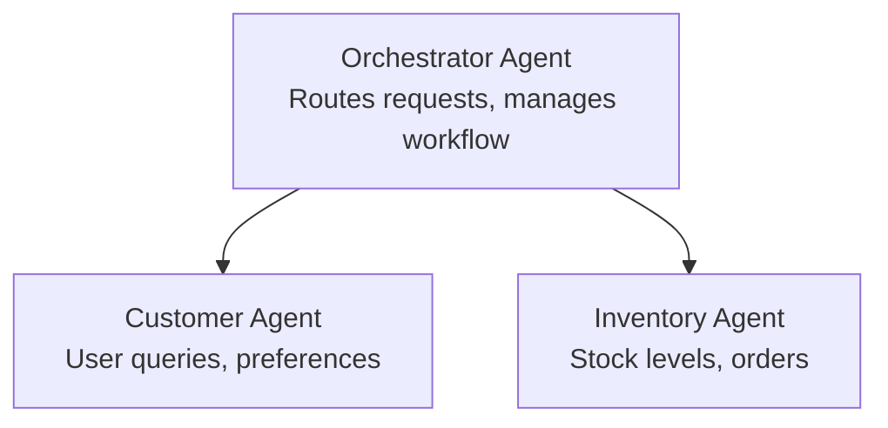

# Глава 5: Многоагентни AI решения

**📚 Курс**: [AZD за начинаещи](../../README.md) | **⏱️ Продължителност**: 2-3 часа | **⭐ Сложност**: Напреднали

---

## Преглед

Тази глава обхваща напреднали многоагентни архитектурни модели, координация на агенти и готови за производство AI внедрения за сложни сценарии.

> Насоки за команди, прегледани спрямо публикувания `azd 1.37.2` референтен материал. Внедрявания в облак не са изпълнявани.

## Учебни цели

След завършване на тази глава, ще можете:
- Да разбирате многоагентни архитектурни модели
- Да внедрявате координирани системи с AI агенти
- Да реализирате комуникация агент-агент
- Да изграждате готови за производство многоагентни решения

---

## 📚 Уроци

| # | Урок | Описание | Време |
|---|--------|-------------|------|
| 1 | [Основи на многоагентни системи](multi-agent-basics.md) | Практически: внедряване на работеща многоагентна апликация с `azd up` | 45 мин |
| 2 | [Координационни модели](../chapter-06-pre-deployment/coordination-patterns.md) | Стратегии за оркестрация на агенти (продължава в Глава 6) | 30 мин |
| 3 | [Внедряване с ARM шаблон](../../examples/retail-multiagent-arm-template/README.md) | Пример за внедряване с един клик | 30 мин |

> **Започнете с Урок 1.** Това е единственият напълно практически урок за внедряване в тази глава. Урок 2 е в Глава 6 (споделен с предварително планиране на внедрявания), а [Решението за търговия с много агенти](../../examples/retail-scenario.md) е архитектурен шаблон — дизайн справочник, не шаблон с една команда.

---

## 🚀 Бърз старт

```bash
# Option 1: Deploy the multi-agent template used in Lesson 1
azd init --template Azure-Samples/contoso-creative-writer .
azd up

# Option 2: Initialize a Foundry agent interactively (requires azure.ai.agents)
azd extension install azure.ai.agents
azd ai agent init
azd up
```

> **Кой подход?** Използвайте `azd init --template` за започване от работещ пример. Използвайте `azd ai agent init` интерактивно, или `azd ai agent init --template <path-to-azure.yaml>` за приемане на текущ агентски проект. Вижте [AZD AI CLI справочник](../chapter-08-production/production-ai-practices.md#azd-ai-cli-commands-and-extensions) за изисквания към версии и миграция при оценка.

Изпълнете тези алтернативи в отделни празни папки. Разширението за агенти `1.0.0-beta.23` изисква `azd >= 1.37.0`; интерактивният му поток не генерира потребителски Service Bus pipeline в координационния урок.

---

## 🤖 Многоагентна архитектура



---

## 🎯 Представено решение: Търговско многоагентно решение

Решението [Retail Multi-Agent Solution](../../examples/retail-scenario.md) демонстрира:

- **Агент за клиенти**: Обработва взаимодействията и предпочитанията на потребителя
- **Агент за наличности**: Управлява запасите и обработката на поръчките
- **Оркестратор**: Координира между агентите
- **Споделена памет**: Управление на контекста между агентите

### Използвани услуги

| Услуга | Цел |
|---------|---------|
| Microsoft Foundry Models | Разбиране на езика |
| Azure AI Search | Каталог на продукти |
| Cosmos DB | Състояние и памет на агентите |
| Container Apps | Хостинг на агентите |
| Application Insights | Наблюдение |

---

## 🔗 Навигация

| Посока | Глава |
|-----------|---------|
| **Предишна** | [Глава 4: Инфраструктура](../chapter-04-infrastructure/README.md) |
| **Следваща** | [Глава 6: Предварително внедряване](../chapter-06-pre-deployment/README.md) |

---

## 📖 Свързани ресурси

- [Ръководство за AI агенти](../chapter-02-ai-development/agents.md)
- [Практики за производство с AI](../chapter-08-production/production-ai-practices.md)
- [Отстраняване на проблеми с AI](../chapter-07-troubleshooting/ai-troubleshooting.md)

---

<!-- CO-OP TRANSLATOR DISCLAIMER START -->
**Отказ от отговорност**:
Този документ е преведен с помощта на AI преводачески услуга [Co-op Translator](https://github.com/Azure/co-op-translator). Въпреки че се стремим към точност, моля имайте предвид, че автоматизираните преводи могат да съдържат грешки или неточности. Оригиналният документ на неговия роден език трябва да се счита за авторитетен източник. За критична информация се препоръчва професионален човешки превод. Ние не носим отговорност за каквито и да е недоразумения или неправилни тълкувания, произтичащи от използването на този превод.
<!-- CO-OP TRANSLATOR DISCLAIMER END -->