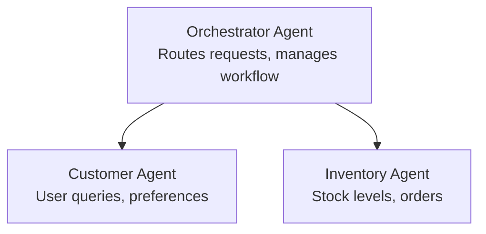

# Глава 5: Многоагентни AI решения

**📚 Курс**: [AZD за начинаещи](../../README.md) | **⏱️ Продължителност**: 2-3 часа | **⭐ Сложност**: Разширено

---

## Преглед

Тази глава разглежда усъвършенствани модели на многоагентна архитектура, оркестрация на агенти и AI внедрявания, готови за продуктивна среда при сложни сценарии.

> Ръководството за команди е прегледано спрямо издаденото `azd 1.37.2` референтно ръководство. Внедрявания в облака не са изпълнявани.

## Учебни цели

След завършване на тази глава, ще можете:
- Да разбирате модели на многоагентна архитектура
- Да внедрявате координирани системи от AI агенти
- Да реализирате комуникация агент-до-агент
- Да изграждате готови за производство многоагентни решения

---

## 📚 Уроци

| № | Урок | Описание | Време |
|---|--------|-------------|------|
| 1 | [Основи на многоагентните системи](multi-agent-basics.md) | Практика: разгръщане на работещо многоагентно приложение с `azd up` | 45 мин |
| 2 | [Координационни модели](../chapter-06-pre-deployment/coordination-patterns.md) | Стратегии за оркестрация на агенти (продължава в Глава 6) | 30 мин |
| 3 | [Внедряване с ARM шаблон](../../examples/retail-multiagent-arm-template/README.md) | Пример за внедряване с един клик | 30 мин |

> **Започнете с Урок 1.** Той е единственият изцяло практичен и разгръщаем урок в тази глава. Урок 2 е в Глава 6 (споделен с планиране преди внедряване), а [Ритейл многоагентното решение](../../examples/retail-scenario.md) е архитектурен модел — дизайн справочник, не шаблон с една команда.

---

## 🚀 Бърз старт

```bash
# Option 1: Deploy the multi-agent template used in Lesson 1
azd init --template Azure-Samples/contoso-creative-writer .
azd up

# Option 2: Initialize a Foundry agent interactively with the GA bundle
azd ext install microsoft.foundry
azd ai agent init
azd up
```

> **Кой подход?** Използвайте `azd init --template`, за да започнете с работещ пример. Използвайте `azd ai agent init` интерактивно или `azd ai agent init --template <path-to-azure.yaml>`, за да адаптирате текущ проект с агенти. Вижте [AZD AI CLI справочника](../chapter-08-production/production-ai-practices.md#azd-ai-cli-commands-and-extensions) за изисквания към версията и миграция при оценка.

Изпълнявайте тези алтернативи в отделни празни папки. Работният процес GA Foundry изисква `azd >= 1.37.0`; неговият интерактивен поток не генерира персонализирания Service Bus pipeline в урока за координация. За локално тестване, разгръщане на код и почистване при нови срещу използвани проекти, следвайте [ръководството за хоствани агенти](../chapter-02-ai-development/microsoft-foundry-integration.md#hosted-agent-walkthrough-ga).

---

## 🤖 Многоагентна архитектура



---

## 🎯 Представено решение: Ритейл многоагент

Решението [Retail Multi-Agent Solution](../../examples/retail-scenario.md) демонстрира:

- **Агент Клиент**: Управлява взаимодействията и предпочитанията на потребителя
- **Агент Запаси**: Управлява наличностите и обработката на поръчките
- **Оркестратор**: Координира между агентите
- **Споделена памет**: Управление на контекста между агентите

### Използвани услуги

| Услуга | Цел |
|---------|---------|
| Microsoft Foundry Models | Разбиране на езика |
| Azure AI Search | Каталог на продукти |
| Cosmos DB | Състояние и памет на агентите |
| Container Apps | Хостинг на агенти |
| Application Insights | Мониторинг |

---

## 🔗 Навигация

| Посока | Глава |
|-----------|---------|
| **Предишна** | [Глава 4: Инфраструктура](../chapter-04-infrastructure/README.md) |
| **Следваща** | [Глава 6: Предварително разгръщане](../chapter-06-pre-deployment/README.md) |

---

## 📖 Свързани ресурси

- [Ръководство за AI агенти](../chapter-02-ai-development/agents.md)
- [Практики за продуктивен AI](../chapter-08-production/production-ai-practices.md)
- [Отстраняване на проблеми с AI](../chapter-07-troubleshooting/ai-troubleshooting.md)

---

<!-- CO-OP TRANSLATOR DISCLAIMER START -->
**Отказ от отговорност**:
Този документ е преведен с помощта на AI преводачески услуга [Co-op Translator](https://github.com/Azure/co-op-translator). Въпреки че се стремим към точност, моля имайте предвид, че автоматизираните преводи могат да съдържат грешки или неточности. Оригиналният документ на неговия роден език трябва да се счита за авторитетен източник. За критична информация се препоръчва професионален човешки превод. Ние не носим отговорност за каквито и да е недоразумения или неправилни тълкувания, произтичащи от използването на този превод.
<!-- CO-OP TRANSLATOR DISCLAIMER END -->