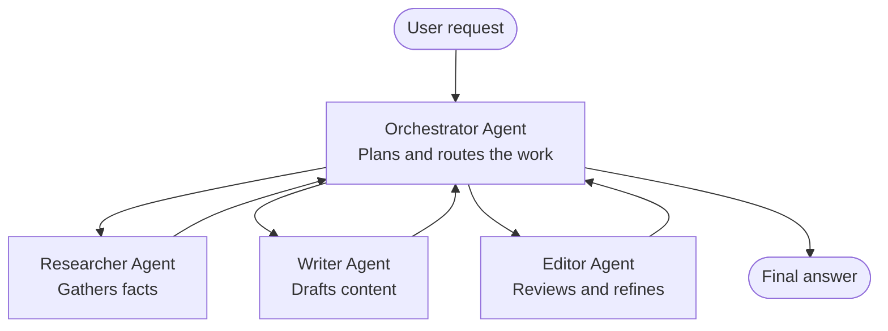

# Основи на Множество Агенти - Разгръщане на Вашата Първа Координирана AI Система

**Навигация в главата:**
- **📚 Начална страница на курса**: [AZD За Начинаещи](../../README.md)
- **📖 Текуща глава**: Глава 5 - Множество AI решения с агенти
- **⬅️ Предишна**: [Глава 4: Инфраструктура](../chapter-04-infrastructure/README.md)
- **➡️ Следваща**: [Патерни за Комуникация](../chapter-06-pre-deployment/coordination-patterns.md)

> Инструкциите са прегледани спрямо публикувания `azd 1.37.2` референтен материал. Облачни разгръщания не са изпълнени.

## Въведение

В по-ранните глави разгръщахте едно приложение — а в Глава 2 разгръщахте един AI агент. Този урок прави следващата стъпка: разгръщане на **мног агентна система**, където няколко специализирани агенти работят заедно, за да решат проблем, който един единствен агент не би могъл да се справи добре сам.

Добрата новина за начинаещите: **не ви трябват нови команди.** Мног агентното решение все още е azd проект. Ще `azd init`, `azd up`, тествате и `azd down` — точно работния поток, който вече знаете. Това, което се променя, е *формата* на приложението вътре.

## Цели на обучението

След края на този урок ще:
- Разберете какво означава "многоагентна" и кога си заслужава допълнителната сложност
- Разпознавате често срещаните роли в една мног агентна система (оркестратор + специалисти)
- Разгърнете реален, работещ мног агентен шаблон с `azd up`
- Разберете кои Azure ресурси поддържат мног агентно приложение
- Знаете как да проверите, персонализирате и изтриете решението безопасно

## Резултати от обучението

След завършване на урока ще можете да:
- Обясните разликата между един агент и мног агентна система
- Изберете между един агент с инструменти и истински мног агентен дизайн
- Разгърнете и тествате мног агентен шаблон изцяло с azd
- Идентифицирате къде работи всеки агент и как комуникират
- Почистите всички ресурси, за да избегнете допълнителни такси

---

## Какво е Мног Агентна Система?

Един AI агент е един модел с набор от инструкции и (по избор) някои инструменти. Това работи добре за фокусирани задачи. Но с разрастване на задачата — проучване, след това писане, след това редактиране, после проверка на фактите — побирането на всичко в един промпт прави агента по-бавен, по-малко надежден и по-труден за отстраняване на грешки.

Една **мног агентна система** разделя работата на специалисти, които всяки вършат по една работа добре, координирани от оркестратор:



### Двете роли, които винаги ще видите

| Роля | Задача | Пример |
|------|-----|---------|
| **Оркестратор** | Решава *какво следва* и насочва работата между агентите | "Първо проучване, после писане, после редактиране" |
| **Специалист** | Прави една фокусирана работа и връща резултат | "изследовател", който само събира факти |

### Наистина ли имате нужда от множество агенти?

Започнете просто. Обърнете се към мног агентен подход **само** когато е вярно едно от следните:

- ✅ Задачата има **отделни етапи**, които биха се възползвали от различни инструкции (проучване срещу писане срещу преглед)
- ✅ Искате специалистите да работят **паралелно**, за да спестите време
- ✅ Различните стъпки имат нужда от **различни инструменти или източници на данни**
- ✅ Имате нужда всяка стъпка да е **независимо тествана и отстраняваща грешки**

Ако задачата ви е един прост въпрос и отговор или просто повикване на инструмент, **един агент с инструменти** (Глава 2) е по-прост, по-евтин и по-лесен за управление.

> **Съвет за начинаещи:** "Повече агенти" не означава "по-добре." Всеки агент добавя забавяне, разходи и ново нещо за наблюдение. Добавяйте агенти само когато проблемът ясно се дели на части.

---

## Два начина за изграждане на мног агентна система в Azure

| Подход | Какво представлява | Най-подходящ за |
|----------|-----------|----------|
| **Един агент + инструменти** | Един Foundry агент, който извиква функции/инструменти | Прости работни потоци, начало за начинаещи |
| **Множество координирани агенти** | Няколко агенти с оркестратор | Отделни етапи, паралелна работа, специализация |

Този урок се фокусира върху втория подход с помощта на **готов шаблон**, за да видите реална мног агентна система в действие преди да изградите собствена.

---

## Практическо: Разгръщане на Работещо Мног Агентно Приложение

Ще разположим **Contoso Creative Writer**, официален пример от Azure, който координира изследователски, продуктови, писателски и редакторски агенти за създаване на статия. Преди да продължите, проверете [предварителните изисквания и разходи на примера](https://github.com/Azure-Samples/contoso-creative-writer#azure-account-requirements): той изисква квота за модели, Azure AI Search, достъп до Bing Grounding, Python, Docker и Bash съвместими куки. Наличността на модели и регион зависи от вашия абонамент; разгръщането не е гарантирано с избор на конкретен регион.

### Стъпка 1: Инициализиране на шаблона

```bash
# Create a working folder
mkdir creative-writer && cd creative-writer

# Initialize from the official multi-agent template
azd init --template Azure-Samples/contoso-creative-writer .
```

> Разгледайте повече мног агентни шаблони по всяко време в [Прекрасната галерия на AZD AI](https://azure.github.io/awesome-azd/?tags=ai). Други опции за начинаещи включват `get-started-with-ai-agents` и `azure-ai-travel-agents`.

### Стъпка 2: Автентикация

```bash
# Required for azd workflows
azd auth login

# Also required by this sample's Azure CLI hooks
az login
```

### Стъпка 3: Проверка на средата

```bash
# init normally creates/selects an environment; confirm it before proceeding
azd env list
# Only if you need an additional environment:
# azd env new dev
```

### Стъпка 4: Преглед и след това разгръщане

```bash
# See what will be created before spending anything (recommended)
azd provision --preview

# Provision infrastructure and deploy all agents in one step
azd up
```

`azd up` ще поиска липсващи настройки за абонамента и региона, след което ще осигури ресурсите и ще разположи приложението. Прегледът не резервира квота и не гарантира успех; куки на шаблона може да се изпълняват и при преглед на осигуряването, затова ги проверете първо. За удължаване на времето за изчакване на всяко **разгръщане на услуга** (не осигуряване на модел):

```bash
azd deploy --timeout 1800
```

Времето за изчакване спира чакането на azd; то не отменя разгръщането в Azure. Проверете състоянието на ресурса преди да опитате отново.

> **Внимание за разходи и капацитет:** Мног агентните приложения разгръщат AI модели, които консумират квота и създават разходи. Ако `azd up` не успее поради квота за модел, вижте [Отстраняване на проблеми с AI](../chapter-07-troubleshooting/ai-troubleshooting.md) за корекции на регион и квота, и Глава 6 [Планиране на капацитет](../chapter-06-pre-deployment/capacity-planning.md).

---

## Разбиране на Разгърнатото

Типичното мног агентно приложение като това осигурява набор от Azure ресурси, които съответстват директно на отговорностите в горната диаграма:

| Ресурс | Защо е там |
|----------|----------------|
| **Microsoft Foundry / Модели** | Хоства езиковите модели, които използва всеки агент |
| **Azure AI Search** | Дава на изследователя агент укрепени данни за търсене |
| **Container Apps** (или App Service) | Хоства кода на оркестратора и агентите |
| **Cosmos DB** (в някои примери) | Съхранява споделено състояние/памет, предавана между агентите |
| **Application Insights** | Следи заявките *през* агентите, за да можеш да дебъгваш потока |

### Как агентите комуникират помежду си

В повечето примери с няколко агента в azd, **оркестраторът работи във вашия приложен код** (например, използвайки рамка като Semantic Kernel или Microsoft Agent Framework). Оркестраторът извиква всеки специализиран агент последователно, предава резултатите и сглобява окончателния отговор. Агентите споделят контекста чрез:

- **Извиквания на функции/инструменти** — оркестраторът извиква специалист и получава резултат обратно
- **Споделена памет** — база данни (често Cosmos DB) държи състояние, което и двата агента могат да четат
- **Съобщения/събития** — за по-слаба връзка, агентите комуникират чрез опашка или Service Bus

> **Защо това е важно при дебъгване:** тъй като всяка стъпка е отделна, Application Insights показва *кой* агент е бил бавен или е неуспешен. Това е основната причина да се раздели работата между агентите първоначално.

---

## Потвърди Деплоймънта

Увери се, че системата наистина работи преди да продължиш:

```bash
# Show the deployed endpoints
azd show

# Open the app's monitoring dashboard
azd monitor

# Open Application Insights Logs (not a terminal log stream)
azd monitor --logs
```

След това отвори URL адреса на приложението от `azd show` и поискай кратка статия. Използвай debug изгледа на примера, за да инспектираш работния процес на агентите. Търсенето на транзакции в Application Insights може да покаже отделните стъпки само ако примерът ги инструментира и корелира; azd не добавя автоматично agent spans.

**Критерии за успех:**
- ✅ `azd show` изброява достъпна крайна точка
- ✅ Заявката произвежда резултат, който ясно преминава през няколко етапа
- ✅ Debug изгледът показва множество стъпки на агентите; ако проследяването е активирано, провери съответната телеметрия след събиране

---

## Персонализирай: Добави или Настрой Агент

Тъй като всеки агент е просто инструкции плюс инструменти, персонализирането е достъпно:

1. **Намери дефинициите на агентите** в шаблона (често набор от файлове `prompts/`, `agents/`, или `*.prompty`).
2. **Настрой инструкциите на агента** — например, кажи на редакторския агент да спазва определен тон или брой думи.
3. **Деплойни само кода** (инфраструктурата остава непроменена):

   ```bash
   azd deploy
   ```

За да продължиш с твой *собствен* Foundry агент проект, използвай интерактивната инициализация на агента:

```bash
azd extension install azure.ai.agents
azd ai agent init
azd up
azd ai agent invoke      # test, with response timing
```

Виж [Глава 2: Агентите](../chapter-02-ai-development/agents.md) и [AZD AI CLI справката](../chapter-08-production/production-ai-practices.md#azd-ai-cli-commands-and-extensions) за пълния жизнен цикъл: агент `invoke`, отделното разширение за оценки `azd ai eval` работен процес, агент `optimize` и агент `delete`.

---

## Изчисти

Мулти-агент приложенията работят няколко таксувани услуги. Разглоби всичко когато свършиш:

```bash
# Review the resources and confirm deletion interactively
azd down
```

Изтриването е разрушително. За еднократно лабораторно упражнение, `azd down --force --purge` прескача изтриването и поддръжката на потвърждения за софт-изтриване; изтриването е необратимо, където е поддържано и може да бъде блокирано от защита срещу изтриване. Софт изтриването е въпрос на възстановяване/повторно използване на имена, не е само по себе си доказателство за текущи такси. Провери задържани ресурси и таксуване след почистване.

---

## Бележка за производствени мулти-агент системи

Решението [Retail Multi-Agent Solution](../../examples/retail-scenario.md) в този репозиторий е **архитектурен план**, не шаблон с една команда — то документира как *би* бил изграден производствен търговски система (и изрично посочва, че пълното изграждане е значително усилие). Използвайте го като дизайн справочник *след* като внедрите работещ пример тук. За производствени въпроси (устойчивост, разходи, наблюдение, управление), продължете към [глава 8: Практики при производствен AI](../chapter-08-production/production-ai-practices.md).

---

## Резюме

- Многопотребителската система разделя работа между специалисти, координирани от оркестратор.
- Използвайте я само когато задачата има различни етапи, паралелизъм или различни инструменти за всеки етап — в противен случай предпочитайте един агент.
- Работният поток на azd остава непроменен: `azd init` → `azd up` → тест → `azd down`.
- Истински шаблон като `contoso-creative-writer` ви позволява да видите и персонализирате работеща многопотребителска апликация днес.
- Проследяването с Application Insights през агентите е едно от най-големите практични предимства на дизайна с много агенти.

---

## 🔗 Навигация

| Посока | Урок |
|-----------|--------|
| **Предишен** | [Глава 4: Инфраструктура](../chapter-04-infrastructure/README.md) |
| **Следващ** | [Координационни модели](../chapter-06-pre-deployment/coordination-patterns.md) |

## 📖 Свързани ресурси

- [Ръководство за AI агенти](../chapter-02-ai-development/agents.md)
- [Координационни модели](../chapter-06-pre-deployment/coordination-patterns.md)
- [Практики при производствен AI](../chapter-08-production/production-ai-practices.md)
- [Отстраняване на проблеми с AI](../chapter-07-troubleshooting/ai-troubleshooting.md)

---

<!-- CO-OP TRANSLATOR DISCLAIMER START -->
**Отказ от отговорност**:
Този документ е преведен с помощта на AI преводачески услуга [Co-op Translator](https://github.com/Azure/co-op-translator). Въпреки че се стремим към точност, моля имайте предвид, че автоматизираните преводи могат да съдържат грешки или неточности. Оригиналният документ на неговия роден език трябва да се счита за авторитетен източник. За критична информация се препоръчва професионален човешки превод. Ние не носим отговорност за каквито и да е недоразумения или неправилни тълкувания, произтичащи от използването на този превод.
<!-- CO-OP TRANSLATOR DISCLAIMER END -->