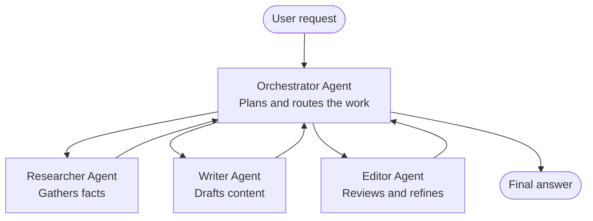

# Основи на многоагентните системи - Разположете първата си координирана AI система

**Навигация в главата:**
- **📚 Начало на курса**: [AZD за начинаещи](../../README.md)
- **📖 Текуща глава**: Глава 5 - Многоагентни AI решения
- **⬅️ Предишна**: [Глава 4: Инфраструктура](../chapter-04-infrastructure/README.md)
- **➡️ Следваща**: [Координационни модели](../chapter-06-pre-deployment/coordination-patterns.md)

> Насоки за команди, проверени спрямо публикувания `azd 1.37.2` справочник. Облачни разгръщания не са изпълнявани.

## Въведение

В по-ранните глави разположихте едно приложение — а в Глава 2 разположихте един AI агент. Този урок прави следващата стъпка: разполагате **многоагентна система**, където няколко специализирани агента работят заедно, за да решат проблем, който нито един агент сам не би могъл добре да се справи.

Добрата новина за начинаещите: **не ви трябват нови команди.** Многоагентното решение все още е azd проект. Ще `azd init`, `azd up`, тествате и `azd down` — точно работния процес, който вече познавате. Промяната е в *формата* на приложението отвътре.

## Цели на обучението

В края на този урок ще:
- Разберете какво означава "многоагентен" и кога си заслужава допълнителната сложност
- Разпознавате общите роли в многоагентна система (оркестратор + специалисти)
- Разположите реален, работещ многоагентен шаблон с `azd up`
- Разберете какви Azure ресурси подкрепят многоагентното приложение
- Знаете как да проверите, персонализирате и обезопасите решението след употреба

## Резултати от обучението

След завършване на урока ще можете:
- Да обясните разликата между единичен агент и многоагентна система
- Да изберете между единичен агент с инструменти и истински многоагентен дизайн
- Да разположите и тествате многоагентен шаблон цялостно с azd
- Да разпознаете къде работи всеки агент и как комуникират
- Да изчистите всички ресурси, за да избегнете текущи разходи

---

## Какво е многоагентна система?

Един AI агент представлява един модел с набор от инструкции и (по избор) някои инструменти. Това работи добре за фокусирани задачи. Но когато задачата расте — проучване, след това писане, редактиране, проверка на факти — побирането на всичко в един единствен подканващ текст прави агента по-бавен, по-малко надежден и по-труден за отстраняване на грешки.

**Многоагентна система** разделя работата на специалисти, които всеки вършат една задача добре, координирани от оркестратор:



### Двете роли, които винаги ще видите

| Роля | Задача | Пример |
|------|-----|---------|
| **Оркестратор** | Решава *какво става следващо* и насочва работата между агентите | "Първо проучване, после писане, после редактиране" |
| **Специалист** | Извършва една конкретна задача и връща резултат | "Изследовател", който събира само факти |

### Действително ли ви трябват множество агенти?

Започнете просто. Вземете многоагентен **само ако** едно от следните е вярно:

- ✅ Задачата има **отделни етапи**, които се възползват от различни инструкции (проучване срещу писане срещу преглед)
- ✅ Искате специалистите да работят **паралелно**, за да спестите време
- ✅ Различните стъпки изискват **различни инструменти или източници на данни**
- ✅ Искате всяка стъпка да е **независимо тестируема и отстраняваема на грешки**

Ако задачата ви е единствен въпрос и отговор или обикновено извикване на инструмент, **единичен агент с инструменти** (Глава 2) е по-прост, по-евтин и по-лесен за опериране.

> **Съвет за начинаещи:** „Повече агенти“ не означава „по-добре.“ Всеки агент добавя забавяне, разход и ново нещо за мониторинг. Добавяйте агенти само когато проблемът ясно се разделя на части.

---

## Два начина да създадете многоагентно решение в Azure

| Подход | Какво представлява | Най-подходящ за |
|----------|-----------|----------|
| **Един агент + инструменти** | Един Foundry агент, който извиква функции/инструменти | Прости работни потоци, начало |
| **Несколько координирани агенти** | Няколко агента с оркестратор | Ясно разграничени етапи, паралелна работа, специализация |

Този урок се фокусира върху втория подход с използването на **готов шаблон**, така че да видите реална многоагентна система в действие, преди да създадете своя собствена.

---

## Практика: Разположете работещо многоагентно приложение

Ще разположим **Contoso Creative Writer**, официален пример от Azure, който координира агенти за проучване, продукт, писане и редактиране, за да създаде статия. Преди да продължите, проверете [предварителните изисквания и разходи на примера](https://github.com/Azure-Samples/contoso-creative-writer#azure-account-requirements): необходими са квота за модели, Azure AI Search, достъп до Bing Grounding, Python, Docker и Bash-съвместими hooks. Наличността на модели и региони зависи от вашия абонамент; разполагането не е гарантирано при избор на определен регион.

### Стъпка 1: Инициализирайте шаблона

```bash
# Create a working folder
mkdir creative-writer && cd creative-writer

# Initialize from the official multi-agent template
azd init --template Azure-Samples/contoso-creative-writer .
```

> Разгледайте още многоагентни шаблони по всяко време в [Галерията Awesome AZD AI](https://azure.github.io/awesome-azd/?tags=ai). Други възможности подходящи за начинаещи включват `get-started-with-ai-agents` и `azure-ai-travel-agents`.

### Стъпка 2: Автентикация

```bash
# Required for azd workflows
azd auth login

# Also required by this sample's Azure CLI hooks
az login
```

### Стъпка 3: Проверка на средата

```bash
# init normally creates/selects an environment; confirm it before proceeding
azd env list
# Only if you need an additional environment:
# azd env new dev
```

### Стъпка 4: Преглед и след това разполагане

```bash
# See what will be created before spending anything (recommended)
azd provision --preview

# Provision infrastructure and deploy all agents in one step
azd up
```

`azd up` ще поиска липсващите настройки за абонамент и регион, след което ще създаде ресурсите и ще разположи приложението. Прегледът не резервира квота и не гарантира успех; hooks от шаблона могат да се изпълняват по време на преглеждането на разполагането, така че ги прегледайте предварително. За да удължите времето за чакане на azd за всяко **разполагане на услуга** (не за модели):

```bash
azd deploy --timeout 1800
```

Таймаутът спира чакането на azd; не отменя разполагането в Azure. Проверете състоянието на ресурса преди повторен опит.

> **Важна информация за разходи и капацитет:** Многоагентните приложения разполагат AI модели, които използват квота и носят разходи. Ако `azd up` не успее поради липса на квота за модел, вижте [Отстраняване на проблеми с AI](../chapter-07-troubleshooting/ai-troubleshooting.md) за решения за регион и квота, както и Глава 6 [Планиране на капацитет](../chapter-06-pre-deployment/capacity-planning.md).

---

## Разбиране на това, което разположихте

Типично многоагентно приложение като това създава набор от Azure ресурси, които съответстват директно на отговорностите от диаграмата по-горе:

| Ресурс | Защо е там |
|----------|----------------|
| **Microsoft Foundry / Модели** | Хоства езиковите модели, които използва всеки агент |
| **Azure AI Search** | Осигурява на агента-изследовател надеждни данни за търсене |
| **Container Apps** (или App Service) | Хоства кода на оркестратора и агентите |
| **Cosmos DB** (в някои примери) | Съхранява споделеното състояние/памет между агентите |
| **Application Insights** | Проследява заявките *през* агентите за дефиниране на грешки |

### Как агентите комуникират помежду си

В повечето многоагентни azd примери, **оркестраторът работи във вашия код на приложението** (например с рамка като Semantic Kernel или Microsoft Agent Framework). Оркестраторът извиква всеки специалист по ред, подава резултатите и събира крайния отговор. Агентите споделят контекст чрез:

- **Извикване на функции/инструменти** — оркестраторът извиква специалист и получава резултат
- **Споделена памет** — база данни (често Cosmos DB) държи състояние, което и двата агента могат да четат
- **Съобщения/събития** — за по-слаба връзка, агентите комуникират чрез опашка или Service Bus

> **Защо това е важно за отстраняване на грешки:** защото всяка стъпка е отделна, Application Insights показва *кой* агент е бил бавен или е допуснал грешка. Това е основна причина за разделяне на работата между агенти.

---

## Проверете разполагането

Потвърдете, че системата наистина работи, преди да продължите:

```bash
# Show the deployed endpoints
azd show

# Open the app's monitoring dashboard
azd monitor

# Open Application Insights Logs (not a terminal log stream)
azd monitor --logs
```

След това отворете URL адреса на приложението от `azd show` и поискайте кратка статия. Използвайте изгледа за отстраняване на грешки на примера, за да разгледате работния поток на агента. Търсенето на транзакции в Application Insights може да покаже отделните стъпки само ако примерът ги инструктира и корелира; azd не добавя автоматично агентски интервали.

**Критерии за успех:**
- ✅ `azd show` изброява достъпен крайна точка
- ✅ Заявка произвежда резултат, който ясно преминава през няколко етапа
- ✅ Изгледът за отстраняване на грешки показва множество агентски стъпки; ако трасето е активирано, проверете съответната телеметрия след приемане

---

## Персонализиране: Добавяне или настройка на агент

Тъй като всеки агент е просто инструкции плюс инструменти, персонализирането е достъпно:

1. **Намерете дефинициите на агента** в шаблона (често набор от файлове `prompts/`, `agents/` или `*.prompty`).
2. **Настройте инструкциите на агент** — например, кажете на агента редактор да налага конкретен тон или брой думи.
3. **Препубликувайте само кода** (инфраструктурата остава непроменена):

   ```bash
   azd deploy
   ```

За да продължите с *собствен* проект на Foundry агент, използвайте GA пакета с AZD 1.37.0+ в отделна празна директория:

```bash
azd ext install microsoft.foundry
azd ai agent init
azd up
azd ai agent invoke      # test, with response timing
```

Вижте [GA hosted-agent walkthrough](../chapter-02-ai-development/microsoft-foundry-integration.md#hosted-agent-walkthrough-ga) за локално тестване на Agent Inspector, дистанционно публикуване на код и изчистване на собствеността. Също така [AZD AI CLI справка](../chapter-08-production/production-ai-practices.md#azd-ai-cli-commands-and-extensions) обхваща отделното разширение за оценки, оптимизация и изтриване на агент.

---

## Изчистване

Многоагентските приложения стартират няколко таксувани услуги. Демонтирайте всичко, когато сте готови:

```bash
# Review the resources and confirm deletion interactively
azd down
```

Изтриването е разрушително. За лаборатория, която може да се изхвърли, `azd down --force --purge` пропуска потвържденията за меко изтриване и подкрепя потвърждения за почистване; изчистването е необратимо, където е поддържано, и може да бъде блокирано от защита срещу почистване. Мекото изтриване е въпрос на възстановяване/повторно използване на имена, а не само доказателство за текущи такси. Проверете за запазени ресурси и таксуване след почистване.

Ако сте инициализирали хостван агент срещу съществуващ проект Foundry, `azd down` оставя агента на този проект и други ресурси на място. Премахнете само нежелани ресурси, които притежавате сами. За нов проект Foundry, създаден чрез неговата AZD среда, `azd down` изтрива групата с ресурси и всичко в нея.

---

## Забележка за производствени многоагентски системи

Решението [Retail Multi-Agent Solution](../../examples/retail-scenario.md) в това хранилище е **архитектурен план**, а не шаблон с една команда — то документира как *би* изглеждала една производствена търговска система (и изрично посочва, че пълната й изградба е значително усилие). Използвайте го като референтен дизайн *след* като сте разположили работещ пример тук. За производствени въпроси (устойчивост, разходи, мониторинг, управление), продължете към [Глава 8: Практики за производство на AI](../chapter-08-production/production-ai-practices.md).

---

## Резюме

- Мултиагентна система разделя работата между специалисти, координирани от оркестратор.
- Използвайте я само когато задачата има различни етапи, паралелизъм или различни инструменти за всяка стъпка — в противен случай предпочитайте един агент.
- Работният процес на azd остава непроменен: `azd init` → `azd up` → test → `azd down`.
- Реален шаблон като `contoso-creative-writer` ви позволява днес да видите и персонализирате работещо мултиагентно приложение.
- Трасировката на Application Insights между агентите е едно от най-големите практически предимства на мултиагентния дизайн.

---

## 🔗 Навигация

| Посока | Урок |
|-----------|--------|
| **Предишен** | [Глава 4: Инфраструктура](../chapter-04-infrastructure/README.md) |
| **Следващ** | [Модели на координация](../chapter-06-pre-deployment/coordination-patterns.md) |

## 📖 Свързани ресурси

- [Ръководство за AI агенти](../chapter-02-ai-development/agents.md)
- [Модели на координация](../chapter-06-pre-deployment/coordination-patterns.md)
- [Практики за продуктивен AI](../chapter-08-production/production-ai-practices.md)
- [Отстраняване на проблеми с AI](../chapter-07-troubleshooting/ai-troubleshooting.md)

---

<!-- CO-OP TRANSLATOR DISCLAIMER START -->
**Отказ от отговорност**:
Този документ е преведен с помощта на AI преводачески услуга [Co-op Translator](https://github.com/Azure/co-op-translator). Въпреки че се стремим към точност, моля имайте предвид, че автоматизираните преводи могат да съдържат грешки или неточности. Оригиналният документ на неговия роден език трябва да се счита за авторитетен източник. За критична информация се препоръчва професионален човешки превод. Ние не носим отговорност за каквито и да е недоразумения или неправилни тълкувания, произтичащи от използването на този превод.
<!-- CO-OP TRANSLATOR DISCLAIMER END -->