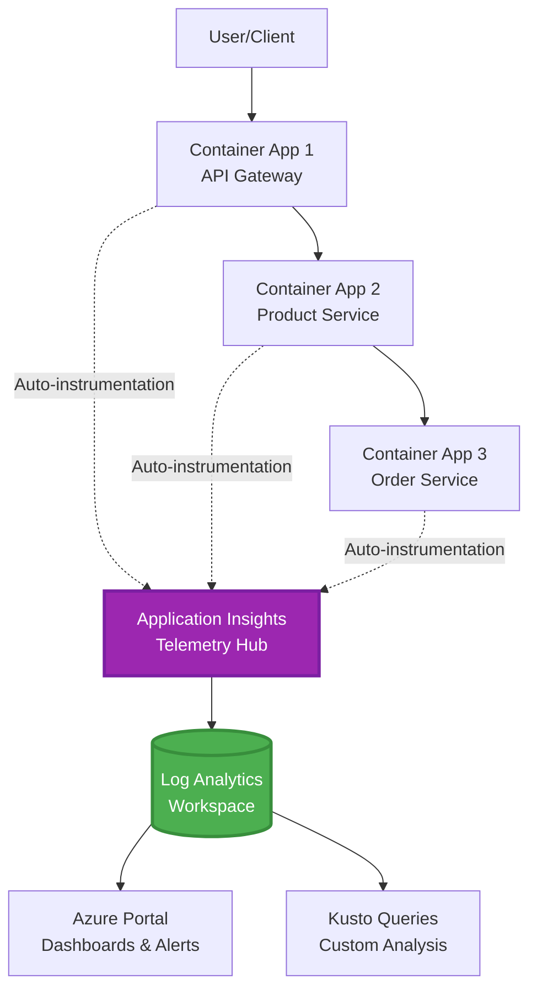
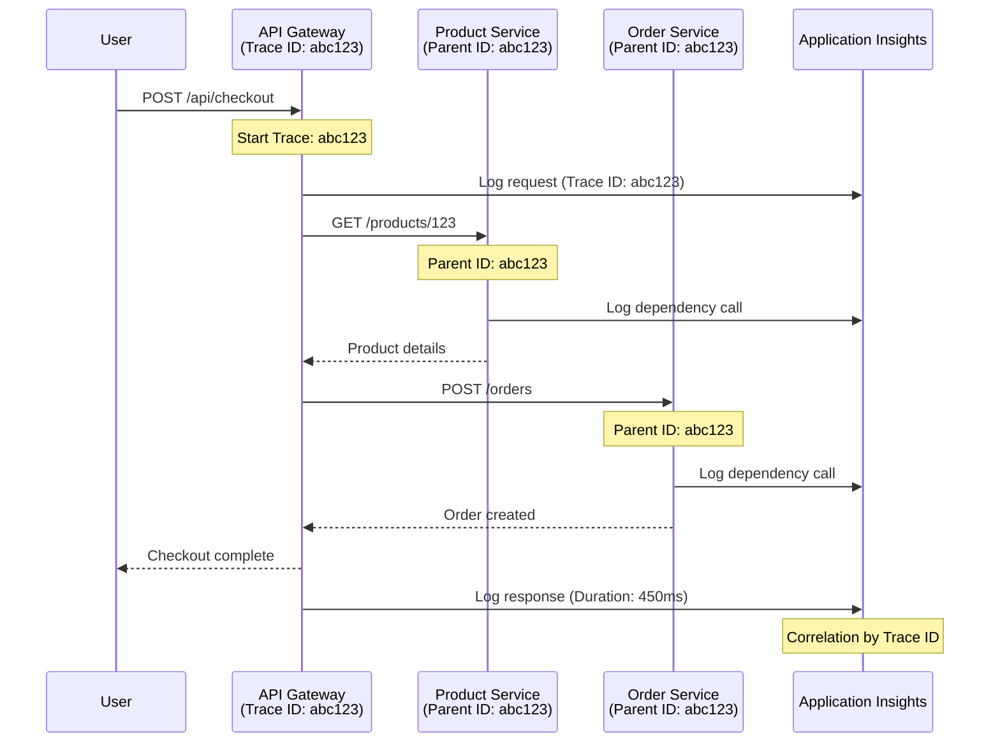

# Интеграция на Application Insights с AZD

⏱️ **Очаквано време**: 40-50 минути | 💰 **Влияние върху разходите**: ~$5-15/месец | ⭐ **Сложност**: Междинно

**📚 Образователен път:**
- ← Предишен: [Проверки преди стартиране](preflight-checks.md) - Валидация преди внедряване
- 🎯 **Вие сте тук**: Интеграция на Application Insights (Мониторинг, телеметрия, отстраняване на грешки)
- → Следващ: [Ръководство за внедряване](../chapter-04-infrastructure/deployment-guide.md) - Внедряване в Azure
- 🏠 [Начало на курса](../../README.md)

---

## Какво ще научите

След завършване на този урок ще:
- Декларирате **Application Insights** в инфраструктурата на AZD и конфигурирате SDK инструментариум
- Конфигурирате **разпределено проследяване** за микросервизи
- Изпълните **персонализирана телеметрия** (метрики, събития, зависимости)
- Настроите **живи метрики** за мониторинг в реално време
- Създадете **сигнали и табла за управление** от разгръщанията с AZD
- Отстранявате проблеми в продукцията с **заявки за телеметрия**
- Оптимизирате **разходите и стратегиите за проби**
- Следите **приложения с AI/LLM** (токени, латентност, разходи)

## Защо Application Insights с AZD е важно

### Предизвикателството: Наблюдаемост в продукция

**Без Application Insights:**
```
❌ No visibility into production behavior
❌ Manual log aggregation across services
❌ Reactive debugging (wait for customer complaints)
❌ No performance metrics
❌ Cannot trace requests across services
❌ Unknown failure rates and bottlenecks
```

**С Application Insights + AZD:**
```
✅ Automatic telemetry collection
✅ Centralized logs from all services
✅ Proactive issue detection
✅ End-to-end request tracing
✅ Performance metrics and insights
✅ Real-time dashboards
✅ AZD provisions the monitoring declared in your templates
```

**Аналогия**: Application Insights е като да имате "черна кутия" за полетен записвач + табло в пилотската кабина за вашето приложение. Виждате всичко, което се случва в реално време, и можете да пресъздадете всеки инцидент.

---

## Преглед на архитектурата

### Application Insights в архитектурата на AZD



### Какво се мониторира автоматично

Поддържаната автоинструментация улавя заявки/зависимости за инструментализирани библиотеки. Персонализирани събития и метрики изискват код на приложението; тестове за достъпност трябва да се конфигурират отделно. Не събира всяка поднизка по-долу просто защото ресурсът съществува.

| Тип телеметрия | Какво улавя | Сценарий за използване |
|----------------|-------------|---------------------|
| **Заявки** | HTTP заявки, статус кодове, продължителност | Мониторинг на производителността на API |
| **Зависимости** | Външни повиквания (БД, API, съхранение) | Идентифициране на бутилки за песъчинки |
| **Изключения** | Непрегледани грешки с стек трасиране | Отстраняване на неизправности |
| **Персонализирани събития** | Събития свързани с бизнеса (регистрация, покупка) | Анализи и фунии |
| **Метрики** | Броячи за производителност, персонализирани метрики | Планиране на капацитет |
| **Трейсове** | Лог съобщения със сериозност | Отстраняване на грешки и одит |
| **Достъпност** | Тестове за време на работа и време за отговор | Мониторинг на SLA |

---

## Предварителни изисквания

### Необходими инструменти

```bash
# Verify Azure Developer CLI
azd version
# Command reference baseline: azd 1.37.2

# Verify Azure CLI
az --version
# ✅ Expected: azure-cli 2.50.0 or higher
```

### Изисквания за Azure

- Активен Azure абонамент
- Разрешения за създаване на:
  - Ресурси за Application Insights
  - Работни пространства за Log Analytics
  - Контейнер приложения
  - Ресурсни групи

### Предварителни знания

Трябва да сте завършили:
- [Основи на AZD](../chapter-01-foundation/azd-basics.md) - Основни концепции на AZD
- [Конфигурация](../chapter-03-configuration/configuration.md) - Настройка на среда
- [Първи проект](../chapter-01-foundation/first-project.md) - Основно внедряване

---

## Урок 1: Автоматичен Application Insights с AZD

### Как AZD осигурява Application Insights

AZD осигурява Application Insights **само когато инфраструктурата на проекта го декларира**. `azure.yaml` сам по себе си не създава мониторинг или не инструктира приложенческия код.

> **Примерен обхват:** Този урок съдържа интеграционни фрагменти, а не пълен проект `monitored-app` в това хранилище. Осигурете главен шаблон и мапинг на параметри, среда за Контейнер приложения, конфигурация на регистър/образ и идентичност, Dockerfile и тагове за услуги преди внедряване. По-късните уроци показват алтернативни/разширителни фрагменти, а не файлове, които могат всички да се поставят заедно непроменени. Започнете с работещ [пример за микросервизи](../../../../examples/microservices), ако имате нужда от изпълним базисен код.

### Структура на проекта

```
monitored-app/
├── azure.yaml                     # AZD configuration
├── infra/
│   ├── main.bicep                # Main infrastructure
│   ├── core/
│   │   └── monitoring.bicep      # Application Insights + Log Analytics
│   └── app/
│       └── api.bicep             # Container App with monitoring
└── src/
    ├── app.py                    # Application with telemetry
    ├── requirements.txt
    └── Dockerfile
```

---

### Стъпка 1: Конфигуриране на AZD (azure.yaml)

**Файл: `azure.yaml`**

```yaml
name: monitored-app
metadata:
  template: monitored-app@1.0.0

services:
  api:
    project: ./src
    language: python
    host: containerapp

# Monitoring must be declared in infra/ and enabled in application code.
```

Това декларира разгръщаемата услуга. Следващата Bicep и SDK конфигурация осигуряват мониторинг; azd не ги добавя имплицитно.

---

### Стъпка 2: Инфраструктура за мониторинг (Bicep)

**Файл: `infra/core/monitoring.bicep`**

```bicep
param logAnalyticsName string
param applicationInsightsName string
param location string = resourceGroup().location
param tags object = {}

// Log Analytics Workspace (required for Application Insights)
resource logAnalytics 'Microsoft.OperationalInsights/workspaces@2022-10-01' = {
  name: logAnalyticsName
  location: location
  tags: tags
  properties: {
    sku: {
      name: 'PerGB2018'  // Pay-as-you-go pricing
    }
    retentionInDays: 30  // Keep logs for 30 days
    features: {
      enableLogAccessUsingOnlyResourcePermissions: true
    }
  }
}

// Application Insights
resource applicationInsights 'Microsoft.Insights/components@2020-02-02' = {
  name: applicationInsightsName
  location: location
  tags: tags
  kind: 'web'
  properties: {
    Application_Type: 'web'
    WorkspaceResourceId: logAnalytics.id
    IngestionMode: 'LogAnalytics'
    publicNetworkAccessForIngestion: 'Enabled'
    publicNetworkAccessForQuery: 'Enabled'
  }
}

// Outputs for Container Apps
output logAnalyticsWorkspaceId string = logAnalytics.id
output logAnalyticsWorkspaceName string = logAnalytics.name
output applicationInsightsConnectionString string = applicationInsights.properties.ConnectionString
output applicationInsightsInstrumentationKey string = applicationInsights.properties.InstrumentationKey
output applicationInsightsName string = applicationInsights.name
output applicationInsightsId string = applicationInsights.id
```

---

### Стъпка 3: Свържете Контейнерното приложение към Application Insights

**Файл: `infra/app/api.bicep`**

```bicep
param name string
param location string
param tags object = {}
param containerAppsEnvironmentId string
param containerImage string
param applicationInsightsConnectionString string

resource containerApp 'Microsoft.App/containerApps@2023-05-01' = {
  name: name
  location: location
  tags: tags
  properties: {
    managedEnvironmentId: containerAppsEnvironmentId
    configuration: {
      ingress: {
        external: true
        targetPort: 8000
      }
      secrets: [
        {
          name: 'appinsights-connection-string'
          value: applicationInsightsConnectionString
        }
      ]
    }
    template: {
      containers: [
        {
          name: 'api'
          image: containerImage // Supply an accessible image and registry authentication
          resources: {
            cpu: json('0.5')
            memory: '1Gi'
          }
          env: [
            {
              name: 'APPLICATIONINSIGHTS_CONNECTION_STRING'
              secretRef: 'appinsights-connection-string'
            }
            {
              name: 'APPLICATIONINSIGHTS_ENABLED'
              value: 'true'
            }
          ]
        }
      ]
    }
  }
}

output uri string = 'https://${containerApp.properties.configuration.ingress.fqdn}'
```

---

### Стъпка 4: Код на приложението с телеметрия

**Файл: `src/app.py`**

```python
from flask import Flask, request, jsonify
from azure.monitor.opentelemetry import configure_azure_monitor
import logging
import os

app = Flask(__name__)

# Get Application Insights connection string
connection_string = os.environ.get('APPLICATIONINSIGHTS_CONNECTION_STRING')

if connection_string:
    # Azure Monitor OpenTelemetry instruments supported libraries, including Flask.
    configure_azure_monitor(
        connection_string=connection_string,
        logger_name=__name__,
        enable_live_metrics=True
    )
    logger = logging.getLogger(__name__)
    logger.setLevel(logging.INFO)
    
    print("✅ Application Insights enabled")
else:
    logger = logging.getLogger(__name__)
    logger.setLevel(logging.INFO)
    print("⚠️ Application Insights not configured")

@app.route('/health')
def health():
    logger.info('Health check endpoint called')
    return jsonify({'status': 'healthy', 'monitoring': 'enabled' if connection_string else 'disabled'})

@app.route('/api/products')
def get_products():
    logger.info('Fetching products')
    
    # In-memory fixture: this is not a database dependency call.
    products = [
        {'id': 1, 'name': 'Laptop', 'price': 999.99},
        {'id': 2, 'name': 'Mouse', 'price': 29.99},
        {'id': 3, 'name': 'Keyboard', 'price': 79.99}
    ]
    
    logger.info(f'Returned {len(products)} products')
    return jsonify(products)

@app.route('/api/error-test')
def error_test():
    """Test error tracking"""
    logger.error('Testing error tracking')
    try:
        raise ValueError('This is a test exception')
    except Exception as e:
        logger.exception('Exception occurred in error-test endpoint')
        return jsonify({'error': str(e)}), 500

@app.route('/api/slow')
def slow_endpoint():
    """Test performance tracking"""
    import time
    logger.info('Slow endpoint called')
    time.sleep(3)  # Simulate slow operation
    logger.warning('Endpoint took 3 seconds to respond')
    return jsonify({'message': 'Slow operation completed'})

if __name__ == '__main__':
    app.run(host='0.0.0.0', port=8000)
```

**Файл: `src/requirements.txt`**

```txt
Flask
azure-monitor-opentelemetry
gunicorn
requests
openai
```

Решете тези зависимости във вашия проект, тествайте ги заедно и заключете версията. Новите проекти трябва да използват Azure Monitor OpenTelemetry, а не старите OpenCensus Python експортери.

---

### Стъпка 5: Внедряване и проверка

```bash
# Deploy only after completing and wiring the infrastructure fragments above
azd up

# Get app URL
APP_URL=$(azd env get-value API_URL) # Requires this output in main.bicep

# Generate telemetry
curl $APP_URL/health
curl $APP_URL/api/products
curl $APP_URL/api/error-test
curl $APP_URL/api/slow
```

**✅ Очакван изход:**
```json
{
  "status": "healthy",
  "monitoring": "enabled"
}
```

---

### Стъпка 6: Преглед на телеметрията в Azure портал

```bash
# Get Application Insights details
azd env get-values | grep APPLICATIONINSIGHTS

# Open in Azure Portal
az monitor app-insights component show \
  --app $(azd env get-values | grep APPLICATIONINSIGHTS_NAME | cut -d '=' -f2 | tr -d '"') \
  --resource-group $(azd env get-values | grep AZURE_RESOURCE_GROUP | cut -d '=' -f2 | tr -d '"') \
  --query "appId" -o tsv
```

**Навигирайте до Azure Portal → Application Insights → Transaction Search**

Ще видите:
- ✅ HTTP заявки със статус кодове
- ✅ Продължителност на заявки (3+ секунди за `/api/slow`)
- ✅ Детайли за изключения от `/api/error-test`
- ✅ Персонализирани лог съобщения

---

## Урок 2: Персонализирана телеметрия и събития

### Следете бизнес събития

Нека добавим персонализирана телеметрия за критични за бизнеса събития.

**Файл: `src/telemetry.py`**

```python
from contextlib import contextmanager
from azure.monitor.opentelemetry import configure_azure_monitor
from opentelemetry import metrics, trace
from opentelemetry.trace import SpanKind
import logging
import os

class TelemetryClient:
    """Custom telemetry client for Application Insights"""
    
    def __init__(self, connection_string=None):
        self.connection_string = connection_string or os.environ.get('APPLICATIONINSIGHTS_CONNECTION_STRING')
        
        # Configure once per process. If app.py already calls this, keep only
        # one configure_azure_monitor call and use logger_name='telemetry'.
        if self.connection_string:
            configure_azure_monitor(
                connection_string=self.connection_string,
                logger_name=__name__,
                enable_live_metrics=True
            )
        self.logger = logging.getLogger(__name__)
        self.logger.setLevel(logging.INFO)
        self.tracer = trace.get_tracer(__name__)
        self.meter = metrics.get_meter(__name__)
        self.instruments = {}
    
    def track_event(self, event_name: str, properties: dict = None):
        """Track custom business event"""
        properties = properties or {}
        self.logger.info(
            f"CustomEvent: {event_name}",
            extra={
                # OTel log attributes become customDimensions in App Insights.
                    'event_name': event_name,
                    **properties
            }
        )
    
    def track_metric(self, metric_name: str, value: float, properties: dict = None):
        """Track custom metric"""
        properties = properties or {}
        if metric_name not in self.instruments:
            self.instruments[metric_name] = self.meter.create_histogram(metric_name)
        self.instruments[metric_name].record(value, attributes=properties)
    
    @contextmanager
    def track_dependency(self, name: str):
        """Time the real operation inside a client span; exceptions mark failure."""
        with self.tracer.start_as_current_span(name, kind=SpanKind.CLIENT) as span:
            yield span

# Global telemetry client
telemetry = TelemetryClient()
```

### Актуализирайте приложението с персонализирани събития

**Файл: `src/app.py` (разширен)**

Добавете тези маршрути към съществуващото Flask приложение; запазете по-ранните маршрути за здраве/тест. Съкратеният блок по-долу показва отделно приложение за яснота. Инициализацията на телеметрията сега живее в `telemetry.py`—не инициализирайте експортьори два пъти.

```python
from flask import Flask, request, jsonify
from telemetry import telemetry
import time
import random
import os

app = Flask(__name__)

@app.route('/api/purchase', methods=['POST'])
def purchase():
    """Track purchase event with custom telemetry"""
    data = request.get_json(silent=True) or {}
    product_id = data.get('product_id')
    quantity = data.get('quantity', 1)
    price = data.get('price', 0)
    if not isinstance(quantity, int) or quantity < 1 or \
       not isinstance(price, (int, float)) or price < 0:
        return jsonify({'error': 'quantity and price must be non-negative numbers; quantity >= 1'}), 400
    
    # Track business event
    telemetry.track_event('Purchase', {
        'product_id': product_id,
        'quantity': quantity,
        'total_amount': price * quantity,
        'user_id': request.headers.get('X-User-Id', 'anonymous')
    })
    
    # Track revenue metric
    telemetry.track_metric('Revenue', price * quantity, {
        'product_id': product_id,
        'currency': 'USD'
    })
    
    return jsonify({
        'order_id': f'ORD-{random.randint(1000, 9999)}',
        'status': 'confirmed',
        'total': price * quantity
    })

@app.route('/api/search')
def search():
    """Track search queries"""
    query = request.args.get('q', '')
    
    start_time = time.time()
    
    # Simulate search (would be real database query)
    results = [{'id': 1, 'name': f'Result for {query}'}]
    
    duration = (time.time() - start_time) * 1000  # Convert to ms
    
    # Track search event
    telemetry.track_event('Search', {
        'query': query,
        'results_count': len(results),
        'duration_ms': duration
    })
    
    # Track search performance metric
    telemetry.track_metric('SearchDuration', duration, {
        'query_length': len(query)
    })
    
    return jsonify({'results': results, 'count': len(results)})

@app.route('/api/external-call')
def external_call():
    """Track external API dependency"""
    import requests
    
    try:
        # Set an actual test endpoint; api.example.com is not a working API.
        with telemetry.track_dependency('ExternalAPI'):
            response = requests.get(os.environ['EXTERNAL_API_URL'], timeout=5)
            response.raise_for_status()
            result = response.json()
    except Exception as e:
        return jsonify({'error': 'External dependency failed'}), 502
    
    return jsonify(result)

if __name__ == '__main__':
    app.run(host='0.0.0.0', port=8000)
```

### Тествайте персонализираната телеметрия

```bash
# Track purchase event
curl -X POST $APP_URL/api/purchase \
  -H "Content-Type: application/json" \
  -H "X-User-Id: user123" \
  -d '{"product_id": 1, "quantity": 2, "price": 29.99}'

# Track search event
curl "$APP_URL/api/search?q=laptop"

# Track external dependency
curl $APP_URL/api/external-call
```

**Преглед в Azure Portal:**

Навигирайте до Application Insights → Logs, след това изпълнете:

```kusto
// View purchase events
traces
| where customDimensions.event_name == "Purchase"
| project 
    timestamp,
    product_id = tostring(customDimensions.product_id),
    total_amount = todouble(customDimensions.total_amount),
    user_id = tostring(customDimensions.user_id)
| order by timestamp desc

// Revenue recorded in Purchase events (not a billing ledger)
traces
| where customDimensions.event_name == "Purchase"
| summarize TotalRevenue = sum(todouble(customDimensions.total_amount)) by bin(timestamp, 1h)
| render timechart

// View search performance
traces
| where customDimensions.event_name == "Search"
| summarize 
    AvgDuration = avg(todouble(customDimensions.duration_ms)),
    SearchCount = count()
  by bin(timestamp, 5m)
| render timechart
```

---

## Урок 3: Разпределено проследяване за микросервизи

### Активиране на проследяване между услуги

Със съвместима инструментализация и W3C разпространение на trace-context, Application Insights корелира заявки между услуги. Споделянето само на connection string не създава parent-child spans. Следващият архитектурен фрагмент препраща към модули, които трябва да имплементирате.

**Файл: `infra/main.bicep`**

```bicep
targetScope = 'subscription'

param environmentName string
param location string = 'eastus'

var tags = { 'azd-env-name': environmentName }

resource rg 'Microsoft.Resources/resourceGroups@2021-04-01' = {
  name: 'rg-${environmentName}'
  location: location
  tags: tags
}

// Monitoring (shared by all services)
module monitoring './core/monitoring.bicep' = {
  name: 'monitoring'
  scope: rg
  params: {
    logAnalyticsName: 'log-${environmentName}'
    applicationInsightsName: 'appi-${environmentName}'
    location: location
    tags: tags
  }
}

// API Gateway
module apiGateway './app/api-gateway.bicep' = {
  name: 'api-gateway'
  scope: rg
  params: {
    name: 'ca-gateway-${environmentName}'
    location: location
    tags: union(tags, { 'azd-service-name': 'gateway' })
    applicationInsightsConnectionString: monitoring.outputs.applicationInsightsConnectionString
  }
}

// Product Service
module productService './app/product-service.bicep' = {
  name: 'product-service'
  scope: rg
  params: {
    name: 'ca-products-${environmentName}'
    location: location
    tags: union(tags, { 'azd-service-name': 'products' })
    applicationInsightsConnectionString: monitoring.outputs.applicationInsightsConnectionString
  }
}

// Order Service
module orderService './app/order-service.bicep' = {
  name: 'order-service'
  scope: rg
  params: {
    name: 'ca-orders-${environmentName}'
    location: location
    tags: union(tags, { 'azd-service-name': 'orders' })
    applicationInsightsConnectionString: monitoring.outputs.applicationInsightsConnectionString
  }
}

output APPLICATIONINSIGHTS_CONNECTION_STRING string = monitoring.outputs.applicationInsightsConnectionString
output GATEWAY_URL string = apiGateway.outputs.uri
```

### Преглед на крайната транзакция



**Заявка за краен проследяващ трак:**

```kusto
// Find complete request flow
let traceId = "abc123...";  // Copy operation_Id from a request in Application Insights
dependencies
| union requests
| where operation_Id == traceId
| project 
    timestamp,
    type = itemType,
    name,
    duration,
    success,
    cloud_RoleName
| order by timestamp asc
```

---

## Урок 4: Живи метрики и мониторинг в реално време

### Активирайте поток на живи метрики

Живите метрики осигуряват почти в реално време телеметрия, когато са поддържани и активирани от SDK. Това не е SLA за латентност. Настройката на Python OpenTelemetry по-горе активира това с `enable_live_metrics=True`.

**Достъп до живи метрики:**

```bash
# Get Application Insights resource
APPI_NAME=$(azd env get-values | grep APPLICATIONINSIGHTS_NAME | cut -d '=' -f2 | tr -d '"')

# Get resource group
RG_NAME=$(azd env get-values | grep AZURE_RESOURCE_GROUP | cut -d '=' -f2 | tr -d '"')

echo "Navigate to: Azure Portal → Resource Groups → $RG_NAME → $APPI_NAME → Live Metrics"
```

**Какво виждате в реално време:**
- ✅ Скорост на входящи заявки (заявки/сек)
- ✅ Изходящи повиквания на зависимости
- ✅ Брой изключения
- ✅ Използване на CPU и памет
- ✅ Брой активни сървъри
- ✅ Примерна телеметрия

### Генерирайте натоварване за тестване

```bash
# Generate load to see live metrics
for i in {1..100}; do
  curl --silent --max-time 10 "$APP_URL/api/products"
  curl --silent --max-time 10 "$APP_URL/api/search?q=test$i"
done

# Watch live metrics in Azure Portal
# You should see request rate spike
```

---

## Практически упражнения

### Упражнение 1: Настройте сигнали ⭐⭐ (Средно)

**Цел**: Създайте сигнали за висок процент грешки и бавни отговори.

**Стъпки:**

1. **Създайте сигнал за процент на грешките:**

```bash
# Get Application Insights resource ID
APPI_ID=$(az monitor app-insights component show \
  --app $APPI_NAME \
  --resource-group $RG_NAME \
  --query "id" -o tsv)

# Create metric alert for failed requests
az monitor metrics alert create \
  --name "High-Error-Rate" \
  --resource-group $RG_NAME \
  --scopes $APPI_ID \
  --condition "count requests/failed > 10" \
  --window-size 5m \
  --evaluation-frequency 1m \
  --description "Alert when failed request count exceeds 10 per 5 minutes"
```

2. **Създайте сигнал за бавни отговори:**

```bash
az monitor metrics alert create \
  --name "Slow-Responses" \
  --resource-group $RG_NAME \
  --scopes $APPI_ID \
  --condition "avg requests/duration > 3000" \
  --window-size 5m \
  --evaluation-frequency 1m \
  --description "Alert when average response time exceeds 3 seconds"
```

3. **Създайте сигнал чрез Bicep (предпочитано за AZD):**

**Файл: `infra/core/alerts.bicep`**

```bicep
param applicationInsightsId string
param actionGroupId string = ''
param location string = resourceGroup().location

// High error rate alert
resource errorRateAlert 'Microsoft.Insights/metricAlerts@2018-03-01' = {
  name: 'high-error-rate'
  location: 'global'
  properties: {
    description: 'Alert when error rate exceeds threshold'
    severity: 2
    enabled: true
    scopes: [
      applicationInsightsId
    ]
    evaluationFrequency: 'PT1M'
    windowSize: 'PT5M'
    criteria: {
      'odata.type': 'Microsoft.Azure.Monitor.SingleResourceMultipleMetricCriteria'
      allOf: [
        {
          name: 'Error rate'
          metricName: 'requests/failed'
          operator: 'GreaterThan'
          threshold: 10
          timeAggregation: 'Count'
        }
      ]
    }
    actions: actionGroupId != '' ? [
      {
        actionGroupId: actionGroupId
      }
    ] : []
  }
}

// Slow response alert
resource slowResponseAlert 'Microsoft.Insights/metricAlerts@2018-03-01' = {
  name: 'slow-responses'
  location: 'global'
  properties: {
    description: 'Alert when response time is too high'
    severity: 3
    enabled: true
    scopes: [
      applicationInsightsId
    ]
    evaluationFrequency: 'PT1M'
    windowSize: 'PT5M'
    criteria: {
      'odata.type': 'Microsoft.Azure.Monitor.SingleResourceMultipleMetricCriteria'
      allOf: [
        {
          name: 'Response duration'
          metricName: 'requests/duration'
          operator: 'GreaterThan'
          threshold: 3000
          timeAggregation: 'Average'
        }
      ]
    }
  }
}

output errorAlertId string = errorRateAlert.id
output slowResponseAlertId string = slowResponseAlert.id
```

4. **Тествайте сигналите:**

```bash
# Generate errors
for i in {1..20}; do
  curl $APP_URL/api/error-test
done

# Generate slow responses
for i in {1..10}; do
  curl $APP_URL/api/slow
done

# Check rule configuration (not fired/resolved alert-instance history)
az monitor metrics alert list \
  --resource-group $RG_NAME \
  --query "[].{Name:name, Enabled:enabled}" \
  --output table
```

**✅ Критерии за успех:**
- ✅ Сигналите са успешно създадени
- ✅ Сигналите се активират при превишаване на праговете
- ✅ История на сигналите е видима в Azure Portal
- ✅ Интегрирани с внедряването с AZD

**Време**: 20-25 минути

---

### Упражнение 2: Създайте персонализирано табло ⭐⭐ (Средно)

**Цел**: Създайте табло, показващо ключови метрики на приложението.

**Стъпки:**

1. **Създайте табло чрез Azure Portal:**

Навигирайте до: Azure Portal → Dashboards → New Dashboard

2. **Добавете плочки за ключови метрики:**

- Брой заявки (последните 24 часа)
- Средно време за отговор
- Процент грешки
- Топ 5 най-бавни операции
- Географско разпределение на потребителите

3. **Създайте табло чрез Bicep:**

**Файл: `infra/core/dashboard.bicep`**

```bicep
param dashboardName string
param applicationInsightsId string
param location string = resourceGroup().location

resource dashboard 'Microsoft.Portal/dashboards@2020-09-01-preview' = {
  name: dashboardName
  location: location
  properties: {
    lenses: [
      {
        order: 0
        parts: [
          // Request count
          {
            position: {
              x: 0
              y: 0
              rowSpan: 4
              colSpan: 6
            }
            metadata: {
              type: 'Extension/Microsoft_OperationsManagementSuite_Workspace/PartType/LogsDashboardPart'
              inputs: [
                {
                  name: 'resourceId'
                  value: applicationInsightsId
                }
                {
                  name: 'query'
                  value: '''
                    requests
                    | summarize RequestCount = count() by bin(timestamp, 1h)
                    | render timechart
                  '''
                }
              ]
            }
          }
          // Error rate
          {
            position: {
              x: 6
              y: 0
              rowSpan: 4
              colSpan: 6
            }
            metadata: {
              type: 'Extension/Microsoft_OperationsManagementSuite_Workspace/PartType/LogsDashboardPart'
              inputs: [
                {
                  name: 'resourceId'
                  value: applicationInsightsId
                }
                {
                  name: 'query'
                  value: '''
                    requests
                    | summarize 
                        Total = count(),
                        Failed = countif(success == false)
                    | extend ErrorRate = (Failed * 100.0) / Total
                    | project ErrorRate
                  '''
                }
              ]
            }
          }
        ]
      }
    ]
  }
}

output dashboardId string = dashboard.id
```

4. **Внедрете таблото:**

```bicep
// Add to a subscription-scoped main.bicep with rg and monitoring declared
module dashboard './core/dashboard.bicep' = {
  name: 'dashboard'
  scope: rg
  params: {
    dashboardName: 'dashboard-${environmentName}'
    applicationInsightsId: monitoring.outputs.applicationInsightsId
    location: location
  }
}
```

```bash
# Deploy
azd up
```

**✅ Критерии за успех:**
- ✅ Таблото показва ключови метрики
- ✅ Може да се закачи в началната страница на Azure Portal
- ✅ Актуализациите са в реално време
- ✅ Възможност за внедряване чрез AZD

**Време**: 25-30 минути

---

### Упражнение 3: Наблюдавайте AI/LLM приложение ⭐⭐⭐ (Напреднало)

**Цел**: Следете употребата на модели Microsoft Foundry (токени, разходи, латентност).

**Стъпки:**

1. **Създайте обвивка за мониторинг на AI:**

**Файл: `src/ai_telemetry.py`**

```python
from telemetry import telemetry
from openai import AzureOpenAI
import time

class MonitoredAzureOpenAI:
    """Microsoft Foundry Models client with automatic telemetry"""
    
    def __init__(self, api_key, endpoint, input_usd_per_million,
                 output_usd_per_million, api_version="2024-10-21"):
        self.client = AzureOpenAI(
            api_key=api_key,
            api_version=api_version,
            azure_endpoint=endpoint
        )
        self.input_rate = input_usd_per_million
        self.output_rate = output_usd_per_million
    
    def chat_completion(self, model: str, messages: list, **kwargs):
        """Track chat completion with telemetry"""
        start_time = time.time()
        
        try:
            # Call Microsoft Foundry Models
            response = self.client.chat.completions.create(
                model=model,
                messages=messages,
                **kwargs
            )
            
            duration = (time.time() - start_time) * 1000  # ms
            
            # Extract usage
            usage = response.usage
            prompt_tokens = usage.prompt_tokens
            completion_tokens = usage.completion_tokens
            total_tokens = usage.total_tokens
            
            # Approximation: supply actual deployment/region/contract rates.
            # Cached input, batch, provisioned and other charges need separate accounting.
            prompt_cost = (prompt_tokens / 1_000_000) * self.input_rate
            completion_cost = (completion_tokens / 1_000_000) * self.output_rate
            total_cost = prompt_cost + completion_cost
            
            # Track custom event
            telemetry.track_event('OpenAI_Request', {
                'model': model,
                'prompt_tokens': prompt_tokens,
                'completion_tokens': completion_tokens,
                'total_tokens': total_tokens,
                'duration_ms': duration,
                'cost_usd': total_cost,
                'success': True
            })
            
            # Track metrics
            telemetry.track_metric('OpenAI_Tokens', total_tokens, {
                'model': model,
                'type': 'total'
            })
            
            telemetry.track_metric('OpenAI_Cost', total_cost, {
                'model': model,
                'currency': 'USD'
            })
            
            telemetry.track_metric('OpenAI_Duration', duration, {
                'model': model
            })
            
            return response
            
        except Exception as e:
            duration = (time.time() - start_time) * 1000
            
            telemetry.track_event('OpenAI_Request', {
                'model': model,
                'duration_ms': duration,
                'success': False,
                'error': str(e)
            })
            
            raise
```

2. **Използвайте наблюдавания клиент:**

```python
from flask import Flask, request, jsonify
from ai_telemetry import MonitoredAzureOpenAI
import os

app = Flask(__name__)

# Initialize monitored OpenAI client
openai_client = MonitoredAzureOpenAI(
    api_key=os.environ['AZURE_OPENAI_API_KEY'],
    endpoint=os.environ['AZURE_OPENAI_ENDPOINT'],
    input_usd_per_million=float(os.environ['INPUT_USD_PER_MILLION']),
    output_usd_per_million=float(os.environ['OUTPUT_USD_PER_MILLION'])
)

@app.route('/api/chat', methods=['POST'])
def chat():
    data = request.json
    user_message = data.get('message')
    
    # Call with automatic monitoring
    response = openai_client.chat_completion(
        model=os.environ['AZURE_OPENAI_DEPLOYMENT'], # Deployment name, not catalog ID
        messages=[
            {'role': 'user', 'content': user_message}
        ]
    )
    
    return jsonify({
        'response': response.choices[0].message.content,
        'tokens': response.usage.total_tokens
    })
```

3. **Заявка на AI метрики:**

```kusto
// Total AI spend over time
traces
| where customDimensions.event_name == "OpenAI_Request"
| where tobool(customDimensions.success) == true
| summarize TotalCost = sum(todouble(customDimensions.cost_usd)) by bin(timestamp, 1h)
| render timechart

// Token usage by model
traces
| where customDimensions.event_name == "OpenAI_Request"
| summarize 
    TotalTokens = sum(toint(customDimensions.total_tokens)),
    RequestCount = count()
  by Model = tostring(customDimensions.model)

// Average latency
traces
| where customDimensions.event_name == "OpenAI_Request"
| summarize AvgDuration = avg(todouble(customDimensions.duration_ms))
| project AvgDurationSeconds = AvgDuration / 1000

// Cost per request
traces
| where customDimensions.event_name == "OpenAI_Request"
| extend Cost = todouble(customDimensions.cost_usd)
| summarize 
    TotalCost = sum(Cost),
    RequestCount = count(),
    AvgCostPerRequest = avg(Cost)
```

**✅ Критерии за успех:**
- ✅ Всяко повикване към OpenAI е автоматично проследено
- ✅ Използването на токени и разходите са видими
- ✅ Латентността е наблюдавана
- ✅ Могат да се настройват бюджетни сигнали

**Време**: 35-45 минути

---

## Оптимизация на разходите

### Стратегии за проби

Контролирайте разходите чрез проби от телеметрията:

```python
import os

# Configure before the one configure_azure_monitor() call in your process.
os.environ["OTEL_TRACES_SAMPLER"] = "microsoft.fixed_percentage"
os.environ["OTEL_TRACES_SAMPLER_ARG"] = "0.1" # 10% trace sampling
```

Пробата на следите не намалява всяка категория телеметрия с 90%. Метриките и независимо излъчваните логове имат свои контролирани обеми. Изберете процент въз основа на нуждите от наблюдавост, а не с обща забрана за продукция.

Задайте пробата в SDK изрично; свойството `SamplingPercentage` на компонента не замества конфигурирането на пробовземача за Python OpenTelemetry.

### Задържане на данни

```bicep
resource logAnalytics 'Microsoft.OperationalInsights/workspaces@2022-10-01' = {
  name: logAnalyticsName
  properties: {
    retentionInDays: 30  // Minimum (cheapest)
    // Options: 30, 31, 60, 90, 120, 180, 270, 365, 550, 730
  }
}
```

### Месечни оценки на разходите

| Обем на данни | Период за задържане | Месечна цена |
|-------------|-------------------|--------------|
| 1 GB/месец | 30 дни | ~$2-5 |
| 5 GB/месец | 30 дни | ~$10-15 |
| 10 GB/месец | 90 дни | ~$25-40 |
| 50 GB/месец | 90 дни | ~$100-150 |

Тези числа са илюстративни, не оферти. Проверете цените за поглъщане, задържане, сигнали и тестове във вашия регион и договор; безплатните квоти се споделят/скопират според ценообразуването на Azure Monitor, а не като гарантиран безплатен SKU за ресурс в Application Insights.

---

## Проверка на знанията

### 1. Основна интеграция ✓

Тествайте разбирането си:

- [ ] **Въпрос 1**: Как AZD осигурява Application Insights?
  - **О**: Внедрява мониторинг ресурсите, изрично декларирани от Bicep/Terraform шаблоните на проекта.

- [ ] **Въпрос 2**: Коя среда променлива активира Application Insights?
  - **О**: `APPLICATIONINSIGHTS_CONNECTION_STRING`

- [ ] **Въпрос 3**: Кои са трите основни типа телеметрия?
  - **О**: Заявки (HTTP повиквания), Зависимости (външни повиквания), Изключения (грешки)

**Практическа проверка:**
```bash
# Check if Application Insights is configured
azd env get-values | grep APPLICATIONINSIGHTS

# Verify telemetry is flowing
az monitor app-insights metrics show \
  --app $APPI_NAME \
  --resource-group $RG_NAME \
  --metric "requests/count"
```

---

### 2. Персонализирана телеметрия ✓

Тествайте разбирането си:

- [ ] **Въпрос 1**: Как да следите персонализирани бизнес събития?
  - **О**: Обвивката от този урок пише структурирани OTel логове с `event_name` атрибути, които могат да се заявяват в `traces`; това не е автоматично `customEvents`.

- [ ] **Въпрос 2**: Каква е разликата между събития и метрики?
  - **О**: Събитията са дискретни случки, метриките са числови измервания.

- [ ] **Въпрос 3**: Как да корелирате телеметрия между услуги?
  - **О**: Application Insights автоматично използва `operation_Id` за корелация.

**Практическа проверка:**
```kusto
// Verify custom events
traces
| where customDimensions.event_name != ""
| summarize count() by tostring(customDimensions.event_name)
```

---

### 3. Мониторинг в продукция ✓

Тествайте разбирането си:

- [ ] **Въпрос 1**: Какво е проба (sampling) и защо се използва?
  - **О**: Пробата намалява обема на данните (и разходите), като улавя само част от телеметрията.

- [ ] **Въпрос 2**: Как се настройват сигналите?
  - **О**: Използвайте метрика сигнали в Bicep или Azure Portal базирани на метриките на Application Insights.

- [ ] **Въпрос 3**: Каква е разликата между Log Analytics и Application Insights?
  - **О**: Application Insights съхранява данни в Log Analytics workspace; App Insights предоставя изгледи специфични за приложението.

**Практическа проверка:**
```bash
# Check the sampler configured for the running application, not only the ARM component.
az containerapp show --name "$APP_NAME" --resource-group "$RG_NAME" \
  --query "properties.template.containers[].env[?starts_with(name, 'OTEL_TRACES_SAMPLER')]"
```

---

## Най-добри практики

### ✅ Направете:

1. **Използвайте correlation ID-та**
   ```python
   logger.info('Processing order', extra={
           'order_id': order_id,
           'user_id': user_id
   })
   ```

2. **Настройте сигнали за критични метрики**
   ```bicep
   // Error rate, slow responses, availability
   ```

3. **Използвайте структурирано логване**
   ```python
   # ✅ GOOD: Structured
   logger.info('User signup', extra={'user_id': 'pseudonymous-id'})
   
   # ❌ BAD: Unstructured
   logger.info(f'User 123 signed up')
   ```

4. **Мониторирайте зависимости**
   ```python
   # Automatically track database calls, HTTP requests, etc.
   ```

5. **Използвайте живи метрики по време на внедряване**

### ❌ Не правете:

1. **Не записвайте чувствителни данни**
   ```python
   # ❌ BAD
   logger.info(f'Login: {username}:{password}')
   
   # ✅ GOOD
   logger.info('Login attempt', extra={'result': 'failed'})
   ```

2. **Не избирайте пробация без да измерите обема и диагностичните нужди**
   ```python
   # ❌ Expensive
   # 100% traces may be appropriate for a small workload or investigation.
   
   # ✅ Cost-effective
   # A lower trace rate reduces visibility; validate coverage before enabling.
   ```

3. **Не игнорирайте опашките със „записани, но неуспешни“ съобщения**

4. **Не забравяйте да зададете лимити за задържане на данните**

---

## Отстраняване на неизправности

### Проблем: Няма показваща се телеметрия

**Диагноза:**
```bash
# Check connection string is set
azd env get-values | grep APPLICATIONINSIGHTS

# Check application logs via Azure Monitor
azd monitor --logs

# Or use Azure CLI for Container Apps:
az containerapp logs show --name $APP_NAME --resource-group $RG_NAME --tail 50
```

**Решение:**
```bash
# Verify connection string in Container App
az containerapp show \
  --name $APP_NAME \
  --resource-group $RG_NAME \
  --query "properties.template.containers[0].env" \
  | grep -i applicationinsights
```

---

### Проблем: Високи разходи

**Диагноза:**
```bash
# Query ingestion volume in the linked Log Analytics workspace.
# WORKSPACE_ID is the workspace customer ID (GUID), not its ARM resource ID.
az monitor log-analytics query --workspace "$WORKSPACE_ID" \
  --analytics-query "Usage | where TimeGenerated > ago(30d) | where IsBillable == true | summarize IngestedMB=sum(Quantity) by DataType"
```

**Решение:**
- Намалете честотата на пробицията
- Намалете периода на задържане
- Премахнете подробното записване в логовете

---

## Научете повече

### Официална документация
- [Обзор на Application Insights](https://learn.microsoft.com/azure/azure-monitor/app/app-insights-overview)
- [Настройка на Azure Monitor OpenTelemetry](https://learn.microsoft.com/azure/azure-monitor/app/opentelemetry-enable?tabs=python)
- [Kusto Query Language](https://learn.microsoft.com/azure/data-explorer/kusto/query/)
- [AZD Monitoring](https://learn.microsoft.com/azure/developer/azure-developer-cli/monitor-your-app)

### Следващи стъпки в този курс
- ← Предишна: [Проверки преди полет](preflight-checks.md)
- → Следваща: [Ръководство за внедряване](../chapter-04-infrastructure/deployment-guide.md)
- 🏠 [Начало на курса](../../README.md)

### Свързани примери
- [Пример с Microsoft Foundry Models](../../../../examples/azure-openai-chat) - AI телеметрия
- [Пример с микроуслуги](../../../../examples/microservices) - Разпределено проследяване

---

## Резюме

**Научихте:**
- ✅ Автоматично предоставяне на Application Insights с AZD
- ✅ Персонализирана телеметрия (събития, метрики, зависимости)
- ✅ Разпределено проследяване през микроуслуги
- ✅ Живи метрики и мониторинг в реално време
- ✅ Аларми и табла за управление
- ✅ Мониторинг на AI/LLM приложения
- ✅ Стратегии за оптимизация на разходи

**Основни изводи:**
1. **Обявете мониторинга явно** - AZD разгръща вашите шаблони; SDK инструментариумът изпраща телеметрията
2. **Използвайте структурирано записване в логове** - Улеснява заявките
3. **Проследявайте бизнес събития** - Не само технически метрики
4. **Следете разходите за AI** - Проследявайте токени и разходи
5. **Настройте аларми** - Бъдете проактивни, не реактивни
6. **Оптимизирайте разходите** - Използвайте пробация и лимити за задържане

**Следващи стъпки:**
1. Завършете практическите упражнения
2. Добавете Application Insights към вашите AZD проекти
3. Създайте персонализирани табла за вашия екип
4. Научете [Ръководство за внедряване](../chapter-04-infrastructure/deployment-guide.md)

---

<!-- CO-OP TRANSLATOR DISCLAIMER START -->
**Отказ от отговорност**:
Този документ е преведен с помощта на AI преводачески услуга [Co-op Translator](https://github.com/Azure/co-op-translator). Въпреки че се стремим към точност, моля имайте предвид, че автоматизираните преводи могат да съдържат грешки или неточности. Оригиналният документ на неговия роден език трябва да се счита за авторитетен източник. За критична информация се препоръчва професионален човешки превод. Ние не носим отговорност за каквито и да е недоразумения или неправилни тълкувания, произтичащи от използването на този превод.
<!-- CO-OP TRANSLATOR DISCLAIMER END -->