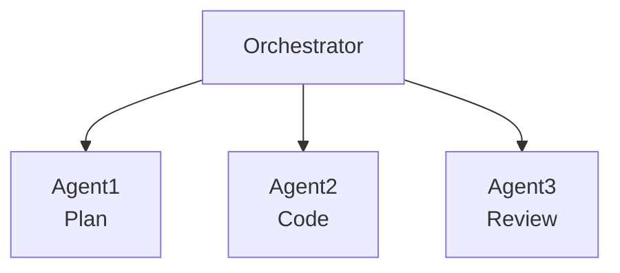
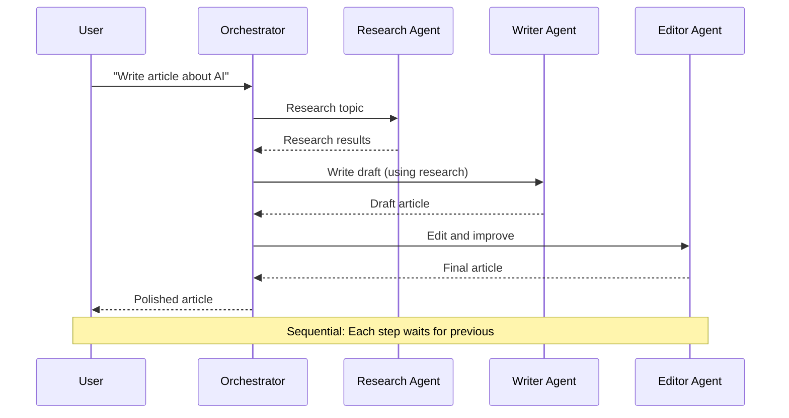
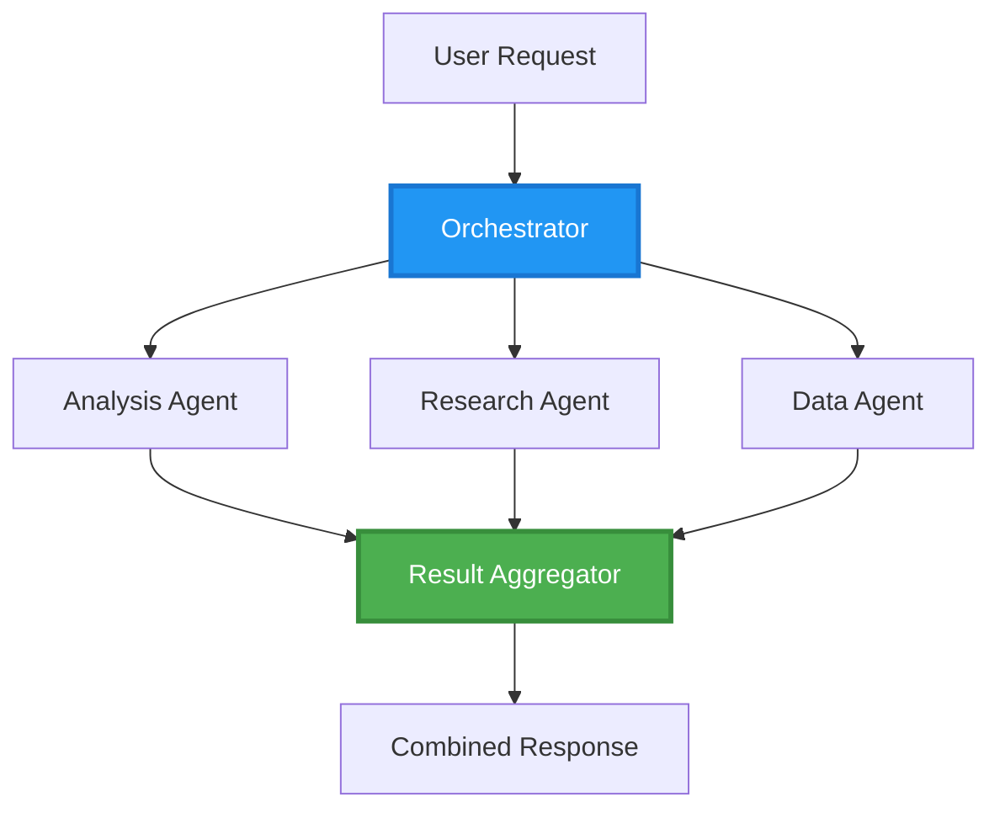
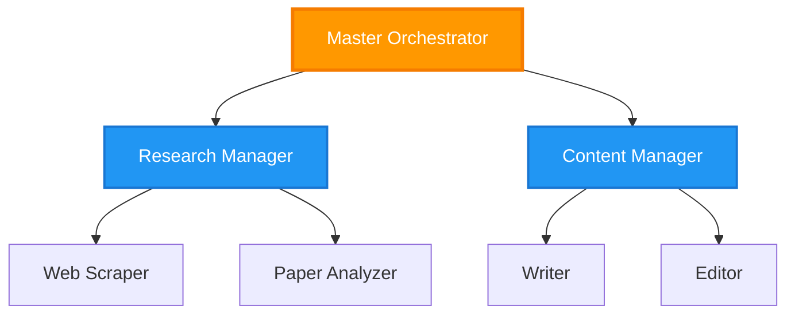
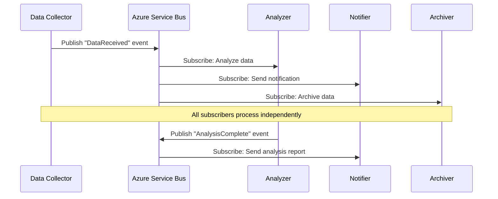
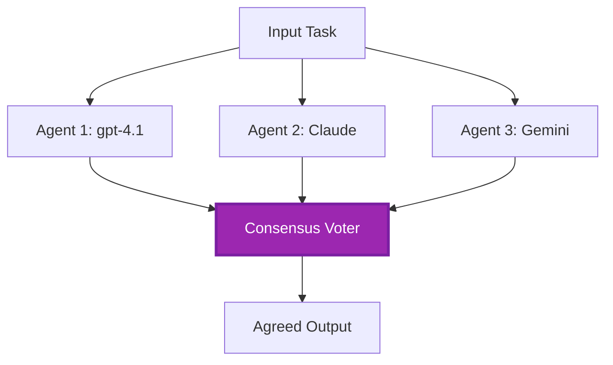
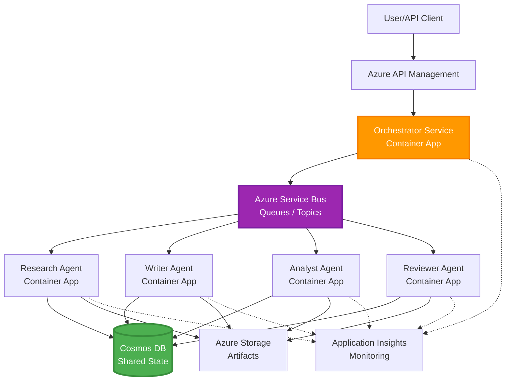

# Шаблони за координация на многоагентни системи

⏱️ **Прогнозно времетраене**: 60-75 минути четене; няколко часа за имплементация | 💰 **Прогнозна цена**: зависи от натоварването | ⭐ **Сложност**: Напреднала

**📚 Учебен път:**
- ← Предишен: [Планиране на капацитет](capacity-planning.md) - стратегии за оразмеряване и мащабиране на ресурси
- 🎯 **Тук сте**: Шаблони за координация на многоагентни системи (Оркестрация, комуникация, управление на състояние)
- → Следващ: [Избор на SKU](sku-selection.md) - Избор на подходящи услуги в Azure
- 🏠 [Начална страница на курса](../../README.md)

---

## Какво ще научите

След завършване на този урок, ще:
- Разберете **шаблоните за многоагентна архитектура** и кога да ги използвате
- Имплементирате **шаблони за оркестрация** (централизирани, децентрализирани, йерархични)
- Проектирате **стратегии за комуникация между агенти** (синхронни, асинхронни, базирани на събития)
- Управлявате **споделено състояние** между разпределени агенти
- Деплойнете **многоагентни системи** на Azure с AZD
- Приложите **шаблони за координация** в реални AI сценарии
- Наблюдавате и отстранявате грешки в разпределени агентски системи

## Защо координацията на многоагентни системи е важна

### Еволюция: От един агент към многоагентна система

**Един агент (Просто):**
```
User → Agent → Response
```
- ✅ Лесен за разбиране и имплементиране
- ✅ Бърз за прости задачи
- ❌ Ограничен от възможностите на един модел
- ❌ Не може да паралелизира сложни задачи
- ❌ Без специализация

**Многоагентна система (Напреднала):**

- ✅ Специализирани агенти за конкретни задачи
- ✅ Паралелно изпълнение за по-бърза работа
- ✅ Модулна и лесна за поддръжка
- ✅ По-добър при сложни работни процеси
- ⚠️ Изисква координационна логика

**Аналогия**: Един агент е като един човек, който върши всички задачи. Многоагентната система е като екип, в който всеки член има специализирани умения (изследовател, кодер, рецензент, писател), работещи заедно.

---

## Основни шаблони за координация

### Шаблон 1: Последователна координация (Низ от отговорности)

**Кога да се използва**: Задачите трябва да се изпълняват в определен ред, всеки агент работи върху предишния резултат.



**Предимства:**
- ✅ Ясен поток на данни
- ✅ Лесно отстраняване на грешки
- ✅ Предвидим ред на изпълнение

**Ограничения:**
- ❌ По-бавно (без паралелизъм)
- ❌ Един провал блокира цялата верига
- ❌ Не може да управлява взаимнозависими задачи

**Примери за употреба:**
- Поток за създаване на съдържание (проучване → писане → редактиране → публикуване)
- Генериране на код (планиране → имплементация → тест → деплой)
- Генериране на отчети (събиране на данни → анализ → визуализация → обобщение)

---

### Шаблон 2: Паралелна координация (Разклоняване/Събиране)

**Кога да се използва**: Независими задачи могат да се изпълняват едновременно, резултатите се комбинират накрая.



**Предимства:**
- ✅ Бързина (паралелно изпълнение)
- ✅ Възможност за толериране на грешки (частични резултати приемливи)
- ✅ Хоризонтално мащабируем

**Ограничения:**
- ⚠️ Резултатите може да пристигнат извън реда
- ⚠️ Необходима е логика за агрегация
- ⚠️ Сложно управление на състоянието

**Примери за употреба:**
- Събиране на данни от множество източници (API-та + бази данни + уеб скрейпинг)
- Конкурентен анализ (няколко модела генерират решения, избира се най-доброто)
- Услуги за превод (превод на няколко езика едновременно)

---

### Шаблон 3: Йерархична координация (Мениджър-Служител)

**Кога да се използва**: Сложни работни процеси с подзадачи, изискващи делегиране.



**Предимства:**
- ✅ Управлява сложни работни процеси
- ✅ Модулна и лесна за поддръжка
- ✅ Ясни граници на отговорност

**Ограничения:**
- ⚠️ По-сложна архитектура
- ⚠️ По-висока латентност (множество координационни слоеве)
- ⚠️ Изисква сложна оркестрация

**Примери за употреба:**
- Обработка на документи в предприятия (класфикация → насочване → обработка → архивиране)
- Многоетапни данни потоци (въвеждане → почистване → трансформация → анализ → отчет)
- Сложни автоматизационни работни процеси (планиране → разпределяне на ресурси → изпълнение → наблюдение)

---

### Шаблон 4: Координация, базирана на събития (Публикуване-Абониране)

**Кога да се използва**: Агенти трябва да реагират на събития, желае се слабо свързване.



**Предимства:**
- ✅ Слабо свързване между агенти
- ✅ Лесно добавяне на нови агенти (просто се абонират)
- ✅ Асинхронна обработка
- ✅ Устойчива (съхранение на съобщения)

**Ограничения:**
- ⚠️ В крайна сметка последователност
- ⚠️ Сложно отстраняване на грешки
- ⚠️ Предизвикателства при подредба на съобщения

**Примери за употреба:**
- Системи за мониторинг в реално време (аларми, табла, логове)
- Многоканални известия (имейл, SMS, push, Slack)
- Данни за обработващи потоци (няколко потребителя на една и съща информация)

---

### Шаблон 5: Координация, базирана на консенсус (Гласуване/Кворум)

**Кога да се използва**: Необходимо е съгласие от няколко агенти преди продължаване.



**Предимства:**
- ✅ По-висока точност (няколко мнения)
- ✅ Толерантност към грешки (приемливи неуспехи на малцинството)
- ✅ Вградена проверка на качеството

**Ограничения:**
- ❌ Скъпо (множество извиквания на модели)
- ❌ По-бавно (чака се всички агенти)
- ⚠️ Необходимост от разрешаване на конфликти

**Примери за употреба:**
- Модериране на съдържание (няколко модела преглеждат съдържанието)
- Преглед на код (няколко линтера/анализатора)
- Медицинска диагноза (множествени AI модели, експертна проверка)

---

## Обзор на архитектурата

### Пълна многоагентна система на Azure



**Ключови компоненти:**

| Компонент | Цел | Услуга в Azure |
|-----------|---------|---------------|
| **API Gateway** | Входна точка, ограничаване на честотата, автентикация | API Management |
| **Оркестратор** | Координира работните процеси на агенти | Container Apps |
| **Сървис Bus опашка** | Асинхронна комуникация | Service Bus / Event Hubs |
| **Агенти** | Специализирани AI изпълнители | Container Apps / Functions |
| **Хранилище на състояние** | Споделено състояние, проследяване на задачи | Cosmos DB |
| **Хранилище на артефакти** | Документи, резултати, логове | Blob Storage |
| **Мониторинг** | Разпределено проследяване, логове | Application Insights |

Service Bus опашките/топиците и Event Hubs са различни услуги с различен модел за доставяне и потребление; Event Hubs не е директен заместител на Service Bus кода за работници по-долу. Паралелизмът, съхранените съобщения и гласуването на модели сами по себе си не гарантират толерантност към грешки или по-висока точност.

---

## Изисквания

### Необходими инструменти

```bash
# Verify Azure Developer CLI
azd version
# Command reference baseline: azd 1.37.2

# Verify Azure CLI
az --version
# ✅ Expected: azure-cli 2.50.0 or higher

# Verify Docker (for local testing)
docker --version
# ✅ Expected: Docker version 20.10 or higher
```

### Изисквания към Azure

- Активен абонамент в Azure
- Разрешения за създаване на:
  - Container Apps
  - Service Bus namespaces
  - Cosmos DB акаунти
  - Storage акаунти
  - Application Insights

### Познавателни изисквания

Трябва да сте завършили:
- [Управление на конфигурации](../chapter-03-configuration/configuration.md)
- [Автентикация и сигурност](../chapter-03-configuration/authsecurity.md)
- [Пример за микросървиси](../../../../examples/microservices)

---

## Ръководство за имплементация

> **Фрагменти за дизайн, а не директно работеща лаборатория:** Дървото на проекта и етикетите `File:` по-долу описват файлове, които да създадете във вашия проект; това хранилище не съдържа пълно приложение `multi-agent-system`. Липсващи части са основният файл/шаблони за параметри, среда за Container Apps/регистри, Dockerfile-и и блокировки на зависимости, настройка на база данни/контейнери Cosmos, внедряване на модели, конфигурация на идентичност/роли, правила за мащабиране и паралелни работници/опашки. Не очаквайте `azd init` да генерира тези файлове или `azd up` да деплойва фрагменти без промени. За изпълним начален проект, завършете [Основи на многоагентните](../chapter-05-multi-agent/multi-agent-basics.md).

**Предпоставки на работната среда:** Python 3.10+, `azure-servicebus`, `azure-cosmos`, `openai`, Flask, и (за мониторинг) `azure-monitor-opentelemetry`; сложете `shared` в пътя за импортиране на Python във всяко образно изображение на услуга. Контейнерът Cosmos `agent-state/tasks` трябва вече да съществува с ключ за партиция `/id`. Връзките с ключове опростяват тези фрагменти, не са съвет за продукция: предпочитайте управлявани идентичности с обхватени роли за Service Bus/Cosmos/OpenAI на ниво данни. Не излагайте ключове в изходите или логовете.

Доставката на Service Bus е **поне веднъж**. Съхранявайте идемпотентност за всяка задача **и стъпка**, използвайте оптимистична конкуренция (ETags) за четене/модифициране/запис на състояние, и подновявайте заключванията за съобщения по време на дълга обработка. Простият мениджър на състояние по-долу е само за последователна работа и не реализира тези производствени гаранции.

### Структура на проекта

```
multi-agent-system/
├── azure.yaml                    # AZD configuration
├── infra/
│   ├── main.bicep               # Main infrastructure
│   ├── core/
│   │   ├── servicebus.bicep     # Message queue
│   │   ├── cosmos.bicep         # State store
│   │   ├── storage.bicep        # Artifact storage
│   │   └── monitoring.bicep     # Application Insights
│   └── app/
│       ├── orchestrator.bicep   # Orchestrator service
│       └── agent.bicep          # Agent template
└── src/
    ├── orchestrator/            # Orchestration logic
    │   ├── app.py
    │   ├── workflows.py
    │   └── Dockerfile
    ├── agents/
    │   ├── research/            # Research agent
    │   ├── writer/              # Writer agent
    │   ├── analyst/             # Analyst agent
    │   └── reviewer/            # Reviewer agent
    └── shared/
        ├── state_manager.py     # Shared state logic
        └── message_handler.py   # Message handling
```

---

## Урок 1: Последователен шаблон за координация

### Имплементация: Поток за създаване на съдържание

Нека проектираме последователен поток: Проучване → Писане → Редактиране. Публикуването е извън този пример.

### 1. Конфигурация с AZD

**Файл: `azure.yaml`**

```yaml
name: content-pipeline
metadata:
  template: multi-agent-sequential@1.0.0

services:
  orchestrator:
    project: ./src/orchestrator
    language: python
    host: containerapp
  
  research-agent:
    project: ./src/agents/research
    language: python
    host: containerapp
  
  writer-agent:
    project: ./src/agents/writer
    language: python
    host: containerapp
  
  editor-agent:
    project: ./src/agents/editor
    language: python
    host: containerapp
```

### 2. Инфраструктура: Service Bus за координация

**Файл: `infra/core/servicebus.bicep`**

```bicep
param name string
param location string
param tags object = {}

resource serviceBusNamespace 'Microsoft.ServiceBus/namespaces@2022-10-01-preview' = {
  name: name
  location: location
  tags: tags
  sku: {
    name: 'Standard'
    tier: 'Standard'
  }
  properties: {
    minimumTlsVersion: '1.2'
  }
}

// Queue for orchestrator → research agent
resource researchQueue 'Microsoft.ServiceBus/namespaces/queues@2022-10-01-preview' = {
  parent: serviceBusNamespace
  name: 'research-tasks'
  properties: {
    maxDeliveryCount: 3
    lockDuration: 'PT5M'
    deadLetteringOnMessageExpiration: true
  }
}

// Queue for research agent → writer agent
resource writerQueue 'Microsoft.ServiceBus/namespaces/queues@2022-10-01-preview' = {
  parent: serviceBusNamespace
  name: 'writer-tasks'
  properties: {
    maxDeliveryCount: 3
    lockDuration: 'PT5M'
  }
}

// Queue for writer agent → editor agent
resource editorQueue 'Microsoft.ServiceBus/namespaces/queues@2022-10-01-preview' = {
  parent: serviceBusNamespace
  name: 'editor-tasks'
  properties: {
    maxDeliveryCount: 3
    lockDuration: 'PT5M'
  }
}

output namespace string = serviceBusNamespace.name
// Do not output RootManageSharedAccessKey. Resolve scoped credentials
// securely or use managed identity in the application and scale rules.
```

### 3. Мениджър на споделено състояние

**Файл: `src/shared/state_manager.py`**

```python
from azure.cosmos import CosmosClient, PartitionKey
from datetime import datetime, timezone
import os

class StateManager:
    """Manages shared state across agents using Cosmos DB"""
    
    def __init__(self):
        endpoint = os.environ['COSMOS_ENDPOINT']
        key = os.environ['COSMOS_KEY']
        
        self.client = CosmosClient(endpoint, key)
        self.database = self.client.get_database_client('agent-state')
        self.container = self.database.get_container_client('tasks')
    
    def create_task(self, task_id: str, task_type: str, input_data: dict):
        """Create a new task"""
        task = {
            'id': task_id,
            'type': task_type,
            'status': 'pending',
            'input': input_data,
            'created_at': datetime.now(timezone.utc).isoformat(),
            'steps': []
        }
        self.container.create_item(task)
        return task
    
    def update_task_step(self, task_id: str, step_name: str, result: dict):
        """Update task with completed step"""
        task = self.container.read_item(task_id, partition_key=task_id)
        
        task['steps'].append({
            'name': step_name,
            'completed_at': datetime.now(timezone.utc).isoformat(),
            'result': result
        })
        
        self.container.replace_item(task_id, task)
        return task
    
    def complete_task(self, task_id: str, final_result: dict):
        """Mark task as complete"""
        task = self.container.read_item(task_id, partition_key=task_id)
        task['status'] = 'completed'
        task['result'] = final_result
        task['completed_at'] = datetime.now(timezone.utc).isoformat()
        self.container.replace_item(task_id, task)
        return task
    
    def get_task(self, task_id: str):
        """Retrieve task state"""
        return self.container.read_item(task_id, partition_key=task_id)
```

### 4. Оркестратор услуга

**Файл: `src/orchestrator/app.py`**

```python
from flask import Flask, request, jsonify
from azure.servicebus import ServiceBusClient, ServiceBusMessage
import json
import uuid
import os
from shared.state_manager import StateManager

app = Flask(__name__)
state_manager = StateManager()

# Service Bus connection
servicebus_connection_str = os.environ['SERVICEBUS_CONNECTION_STRING']
servicebus_client = ServiceBusClient.from_connection_string(servicebus_connection_str)

@app.route('/health', methods=['GET'])
def health():
    return jsonify({'status': 'healthy', 'service': 'orchestrator'})

@app.route('/create-content', methods=['POST'])
def create_content():
    """
    Sequential workflow: Research → Write → Edit (returns a draft; no publishing)
    """
    data = request.get_json(silent=True) or {}
    topic = data.get('topic')
    
    if not topic:
        return jsonify({'error': 'Topic required'}), 400
    
    # Create task in state store
    task_id = str(uuid.uuid4())
    task = state_manager.create_task(
        task_id=task_id,
        task_type='content_creation',
        input_data={'topic': topic}
    )
    
    # Send message to research agent (first step)
    sender = servicebus_client.get_queue_sender('research-tasks')
    message = ServiceBusMessage(
        body=json.dumps({
            'task_id': task_id,
            'topic': topic,
            'next_queue': 'writer-tasks'  # Where to send results
        }),
        content_type='application/json'
    )
    
    with sender:
        sender.send_messages(message)
    
    return jsonify({
        'task_id': task_id,
        'status': 'started',
        'workflow': 'sequential',
        'steps': ['research', 'write', 'edit'],
        'message': 'Content creation pipeline initiated'
    }), 202

@app.route('/task/<task_id>', methods=['GET'])
def get_task_status(task_id):
    """Check task status"""
    try:
        task = state_manager.get_task(task_id)
        return jsonify(task)
    except Exception as e:
        return jsonify({'error': str(e)}), 404

if __name__ == '__main__':
    app.run(host='0.0.0.0', port=8080)
```

### 5. Агент за проучване

**Файл: `src/agents/research/app.py`**

```python
from azure.servicebus import ServiceBusClient, ServiceBusMessage
from openai import AzureOpenAI
import json
import os
import time
from shared.state_manager import StateManager

# Initialize clients
state_manager = StateManager()
servicebus_client = ServiceBusClient.from_connection_string(
    os.environ['SERVICEBUS_CONNECTION_STRING']
)

openai_client = AzureOpenAI(
    api_key=os.environ['AZURE_OPENAI_API_KEY'],
    api_version="2024-10-21",
    azure_endpoint=os.environ['AZURE_OPENAI_ENDPOINT']
)

def process_research_task(message_data):
    """Process research request and pass to writer"""
    task_id = message_data['task_id']
    topic = message_data['topic']
    next_queue = message_data['next_queue']
    
    print(f"🔬 Researching: {topic}")
    
    # Call Microsoft Foundry Models for research
    response = openai_client.chat.completions.create(
        model=os.environ['AZURE_OPENAI_DEPLOYMENT'],
        messages=[
            {"role": "system", "content": "You are a research assistant. Provide comprehensive research on the given topic."},
            {"role": "user", "content": f"Research this topic thoroughly: {topic}"}
        ],
        max_tokens=1500
    )
    
    research_results = response.choices[0].message.content
    
    # Update state
    state_manager.update_task_step(
        task_id=task_id,
        step_name='research',
        result={'research': research_results}
    )
    
    # Send to next agent (writer)
    sender = servicebus_client.get_queue_sender(next_queue)
    message = ServiceBusMessage(
        body=json.dumps({
            'task_id': task_id,
            'topic': topic,
            'research': research_results,
            'next_queue': 'editor-tasks'
        }),
        content_type='application/json'
    )
    
    with sender:
        sender.send_messages(message)
    
    print(f"✅ Research complete for task {task_id}")

def main():
    """Listen to research queue"""
    receiver = servicebus_client.get_queue_receiver('research-tasks')
    
    print("🔬 Research Agent started, listening for tasks...")
    
    with receiver:
        while True:
            messages = receiver.receive_messages(max_wait_time=5)
            for message in messages:
                try:
                    message_data = json.loads(str(message))
                    process_research_task(message_data)
                    receiver.complete_message(message)
                except Exception as e:
                    print(f"❌ Error processing message: {e}")
                    receiver.abandon_message(message)

if __name__ == '__main__':
    main()
```

### 6. Агент писател

**Файл: `src/agents/writer/app.py`**

```python
from azure.servicebus import ServiceBusClient, ServiceBusMessage
from openai import AzureOpenAI
import json
import os
from shared.state_manager import StateManager

state_manager = StateManager()
servicebus_client = ServiceBusClient.from_connection_string(
    os.environ['SERVICEBUS_CONNECTION_STRING']
)

openai_client = AzureOpenAI(
    api_key=os.environ['AZURE_OPENAI_API_KEY'],
    api_version="2024-10-21",
    azure_endpoint=os.environ['AZURE_OPENAI_ENDPOINT']
)

def process_writing_task(message_data):
    """Write article based on research"""
    task_id = message_data['task_id']
    topic = message_data['topic']
    research = message_data['research']
    next_queue = message_data['next_queue']
    
    print(f"✍️ Writing article: {topic}")
    
    # Call Microsoft Foundry Models to write article
    response = openai_client.chat.completions.create(
        model=os.environ['AZURE_OPENAI_DEPLOYMENT'],
        messages=[
            {"role": "system", "content": "You are a professional writer. Write engaging, well-structured articles."},
            {"role": "user", "content": f"Based on this research:\n\n{research}\n\nWrite a comprehensive article about: {topic}"}
        ],
        max_tokens=2000
    )
    
    article_draft = response.choices[0].message.content
    
    # Update state
    state_manager.update_task_step(
        task_id=task_id,
        step_name='writing',
        result={'draft': article_draft}
    )
    
    # Send to editor
    sender = servicebus_client.get_queue_sender(next_queue)
    message = ServiceBusMessage(
        body=json.dumps({
            'task_id': task_id,
            'topic': topic,
            'draft': article_draft
        }),
        content_type='application/json'
    )
    
    with sender:
        sender.send_messages(message)
    
    print(f"✅ Article draft complete for task {task_id}")

def main():
    """Listen to writer queue"""
    receiver = servicebus_client.get_queue_receiver('writer-tasks')
    
    print("✍️ Writer Agent started, listening for tasks...")
    
    with receiver:
        while True:
            messages = receiver.receive_messages(max_wait_time=5)
            for message in messages:
                try:
                    message_data = json.loads(str(message))
                    process_writing_task(message_data)
                    receiver.complete_message(message)
                except Exception as e:
                    print(f"❌ Error: {e}")
                    receiver.abandon_message(message)

if __name__ == '__main__':
    main()
```

### 7. Агент редактор

**Файл: `src/agents/editor/app.py`**

```python
from azure.servicebus import ServiceBusClient
from openai import AzureOpenAI
import json
import os
from shared.state_manager import StateManager

state_manager = StateManager()
servicebus_client = ServiceBusClient.from_connection_string(
    os.environ['SERVICEBUS_CONNECTION_STRING']
)

openai_client = AzureOpenAI(
    api_key=os.environ['AZURE_OPENAI_API_KEY'],
    api_version="2024-10-21",
    azure_endpoint=os.environ['AZURE_OPENAI_ENDPOINT']
)

def process_editing_task(message_data):
    """Edit and finalize article"""
    task_id = message_data['task_id']
    topic = message_data['topic']
    draft = message_data['draft']
    
    print(f"📝 Editing article: {topic}")
    
    # Call Microsoft Foundry Models to edit
    response = openai_client.chat.completions.create(
        model=os.environ['AZURE_OPENAI_DEPLOYMENT'],
        messages=[
            {"role": "system", "content": "You are an expert editor. Improve grammar, clarity, and structure."},
            {"role": "user", "content": f"Edit and improve this article:\n\n{draft}"}
        ],
        max_tokens=2000
    )
    
    final_article = response.choices[0].message.content
    
    # Mark task as complete
    state_manager.complete_task(
        task_id=task_id,
        final_result={
            'topic': topic,
            'final_article': final_article,
            'word_count': len(final_article.split())
        }
    )
    
    print(f"✅ Article finalized for task {task_id}")

def main():
    """Listen to editor queue"""
    receiver = servicebus_client.get_queue_receiver('editor-tasks')
    
    print("📝 Editor Agent started, listening for tasks...")
    
    with receiver:
        while True:
            messages = receiver.receive_messages(max_wait_time=5)
            for message in messages:
                try:
                    message_data = json.loads(str(message))
                    process_editing_task(message_data)
                    receiver.complete_message(message)
                except Exception as e:
                    print(f"❌ Error: {e}")
                    receiver.abandon_message(message)

if __name__ == '__main__':
    main()
```

### 8. Деплой и тест

Тези команди важат **само след като имплементирате липсващите файлове в проекта**. Инициализацията на интерактивния агент Foundry е отделен работен процес; той не генерира този дизайн с Service Bus.

```bash
# In your completed custom project
azd up

# Alternative in a SEPARATE empty folder (agents beta.23 requires azd >= 1.37)
azd extension install azure.ai.agents
azd ai agent init
azd up
```

> Вижте [AZD AI CLI команди](../chapter-08-production/production-ai-practices.md#azd-ai-cli-commands-and-extensions) за всички флагове и опции на `azd ai`.

```bash
# Get orchestrator URL
ORCHESTRATOR_URL=$(azd env get-values | grep ORCHESTRATOR_URL | cut -d '=' -f2 | tr -d '"')

# Create content
curl -X POST $ORCHESTRATOR_URL/create-content \
  -H "Content-Type: application/json" \
  -d '{"topic": "The Future of AI in Healthcare"}'
```

**✅ Очакван изход:**
```json
{
  "task_id": "a1b2c3d4-e5f6-7890-abcd-ef1234567890",
  "status": "started",
  "workflow": "sequential",
  "steps": ["research", "write", "edit"],
  "message": "Content creation pipeline initiated"
}
```

**Проверка на напредък на задачата:**
```bash
TASK_ID="a1b2c3d4-e5f6-7890-abcd-ef1234567890"
curl $ORCHESTRATOR_URL/task/$TASK_ID
```

**✅ Очакван изход (завършено):**
```json
{
  "id": "a1b2c3d4-e5f6-7890-abcd-ef1234567890",
  "type": "content_creation",
  "status": "completed",
  "steps": [
    {
      "name": "research",
      "completed_at": "2025-11-19T10:30:00Z",
      "result": {"research": "..."}
    },
    {
      "name": "writing",
      "completed_at": "2025-11-19T10:32:00Z",
      "result": {"draft": "..."}
    }
  ],
  "result": {
    "topic": "The Future of AI in Healthcare",
    "final_article": "...",
    "word_count": 1500
  }
}
```

---

## Урок 2: Паралелен шаблон за координация

### Имплементация: Мулти-източников агрегатор на проучвания

Нека изградим паралелна система, която събира информация от няколко източника едновременно.

### Паралелен оркестратор

**Файл: `src/orchestrator/parallel_workflow.py`**

```python
from flask import Flask, request, jsonify
from azure.servicebus import ServiceBusClient, ServiceBusMessage
import json
import uuid
import os
from shared.state_manager import StateManager

app = Flask(__name__)
state_manager = StateManager()

servicebus_client = ServiceBusClient.from_connection_string(
    os.environ['SERVICEBUS_CONNECTION_STRING']
)

@app.route('/research-parallel', methods=['POST'])
def research_parallel():
    """
    Parallel workflow: Multiple agents work simultaneously
    """
    data = request.json
    query = data.get('query')
    
    task_id = str(uuid.uuid4())
    task = state_manager.create_task(
        task_id=task_id,
        task_type='parallel_research',
        input_data={
            'query': query,
            'agents': ['web', 'academic', 'news', 'social']
        }
    )
    
    # Fan-out: publish sequentially; workers may process concurrently.
    agents = [
        ('web-research-queue', 'web'),
        ('academic-research-queue', 'academic'),
        ('news-research-queue', 'news'),
        ('social-research-queue', 'social')
    ]
    
    for queue_name, agent_type in agents:
        sender = servicebus_client.get_queue_sender(queue_name)
        message = ServiceBusMessage(
            body=json.dumps({
                'task_id': task_id,
                'query': query,
                'agent_type': agent_type,
                'result_queue': 'aggregation-queue'
            }),
            content_type='application/json'
        )
        
        with sender:
            sender.send_messages(message)
    
    return jsonify({
        'task_id': task_id,
        'status': 'started',
        'workflow': 'parallel',
        'agents_dispatched': 4,
        'message': 'Parallel research initiated'
    }), 202

if __name__ == '__main__':
    app.run(host='0.0.0.0', port=8080)
```

### Логика за агрегация

**Файл: `src/agents/aggregator/app.py`**

```python
from azure.servicebus import ServiceBusClient
import json
import os
from collections import defaultdict
from shared.state_manager import StateManager

state_manager = StateManager()
servicebus_client = ServiceBusClient.from_connection_string(
    os.environ['SERVICEBUS_CONNECTION_STRING']
)

# Single-process demo only: not durable or shared across replicas.
# Production: use durable unique (task_id, agent_type) result records.
task_results = defaultdict(dict)
expected_agents = 4  # web, academic, news, social

def process_result(message_data):
    """Aggregate results from parallel agents"""
    task_id = message_data['task_id']
    agent_type = message_data['agent_type']
    result = message_data['result']
    
    # Store result
    task_results[task_id][agent_type] = {
        'agent': agent_type,
        'data': result
    }
    
    print(f"📊 Received result from {agent_type} agent ({len(task_results[task_id])}/{expected_agents})")
    
    # Check if all agents completed (fan-in)
    if len(task_results[task_id]) == expected_agents:
        print(f"✅ All agents completed for task {task_id}. Aggregating...")
        
        # Combine results
        aggregated = {
            'query': message_data['query'],
            'sources': list(task_results[task_id].values()),
            'summary': generate_summary(list(task_results[task_id].values()))
        }
        
        # Mark complete
        state_manager.complete_task(task_id, aggregated)
        
        # Clean up
        del task_results[task_id]
        
        print(f"✅ Aggregation complete for task {task_id}")

def generate_summary(results):
    """Generate summary from all sources"""
    summaries = [r['data'].get('summary', '') for r in results]
    return '\n\n'.join(summaries)

def main():
    """Listen to aggregation queue"""
    receiver = servicebus_client.get_queue_receiver('aggregation-queue')
    
    print("📊 Aggregator started, listening for results...")
    
    with receiver:
        while True:
            messages = receiver.receive_messages(max_wait_time=5)
            for message in messages:
                try:
                    message_data = json.loads(str(message))
                    process_result(message_data)
                    receiver.complete_message(message)
                except Exception as e:
                    print(f"❌ Error: {e}")
                    receiver.abandon_message(message)

if __name__ == '__main__':
    main()
```

**Предимства на паралелния шаблон:**
- ⚡ **Потенциално по-ниска латентност** (ограничена от най-бавния работник плюс координационни режийни разходи)
- 🔄 **Поддържа частични резултати** с експлицитни крайни срокове и политика за отказ (не е имплементирана в базовия агрегатор)
- 📈 **Мащабируем** (лесно се добавят повече агенти)

---

## Практически упражнения

### Упражнение 1: Добавяне на обработка на таймаут ⭐⭐ (Средно)

**Цел**: Имплементирайте логика за таймаут, така че агрегаторът да не чака безкрайно за бавни агенти.

**Начална точка:** Стартирайте тази локална симулация на краен срок преди да я интегрирате в работник на опашка. Таймаут, проверяван само при пристигане на друго съобщение, никога не се задейства, ако липсващият работник не изпрати нищо.

**Стъпки**:

1. **Добавете проследяване на таймаут към агрегатора:**

```python
import asyncio

async def simulated_agent(name, delay):
    await asyncio.sleep(delay)
    return {'agent': name, 'result': 'done'}

async def main():
    tasks = [asyncio.create_task(simulated_agent(name, delay))
             for name, delay in [('web', 0.1), ('academic', 0.2),
                                 ('news', 0.3), ('social', 3)]]
    done, pending = await asyncio.wait(tasks, timeout=1)
    results = [task.result() for task in done]
    for task in pending:
        task.cancel()
    await asyncio.gather(*pending, return_exceptions=True)
    print({'completed_agents': len(results), 'timed_out': bool(pending)})
    assert len(results) == 3 and pending

asyncio.run(main())
```

2. **Очакван изход:**

```text
{'completed_agents': 3, 'timed_out': True}
```

3. **Интеграция в системата с опашки (задача за дизайн):** Съхранявайте срока за изпращане и очакваните агенти при създаване на задачата, изпълнявайте периодично почистване на сроковете независимо от пристигащите резултати, атомарно финализирайте частични резултати и игнорирайте закъснели/дублирани съобщения за вече финализирани задачи. Локалният таймаут не отменя отдалечени работници.

Само за вашия имплементиран проект:

```bash
azd deploy aggregator

# Submit task
curl -X POST $ORCHESTRATOR_URL/research-parallel \
  -H "Content-Type: application/json" \
  -d '{"query": "AI safety research"}'

# Check results after 30 seconds
curl $ORCHESTRATOR_URL/task/$TASK_ID
```

**✅ Критерии за успех:**
- ✅ Локалният тест се връща след едносекунден краен срок, дори ако агентът не е завършен
- ✅ Отговорът показва частични резултати (`"timed_out": true`)
- ✅ Връщат се налични резултати (3 от 4 агента)

**Време**: 20-25 минути

---

### Упражнение 2: Имплементиране на логика за повторение ⭐⭐⭐ (Напреднало)

**Цел**: Автоматично повтаряйте неуспешни задачи на агент преди отказ.

**Стъпки**:

1. **Използвайте броя на доставките на Service Bus вместо повторно поставяне на опашката с персонализирани броячи за повторение:**

```python
import json
import time
# Integration fragment: use a live peek-lock ServiceBusReceiver.
# Set queue maxDeliveryCount to 4 for one attempt + up to three retries.
```

2. **Добавете обработчик за повторения към агентите:**

```python
def process_with_retry(message, receiver, process_func):
    """Process message with automatic retry on failure"""
    try:
        message_data = json.loads(str(message))
        
        # Process the message
        process_func(message_data)
        
        # Success - complete
        receiver.complete_message(message)
        
    except Exception as e:
        if message.delivery_count < 4:
            # Bounded exponential delay: 5s, 10s, 20s.
            # Renew the lock if processing + waiting can exceed its duration.
            time.sleep(5 * 2 ** (message.delivery_count - 1))
            receiver.abandon_message(message)
        else:
            # Max retries exceeded - move to dead letter queue
            print(f"❌ Max attempts exceeded for message {message.message_id}")
            receiver.dead_letter_message(
                message,
                reason="MaxRetriesExceeded",
                error_description=str(e)
            )
```

3. **Мониторинг на опашката с невалидни съобщения:**

```python
def monitor_dead_letters():
    """Check dead letter queue for failed messages"""
    receiver = servicebus_client.get_queue_receiver(
        'research-tasks',
        sub_queue='deadletter'
    )
    
    with receiver:
        messages = receiver.receive_messages(max_wait_time=5)
        for message in messages:
            print(f"☠️ Dead letter: {message.message_id}")
            print(f"Reason: {message.dead_letter_reason}")
            print(f"Description: {message.dead_letter_error_description}")
```

**✅ Критерии за успех:**
- ✅ Неуспешни задачи се повтарят автоматично (до 3 пъти)
- ✅ Експоненциално забавяне между повторенията (5s, 10s, 20s), с подновяване на заключването на съобщения при нужда
- ✅ След максимален брой повторения, съобщенията отиват в опашка за невалидни съобщения
- ✅ Съобщенията в опашката за невалидни могат да бъдат инспектирани; повторението изисква отделен идемпотентен процес за възстановяване

**Време**: 30-40 минути

---

### Упражнение 3: Имплементиране на прекъсвач на верига (Circuit Breaker) ⭐⭐⭐ (Напреднало)

**Цел**: Предотвратяване на каскадни повреди чрез спиране на заявки към неработещи агенти.

**Стъпки**:

1. **Създайте клас за прекъсвач на верига:**

```python
from enum import Enum
from datetime import datetime, timedelta, timezone

class CircuitState(Enum):
    CLOSED = "closed"      # Normal operation
    OPEN = "open"          # Failing, reject requests
    HALF_OPEN = "half_open"  # Testing if recovered

class CircuitBreaker:
    def __init__(self, failure_threshold=5, timeout_seconds=60):
        self.failure_threshold = failure_threshold
        self.timeout_seconds = timeout_seconds
        self.failure_count = 0
        self.last_failure_time = None
        self.state = CircuitState.CLOSED
    
    def call(self, func):
        """Execute function with circuit breaker protection"""
        if self.state == CircuitState.OPEN:
            # Check if timeout expired
            if datetime.now(timezone.utc) - self.last_failure_time > timedelta(seconds=self.timeout_seconds):
                self.state = CircuitState.HALF_OPEN
                print("🔄 Circuit breaker: HALF_OPEN (testing)")
            else:
                raise Exception(f"Circuit breaker OPEN for agent. Try again in {self.timeout_seconds}s")
        
        try:
            result = func()
            
            # Success
            self.failure_count = 0 # Count consecutive failures only
            if self.state == CircuitState.HALF_OPEN:
                self.state = CircuitState.CLOSED
                self.failure_count = 0
                print("✅ Circuit breaker: CLOSED (recovered)")
            
            return result
            
        except Exception as e:
            self.failure_count += 1
            self.last_failure_time = datetime.now(timezone.utc)
            
            if self.failure_count >= self.failure_threshold:
                self.state = CircuitState.OPEN
                print(f"🔴 Circuit breaker: OPEN (too many failures)")
            
            raise
```

2. **Приложете към извикванията на агенти:**

```python
# In orchestrator
agent_circuits = {
    'web': CircuitBreaker(failure_threshold=5, timeout_seconds=60),
    'academic': CircuitBreaker(failure_threshold=5, timeout_seconds=60),
    'news': CircuitBreaker(failure_threshold=5, timeout_seconds=60),
    'social': CircuitBreaker(failure_threshold=5, timeout_seconds=60)
}

def send_to_agent(agent_type, message_data):
    """Send with circuit breaker protection"""
    circuit = agent_circuits[agent_type]
    
    try:
        circuit.call(lambda: send_message(agent_type, message_data))
    except Exception as e:
        print(f"⚠️ Skipping {agent_type} agent: {e}")
        # Continue with other agents
```

Тази верига защитава **операцията за изпращане**, не и завършването от отдалечен работник: успешно поставяне на съобщение в опашката не означава нищо за това дали агентът е активен. `send_message` е функцията за изпращане на вашето приложение. За вериги за изпълнение, подавайте наблюдавани неуспехи/таймаути на задачи към траен координатор. Този клас в паметта е демонстрация с един нишков процес, не разпределен прекъсвач на веригата.

3. **Тествайте прекъсвача локално:**

```python
# Run after the class definition; no Azure changes required.
circuit = CircuitBreaker(failure_threshold=5, timeout_seconds=0)
def fail():
    raise RuntimeError("simulated failure")
for _ in range(5):
    try:
        circuit.call(fail)
    except RuntimeError:
        pass
assert circuit.state == CircuitState.OPEN
assert circuit.call(lambda: "recovered") == "recovered"
assert circuit.state == CircuitState.CLOSED
print("Circuit breaker recovery verified")
```

**✅ Критерии за успех:**
- ✅ След 5 неуспеха, веригата се отваря (отхвърля заявки)
- ✅ След 60 секунди, веригата става полуотворена (тест на възстановяване)
- ✅ Другите агенти продължават да работят нормално
- ✅ Верига се затваря автоматично при възстановяване на агента

**Време**: 40-50 минути

---

## Мониторинг и отстраняване на грешки

### Разпределено трасериране с Application Insights

**Файл: `src/shared/tracing.py`**

```python
from azure.monitor.opentelemetry import configure_azure_monitor
from opentelemetry import trace
from opentelemetry.trace import SpanKind
import logging
import os

connection_string = os.environ.get('APPLICATIONINSIGHTS_CONNECTION_STRING')

# Configure once per process. Message send/receive trace-context propagation
# and agent attributes on exceptions need explicit instrumentation.
if connection_string:
    configure_azure_monitor(connection_string=connection_string, logger_name=__name__)
tracer = trace.get_tracer(__name__)

# Configure logging
logger = logging.getLogger(__name__)
logger.setLevel(logging.INFO)

def trace_agent_call(agent_name, task_id, operation_name, operation):
    """Trace agent operations"""
    with tracer.start_as_current_span(f'agent.{agent_name}.{operation_name}', kind=SpanKind.CLIENT) as span:
        span.set_attribute('agent', agent_name)
        span.set_attribute('task_id', task_id)
        span.set_attribute('operation', operation_name)
        
        try:
            result = operation()
            span.set_attribute('status', 'success')
            logger.info('Agent operation completed', extra={
                'agent': agent_name, 'task_id': task_id, 'operation': operation_name
            })
            return result
        except Exception as e:
            span.set_attribute('status', 'error')
            logger.exception('Agent operation failed', extra={
                'agent': agent_name, 'task_id': task_id, 'operation': operation_name
            })
            raise
```

### Запитвания в Application Insights

**Проследявайте многоагентни работни потоци:**

```kusto
// Trace complete workflow for a task
traces
| where customDimensions.task_id == "a1b2c3d4-..."
| project timestamp, message, customDimensions.agent, customDimensions.operation
| order by timestamp asc
```

**Сравнение на производителността на агентите:**

```kusto
// Compare agent execution times
dependencies
| where name contains "agent"
| summarize 
    avg_duration = avg(duration),
    p95_duration = percentile(duration, 95),
    count = count()
  by agent = tostring(customDimensions.agent)
| order by avg_duration desc
```

**Анализ на неуспехи:**

```kusto
// Find which agents fail most
exceptions
| where customDimensions.agent != ""
| summarize 
    failure_count = count(),
    unique_errors = dcount(outerMessage)
  by agent = tostring(customDimensions.agent)
| order by failure_count desc
```

---

## Анализ на разходите

### Разходи за многоагентна система (месечни оценки)

Илюстративни планови цифри, не оферти: сумата по-долу е **240-565$/месец**. Проверете текущите регионални тарифи, часове на активни/неактивни инстанции, съотношение входящи/изходящи токени, съхранение и телеметрия. Серверлес няма минимален предоставен капацитет, но все пак таксува за заявки и съхранение.

| Компонент | Конфигурация | Цена |
|-----------|--------------|------|
| **Оркестратор** | 1 контейнерно приложение (1 vCPU, 2GB) | 30-50$ |
| **4 агента** | 4 контейнерни приложения (0.5 vCPU, 1GB всеки) | 60-120$ |
| **Service Bus** | Стандартен слой, 10M съобщения | 10-20$ |
| **Cosmos DB** | Serverless, 5GB съхранение, 1M RUs | 25-50$ |
| **Blob Storage** | 10GB съхранение, 100K операции | 5-10$ |
| **Application Insights** | 5GB поглъщане | 10-15$ |
| **Microsoft Foundry Models** | gpt-4.1, 10M токена | 100-300$ |
| **Общо** | | **240-565$/месец** |

### Стратегии за оптимизация на разходите

1. **Използвайте serverless, когато е възможно:**
   ```bicep
   // Cosmos DB serverless (no minimum cost)
   properties: {
     databaseAccountOfferType: 'Standard'
     capabilities: [{ name: 'EnableServerless' }]
   }
   ```

2. **Намалявайте агентите до нула при бездействие:**
   ```bicep
   scale: {
     minReplicas: 0  // Requires a Service Bus/KEDA scale rule to wake workers
     maxReplicas: 10
   }
   ```

3. **Използвайте пакетиране за Service Bus:**
   ```python
   # Send messages in batches (cheaper)
   sender.send_messages([message1, message2, message3])
   ```

4. **Кеширайте често използвани резултати:**
   ```python
   # Use Azure Cache for Redis
   if cache.exists(query_hash):
       return cache.get(query_hash)
   ```

---

## Добри практики

### ✅ ПРАВЕТЕ:

1. **Използвайте идемпотентни операции**
   ```python
   # Pseudocode: implement a durable, atomic per-step deduplication claim.
   def process_task(task_id):
       raise NotImplementedError("Claim (task_id, step) atomically, execute, persist outcome")
   ```

2. **Прилагайте пълноценно логване**
   ```python
   logger.info(f"Agent: {agent_name}, Task: {task_id}, Action: {action}")
   ```

3. **Използвайте корелационни идентификатори**
   ```python
   # Pass task_id through entire workflow
   message_data = {
       'task_id': task_id,  # Correlation ID
       'timestamp': datetime.utcnow().isoformat()
   }
   ```

4. **Задайте TTL на съобщенията (време на живот)**
   ```bicep
   properties: {
     defaultMessageTimeToLive: 'PT1H'  // 1 hour max
   }
   ```

5. **Следете опашките на неуспешни съобщения**
   ```python
   # Regular monitoring of failed messages
   monitor_dead_letters()
   ```

### ❌ НЕ ПРАВЕТЕ:

1. **Не създавайте циклични зависимости**
   ```python
   # ❌ BAD: Agent A → Agent B → Agent A (infinite loop)
   # ✅ GOOD: Define clear directed acyclic graph (DAG)
   ```

2. **Не блокирайте нишките на агентите**
   ```python
   # ❌ BAD: Synchronous wait
   while not task_complete:
       time.sleep(1)
   
   # ✅ GOOD: Use message queue callbacks
   ```

3. **Не пренебрегвайте частични неуспехи**
   ```python
   # ❌ BAD: Fail entire workflow if one agent fails
   # ✅ GOOD: Return partial results with error indicators
   ```

4. **Не използвайте безкрайни опити за повторение**
   ```python
   # ❌ BAD: retry forever
   # ✅ GOOD: max_retries = 3, then dead letter
   ```

---

## Ръководство за отстраняване на проблеми

### Проблем: Съобщения блокирани в опашката

**Симптоми:**
- Съобщенията се натрупват в опашката
- Агентите не обработват
- Статусът на задачата останал на „очакваща“

**Диагноза:**
```bash
# Check queue depth
az servicebus queue show \
  --resource-group "$RG_NAME" \
  --namespace-name mybus \
  --name research-tasks \
  --query "countDetails"

# Check agent logs using Azure CLI
az containerapp logs show --name research-agent --resource-group $RG_NAME --tail 50
```

**Решения:**

1. **Увеличете броя на агентите:**
   ```bash
   az containerapp update \
     --resource-group "$RG_NAME" \
     --name research-agent \
     --min-replicas 3 \
     --max-replicas 10
   ```

2. **Проверете опашката за неуспешни съобщения:**
   ```bash
   az servicebus queue show \
     --resource-group "$RG_NAME" \
     --namespace-name mybus \
     --name research-tasks \
     --query "countDetails.deadLetterMessageCount"
   ```

---

### Проблем: Задачата изтича/никога не завършва

**Симптоми:**
- Статусът на задачата остава "в ход"
- Някои агенти завършват, други не
- Няма съобщения за грешки

**Диагноза:**
```bash
# Check task state
curl $ORCHESTRATOR_URL/task/$TASK_ID

# Check Application Insights
# Run query: traces | where customDimensions.task_id == "..."
```

**Решения:**

1. **Прилагайте таймаут в агрегатора (Упражнение 1)**

2. **Проверете за неуспехи на агентите чрез Azure Monitor:**
   ```bash
   # View logs via azd monitor
   azd monitor --logs
   
   # Or use Azure CLI to check specific container app logs
   az containerapp logs show --name <agent-name> --resource-group $RG_NAME --follow | grep "ERROR\|FAIL"
   ```

3. **Проверете дали всички агенти работят:**
   ```bash
   az containerapp list \
     --resource-group rg-agents \
     --query "[].{name:name, status:properties.runningStatus}"
   ```

---

## Научете повече

### Официална документация
- [Azure Service Bus](https://learn.microsoft.com/azure/service-bus-messaging/service-bus-messaging-overview)
- [Cosmos DB](https://learn.microsoft.com/azure/cosmos-db/introduction)
- [Container Apps DAPR](https://learn.microsoft.com/azure/container-apps/dapr-overview)
- [AI Agent Orchestration Patterns](https://learn.microsoft.com/azure/architecture/ai-ml/guide/ai-agent-design-patterns)

### Следващи стъпки в този курс
- ← Предишна: [Планиране на капацитета](capacity-planning.md)
- → Следваща: [Избор на SKU](sku-selection.md)
- 🏠 [Начало на курса](../../README.md)

### Свързани примери
- [Пример за микросървиси](../../../../examples/microservices) - Модели на комуникация между услуги
- [Пример за Microsoft Foundry Models](../../../../examples/azure-openai-chat) - Интеграция на ИИ

---

## Резюме

**Научихте:**
- ✅ Пет модела за координация (последователен, паралелен, йерархичен, събитийно-управляем, консенсус)
- ✅ Многоагентна архитектура в Azure (Service Bus, Cosmos DB, Container Apps)
- ✅ Управление на състоянието между разпределени агенти
- ✅ Обработка на таймаути, повторения и прекъсвачи на веригата
- ✅ Мониторинг и отстраняване на грешки в разпределени системи
- ✅ Стратегии за оптимизация на разходите

**Основни изводи:**
1. **Изберете правилния модел** - Последователен за наредени работни потоци, паралелен за скорост, събитийно управление за гъвкавост
2. **Управлявайте състоянието внимателно** - Използвайте Cosmos DB или подобно за споделено състояние
3. **Обработвайте неуспехите елегантно** - Таймаути, повторения, прекъсвачи на веригата, опашки за мъртви писма
4. **Следете всичко** - Разпределеното трасериране е от съществено значение за отстраняване на грешки
5. **Оптимизирайте разходите** - Скалиране до нула, използване на serverless, прилагане на кеширане

**Следващи стъпки:**
1. Завършете практическите упражнения
2. Създайте многоагентна система за вашия случай на употреба
3. Изучете [Избор на SKU](sku-selection.md) за оптимизиране на производителността и разходите

---

<!-- CO-OP TRANSLATOR DISCLAIMER START -->
**Отказ от отговорност**:
Този документ е преведен с помощта на AI преводачески услуга [Co-op Translator](https://github.com/Azure/co-op-translator). Въпреки че се стремим към точност, моля имайте предвид, че автоматизираните преводи могат да съдържат грешки или неточности. Оригиналният документ на неговия роден език трябва да се счита за авторитетен източник. За критична информация се препоръчва професионален човешки превод. Ние не носим отговорност за каквито и да е недоразумения или неправилни тълкувания, произтичащи от използването на този превод.
<!-- CO-OP TRANSLATOR DISCLAIMER END -->