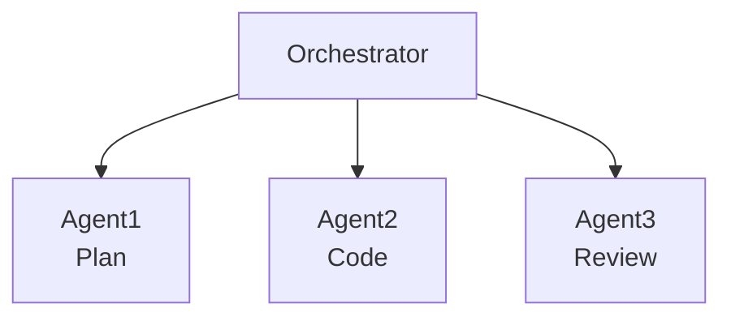
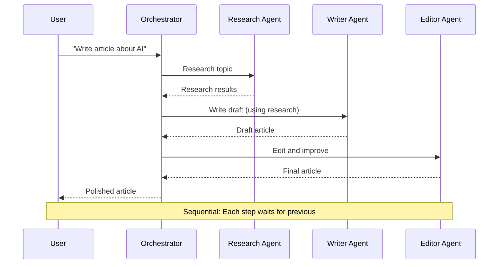
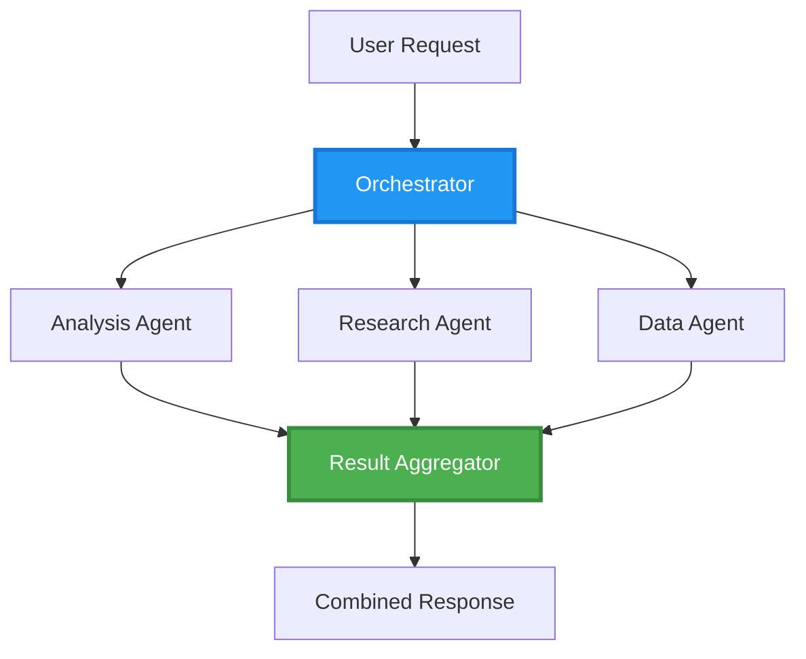
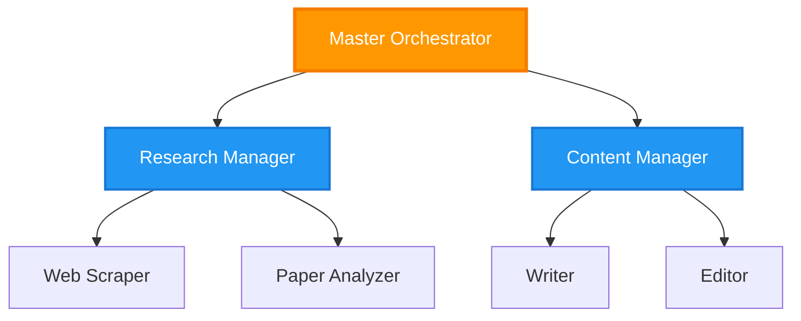
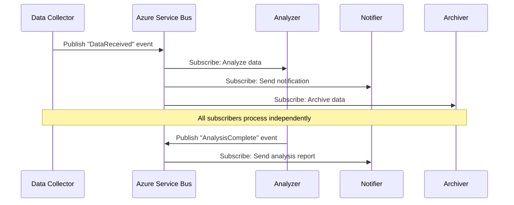
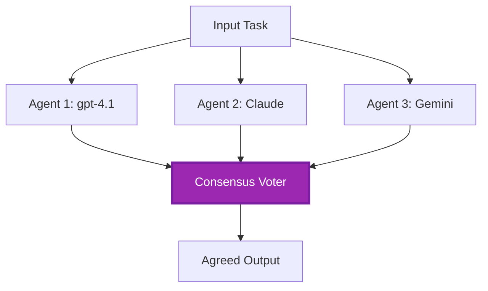
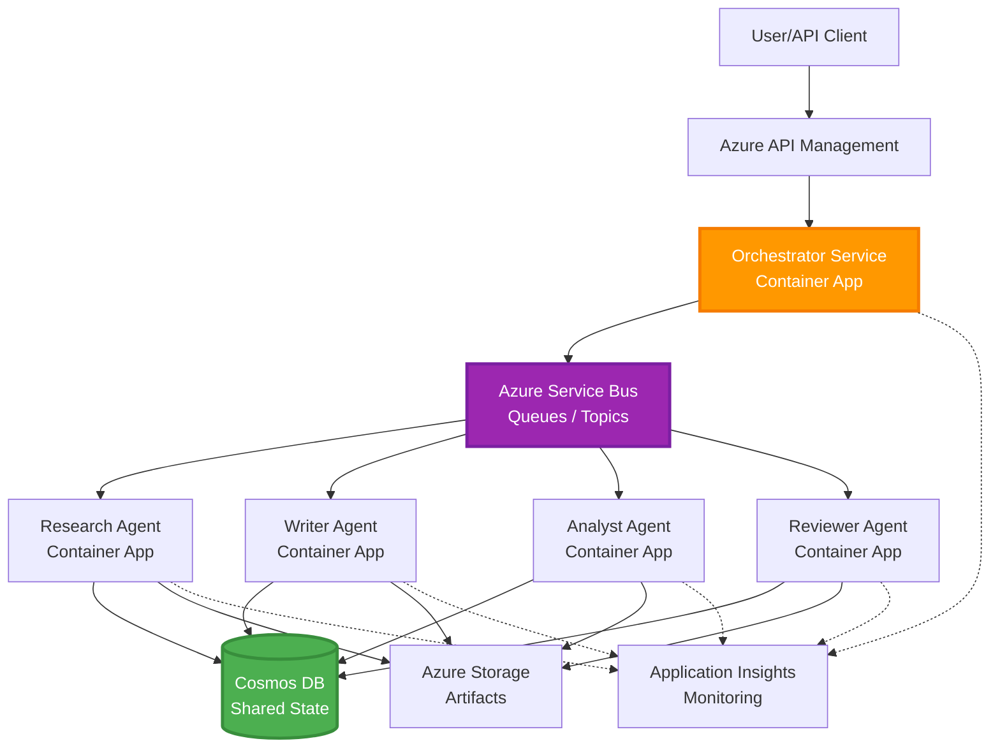

# Модели за координация на многоагентни системи

⏱️ **Оценено време**: 60-75 минути четене; няколко часа за изпълнение | 💰 **Оценена цена**: зависи от натоварването | ⭐ **Сложност**: Напреднали

**📚 Учебен път:**
- ← Предишен: [Планиране на капацитета](capacity-planning.md) - Стратегии за оразмеряване и мащабиране на ресурси
- 🎯 **Тук сте**: Модели за координация на многоагентни системи (Оркестрация, комуникация, управление на състоянието)
- → Следващ: [Избор на SKU](sku-selection.md) - Избор на подходящи услуги на Azure
- 🏠 [Начална страница на курса](../../README.md)

---

## Какво ще научите

Чрез завършване на този урок ще:
- Разберете шаблони на **многоагентната архитектура** и кога да ги използвате
- Изпълните **оркестрационни модели** (централизирани, децентрализирани, йерархични)
- Проектирате стратегии за **комуникация между агенти** (синхронен, асинхронен, събитийно задвижван)
- Управлявате **споделеното състояние** между разпределени агенти
- Деплойвате **многоагентни системи** в Azure с AZD
- Прилагате **шаблони за координация** за реални AI сценарии
- Наблюдавате и отстранявате грешки в разпределени агентски системи

## Защо координацията на многоагентни системи е важна

### Еволюция: От единичен агент към многоагентна система

**Единичен агент (опростен):**
```
User → Agent → Response
```
- ✅ Лесен за разбиране и изпълнение
- ✅ Бърз за прости задачи
- ❌ Ограничен от възможностите на един модел
- ❌ Не може да извършва паралелно сложни задачи
- ❌ Липсва специализация

**Многоагентна система (напреднала):**

- ✅ Специализирани агенти за конкретни задачи
- ✅ Паралелно изпълнение за по-бърза работа
- ✅ Модулна и поддържима
- ✅ По-добра при сложни работни потоци
- ⚠️ Изисква координационна логика

**Аналогия**: Единичен агент е като един човек, който върши всички задачи. Многоагентна система е като екип, където всеки член притежава специализирани умения (изследовател, програмист, преглеждач, писател), които работят заедно.

---

## Основни модели за координация

### Модел 1: Последователна координация (Верига на отговорност)

**Кога да се използва**: Задачите трябва да се изпълняват в определен ред, всеки агент надгражда предишния резултат.



**Предимства:**
- ✅ Ясен поток на данни
- ✅ Лесно за отстраняване на грешки
- ✅ Предвидим ред на изпълнение

**Ограничения:**
- ❌ По-бавно (липсва паралелизъм)
- ❌ Една грешка блокира цялата верига
- ❌ Не може да обработва взаимнозависими задачи

**Примери за използване:**
- Конвейер за създаване на съдържание (проучване → писане → редактиране → публикация)
- Генериране на код (планиране → изпълнение → тестване → внедряване)
- Генериране на отчети (събиране на данни → анализ → визуализация → резюме)

---

### Модел 2: Паралелна координация (Fan-Out/Fan-In)

**Кога да се използва**: Независими задачи могат да се изпълняват едновременно, а резултатите се комбинират накрая.



**Предимства:**
- ✅ Бързо (паралелно изпълнение)
- ✅ Устойчив на грешки (частични резултати са приемливи)
- ✅ Хоризонтално мащабируем

**Ограничения:**
- ⚠️ Резултатите могат да пристигнат в произволен ред
- ⚠️ Изисква логика за агрегиране
- ⚠️ Сложно управление на състоянието

**Примери за използване:**
- Събиране на данни от множество източници (API-та + бази данни + уеб скрейпинг)
- Конкурентен анализ (няколко модела генерират решения, избира се най-доброто)
- Преводни услуги (едновременно превеждане на няколко езика)

---

### Модел 3: Йерархична координация (Мениджър-Служител)

**Кога да се използва**: Сложни работни потоци с подзадачи, нужда от делегиране.



**Предимства:**
- ✅ Обработва сложни работни потоци
- ✅ Модулна и поддържима
- ✅ Ясни граници на отговорност

**Ограничения:**
- ⚠️ По-сложна архитектура
- ⚠️ По-висока латентност (няколко слоя на координация)
- ⚠️ Изисква сложна оркестрация

**Примери за използване:**
- Обработване на фирмени документи (классифициране → насочване → обработка → архивиране)
- Многостъпални конвейери за данни (въвеждане → почистване → трансформация → анализ → докладване)
- Сложни автоматизирани работни потоци (планиране → разпределяне на ресурси → изпълнение → наблюдение)

---

### Модел 4: Събитийно задвижвана координация (Публикувай-Абонирай се)

**Кога да се използва**: Агенти трябва да реагират на събития, желателна е слаба свързаност.



**Предимства:**
- ✅ Слаба свързаност между агенти
- ✅ Лесно добавяне на нови агенти (просто се абонират)
- ✅ Асинхронна обработка
- ✅ Устойчивост (съхранение на съобщения)

**Ограничения:**
- ⚠️ Крайна консистентност
- ⚠️ Сложно отстраняване на грешки
- ⚠️ Проблеми с реда на съобщенията

**Примери за използване:**
- Системи за мониторинг в реално време (аларми, табла, логове)
- Много канални известия (имейл, SMS, push, Slack)
- Конвейери за обработка на данни (няколко консуматора на едни и същи данни)

---

### Модел 5: Координация на базата на консенсус (Гласуване/Кворум)

**Кога да се използва**: Изисква се съгласие от няколко агенти преди продължаване.



**Предимства:**
- ✅ По-висока точност (няколко мнения)
- ✅ Устойчив на грешки (малки неизправности са допустими)
- ✅ Вградена гаранция за качество

**Ограничения:**
- ❌ Скъп (множество повиквания към модели)
- ❌ По-бавно (чака се всички агенти)
- ⚠️ Необходима е логика за разрешаване на конфликти

**Примери за използване:**
- Модериране на съдържание (множество модели преглеждат съдържание)
- Преглед на код (множество линтери/анализатори)
- Медицинска диагноза (няколко AI модела, проверка от експерти)

---

## Обзор на архитектурата

### Пълна многоагентна система в Azure



**Ключови компоненти:**

| Компонент | Цел | Услуга на Azure |
|-----------|---------|---------------|
| **API Gateway** | Входна точка, ограничаване на честотата, автентикация | API Management |
| **Оркестратор** | Координира агентските работни потоци | Container Apps |
| **Опашка за съобщения** | Асинхронна комуникация | Service Bus / Event Hubs |
| **Агенти** | Специализирани AI работници | Container Apps / Functions |
| **Магазин за състояние** | Споделено състояние, проследяване на задачи | Cosmos DB |
| **Хранилище на артефакти** | Документи, резултати, логове | Blob Storage |
| **Мониторинг** | Разпределен трасиране, логове | Application Insights |

Опашките/топиците на Service Bus и Event Hubs са различни услуги с различни модели за доставка/консумация; Event Hubs не е директен заместител за Service Bus worker кода по-долу. Паралелизмът, запаметените съобщения и гласуването на модели сами по себе си не гарантират устойчивост на грешки или по-висока точност.

---

## Предварителни изисквания

### Необходими инструменти

```bash
# Verify Azure Developer CLI
azd version
# Command reference baseline: azd 1.37.2

# Verify Azure CLI
az --version
# ✅ Expected: azure-cli 2.50.0 or higher

# Verify Docker (for local testing)
docker --version
# ✅ Expected: Docker version 20.10 or higher
```

### Изисквания за Azure

- Активен абонамент за Azure
- Права за създаване на:
  - Container Apps
  - Service Bus namespaces
  - Cosmos DB акаунти
  - Storage акаунти
  - Application Insights

### Знания

Трябва да сте завършили:
- [Управление на конфигурации](../chapter-03-configuration/configuration.md)
- [Автентикация и сигурност](../chapter-03-configuration/authsecurity.md)
- [Пример за микросервизи](../../../../examples/microservices)

---

## Ръководство за изпълнение

> **Дизайнерски фрагменти, а не изпълнимо лабораторно упражнение:** Дървото на проекта и етикетите `File:` по-долу описват файловете, които да създадете във вашия проект; това хранилище не съдържа пълно коя-инг `multi-agent-system` приложение. Липсват основните шаблони/параметри, среда/регистри за Container Apps, Dockerfile-и и блокирания на зависимости, настройка на Cosmos база/контейнери, deployment на модели, конфигурации на идентичност/роли, правила за мащабиране и паралелни работници/опашки. Не очаквайте `azd init` да генерира тези файлове или `azd up` да деплойва фрагментите без промени. За изпълним начален проект завършете [Основи на многоагентните системи](../chapter-05-multi-agent/multi-agent-basics.md).

**Предварителни изисквания при изпълнение:** Python 3.10+, `azure-servicebus`, `azure-cosmos`, `openai`, Flask и (за мониторинг) `azure-monitor-opentelemetry`; добавете `shared` в пътя за импортиране на Python във всяко контейнерно изображение. Контейнерът `agent-state/tasks` на Cosmos трябва вече да съществува с partition key `/id`. Свързването с ключове опростява тези фрагменти, но не е препоръка за продукция: предпочитайте управлявани идентичности с роли за Service Bus/Cosmos/OpenAI. Не излагайте ключове в изходи или логове.

Доставката на Service Bus е **поне веднъж**. Запазвайте идемпотентност за всяка задача **и стъпка**, използвайте оптимистична конкуренция (ETags) за четене/промяна/запис на състояние и обновявайте блокировките на съобщения по време на дълга обработка. Простият мениджър на състоянието долу е само последователен и не прилага тези гаранции за продукция.

### Структура на проекта

```
multi-agent-system/
├── azure.yaml                    # AZD configuration
├── infra/
│   ├── main.bicep               # Main infrastructure
│   ├── core/
│   │   ├── servicebus.bicep     # Message queue
│   │   ├── cosmos.bicep         # State store
│   │   ├── storage.bicep        # Artifact storage
│   │   └── monitoring.bicep     # Application Insights
│   └── app/
│       ├── orchestrator.bicep   # Orchestrator service
│       └── agent.bicep          # Agent template
└── src/
    ├── orchestrator/            # Orchestration logic
    │   ├── app.py
    │   ├── workflows.py
    │   └── Dockerfile
    ├── agents/
    │   ├── research/            # Research agent
    │   ├── writer/              # Writer agent
    │   ├── analyst/             # Analyst agent
    │   └── reviewer/            # Reviewer agent
    └── shared/
        ├── state_manager.py     # Shared state logic
        └── message_handler.py   # Message handling
```

---

## Урок 1: Модел за последователна координация

### Изпълнение: Конвейер за създаване на съдържание

Нека проектираме последователен конвейер: Проучване → Писане → Редактиране. Публикуването е извън примера.

### 1. Конфигурация на AZD

**Файл: `azure.yaml`**

```yaml
name: content-pipeline
metadata:
  template: multi-agent-sequential@1.0.0

services:
  orchestrator:
    project: ./src/orchestrator
    language: python
    host: containerapp
  
  research-agent:
    project: ./src/agents/research
    language: python
    host: containerapp
  
  writer-agent:
    project: ./src/agents/writer
    language: python
    host: containerapp
  
  editor-agent:
    project: ./src/agents/editor
    language: python
    host: containerapp
```

### 2. Инфраструктура: Service Bus за координация

**Файл: `infra/core/servicebus.bicep`**

```bicep
param name string
param location string
param tags object = {}

resource serviceBusNamespace 'Microsoft.ServiceBus/namespaces@2022-10-01-preview' = {
  name: name
  location: location
  tags: tags
  sku: {
    name: 'Standard'
    tier: 'Standard'
  }
  properties: {
    minimumTlsVersion: '1.2'
  }
}

// Queue for orchestrator → research agent
resource researchQueue 'Microsoft.ServiceBus/namespaces/queues@2022-10-01-preview' = {
  parent: serviceBusNamespace
  name: 'research-tasks'
  properties: {
    maxDeliveryCount: 3
    lockDuration: 'PT5M'
    deadLetteringOnMessageExpiration: true
  }
}

// Queue for research agent → writer agent
resource writerQueue 'Microsoft.ServiceBus/namespaces/queues@2022-10-01-preview' = {
  parent: serviceBusNamespace
  name: 'writer-tasks'
  properties: {
    maxDeliveryCount: 3
    lockDuration: 'PT5M'
  }
}

// Queue for writer agent → editor agent
resource editorQueue 'Microsoft.ServiceBus/namespaces/queues@2022-10-01-preview' = {
  parent: serviceBusNamespace
  name: 'editor-tasks'
  properties: {
    maxDeliveryCount: 3
    lockDuration: 'PT5M'
  }
}

output namespace string = serviceBusNamespace.name
// Do not output RootManageSharedAccessKey. Resolve scoped credentials
// securely or use managed identity in the application and scale rules.
```

### 3. Мениджър на споделено състояние

**Файл: `src/shared/state_manager.py`**

```python
from azure.cosmos import CosmosClient, PartitionKey
from datetime import datetime, timezone
import os

class StateManager:
    """Manages shared state across agents using Cosmos DB"""
    
    def __init__(self):
        endpoint = os.environ['COSMOS_ENDPOINT']
        key = os.environ['COSMOS_KEY']
        
        self.client = CosmosClient(endpoint, key)
        self.database = self.client.get_database_client('agent-state')
        self.container = self.database.get_container_client('tasks')
    
    def create_task(self, task_id: str, task_type: str, input_data: dict):
        """Create a new task"""
        task = {
            'id': task_id,
            'type': task_type,
            'status': 'pending',
            'input': input_data,
            'created_at': datetime.now(timezone.utc).isoformat(),
            'steps': []
        }
        self.container.create_item(task)
        return task
    
    def update_task_step(self, task_id: str, step_name: str, result: dict):
        """Update task with completed step"""
        task = self.container.read_item(task_id, partition_key=task_id)
        
        task['steps'].append({
            'name': step_name,
            'completed_at': datetime.now(timezone.utc).isoformat(),
            'result': result
        })
        
        self.container.replace_item(task_id, task)
        return task
    
    def complete_task(self, task_id: str, final_result: dict):
        """Mark task as complete"""
        task = self.container.read_item(task_id, partition_key=task_id)
        task['status'] = 'completed'
        task['result'] = final_result
        task['completed_at'] = datetime.now(timezone.utc).isoformat()
        self.container.replace_item(task_id, task)
        return task
    
    def get_task(self, task_id: str):
        """Retrieve task state"""
        return self.container.read_item(task_id, partition_key=task_id)
```

### 4. Оркестратор услуга

**Файл: `src/orchestrator/app.py`**

```python
from flask import Flask, request, jsonify
from azure.servicebus import ServiceBusClient, ServiceBusMessage
import json
import uuid
import os
from shared.state_manager import StateManager

app = Flask(__name__)
state_manager = StateManager()

# Service Bus connection
servicebus_connection_str = os.environ['SERVICEBUS_CONNECTION_STRING']
servicebus_client = ServiceBusClient.from_connection_string(servicebus_connection_str)

@app.route('/health', methods=['GET'])
def health():
    return jsonify({'status': 'healthy', 'service': 'orchestrator'})

@app.route('/create-content', methods=['POST'])
def create_content():
    """
    Sequential workflow: Research → Write → Edit (returns a draft; no publishing)
    """
    data = request.get_json(silent=True) or {}
    topic = data.get('topic')
    
    if not topic:
        return jsonify({'error': 'Topic required'}), 400
    
    # Create task in state store
    task_id = str(uuid.uuid4())
    task = state_manager.create_task(
        task_id=task_id,
        task_type='content_creation',
        input_data={'topic': topic}
    )
    
    # Send message to research agent (first step)
    sender = servicebus_client.get_queue_sender('research-tasks')
    message = ServiceBusMessage(
        body=json.dumps({
            'task_id': task_id,
            'topic': topic,
            'next_queue': 'writer-tasks'  # Where to send results
        }),
        content_type='application/json'
    )
    
    with sender:
        sender.send_messages(message)
    
    return jsonify({
        'task_id': task_id,
        'status': 'started',
        'workflow': 'sequential',
        'steps': ['research', 'write', 'edit'],
        'message': 'Content creation pipeline initiated'
    }), 202

@app.route('/task/<task_id>', methods=['GET'])
def get_task_status(task_id):
    """Check task status"""
    try:
        task = state_manager.get_task(task_id)
        return jsonify(task)
    except Exception as e:
        return jsonify({'error': str(e)}), 404

if __name__ == '__main__':
    app.run(host='0.0.0.0', port=8080)
```

### 5. Агент за проучване

**Файл: `src/agents/research/app.py`**

```python
from azure.servicebus import ServiceBusClient, ServiceBusMessage
from openai import AzureOpenAI
import json
import os
import time
from shared.state_manager import StateManager

# Initialize clients
state_manager = StateManager()
servicebus_client = ServiceBusClient.from_connection_string(
    os.environ['SERVICEBUS_CONNECTION_STRING']
)

openai_client = AzureOpenAI(
    api_key=os.environ['AZURE_OPENAI_API_KEY'],
    api_version="2024-10-21",
    azure_endpoint=os.environ['AZURE_OPENAI_ENDPOINT']
)

def process_research_task(message_data):
    """Process research request and pass to writer"""
    task_id = message_data['task_id']
    topic = message_data['topic']
    next_queue = message_data['next_queue']
    
    print(f"🔬 Researching: {topic}")
    
    # Call Microsoft Foundry Models for research
    response = openai_client.chat.completions.create(
        model=os.environ['AZURE_OPENAI_DEPLOYMENT'],
        messages=[
            {"role": "system", "content": "You are a research assistant. Provide comprehensive research on the given topic."},
            {"role": "user", "content": f"Research this topic thoroughly: {topic}"}
        ],
        max_tokens=1500
    )
    
    research_results = response.choices[0].message.content
    
    # Update state
    state_manager.update_task_step(
        task_id=task_id,
        step_name='research',
        result={'research': research_results}
    )
    
    # Send to next agent (writer)
    sender = servicebus_client.get_queue_sender(next_queue)
    message = ServiceBusMessage(
        body=json.dumps({
            'task_id': task_id,
            'topic': topic,
            'research': research_results,
            'next_queue': 'editor-tasks'
        }),
        content_type='application/json'
    )
    
    with sender:
        sender.send_messages(message)
    
    print(f"✅ Research complete for task {task_id}")

def main():
    """Listen to research queue"""
    receiver = servicebus_client.get_queue_receiver('research-tasks')
    
    print("🔬 Research Agent started, listening for tasks...")
    
    with receiver:
        while True:
            messages = receiver.receive_messages(max_wait_time=5)
            for message in messages:
                try:
                    message_data = json.loads(str(message))
                    process_research_task(message_data)
                    receiver.complete_message(message)
                except Exception as e:
                    print(f"❌ Error processing message: {e}")
                    receiver.abandon_message(message)

if __name__ == '__main__':
    main()
```

### 6. Агент писател

**Файл: `src/agents/writer/app.py`**

```python
from azure.servicebus import ServiceBusClient, ServiceBusMessage
from openai import AzureOpenAI
import json
import os
from shared.state_manager import StateManager

state_manager = StateManager()
servicebus_client = ServiceBusClient.from_connection_string(
    os.environ['SERVICEBUS_CONNECTION_STRING']
)

openai_client = AzureOpenAI(
    api_key=os.environ['AZURE_OPENAI_API_KEY'],
    api_version="2024-10-21",
    azure_endpoint=os.environ['AZURE_OPENAI_ENDPOINT']
)

def process_writing_task(message_data):
    """Write article based on research"""
    task_id = message_data['task_id']
    topic = message_data['topic']
    research = message_data['research']
    next_queue = message_data['next_queue']
    
    print(f"✍️ Writing article: {topic}")
    
    # Call Microsoft Foundry Models to write article
    response = openai_client.chat.completions.create(
        model=os.environ['AZURE_OPENAI_DEPLOYMENT'],
        messages=[
            {"role": "system", "content": "You are a professional writer. Write engaging, well-structured articles."},
            {"role": "user", "content": f"Based on this research:\n\n{research}\n\nWrite a comprehensive article about: {topic}"}
        ],
        max_tokens=2000
    )
    
    article_draft = response.choices[0].message.content
    
    # Update state
    state_manager.update_task_step(
        task_id=task_id,
        step_name='writing',
        result={'draft': article_draft}
    )
    
    # Send to editor
    sender = servicebus_client.get_queue_sender(next_queue)
    message = ServiceBusMessage(
        body=json.dumps({
            'task_id': task_id,
            'topic': topic,
            'draft': article_draft
        }),
        content_type='application/json'
    )
    
    with sender:
        sender.send_messages(message)
    
    print(f"✅ Article draft complete for task {task_id}")

def main():
    """Listen to writer queue"""
    receiver = servicebus_client.get_queue_receiver('writer-tasks')
    
    print("✍️ Writer Agent started, listening for tasks...")
    
    with receiver:
        while True:
            messages = receiver.receive_messages(max_wait_time=5)
            for message in messages:
                try:
                    message_data = json.loads(str(message))
                    process_writing_task(message_data)
                    receiver.complete_message(message)
                except Exception as e:
                    print(f"❌ Error: {e}")
                    receiver.abandon_message(message)

if __name__ == '__main__':
    main()
```

### 7. Агент редактор

**Файл: `src/agents/editor/app.py`**

```python
from azure.servicebus import ServiceBusClient
from openai import AzureOpenAI
import json
import os
from shared.state_manager import StateManager

state_manager = StateManager()
servicebus_client = ServiceBusClient.from_connection_string(
    os.environ['SERVICEBUS_CONNECTION_STRING']
)

openai_client = AzureOpenAI(
    api_key=os.environ['AZURE_OPENAI_API_KEY'],
    api_version="2024-10-21",
    azure_endpoint=os.environ['AZURE_OPENAI_ENDPOINT']
)

def process_editing_task(message_data):
    """Edit and finalize article"""
    task_id = message_data['task_id']
    topic = message_data['topic']
    draft = message_data['draft']
    
    print(f"📝 Editing article: {topic}")
    
    # Call Microsoft Foundry Models to edit
    response = openai_client.chat.completions.create(
        model=os.environ['AZURE_OPENAI_DEPLOYMENT'],
        messages=[
            {"role": "system", "content": "You are an expert editor. Improve grammar, clarity, and structure."},
            {"role": "user", "content": f"Edit and improve this article:\n\n{draft}"}
        ],
        max_tokens=2000
    )
    
    final_article = response.choices[0].message.content
    
    # Mark task as complete
    state_manager.complete_task(
        task_id=task_id,
        final_result={
            'topic': topic,
            'final_article': final_article,
            'word_count': len(final_article.split())
        }
    )
    
    print(f"✅ Article finalized for task {task_id}")

def main():
    """Listen to editor queue"""
    receiver = servicebus_client.get_queue_receiver('editor-tasks')
    
    print("📝 Editor Agent started, listening for tasks...")
    
    with receiver:
        while True:
            messages = receiver.receive_messages(max_wait_time=5)
            for message in messages:
                try:
                    message_data = json.loads(str(message))
                    process_editing_task(message_data)
                    receiver.complete_message(message)
                except Exception as e:
                    print(f"❌ Error: {e}")
                    receiver.abandon_message(message)

if __name__ == '__main__':
    main()
```

### 8. Деплой и тест

Тези команди важат **само след като реализирате липсващите файлове от проекта**. Инициализацията на агента от Foundry е отделен процес; той не генерира дизайна за Service Bus.

```bash
# In your completed custom project
azd up

# Alternative in a SEPARATE empty folder (GA bundle workflow requires azd >= 1.37.0)
azd ext install microsoft.foundry
azd ai agent init
azd up
```

> Вижте [Команди на AZD AI CLI](../chapter-08-production/production-ai-practices.md#azd-ai-cli-commands-and-extensions) за всички флагове и опции `azd ai`.

```bash
# Get orchestrator URL
ORCHESTRATOR_URL=$(azd env get-values | grep ORCHESTRATOR_URL | cut -d '=' -f2 | tr -d '"')

# Create content
curl -X POST $ORCHESTRATOR_URL/create-content \
  -H "Content-Type: application/json" \
  -d '{"topic": "The Future of AI in Healthcare"}'
```

**✅ Очакван изход:**
```json
{
  "task_id": "a1b2c3d4-e5f6-7890-abcd-ef1234567890",
  "status": "started",
  "workflow": "sequential",
  "steps": ["research", "write", "edit"],
  "message": "Content creation pipeline initiated"
}
```

**Проверка на напредъка по задачите:**
```bash
TASK_ID="a1b2c3d4-e5f6-7890-abcd-ef1234567890"
curl $ORCHESTRATOR_URL/task/$TASK_ID
```

**✅ Очакван изход (завършено):**
```json
{
  "id": "a1b2c3d4-e5f6-7890-abcd-ef1234567890",
  "type": "content_creation",
  "status": "completed",
  "steps": [
    {
      "name": "research",
      "completed_at": "2025-11-19T10:30:00Z",
      "result": {"research": "..."}
    },
    {
      "name": "writing",
      "completed_at": "2025-11-19T10:32:00Z",
      "result": {"draft": "..."}
    }
  ],
  "result": {
    "topic": "The Future of AI in Healthcare",
    "final_article": "...",
    "word_count": 1500
  }
}
```

---

## Урок 2: Модел за паралелна координация

### Изпълнение: Агрегатор на проучвания от множество източници

Нека създадем паралелна система, която събира информация от няколко източника едновременно.

### Паралелен оркестратор

**Файл: `src/orchestrator/parallel_workflow.py`**

```python
from flask import Flask, request, jsonify
from azure.servicebus import ServiceBusClient, ServiceBusMessage
import json
import uuid
import os
from shared.state_manager import StateManager

app = Flask(__name__)
state_manager = StateManager()

servicebus_client = ServiceBusClient.from_connection_string(
    os.environ['SERVICEBUS_CONNECTION_STRING']
)

@app.route('/research-parallel', methods=['POST'])
def research_parallel():
    """
    Parallel workflow: Multiple agents work simultaneously
    """
    data = request.json
    query = data.get('query')
    
    task_id = str(uuid.uuid4())
    task = state_manager.create_task(
        task_id=task_id,
        task_type='parallel_research',
        input_data={
            'query': query,
            'agents': ['web', 'academic', 'news', 'social']
        }
    )
    
    # Fan-out: publish sequentially; workers may process concurrently.
    agents = [
        ('web-research-queue', 'web'),
        ('academic-research-queue', 'academic'),
        ('news-research-queue', 'news'),
        ('social-research-queue', 'social')
    ]
    
    for queue_name, agent_type in agents:
        sender = servicebus_client.get_queue_sender(queue_name)
        message = ServiceBusMessage(
            body=json.dumps({
                'task_id': task_id,
                'query': query,
                'agent_type': agent_type,
                'result_queue': 'aggregation-queue'
            }),
            content_type='application/json'
        )
        
        with sender:
            sender.send_messages(message)
    
    return jsonify({
        'task_id': task_id,
        'status': 'started',
        'workflow': 'parallel',
        'agents_dispatched': 4,
        'message': 'Parallel research initiated'
    }), 202

if __name__ == '__main__':
    app.run(host='0.0.0.0', port=8080)
```

### Логика за агрегиране

**Файл: `src/agents/aggregator/app.py`**

```python
from azure.servicebus import ServiceBusClient
import json
import os
from collections import defaultdict
from shared.state_manager import StateManager

state_manager = StateManager()
servicebus_client = ServiceBusClient.from_connection_string(
    os.environ['SERVICEBUS_CONNECTION_STRING']
)

# Single-process demo only: not durable or shared across replicas.
# Production: use durable unique (task_id, agent_type) result records.
task_results = defaultdict(dict)
expected_agents = 4  # web, academic, news, social

def process_result(message_data):
    """Aggregate results from parallel agents"""
    task_id = message_data['task_id']
    agent_type = message_data['agent_type']
    result = message_data['result']
    
    # Store result
    task_results[task_id][agent_type] = {
        'agent': agent_type,
        'data': result
    }
    
    print(f"📊 Received result from {agent_type} agent ({len(task_results[task_id])}/{expected_agents})")
    
    # Check if all agents completed (fan-in)
    if len(task_results[task_id]) == expected_agents:
        print(f"✅ All agents completed for task {task_id}. Aggregating...")
        
        # Combine results
        aggregated = {
            'query': message_data['query'],
            'sources': list(task_results[task_id].values()),
            'summary': generate_summary(list(task_results[task_id].values()))
        }
        
        # Mark complete
        state_manager.complete_task(task_id, aggregated)
        
        # Clean up
        del task_results[task_id]
        
        print(f"✅ Aggregation complete for task {task_id}")

def generate_summary(results):
    """Generate summary from all sources"""
    summaries = [r['data'].get('summary', '') for r in results]
    return '\n\n'.join(summaries)

def main():
    """Listen to aggregation queue"""
    receiver = servicebus_client.get_queue_receiver('aggregation-queue')
    
    print("📊 Aggregator started, listening for results...")
    
    with receiver:
        while True:
            messages = receiver.receive_messages(max_wait_time=5)
            for message in messages:
                try:
                    message_data = json.loads(str(message))
                    process_result(message_data)
                    receiver.complete_message(message)
                except Exception as e:
                    print(f"❌ Error: {e}")
                    receiver.abandon_message(message)

if __name__ == '__main__':
    main()
```

**Предимства на паралелния модел:**
- ⚡ **Потенциално по-ниска латентност** (ограничена от най-бавния работник плюс координационни разходи)
- 🔄 **Поддържа частични резултати** с изрични крайни срокове и политика за неуспех (не е реализирано в базовия агрегатор)
- 📈 **Мащабируем** (лесно се добавят нови агенти)

---

## Практически упражнения

### Упражнение 1: Добавяне на timeout обработка ⭐⭐ (Средно)

**Цел**: Реализирайте логика за timeout, за да не чака агрегаторът безкрайно за бавни агенти.

**Начална точка:** Стартирайте тази локална симулация на крайни срокове преди да я интегрирате в опашков работник. Timeout проверявана само при пристигане на друго съобщение никога не се задейства, ако липсващият работник не изпраща нищо.

**Стъпки**:

1. **Добавете проследяване на timeout в агрегатора:**

```python
import asyncio

async def simulated_agent(name, delay):
    await asyncio.sleep(delay)
    return {'agent': name, 'result': 'done'}

async def main():
    tasks = [asyncio.create_task(simulated_agent(name, delay))
             for name, delay in [('web', 0.1), ('academic', 0.2),
                                 ('news', 0.3), ('social', 3)]]
    done, pending = await asyncio.wait(tasks, timeout=1)
    results = [task.result() for task in done]
    for task in pending:
        task.cancel()
    await asyncio.gather(*pending, return_exceptions=True)
    print({'completed_agents': len(results), 'timed_out': bool(pending)})
    assert len(results) == 3 and pending

asyncio.run(main())
```

2. **Очакван изход:**

```text
{'completed_agents': 3, 'timed_out': True}
```

3. **Интеграция с опашкова система (дизайнерска задача):** Запазете крайния срок и очакваните агенти при създаване на задачата, извършвайте периодично почистване на изтеклите задачи независимо от постъпващи резултати, атомарно финализирайте частични резултати и игнорирайте късни/дублирани съобщения за финализирани задачи. Локалният timeout не отменя отдалечени работници.

Само за реализирания проект:

```bash
azd deploy aggregator

# Submit task
curl -X POST $ORCHESTRATOR_URL/research-parallel \
  -H "Content-Type: application/json" \
  -d '{"query": "AI safety research"}'

# Check results after 30 seconds
curl $ORCHESTRATOR_URL/task/$TASK_ID
```

**✅ Критерии за успех:**
- ✅ Локалният тест връща резултат след едносекундния край на срока, дори ако агент е незавършен
- ✅ Отговорът посочва частични резултати (`"timed_out": true`)
- ✅ Връщат се налични резултати (3 от 4 агенти)

**Време**: 20-25 минути

---

### Упражнение 2: Реализиране на логика за повторен опит ⭐⭐⭐ (Напреднал)

**Цел**: Автоматично повторение на неуспешни агентски задачи преди отказ.

**Стъпки**:

1. **Използвайте броя на доставките на Service Bus вместо да имплементирате собствени броячи за повторения:**

```python
import json
import time
# Integration fragment: use a live peek-lock ServiceBusReceiver.
# Set queue maxDeliveryCount to 4 for one attempt + up to three retries.
```

2. **Добавете обработка на повторни опити за агенти:**

```python
def process_with_retry(message, receiver, process_func):
    """Process message with automatic retry on failure"""
    try:
        message_data = json.loads(str(message))
        
        # Process the message
        process_func(message_data)
        
        # Success - complete
        receiver.complete_message(message)
        
    except Exception as e:
        if message.delivery_count < 4:
            # Bounded exponential delay: 5s, 10s, 20s.
            # Renew the lock if processing + waiting can exceed its duration.
            time.sleep(5 * 2 ** (message.delivery_count - 1))
            receiver.abandon_message(message)
        else:
            # Max retries exceeded - move to dead letter queue
            print(f"❌ Max attempts exceeded for message {message.message_id}")
            receiver.dead_letter_message(
                message,
                reason="MaxRetriesExceeded",
                error_description=str(e)
            )
```

3. **Наблюдавайте опашката за „dead letter“ съобщения:**

```python
def monitor_dead_letters():
    """Check dead letter queue for failed messages"""
    receiver = servicebus_client.get_queue_receiver(
        'research-tasks',
        sub_queue='deadletter'
    )
    
    with receiver:
        messages = receiver.receive_messages(max_wait_time=5)
        for message in messages:
            print(f"☠️ Dead letter: {message.message_id}")
            print(f"Reason: {message.dead_letter_reason}")
            print(f"Description: {message.dead_letter_error_description}")
```

**✅ Критерии за успех:**
- ✅ Неуспешните задачи се повтарят автоматично (до 3 пъти)
- ✅ Експоненциално изчакване между опитите (5с, 10с, 20с) с обновяване на блокировката на съобщението при нужда
- ✅ След максимален брой опити, съобщенията отиват в опашка „dead letter“
- ✅ Съобщенията в „dead letter“ могат да бъдат инспектирани; повторното им изпълнение изисква отделен идемпотентен процес за възстановяване

**Време**: 30-40 минути

---

### Упражнение 3: Реализиране на Circuit Breaker ⭐⭐⭐ (Напреднал)

**Цел**: Предотвратяване на каскадни грешки чрез спиране на заявки към нестабилни агенти.

**Стъпки**:

1. **Създайте клас за Circuit Breaker:**

```python
from enum import Enum
from datetime import datetime, timedelta, timezone

class CircuitState(Enum):
    CLOSED = "closed"      # Normal operation
    OPEN = "open"          # Failing, reject requests
    HALF_OPEN = "half_open"  # Testing if recovered

class CircuitBreaker:
    def __init__(self, failure_threshold=5, timeout_seconds=60):
        self.failure_threshold = failure_threshold
        self.timeout_seconds = timeout_seconds
        self.failure_count = 0
        self.last_failure_time = None
        self.state = CircuitState.CLOSED
    
    def call(self, func):
        """Execute function with circuit breaker protection"""
        if self.state == CircuitState.OPEN:
            # Check if timeout expired
            if datetime.now(timezone.utc) - self.last_failure_time > timedelta(seconds=self.timeout_seconds):
                self.state = CircuitState.HALF_OPEN
                print("🔄 Circuit breaker: HALF_OPEN (testing)")
            else:
                raise Exception(f"Circuit breaker OPEN for agent. Try again in {self.timeout_seconds}s")
        
        try:
            result = func()
            
            # Success
            self.failure_count = 0 # Count consecutive failures only
            if self.state == CircuitState.HALF_OPEN:
                self.state = CircuitState.CLOSED
                self.failure_count = 0
                print("✅ Circuit breaker: CLOSED (recovered)")
            
            return result
            
        except Exception as e:
            self.failure_count += 1
            self.last_failure_time = datetime.now(timezone.utc)
            
            if self.failure_count >= self.failure_threshold:
                self.state = CircuitState.OPEN
                print(f"🔴 Circuit breaker: OPEN (too many failures)")
            
            raise
```

2. **Прилагайте към повикванията на агенти:**

```python
# In orchestrator
agent_circuits = {
    'web': CircuitBreaker(failure_threshold=5, timeout_seconds=60),
    'academic': CircuitBreaker(failure_threshold=5, timeout_seconds=60),
    'news': CircuitBreaker(failure_threshold=5, timeout_seconds=60),
    'social': CircuitBreaker(failure_threshold=5, timeout_seconds=60)
}

def send_to_agent(agent_type, message_data):
    """Send with circuit breaker protection"""
    circuit = agent_circuits[agent_type]
    
    try:
        circuit.call(lambda: send_message(agent_type, message_data))
    except Exception as e:
        print(f"⚠️ Skipping {agent_type} agent: {e}")
        # Continue with other agents
```

Тази схема защитава **операцията на изпращане**, а не завършването от отдалечения работник: успешно поставяне на съобщение в опашката не означава, че агентът е жив. `send_message` е функцията на вашето приложение за изпращане. При схеми за изпълнение, въвеждайте наблюдавани провали/таймаути на задачи в устойчив координатор. Този клас в паметта е демонстрация за еднопоточна работа, а не разпределен прекъсвач на веригата.

3. **Тествайте прекъсвача на веригата локално:**

```python
# Run after the class definition; no Azure changes required.
circuit = CircuitBreaker(failure_threshold=5, timeout_seconds=0)
def fail():
    raise RuntimeError("simulated failure")
for _ in range(5):
    try:
        circuit.call(fail)
    except RuntimeError:
        pass
assert circuit.state == CircuitState.OPEN
assert circuit.call(lambda: "recovered") == "recovered"
assert circuit.state == CircuitState.CLOSED
print("Circuit breaker recovery verified")
```

**✅ Критерии за успех:**
- ✅ След 5 провала веригата се отваря (отхвърля заявки)
- ✅ След 60 секунди веригата се полуотваря (тества възстановяването)
- ✅ Другите агенти продължават нормално да работят
- ✅ Веригата автоматично се затваря, когато агентът се възстанови

**Време**: 40-50 минути

---

## Мониторинг и отстраняване на проблеми

### Разпределено проследяване с Application Insights

**Файл: `src/shared/tracing.py`**

```python
from azure.monitor.opentelemetry import configure_azure_monitor
from opentelemetry import trace
from opentelemetry.trace import SpanKind
import logging
import os

connection_string = os.environ.get('APPLICATIONINSIGHTS_CONNECTION_STRING')

# Configure once per process. Message send/receive trace-context propagation
# and agent attributes on exceptions need explicit instrumentation.
if connection_string:
    configure_azure_monitor(connection_string=connection_string, logger_name=__name__)
tracer = trace.get_tracer(__name__)

# Configure logging
logger = logging.getLogger(__name__)
logger.setLevel(logging.INFO)

def trace_agent_call(agent_name, task_id, operation_name, operation):
    """Trace agent operations"""
    with tracer.start_as_current_span(f'agent.{agent_name}.{operation_name}', kind=SpanKind.CLIENT) as span:
        span.set_attribute('agent', agent_name)
        span.set_attribute('task_id', task_id)
        span.set_attribute('operation', operation_name)
        
        try:
            result = operation()
            span.set_attribute('status', 'success')
            logger.info('Agent operation completed', extra={
                'agent': agent_name, 'task_id': task_id, 'operation': operation_name
            })
            return result
        except Exception as e:
            span.set_attribute('status', 'error')
            logger.exception('Agent operation failed', extra={
                'agent': agent_name, 'task_id': task_id, 'operation': operation_name
            })
            raise
```

### Запитвания в Application Insights

**Проследяване на многократни работни потоци с агенти:**

```kusto
// Trace complete workflow for a task
traces
| where customDimensions.task_id == "a1b2c3d4-..."
| project timestamp, message, customDimensions.agent, customDimensions.operation
| order by timestamp asc
```

**Сравнение на представянето на агентите:**

```kusto
// Compare agent execution times
dependencies
| where name contains "agent"
| summarize 
    avg_duration = avg(duration),
    p95_duration = percentile(duration, 95),
    count = count()
  by agent = tostring(customDimensions.agent)
| order by avg_duration desc
```

**Анализ на провалите:**

```kusto
// Find which agents fail most
exceptions
| where customDimensions.agent != ""
| summarize 
    failure_count = count(),
    unique_errors = dcount(outerMessage)
  by agent = tostring(customDimensions.agent)
| order by failure_count desc
```

---

## Анализ на разходите

### Разходи за многoагентна система (месячни оценки)

Илюстративни планови цифри, а не оферти: сумата по-долу е **240-565$ на месец**. Проверете текущите регионални тарифи, активните/неактивни часове на реплики, съотношението на входни/изходни токени, съхранение и телеметрия. Serverless няма минимален гарантиран пропускателен капацитет, но все още начислява за заявки и съхранение.

| Компонент | Конфигурация | Разходи |
|-----------|--------------|------|
| **Оркестратор** | 1 Container App (1 vCPU, 2GB) | 30-50$ |
| **4 Агенти** | 4 Container Apps (0.5 vCPU, 1GB всеки) | 60-120$ |
| **Service Bus** | Стандартно ниво, 10M съобщения | 10-20$ |
| **Cosmos DB** | Serverless, 5GB съхранение, 1M RU | 25-50$ |
| **Blob Storage** | 10GB съхранение, 100K операции | 5-10$ |
| **Application Insights** | 5GB поглъщане | 10-15$ |
| **Microsoft Foundry Models** | gpt-4.1, 10M токена | 100-300$ |
| **Общо** | | **240-565$ на месец** |

### Стратегии за оптимизация на разходите

1. **Използвайте Serverless където е възможно:**
   ```bicep
   // Cosmos DB serverless (no minimum cost)
   properties: {
     databaseAccountOfferType: 'Standard'
     capabilities: [{ name: 'EnableServerless' }]
   }
   ```

2. **Намалявайте агенти до нула при неактивност:**
   ```bicep
   scale: {
     minReplicas: 0  // Requires a Service Bus/KEDA scale rule to wake workers
     maxReplicas: 10
   }
   ```

3. **Използвайте пачване за Service Bus:**
   ```python
   # Send messages in batches (cheaper)
   sender.send_messages([message1, message2, message3])
   ```

4. **Кеширайте често използвани резултати:**
   ```python
   # Use Azure Cache for Redis
   if cache.exists(query_hash):
       return cache.get(query_hash)
   ```

---

## Най-добри Практики

### ✅ ТРЯБВА ДА:

1. **Използвайте идемпотентни операции**
   ```python
   # Pseudocode: implement a durable, atomic per-step deduplication claim.
   def process_task(task_id):
       raise NotImplementedError("Claim (task_id, step) atomically, execute, persist outcome")
   ```

2. **Прилагайте цялостно логване**
   ```python
   logger.info(f"Agent: {agent_name}, Task: {task_id}, Action: {action}")
   ```

3. **Използвайте идентификатори за корелация**
   ```python
   # Pass task_id through entire workflow
   message_data = {
       'task_id': task_id,  # Correlation ID
       'timestamp': datetime.utcnow().isoformat()
   }
   ```

4. **Задавайте TTL (време на живот) на съобщенията**
   ```bicep
   properties: {
     defaultMessageTimeToLive: 'PT1H'  // 1 hour max
   }
   ```

5. **Наблюдавайте опашките за мъртви писма**
   ```python
   # Regular monitoring of failed messages
   monitor_dead_letters()
   ```

### ❌ НЕ ТРЯБВА ДА:

1. **Не създавайте циклични зависимости**
   ```python
   # ❌ BAD: Agent A → Agent B → Agent A (infinite loop)
   # ✅ GOOD: Define clear directed acyclic graph (DAG)
   ```

2. **Не блокирайте нишките на агентите**
   ```python
   # ❌ BAD: Synchronous wait
   while not task_complete:
       time.sleep(1)
   
   # ✅ GOOD: Use message queue callbacks
   ```

3. **Не игнорирайте частичните провали**
   ```python
   # ❌ BAD: Fail entire workflow if one agent fails
   # ✅ GOOD: Return partial results with error indicators
   ```

4. **Не използвайте безкрайни повторения**
   ```python
   # ❌ BAD: retry forever
   # ✅ GOOD: max_retries = 3, then dead letter
   ```

---

## Ръководство за отстраняване на проблеми

### Проблем: Съобщенията са заседнали в опашката

**Симптоми:**
- Съобщенията се натрупват в опашката
- Агентите не обработват
- Статусът на задачата е "в очакване"

**Диагноза:**
```bash
# Check queue depth
az servicebus queue show \
  --resource-group "$RG_NAME" \
  --namespace-name mybus \
  --name research-tasks \
  --query "countDetails"

# Check agent logs using Azure CLI
az containerapp logs show --name research-agent --resource-group $RG_NAME --tail 50
```

**Решения:**

1. **Увеличете репликите на агентите:**
   ```bash
   az containerapp update \
     --resource-group "$RG_NAME" \
     --name research-agent \
     --min-replicas 3 \
     --max-replicas 10
   ```

2. **Проверете опашката за мъртви писма:**
   ```bash
   az servicebus queue show \
     --resource-group "$RG_NAME" \
     --namespace-name mybus \
     --name research-tasks \
     --query "countDetails.deadLetterMessageCount"
   ```

---

### Проблем: Таймаут на задача/не завършва

**Симптоми:**
- Статусът на задачата е "в процес"
- Някои агенти завършват, други не
- Без съобщения за грешки

**Диагноза:**
```bash
# Check task state
curl $ORCHESTRATOR_URL/task/$TASK_ID

# Check Application Insights
# Run query: traces | where customDimensions.task_id == "..."
```

**Решения:**

1. **Прилага се таймаут в агрегатора (Упражнение 1)**

2. **Проверете за откази на агенти чрез Azure Monitor:**
   ```bash
   # View logs via azd monitor
   azd monitor --logs
   
   # Or use Azure CLI to check specific container app logs
   az containerapp logs show --name <agent-name> --resource-group $RG_NAME --follow | grep "ERROR\|FAIL"
   ```

3. **Потвърдете, че всички агенти работят:**
   ```bash
   az containerapp list \
     --resource-group rg-agents \
     --query "[].{name:name, status:properties.runningStatus}"
   ```

---

## Научете повече

### Официална документация
- [Azure Service Bus](https://learn.microsoft.com/azure/service-bus-messaging/service-bus-messaging-overview)
- [Cosmos DB](https://learn.microsoft.com/azure/cosmos-db/introduction)
- [Container Apps DAPR](https://learn.microsoft.com/azure/container-apps/dapr-overview)
- [AI Agent Orchestration Patterns](https://learn.microsoft.com/azure/architecture/ai-ml/guide/ai-agent-design-patterns)

### Следващи стъпки в този курс
- ← Предишна: [Планиране на капацитета](capacity-planning.md)
- → Следваща: [Избор на SKU](sku-selection.md)
- 🏠 [Начало на курса](../../README.md)

### Свързани примери
- [Пример с микросервизи](../../../../examples/microservices) - Патерни на комуникация между услуги
- [Пример с Microsoft Foundry Models](../../../../examples/azure-openai-chat) - Интеграция с AI

---

## Резюме

**Вие научихте:**
- ✅ Пет модела за координация (последователен, паралелен, йерархичен, събитийно задвижван, консенсус)
- ✅ Многoагентна архитектура в Azure (Service Bus, Cosmos DB, Container Apps)
- ✅ Управление на състоянието между разпределени агенти
- ✅ Обработка на таймаути, повторения и прекъсвачи на вериги
- ✅ Мониторинг и отстраняване на проблеми в разпределени системи
- ✅ Стратегии за оптимизация на разходите

**Основни изводи:**
1. **Изберете правилния модел** - последователен за подредени работни потоци, паралелен за скорост, събитийно задвижван за гъвкавост
2. **Управлявайте състоянието внимателно** - използвайте Cosmos DB или подобно за споделено състояние
3. **Обработвайте провалите с внимание** - таймаути, повторения, прекъсвачи, опашки за мъртви писма
4. **Наблюдавайте всичко** - разпределеното проследяване е ключово за отстраняване на проблеми
5. **Оптимизирайте разходите** - мащабиране до нула, използване на serverless, прилагане на кеширане

**Следващи стъпки:**
1. Завършете практическите упражнения
2. Създайте многoагентна система за вашия случай на употреба
3. Изучете [Избор на SKU](sku-selection.md) за оптимизиране на производителността и разходите

---

<!-- CO-OP TRANSLATOR DISCLAIMER START -->
**Отказ от отговорност**:
Този документ е преведен с помощта на AI преводачески услуга [Co-op Translator](https://github.com/Azure/co-op-translator). Въпреки че се стремим към точност, моля имайте предвид, че автоматизираните преводи могат да съдържат грешки или неточности. Оригиналният документ на неговия роден език трябва да се счита за авторитетен източник. За критична информация се препоръчва професионален човешки превод. Ние не носим отговорност за каквито и да е недоразумения или неправилни тълкувания, произтичащи от използването на този превод.
<!-- CO-OP TRANSLATOR DISCLAIMER END -->