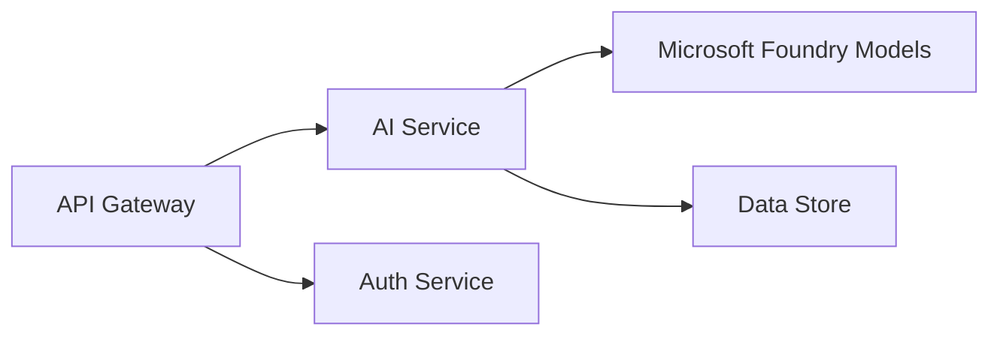

# Глава 8: Производствени и корпоративни модели

**📚 Курс**: [AZD за начинаещи](../../README.md) | **⏱️ Продължителност**: 2-3 часа | **⭐ Сложност**: Напреднал

---

## Преглед

Тази глава обхваща модели за внедряване, подходящи за корпоративна употреба, усилване на сигурността, мониторинг и оптимизация на разходите за производствени AI натоварвания.

Това е архитектурен справочник, а не пълен шаблон за производствено внедряване. Примерите пропускат детайли за интеграция, които трябва да бъдат осигурени и тествани във вашето собствено приложение; прочитането на контролния списък не удостоверява готовност за производство.

> **Преглед на изданието (2026-11-04):** Ръководството за AI CLI беше проверено спрямо документацията/източника на `azd 1.37.2`, агенти `1.0.0-beta.23` и оценки `1.0.0-beta.2`. Вижте [промени и поправки в изданието](production-ai-practices.md#recent-release-changes-and-fixes) за изисквания за съвместимост и подробности за миграция; това не е валидация на живо.

## Учебни цели

След завършване на тази глава, вие ще:
- Внедрите устойчиви приложения в множество региони
- Прилагате корпоративни модели за сигурност
- Конфигурирате цялостен мониторинг
- Оптимизирате разходите в голям мащаб
- Настроите CI/CD линии с AZD

---

## 📚 Уроци

| № | Урок | Описание | Време |
|---|--------|-------------|------|
| 1 | [Производствени AI практики](production-ai-practices.md) | Корпоративни модели за внедряване | 90 мин |

---

## 🚀 Контролен списък за производство

- [ ] Внедряване в множество региони за устойчивост
- [ ] Управлявана самоличност за удостоверяване (без ключове)
- [ ] Application Insights за мониторинг
- [ ] Конфигурирани бюджети за разходи и известия
- [ ] Активирано сканиране за сигурност
- [ ] Интеграция на CI/CD линия
- [ ] План за възстановяване при бедствия

---

## 🏗️ Архитектурни модели

### Модел 1: Микросервизни AI приложения



### Модел 2: Събитийно-ориентиран AI


---

## 🔐 Най-добри практики за сигурност

```bicep
// Illustrative properties from different resources, NOT a standalone Bicep file.
// Attach identity to the application host:
identity: {
  type: 'SystemAssigned'
}

// AI account properties (also require private endpoints, DNS and app connectivity):
properties: {
  publicNetworkAccess: 'Disabled'
  networkAcls: {
    defaultAction: 'Deny'
  }
}
```

---

## 💰 Оптимизация на разходите

| Стратегия | Основно ограничение |
|----------|---------|
| Скалиране до нула (Container Apps) | Изисква подходящ тригер; други услуги все още генерират разходи |
| Използване на консумационни нива за разработка | Сравняване на ценообразуването на избраната услуга и натоварването |
| Планирано скалиране | Скалиране чрез поддържана инфраструктура/автоматизация |
| Резервации/запазен капацитет | Само когато е поддържано; ангажиментите могат да увеличат празните разходи |

Използвайте [пълния модел за бюджетен ресурс](production-ai-practices.md#2-cost-monitoring-and-budgets) с валидна начална дата, обхват на фактуриране, получатели и разрешения. Бюджетът изпраща известия; той не ограничава разходите. Спестяванията зависят от измереното използване и не са гарантирани проценти.

---

## 📊 Настройка на мониторинга

```bash
# Open the Application Insights logs view (requires configured monitoring)
azd monitor --logs

# Check Application Insights
azd monitor --overview

# View metrics
az monitor metrics list --resource <resource-id>
```

---

## 🔗 Навигация

| Посока | Глава |
|-----------|---------|
| **Предишна** | [Глава 7: Отстраняване на неизправности](../chapter-07-troubleshooting/README.md) |
| **Край на курса** | [Начална страница на курса](../../README.md) |

---

## 📖 Свързани ресурси

- [Ръководство за AI агенти](../chapter-02-ai-development/agents.md)
- [Application Insights](../chapter-06-pre-deployment/application-insights.md)
- [Решения с множество агенти](../chapter-05-multi-agent/README.md)
- [Пример с микросервизи](../../examples/microservices/README.md)

---

<!-- CO-OP TRANSLATOR DISCLAIMER START -->
**Отказ от отговорност**:
Този документ е преведен с помощта на AI преводачески услуга [Co-op Translator](https://github.com/Azure/co-op-translator). Въпреки че се стремим към точност, моля имайте предвид, че автоматизираните преводи могат да съдържат грешки или неточности. Оригиналният документ на неговия роден език трябва да се счита за авторитетен източник. За критична информация се препоръчва професионален човешки превод. Ние не носим отговорност за каквито и да е недоразумения или неправилни тълкувания, произтичащи от използването на този превод.
<!-- CO-OP TRANSLATOR DISCLAIMER END -->