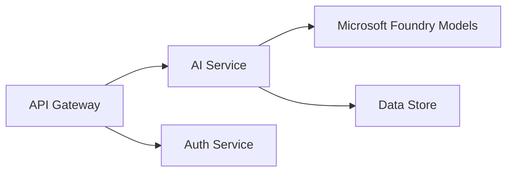
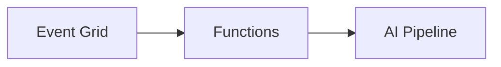

# Глава 8: Производствени и корпоративни модели

**📚 Курс**: [AZD За Начинаещи](../../README.md) | **⏱️ Продължителност**: 2-3 часа | **⭐ Сложност**: Напреднал

---

## Преглед

Тази глава разглежда готови за предприятия модели за внедряване, засилване на сигурността, мониторинг и оптимизация на разходите за производствени AI натоварвания.

Това е архитектурна справка, а не пълен внедрим производствен шаблон. Примерите пропускат интеграционни детайли, които трябва да бъдат осигурени и тествани във вашето собствено приложение; прочитането на контролния списък не гарантира готовност за производство.

> **Foundry GA актуализация (2026-11-09):** Използвайте `azd >= 1.37.0` и общодостъпния пакет `microsoft.foundry` 1.0 за работния поток Foundry; оценките се инсталират отделно. Вижте [обхват на изданието и миграция](production-ai-practices.md#recent-release-changes-and-fixes) и [пример за удостоверен pipeline](production-ai-practices.md#cicd-pipeline-configuration). Това е преглед на документацията, а не валидиране на живо внедряване или общ статус GA за опционални функции в преглед.

## Цели за учене

Завършвайки тази глава, вие ще:
- Внедрите много регионални устойчиви приложения
- Изпълните корпоративни модели за сигурност
- Конфигурирате всеобхватен мониторинг
- Оптимизирате разходите в голям мащаб
- Настроите CI/CD pipeline-и с AZD

---

## 📚 Уроци

| # | Урок | Описание | Време |
|---|--------|-------------|------|
| 1 | [Практики за Производствен AI](production-ai-practices.md) | Корпоративни модели за внедряване | 90 мин |

---

## 🚀 Производствен Контролен Списък

- [ ] Много регионално внедряване за устойчивост
- [ ] Управлявана идентичност за удостоверяване (без ключове)
- [ ] Application Insights за мониторинг
- [ ] Конфигурирани бюджети и сигнали за разходи
- [ ] Включено сканиране за сигурност
- [ ] Интеграция на CI/CD pipeline
- [ ] План за възстановяване при бедствия

---

## 🏗️ Архитектурни модели

### Модел 1: Microservices AI



### Модел 2: Събитийно управление на AI



---

## 🔐 Най-добри практики за сигурност

```bicep
// Illustrative properties from different resources, NOT a standalone Bicep file.
// Attach identity to the application host:
identity: {
  type: 'SystemAssigned'
}

// AI account properties (also require private endpoints, DNS and app connectivity):
properties: {
  publicNetworkAccess: 'Disabled'
  networkAcls: {
    defaultAction: 'Deny'
  }
}
```

---

## 💰 Оптимизация на разходите

| Стратегия | Основно ограничение |
|----------|---------|
| Скалиране до нула (Container Apps) | Изисква подходящ тригер; други услуги все още генерират разходи |
| Използване на консумативни нива за разработка | Сравнете цените на избраната услуга и натоварването |
| Планирано скалиране | Скалиране чрез поддържана инфраструктура/автоматизация |
| Резервации/резервирано капацитет | Само когато е поддържано; ангажиментите могат да увеличат разходите при бездействие |

Използвайте [пълния модел на бюджетния ресурс](production-ai-practices.md#2-cost-monitoring-and-budgets) с валидна начална дата, обхват на фактуриране, получатели и права. Бюджет изпраща сигнали; той не ограничава разходите. Спестяванията зависят от измерената използваемост и не са гарантирани проценти.

---

## 📊 Настройка на мониторинга

```bash
# Open the Application Insights logs view (requires configured monitoring)
azd monitor --logs

# Check Application Insights
azd monitor --overview

# View metrics
az monitor metrics list --resource <resource-id>
```

---

## 🔗 Навигация

| Посока | Глава |
|-----------|---------|
| **Предишна** | [Глава 7: Отстраняване на проблеми](../chapter-07-troubleshooting/README.md) |
| **Курс завършен** | [Начална страница на курса](../../README.md) |

---

## 📖 Свързани ресурси

- [Ръководство за AI агенти](../chapter-02-ai-development/agents.md)
- [Application Insights](../chapter-06-pre-deployment/application-insights.md)
- [Мулти-агентски решения](../chapter-05-multi-agent/README.md)
- [Пример с микросървиси](../../examples/microservices/README.md)

---

<!-- CO-OP TRANSLATOR DISCLAIMER START -->
**Отказ от отговорност**:
Този документ е преведен с помощта на AI преводачески услуга [Co-op Translator](https://github.com/Azure/co-op-translator). Въпреки че се стремим към точност, моля имайте предвид, че автоматизираните преводи могат да съдържат грешки или неточности. Оригиналният документ на неговия роден език трябва да се счита за авторитетен източник. За критична информация се препоръчва професионален човешки превод. Ние не носим отговорност за каквито и да е недоразумения или неправилни тълкувания, произтичащи от използването на този превод.
<!-- CO-OP TRANSLATOR DISCLAIMER END -->