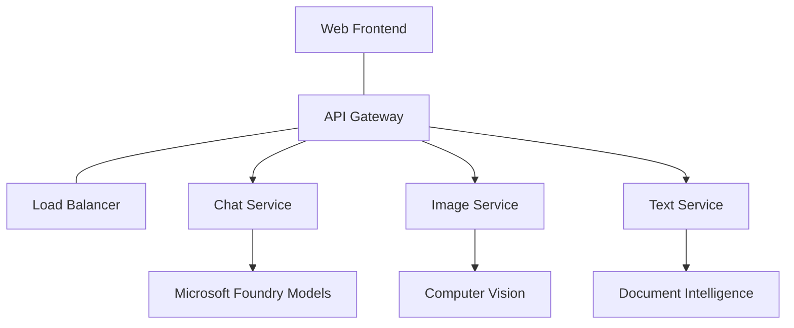

# Най-добри практики за производствени AI натоварвания с AZD

**Навигация в главата:**
- **📚 Начало на курса**: [AZD за начинаещи](../../README.md)
- **📖 Текуща глава**: Глава 8 - Производствени & корпоративни модели
- **⬅️ Предишна глава**: [Глава 7: Отстраняване на проблеми](../chapter-07-troubleshooting/debugging.md)
- **⬅️ Свързано**: [AI семинарна лаборатория](../chapter-02-ai-development/ai-workshop-lab.md)
- **🎯 Курс завършен**: [AZD за начинаещи](../../README.md)

## Преглед

Този наръчник обяснява производствени AI модели за проектиране, използвайки Azure Developer CLI (AZD). Това е справочник за дизайн, а не приложимо приложение или производствен сертификат.

**Примерни граници:** Ако не е описано изрично като пълно, фрагментите Bicep предполагат параметри и реферирани ресурси от съдържащ шаблон. Те пропускат хост изображения/планове, идентичности, роли, DNS, изходи и друга необходима интеграция. YAML пътищата за услуги и hook/test скриптовете са илюстративни файлове за създаване във **вашето собствено приложение**; те не се предоставят от този курс. Използвайте работещ AZD пример като база, компилирайте цялата инфраструктура и тествайте в изолирана среда преди производство.

## Основни предизвикателства, разгледани

Общите проблеми за производство включват разгръщане на множество услуги, управление на идентичност и тайни, мащабиране, контрол на разходите и наблюдение. Тук не се претендира измерена разпространеност.

## Архитектурни модели за производствен AI

### Модел 1: Микросървиз AI архитектура

**Кога да използвате**: Комплексни AI приложения с множество функции



**Изпълнение с AZD**:

```yaml
# azure.yaml
name: enterprise-ai-platform
services:
  web:
    project: ./web
    host: staticwebapp
  api-gateway:
    project: ./api-gateway
    host: containerapp
  chat-service:
    project: ./services/chat
    host: containerapp
  vision-service:
    project: ./services/vision
    host: containerapp
  text-service:
    project: ./services/text
    host: containerapp
```

### Модел 2: Събитийно-управляван AI процесинг

**Кога да използвате**: Партидно обработване, анализ на документи, асинхронни работни потоци

```bicep
// Event Hub for AI processing pipeline
resource eventHub 'Microsoft.EventHub/namespaces@2024-01-01' = {
  name: eventHubNamespaceName
  location: location
  sku: {
    name: 'Standard'
    tier: 'Standard'
    capacity: 1
  }
}

// Service Bus for reliable message processing
resource serviceBus 'Microsoft.ServiceBus/namespaces@2024-01-01' = {
  name: serviceBusNamespaceName
  location: location
  sku: {
    name: 'Premium'
    tier: 'Premium'
    capacity: 1
  }
}

// Function App for processing
resource functionApp 'Microsoft.Web/sites@2023-01-01' = {
  name: functionAppName
  location: location
  kind: 'functionapp,linux'
  properties: {
    siteConfig: {
      appSettings: [
        {
          name: 'FUNCTIONS_EXTENSION_VERSION'
          value: '~4'
        }
        {
          name: 'AZURE_OPENAI_ENDPOINT'
          value: '@Microsoft.KeyVault(VaultName=${keyVault.name};SecretName=openai-endpoint)'
        }
      ]
    }
  }
}
```

Това създава фрагменти от пространство, а не хъбове, опашки, абонаменти или задействания на Function. Изпълним Function също се нуждае от хостинг план, конфигурация на изпълнителна среда/съхранение, приложена идентичност, RBAC и мрежов достъп. Референцията към Key Vault изисква разрешение за четене на тайната; URL адресът на крайна точка не е удостоверение.

## Мислене за здравето на AI агента

Когато традиционно уеб приложение се разпадне, симптомите са познати: страница не се зарежда, API връща грешка или разгръщането се проваля. AI приложенията могат да се развалят по същите начини — но могат и да се държат по-финно, без очевидни съобщения за грешки.

Тази секция ви помага да изградите ментален модел за наблюдение на AI натоварвания, за да знаете къде да погледнете, когато нещо не е наред.

### Как здравето на агента се различава от здравето на традиционно приложение

Традиционните приложения също могат да имат фини грешки в коректността. AI агентът добавя недетерминистично качество на отговорите към обичайните проблеми с наличност и коректност. Помислете за здравето на агента в два слоя:

| Слой | Какво да наблюдавате | Къде да погледнете |
|-------|--------------|---------------|
| **Здраве на инфраструктурата** | Работи ли услугата? Проектирани ли са ресурсите? Достъпни ли са крайните точки? | `azd monitor`, Azure Portal състояние на ресурсите, контейнери/логи на приложения |
| **Здраве на поведението** | Отговаря ли агентът точно? Отговорите своевременни ли са? Извиква ли се правилно моделът? | Application Insights следи, метрики за латентност на модели, дневници за качество на отговорите |

Здравето на инфраструктурата е познато — същото е за всяко azd приложение. Здравето на поведението е новият слой, който AI натоварванията въвеждат.

### Къде да погледнете, когато AI приложенията не се държат очаквано

Ако вашето AI приложение не произвежда очакваните резултати, ето концептуален контролен списък:

1. **Започнете с основите.** Работи ли приложението? Може ли да достигне зависимостите си? Проверете `azd monitor` и състоянието на ресурса както при всяко приложение.
2. **Проверете връзката с модела.** Вашето приложение успешно ли извиква AI модела? Неуспешни или прекъснати извиквания са най-честата причина за проблеми и ще се виждат в логовете.
3. **Проверете входните данни и контекст безопасно.** Грешни отговори могат да възникнат от извличане, инструкции, ограничения на модела или изпълнение на инструменти. Използвайте контролирани, редактирани диагностични данни; не активирайте неограничено записване на prompt/response в продукция.
4. **Прегледайте латентността на отговора.** Извикванията към AI модел са по-бавни от типичните API. Ако приложението изглежда мудно, проверете дали времето за отговор е нараснало — това може да е признак за ограничаване, капацитет или регионална конгестия.
5. **Проследявайте сигнали за разходи.** Неочаквани скокове в използването на токени или API извиквания може да означават цикъл, неправилен prompt или прекалени повторни опити.

Не е нужно веднага да овладявате инструментите за наблюдение. Основното е, че AI приложенията имат допълнителен поведенчески слой за наблюдение, а вграденото наблюдение на azd (`azd monitor`) ви дава отправна точка за проучване на двата слоя.

---

## Най-добри практики за сигурност

### 1. Модел за сигурност нулево доверие

**Стратегия за изпълнение**:
- Няма комуникация услуга-до-услуга без удостоверяване
- Всички API извиквания използват управлявани идентичности
- Мрежова изолация с частни крайни точки
- Контрол на достъп с най-малко права

```bicep
// Managed Identity for each service
resource chatServiceIdentity 'Microsoft.ManagedIdentity/userAssignedIdentities@2023-01-31' = {
  name: 'chat-service-identity'
  location: location
}

// Role assignments with minimal permissions
resource openAIUserRole 'Microsoft.Authorization/roleAssignments@2022-04-01' = {
  scope: openAIAccount
  name: guid(openAIAccount.id, chatServiceIdentity.id, '5e0bd9bd-7b93-4f28-af87-19fc36ad61bd')
  properties: {
    roleDefinitionId: subscriptionResourceId('Microsoft.Authorization/roleDefinitions', '5e0bd9bd-7b93-4f28-af87-19fc36ad61bd')
    principalId: chatServiceIdentity.properties.principalId
    principalType: 'ServicePrincipal'
  }
}
```

### 2. Сигурно управление на тайни

**Модел за интеграция с Key Vault**:

```bicep
// Key Vault with proper access policies
resource keyVault 'Microsoft.KeyVault/vaults@2023-02-01' = {
  name: keyVaultName
  location: location
  properties: {
    tenantId: tenant().tenantId
    sku: {
      family: 'A'
      name: 'standard' // Premium is needed for HSM-backed keys, not ordinary secrets
    }
    enableRbacAuthorization: true  // Use RBAC instead of access policies
    enablePurgeProtection: true    // Prevent accidental deletion
    enableSoftDelete: true
    softDeleteRetentionInDays: 90
  }
}

// Optional legacy key-auth alternative; omit when using Entra ID.
resource openAIKeySecret 'Microsoft.KeyVault/vaults/secrets@2023-02-01' = {
  parent: keyVault
  name: 'openai-api-key'
  properties: {
    value: openAIAccount.listKeys().key1
    attributes: {
      enabled: true
    }
  }
}
```

Назначете runtime идентичност `Key Vault Secrets User` в подходящия обхват и я прикачете към хоста; само `enableRbacAuthorization` не дава достъп. Предпочитайте удостоверяване с управлявана идентичност на OpenAI с `disableLocalAuth: true`. Опционалният ключ-тайна има смисъл само за акаунт с разрешен ключ, а и лицето за предоставяне трябва да има право да записва тайни.

### 3. Мрежова сигурност

**Конфигурация на частна крайна точка**:

```bicep
// Virtual Network for AI services
resource virtualNetwork 'Microsoft.Network/virtualNetworks@2023-04-01' = {
  name: vnetName
  location: location
  properties: {
    addressSpace: {
      addressPrefixes: ['10.0.0.0/16']
    }
    subnets: [
      {
        name: 'ai-services-subnet'
        properties: {
          addressPrefix: '10.0.1.0/24'
          privateEndpointNetworkPolicies: 'Disabled'
        }
      }
      {
        name: 'app-services-subnet'
        properties: {
          addressPrefix: '10.0.2.0/24'
          delegations: [
            {
              name: 'Microsoft.Web/serverFarms'
              properties: {
                serviceName: 'Microsoft.Web/serverFarms'
              }
            }
          ]
        }
      }
    ]
  }
}

// Private endpoints for all AI services
resource openAIPrivateEndpoint 'Microsoft.Network/privateEndpoints@2023-04-01' = {
  name: '${openAIAccountName}-pe'
  location: location
  properties: {
    subnet: {
      id: virtualNetwork.properties.subnets[0].id
    }
    privateLinkServiceConnections: [
      {
        name: 'openai-connection'
        properties: {
          privateLinkServiceId: openAIAccount.id
          groupIds: ['account']
        }
      }
    ]
  }
}
```

Частните крайни точки изискват също частни DNS зонови групи/VNet връзки и интеграция на приложението с VNet. Те не блокират автоматично публичен достъп: изрично деактивирайте публичен мрежови достъп на AI акаунта след валидиране на частна връзка и достъп за разгръщане.

## Производителност и мащабиране

### 1. Автоматични стратегии за мащабиране

**Автоматично мащабиране на контейнерни приложения**:

```bicep
resource containerApp 'Microsoft.App/containerApps@2023-05-01' = {
  name: containerAppName
  location: location
  properties: {
    configuration: {
      ingress: {
        external: true
        targetPort: 8000
        transport: 'http'
      }
    }
    template: {
      scale: {
        minReplicas: 2  // Always have 2 instances minimum
        maxReplicas: 50 // Scale up to 50 for high load
        rules: [
          {
            name: 'http-scaling'
            http: {
              metadata: {
                concurrentRequests: '20'  // Scale when >20 concurrent requests
              }
            }
          }
          {
            name: 'cpu-scaling'
            custom: {
              type: 'cpu'
              metadata: {
                type: 'Utilization'
                value: '70'  // Scale when CPU >70%
              }
            }
          }
        ]
      }
    }
  }
}
```

### 2. Стратегии за кеширане

**Redis кеш за AI отговори**:

```bicep
// Legacy Azure Cache for Redis example (not recommended for new deployments)
resource redisCache 'Microsoft.Cache/redis@2023-04-01' = {
  name: redisCacheName
  location: location
  properties: {
    sku: {
      name: 'Premium'
      family: 'P'
      capacity: 1
    }
    enableNonSslPort: false
    minimumTlsVersion: '1.2'
    redisConfiguration: {
      'maxmemory-policy': 'allkeys-lru'
    }
    // Sharding distributes data; replication/failover provides availability.
    shardCount: 2
  }
}

// Cache configuration in application
var cacheConnectionString = '${redisCache.properties.hostName}:6380,password=${redisCache.listKeys().primaryKey},ssl=True,abortConnect=False'
```

Azure Cache за Redis Basic/Standard/Premium е на [път за пенсиониране](https://learn.microsoft.com/azure/azure-cache-for-redis/retirement-faq). Използвайте Azure Managed Redis за нови дизайни и документираната му SKU, идентичност и TLS конфигурация, вместо да копирате този наследствен ресурс в нова производствена система. Редът със connection-string е нефункционален заместител, не удостоверение. Разделяйте кеш ключове по упълномощаване, модел/инструкции и версия за извличане, с изтичане; споделеният кеш само за заявки може да изложи данни на друг потребител.

### 3. Балансиране на натоварването и управление на трафика

**Application Gateway с WAF**:

```bicep
// Application Gateway with Web Application Firewall
resource applicationGateway 'Microsoft.Network/applicationGateways@2023-04-01' = {
  name: appGatewayName
  location: location
  properties: {
    sku: {
      name: 'WAF_v2'
      tier: 'WAF_v2'
      capacity: 2
    }
    webApplicationFirewallConfiguration: {
      enabled: true
      firewallMode: 'Prevention'
      ruleSetType: 'OWASP'
      ruleSetVersion: '3.2'
    }
    // Backend pools for AI services
    backendAddressPools: [
      {
        name: 'ai-services-pool'
        properties: {
          backendAddresses: [
            {
              fqdn: '${containerApp.properties.configuration.ingress.fqdn}'
            }
          ]
        }
      }
    ]
  }
}
```

Това е частичен gateway ресурс: истинско разгръщане също изисква gateway subnet/IP конфигурация, frontend IP адреси и портове, TLS слушатели/сертификати, backend HTTP настройки/проби, правила за маршрутиране и приоритети, както и прегледана WAF политика. TLS hostname/SNI и удостоверяване трябва да съответстват на backend на Container App.

## 💰 Оптимизация на разходите

### 1. Правилно оразмеряване на ресурсите

**Конфигурации, специфични за средата**:

Тези имена са **илюстративни входове за персонализиран шаблон**, а не автоматични AZD настройки. Съпоставете всеки с `infra/main.parameters.json`/Bicep и хост конфигурация първо. Например, RAG примерът използва `AZURE_SEARCH_SERVICE_SKU` и `AZURE_OPENAI_CHATGPT_DEPLOYMENT_CAPACITY`, не общите имена по-долу. Дайте памет на Container Apps с поддържана единица като `1Gi` в реалния ресурс. Приложете инфраструктурни промени с `azd up` или `azd provision`; само с `azd deploy` не се прилагат промени в Bicep.

```bash
# Development environment
azd env new development
azd env set AZURE_OPENAI_SKU "S0"
azd env set AZURE_OPENAI_CAPACITY 10
azd env set AZURE_SEARCH_SKU "basic"
azd env set CONTAINER_CPU 0.5
azd env set CONTAINER_MEMORY 1.0

# Production environment  
azd env new production
azd env set AZURE_OPENAI_SKU "S0"
azd env set AZURE_OPENAI_CAPACITY 100
azd env set AZURE_SEARCH_SKU "standard"
azd env set CONTAINER_CPU 2.0
azd env set CONTAINER_MEMORY 4.0
```

### 2. Мониторинг на разходите и бюджети

```bicep
// Supply the first day of the current UTC month, e.g. 2026-11-01T00:00:00Z.
param budgetStartDate string

// Cost management and budgets
resource budget 'Microsoft.Consumption/budgets@2024-08-01' = {
  name: 'ai-workload-budget'
  properties: {
    timePeriod: {
      startDate: budgetStartDate
    }
    timeGrain: 'Monthly'
    amount: 2000  // In the billing currency, not necessarily USD
    category: 'Cost'
    notifications: {
      warning: {
        enabled: true
        operator: 'GreaterThan'
        threshold: 80
        contactEmails: [
          'finance@company.com'
          'engineering@company.com'
        ]
        contactRoles: [
          'Owner'
          'Contributor'
        ]
      }
      critical: {
        enabled: true
        operator: 'GreaterThan'
        threshold: 95
        contactEmails: [
          'cto@company.com'
        ]
      }
    }
  }
}
```

Заменете примерните получатели и проверете обхват/разрешения. Бюджетните известия използват забавени данни за фактуриране и не налагат лимит на разход.

### 3. Оптимизация на използването на токени

**Управление на разходите за OpenAI**:

Това е само евристика, базирана на брой знаци за UI преглед, **НЕ** валидатор за лимит на токени на модела. Производственият код трябва да използва подходящ токенизатор за използвания модел и да отчита системни инструкции, схеми на инструменти, история и бюджет за изход. Отхвърлете прекалено голямо потребителско съобщение, вместо да го режете безшумно.

```typescript
// Application-level token optimization
class TokenOptimizer {
  private readonly maxTokens = 4000;
  private readonly reserveTokens = 500;
  
  optimizePrompt(userInput: string, context: string): string {
    const availableTokens = this.maxTokens - this.reserveTokens;
    if (this.estimateTokens(userInput) + 8 >= availableTokens) {
      throw new Error("User input exceeds the illustrative prompt budget");
    }
    const estimatedTokens = this.estimateTokens(userInput + context) + 8;
    
    if (estimatedTokens > availableTokens) {
      // Truncate context, not user input
      context = this.truncateContext(context, Math.max(0, availableTokens - this.estimateTokens(userInput) - 8));
    }
    
    return `${context}\n\nUser: ${userInput}`;
  }
  
  private estimateTokens(text: string): number {
    // Rough estimation: 1 token ≈ 4 characters
    return Math.ceil(text.length / 4);
  }

  private truncateContext(text: string, estimatedBudget: number): string {
    return text.slice(0, Math.max(0, estimatedBudget) * 4);
  }
}
```

## Мониторинг и наблюдаемост

### 1. Обширен Application Insights

```bicep
// Application Insights with advanced features
resource applicationInsights 'Microsoft.Insights/components@2020-02-02' = {
  name: applicationInsightsName
  location: location
  kind: 'web'
  properties: {
    Application_Type: 'web'
    WorkspaceResourceId: logAnalyticsWorkspace.id
    SamplingPercentage: 100  // Ingestion setting; review cost and SDK sampling separately
    DisableIpMasking: false  // Retain IP masking
  }
}

// Custom metrics for AI operations
resource aiMetricAlerts 'Microsoft.Insights/metricAlerts@2018-03-01' = {
  name: 'ai-high-error-rate'
  location: 'global'
  properties: {
    description: 'Alert when failed request count exceeds 10 in five minutes'
    severity: 2
    enabled: true
    scopes: [
      applicationInsights.id
    ]
    evaluationFrequency: 'PT1M'
    windowSize: 'PT5M'
    criteria: {
      'odata.type': 'Microsoft.Azure.Monitor.SingleResourceMultipleMetricCriteria'
      allOf: [
        {
          name: 'high-error-rate'
          metricName: 'requests/failed'
          operator: 'GreaterThan'
          threshold: 10
          timeAggregation: 'Count'
        }
      ]
    }
  }
}
```

### 2. AI-специфичен мониторинг

**Персонализирани табла за AI метрики**:

```json
{
  "dashboard": {
    "name": "AI Application Monitoring",
    "tiles": [
      {
        "name": "OpenAI Request Volume",
        "query": "dependencies | where target contains 'openai' | summarize count() by bin(timestamp, 5m)"
      },
      {
        "name": "AI Response Latency",
        "query": "dependencies | where target contains 'openai' | summarize avg(duration) by bin(timestamp, 5m)"
      },
      {
        "name": "Token Usage",
        "query": "customMetrics | where name == 'openai_tokens_used' | summarize sum(value) by bin(timestamp, 1h)"
      },
      {
        "name": "Cost per Hour",
        "query": "customMetrics | where name == 'openai_cost' | summarize sum(value) by bin(timestamp, 1h)"
      }
    ]
  }
}
```

Този JSON е скица, определена от приложението, а не импортираща се схема за Azure портал табло. Заявките за токени/разходи изискват вашето приложение да излъчва точно тези персонализирани метрики; те не се създават от AZD. Адаптирайте филтрите на зависимости според вашата реална крайна точка на модела/имена на спанове.

### 3. Проверки на здравето и наблюдение на достъпността

```bicep
// Application Insights availability tests
resource availabilityTest 'Microsoft.Insights/webtests@2022-06-15' = {
  name: 'ai-app-availability-test'
  location: location
  tags: {
    'hidden-link:${applicationInsights.id}': 'Resource'
  }
  properties: {
    SyntheticMonitorId: 'ai-app-availability-test'
    Name: 'AI Application Availability Test'
    Description: 'Tests AI application endpoints'
    Enabled: true
    Frequency: 300  // 5 minutes
    Timeout: 120    // 2 minutes
    Kind: 'standard'
    Locations: [
      {
        Id: 'us-east-2-azr'
      }
      {
        Id: 'us-west-2-azr'
      }
    ]
    Request: {
      RequestUrl: 'https://${webApp.properties.defaultHostName}/health'
      HttpVerb: 'GET'
      FollowRedirects: true
      ParseDependentRequests: false
    }
    ValidationRules: {
      ExpectedHttpStatusCode: 200
      SSLCheck: true
      SSLCertRemainingLifetimeCheck: 7
    }
  }
}
```

## Възстановяване при бедствия и висока наличност

Предишният тест предполага съществуващ App Service `webApp` и Application Insights ресурс. Стандартните тестове за достъпност се таксуват и изискват достъпна крайна точка; частни приложения се нуждаят от подходящ личен мониторинг дизайн. Тестовете с URL ping са остарели; използвайте [стандартни тестове за достъпност](https://learn.microsoft.com/azure/azure-monitor/app/availability).

### 1. Разгръщане в множество региони

```yaml
# azure.yaml - Multi-region configuration
name: ai-app-multiregion
services:
  api-primary:
    project: ./api
    host: containerapp
    env:
      AZURE_REGION: eastus
  api-secondary:
    project: ./api
    host: containerapp
    env:
      AZURE_REGION: westus2
```

```bicep
// Separate App Service topology, not the Container Apps declarations above
resource trafficManager 'Microsoft.Network/trafficManagerProfiles@2022-04-01' = {
  name: trafficManagerProfileName
  location: 'global'
  properties: {
    profileStatus: 'Enabled'
    trafficRoutingMethod: 'Priority'
    dnsConfig: {
      relativeName: trafficManagerProfileName
      ttl: 30
    }
    monitorConfig: {
      protocol: 'HTTPS'
      port: 443
      path: '/health'
      intervalInSeconds: 30
      toleratedNumberOfFailures: 3
      timeoutInSeconds: 10
    }
    endpoints: [
      {
        name: 'primary-endpoint'
        type: 'Microsoft.Network/trafficManagerProfiles/azureEndpoints'
        properties: {
          targetResourceId: primaryAppService.id
          endpointStatus: 'Enabled'
          priority: 1
        }
      }
      {
        name: 'secondary-endpoint'
        type: 'Microsoft.Network/trafficManagerProfiles/azureEndpoints'
        properties: {
          targetResourceId: secondaryAppService.id
          endpointStatus: 'Enabled'
          priority: 2
        }
      }
    ]
  }
}
```

Променливите на средата не избират местоположения на ресурси. IaC трябва да създава отделни регионални хостове и да свързва всяка услуга с `resourceName` или `azd-service-name` тагове. Примерът с Traffic Manager е **отделна App Service топология** (`primaryAppService`/`secondaryAppService`), а не маршрутизиране за декларации на Container Apps. Container Apps изисква подходящо конфигурирана външна крайна точка/front door, TLS/маршрутиране на персонализиран домейн и здравни проби.

### 2. Архивиране и възстановяване на данни

```bicep
// Backup configuration for critical data
resource backupVault 'Microsoft.DataProtection/backupVaults@2023-05-01' = {
  name: backupVaultName
  location: location
  identity: {
    type: 'SystemAssigned'
  }
  properties: {
    storageSettings: [
      {
        datastoreType: 'VaultStore'
        type: 'LocallyRedundant'
      }
    ]
  }
}

```

Самият хранилище не архивира нищо. Конфигурирайте **политика и инстанция за архивиране, специфични за натоварването**, разрешения за изход, задържане и тестове за възстановяване, използвайки [матрици за поддръжка на Azure Backup](https://learn.microsoft.com/azure/backup/backup-support-matrix). Няма универсална Azure Backup политика за хоствани Azure OpenAI моделни разгръщания. Дръжте дефиниции за инфраструктура/разгръщане на модел във version control; защитете качени документи, данни на приложения и артефакти за финно настрояване чрез поддържаните функции за архивиране/експорт на съответния бекъп сървис. Определете и тествайте RPO/RTO изрично.

## DevOps и CI/CD интеграция

### 1. Работен поток на GitHub Actions

```yaml
# .github/workflows/deploy-ai-app.yml
name: Deploy AI Application

on:
  push:
    branches: [main]
  pull_request:
    branches: [main]

jobs:
  test:
    runs-on: ubuntu-latest
    steps:
      - uses: actions/checkout@v4
      
      - name: Setup Python
        uses: actions/setup-python@v4
        with:
          python-version: '3.11'
          
      - name: Install dependencies
        run: |
          pip install -r requirements.txt
          pip install pytest
          
      - name: Run tests
        run: pytest tests/
        
      - name: AI Safety Tests
        run: |
          python scripts/test_ai_safety.py
          python scripts/validate_prompts.py

```

Това е **само тестова част** от работен поток и предполага, че сте създали `requirements.txt`, `tests/` и двата защитни скрипта. Добавете удостоверени OIDC provisioning/разгръщащи задачи от [Конфигурация на CI/CD pipeline](#cicd-pipeline-configuration), с `needs: test`, сигурно пускане/ръчно задействане и защитени GitHub среди. Не разгръщайте недоверен pull-request код с облачни удостоверения. Нов runner няма избран локален AZD environment; осигурете входове за среда/абонамент/локация и използвайте `azd auth login`, а не само `azure/login`.

### 2. Валидация на инфраструктурата

```bash
# scripts/validate_infrastructure.sh
#!/bin/bash
set -euo pipefail

echo "Validating AI infrastructure deployment..."

# Requires Azure CLI login and the resource group selected explicitly.
: "${AZURE_RESOURCE_GROUP:?Set AZURE_RESOURCE_GROUP}"
: "${AZURE_OPENAI_NAME:?Set AZURE_OPENAI_NAME}"
: "${AZURE_OPENAI_CHAT_DEPLOYMENT:?Set the actual deployment name}"

# A successful empty list is not proof that resources exist.
types=("Microsoft.CognitiveServices/accounts" "Microsoft.Search/searchServices"
       "Microsoft.Storage/storageAccounts" "Microsoft.KeyVault/vaults")
for resource_type in "${types[@]}"; do
    count=$(az resource list --resource-group "$AZURE_RESOURCE_GROUP" \
        --resource-type "$resource_type" --query "length(@)" -o tsv)
    if [[ "$count" -lt 1 ]]; then
        echo "ERROR: No $resource_type found in $AZURE_RESOURCE_GROUP"
        exit 1
    fi
done

# Validate OpenAI model deployments
echo "Validating OpenAI model deployments..."
state=$(az cognitiveservices account deployment show \
  --name "$AZURE_OPENAI_NAME" --resource-group "$AZURE_RESOURCE_GROUP" \
  --deployment-name "$AZURE_OPENAI_CHAT_DEPLOYMENT" \
  --query "properties.provisioningState" -o tsv)
if [[ "$state" != "Succeeded" ]]; then
    echo "ERROR: Required model deployment is not provisioned successfully"
    exit 1
fi

echo "Infrastructure validation completed successfully!"
```

Очаквано: нулев изход и съобщение за завършване само ако всички очаквани типове съществуват и наименуваното разгръщане на модел е проектирано. Това проверява състояние на инвентаризация/проект, **не** здраве на ресурс, точна топология, RBAC, наличност на мрежа или поведение на модел. Адаптирайте очакваните типове към вашата архитектура, след което направете отделен удостоверен тест на готовност на приложението.

## Контролен списък за производствена готовност

### Сигурност ✅
- [ ] Всички услуги използват управлявани идентичности
- [ ] Тайни съхранени в Key Vault
- [ ] Конфигурирани частни крайни точки
- [ ] Внедрени мрежови защитни групи
- [ ] RBAC с най-малка привилегия
- [ ] WAF активиран на публичните крайни точки

### Производителност ✅
- [ ] Конфигурирано автоматично мащабиране
- [ ] Внедрено кеширане
- [ ] Настройка за балансиране на натоварването
- [ ] CDN за статично съдържание
- [ ] Групиране на връзки към база данни
- [ ] Оптимизация на използване на токени

### Наблюдение ✅
- [ ] Конфигуриран Application Insights
- [ ] Дефинирани персонализирани метрики
- [ ] Настроени правила за известяване
- [ ] Създадено табло
- [ ] Внедрени проверки на здравето
- [ ] Политики за задържане на логове

### Надеждност ✅
- [ ] Разгръщане в множество региони
- [ ] План за архивиране и възстановяване
- [ ] Внедрени прекъсвачи на схеми
- [ ] Конфигурирани политики за повторни опити
- [ ] Грациозно деградиране
- [ ] Крайни точки за проверки на здравето

### Управление на разходите ✅
- [ ] Конфигурирани бюджетни предупреждения
- [ ] Правилно оразмеряване на ресурси
- [ ] Приложени отстъпки за разработка/тест
- [ ] Закупени резервирани инстанции
- [ ] Табло за мониторинг на разходите
- [ ] Редовни прегледи на разходите

### Съответствие ✅
- [ ] Спазени изисквания за местонахождение на данните
- [ ] Включено логване на одити
- [ ] Прилагане на политики за съответствие
- [ ] Внедрени базови защити
- [ ] Редовни оценки на сигурността
- [ ] План за реакция при инциденти

## Производителни бенчмаркове

### Илюстративни цели за продукция

Това са примерни SLO, за договаряне и товарно тестване, а не измерени показатели или гаранции. Времето за отговор зависи от дължината на модела/изхода; месечните разходи за токени зависят от трафика и цените, не само от броя на токените.

| Метрика | Цел | Наблюдение |
|--------|--------|------------|
| **Време за отговор** | < 2 секунди | Application Insights |
| **Наличност** | 99.9% | Наблюдение на достъпността |
| **Процент грешки** | < 0.1% | Логове на приложение |
| **Разходи за модел** | < $500/месец (примерен бюджет) | Управление на разходи |
| **Паралелни потребители** | 1000+ | Товарно тестване |
| **Време за възстановяване** | < 1 час | Тестове за аварийно възстановяване |

### Тестване на натоварване

По-долу е даден интерфейсен чертеж за скрипт за тестване на натоварване, който **трябва да реализирате**; този репозиториум не предоставя `scripts/load_test.py`. Дефинирайте полезни товари на заявките, удостоверяване, представителни натоварвания, асерции за латентност/грешка на перцентил, и лимит за разходи в избрания от вас инструмент за тестване на натоварване преди изпълнение:

```bash
# Load testing script for AI applications
python scripts/load_test.py \
  --endpoint https://your-ai-app.azurewebsites.net \
  --concurrent-users 100 \
  --duration 300 \
  --ramp-up 60
```

## 🤝 Най-добри практики от общността

Базирано на обратна връзка от общността Microsoft Foundry Discord:

### Топ препоръки от общността:

1. **Започнете малко, скалирайте постепенно**: Започнете с основни SKU и скалирайте според реалната употреба
2. **Наблюдавайте всичко**: Настройте комплексен мониторинг от първия ден
3. **Автоматизирайте сигурността**: Използвайте инфраструктура като код за консистентна сигурност
4. **Тествайте тщательно**: Включете специфично AI тестване във вашия pipeline
5. **Планирайте разходите**: Следете използването на токени и задавайте аларми за бюджета рано

### Чести грешки, които да избегнете:

- ❌ Закодиране на API ключове в кода
- ❌ Липса на правилен мониторинг
- ❌ Игнориране на оптимизация на разходите
- ❌ Непровеждане на тестове за сценарии на отказ
- ❌ Разгръщане без проверки на здравето

## Команди и разширения на AZD AI CLI

AZD включва все повече AI-специфични команди и разширения, които оптимизират производствените AI работни потоци. Тези инструменти свързват разработката локално и продукционното разгръщане на AI работни натоварвания.

> **Преглед на изданието (2026-11-04):** Насоките за CLI по-долу са проверени спрямо публикуваните версии на `azd` **1.37.2**, `azure.ai.agents` **1.0.0-beta.23**, и `azure.ai.evaluations` **1.0.0-beta.2**. Агентите beta.23 изискват `azd >= 1.37.0`; оценките beta.2 изискват `azd >= 1.33.0`. Използвайте поне 1.37.0 за комбинирания работен поток. Това е преглед на документация/източник, а не валидиране на живо Azure разгръщане.

### Разширения на AZD за AI

AZD използва система за разширения, за да добави AI-специфични възможности. Инсталирайте и управлявайте разширения с:

```bash
# List all available extensions (including AI)
azd extension list

# Inspect installed extension details
azd version
azd extension show azure.ai.agents

# Install the Foundry agents extension
azd extension install azure.ai.agents

# Install the separate Foundry evaluations extension
azd extension install azure.ai.evaluations

# Install the fine-tuning extension
azd extension install azure.ai.finetune

# Install the custom models extension
azd extension install azure.ai.models

# Upgrade all installed extensions
azd extension upgrade --all
```

**Налични AI разширения:**

| Разширение | Цел | Статус |
|-----------|---------|--------|
| `azure.ai.agents` | Управление на услуга Foundry Agent | Преглед |
| `azure.ai.evaluations` | Оценителни набори от данни, оценители, eval групи и изпълнения | Преглед |
| `azure.ai.skills` | Многократно използваеми умения на агенти | Преглед |
| `azure.ai.connections` | Foundry връзки (източници на данни, инструменти) | Преглед |
| `azure.ai.finetune` | Тунинг на модели в Foundry | Преглед |
| `azure.ai.models` | Персонализирани модели в Foundry | Преглед |
| `azure.coding-agent` | Конфигурация на кодиращ агент | Налично |

> Стартирайте `azd extension list --installed` и `azd extension show azure.ai.evaluations`, за да проверите инсталираните версии. Първо ъпгрейднете основното CLI според [инструкциите за инсталация/ъпдейт](https://learn.microsoft.com/azure/developer/azure-developer-cli/install-azd) (за Windows winget инсталация: `winget upgrade Microsoft.Azd`), след това изпълнете `azd extension upgrade --all`. Няма основна команда `azd upgrade`. Прегледайте счупващите промени преди ъпгрейд на продукционна автоматизация; не приемайте, че ъпгрейд на разширение запазва стар формати на командите или конфигурациите.

### Последни промени и поправки в изданието

| Издание | Какво се променя за този курс |
|---------|------------------------------|
| `azd 1.37.0` | Добавя стабилни Deployment-preview API-та и поправя промяна на разширения, която пренаписва несвързани `azure.yaml` настройки. |
| `azd 1.37.1` | Поправя разпространението на Ctrl+C през разширения и разграничаване на анулиране/таймаут от общи откази. |
| `azd 1.37.2` | Подобрява валидация на провизиране: критичните предупреждения по подразбиране са **Не**, отказват без потвърждение при автономни изпълнения, и анулирането пропуска пост-провизиращи куки. Поправя и нерешени стойности на среди в deny списъци на Deployment Stacks, когато тази алфа функция е активирана. |
| Агенти `beta.22` | Мигрира оценките към `azd ai eval`, променя оптимизацията към GA v1 API, изисква множествено `toolboxes`, и разделя managed-harness, voice, и дългосрочни preview opt-in-и. Поправя избора на модела според средата и удостоверяването в кутия с инструменти. |
| Агенти `beta.23` | Излага `init --harness`; поправя изхода на отговори A2A 0.3, невалидни пътеки/модули за prompt-agent през инфраструктурни слоеве, диагностика при таймаут на активация, и задържани предупреждения за developer RBAC. |
| Оценки `beta.2` | Изисква camelCase конфигурация за оценяване, добавя статично/симулирано създаване на разговори и експлицитни локални файлови източници, и поправя обработката на идентичност/версия на набор данни, броя на quality-gate и диагностика на неуспешни изпълнения. |

Таймаутът при активация на агент **не** доказва провал на разгръщането: прегледайте опитваната версия и нейното състояние преди повторен опит. Предупрежденията developer RBAC могат да останат, дори когато провизирането е успешно; решете липсващия достъп преди изпълнение като съответния разработчик.

Източници: [AZD издания](https://github.com/Azure/azure-dev/releases), [версии agents beta.23](https://github.com/Azure/azure-dev/releases/tag/azd-ext-azure-ai-agents_1.0.0-beta.23), [миграция agents beta.22](https://github.com/Azure/azure-dev/releases/tag/azd-ext-azure-ai-agents_1.0.0-beta.22), и [версии evaluations beta.2](https://github.com/Azure/azure-dev/releases/tag/azd-ext-azure-ai-evaluations_1.0.0-beta.2).

**Какви са по-новите `skills` и `connections` разширения?**

Две preview разширения се появиха заедно с инструментите за агенти и си струва да ги разберете дори като начинаещ:

- **`azure.ai.skills`** — **умение** е многократно използваемо умение (опакован инструмент или поведение), което можете да прикачите към един или повече агенти вместо да го реализирате отново всеки път. Помислете за него като споделен модул: дефинирайте умение "търсене в документацията" или "проверка на поръчка" веднъж, след това го използвайте при различни агенти. Това поддържа системите с повече агенти (Глава 5) консистентни и избягва копиране и поставяне.
- **`azure.ai.connections`** — **връзка** е управлявана връзка от вашия Foundry проект към външен ресурс, от който агенти се нуждаят — източник на данни (като Azure AI Search), инструментален endpoint, или друга услуга. Връзките централизират *къде* и *как* агентите достъпват данни, така че креденциалите и endpoint-ите живеят на едно място с управление, а не разхвърляно из кода.

Не е необходимо да ги използвате, за да разположите първите си агенти — стойте с `azure.ai.agents` докато учите. Приберете се към `skills`, когато откриете, че дублирате един и същ инструмент при агенти, и `connections`, когато няколко агенти споделят същия източник на данни.

### Инициализиране на агентски проекти с `azd ai agent init`

Командата `azd ai agent init` създава скелет на агентски проект Microsoft Foundry. Използвайте актуален `azure.yaml` проектен шаблон, а не подразбиращ се остарял агентски манифест:

```bash
# Initialize a new agent project from a local project template
azd ai agent init --template ./templates/support-agent/azure.yaml

# Initialize and target a specific Foundry project
azd ai agent init --template ./templates/support-agent/azure.yaml --project-id <foundry-project-id>

# Adopt the template into a different directory
azd ai agent init --template ./templates/support-agent/azure.yaml --src ./agents/my-agent
```

**Основни флагове:**

| Флаг | Описание |
|------|-------------|
| `-t, --template` | Път или поддържан GitHub URI към проектен документ `azure.yaml` |
| `-p, --project-id` | Съществуващо Microsoft Foundry Project ID за вашата azd среда |
| `-s, --src` | Изходна директория за генерираните агенти, или целева директория при приемане на проект |
| `--kind` | Инициализира `hosted`, `prompt`, или preview `prompt-voice` агент |
| `--harness` | Незадължителна изпълнителна рамка за `--kind prompt`; изисква preview opt-in |
| `-e, --environment` | Средата azd за използване |

`--manifest`/`-m` е остарял псевдоним за `--template`/`-t`; преименуването на флага не конвертира стар манифест в актуален проектен документ. `--host containerapp` не е текущ флаг за agent-init. За обикновено Container Apps приложение използвайте `azd init --template` с шаблон, деклариращ `host: containerapp`.

За съществуващ проект с точно една `azure.ai.project` услуга, `azd ai agent add support-agent --file ./agents/support-agent.yaml` добавя или актуализира директно агентско определение без провизиране или разгръщане. Командите за изпълнение отказват стари имплицитни `agent.yaml`/AgentManifest и вложени услужни `config:` определения; мигрирайте ги към актуална `azure.ai.agent` услуга. Когато init отпечата `cd` следваща стъпка, изпълнете я преди `azd up`: init не променя текущата ви директория на shell.

**Съвет за продукция**: Използвайте `--project-id` за директна връзка със съществуващ Foundry проект, за да поддържате кода на агента и облачните ресурси свързани от самото начало.

#### Незадължителни preview функции

Управляваната рамка, гласът и дългосрочното извикване са по подразбиране независимо забранени. Активирайте само превключвателя за функцията, която ви трябва в **средата на процеса shell/CI**, а не с `azd env set`:

| Функция | Променлива на средата на процеса |
|---------|------------------------------|
| Управлявана рамка (`init --kind prompt --harness ...`) | `AZD_ALPHA_ENABLE_AGENTS_MANAGED_HARNESS=true` |
| Глас (`init --kind prompt-voice`) | `AZD_ALPHA_ENABLE_AGENTS_VOICE=true` |
| Дългосрочно извикване | `AZD_ALPHA_ENABLE_AGENTS_LONG_RUNNING=true` |

Например, използвайте `export AZD_ALPHA_ENABLE_AGENTS_MANAGED_HARNESS=true` в Bash или `$env:AZD_ALPHA_ENABLE_AGENTS_MANAGED_HARNESS = "true"` в PowerShell преди стартиране на съответната команда. Един превключвател не активира останалите. Вижте [README на пуснатите агенти](https://github.com/Azure/azure-dev/blob/azd-ext-azure-ai-agents_1.0.0-beta.23/cli/azd/extensions/azure.ai.agents/README.md) за всички preview превключватели и ограничения.

### Управление на жизнения цикъл на агентите

Използвайте `azure.ai.agents` за тестване, инспекция, оптимизация и оттегляне на агенти, и отделното `azure.ai.evaluations` разширение за измерване на качеството:

```bash
# Invoke a deployed agent and view server response timing
# (total latency and time to first byte)
azd ai agent invoke

# Show the live endpoint configuration before changing it
azd ai agent endpoint show

# Download the deployed source of a code-based hosted agent
# (with SHA-256 verification)
azd ai agent code download

# Delete a hosted agent and all of its versions
# (--force terminates active sessions)
azd ai agent delete --force
```

**Жизнен цикъл в кратък преглед:**

| Етап | Команда | Използване в продукция |
|-------|---------|----------------|
| Тест | `azd ai agent invoke` | Верифициране на отговори и измерване на латентност преди пускане |
| Инспекция | `azd ai agent endpoint show` | Преглед на удостоверяване/конфигурация на endpoint; откриване на счупващи промени рано |
| Измерване | `azd ai eval init`, `generate`, `run start` | Дефиниране, разгъване и изпълнение на повторяеми оценки |
| Подобрение | `azd ai agent optimize --eval <evaluation-name> --optimize-model <optimizer-deployment>` | Повторно използване на съвместима оценка за оптимизиране на агента |
| Възстановяване | `azd ai agent code download` | Възстановяване на точния разгърнат източник за одит/връщане |
| Оттегляне | `azd ai agent delete --force` | Изтриване на агент и неговите версии чисто |

> Това са preview команди и могат да се променят между изданията на разширенията. Стартирайте `azd ai agent --help`, за да видите точните подкоманди, налични във вашата инсталирана версия.

`endpoint show` поддържа хоствани, prompt и гласови агенти, но ъпдейтите на endpoint са само за хоствани; workflow агенти не са поддържани. Изтеглянето на код и примерът за оттегляне на хостван агент по-горе не са универсални операции за всеки вид агент.

#### Миграция на оценки и проверки на качеството

Започвайки с агенти **1.0.0-beta.22 (2026-10-23)**, остарелите `azd ai agent eval` команди предоставят насоки за миграция вместо предишния работен поток за оценяване. Не копирайте стари `eval generate --dataset ...` примери: оценяването вече е под **`azd ai eval`**.

В инициализиран агентски проект удостоверете се с `azd auth login`, потвърдете избраната среда/Foundry проект, и инсталирайте `azure.ai.evaluations`. За разгръщане на модел съдия е необходим модел-основен скориране; генерирането и симулацията на разговор могат да изискват свои собствени модели и да налагат допълнителни такси.

```bash
# Scaffold evals/ and wire an azure.ai.eval service into azure.yaml
azd ai eval init

# Optionally synthesize a rubric and dataset from the agent
azd ai eval generate

# Review generated files, then register datasets, evaluators, and eval groups
azd up

# Start an evaluation and wait for its results
azd ai eval run start --wait

# Inspect runs and available test-case output
azd ai eval run list
azd ai eval run show <run-id>
azd ai eval run output list <run-id>
```

Следвайте интерактивните избори и отпечатаните следващи стъпки вместо да приемате, че генерираните активи вече са регистрирани. Конфигурацията на оценяването обикновено се намира в `evals/azure.eval.yaml`, посочена от услугата `azure.ai.eval` в `azure.yaml`. Ключовете са **camelCase** (`evaluationLevel`, `maxSamples`, `initializationParameters`, `dataMapping`); старите snake_case ключове са отхвърлени. Пътищата в референтната конфигурация се решават относително спрямо този файл, а не спрямо корена на репозиториума.

За оценки на разговори изберете **static**, за да оцените завършени стенограми без извикване на агент, или **simulation**, за да генерирате разговори от начални сценарии. Симулацията се нуждае от целеви агент, симулатор модел и отделен избор на модел-съдия. За автономни команди подавайте входовете, посочени от `azd ai eval init --help` и `azd ai eval generate --help`; не приемайте, че генеративният модел е и съдия или симулатор.

За CI конфигурирайте експлицитна политика за качество с `azd ai eval run start --help` (`--fail-on`) и третирайте ненулев изход от хоста като неуспех. Завършеното изпълнение не е автоматично преминаване на качествения тест. Прегледайте неуспешните/с грешки редове и диагностиката; липсващи или несъответстващи брой резултати не са доказателство за успех. Регистрираните набори от данни запазват своята идентичност/версия на услуга; `--max-samples` не може да подмножества регистриран набор. Публикувайте умишлено по-малък набор, или използвайте поддържан локален файлов източник.

```bash
# Example CI policy: at least 90% of all test cases must pass
azd ai eval run start --wait --fail-on "pass-rate=0.9"
```

Процентът на преминаване използва преминали тестови случаи, разделени на общия брой тестови случаи; провалени, с грешки, пропуснати и други неприсъдени редове се броят срещу него. Не комбинирайте пропускателен праг с `--no-wait`, която се връща преди да има налично решение.

#### Миграция на конфигурация за оптимизация

Оптимизацията вече използва GA v1 API. За повторно използване на съвместима **оценка на ниво ход, базирана на набор данни** от новия работен поток:

```bash
# Replace placeholders with the evaluation name and optimizer model deployment
azd ai agent optimize --eval-config ./evals/azure.eval.yaml --eval <evaluation-name> --optimize-model <optimizer-deployment>
```

`--eval` избира оценка; `--eval-config` избира нейния конфигурационен файл (включително дефиниции, основани на файлове). `--config` вместо това приема **самостоятелна оптимизационна API заявка** в YAML или JSON. Не подавайте стар агент `eval.yaml` или новия `azure.eval.yaml` към `--config` и не комбинирайте `--config` с `--eval`/`--eval-config`. Разговорните, следени по трасета или симулационни оценки не са взаимозаменяеми с оптимизационния пряк път, основан на набор от данни; използвайте поддържания формат за оптимизационни заявки за тези сценарии. Прегледайте кандидатите преди прилагане или внедряване.

Вижте [справочника за оценки за прегледаното издание](https://github.com/Azure/azure-dev/blob/azd-ext-azure-ai-evaluations_1.0.0-beta.2/cli/azd/extensions/azure.ai.evaluations/README.md) и [източника на команди за оптимизация за прегледаното издание](https://github.com/Azure/azure-dev/blob/azd-ext-azure-ai-agents_1.0.0-beta.23/cli/azd/extensions/azure.ai.agents/internal/cmd/optimize.go) за точните опции.

#### Преглед на хоствано внедряване на агент само за четене

За съществуваща среда, свързана с Foundry, с обединен `azure.ai.agent` услуга на `kind: hosted`, сравнете поддържанията конфигурация преди внедряване:

```bash
azd deploy <service-name> --preview --no-prompt
```

Този преглед не внедрява агента. Той не е пълен диференциал на инфраструктурата/сигурността: агенти за подкани/глас/работни потоци, наследени конфигурационни оформления и някои хоствани настройки са извън неговия обхват. Резултатът `unknown` не е одобрение за внедряване. Няма самостоятелна `azd ai agent deploy` или команда за агент `--dry-run`; използвайте основния работен поток за внедряване.

### Протокол за контекст на модел (MCP) с `azd mcp`

AZD включва вградена поддръжка на MCP сървър (Алфа), позволяваща на AI агенти и инструменти да взаимодействат с вашите Azure ресурси чрез стандартизиран протокол:

```bash
# Start the MCP server for your project
azd mcp start

# Review current Copilot consent rules for tool execution
azd copilot consent list
```

MCP сървърът предоставя контекста на вашия azd проект — среди, услуги и Azure ресурси — на инструменти за разработка с AI поддръжка. Това дава възможност за:

- **AI подпомагано внедряване**: Нека агентите за кодиране да запитват състоянието на проекта ви и да задействат внедрявания
- **Откриване на ресурси**: AI инструментите могат да откриват какви Azure ресурси използва проектът ви
- **Управление на среди**: Агентите могат да превключват между dev/staging/production среди

### Генериране на инфраструктура с `azd infra generate`

За продукционни AI натоварвания можете да генерирате и персонализирате Infrastructure as Code, вместо да разчитате на автоматично предоставяне:

```bash
# Generate supported infrastructure for this project type
azd infra generate
```

Поддръжката зависи от проекта/хоста и инсталираните провайдъри; това не е обща команда за обратно инженерство за произволни Azure ресурси или обещание за генериране и на Bicep, и на Terraform. Стартирайте `azd infra generate --help` и разгледайте генерирания формат. Където се поддържа, записването на IaC на диск ви позволява да:
- Прегледате и проверите инфраструктурата преди внедряване
- Добавите персонализирани политики за сигурност (мрежови правила, частни крайни точки)
- Интегрирате с вече съществуващи процеси за преглед на IaC
- Управлявате версиите на инфраструктурните промени отделно от кода на приложението

### Жизнен цикъл на продукционните куки

AZD куки ви позволяват да вмъквате персонализирана логика във всеки етап от жизнения цикъл на внедряването — критично за продукционни AI работни потоци:

```yaml
# azure.yaml - Production hooks example
name: ai-production-app
hooks:
  preprovision:
    shell: sh
    run: scripts/validate-quotas.sh    # Check AI model quota before provisioning
  postprovision:
    shell: sh
    run: scripts/verify-networking.sh  # Verify IaC-provisioned private connectivity
  predeploy:
    shell: sh
    run: scripts/run-ai-safety-tests.sh  # Run prompt safety checks
  postdeploy:
    shell: sh
    run: scripts/smoke-test.sh           # Verify agent responses post-deploy
services:
  agent-api:
    project: ./src/agent
    host: containerapp
    hooks:
      predeploy:
        shell: sh
        run: scripts/validate-model-access.sh  # Per-service hook
```

```bash
# Run a specific hook manually during development
azd hooks run predeploy
```

**Препоръчителни продукционни куки за AI натоварвания:**

| Кука | Сценарий на използване |
|------|--------------------|
| `preprovision` | Валидиране на квоти за абонамент за капацитета на AI модел |
| `postprovision` | Проверка на частна свързаност и изисквани изходни ресурси |
| `predeploy` | Провеждане на тестове за безопасност на AI, валидиране на шаблони за подкани |
| `postdeploy` | Тест за основно функциониране на агентските отговори, проверка на свързаност с модела |

### Конфигурация на CI/CD пайплайн

Използвайте `azd pipeline config`, за да свържете проекта си с GitHub Actions или Azure Pipelines с защитена Azure автентикация:

```bash
# Configure CI/CD pipeline (interactive)
azd pipeline config

# Configure with a specific provider
azd pipeline config --provider github
```

Тази команда:
- Създава или конфигурира идентичност на пайплайн; прегледайте обхвата/разрешенията на ролята, която е генерирана, вместо да приемате принципа на най-малко привилегии автоматично
- Конфигурира федеративни идентификационни данни (без съхранени тайни)
- Генерира или обновява файла с дефиниция на пайплайна
- Настройва изискваните променливи на средата във вашата CI/CD система

#### Стъпка по стъпка: вашият първи GitHub Actions пайплайн

Ето цялото ръководство от работещ azd проект до автоматизирани внедрявания при всяко push.

**1. Уверете се, че вашият проект е в GitHub**

```bash
git init
git add .
git commit -m "Initial azd project"
gh repo create my-ai-app --private --source=. --push
```

**2. Стартирайте конфигурацията на пайплайна**

```bash
azd pipeline config --provider github
```

azd ще:
- Попита за целевия Azure абонамент и среда
- Създаде Entra **регистрация на приложение + service principal** за пайплайна
- Настройка на **федеративни идентификационни данни (OIDC)** — така GitHub се удостоверява в Azure с краткотрайни токени и **без съхраняване на тайни**
- Добавя нужните **променливи** към вашето GitHub хранилище (`AZURE_CLIENT_ID`, `AZURE_TENANT_ID`, `AZURE_SUBSCRIPTION_ID`, `AZURE_ENV_NAME`, `AZURE_LOCATION`)

**3. Разберете генерирания работен поток**

За поддържан шаблон конфигурирайте/прегледайте `.github/workflows/azure-dev.yml`. Ключовите части изглеждат така (шаблонът трябва да осигури инструменти и параметри на средата за приложението):

```yaml
# .github/workflows/azure-dev.yml
on:
  push:
    branches: [ main ]
  workflow_dispatch:        # lets you run it manually too

permissions:
  id-token: write           # required for OIDC federated login
  contents: read

jobs:
  build:
    runs-on: ubuntu-latest
    env:
      AZURE_CLIENT_ID: ${{ vars.AZURE_CLIENT_ID }}
      AZURE_TENANT_ID: ${{ vars.AZURE_TENANT_ID }}
      AZURE_SUBSCRIPTION_ID: ${{ vars.AZURE_SUBSCRIPTION_ID }}
      AZURE_ENV_NAME: ${{ vars.AZURE_ENV_NAME }}
      AZURE_LOCATION: ${{ vars.AZURE_LOCATION }}
    steps:
      - uses: actions/checkout@v4
      - name: Install azd
        uses: Azure/setup-azd@v2
      - name: Log in with OIDC
        run: azd auth login --client-id "$AZURE_CLIENT_ID" --federated-credential-provider "github" --tenant-id "$AZURE_TENANT_ID"
      - name: Provision infrastructure
        run: azd provision --no-prompt
      - name: Deploy application
        run: azd deploy --no-prompt
```

**4. Потвърдете, че работи**

```bash
# Push a change to trigger the pipeline
git commit -am "Trigger pipeline" --allow-empty
git push
```

Отворете таба **Actions** в GitHub хранилището си и наблюдавайте автоматичното изпълнение на работния поток `azd provision` и `azd deploy`.

> **Защо федеративните идентификационни данни имат значение:** по-старите пайплайни съхраняваха клиентско тайно в GitHub. Федеративните идентификационни данни на OIDC премахват напълно това тайно — GitHub изисква краткотраен токен при изпълнение, което е по-сигурно и няма нужда от ротация или утечка. Това е настройката по подразбиране, която `azd pipeline config` прави.

> **Тайни срещу променливи:** некритичните идентификатори (`AZURE_CLIENT_ID` и др.) се поставят в **променливи** на хранилището. Ако приложението ви наистина се нуждае от таен ключ по време на компилация, добавете го като **тайна** в GitHub и го препратете с `${{ secrets.NAME }}` — но предпочитайте Key Vault + управлявана идентичност по време на изпълнение (вижте [Глава 3](../chapter-03-configuration/authsecurity.md)).

**Продукционен работен поток с конфигурация на пайплайн:**

```bash
# 1. Set up production environment
azd env new production
azd env set AZURE_OPENAI_CAPACITY 100

# 2. Configure the pipeline
azd pipeline config --provider github

# 3. Review the generated trigger, provisioning/deployment steps, and approvals
```

#### Стъпка по стъпка: Azure DevOps Pipelines

Предпочитате Azure DevOps пред GitHub Actions? azd го поддържа нативно с провайдъра `azdo`. Потокът е почти идентичен — azd генерира файла на пайплайна, създава service connection и осигурява автентикацията.

**1. Уверете се, че имате Azure DevOps проект**

Необходима ви е организация и проект в `https://dev.azure.com/<your-org>`. Генерирайте Personal Access Token (PAT) с обхвати **Build (Read & execute)**, **Code (Read & write)** и **Service Connections (Read, query & manage)** — azd ще ви подкани за него.

**2. Конфигурирайте пайплайна**

```bash
azd pipeline config --provider azdo
```

azd ще:
- Попита за вашата Azure DevOps организация и проект
- Създаде (или използва повторно) **service connection** към Azure с помощта на service principal
- Конфигурира **workload identity federation (OIDC)**, така че да не се съхранява клиентско тайно
- Конфигурира дефиниция на пайплайн (често `.azdo/pipelines/azure-dev.yml`) от шаблона на проекта на пайплайна

**3. Прегледайте генерирания пайплайн**

Използвайте генерирания пайплайн на проекта, включително **Azure service connection и стъпките за автентикация на AZD**. Официалното [ръководство за настройка на Azure Pipelines](https://learn.microsoft.com/azure/developer/azure-developer-cli/pipeline-azure-pipelines) показва инсталационен фрагмент по-долу; това е само за **инсталация**, а не изпълним автентикиран работен поток за внедряване:

```yaml
# .azdo/pipelines/azure-dev.yml (installer fragment only)
trigger:
  - main

pool:
  vmImage: ubuntu-latest

steps:
  - task: setup-azd@0
    displayName: Install azd
```

Инсталирайте AZD Azure DevOps разширението, ако задачата не е налична във вашата организация. Не копирайте директни `azd provision`/`azd deploy` shell стъпки без автентикация: наличието на service connection не логва автоматично всеки процес в AZD. Следвайте OIDC влизането на шаблона и контекста на упълномощената задача и осигурете избраната среда/абонамент/локация.

**4. Откъде идват променливите**

azd съхранява стойностите на средата (`AZURE_ENV_NAME`, `AZURE_LOCATION`, `AZURE_SUBSCRIPTION_ID`) като **variable group** в Azure DevOps, така че пайплайнът да има достъп до тях. Можете да ги видите и редактирате в **Pipelines → Library**.

> **Същата полза от OIDC като в GitHub:** провайдърът `azdo` също конфигурира workload identity federation по подразбиране, така че в service connection не се съхранява клиентско тайно — Azure DevOps обменя краткотраен токен при изпълнение. Предавайте `--auth-type client-credentials` само ако вашата организация все още не може да използва OIDC.

**5. Стартирайте го**

```bash
git commit -am "Add Azure DevOps pipeline" --allow-empty
git push
```

Отворете **Pipelines** в Azure DevOps, за да видите изпълнението на `azd provision` и `azd deploy`.

### Добавяне на компоненти с `azd add`

Добавяйте постепенно Azure услуги към съществуващ проект:

```bash
# Add a new service component interactively
azd add
```

Това е особено полезно за разширяване на продукционни AI приложения — например, добавяне на услуга за търсене на векторни данни, нов агентски краен пункт или мониторингов компонент към съществуващо внедряване.

## Допълнителни ресурси

- **Azure Well-Architected Framework**: [Ръководство за AI натоварвания](https://learn.microsoft.com/azure/well-architected/ai/)
- **Microsoft Foundry Documentation**: [Официална документация](https://learn.microsoft.com/azure/ai-studio/)
- **Community Templates**: [Azure Samples](https://github.com/Azure-Samples)
- **Discord Community**: [#Azure channel](https://discord.gg/microsoft-azure)
- **Agent Skills for Azure**: [microsoft/github-copilot-for-azure on skills.sh](https://skills.sh/microsoft/github-copilot-for-azure) - Преустановяеми умения за агенти за Azure AI, Foundry, внедряване, оптимизация на разходи и диагностика. Инсталирайте в редактора си:
  ```bash
  npx skills add microsoft/github-copilot-for-azure
  ```

---

**Навигация в главата:**
- **📚 Начало на курса**: [AZD За начинаещи](../../README.md)
- **📖 Текуща глава**: Глава 8 - Продукционни и корпоративни модели
- **⬅️ Предишна глава**: [Глава 7: Отстраняване на неизправности](../chapter-07-troubleshooting/debugging.md)
- **⬅️ Също свързано**: [AI Workshop Lab](../chapter-02-ai-development/ai-workshop-lab.md)
- **🎯 Курс завършен**: [AZD За начинаещи](../../README.md)

**Запомнете**: Продукционните AI натоварвания изискват внимателно планиране, наблюдение и непрекъсната оптимизация. Започнете с тези модели и ги адаптирайте към специфичните си изисквания.

---

<!-- CO-OP TRANSLATOR DISCLAIMER START -->
**Отказ от отговорност**:
Този документ е преведен с помощта на AI преводачески услуга [Co-op Translator](https://github.com/Azure/co-op-translator). Въпреки че се стремим към точност, моля имайте предвид, че автоматизираните преводи могат да съдържат грешки или неточности. Оригиналният документ на неговия роден език трябва да се счита за авторитетен източник. За критична информация се препоръчва професионален човешки превод. Ние не носим отговорност за каквито и да е недоразумения или неправилни тълкувания, произтичащи от използването на този превод.
<!-- CO-OP TRANSLATOR DISCLAIMER END -->