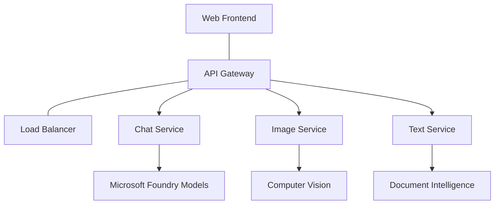

# Най-добри практики за продуктивни AI натоварвания с AZD

**Навигация в главите:**
- **📚 Начало на курса**: [AZD за начинаещи](../../README.md)
- **📖 Текуща глава**: Глава 8 - Продукционни и корпоративни модели
- **⬅️ Предишна глава**: [Глава 7: Отстраняване на неизправности](../chapter-07-troubleshooting/debugging.md)
- **⬅️ Свързани също**: [AI работилница лаборатория](../chapter-02-ai-development/ai-workshop-lab.md)
- **🎯 Край на курса**: [AZD за начинаещи](../../README.md)

## Преглед

Това ръководство обяснява продукционни AI модели, използвайки Azure Developer CLI (AZD). То е референтен дизайн, а не приложимо приложение или продукционен сертификат.

**Примерни граници:** Освен ако не е описано изрично като завършено, Bicep фрагментите приемат параметри и препратки към ресурси от съдържащия шаблон. Те пропускат хост изображения/планове, идентичности, ролеви присвоявания, DNS, изходи и друга необходима интеграция. Пътищата на услугите в YAML и hook/test скриптовете са илюстративни файлове за създаване в **собственото ви приложение**; те не са предоставени от този курс. Използвайте работещ AZD пример като основа, компилирайте пълната инфраструктура и го тествайте в изолиран среда преди продукция.

## Основни решавани предизвикателства

Чести продукционни проблеми включват внедряване на множество услуги, управление на идентичности и тайни, скалиране, контрол на разходите и мониторинг. Тук не се претендира за измерена честота.

## Архитектурни модели за продукционен AI

### Модел 1: Микросервизни AI архитектури

**Кога да използвате**: Сложни AI приложения с множество възможности



**Имплементация с AZD**:

```yaml
# azure.yaml
name: enterprise-ai-platform
services:
  web:
    project: ./web
    host: staticwebapp
  api-gateway:
    project: ./api-gateway
    host: containerapp
  chat-service:
    project: ./services/chat
    host: containerapp
  vision-service:
    project: ./services/vision
    host: containerapp
  text-service:
    project: ./services/text
    host: containerapp
```

### Модел 2: Събитиен AI процесинг

**Кога да използвате**: Партидно обработване, документен анализ, асинхронни работни процеси

```bicep
// Event Hub for AI processing pipeline
resource eventHub 'Microsoft.EventHub/namespaces@2024-01-01' = {
  name: eventHubNamespaceName
  location: location
  sku: {
    name: 'Standard'
    tier: 'Standard'
    capacity: 1
  }
}

// Service Bus for reliable message processing
resource serviceBus 'Microsoft.ServiceBus/namespaces@2024-01-01' = {
  name: serviceBusNamespaceName
  location: location
  sku: {
    name: 'Premium'
    tier: 'Premium'
    capacity: 1
  }
}

// Function App for processing
resource functionApp 'Microsoft.Web/sites@2023-01-01' = {
  name: functionAppName
  location: location
  kind: 'functionapp,linux'
  properties: {
    siteConfig: {
      appSettings: [
        {
          name: 'FUNCTIONS_EXTENSION_VERSION'
          value: '~4'
        }
        {
          name: 'AZURE_OPENAI_ENDPOINT'
          value: '@Microsoft.KeyVault(VaultName=${keyVault.name};SecretName=openai-endpoint)'
        }
      ]
    }
  }
}
```

Това създава фрагменти на namespace, а не hub-ове, опашки, абонаменти или тригери на Function. За изпълним Function е нужен и хостинг плана, runtime/сторидж конфигурация, закачена идентичност, RBAC и мрежов достъп. Препратката към Key Vault се нуждае от разрешение за четене на тайната; самият URL на endpoint не е удостоверение.

## Разсъждения за здравето на AI агента

Когато традиционно уеб приложение се срине, симптомите са познати: страница не се зарежда, API връща грешка или внедряването се проваля. AI приложенията могат да се повредят по тези начини — но и по по-фини начини, които не произвеждат очевидни грешки.

Тази секция помага да си изградите ментален модел за наблюдение на AI натоварвания, за да знаете къде да търсите, когато нещо не е както трябва.

### Как здравето на агента се различава от здравето на традиционно приложение

Традиционните приложения също могат да имат фини грешки в коректността. AI агентът добавя недетерминирано качество на отговора към обичайните проблеми с наличност и коректност. Разглеждайте здравето на агента на два слоя:

| Слой | Какво да наблюдавате | Къде да гледате |
|-------|--------------|---------------|
| **Здраве на инфраструктурата** | Работи ли услугата? Ресурсите осигурени ли са? Достъпни ли са endpoint-ите? | `azd monitor`, здравен статус в Azure портала, логове на контейнери/приложения |
| **Здраве на поведението** | Отговаря ли агентът правилно? Времето за отговор адекватно ли е? Извиква ли се моделът правилно? | Application Insights следи, метрики за латентност на извикване на модела, дневници за качество на отговора |

Здравето на инфраструктурата е познато — същото за всяко azd приложение. Здравето на поведението е новият слой, който AI натоварванията въвеждат.

### Къде да гледате, когато AI приложенията не се държат както очаквано

Ако вашето AI приложение не произвежда очакваните резултати, ето концептуален контролен списък:

1. **Започнете с основните неща.** Работи ли приложението? Може ли да достигне зависимостите си? Проверете `azd monitor` и здравето на ресурсите както при всяко приложение.
2. **Проверете връзката с модела.** Вашето приложение успешно ли извиква AI модела? Неуспешни или прекъснати извиквания на модел са най-честата причина за проблеми и ще се покажат в логовете на приложението.
3. **Проверете входа и основите безопасно.** Грешните отговори могат да произлизат от извличане, инструкции, ограничения на модела или изпълнение на инструменти. Използвайте контролирани диагностични данни с ограничен достъп; не активирайте произволно логване на подканите/отговорите в продукция.
4. **Прегледайте латентността на отговора.** Извикванията към AI модел са по-бавни от типични API повиквания. Ако приложението ви се усеща бавно, проверете дали времето за отговор на модела се е увеличило — това може да означава ограничаване, капацитет или регионална конгестия.
5. **Следете сигналите за разходи.** Неочаквани пикове в използване на токени или API извиквания могат да показват цикъл, неправилна конфигурация на подканата или прекомерни повторни опити.

Не е нужно да овладявате инструментите за наблюдение веднага. Ключовото е, че AI приложенията имат допълнителен слой поведение за мониторинг, а вграденият мониторинг на azd (`azd monitor`) ви дава начална точка за проучване и на двата слоя.

---

## Най-добри практики за сигурност

### 1. Модел за сигурност Zero-Trust

**Стратегия за изпълнение**:
- Няма комуникация между услуги без удостоверяване
- Всички API извиквания използват управлявани идентичности
- Мрежова изолация с частни крайни точки
- Контрол на достъпа с най-малко права

```bicep
// Managed Identity for each service
resource chatServiceIdentity 'Microsoft.ManagedIdentity/userAssignedIdentities@2023-01-31' = {
  name: 'chat-service-identity'
  location: location
}

// Role assignments with minimal permissions
resource openAIUserRole 'Microsoft.Authorization/roleAssignments@2022-04-01' = {
  scope: openAIAccount
  name: guid(openAIAccount.id, chatServiceIdentity.id, '5e0bd9bd-7b93-4f28-af87-19fc36ad61bd')
  properties: {
    roleDefinitionId: subscriptionResourceId('Microsoft.Authorization/roleDefinitions', '5e0bd9bd-7b93-4f28-af87-19fc36ad61bd')
    principalId: chatServiceIdentity.properties.principalId
    principalType: 'ServicePrincipal'
  }
}
```

### 2. Сигурно управление на тайни

**Модел за интеграция с Key Vault**:

```bicep
// Key Vault with proper access policies
resource keyVault 'Microsoft.KeyVault/vaults@2023-02-01' = {
  name: keyVaultName
  location: location
  properties: {
    tenantId: tenant().tenantId
    sku: {
      family: 'A'
      name: 'standard' // Premium is needed for HSM-backed keys, not ordinary secrets
    }
    enableRbacAuthorization: true  // Use RBAC instead of access policies
    enablePurgeProtection: true    // Prevent accidental deletion
    enableSoftDelete: true
    softDeleteRetentionInDays: 90
  }
}

// Optional legacy key-auth alternative; omit when using Entra ID.
resource openAIKeySecret 'Microsoft.KeyVault/vaults/secrets@2023-02-01' = {
  parent: keyVault
  name: 'openai-api-key'
  properties: {
    value: openAIAccount.listKeys().key1
    attributes: {
      enabled: true
    }
  }
}
```

Определете runtime идентичността `Key Vault Secrets User` на подходящия обхват и я закачете към хоста; самият `enableRbacAuthorization` не дава достъп. Предпочитайте OpenAI удостоверяване с управлявана идентичност с `disableLocalAuth: true`. Опционалният ключ/тайна има смисъл само при умишлено активиран акаунт, а също и управителя трябва да има права за писане на тайни.

### 3. Мрежова сигурност

**Конфигурация на частни крайни точки**:

```bicep
// Virtual Network for AI services
resource virtualNetwork 'Microsoft.Network/virtualNetworks@2023-04-01' = {
  name: vnetName
  location: location
  properties: {
    addressSpace: {
      addressPrefixes: ['10.0.0.0/16']
    }
    subnets: [
      {
        name: 'ai-services-subnet'
        properties: {
          addressPrefix: '10.0.1.0/24'
          privateEndpointNetworkPolicies: 'Disabled'
        }
      }
      {
        name: 'app-services-subnet'
        properties: {
          addressPrefix: '10.0.2.0/24'
          delegations: [
            {
              name: 'Microsoft.Web/serverFarms'
              properties: {
                serviceName: 'Microsoft.Web/serverFarms'
              }
            }
          ]
        }
      }
    ]
  }
}

// Private endpoints for all AI services
resource openAIPrivateEndpoint 'Microsoft.Network/privateEndpoints@2023-04-01' = {
  name: '${openAIAccountName}-pe'
  location: location
  properties: {
    subnet: {
      id: virtualNetwork.properties.subnets[0].id
    }
    privateLinkServiceConnections: [
      {
        name: 'openai-connection'
        properties: {
          privateLinkServiceId: openAIAccount.id
          groupIds: ['account']
        }
      }
    ]
  }
}
```

Частните крайни точки изискват и групи за частни DNS зони/връзки VNet и интеграция с приложение във VNet. Те не блокират публичен достъп автоматично: изрично деактивирайте публичния мрежов достъп на AI акаунта след потвърждаване на частна свързаност и достъп за внедряване.

## Производителност и скалиране

### 1. Стратегии за автоматично скалиране

**Автоматично скалиране на приложения с контейнери**:

```bicep
resource containerApp 'Microsoft.App/containerApps@2023-05-01' = {
  name: containerAppName
  location: location
  properties: {
    configuration: {
      ingress: {
        external: true
        targetPort: 8000
        transport: 'http'
      }
    }
    template: {
      scale: {
        minReplicas: 2  // Always have 2 instances minimum
        maxReplicas: 50 // Scale up to 50 for high load
        rules: [
          {
            name: 'http-scaling'
            http: {
              metadata: {
                concurrentRequests: '20'  // Scale when >20 concurrent requests
              }
            }
          }
          {
            name: 'cpu-scaling'
            custom: {
              type: 'cpu'
              metadata: {
                type: 'Utilization'
                value: '70'  // Scale when CPU >70%
              }
            }
          }
        ]
      }
    }
  }
}
```

### 2. Стратегии за кеширане

**Redis кеш за AI отговори**:

```bicep
// Legacy Azure Cache for Redis example (not recommended for new deployments)
resource redisCache 'Microsoft.Cache/redis@2023-04-01' = {
  name: redisCacheName
  location: location
  properties: {
    sku: {
      name: 'Premium'
      family: 'P'
      capacity: 1
    }
    enableNonSslPort: false
    minimumTlsVersion: '1.2'
    redisConfiguration: {
      'maxmemory-policy': 'allkeys-lru'
    }
    // Sharding distributes data; replication/failover provides availability.
    shardCount: 2
  }
}

// Cache configuration in application
var cacheConnectionString = '${redisCache.properties.hostName}:6380,password=${redisCache.listKeys().primaryKey},ssl=True,abortConnect=False'
```

Azure Cache за Redis Basic/Standard/Premium е на [път към отмяна](https://learn.microsoft.com/azure/azure-cache-for-redis/retirement-faq). Използвайте Azure Managed Redis за нови дизайни с документиран SKU, идентичност и TLS конфигурация, вместо да копирате този стар ресурс в нова продукционна система. Редът със connection-string е неизпълним запълващ текст, а не удостоверение. Разделяйте кеш ключове според авторизация, модел/инструкции и версия на извличане с изтичане на срока; споделен кеш само за заявки може да разкрие данни на друг потребител.

### 3. Балансиране на натоварването и управление на трафика

**Application Gateway с WAF**:

```bicep
// Application Gateway with Web Application Firewall
resource applicationGateway 'Microsoft.Network/applicationGateways@2023-04-01' = {
  name: appGatewayName
  location: location
  properties: {
    sku: {
      name: 'WAF_v2'
      tier: 'WAF_v2'
      capacity: 2
    }
    webApplicationFirewallConfiguration: {
      enabled: true
      firewallMode: 'Prevention'
      ruleSetType: 'OWASP'
      ruleSetVersion: '3.2'
    }
    // Backend pools for AI services
    backendAddressPools: [
      {
        name: 'ai-services-pool'
        properties: {
          backendAddresses: [
            {
              fqdn: '${containerApp.properties.configuration.ingress.fqdn}'
            }
          ]
        }
      }
    ]
  }
}
```

Това е частичен Gateway ресурс: за реално внедряване са нужни също gateway subnet/IP конфигурация, frontend IP и портове, TLS слушатели/сертификати, backend HTTP настройки/проби, правила за маршрутизация и приоритети, както и прегледана WAF политика. TLS hostname/SNI и удостоверяване трябва да съвпадат с backend-а на Container App.

## 💰 Оптимизация на разходите

### 1. Определяне на правилния размер на ресурсите

**Конфигурации специфични за средата**:

Тези имена са **илюстративни входове за потребителски шаблон**, а не автоматични AZD настройки. Най-напред ги нанесете в `infra/main.parameters.json`/Bicep и хост конфигурация. Например, примерът RAG използва `AZURE_SEARCH_SERVICE_SKU` и `AZURE_OPENAI_CHATGPT_DEPLOYMENT_CAPACITY`, а не общите имена по-долу. Дайте на паметта на Container Apps поддържана единица като `1Gi` в реалния ресурс. Приложете инфраструктурни промени с `azd up` или `azd provision`; самият `azd deploy` не прилага Bicep промени.

```bash
# Development environment
azd env new development
azd env set AZURE_OPENAI_SKU "S0"
azd env set AZURE_OPENAI_CAPACITY 10
azd env set AZURE_SEARCH_SKU "basic"
azd env set CONTAINER_CPU 0.5
azd env set CONTAINER_MEMORY 1.0

# Production environment  
azd env new production
azd env set AZURE_OPENAI_SKU "S0"
azd env set AZURE_OPENAI_CAPACITY 100
azd env set AZURE_SEARCH_SKU "standard"
azd env set CONTAINER_CPU 2.0
azd env set CONTAINER_MEMORY 4.0
```

### 2. Мониторинг на разходите и бюджети

```bicep
// Supply the first day of the current UTC month, e.g. 2026-11-01T00:00:00Z.
param budgetStartDate string

// Cost management and budgets
resource budget 'Microsoft.Consumption/budgets@2024-08-01' = {
  name: 'ai-workload-budget'
  properties: {
    timePeriod: {
      startDate: budgetStartDate
    }
    timeGrain: 'Monthly'
    amount: 2000  // In the billing currency, not necessarily USD
    category: 'Cost'
    notifications: {
      warning: {
        enabled: true
        operator: 'GreaterThan'
        threshold: 80
        contactEmails: [
          'finance@company.com'
          'engineering@company.com'
        ]
        contactRoles: [
          'Owner'
          'Contributor'
        ]
      }
      critical: {
        enabled: true
        operator: 'GreaterThan'
        threshold: 95
        contactEmails: [
          'cto@company.com'
        ]
      }
    }
  }
}
```

Заменете примерните получатели и проверете обхват/разрешения. Алармите за бюджет използват забавени данни за фактуриране и не налагат капачка на разхода.

### 3. Оптимизация на използването на токени

**Управление на разходите в OpenAI**:

Това е само симплифицирана хеуристика на база символи за визуализация в потребителски интерфейс, **не** валидатор за лимит на токени на модел. Продукционният код трябва да използва токенизатор, съобразен с внедрения модел и да отчита системни инструкции, схеми на инструменти, история и бюджет за изход. Отказвайте твърде големи съобщения на потребителя, вместо да ги съкращавате мълчаливо.

```typescript
// Application-level token optimization
class TokenOptimizer {
  private readonly maxTokens = 4000;
  private readonly reserveTokens = 500;
  
  optimizePrompt(userInput: string, context: string): string {
    const availableTokens = this.maxTokens - this.reserveTokens;
    if (this.estimateTokens(userInput) + 8 >= availableTokens) {
      throw new Error("User input exceeds the illustrative prompt budget");
    }
    const estimatedTokens = this.estimateTokens(userInput + context) + 8;
    
    if (estimatedTokens > availableTokens) {
      // Truncate context, not user input
      context = this.truncateContext(context, Math.max(0, availableTokens - this.estimateTokens(userInput) - 8));
    }
    
    return `${context}\n\nUser: ${userInput}`;
  }
  
  private estimateTokens(text: string): number {
    // Rough estimation: 1 token ≈ 4 characters
    return Math.ceil(text.length / 4);
  }

  private truncateContext(text: string, estimatedBudget: number): string {
    return text.slice(0, Math.max(0, estimatedBudget) * 4);
  }
}
```

## Мониторинг и наблюдаемост

### 1. Всестранен Application Insights

```bicep
// Application Insights with advanced features
resource applicationInsights 'Microsoft.Insights/components@2020-02-02' = {
  name: applicationInsightsName
  location: location
  kind: 'web'
  properties: {
    Application_Type: 'web'
    WorkspaceResourceId: logAnalyticsWorkspace.id
    SamplingPercentage: 100  // Ingestion setting; review cost and SDK sampling separately
    DisableIpMasking: false  // Retain IP masking
  }
}

// Custom metrics for AI operations
resource aiMetricAlerts 'Microsoft.Insights/metricAlerts@2018-03-01' = {
  name: 'ai-high-error-rate'
  location: 'global'
  properties: {
    description: 'Alert when failed request count exceeds 10 in five minutes'
    severity: 2
    enabled: true
    scopes: [
      applicationInsights.id
    ]
    evaluationFrequency: 'PT1M'
    windowSize: 'PT5M'
    criteria: {
      'odata.type': 'Microsoft.Azure.Monitor.SingleResourceMultipleMetricCriteria'
      allOf: [
        {
          name: 'high-error-rate'
          metricName: 'requests/failed'
          operator: 'GreaterThan'
          threshold: 10
          timeAggregation: 'Count'
        }
      ]
    }
  }
}
```

### 2. Мониторинг специфичен за AI

**Потребителски табла за AI метрики**:

```json
{
  "dashboard": {
    "name": "AI Application Monitoring",
    "tiles": [
      {
        "name": "OpenAI Request Volume",
        "query": "dependencies | where target contains 'openai' | summarize count() by bin(timestamp, 5m)"
      },
      {
        "name": "AI Response Latency",
        "query": "dependencies | where target contains 'openai' | summarize avg(duration) by bin(timestamp, 5m)"
      },
      {
        "name": "Token Usage",
        "query": "customMetrics | where name == 'openai_tokens_used' | summarize sum(value) by bin(timestamp, 1h)"
      },
      {
        "name": "Cost per Hour",
        "query": "customMetrics | where name == 'openai_cost' | summarize sum(value) by bin(timestamp, 1h)"
      }
    ]
  }
}
```

Този JSON е скица, определена от приложението, а не импортираща се схема за табло в Azure портал. Запитванията за токени/разходи изискват приложението ви да излъчва тези точно определени метрики; те не се създават от AZD. Адаптирайте филтрите за зависимости спрямо реалните крайни точки/имената на спановете на модела.

### 3. Проверки на здравето и мониторинг на време на работа

```bicep
// Application Insights availability tests
resource availabilityTest 'Microsoft.Insights/webtests@2022-06-15' = {
  name: 'ai-app-availability-test'
  location: location
  tags: {
    'hidden-link:${applicationInsights.id}': 'Resource'
  }
  properties: {
    SyntheticMonitorId: 'ai-app-availability-test'
    Name: 'AI Application Availability Test'
    Description: 'Tests AI application endpoints'
    Enabled: true
    Frequency: 300  // 5 minutes
    Timeout: 120    // 2 minutes
    Kind: 'standard'
    Locations: [
      {
        Id: 'us-east-2-azr'
      }
      {
        Id: 'us-west-2-azr'
      }
    ]
    Request: {
      RequestUrl: 'https://${webApp.properties.defaultHostName}/health'
      HttpVerb: 'GET'
      FollowRedirects: true
      ParseDependentRequests: false
    }
    ValidationRules: {
      ExpectedHttpStatusCode: 200
      SSLCheck: true
      SSLCertRemainingLifetimeCheck: 7
    }
  }
}
```

## Възстановяване при аварии и висока достъпност

Предишният тест предполага съществуващ App Service `webApp` и ресурс Application Insights. Стандартните тестове за достъпност са платими и изискват достъпен endpoint; приложения с достъп само през частна мрежа се нуждаят от подходящ частен мониторинг дизайн. Тестовете чрез URL пингове са остарели; използвайте [стандартни тестове за достъпност](https://learn.microsoft.com/azure/azure-monitor/app/availability).

### 1. Внедряване в множество региони

```yaml
# azure.yaml - Multi-region configuration
name: ai-app-multiregion
services:
  api-primary:
    project: ./api
    host: containerapp
    env:
      AZURE_REGION: eastus
  api-secondary:
    project: ./api
    host: containerapp
    env:
      AZURE_REGION: westus2
```

```bicep
// Separate App Service topology, not the Container Apps declarations above
resource trafficManager 'Microsoft.Network/trafficManagerProfiles@2022-04-01' = {
  name: trafficManagerProfileName
  location: 'global'
  properties: {
    profileStatus: 'Enabled'
    trafficRoutingMethod: 'Priority'
    dnsConfig: {
      relativeName: trafficManagerProfileName
      ttl: 30
    }
    monitorConfig: {
      protocol: 'HTTPS'
      port: 443
      path: '/health'
      intervalInSeconds: 30
      toleratedNumberOfFailures: 3
      timeoutInSeconds: 10
    }
    endpoints: [
      {
        name: 'primary-endpoint'
        type: 'Microsoft.Network/trafficManagerProfiles/azureEndpoints'
        properties: {
          targetResourceId: primaryAppService.id
          endpointStatus: 'Enabled'
          priority: 1
        }
      }
      {
        name: 'secondary-endpoint'
        type: 'Microsoft.Network/trafficManagerProfiles/azureEndpoints'
        properties: {
          targetResourceId: secondaryAppService.id
          endpointStatus: 'Enabled'
          priority: 2
        }
      }
    ]
  }
}
```

Променливите на средата не избират местоположения на ресурси. IaC трябва да осигури отделни регионални хостове и да свърже всяка услуга с `resourceName` или `azd-service-name` тагове. Примерът с Traffic Manager е **отделна App Service топология** (`primaryAppService`/`secondaryAppService`), а не маршрутизация за Container Apps декларациите. Container Apps изисква подходящо конфигуриран външен endpoint/front door, TLS/custom домейн маршрутизация и здравни проби.

### 2. Архивиране и възстановяване на данни

```bicep
// Backup configuration for critical data
resource backupVault 'Microsoft.DataProtection/backupVaults@2023-05-01' = {
  name: backupVaultName
  location: location
  identity: {
    type: 'SystemAssigned'
  }
  properties: {
    storageSettings: [
      {
        datastoreType: 'VaultStore'
        type: 'LocallyRedundant'
      }
    ]
  }
}

```

Самото хранилище не прави бекъп. Конфигурирайте **насочена към натоварването поддържана политика и бекъп инстанция**, разрешения за източника, задържане и тестове за възстановяване с помощта на [матрици за поддръжка на Azure Backup](https://learn.microsoft.com/azure/backup/backup-support-matrix). Няма обща политика на Azure Backup за хостнати внедрявания на Azure OpenAI модели. Дръжте дефинициите за инфраструктура/внедряване на модели под контрол на версиите; защитете качените документи, приложения и артефакти за донастройка, използвайки бекъп/експорт функциите на всяка поддържаща услуга. Определете и тествайте RPO/RTO изрично.

## DevOps и CI/CD интеграция

### 1. GitHub Actions работен процес

```yaml
# .github/workflows/deploy-ai-app.yml
name: Deploy AI Application

on:
  push:
    branches: [main]
  pull_request:
    branches: [main]

jobs:
  test:
    runs-on: ubuntu-latest
    steps:
      - uses: actions/checkout@v4
      
      - name: Setup Python
        uses: actions/setup-python@v4
        with:
          python-version: '3.11'
          
      - name: Install dependencies
        run: |
          pip install -r requirements.txt
          pip install pytest
          
      - name: Run tests
        run: pytest tests/
        
      - name: AI Safety Tests
        run: |
          python scripts/test_ai_safety.py
          python scripts/validate_prompts.py

```

Това е **само тестова част** на работния процес и предполага, че сте създали `requirements.txt`, `tests/` и двата скрипта за безопасност. Добавете удостоверени OIDC provisioning/deployment задачи от [CI/CD конфигурация на pipeline](#cicd-pipeline-configuration), с `needs: test`, доверен push/manual тригер и защитени GitHub среди. Не внедрявайте недоверен pull-request код с облачни удостоверения. Нов runner няма избрана локална AZD среда; подайте входните параметри за среда/абонамент/локация и използвайте `azd auth login`, не само `azure/login`.

### 2. Валидация на инфраструктурата

```bash
# scripts/validate_infrastructure.sh
#!/bin/bash
set -euo pipefail

echo "Validating AI infrastructure deployment..."

# Requires Azure CLI login and the resource group selected explicitly.
: "${AZURE_RESOURCE_GROUP:?Set AZURE_RESOURCE_GROUP}"
: "${AZURE_OPENAI_NAME:?Set AZURE_OPENAI_NAME}"
: "${AZURE_OPENAI_CHAT_DEPLOYMENT:?Set the actual deployment name}"

# A successful empty list is not proof that resources exist.
types=("Microsoft.CognitiveServices/accounts" "Microsoft.Search/searchServices"
       "Microsoft.Storage/storageAccounts" "Microsoft.KeyVault/vaults")
for resource_type in "${types[@]}"; do
    count=$(az resource list --resource-group "$AZURE_RESOURCE_GROUP" \
        --resource-type "$resource_type" --query "length(@)" -o tsv)
    if [[ "$count" -lt 1 ]]; then
        echo "ERROR: No $resource_type found in $AZURE_RESOURCE_GROUP"
        exit 1
    fi
done

# Validate OpenAI model deployments
echo "Validating OpenAI model deployments..."
state=$(az cognitiveservices account deployment show \
  --name "$AZURE_OPENAI_NAME" --resource-group "$AZURE_RESOURCE_GROUP" \
  --deployment-name "$AZURE_OPENAI_CHAT_DEPLOYMENT" \
  --query "properties.provisioningState" -o tsv)
if [[ "$state" != "Succeeded" ]]; then
    echo "ERROR: Required model deployment is not provisioned successfully"
    exit 1
fi

echo "Infrastructure validation completed successfully!"
```

Очаквано: нулев изход и съобщение за завършване само когато всички очаквани типове съществуват и именуваното внедряване на модел е готово. Това проверява състоянието на инвентаризация/провизия, **не** здравето на ресурси, точна топология, RBAC, мрежова достъпност или поведение на модела. Адаптирайте очакваните типове към вашата архитектура и после извършете отделен удостоверен тест за готовност на приложението.

## Контролен списък за продукционна готовност

### Сигурност ✅
- [ ] Всички услуги използват управлявани идентичности
- [ ] Тайните са съхранени в Key Vault
- [ ] Частни крайни точки са конфигурирани
- [ ] Прилагани са мрежови групи за сигурност
- [ ] RBAC с най-малко права
- [ ] WAF е активиран на публичните крайни точки

### Производителност ✅
- [ ] Конфигурирано е автоматично скалиране
- [ ] Изпълнено е кеширане
- [ ] Настроено е балансиране на натоварването
- [ ] CDN за статично съдържание
- [ ] Управление на сесии за връзки с база данни
- [ ] Оптимизация на използване на токени

### Мониторинг ✅
- [ ] Конфигуриран е Application Insights
- [ ] Дефинирани са потребителски метрики
- [ ] Настроени са правила за алармиране
- [ ] Създадено е табло
- [ ] Изпълнени са проверки на здравето
- [ ] Политики за съхранение на логове

### Надеждност ✅
- [ ] Много-регионално внедряване
- [ ] План за архивиране и възстановяване
- [ ] Внедрени прекъсвачи на вериги
- [ ] Конфигурирани политики за повторни опити
- [ ] Грациозна деградация
- [ ] Endpoint-ове за проверки на здравето

### Управление на разходите ✅
- [ ] Конфигурирани сигнали за бюджет
- [ ] Определяне на правилния размер на ресурси
- [ ] Приложени са отстъпки за разработка/тест
- [ ] Закупени са резервирани инстанции
- [ ] Табло за управление на разходите
- [ ] Редовни прегледи на разходите

### Съответствие ✅
- [ ] Спазени са изисквания за местоположение на данните
- [ ] Активирано е аудиторско логване
- [ ] Приложени са политики за съответствие
- [ ] Внедрени са базови стандарти за сигурност
- [ ] Редовни оценки на сигурността
- [ ] План за реакция при инциденти

## Изпитателни показатели за производителност

### Илюстративни продукционни цели

Това са примерни SLO за договаряне и стрес тестове, а не измерени показатели или гаранции. Латентността на отговора зависи от дължината на модел/изход; месечният разход за токени зависи от трафичните и ценови условия, не само от броя токени.

| Метрика | Цел | Мониторинг |
|--------|--------|------------|
| **Време за отговор** | < 2 секунди | Application Insights |
| **Наличност** | 99.9% | Мониторинг на време на работа |
| **Процент грешки** | < 0.1% | Логове на приложението |
| **Разход за модел** | < 500$/месец (примерен бюджет) | Управление на разходите |
| **Паралелни потребители** | 1000+ | Тестове на натоварване |
| **Време за възстановяване** | < 1 час | Тестове за възстановяване от бедствия |

### Тест за натоварване

По-долу е предоставен скица на интерфейс за скрипт за тест за натоварване, **който трябва да реализирате**; това хранилище не предоставя `scripts/load_test.py`. Определете натоварването на заявки, удостоверяване, представителни работни натоварвания, твърдения за латентност/грешки по перцентилен принцип и ограничение на разходите във вашия предпочитан инструмент за тест за натоварване, преди да го стартирате:

```bash
# Load testing script for AI applications
python scripts/load_test.py \
  --endpoint https://your-ai-app.azurewebsites.net \
  --concurrent-users 100 \
  --duration 300 \
  --ramp-up 60
```

## 🤝 Най-добри практики от общността

Въз основа на обратната връзка от общността Microsoft Foundry Discord:

### Топ препоръки от общността:

1. **Започнете малко, мащабирайте постепенно**: Започнете с основни SKU-та и мащабирайте според реалната употреба
2. **Наблюдавайте всичко**: Настройте пълно наблюдение от първия ден
3. **Автоматизирайте сигурността**: Използвайте инфраструктура като код за консистентна сигурност
4. **Тествайте старателно**: Включете AI-специфично тестване в своята верига за доставка
5. **Планирайте разходите**: Следете употребата на токени и настройте бюджетни предупреждения рано

### Общи капани, които да избягвате:

- ❌ Закодиране на API ключове в кода
- ❌ Не настройване на подходящо наблюдение
- ❌ Игнориране на оптимизацията на разходите
- ❌ Не тествайте сценарии на отказ
- ❌ Деплой без проверки на здравето

## Команди и разширения на AZD AI CLI

AZD включва разрастващ се набор от AI-специфични команди и разширения, които оптимизират производствените AI работни потоци. Тези инструменти преодоляват пропастта между локалната разработка и производственото внедряване за AI работни натоварвания.

> **Актуализация Foundry GA (09.11.2026):** Пакетът `microsoft.foundry` достигна **1.0 / обща наличност** на [5 ноември 2026](https://devblogs.microsoft.com/azure-sdk/microsoft-foundry-azure-developer-cli-ga/). Използвайте **`azd >= 1.37.0`** за този работен процес. По-ранният `azd 1.37.2`, агенти beta.23 и преглед на evaluations beta.2 са запазени по-долу като история на миграциите, а не като текуща версия на пакета. Това е преглед на документация/източник, не проверка на внедряването на живо или твърдение, че всяко опционално разширение, API или предварителна функция е GA.

### Разширения на AZD за AI

AZD използва система за разширения, за да добави AI-специфични възможности. Инсталирайте и управлявайте разширения с:

```bash
# List all available extensions (including AI)
azd extension list

# Inspect installed versions
azd version
azd ext list --installed

# Install the GA Foundry bundle
azd ext install microsoft.foundry

# Install the separate Foundry evaluations extension
azd extension install azure.ai.evaluations

# Install the fine-tuning extension
azd extension install azure.ai.finetune

# Install the custom models extension
azd extension install azure.ai.models

# Upgrade the Foundry bundle
azd ext upgrade microsoft.foundry
```

**Налични AI разширения:**

| Разширение | Цел | Статус |
|-----------|---------|--------|
| `microsoft.foundry` | Мета-пакет, инсталиращ седемте основни разширения по-долу; няма собствена група от команди | GA пакет 1.0 |
| `azure.ai.agents` | `azd ai agent`: настройка на агент, локално изпълнение и операции | Включено; независимо версионирано |
| `azure.ai.connections` | `azd ai connection`: връзки на проекти | Включено; независимо версионирано |
| `azure.ai.inspector` | `azd ai inspector`: локален Agent Inspector UI | Включено; независимо версионирано |
| `azure.ai.projects` | `azd ai project`: ресурси и внедрения на модели на проект | Включено; независимо версионирано |
| `azure.ai.routines` | `azd ai routine`: графици и тригери | Включено; независимо версионирано |
| `azure.ai.skills` | `azd ai skill`: повторно използваеми поведенчески насоки | Включено; независимо версионирано |
| `azure.ai.toolboxes` | `azd ai toolbox`: версионирани колекции инструменти | Включено; независимо версионирано |
| `azure.ai.evaluations` | Набори от данни за оценка, оценители, групи за оценяване и изпълнения | Отделна инсталация/релийз |
| `azure.ai.dataset` | Регистрация и версиониране на набори данни | Отделна инсталация/релийз |
| `azure.ai.finetune` | Фино настройване на модел във Foundry | Отделна инсталация/релийз |
| `azure.ai.models` | Потребителски модели на Foundry | Отделна инсталация/релийз |

Все още е поддържано индивидуалното инсталиране на `azure.ai.agents`, което инсталира и зависимостите си; пакетът е по подразбиране за курса при GA работния поток. GA на пакета не е гаранция за статуса на опционалните функции на съставните компоненти. Вижте [опаковане и проверка на разширения](https://learn.microsoft.com/azure/foundry/agents/how-to/install-cli-foundry-extensions) и инспектирайте помощта на инсталираните команди преди употреба.

> Надстройте първо основния CLI с `azd update` или съответния [метод за инсталация/актуализация](https://learn.microsoft.com/azure/developer/azure-developer-cli/install-azd), след това стартирайте `azd ext upgrade microsoft.foundry`. Актуализирайте отделно инсталираните оценки по нужда с `azd ext upgrade azure.ai.evaluations`. Няма основна команда `azd upgrade`. Записвайте и преглеждайте независимо версионираните разширения в производствената автоматизация; надстройката не мигрира автоматично старата конфигурация.

### Последни промени и поправки в релийзите

| Релийз | Какво се променя за този курс |
|---------|------------------------------|
| `microsoft.foundry` 1.0 GA (05.11.2026) | По подразбиране се използва пакетът със седем разширения, пази настройки на агент/внедряване в `azure.yaml`, тества локално с Agent Inspector и качва код за отдалечено изграждане във Foundry. Оценките се инсталират отделно и се инсталират отново изисканите разширения на CI сървъри. |
| `azd 1.37.0` | Добавя стабилни API за предварителен преглед на внедряванията и поправя редакции на разширения, които презаписват несвързани настройки `azure.yaml`. |
| `azd 1.37.1` | Поправя разпространението на Ctrl+C през разширения и различава отменяне/изтичане на време от общи сривове. |
| `azd 1.37.2` | Подобрява проверката на осигуряване: критични предупреждения по подразбиране са **Не**, неуспех без потвърждение при автоматични изпълнения и отменяне пропуска последващи указатели. Поправя и неразрешени стойности за среди в списък с откази на Deployment Stacks, когато тази алфа функция е активирана. |
| Агенти `beta.22` | Мигрира оценките към `azd ai eval`, сменя оптимизацията към GA v1 API, изисква множествено `toolboxes` и отделя управляван харнес, глас и дългосрочни предварителни опции. Поправя избор на модел по среда и удостоверяване на toolkit. |
| Агенти `beta.23` | Излага `init --harness`; поправя изхода на отговор A2A 0.3, невалидни пътища/модули за prompt-agent през инфраструктурни слоеве, диагностика на таймаут при активиране и задържани предупреждения RBAC за разработчик. |
| Оценки `beta.2` | Изисква конфигурация за оценка в camelCase, добавя статично/симулирано авторство на разговор и изрични източници на локални файлове, поправя обработката на идентичност/версия на набори данни, броя на quality-gates и диагностика при неуспешни изпълнения. |

Таймаут при активиране на агент **не доказва** неуспех на внедряване: инспектирайте опитната версия и състоянието ѝ преди повторен опит. Предупрежденията RBAC за разработчик могат да останат дори при успешно осигуряване; разрешете липсващия достъп преди да го използвате като този разработчик.

Редовете за бета по-горе описват предишни поправки и граници на миграция, а не изискване да фиксирате нови проекти на тези версии.

Източници: [Foundry GA обявление](https://devblogs.microsoft.com/azure-sdk/microsoft-foundry-azure-developer-cli-ga/), [AZD версии](https://github.com/Azure/azure-dev/releases), [релийз на агенти beta.23](https://github.com/Azure/azure-dev/releases/tag/azd-ext-azure-ai-agents_1.0.0-beta.23), [миграция агенти beta.22](https://github.com/Azure/azure-dev/releases/tag/azd-ext-azure-ai-agents_1.0.0-beta.22) и [релийз на оценки beta.2](https://github.com/Azure/azure-dev/releases/tag/azd-ext-azure-ai-evaluations_1.0.0-beta.2).

**Какви са вградени разширения `skills` и `connections`?**

Те са инсталирани с основния пакет, но служат за различни цели:

- **`azure.ai.skills`** — Една **умение** пакетира повторно използваеми поведенчески насоки за агенти. Споделяйте прегледани инструкции между агенти, вместо да ги копирате. Умението само по себе си не реализира инструмент или дава достъп до данни; използвайте toolbox и приложение за изпълнение на инструменти.
- **`azure.ai.connections`** — Една **връзка** е управлявана връзка от вашия проект Foundry до външен ресурс, от който твоите агенти се нуждаят — източник на данни (като Azure AI Search), точка за достъп на инструмент или друга услуга. Връзките централизират *къде* и *как* агентите получават достъп до данните, така че идентификационните данни и точките за достъп да живеят в едно управлявано място, а не да се разпръскват в кода.

Не е нужно да конфигурирате всяка вградена възможност, за да внедрите първия си агент. Обърнете се към уменията, ако агентите споделят поведенчески насоки, и към връзките, ако споделят външни ресурси.

### Инициализиране на проектите за агент с `azd ai agent init`

Командата `azd ai agent init` изгражда скелет на проект за агент Microsoft Foundry. За пример за изпълним код при разгръщане с Python 3.13+ и актуалния uv, следвайте [GA hosted-agent walkthrough](../chapter-02-ai-development/microsoft-foundry-integration.md#hosted-agent-walkthrough-ga). Командите по-долу илюстрират приемането на **вашия собствен** актуален шаблон за проект `azure.yaml`; именуваният локален шаблон не се доставя с този курс:

```bash
# Initialize a new agent project from a local project template
azd ai agent init --template ./templates/support-agent/azure.yaml

# Initialize and target a specific Foundry project
azd ai agent init --template ./templates/support-agent/azure.yaml --project-id <foundry-project-id>

# Adopt the template into a different directory
azd ai agent init --template ./templates/support-agent/azure.yaml --src ./agents/my-agent
```

**Ключови флагове:**

| Флаг | Описание |
|------|-------------|
| `-t, --template` | Път или поддържан URI Github за проектен документ `azure.yaml` |
| `-p, --project-id` | Съществуващ Microsoft Foundry Project ID за вашата azd среда |
| `-s, --src` | Изходна директория за генерирани агенти, или целева директория при приемане на проект |
| `--deploy-mode code` | Качване на изходния код за отдалечено изграждане във Foundry вместо локално контейнерно изграждане |
| `--model-deployment` | Използване на съществуващо именувано внедряване на модел по време на инициализация |
| `--kind` | Инициализиране на `hosted`, `prompt` или преглед `prompt-voice` агент |
| `--harness` | Опционален харнес за изпълнение на `--kind prompt`; изисква предварителното му опция |
| `-e, --environment` | Средата на azd, която да се използва |

`--manifest`/`-m` е остарял псевдоним за `--template`/`-t`; преименуването на флага не преобразува стар манифест в актуален проектен документ. `--host containerapp` не е текущ флаг за agent-init. За обикновено приложение Container Apps използвайте `azd init --template` с шаблон, който декларира `host: containerapp`.

За съществуващ проект с точно една услуга `azure.ai.project`, `azd ai agent add support-agent --file ./agents/support-agent.yaml` добавя или обновява директно дефиниция на агент без осигуряване или внедряване. Изпълнителните команди отказват наследени имплицитни `agent.yaml`/AgentManifest и вложени дефиниции за услуги `config:`; мигрирайте ги към актуална услуга `azure.ai.agent`. Когато команда init отпечата следващата стъпка `cd`, стартирайте я преди `azd up`: init не променя директорията на вашата обвивка.

**Съвет за продукция**: Използвайте `--project-id`, за да се свържете директно към съществуващ проект Foundry, като поддържате кода на агента и облачните ресурси свързани от самото начало.

#### Опционални предварителни функции

Управляваният харнес, гласовият агент и дългосрочното извикване са независими и по подразбиране деактивирани. Задайте само превключвателя за функцията, която ви трябва в **процесната среда на shell/CI**, а не с `azd env set`:

| Функция | Променлива на процесната среда |
|---------|------------------------------|
| Управляван харнес (`init --kind prompt --harness ...`) | `AZD_ALPHA_ENABLE_AGENTS_MANAGED_HARNESS=true` |
| Глас (`init --kind prompt-voice`) | `AZD_ALPHA_ENABLE_AGENTS_VOICE=true` |
| Дългосрочно извикване | `AZD_ALPHA_ENABLE_AGENTS_LONG_RUNNING=true` |

Например, използвайте `export AZD_ALPHA_ENABLE_AGENTS_MANAGED_HARNESS=true` в Bash или `$env:AZD_ALPHA_ENABLE_AGENTS_MANAGED_HARNESS = "true"` в PowerShell преди изпълнението на съответната команда. Един превключвател не активира другите. Вижте [прочетения agents README](https://github.com/Azure/azure-dev/blob/azd-ext-azure-ai-agents_1.0.0-beta.23/cli/azd/extensions/azure.ai.agents/README.md) за всички предварителни превключватели и ограничения.

### Управление на жизнения цикъл на агента

Разширението `azure.ai.agents` от пакета поддържа локално тестване и операции с внедрен агент. Инсталирайте `azure.ai.evaluations` отделно за измерване на качеството:

```bash
# Start the local agent and Agent Inspector (leave running)
azd ai agent run

# From a second terminal in the project directory
azd ai agent invoke --local "Explain how this agent is deployed."

# Invoke a deployed agent and view server response timing
# (total latency and time to first byte)
azd ai agent invoke

# Show the live endpoint configuration before changing it
azd ai agent endpoint show

# Download the deployed source of a code-based hosted agent
# (with SHA-256 verification)
azd ai agent code download

# Delete a hosted agent and all of its versions
# (--force terminates active sessions)
azd ai agent delete --force
```

**Жизнен цикъл накратко:**

| Етап | Команда | Производствена употреба |
|-------|---------|----------------|
| Локален тест | `azd ai agent run`, след това `azd ai agent invoke --local "Test prompt"` | Инспектиране на заявки и отговори преди внедряване; обажданията към модели от Azure все още носят разходи |
| Внедряване | `azd deploy` | В кодов режим, локално каченият изход се изгражда отдалечено във Foundry |
| Тест | `azd ai agent invoke` | Валидиране на отговори и измерване на латентност преди пускане |
| Диагностика | `azd ai agent doctor`, `azd ai agent monitor --follow` | Проверка на настройка/права и преглед на агент логове |
| Инспекция | `azd ai agent endpoint show` | Преглед на удостоверяване/конфигурация на крайна точка; откриване на критични промени рано |
| Измерване | `azd ai eval init`, `generate`, `run start` | Дефиниране, внедряване и изпълнение на повторяеми оценки |
| Подобряване | `azd ai agent optimize --eval <evaluation-name> --optimize-model <optimizer-deployment>` | Повторно използване на съвместима оценка за оптимизиране на агента |
| Възстановяване | `azd ai agent code download` | Възстановяване на точното внедрено изходно съдържание за одит/връщане назад |
| Приключване | `azd ai agent delete --force` | Изтриване на агент и неговите версии чисто |

> Стартирайте `azd ai agent --help` за преглед на командите във вашата инсталирана версия. Пакетът е GA; независимо контролирани предварителни функции все още са по избор. Преди почистване разграничете изтриването на агент от това на проект: `azd down` изтрива групата ресурси на новосъздадения проект, но оставя ресурсите в повторно използвани проекти. Следвайте [указанията за почистване](../chapter-02-ai-development/microsoft-foundry-integration.md#7-clean-up-deliberately).

`endpoint show` поддържа хоствани, prompt и гласови агенти, но актуализациите на крайни точки са само за хоствани; агенти за работни потоци не се поддържат. Изтеглянето на код и горния пример за приключване на хостван агент не са общи операции за всеки тип агент.

#### Миграция на оценки и проверки на качеството

Започвайки с агенти **1.0.0-beta.22 (23.10.2026)**, наследените команди `azd ai agent eval` предоставят указания за миграция вместо предишния работен поток за оценки. Не копирайте стари примери `eval generate --dataset ...`: оценката сега е под **`azd ai eval`**.

В инициализиран проект с агент, удостоверете се с `azd auth login`, потвърдете избраната среда/Foundry проект и инсталирайте `azure.ai.evaluations`. Необходимо е разгръщане на модел на съдия за оценяване на базата на модел; генерирането и симулацията на разговор могат да изискват собствени избрани модели и да водят до допълнителни такси.

```bash
# Generate a draft rubric and dataset from the deployed agent
azd ai eval generate

# After reviewing the assets, configure a named evaluation
azd ai eval init --name quality

# Review generated files, then register datasets, evaluators, and eval groups
azd up

# Start an evaluation and wait for its results
azd ai eval run start --eval quality --wait

# Inspect runs and available test-case output
azd ai eval run list
azd ai eval run show <run-id>
azd ai eval run output list <run-id>
```

За примера от анонса на GA изберете **Dataset and evaluator** и **Turn** по време на генерирането, след това изберете тези прегледани активи и модел на съдия при инициализацията. Следвайте отпечатаните следващи стъпки, вместо да приемате, че генерираните активи вече са регистрирани. Можете също да инициализирате срещу съществуващ прегледан набор от данни/рубрика без генериране на нови данни. Конфигурацията на оценяването обикновено се намира в `evals/azure.eval.yaml`, позовавана от услугата `azure.ai.eval` в `azure.yaml`. Ключовете са в **camelCase** (`evaluationLevel`, `maxSamples`, `initializationParameters`, `dataMapping`); старите конфигурационни ключове в snake_case се отхвърлят. Пътеките в реферираната конфигурация се разрешават относително към този файл, а не към корена на хранилището.

За оценки на разговори изберете **static** за оценка на завършени транскрипти без повикване на агент, или **simulation** за генериране на разговори от семена на сценарии. Симулацията изисква целеви агент, модел-симулатор и отделен избор на модел на съдия. За команди без наблюдение подайте входните данни, изброени от `azd ai eval init --help` и `azd ai eval generate --help`; не приемайте, че моделът за генериране е и съдия или симулатор.

За CI конфигурирайте изрична политика за качество чрез `azd ai eval run start --help` (`--fail-on`) и приемайте неизход с различно от нула на хоста като провал. Завършеното изпълнение не е автоматично пропускане на качеството. Прегледайте провалените/с грешки редове и диагностика; липсващи или несъответстващи брой резултати не са доказателство за успех. Регистрираните набори от данни запазват своята идентичност/версия на услугата; `--max-samples` не може да съкратява регистриран набор от данни. Публикувайте по-малък набор от данни умишлено или използвайте поддържан локален файлов източник.

```bash
# Example CI policy: at least 90% of all test cases must pass
azd ai eval run start --eval quality --wait --no-prompt --fail-on "pass-rate=0.9"
```

Проходната порта използва съотношението на преминали тестови случаи към общия брой тестови случаи; провалени, с грешки, пропуснати и по друг начин непреминали редове се броят срещу нея. Не комбинирайте порта с `--no-wait`, който връща резултат преди да е налично решение.

#### Миграция на конфигурация за оптимизация

Оптимизацията вече използва API на GA v1. За да преизползвате съвместима **оценка на ниво ход, базирана на набор от данни** от новия работен процес:

```bash
# Replace placeholders with the evaluation name and optimizer model deployment
azd ai agent optimize --eval-config ./evals/azure.eval.yaml --eval <evaluation-name> --optimize-model <optimizer-deployment>
```

`--eval` избира оценка; `--eval-config` избира нейния конфигурационен файл (включително файлови дефиниции). `--config` вместо това приема **отделна заявка към оптимизационен API** в YAML или JSON. Не предавайте стария агент `eval.yaml` или новия `azure.eval.yaml` на `--config` и не комбинирайте `--config` с `--eval`/`--eval-config`. Оценките на разговори, основани на трасета, или симулации не са взаимнозаменяеми с оптимизационната кратка пътека, базирана на набор от данни; използвайте поддържан формат за оптимизационна заявка за тези сценарии. Прегледайте кандидатите преди прилагане или разгръщане.

Вижте [справочника на оценките за прегледаното издание](https://github.com/Azure/azure-dev/blob/azd-ext-azure-ai-evaluations_1.0.0-beta.2/cli/azd/extensions/azure.ai.evaluations/README.md) и [източника на командата за оптимизация за прегледаното издание](https://github.com/Azure/azure-dev/blob/azd-ext-azure-ai-agents_1.0.0-beta.23/cli/azd/extensions/azure.ai.agents/internal/cmd/optimize.go) за точни опции.

#### Преглед на внедряването на хостван агент само за четене

За съществуваща среда, свързана с Foundry, с обединена услуга `azure.ai.agent` на `kind: hosted`, сравнете поддържаната конфигурация преди внедряване:

```bash
azd deploy <service-name> --preview --no-prompt
```

Този преглед не внедрява агента. Това не е пълен диф на инфраструктурата/сигурността: агентите за подсказки/глас/работен процес, наследени конфигурационни оформления и някои хоствани настройки са извън обхвата му. Резултатът от `unknown` не е одобрение за разгръщане. Няма отделна команда `azd ai agent deploy` или агент `--dry-run`; използвайте основния работен поток за внедряване.

### Протокол за контекст на модел (MCP) с `azd mcp`

AZD включва вградена поддръжка за MCP сървър (Алфа), позволявайки на AI агенти и инструменти да взаимодействат с вашите ресурси в Azure чрез стандартизиран протокол:

```bash
# Start the MCP server for your project
azd mcp start

# Review current Copilot consent rules for tool execution
azd copilot consent list
```

MCP сървърът излага контекста на вашия azd проект — среди, услуги и ресурси в Azure — към инструментите за разработка с изкуствен интелект. Това позволява:

- **Подпомогнато с ИИ внедряване**: Позволете на агентите за кодиране да запитват състоянието на проекта и да задействат внедрявания
- **Откриване на ресурси**: Инструментите с изкуствен интелект могат да откриват какви Azure ресурси използва проектът ви
- **Управление на среди**: Агентите могат да превключват между развойна, подготвителна и продукционна среда

### Генериране на инфраструктура с `azd infra generate`

За производствени натоварвания с изкуствен интелект можете да генерирате и персонализирате инфраструктура като код, вместо да разчитате на автоматично осигуряване:

```bash
# Generate supported infrastructure for this project type
azd infra generate
```

Поддръжката зависи от проекта/домакина и инсталираните доставчици; това не е обща команда за обратен инженеринг за произволни Azure ресурси или обещание да генерира както Bicep, така и Terraform. Стартирайте `azd infra generate --help` и прегледайте генерирания формат. Където се поддържа, записването на IaC на диск ви позволява:
- Да прегледате и одитирате инфраструктурата преди внедряване
- Да добавите персонализирани политики за сигурност (мрежови правила, частни крайни точки)
- Да интегрирате с вече съществуващи процеси за преглед на IaC
- Да контролирате версиите на инфраструктурните промени отделно от кода на приложението

### Продукционни конектори за жизнения цикъл

AZD конекторите ви позволяват да вмъквате персонална логика на всеки етап от жизнения цикъл на внедряването — критично за производствени AI работни потоци:

```yaml
# azure.yaml - Production hooks example
name: ai-production-app
hooks:
  preprovision:
    shell: sh
    run: scripts/validate-quotas.sh    # Check AI model quota before provisioning
  postprovision:
    shell: sh
    run: scripts/verify-networking.sh  # Verify IaC-provisioned private connectivity
  predeploy:
    shell: sh
    run: scripts/run-ai-safety-tests.sh  # Run prompt safety checks
  postdeploy:
    shell: sh
    run: scripts/smoke-test.sh           # Verify agent responses post-deploy
services:
  agent-api:
    project: ./src/agent
    host: containerapp
    hooks:
      predeploy:
        shell: sh
        run: scripts/validate-model-access.sh  # Per-service hook
```

```bash
# Run a specific hook manually during development
azd hooks run predeploy
```

**Препоръчителни продукционни конектори за AI натоварвания:**

| Конектор | Приложение |
|------|----------|
| `preprovision` | Валидиране на квотите на абонамента за капацитет на AI модел |
| `postprovision` | Проверка на частната свързаност и необходимите изходи на ресурси |
| `predeploy` | Провеждане на AI тестове за безопасност, валидиране на шаблони за подсказки |
| `postdeploy` | Димна проба на отговорите на агента, проверка на свързаността на модела |

### Конфигурация на CI/CD pipeline

Първо валидирайте проекта локално и завършете успешно `azd up`. След това използвайте `azd pipeline config`, за да го свържете с GitHub Actions или Azure Pipelines със сигурно удостоверяване в Azure:

```bash
# Configure CI/CD pipeline (interactive)
azd pipeline config

# Configure with a specific provider
azd pipeline config --provider github
```

Тази команда:
- Създава или конфигурира идентичност на pipeline; прегледайте генерирания от нея диапазон/разрешения на ролята, вместо да приемате най-малко привилегии
- Конфигурира федеративни удостоверения (без съхранени тайни)
- Генерира или актуализира файла с дефиницията на pipeline
- Настройва необходимите променливи на средата във вашата CI/CD система

#### Стъпка по стъпка: първият ви GitHub Actions pipeline

Ето пълното ръководство от работещ проект azd до автоматизирани внедрявания при всяко push.

**1. Уверете се, че проектът ви е в GitHub**

```bash
git init
git add .
git commit -m "Initial azd project"
gh repo create my-ai-app --private --source=. --push
```

**2. Стартирайте конфигурация на pipeline**

```bash
azd pipeline config --provider github
```

azd ще направи интерактивно:
- Ще попита кой Azure абонамент и среда да бъде таргетирана
- Ще създаде Entra **регистрация на приложение + служебно лице** за pipeline
- Ще настрои **федеративни удостоверения (OIDC)** — така GitHub се удостоверява в Azure с краткотрайни токени и **няма съхранени тайни**
- Ще натисне необходимите **променливи** в GitHub хранилището ви (`AZURE_CLIENT_ID`, `AZURE_TENANT_ID`, `AZURE_SUBSCRIPTION_ID`, `AZURE_ENV_NAME`, `AZURE_LOCATION`)

**3. Разберете генерирания работен процес**

За поддържан шаблон конфигурирайте/прегледайте `.github/workflows/azure-dev.yml`. Следният пример Foundry запазва настройките за checkout, OIDC влизане и целева среда и инсталира GA пакета плюс оценки на runner. Добавете изискванията на инструментария на вашето приложение и доставчика на инфраструктура; за Terraform запазете генерираната настройка, remote-state и стъпките за удостоверяване. Изберете и закрепете прегледана версия на AZD с номер равен на или по-голям от 1.37.0; този извадка използва минималната от анонса.

```yaml
# .github/workflows/azure-dev.yml
on:
  push:
    branches: [ main ]
  workflow_dispatch:        # lets you run it manually too

permissions:
  id-token: write           # required for OIDC federated login
  contents: read

concurrency:
  group: foundry-production-deployment
  cancel-in-progress: false

jobs:
  build:
    runs-on: ubuntu-latest
    env:
      AZURE_CLIENT_ID: ${{ vars.AZURE_CLIENT_ID }}
      AZURE_TENANT_ID: ${{ vars.AZURE_TENANT_ID }}
      AZURE_SUBSCRIPTION_ID: ${{ vars.AZURE_SUBSCRIPTION_ID }}
      AZURE_ENV_NAME: ${{ vars.AZURE_ENV_NAME }}
      AZURE_LOCATION: ${{ vars.AZURE_LOCATION }}
    steps:
      - uses: actions/checkout@v4
      - name: Install azd
        uses: Azure/setup-azd@v2
        with:
          version: 1.37.0
      - name: Install Foundry extensions
        run: azd ext install microsoft.foundry azure.ai.evaluations
      - name: Log in with OIDC
        run: azd auth login --client-id "$AZURE_CLIENT_ID" --federated-credential-provider "github" --tenant-id "$AZURE_TENANT_ID"
      - name: Provision infrastructure
        run: azd provision --no-prompt
      - name: Deploy application
        run: azd deploy --no-prompt
      - name: Evaluate deployed agent
        run: azd ai eval run start --eval quality --wait --no-prompt --fail-on "pass-rate=0.9"
```

Стъпката за оценяване изисква заявка с ангажирана `evals/azure.eval.yaml`, нейния референт в услугата `azure.yaml`, прегледани тестови активи без тайни и достъп на pipeline до препратените набори от данни, оценители и разгръщания на модели. Конфигурирайте оценката `quality` преди да активирате тази стъпка; пропуснете както стъпката, така и инсталацията на оценки, ако проектът ви не я използва. Само завършеното изпълнение не е проходна врата за качество: този пример изисква поне 90% от всички случаи да преминат.

Използвайте отделна среда AZD и съответни одобрения за всеки етап. Конкурентната група сериализира само този работен процес, а не други инструменти или хранилища, актуализиращи същия агент. Предоставете необходимите разрешения за ресурси и Foundry на идентичността на pipeline и съхранявайте всички необходими идентификационни данни за време на изпълнение в secrets, а не в ангажирана конфигурация. Вижте [пълното ръководство за Foundry CI/CD](https://learn.microsoft.com/azure/foundry/agents/how-to/set-up-ci-cd-cli) за изисквания, специфични за доставчика.

**4. Проверете дали работи**

```bash
# Push a change to trigger the pipeline
git commit -am "Trigger pipeline" --allow-empty
git push
```

Отворете таба **Actions** във вашето GitHub хранилище и наблюдавайте автоматичното изпълнение на работния процес `azd provision` и `azd deploy`.

> **Защо федеративните удостоверения са важни:** старите pipeline-и съхраняваха клиентски таен ключ в GitHub. Федеративните удостоверения OIDC премахват този таен ключ изцяло — GitHub изисква краткотраен токен по време на изпълнение, което е по-сигурно и няма нужда от завъртане или изтичане. Това е подразбиращата се настройка, която `azd pipeline config` задава.

> **Тайни срещу променливи:** не чувствителни идентификатори (`AZURE_CLIENT_ID` и др.) се поставят в репо **променливи**. Ако вашето приложение наистина се нуждае от тайна по време на изграждане, добавете я като GitHub **тайна** и я позовете с `${{ secrets.NAME }}`—но предпочитайте Key Vault + управлявана идентичност по време на изпълнение (вижте [Глава 3](../chapter-03-configuration/authsecurity.md)).

**Производствен работен процес с конфигурация на конвейер:**

```bash
# 1. Set up production environment
azd env new production
azd env set AZURE_OPENAI_CAPACITY 100

# 2. Configure the pipeline
azd pipeline config --provider github

# 3. Review the generated trigger, provisioning/deployment steps, and approvals
```

#### Стъпка по стъпка: Azure DevOps Pipelines

Предпочитате Azure DevOps пред GitHub Actions? azd го поддържа нативно с провайдър `azdo`. Потокът е почти идентичен—azd генерира файла на конвейера, създава service connection и осъществява удостоверяване.

**1. Уверете се, че имате проект в Azure DevOps**

Трябва ви организация и проект в `https://dev.azure.com/<your-org>`. Генерирайте Personal Access Token (PAT) с обхвати **Build (прочит и изпълнение)**, **Code (прочит и запис)**, и **Service Connections (прочит, заявка и управление)**—azd ще ви подкани за това.

**2. Конфигурирайте конвейера**

```bash
azd pipeline config --provider azdo
```

azd ще:
- Попита за вашата организация и проект в Azure DevOps
- Създаде (или преизползва) **service connection** към Azure с помощта на service principal
- Конфигурира **workload identity federation (OIDC)**, така че да не се съхранява клиентски таен ключ
- Конфигурира дефиниция на конвейер (обикновено `.azdo/pipelines/azure-dev.yml`) от шаблона на конвейера на проекта

**3. Прегледайте генерирания конвейер**

Използвайте генерирания конвейер на проекта, включително **Azure service connection и стъпките за удостоверяване на AZD**. Официалното [Azure Pipelines ръководство за настройка](https://learn.microsoft.com/azure/developer/azure-developer-cli/pipeline-azure-pipelines) показва инсталационния фрагмент по-долу; това е **само инсталация**, не работен поток за изпълнима удостоверена деплоймент:

```yaml
# .azdo/pipelines/azure-dev.yml (installer fragment only)
trigger:
  - main

pool:
  vmImage: ubuntu-latest

steps:
  - task: setup-azd@0
    displayName: Install azd
```

Инсталирайте добавката AZD Azure DevOps, ако тази задача не е налична във вашата организация. За Foundry задачи, уверете се, че имате AZD 1.37.0+ и инсталирайте `microsoft.foundry` на ездача, плюс `azure.ai.evaluations` когато са необходими оценки. Не копирайте голи стъпки shell `azd provision`/`azd deploy` без удостоверяване: разполагането на service connection не влиза автоматично във всеки процес в AZD. Следвайте входящия OIDC логин на генерирания шаблон и упълномощения контекст на задачата и предоставете избрания environment/subscription/location.

**4. Откъде идват променливите**

azd съхранява стойностите на средата (`AZURE_ENV_NAME`, `AZURE_LOCATION`, `AZURE_SUBSCRIPTION_ID`) като **група променливи** в Azure DevOps, така че конвейерът да може да ги чете. Можете да ги преглеждате и редактирате под **Pipelines → Library**.

> **Същата OIDC полза като в GitHub:** провайдърът `azdo` също конфигурира workload identity federation по подразбиране, така че в service connection не се съхранява клиентски таен ключ—Azure DevOps разменя краткосрочен токен по време на изпълнение. Предавайте `--auth-type client-credentials` само ако вашата организация все още не може да използва OIDC.

**5. Стартирайте го**

```bash
git commit -am "Add Azure DevOps pipeline" --allow-empty
git push
```

Отворете **Pipelines** в Azure DevOps, за да наблюдавате изпълнението на `azd provision` и `azd deploy`.

### Добавяне на компоненти с `azd add`

Добавяйте постепенно Azure услуги към съществуващ проект:

```bash
# Add a new service component interactively
azd add
```

Това е особено полезно за разширяване на продукционни AI приложения—например добавяне на услуга за векторно търсене, нов агентски крайна точка или компонент за мониторинг към съществуващ деплоймент.

## Допълнителни ресурси

- **Azure Well-Architected Framework**: [AI насоки за работно натоварване](https://learn.microsoft.com/azure/well-architected/ai/)
- **Microsoft Foundry Документация**: [Официална документация](https://learn.microsoft.com/azure/ai-studio/)
- **Общности шаблони**: [Azure примери](https://github.com/Azure-Samples)
- **Discord общност**: [#Azure канал](https://discord.gg/microsoft-azure)
- **Agent Skills за Azure**: [microsoft/github-copilot-for-azure в skills.sh](https://skills.sh/microsoft/github-copilot-for-azure) - Преизползваеми агентски умения за Azure AI, Foundry, деплоймент, оптимизация на разходи и диагностика. Инсталирайте във вашия редактор:
  ```bash
  npx skills add microsoft/github-copilot-for-azure
  ```

---

**Навигация на глава:**
- **📚 Начало на курса**: [AZD за начинаещи](../../README.md)
- **📖 Текуща глава**: Глава 8 - Производствени и корпоративни модели
- **⬅️ Предишна глава**: [Глава 7: Отстраняване на проблеми](../chapter-07-troubleshooting/debugging.md)
- **⬅️ Също свързано**: [Лаборатория AI Workshop](../chapter-02-ai-development/ai-workshop-lab.md)
- **🎯 Курсът е завършен**: [AZD за начинаещи](../../README.md)

**Запомнете**: Производствените AI натоварвания изискват внимателно планиране, наблюдение и непрекъсната оптимизация. Започнете с тези шаблони и ги адаптирайте към вашите специфични изисквания.

---

<!-- CO-OP TRANSLATOR DISCLAIMER START -->
**Отказ от отговорност**:
Този документ е преведен с помощта на AI преводачески услуга [Co-op Translator](https://github.com/Azure/co-op-translator). Въпреки че се стремим към точност, моля имайте предвид, че автоматизираните преводи могат да съдържат грешки или неточности. Оригиналният документ на неговия роден език трябва да се счита за авторитетен източник. За критична информация се препоръчва професионален човешки превод. Ние не носим отговорност за каквито и да е недоразумения или неправилни тълкувания, произтичащи от използването на този превод.
<!-- CO-OP TRANSLATOR DISCLAIMER END -->