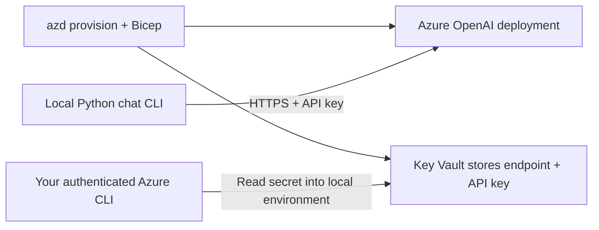

# Azure OpenAI чат — Локален CLI и инфраструктура AZD

**Ниво:** Средно · **Време:** 35–60 минути, включително настройка

Този пример създава **ресурс Azure OpenAI и Key Vault**, след което изпълнява
интерактивен Python чат CLI **на вашата машина**. Не хоства уеб приложение
или контейнерно приложение. По подразбиране моделът е `gpt-4.1`, версия `2025-04-14`, с
капацитет на разгръщане `GlobalStandard`, 20. Проверете текущата наличност и квота във
избрания от вас регион преди създаването; датите на жизнения цикъл на модела могат да се променят.

## Учебни цели

- Създаване на инфраструктура за модел с Bicep и azd.
- Извличане на API ключ от Key Vault без да се поставя в изходите от разгръщането.
- Изпращане на заявки за допълване на чат и поддържане на история на разговора.
- Интерпретиране на броя токени и ограниченията на оценките за разходи.



В този пример няма интеграция на изпълнението с управлявана идентичност, много- регионален failover,
персонализиран ограничител на честотата, режим на стрийминг или хостван компютърен ресурс.
OpenAI SDK изпълнява до две повторения при грешки, които могат да бъдат повторени; CLI докладва останалите грешки.

## Изисквания

- Текущ стабилен [azd](https://learn.microsoft.com/azure/developer/azure-developer-cli/install-azd)
  (публикуваната версия към момента на преглед: 1.37.2).
- [Azure CLI](https://learn.microsoft.com/cli/azure/install-azure-cli).
- Python **3.10+** (препоръчително 3.11) и виртуална среда.
- Абонамент в Azure с права за създаване на Cognitive Services и Key Vault
  ресурси, разгръщане на модели и четене на тайните в хранилището.
- Регионална наличност и `GlobalStandard` квота за `gpt-4.1`. Изискванията за достъп
  зависят от абонамента и функцията; няма гарантирано време за одобрение.

```bash
azd version
az version
python --version
azd auth login
az login
```

Това са отделни сесии за удостоверяване. Изберете същия абонамент и в двете
инструменти преди да изпълните командите по-долу.

## Бърз старт (Bash)

Изпълнете от корена на репозитория:

```bash
cd examples/azure-openai-chat
azd env new myopenai
azd provision
```

Изберете поддържан регион. Създаването прави ресурсна група, OpenAI акаунт,
разгръщане на модел, Key Vault и тайните `openai-endpoint`/`openai-api-key`.
Няма **услуги за разгръщане** в `azure.yaml`.

Заредете изходите без тайни и вземете тайната в текущата си shell среда:

```bash
export AZURE_OPENAI_ENDPOINT="$(azd env get-value AZURE_OPENAI_ENDPOINT)"
export AZURE_OPENAI_MODEL="$(azd env get-value AZURE_OPENAI_MODEL)"
KV_NAME="$(azd env get-value AZURE_KEY_VAULT_NAME)"
export AZURE_OPENAI_API_KEY="$(az keyvault secret show \
  --vault-name "$KV_NAME" --name openai-api-key --query value --output tsv)"

python -m venv .venv
source .venv/bin/activate
python -m pip install -r src/requirements.txt
python src/chat.py
```

В PowerShell активирайте с `.\.venv\Scripts\Activate.ps1` и задайте променливи на средата
с `$env:AZURE_OPENAI_ENDPOINT = azd env get-value AZURE_OPENAI_ENDPOINT`
(и по същия начин за модела). Вземете API ключа с помощта на
`$env:AZURE_OPENAI_API_KEY = az keyvault secret show --vault-name $KV_NAME --name openai-api-key --query value -o tsv`.
Задайте `$KV_NAME = azd env get-value AZURE_KEY_VAULT_NAME` първо.

Не печатайте, не комитвайте и не поставяйте API ключа в доклади за проблеми. CLI чете променливите
на средата на процеса; той **не** изтегля Key Vault тайни или не зарежда `.env` файлове.
`config.py` проверява крайна точка, лимит на токени и температура при стартиране.

Очакван изход (съдържание и използване варират):

```text
Azure OpenAI Chat Application
Model: gpt-4.1
...
You: Say hello in one sentence.
Assistant: Hello! How can I help you today?
[Tokens: ... | Cost: $...]
```

Команди: `stats` показва общо, `clear` изчиства историята на разговора, и
`quit`/`exit` приключва сесията. Няма команди `--stream`, `--show-tokens`, `tokens`,
или `cost`.

## Проверка на внедряването

След зареждане на горните променливи на средата:

```bash
curl --fail-with-body \
  "${AZURE_OPENAI_ENDPOINT%/}/openai/deployments/${AZURE_OPENAI_MODEL}/chat/completions?api-version=2024-10-21" \
  -H "Content-Type: application/json" \
  -H "api-key: $AZURE_OPENAI_API_KEY" \
  -d '{"messages":[{"role":"user","content":"Say hello!"}],"max_tokens":50}'

az keyvault secret list --vault-name "$KV_NAME" --query "[].name" -o table
```

Успех: API връща HTTP 200 с `choices[0].message.content` и `usage`;
хранилището изброява `openai-api-key` и `openai-endpoint`. Успешното ARM внедряване
само по себе си не проверява инференцията.

## Файлове и конфигурация

```text
azure.yaml                         # Infrastructure-only AZD project
infra/main.bicep                   # Subscription deployment
infra/main.parameters.json         # Environment, location, principal ID
infra/resources/openai.bicep       # Account + model
infra/resources/keyvault.bicep     # Vault + deploying user's secret access policy
infra/resources/secrets.bicep      # Writes secrets, no key output
src/chat.py                        # Interactive CLI
src/config.py                      # Environment validation
src/requirements.txt               # Python packages
```

За да промените предоставения модел/версия/капацитет, редактирайте стойностите по подразбиране в
`infra/main.bicep` и стартирайте `azd provision`. Задаването на `AZURE_OPENAI_MODEL` във вашия
шел избира само **съществуващо име на внедряване**; не внедрява друг модел.

| Променлива на runtime | По подразбиране / източник |
|---|---|
| `AZURE_OPENAI_ENDPOINT` | Задължително; изход на azd без тайни |
| `AZURE_OPENAI_API_KEY` | Задължително; извлича се от Key Vault |
| `AZURE_OPENAI_MODEL` | `gpt-4.1`; име на Azure внедряване |
| `AZURE_OPENAI_MAX_TOKENS` | 800 (валидиращ диапазон 1–4096) |
| `AZURE_OPENAI_TEMPERATURE` | 0.7 (диапазон 0–2) |
| `AZURE_OPENAI_INPUT_PRICE_PER_1K` | 0.002 USD; илюстративна ставка за неизползван вход |
| `AZURE_OPENAI_OUTPUT_PRICE_PER_1K` | 0.008 USD; илюстративна ставка за изход |

## Разходи и ограничения за сигурност

Показването на разходите е **оценка**, не е фактуриране на Azure. Той умножава използването на API токени
по конфигурираните тарифи и не отчита кеширани отстъпки за вход,
регионални/SKU различия, данъци, ценови промени или неуспешни/повтаряни обаждания.
Заменете **и двата тарифа** при използване на друг модел или SKU и проверете актуалните
[цени на Azure OpenAI](https://azure.microsoft.com/pricing/details/cognitive-services/openai-service/).

За илюстрация, 100 заявки с 500 неизползвани входни и 200 изходни токени всяка
при стандартните тарифи струват `100 × (500/1000 × .002 + 200/1000 × .008) = $0.26`.
Операциите и съхранението в Key Vault носят отделни такси. Няма фиксирана такса от $50/месец
за този локален CLI и няма хостван изчислителен ресурс в шаблона.

Хранилището използва политика за достъп за разгръщащия главен; това не е пример за RBAC или
приложение с управлявана идентичност. Публичните крайни точки и удостоверяването с API ключ
се използват за обучение. Ограничете правата и добавете подходящи контролни механизми за идентичност/мрежа
преди да го адаптирате за продукция.

## Практически упражнения

### 1. Проверка и нулиране на контекста

**Старт:** стартиран CLI. **Цел:** наблюдаване на историята.
Кажете „Запомни думата кедър“, след това попитайте „Каква дума те помолих да запомниш?“
Стартирайте `stats`; два успешни хода трябва да се броят като два обменени съобщения.
Стартирайте `clear` и `stats`; обменените съобщения трябва да са нула (общото количество токени остава).
Точният текст на модела не е детерминистичен.

### 2. Промяна на лимита за отговор

**Старт:** излезте от CLI, като оставите същия шел.
Стартирайте `export AZURE_OPENAI_MAX_TOKENS=100`, рестартирайте `python src/chat.py` и поискайте
кратко обяснение на azd. Проверете, че обявата показва 100.
Възстановете с `unset AZURE_OPENAI_MAX_TOKENS`. По-малък лимит за отговор
не намалява токените от вече изпратената история.

### Често срещани проблеми

- **Липсващи променливи на средата:** провизирането не експортира стойности за шел;
  повторете стъпките за експортиране. Нов терминал ги изисква отново.
- **403 при четене на Key Vault:** проверете абонамента/входа в Azure CLI и главния
  в политиката за достъп до хранилището. Промените в политиката може да отнемат време за разпространение.
- **404 инференция:** проверете името на внедряването, крайна точка и статуса на внедряване.
- **429 инференция:** изчакайте нулиране на лимитите; проверете регионалната квота за модел.
  CLI премахва неуспешните ходове от историята, за да не се дублират при повторен опит.
- **Дължина на контекста:** примерът не скъсява дълги разговори; използвайте `clear`.
- **Моделът е недостъпен/оттеглен:** консултирайте се с актуална наличност на модели и актуализирайте
  модел/версия/SKU заедно; версията на API и версията на модела са различни настройки.

## Изчистване и следващи стъпки

```bash
azd down
unset AZURE_OPENAI_API_KEY
```

Задържането при меко изтриване на Key Vault е седем дни; изтриването изисква отделни права.
Няма ангажиран тестов пакет; не стартирайте несъществуваща команда `pytest tests/`.
Добавете мокнати API тестове преди да разширявате кода.

[Примери за контейнери](../../../../examples/container-app) · [Базов модел за търговска архитектура](../retail-scenario.md) ·
[Начало на курса](../../README.md) · [Докладвайте за проблем](https://github.com/microsoft/AZD-for-beginners/issues)

---

<!-- CO-OP TRANSLATOR DISCLAIMER START -->
**Отказ от отговорност**:
Този документ е преведен с помощта на AI преводачески услуга [Co-op Translator](https://github.com/Azure/co-op-translator). Въпреки че се стремим към точност, моля имайте предвид, че автоматизираните преводи могат да съдържат грешки или неточности. Оригиналният документ на неговия роден език трябва да се счита за авторитетен източник. За критична информация се препоръчва професионален човешки превод. Ние не носим отговорност за каквито и да е недоразумения или неправилни тълкувания, произтичащи от използването на този превод.
<!-- CO-OP TRANSLATOR DISCLAIMER END -->