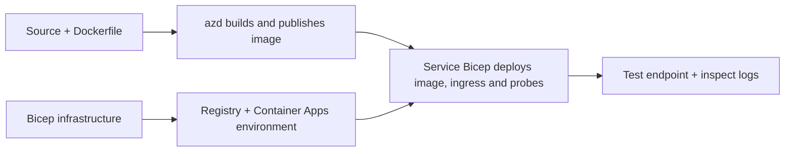

# Примери за внедряване на контейнерно приложение с AZD

Този директория съдържа два образователни примера със сорс код, Dockerfile-и,
инфраструктура Bicep и `azure.yaml`. Нито един не е подсилен за продукция.

## Изберете пример

| Пример | Какво е реализирано | Предварителни изисквания |
|---|---|---|
| [Прост Flask API](../../../../examples/container-app/simple-flask-api) | Едно Python CRUD API, обекти в паметта, здравни проверки, HTTP скалиране | Основни CLI и HTTP познания |
| [Дву-сервисни микросървиси](../../../../examples/container-app/microservices) | Node.js шлюз, вътрешен само за четене Python продуктен сървис, телеметрия и скалиране | Първо завършете примера с един сървис |

Отделете 30–60 минути включително настройка и проверка. Времето за предоставяне в Azure варира.

## Предварителни изисквания

- [Azure Developer CLI](https://learn.microsoft.com/azure/developer/azure-developer-cli/install-azd)
- [Azure CLI](https://learn.microsoft.com/cli/azure/install-azure-cli) за команди за проверка
- Docker с работещ демон за изграждане на тези контейнерни образи
- Абонамент в Azure с разрешения за създаване на ресурси и достатъчна регионална квота
- Bash за командните примери, или еквивалентни PowerShell команди

```bash
azd version
az version
docker info
azd auth login
az login
```

Двете инструменти имат отделни сесии за вписване. Използвайте актуален стабилен azd; текущата
публикувана версия към момента на преглед е 1.37.2. По-старите минимални версии не са
гаранция за съвместимост.

## Бърз старт

От корена на хранилището:

```bash
cd examples/container-app/simple-flask-api
azd env new flask-demo
azd up
API_URL=$(azd env get-value API_ENDPOINT)
curl --fail-with-body "${API_URL}/health"
```

Очаквано: HTTP 200 с `"status": "healthy"`. Следвайте README-то на примера, за да създавате,
четете, обновявате и изтривате обект, както и за да разглеждате логове.



Първоначалното предоставяне използва публичен hello-world образ на порт 80. Специфичните
Bicep параметърни файлове позволяват на `azd deploy` да го замени с изграденото приложение
и правилния порт/проверки на приложението (8000 за Flask/продукт, 8080 за шлюза).
Запазете тези файлове с техните `azure.yaml` `module` настройки.

## Конфигурация: кой параметър променя какво

`azure.yaml` избира изходни директории, езици, хостове и модули за внедряване.
CPU/памет на контейнера, входящ трафик, проверки, брой реплики и правила за скалиране се дефинират
в **Bicep**, не в произволни свойства на услугите `resources`, `scale`, или `regions`.

`azd env set SOME_VALUE ...` съхранява стойност локално. Тя променя само вече внедрен
ресурс, когато параметър, съпоставяне на околната среда или hook изрично потребява тази
стойност. Тези примери не консумират `MAX_REPLICAS`, `SCALE_TO_ZERO_TIMEOUT`,
`CONTAINER_APP_REPLICA_TYPE` или персонализирани настройки на canary от стойностите на околната среда на azd.
Редактирайте съответния Bicep и изпълнете `azd up`, за да преосигурите и деплойнете отново.

Не поставяйте изходния код на приложението под `infra/`. `project` трябва да сочи към директорията с изходния код,
съдържаща Dockerfile и манифеста за зависимости.

## Мониторинг и разходи

- `azd monitor --logs` отваря изглед на портала; това не е поток от терминални логове.
  Използвайте `az containerapp logs show --follow` с действителното име на ресурса.
- Простият API записва stdout логове, събирани чрез Container Apps/Log Analytics.
  Осигуреният от него Application Insights ресурс не е автоматично инструментализиран.
- Гейтуеят за микросервизи използва Node.js SDK за Application Insights; Python
  услугата експортира следи от логовете на приложението. Пълното проследяване на заявки/зависимости в Python
  не е конфигурирано.
- Scale-to-zero може да намали разходите за изчисления, но регистърът и приемането/съхранението на логове
  все още могат да струват пари. По подразбиране в микросервизите репликите остават активни.
  Оценете вашия регион и употреба в
  [калькулатора за ценообразуване на Azure](https://azure.microsoft.com/pricing/calculator/).

## Разширени модели — не включени реализации

Това са насоки за дизайн, а не допълнителни локални проекти или фрагменти за копиране и изпълнение:

- **Постоянни данни и автентикация:** заменете в паметта съхранените хранилища и добавете
  автентикация/авторизация с Microsoft Entra ID преди продукция.
- **Blue-green/canary:** използвайте режим на множество ревизии на Container Apps, етикети на ревизии,
  тегла на трафика, проверка на здравето и процедури за връщане назад.
  В тези примери няма конфигурация на `deploymentStrategy: canary` azd.
  Вижте [управление на ревизии](https://learn.microsoft.com/azure/container-apps/revisions).
- **Много региони:** създайте отделни среди и приложения в Bicep и проектирайте
  глобално маршрутизиране и последователност на данните. Списъкът с услуги `regions` не е механизъм за деплоймент на azd.
- **Работници на опашка:** добавете изходен код на работника, зависимости, ресурси за опашки, управляван
- **Работници на опашката:** добавете източник на работника, зависимости, ресурси на опашката, управлявани
  идентичност с роли в data-plane и автентикирано правило за мащабиране. Не копирайте
  празен `src/worker` път и очаквайте изпълним проект.
- **Dapr:** осигурете компоненти, конфигурирайте sidecar, инсталирайте съответния SDK,
  и реализирайте обработка на грешки при състояния/pub-sub.
- **Secrets:** използвайте управлявана идентичност и присвоявания на роли, където е възможно. Самото
  създаване на Key Vault не дава достъп на приложения или не зарежда тайни.

## Почистване

От директорията с примерите:

```bash
azd down
```

Прегледайте заявките за изтриване и потвърдете, че съответната ресурсна група е премахната.
Не използвайте тези примери като базисна основа за продукция без допълнителен дизайн и тестове.

[Индекс на примери](../README.md) · [Начална страница на курса](../../README.md) ·
[Документация за Container Apps](https://learn.microsoft.com/azure/container-apps/) ·
[Докладване на проблем](https://github.com/microsoft/AZD-for-beginners/issues)

---

<!-- CO-OP TRANSLATOR DISCLAIMER START -->
**Отказ от отговорност**:
Този документ е преведен с помощта на AI преводачески услуга [Co-op Translator](https://github.com/Azure/co-op-translator). Въпреки че се стремим към точност, моля имайте предвид, че автоматизираните преводи могат да съдържат грешки или неточности. Оригиналният документ на неговия роден език трябва да се счита за авторитетен източник. За критична информация се препоръчва професионален човешки превод. Ние не носим отговорност за каквито и да е недоразумения или неправилни тълкувания, произтичащи от използването на този превод.
<!-- CO-OP TRANSLATOR DISCLAIMER END -->